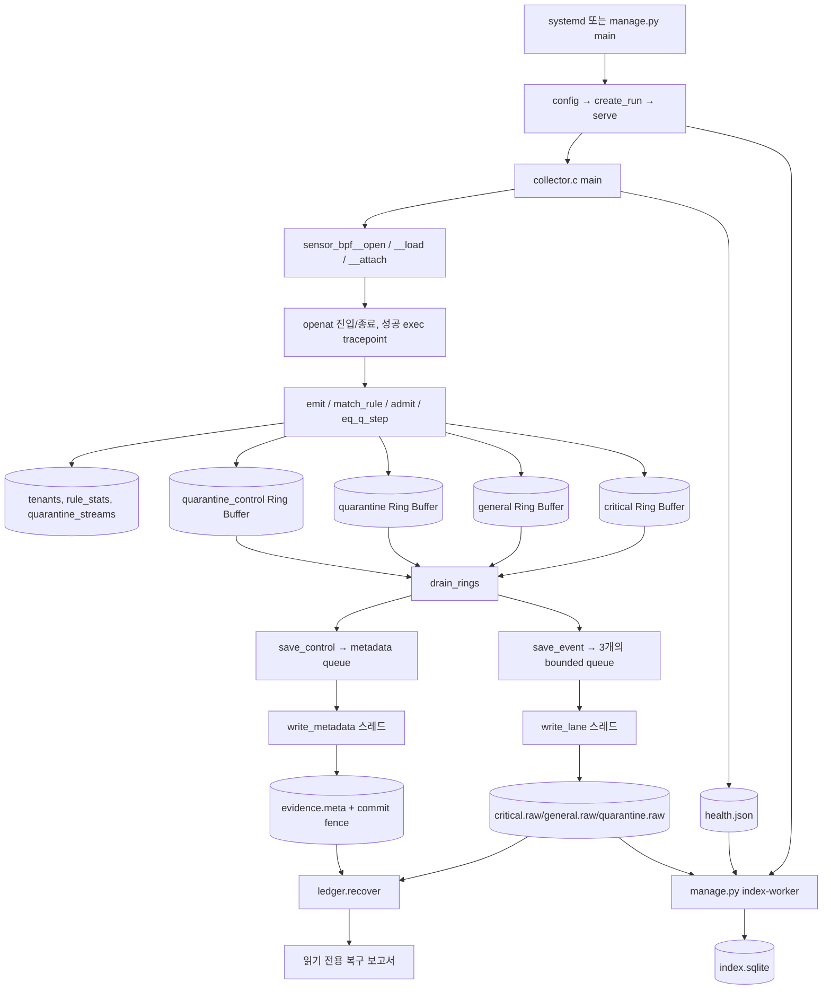
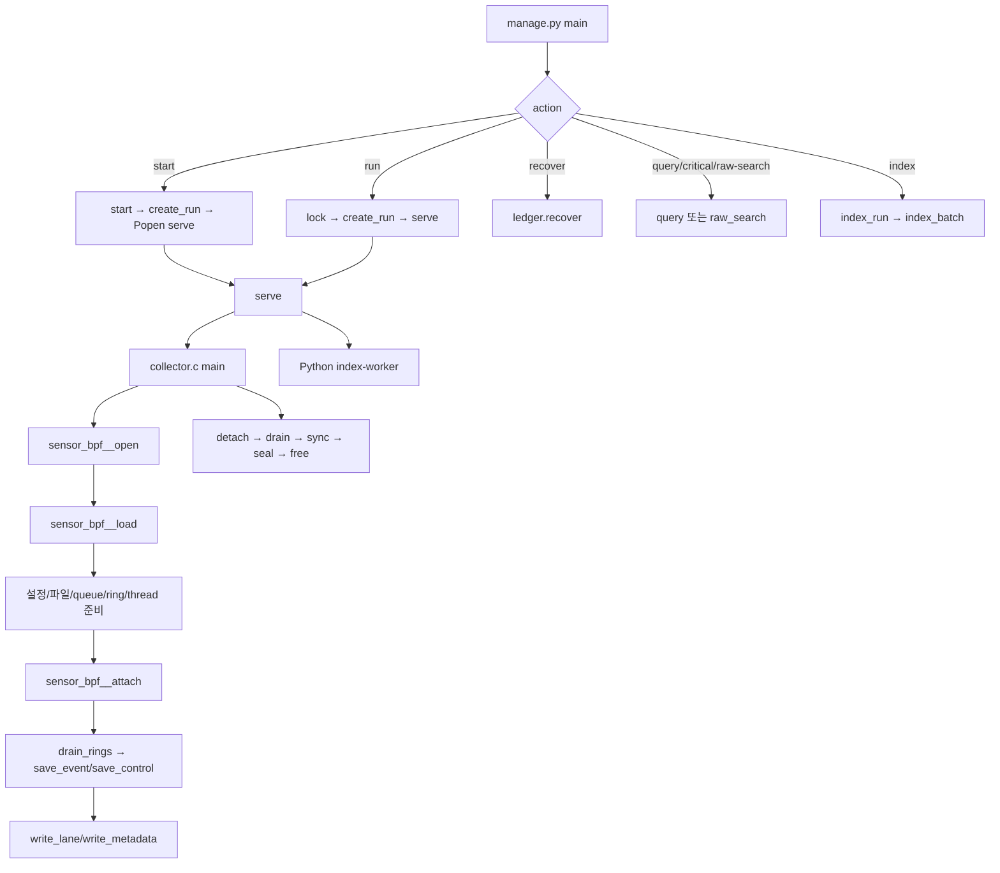
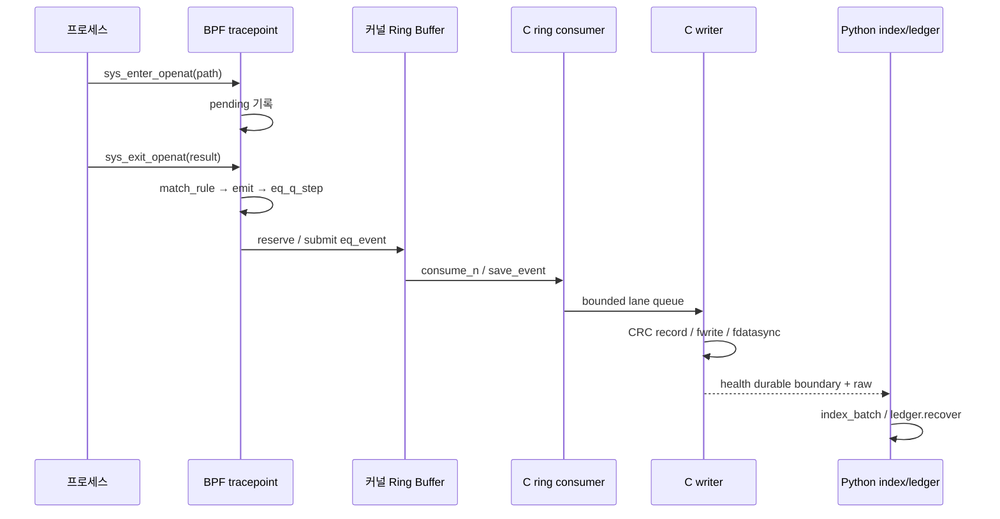

# MGlogWH 전체 소스코드 학습서 (한국어)

> **현재 저장소 안내**: 이 문서는 아래에 적힌 기준 커밋의 코드와 파일 구성을 설명한다. 현재 `main`에서 테스트 코드와 `validation/` 자료는 제거되었지만, 문서 안의 해당 링크는 당시 커밋의 자료를 가리키므로 계속 열람할 수 있다.

> **기준 소스**: `habang2222/MGlogWH` — 2026-10-15 확인한 커밋 `e6ff2b9922086d2167fe0483a0616adda55d3a50`. 모든 소스 링크는 당시 커밋에 고정하였다. **소스 읽기 학습용**으로 작성했으며, 프로젝트 README나 설계 의도만 옮긴 요약이 아니다.
>
> **검증 범위**: GitHub에서 코드와 파일 트리를 확인하였다. 이 문서를 작성하면서 Linux/WSL 센서를 실제로 빌드·실행하거나 단위 테스트를 수행하지 않았다. 문서 안의 테스트는 테스트 **코드가 검사하는 것**이지 이 작업에서 새로 통과시킨 결과가 아니다. 기존 `validation/` 자료에 보고된 실험도 별도 기록으로 취급한다.
>
> **학습 원칙**: 먼저 의미를 이해하고, 바로 아래의 실제 코드·줄 번호를 대조한다. 모든 함수 해설의 원본 코드는 중간을 임의 생략하지 않고 해당 함수 정의 구간을 싣는다. 코드를 수정해도 된다는 과제가 있더라도 이 작업은 프로그램 자체를 수정하지 않는다.

## 시작 전에 알아둘 기초 문법

| 개념 | 의미 | 이 프로젝트에서 찾을 곳 |
|---|---|---|
| 변수와 주소 | `&x`는 x의 주소, `*p`는 포인터 p가 가리키는 값 | `collector.c`의 `&state_lock` |
| 구조체 | `struct`는 이름 붙인 필드들의 메모리 묶음 | `eq_event`, `eq_quarantine_episode` |
| 멤버 연산자 | `p->field`는 `(*p).field`와 같다 | `e->pid`, `lane->count` |
| 배열과 포인터 | 배열은 고정 길이 연속 데이터, 포인터는 메모리 주소 | `lanes[3]`·`ring_buffer *rings[4]` |
| enum | 의미를 가진 정수 상수 묶음 | `EQ_BULK`, `EQ_CRITICAL` |
| 비트마스크 | 일부 비트를 `&`로 추출하고 `|`로 설정한다 | `quality`에서 rule ID 추출 |
| 전처리 | `#define`은 컴파일 전에 값·코드 조각을 치환 | `EQ_PATH`·`EQ_RULES` |
| static | C 파일 내부에서만 이름을 볼 수 있게 하거나 정적 저장 기간을 준다 | `static struct lane lanes[]` |
| 호출 스택 | 함수를 부르면 실행 흐름이 해당 함수로 이동했다가 반환 | `main`→`sensor_bpf__load` |
| 힙 할당 | `calloc`/`malloc`은 명시적 `free`가 필요한 데이터 공간 | lane 큐·metadata 큐 |
| 사용자 공간/커널 | 일반 프로세스 메모리·권한과 OS kernel 메모리·권한 구분 | collector↔eBPF |
| syscall | 프로세스가 커널에 요청하는 API. `openat`는 파일 열기 | sys_enter/exit_openat |
| tracepoint | 커널이 미리 제공하는 계측 지점 | `SEC("tp/...")` |
| eBPF map | 커널의 여러 BPF 실행 사이 상태를 공유하는 자료구조 | `tenants`·`pending` |
| Ring Buffer | 커널 데이터를 사용자 공간으로 흘리는 고정 크기 공유 버퍼 | `critical`·`general` |
| mutex | 여러 스레드가 공유 변수 변경을 동시에 하지 못하도록 잠금 | `state_lock` |
| condition variable | 작업이 생겼을 때 스레드를 깨우는 동기화 도구 | `pthread_cond_signal` |
| CAS | 값이 예상 상태일 때만 원자적으로 변경하는 연산 | `admit`·stream lock |
| CRC32 | 우발 손상을 탐지하는 짧은 checksum. 변조 방지 서명은 아니다 | raw record/journal frame |
| durable | 버퍼에 써 놓았다는 것과 달리 fdatasync/fsync 성공으로 게시된 경계 | `sync_lane`·`meta_sync` |
| ABI | C/Python/커널 사이 같은 바이트 레이아웃이라는 계약 | 232B event + 8B CRC/reserved |
| CO-RE/BTF | 커널 타입 메타데이터를 이용한 BPF 필드 접근 호환 방식 | `BPF_CORE_READ` |

# PART 1. 프로젝트 전체 이해

MGlogWH는 **Linux의 openat 호출과 성공한 프로세스 실행을 관찰**하고, 사건 중요도·격리 정책에 따라 커널 Ring Buffer와 사용자 공간 저장 경로를 나누며, 수집 자체가 실패했을 때 어디까지 관측/보존했는지 확인 가능한 근거를 남기려는 수집기다. 무조건 모든 로그를 저장해 준다는 보장은 없다. 수집량이 파일 시스템/큐 속도를 초과하면 중요 이벤트도 누락될 수 있다.

구성 요소는 다음과 같다. `sensor.bpf.c`는 커널 이벤트 캡처·규칙 평가·BULK 예산·격리 분기를 담당한다. `collector.c`는 BPF 로드·ring callback·고정 크기 큐·독립 기록 스레드·metadata checkpoint를 담당한다. `manage.py`는 설정·실행·중지·조회·SQLite 인덱스를 담당한다. `ledger.py`는 **기존 파일을 수정하지 않고** 커밋된 원장과 raw를 검증하여 복구 보고서를 만든다.



위 다이어그램의 중요한 구분은 **Python이 raw 이벤트를 직접 수집하지 않는다는 것**이다. Python은 C 수집기와 인덱서를 관리하고, C는 BPF에서 가져온 이벤트를 디스크에 쓴다. 정상 종료 시 C는 detach→ring drain→큐 닫기→writer join/sync→metadata seal/commit→스냅샷 정리로 진행한다.

# PART 2. 파일 및 디렉터리 인벤토리

Git tree에 등록된 소스·설정·테스트뿐 아니라 validation 하위 실험 파일도 목록에서 빠뜨리지 않는다. 파일 링크는 읽은 커밋의 실제 위치를 가리킨다.

| 경로 | 역할과 연결 관계 | 링크 |
|---|---|---|
| `.gitattributes` | Git 관리·문서·설정 자료 | [221 B](https://github.com/habang2222/MGlogWH/blob/e6ff2b9922086d2167fe0483a0616adda55d3a50/.gitattributes) |
| `.gitignore` | Git 관리·문서·설정 자료 | [327 B](https://github.com/habang2222/MGlogWH/blob/e6ff2b9922086d2167fe0483a0616adda55d3a50/.gitignore) |
| `LEDGER.md` | 증거·손실 해석 계약 | [14273 B](https://github.com/habang2222/MGlogWH/blob/e6ff2b9922086d2167fe0483a0616adda55d3a50/LEDGER.md) |
| `Makefile` | 클랭 BPF·skeleton·collector·테스트 빌드 | [1723 B](https://github.com/habang2222/MGlogWH/blob/e6ff2b9922086d2167fe0483a0616adda55d3a50/Makefile) |
| `QUARANTINE.md` | 격리 정책 설명 | [11578 B](https://github.com/habang2222/MGlogWH/blob/e6ff2b9922086d2167fe0483a0616adda55d3a50/QUARANTINE.md) |
| `README.md` | 설치·사용 안내, 실제 구현과 다른 경우 소스 우선 | [8666 B](https://github.com/habang2222/MGlogWH/blob/e6ff2b9922086d2167fe0483a0616adda55d3a50/README.md) |
| `RULES.md` | 규칙 정책 설명 | [8330 B](https://github.com/habang2222/MGlogWH/blob/e6ff2b9922086d2167fe0483a0616adda55d3a50/RULES.md) |
| `THIRD_PARTY.md` | 외부 소스·라이선스 고지 | [7173 B](https://github.com/habang2222/MGlogWH/blob/e6ff2b9922086d2167fe0483a0616adda55d3a50/THIRD_PARTY.md) |
| `collector.c` | 사용자 공간 이벤트 수신, raw writer, metadata, 건강도·종료 | [66802 B](https://github.com/habang2222/MGlogWH/blob/e6ff2b9922086d2167fe0483a0616adda55d3a50/collector.c) |
| `config.json` | 기본값 및 구형 critical rule 예 | [605 B](https://github.com/habang2222/MGlogWH/blob/e6ff2b9922086d2167fe0483a0616adda55d3a50/config.json) |
| `event.h` | event/record ABI, 버전·quality 비트 | [1648 B](https://github.com/habang2222/MGlogWH/blob/e6ff2b9922086d2167fe0483a0616adda55d3a50/event.h) |
| `examples/A-nonroot-etc-write.json` | 규칙 설정 예제 | [960 B](https://github.com/habang2222/MGlogWH/blob/e6ff2b9922086d2167fe0483a0616adda55d3a50/examples/A-nonroot-etc-write.json) |
| `examples/B-cgroup-shell-exec.json` | 규칙 설정 예제 | [853 B](https://github.com/habang2222/MGlogWH/blob/e6ff2b9922086d2167fe0483a0616adda55d3a50/examples/B-cgroup-shell-exec.json) |
| `examples/C-shadow-exempt.json` | 규칙 설정 예제 | [819 B](https://github.com/habang2222/MGlogWH/blob/e6ff2b9922086d2167fe0483a0616adda55d3a50/examples/C-shadow-exempt.json) |
| `examples/D-uid-specific-file.json` | 규칙 설정 예제 | [855 B](https://github.com/habang2222/MGlogWH/blob/e6ff2b9922086d2167fe0483a0616adda55d3a50/examples/D-uid-specific-file.json) |
| `install-ubuntu.sh` | 컴파일 결과·소스의 root-owned 설치 | [5480 B](https://github.com/habang2222/MGlogWH/blob/e6ff2b9922086d2167fe0483a0616adda55d3a50/install-ubuntu.sh) |
| `ledger.py` | 커밋된 원장·raw 읽기 전용 복구 | [62871 B](https://github.com/habang2222/MGlogWH/blob/e6ff2b9922086d2167fe0483a0616adda55d3a50/ledger.py) |
| `licenses/GPL-2.0.txt` | 외부 라이선스 원문 | [18092 B](https://github.com/habang2222/MGlogWH/blob/e6ff2b9922086d2167fe0483a0616adda55d3a50/licenses/GPL-2.0.txt) |
| `licenses/bootstrap-BSD-3-Clause.txt` | 외부 라이선스 원문 | [1523 B](https://github.com/habang2222/MGlogWH/blob/e6ff2b9922086d2167fe0483a0616adda55d3a50/licenses/bootstrap-BSD-3-Clause.txt) |
| `licenses/libbpf-BSD-2-Clause.txt` | 외부 라이선스 원문 | [1649 B](https://github.com/habang2222/MGlogWH/blob/e6ff2b9922086d2167fe0483a0616adda55d3a50/licenses/libbpf-BSD-2-Clause.txt) |
| `manage.py` | CLI, 설정, supervisor, SQLite·검색 | [67194 B](https://github.com/habang2222/MGlogWH/blob/e6ff2b9922086d2167fe0483a0616adda55d3a50/manage.py) |
| `packaging/mglogwh.logrotate` | 텍스트 진단 로그 회전 | [229 B](https://github.com/habang2222/MGlogWH/blob/e6ff2b9922086d2167fe0483a0616adda55d3a50/packaging/mglogwh.logrotate) |
| `packaging/mglogwh.service` | systemd 서비스 사전검사와 실행 | [769 B](https://github.com/habang2222/MGlogWH/blob/e6ff2b9922086d2167fe0483a0616adda55d3a50/packaging/mglogwh.service) |
| `quarantine.h` | 격리 상태 머신과 샘플 정책 | [12440 B](https://github.com/habang2222/MGlogWH/blob/e6ff2b9922086d2167fe0483a0616adda55d3a50/quarantine.h) |
| `rules.h` | fixed rule ABI, 3값 evaluator | [11218 B](https://github.com/habang2222/MGlogWH/blob/e6ff2b9922086d2167fe0483a0616adda55d3a50/rules.h) |
| `sensor.bpf.c` | 커널 tracepoint, BPF 맵, emit 및 정책/예산 적용 | [24529 B](https://github.com/habang2222/MGlogWH/blob/e6ff2b9922086d2167fe0483a0616adda55d3a50/sensor.bpf.c) |
| `tenant.h` | cgroup 단위 카운터와 시퀀스 | [523 B](https://github.com/habang2222/MGlogWH/blob/e6ff2b9922086d2167fe0483a0616adda55d3a50/tenant.h) |
| `test_budget.py` | 낮은 BULK 예산 수집 통합 검증(명시 실행) | [2348 B](https://github.com/habang2222/MGlogWH/blob/e6ff2b9922086d2167fe0483a0616adda55d3a50/test_budget.py) |
| `test_ledger.py` | 원장 해석·복구 fixture 테스트 | [38255 B](https://github.com/habang2222/MGlogWH/blob/e6ff2b9922086d2167fe0483a0616adda55d3a50/test_ledger.py) |
| `test_live.py` | 실제 프로브/색인 장애 smoke 테스트(명시 실행) | [3966 B](https://github.com/habang2222/MGlogWH/blob/e6ff2b9922086d2167fe0483a0616adda55d3a50/test_live.py) |
| `test_manage.py` | 설정·인덱스·파일 경로·lock 시험 | [30137 B](https://github.com/habang2222/MGlogWH/blob/e6ff2b9922086d2167fe0483a0616adda55d3a50/test_manage.py) |
| `test_quarantine.c` | 격리 정책 단위 테스트 | [11276 B](https://github.com/habang2222/MGlogWH/blob/e6ff2b9922086d2167fe0483a0616adda55d3a50/test_quarantine.c) |
| `test_rules.c` | 규칙 evaluator 단위 테스트 | [10562 B](https://github.com/habang2222/MGlogWH/blob/e6ff2b9922086d2167fe0483a0616adda55d3a50/test_rules.c) |
| `test_writer.c` | raw/metadata writer 검증 | [17566 B](https://github.com/habang2222/MGlogWH/blob/e6ff2b9922086d2167fe0483a0616adda55d3a50/test_writer.c) |
| `validation/2026-10-14/CORRECTION-eb9c888.md` | 버전·날짜가 고정된 벤치·검증 스크립트 또는 결과 산출물 | [3365 B](https://github.com/habang2222/MGlogWH/blob/e6ff2b9922086d2167fe0483a0616adda55d3a50/validation/2026-10-14/CORRECTION-eb9c888.md) |
| `validation/2026-10-14/REVIEW.md` | 버전·날짜가 고정된 벤치·검증 스크립트 또는 결과 산출물 | [22545 B](https://github.com/habang2222/MGlogWH/blob/e6ff2b9922086d2167fe0483a0616adda55d3a50/validation/2026-10-14/REVIEW.md) |
| `validation/2026-10-14/artifact-hashes-eb9c888.json` | 버전·날짜가 고정된 벤치·검증 스크립트 또는 결과 산출물 | [21882 B](https://github.com/habang2222/MGlogWH/blob/e6ff2b9922086d2167fe0483a0616adda55d3a50/validation/2026-10-14/artifact-hashes-eb9c888.json) |
| `validation/2026-10-14/bench_workload.c` | 버전·날짜가 고정된 벤치·검증 스크립트 또는 결과 산출물 | [6151 B](https://github.com/habang2222/MGlogWH/blob/e6ff2b9922086d2167fe0483a0616adda55d3a50/validation/2026-10-14/bench_workload.c) |
| `validation/2026-10-14/configs/baseline.json` | 버전·날짜가 고정된 벤치·검증 스크립트 또는 결과 산출물 | [512 B](https://github.com/habang2222/MGlogWH/blob/e6ff2b9922086d2167fe0483a0616adda55d3a50/validation/2026-10-14/configs/baseline.json) |
| `validation/2026-10-14/configs/rule1.json` | 버전·날짜가 고정된 벤치·검증 스크립트 또는 결과 산출물 | [989 B](https://github.com/habang2222/MGlogWH/blob/e6ff2b9922086d2167fe0483a0616adda55d3a50/validation/2026-10-14/configs/rule1.json) |
| `validation/2026-10-14/configs/rule4.json` | 버전·날짜가 고정된 벤치·검증 스크립트 또는 결과 산출물 | [2351 B](https://github.com/habang2222/MGlogWH/blob/e6ff2b9922086d2167fe0483a0616adda55d3a50/validation/2026-10-14/configs/rule4.json) |
| `validation/2026-10-14/configs/rule8.json` | 버전·날짜가 고정된 벤치·검증 스크립트 또는 결과 산출물 | [4167 B](https://github.com/habang2222/MGlogWH/blob/e6ff2b9922086d2167fe0483a0616adda55d3a50/validation/2026-10-14/configs/rule8.json) |
| `validation/2026-10-14/controlroom-live-evidence.json` | 버전·날짜가 고정된 벤치·검증 스크립트 또는 결과 산출물 | [1031 B](https://github.com/habang2222/MGlogWH/blob/e6ff2b9922086d2167fe0483a0616adda55d3a50/validation/2026-10-14/controlroom-live-evidence.json) |
| `validation/2026-10-14/corrected_summary-eb9c888.json` | 버전·날짜가 고정된 벤치·검증 스크립트 또는 결과 산출물 | [49259 B](https://github.com/habang2222/MGlogWH/blob/e6ff2b9922086d2167fe0483a0616adda55d3a50/validation/2026-10-14/corrected_summary-eb9c888.json) |
| `validation/2026-10-14/current-code-benchmark.md` | 버전·날짜가 고정된 벤치·검증 스크립트 또는 결과 산출물 | [3465 B](https://github.com/habang2222/MGlogWH/blob/e6ff2b9922086d2167fe0483a0616adda55d3a50/validation/2026-10-14/current-code-benchmark.md) |
| `validation/2026-10-14/environment.json` | 버전·날짜가 고정된 벤치·검증 스크립트 또는 결과 산출물 | [1943 B](https://github.com/habang2222/MGlogWH/blob/e6ff2b9922086d2167fe0483a0616adda55d3a50/validation/2026-10-14/environment.json) |
| `validation/2026-10-14/final-f9bd477/configs/legacy1.json` | 버전·날짜가 고정된 벤치·검증 스크립트 또는 결과 산출물 | [686 B](https://github.com/habang2222/MGlogWH/blob/e6ff2b9922086d2167fe0483a0616adda55d3a50/validation/2026-10-14/final-f9bd477/configs/legacy1.json) |
| `validation/2026-10-14/final-f9bd477/configs/rule1.json` | 버전·날짜가 고정된 벤치·검증 스크립트 또는 결과 산출물 | [993 B](https://github.com/habang2222/MGlogWH/blob/e6ff2b9922086d2167fe0483a0616adda55d3a50/validation/2026-10-14/final-f9bd477/configs/rule1.json) |
| `validation/2026-10-14/final-f9bd477/configs/rule4.json` | 버전·날짜가 고정된 벤치·검증 스크립트 또는 결과 산출물 | [2361 B](https://github.com/habang2222/MGlogWH/blob/e6ff2b9922086d2167fe0483a0616adda55d3a50/validation/2026-10-14/final-f9bd477/configs/rule4.json) |
| `validation/2026-10-14/final-f9bd477/configs/rule8.json` | 버전·날짜가 고정된 벤치·검증 스크립트 또는 결과 산출물 | [4185 B](https://github.com/habang2222/MGlogWH/blob/e6ff2b9922086d2167fe0483a0616adda55d3a50/validation/2026-10-14/final-f9bd477/configs/rule8.json) |
| `validation/2026-10-14/final-f9bd477/environment.json` | 버전·날짜가 고정된 벤치·검증 스크립트 또는 결과 산출물 | [2227 B](https://github.com/habang2222/MGlogWH/blob/e6ff2b9922086d2167fe0483a0616adda55d3a50/validation/2026-10-14/final-f9bd477/environment.json) |
| `validation/2026-10-14/final-f9bd477/runs/legacy1-r1.json` | 버전·날짜가 고정된 벤치·검증 스크립트 또는 결과 산출물 | [55594 B](https://github.com/habang2222/MGlogWH/blob/e6ff2b9922086d2167fe0483a0616adda55d3a50/validation/2026-10-14/final-f9bd477/runs/legacy1-r1.json) |
| `validation/2026-10-14/final-f9bd477/runs/legacy1-r2.json` | 버전·날짜가 고정된 벤치·검증 스크립트 또는 결과 산출물 | [50316 B](https://github.com/habang2222/MGlogWH/blob/e6ff2b9922086d2167fe0483a0616adda55d3a50/validation/2026-10-14/final-f9bd477/runs/legacy1-r2.json) |
| `validation/2026-10-14/final-f9bd477/runs/legacy1-r3.json` | 버전·날짜가 고정된 벤치·검증 스크립트 또는 결과 산출물 | [50319 B](https://github.com/habang2222/MGlogWH/blob/e6ff2b9922086d2167fe0483a0616adda55d3a50/validation/2026-10-14/final-f9bd477/runs/legacy1-r3.json) |
| `validation/2026-10-14/final-f9bd477/runs/rule1-r1.json` | 버전·날짜가 고정된 벤치·검증 스크립트 또는 결과 산출물 | [62802 B](https://github.com/habang2222/MGlogWH/blob/e6ff2b9922086d2167fe0483a0616adda55d3a50/validation/2026-10-14/final-f9bd477/runs/rule1-r1.json) |
| `validation/2026-10-14/final-f9bd477/runs/rule1-r2.json` | 버전·날짜가 고정된 벤치·검증 스크립트 또는 결과 산출물 | [52201 B](https://github.com/habang2222/MGlogWH/blob/e6ff2b9922086d2167fe0483a0616adda55d3a50/validation/2026-10-14/final-f9bd477/runs/rule1-r2.json) |
| `validation/2026-10-14/final-f9bd477/runs/rule1-r3.json` | 버전·날짜가 고정된 벤치·검증 스크립트 또는 결과 산출물 | [50498 B](https://github.com/habang2222/MGlogWH/blob/e6ff2b9922086d2167fe0483a0616adda55d3a50/validation/2026-10-14/final-f9bd477/runs/rule1-r3.json) |
| `validation/2026-10-14/final-f9bd477/runs/rule4-r1.json` | 버전·날짜가 고정된 벤치·검증 스크립트 또는 결과 산출물 | [63967 B](https://github.com/habang2222/MGlogWH/blob/e6ff2b9922086d2167fe0483a0616adda55d3a50/validation/2026-10-14/final-f9bd477/runs/rule4-r1.json) |
| `validation/2026-10-14/final-f9bd477/runs/rule4-r2.json` | 버전·날짜가 고정된 벤치·검증 스크립트 또는 결과 산출물 | [63968 B](https://github.com/habang2222/MGlogWH/blob/e6ff2b9922086d2167fe0483a0616adda55d3a50/validation/2026-10-14/final-f9bd477/runs/rule4-r2.json) |
| `validation/2026-10-14/final-f9bd477/runs/rule4-r3.json` | 버전·날짜가 고정된 벤치·검증 스크립트 또는 결과 산출물 | [65775 B](https://github.com/habang2222/MGlogWH/blob/e6ff2b9922086d2167fe0483a0616adda55d3a50/validation/2026-10-14/final-f9bd477/runs/rule4-r3.json) |
| `validation/2026-10-14/final-f9bd477/runs/rule8-r1.json` | 버전·날짜가 고정된 벤치·검증 스크립트 또는 결과 산출물 | [86165 B](https://github.com/habang2222/MGlogWH/blob/e6ff2b9922086d2167fe0483a0616adda55d3a50/validation/2026-10-14/final-f9bd477/runs/rule8-r1.json) |
| `validation/2026-10-14/final-f9bd477/runs/rule8-r2.json` | 버전·날짜가 고정된 벤치·검증 스크립트 또는 결과 산출물 | [84310 B](https://github.com/habang2222/MGlogWH/blob/e6ff2b9922086d2167fe0483a0616adda55d3a50/validation/2026-10-14/final-f9bd477/runs/rule8-r2.json) |
| `validation/2026-10-14/final-f9bd477/runs/rule8-r3.json` | 버전·날짜가 고정된 벤치·검증 스크립트 또는 결과 산출물 | [87924 B](https://github.com/habang2222/MGlogWH/blob/e6ff2b9922086d2167fe0483a0616adda55d3a50/validation/2026-10-14/final-f9bd477/runs/rule8-r3.json) |
| `validation/2026-10-14/final-f9bd477/summary.json` | 버전·날짜가 고정된 벤치·검증 스크립트 또는 결과 산출물 | [5202 B](https://github.com/habang2222/MGlogWH/blob/e6ff2b9922086d2167fe0483a0616adda55d3a50/validation/2026-10-14/final-f9bd477/summary.json) |
| `validation/2026-10-14/hash_artifacts.py` | 버전·날짜가 고정된 벤치·검증 스크립트 또는 결과 산출물 | [1498 B](https://github.com/habang2222/MGlogWH/blob/e6ff2b9922086d2167fe0483a0616adda55d3a50/validation/2026-10-14/hash_artifacts.py) |
| `validation/2026-10-14/path-matrix-288b454fc769/compile.stderr` | 버전·날짜가 고정된 벤치·검증 스크립트 또는 결과 산출물 | [0 B](https://github.com/habang2222/MGlogWH/blob/e6ff2b9922086d2167fe0483a0616adda55d3a50/validation/2026-10-14/path-matrix-288b454fc769/compile.stderr) |
| `validation/2026-10-14/path-matrix-288b454fc769/compile.stdout` | 버전·날짜가 고정된 벤치·검증 스크립트 또는 결과 산출물 | [0 B](https://github.com/habang2222/MGlogWH/blob/e6ff2b9922086d2167fe0483a0616adda55d3a50/validation/2026-10-14/path-matrix-288b454fc769/compile.stdout) |
| `validation/2026-10-14/path-matrix-288b454fc769/config.json` | 버전·날짜가 고정된 벤치·검증 스크립트 또는 결과 산출물 | [4594 B](https://github.com/habang2222/MGlogWH/blob/e6ff2b9922086d2167fe0483a0616adda55d3a50/validation/2026-10-14/path-matrix-288b454fc769/config.json) |
| `validation/2026-10-14/path-matrix-288b454fc769/health.json` | 버전·날짜가 고정된 벤치·검증 스크립트 또는 결과 산출물 | [18210 B](https://github.com/habang2222/MGlogWH/blob/e6ff2b9922086d2167fe0483a0616adda55d3a50/validation/2026-10-14/path-matrix-288b454fc769/health.json) |
| `validation/2026-10-14/path-matrix-288b454fc769/index-health.json` | 버전·날짜가 고정된 벤치·검증 스크립트 또는 결과 산출물 | [1121 B](https://github.com/habang2222/MGlogWH/blob/e6ff2b9922086d2167fe0483a0616adda55d3a50/validation/2026-10-14/path-matrix-288b454fc769/index-health.json) |
| `validation/2026-10-14/path-matrix-288b454fc769/manifest.json` | 버전·날짜가 고정된 벤치·검증 스크립트 또는 결과 산출물 | [2534 B](https://github.com/habang2222/MGlogWH/blob/e6ff2b9922086d2167fe0483a0616adda55d3a50/validation/2026-10-14/path-matrix-288b454fc769/manifest.json) |
| `validation/2026-10-14/path-matrix-288b454fc769/probe.stderr` | 버전·날짜가 고정된 벤치·검증 스크립트 또는 결과 산출물 | [0 B](https://github.com/habang2222/MGlogWH/blob/e6ff2b9922086d2167fe0483a0616adda55d3a50/validation/2026-10-14/path-matrix-288b454fc769/probe.stderr) |
| `validation/2026-10-14/path-matrix-288b454fc769/probe.stdout` | 버전·날짜가 고정된 벤치·검증 스크립트 또는 결과 산출물 | [0 B](https://github.com/habang2222/MGlogWH/blob/e6ff2b9922086d2167fe0483a0616adda55d3a50/validation/2026-10-14/path-matrix-288b454fc769/probe.stdout) |
| `validation/2026-10-14/path-matrix-288b454fc769/recover.stderr` | 버전·날짜가 고정된 벤치·검증 스크립트 또는 결과 산출물 | [0 B](https://github.com/habang2222/MGlogWH/blob/e6ff2b9922086d2167fe0483a0616adda55d3a50/validation/2026-10-14/path-matrix-288b454fc769/recover.stderr) |
| `validation/2026-10-14/path-matrix-288b454fc769/recover.stdout` | 버전·날짜가 고정된 벤치·검증 스크립트 또는 결과 산출물 | [59747 B](https://github.com/habang2222/MGlogWH/blob/e6ff2b9922086d2167fe0483a0616adda55d3a50/validation/2026-10-14/path-matrix-288b454fc769/recover.stdout) |
| `validation/2026-10-14/path-matrix-288b454fc769/result.json` | 버전·날짜가 고정된 벤치·검증 스크립트 또는 결과 산출물 | [78940 B](https://github.com/habang2222/MGlogWH/blob/e6ff2b9922086d2167fe0483a0616adda55d3a50/validation/2026-10-14/path-matrix-288b454fc769/result.json) |
| `validation/2026-10-14/path-matrix-288b454fc769/start.stderr` | 버전·날짜가 고정된 벤치·검증 스크립트 또는 결과 산출물 | [0 B](https://github.com/habang2222/MGlogWH/blob/e6ff2b9922086d2167fe0483a0616adda55d3a50/validation/2026-10-14/path-matrix-288b454fc769/start.stderr) |
| `validation/2026-10-14/path-matrix-288b454fc769/start.stdout` | 버전·날짜가 고정된 벤치·검증 스크립트 또는 결과 산출물 | [19511 B](https://github.com/habang2222/MGlogWH/blob/e6ff2b9922086d2167fe0483a0616adda55d3a50/validation/2026-10-14/path-matrix-288b454fc769/start.stdout) |
| `validation/2026-10-14/path-matrix-288b454fc769/stop.stderr` | 버전·날짜가 고정된 벤치·검증 스크립트 또는 결과 산출물 | [0 B](https://github.com/habang2222/MGlogWH/blob/e6ff2b9922086d2167fe0483a0616adda55d3a50/validation/2026-10-14/path-matrix-288b454fc769/stop.stderr) |
| `validation/2026-10-14/path-matrix-288b454fc769/stop.stdout` | 버전·날짜가 고정된 벤치·검증 스크립트 또는 결과 산출물 | [40491 B](https://github.com/habang2222/MGlogWH/blob/e6ff2b9922086d2167fe0483a0616adda55d3a50/validation/2026-10-14/path-matrix-288b454fc769/stop.stdout) |
| `validation/2026-10-14/path-matrix-288b454fc769/truth.csv` | 버전·날짜가 고정된 벤치·검증 스크립트 또는 결과 산출물 | [1788 B](https://github.com/habang2222/MGlogWH/blob/e6ff2b9922086d2167fe0483a0616adda55d3a50/validation/2026-10-14/path-matrix-288b454fc769/truth.csv) |
| `validation/2026-10-14/path-matrix-288b454fc769/validate.stderr` | 버전·날짜가 고정된 벤치·검증 스크립트 또는 결과 산출물 | [0 B](https://github.com/habang2222/MGlogWH/blob/e6ff2b9922086d2167fe0483a0616adda55d3a50/validation/2026-10-14/path-matrix-288b454fc769/validate.stderr) |
| `validation/2026-10-14/path-matrix-288b454fc769/validate.stdout` | 버전·날짜가 고정된 벤치·검증 스크립트 또는 결과 산출물 | [11846 B](https://github.com/habang2222/MGlogWH/blob/e6ff2b9922086d2167fe0483a0616adda55d3a50/validation/2026-10-14/path-matrix-288b454fc769/validate.stdout) |
| `validation/2026-10-14/path-matrix-7c1ccb849a3f/CORRECTION.md` | 버전·날짜가 고정된 벤치·검증 스크립트 또는 결과 산출물 | [978 B](https://github.com/habang2222/MGlogWH/blob/e6ff2b9922086d2167fe0483a0616adda55d3a50/validation/2026-10-14/path-matrix-7c1ccb849a3f/CORRECTION.md) |
| `validation/2026-10-14/path-matrix-7c1ccb849a3f/compile.stderr` | 버전·날짜가 고정된 벤치·검증 스크립트 또는 결과 산출물 | [0 B](https://github.com/habang2222/MGlogWH/blob/e6ff2b9922086d2167fe0483a0616adda55d3a50/validation/2026-10-14/path-matrix-7c1ccb849a3f/compile.stderr) |
| `validation/2026-10-14/path-matrix-7c1ccb849a3f/compile.stdout` | 버전·날짜가 고정된 벤치·검증 스크립트 또는 결과 산출물 | [0 B](https://github.com/habang2222/MGlogWH/blob/e6ff2b9922086d2167fe0483a0616adda55d3a50/validation/2026-10-14/path-matrix-7c1ccb849a3f/compile.stdout) |
| `validation/2026-10-14/path-matrix-7c1ccb849a3f/config.json` | 버전·날짜가 고정된 벤치·검증 스크립트 또는 결과 산출물 | [4594 B](https://github.com/habang2222/MGlogWH/blob/e6ff2b9922086d2167fe0483a0616adda55d3a50/validation/2026-10-14/path-matrix-7c1ccb849a3f/config.json) |
| `validation/2026-10-14/path-matrix-7c1ccb849a3f/health.json` | 버전·날짜가 고정된 벤치·검증 스크립트 또는 결과 산출물 | [18448 B](https://github.com/habang2222/MGlogWH/blob/e6ff2b9922086d2167fe0483a0616adda55d3a50/validation/2026-10-14/path-matrix-7c1ccb849a3f/health.json) |
| `validation/2026-10-14/path-matrix-7c1ccb849a3f/index-health.json` | 버전·날짜가 고정된 벤치·검증 스크립트 또는 결과 산출물 | [1119 B](https://github.com/habang2222/MGlogWH/blob/e6ff2b9922086d2167fe0483a0616adda55d3a50/validation/2026-10-14/path-matrix-7c1ccb849a3f/index-health.json) |
| `validation/2026-10-14/path-matrix-7c1ccb849a3f/manifest.json` | 버전·날짜가 고정된 벤치·검증 스크립트 또는 결과 산출물 | [2533 B](https://github.com/habang2222/MGlogWH/blob/e6ff2b9922086d2167fe0483a0616adda55d3a50/validation/2026-10-14/path-matrix-7c1ccb849a3f/manifest.json) |
| `validation/2026-10-14/path-matrix-7c1ccb849a3f/probe.stderr` | 버전·날짜가 고정된 벤치·검증 스크립트 또는 결과 산출물 | [0 B](https://github.com/habang2222/MGlogWH/blob/e6ff2b9922086d2167fe0483a0616adda55d3a50/validation/2026-10-14/path-matrix-7c1ccb849a3f/probe.stderr) |
| `validation/2026-10-14/path-matrix-7c1ccb849a3f/probe.stdout` | 버전·날짜가 고정된 벤치·검증 스크립트 또는 결과 산출물 | [0 B](https://github.com/habang2222/MGlogWH/blob/e6ff2b9922086d2167fe0483a0616adda55d3a50/validation/2026-10-14/path-matrix-7c1ccb849a3f/probe.stdout) |
| `validation/2026-10-14/path-matrix-7c1ccb849a3f/recover.stderr` | 버전·날짜가 고정된 벤치·검증 스크립트 또는 결과 산출물 | [0 B](https://github.com/habang2222/MGlogWH/blob/e6ff2b9922086d2167fe0483a0616adda55d3a50/validation/2026-10-14/path-matrix-7c1ccb849a3f/recover.stderr) |
| `validation/2026-10-14/path-matrix-7c1ccb849a3f/recover.stdout` | 버전·날짜가 고정된 벤치·검증 스크립트 또는 결과 산출물 | [60558 B](https://github.com/habang2222/MGlogWH/blob/e6ff2b9922086d2167fe0483a0616adda55d3a50/validation/2026-10-14/path-matrix-7c1ccb849a3f/recover.stdout) |
| `validation/2026-10-14/path-matrix-7c1ccb849a3f/result.json` | 버전·날짜가 고정된 벤치·검증 스크립트 또는 결과 산출물 | [74598 B](https://github.com/habang2222/MGlogWH/blob/e6ff2b9922086d2167fe0483a0616adda55d3a50/validation/2026-10-14/path-matrix-7c1ccb849a3f/result.json) |
| `validation/2026-10-14/path-matrix-7c1ccb849a3f/start.stderr` | 버전·날짜가 고정된 벤치·검증 스크립트 또는 결과 산출물 | [0 B](https://github.com/habang2222/MGlogWH/blob/e6ff2b9922086d2167fe0483a0616adda55d3a50/validation/2026-10-14/path-matrix-7c1ccb849a3f/start.stderr) |
| `validation/2026-10-14/path-matrix-7c1ccb849a3f/start.stdout` | 버전·날짜가 고정된 벤치·검증 스크립트 또는 결과 산출물 | [19510 B](https://github.com/habang2222/MGlogWH/blob/e6ff2b9922086d2167fe0483a0616adda55d3a50/validation/2026-10-14/path-matrix-7c1ccb849a3f/start.stdout) |
| `validation/2026-10-14/path-matrix-7c1ccb849a3f/stop.stderr` | 버전·날짜가 고정된 벤치·검증 스크립트 또는 결과 산출물 | [0 B](https://github.com/habang2222/MGlogWH/blob/e6ff2b9922086d2167fe0483a0616adda55d3a50/validation/2026-10-14/path-matrix-7c1ccb849a3f/stop.stderr) |
| `validation/2026-10-14/path-matrix-7c1ccb849a3f/stop.stdout` | 버전·날짜가 고정된 벤치·검증 스크립트 또는 결과 산출물 | [40903 B](https://github.com/habang2222/MGlogWH/blob/e6ff2b9922086d2167fe0483a0616adda55d3a50/validation/2026-10-14/path-matrix-7c1ccb849a3f/stop.stdout) |
| `validation/2026-10-14/path-matrix-7c1ccb849a3f/truth.csv` | 버전·날짜가 고정된 벤치·검증 스크립트 또는 결과 산출물 | [1772 B](https://github.com/habang2222/MGlogWH/blob/e6ff2b9922086d2167fe0483a0616adda55d3a50/validation/2026-10-14/path-matrix-7c1ccb849a3f/truth.csv) |
| `validation/2026-10-14/path-matrix-7c1ccb849a3f/validate.stderr` | 버전·날짜가 고정된 벤치·검증 스크립트 또는 결과 산출물 | [0 B](https://github.com/habang2222/MGlogWH/blob/e6ff2b9922086d2167fe0483a0616adda55d3a50/validation/2026-10-14/path-matrix-7c1ccb849a3f/validate.stderr) |
| `validation/2026-10-14/path-matrix-7c1ccb849a3f/validate.stdout` | 버전·날짜가 고정된 벤치·검증 스크립트 또는 결과 산출물 | [11846 B](https://github.com/habang2222/MGlogWH/blob/e6ff2b9922086d2167fe0483a0616adda55d3a50/validation/2026-10-14/path-matrix-7c1ccb849a3f/validate.stdout) |
| `validation/2026-10-14/path_matrix_probe.c` | 버전·날짜가 고정된 벤치·검증 스크립트 또는 결과 산출물 | [4905 B](https://github.com/habang2222/MGlogWH/blob/e6ff2b9922086d2167fe0483a0616adda55d3a50/validation/2026-10-14/path_matrix_probe.c) |
| `validation/2026-10-14/pilot-15k.json` | 버전·날짜가 고정된 벤치·검증 스크립트 또는 결과 산출물 | [779 B](https://github.com/habang2222/MGlogWH/blob/e6ff2b9922086d2167fe0483a0616adda55d3a50/validation/2026-10-14/pilot-15k.json) |
| `validation/2026-10-14/run_benchmark.py` | 버전·날짜가 고정된 벤치·검증 스크립트 또는 결과 산출물 | [13621 B](https://github.com/habang2222/MGlogWH/blob/e6ff2b9922086d2167fe0483a0616adda55d3a50/validation/2026-10-14/run_benchmark.py) |
| `validation/2026-10-14/run_benchmark_portable.py` | 버전·날짜가 고정된 벤치·검증 스크립트 또는 결과 산출물 | [16067 B](https://github.com/habang2222/MGlogWH/blob/e6ff2b9922086d2167fe0483a0616adda55d3a50/validation/2026-10-14/run_benchmark_portable.py) |
| `validation/2026-10-14/run_path_matrix.py` | 버전·날짜가 고정된 벤치·검증 스크립트 또는 결과 산출물 | [15806 B](https://github.com/habang2222/MGlogWH/blob/e6ff2b9922086d2167fe0483a0616adda55d3a50/validation/2026-10-14/run_path_matrix.py) |
| `validation/2026-10-14/runs/baseline-r1.json` | 버전·날짜가 고정된 벤치·검증 스크립트 또는 결과 산출물 | [31078 B](https://github.com/habang2222/MGlogWH/blob/e6ff2b9922086d2167fe0483a0616adda55d3a50/validation/2026-10-14/runs/baseline-r1.json) |
| `validation/2026-10-14/runs/baseline-r2.json` | 버전·날짜가 고정된 벤치·검증 스크립트 또는 결과 산출물 | [30180 B](https://github.com/habang2222/MGlogWH/blob/e6ff2b9922086d2167fe0483a0616adda55d3a50/validation/2026-10-14/runs/baseline-r2.json) |
| `validation/2026-10-14/runs/baseline-r3.json` | 버전·날짜가 고정된 벤치·검증 스크립트 또는 결과 산출물 | [31081 B](https://github.com/habang2222/MGlogWH/blob/e6ff2b9922086d2167fe0483a0616adda55d3a50/validation/2026-10-14/runs/baseline-r3.json) |
| `validation/2026-10-14/runs/rule1-r1.json` | 버전·날짜가 고정된 벤치·검증 스크립트 또는 결과 산출물 | [32862 B](https://github.com/habang2222/MGlogWH/blob/e6ff2b9922086d2167fe0483a0616adda55d3a50/validation/2026-10-14/runs/rule1-r1.json) |
| `validation/2026-10-14/runs/rule1-r2.json` | 버전·날짜가 고정된 벤치·검증 스크립트 또는 결과 산출물 | [31136 B](https://github.com/habang2222/MGlogWH/blob/e6ff2b9922086d2167fe0483a0616adda55d3a50/validation/2026-10-14/runs/rule1-r2.json) |
| `validation/2026-10-14/runs/rule1-r3.json` | 버전·날짜가 고정된 벤치·검증 스크립트 또는 결과 산출물 | [31137 B](https://github.com/habang2222/MGlogWH/blob/e6ff2b9922086d2167fe0483a0616adda55d3a50/validation/2026-10-14/runs/rule1-r3.json) |
| `validation/2026-10-14/runs/rule4-r1.json` | 버전·날짜가 고정된 벤치·검증 스크립트 또는 결과 산출물 | [39062 B](https://github.com/habang2222/MGlogWH/blob/e6ff2b9922086d2167fe0483a0616adda55d3a50/validation/2026-10-14/runs/rule4-r1.json) |
| `validation/2026-10-14/runs/rule4-r2.json` | 버전·날짜가 고정된 벤치·검증 스크립트 또는 결과 산출물 | [39093 B](https://github.com/habang2222/MGlogWH/blob/e6ff2b9922086d2167fe0483a0616adda55d3a50/validation/2026-10-14/runs/rule4-r2.json) |
| `validation/2026-10-14/runs/rule4-r3.json` | 버전·날짜가 고정된 벤치·검증 스크립트 또는 결과 산출물 | [39060 B](https://github.com/habang2222/MGlogWH/blob/e6ff2b9922086d2167fe0483a0616adda55d3a50/validation/2026-10-14/runs/rule4-r3.json) |
| `validation/2026-10-14/runs/rule8-r1.json` | 버전·날짜가 고정된 벤치·검증 스크립트 또는 결과 산출물 | [49697 B](https://github.com/habang2222/MGlogWH/blob/e6ff2b9922086d2167fe0483a0616adda55d3a50/validation/2026-10-14/runs/rule8-r1.json) |
| `validation/2026-10-14/runs/rule8-r2.json` | 버전·날짜가 고정된 벤치·검증 스크립트 또는 결과 산출물 | [49704 B](https://github.com/habang2222/MGlogWH/blob/e6ff2b9922086d2167fe0483a0616adda55d3a50/validation/2026-10-14/runs/rule8-r2.json) |
| `validation/2026-10-14/runs/rule8-r3.json` | 버전·날짜가 고정된 벤치·검증 스크립트 또는 결과 산출물 | [49677 B](https://github.com/habang2222/MGlogWH/blob/e6ff2b9922086d2167fe0483a0616adda55d3a50/validation/2026-10-14/runs/rule8-r3.json) |
| `validation/2026-10-14/source-eb9c888.tar` | 버전·날짜가 고정된 벤치·검증 스크립트 또는 결과 산출물 | [471040 B](https://github.com/habang2222/MGlogWH/blob/e6ff2b9922086d2167fe0483a0616adda55d3a50/validation/2026-10-14/source-eb9c888.tar) |
| `validation/2026-10-14/summarize_benchmark.py` | 버전·날짜가 고정된 벤치·검증 스크립트 또는 결과 산출물 | [11744 B](https://github.com/habang2222/MGlogWH/blob/e6ff2b9922086d2167fe0483a0616adda55d3a50/validation/2026-10-14/summarize_benchmark.py) |
| `validation/2026-10-14/summary.json` | 버전·날짜가 고정된 벤치·검증 스크립트 또는 결과 산출물 | [3955 B](https://github.com/habang2222/MGlogWH/blob/e6ff2b9922086d2167fe0483a0616adda55d3a50/validation/2026-10-14/summary.json) |
| `validation/2026-10-14/test_benchmark_portable.py` | 버전·날짜가 고정된 벤치·검증 스크립트 또는 결과 산출물 | [3032 B](https://github.com/habang2222/MGlogWH/blob/e6ff2b9922086d2167fe0483a0616adda55d3a50/validation/2026-10-14/test_benchmark_portable.py) |
| `validation/2026-10-14/verify_controlroom_run.py` | 버전·날짜가 고정된 벤치·검증 스크립트 또는 결과 산출물 | [4632 B](https://github.com/habang2222/MGlogWH/blob/e6ff2b9922086d2167fe0483a0616adda55d3a50/validation/2026-10-14/verify_controlroom_run.py) |


**소스와 빌드물 차이**: `sensor.bpf.c`는 편집하는 소스, `build/sensor.bpf.o`는 clang BPF 오브젝트, `build/sensor.skel.h`는 bpftool 생성 헤더, `build/collector`는 C 실행 파일이다. `build/`는 런타임 증거 저장 위치가 아니다. `critical.raw`·`general.raw`·`quarantine.raw`·`health.json`·`index.sqlite`·`evidence.meta`는 UUID run 디렉터리 안에 생기는 산출물이다. `validation/2026-10-14`의 보관 JSON은 현재 run의 raw 파일이 아니라 과거 실험 결과다.

# PART 3. 실행 시작점부터 종료까지

### Python 실행 진입점
[`manage.py main`](https://github.com/habang2222/MGlogWH/blob/e6ff2b9922086d2167fe0483a0616adda55d3a50/manage.py#L1146-L1246)는 `argparse`로 action·--config·--run·--run-dir 등을 읽는다. 파일 하단 `if __name__ == '__main__': main()`에서만 명령행 진입이 일어난다. `validate`는 config를 읽고 다음 run에 적용될 설정 diff를 출력할 뿐 현재 센서를 바꾸지 않는다.

`start` 경로: `main → config → ensure_data_dir → lock(control.lock) → start → lock(collector.lock) → create_run → subprocess.Popen(python manage.py serve --run ID)`. `run` 경로는 `main → lock → create_run → serve`이며 collector lock을 foreground 생명주기 동안 보유한다. `serve`는 run의 설정·manifest/rules.bin 무결성을 확인한 뒤 환경변수로 lineage를 전달하고 C collector와 index worker 자식을 관리한다.

### C 실행 진입점
[`collector.c int main(int argc, char **argv)`](https://github.com/habang2222/MGlogWH/blob/e6ff2b9922086d2167fe0483a0616adda55d3a50/collector.c#L1017-L1172)가 실행 파일 시작점이다. argc/argv와 lineage 환경변수를 확인하고 `sensor_bpf__open`, rodata 주입, `sensor_bpf__load`, `install_rule_strings`, 파일/큐 생성, metadata 스레드·raw writer 스레드 생성, 4개 Ring Buffer consumer 생성, `sensor_bpf__attach`, ring drain 스레드 기동 순으로 진행한다. 마지막 `done:`이 detach와 자원 정리의 공통 경로다.



`open_enter`·`open_exit`·`exec_event`는 C main이 **직접 호출하지 않는다**. 커널 tracepoint가 발생하면 커널이 BPF 프로그램을 호출한다. `save_event`는 `ring_buffer__consume_n`에 등록된 callback으로 호출되며 `write_lane`은 `pthread_create`의 별도 스레드 진입점이다. 따라서 호출 함수와 트리거 이벤트를 구분해야 한다.

## 실행 시 생성되는 상태

| 순서 | 함수 | 생성/변경되는 데이터 | 다음 단계 |
|---|---|---|---|
| 1 | `config` | 정상화된 Python dict | 필수 키·타입·범위·규칙 조건 검사 |
| 2 | `create_run` | UUID run/config/manifest/선택적 rules.bin/current.json | 디렉터리·공간·권한 통과 |
| 3 | C `main` | `skel`, rodata, BPF 맵, ring handle | `sensor_bpf__load` 성공 |
| 4 | `queue_init/meta_init` | 큐 용량·파일·조건변수 | 준비 후 attach |
| 5 | BPF `emit` | sequence/priority/quality와 제출 카운터 | 규칙/예산/격리 판단 |
| 6 | `save_event` | 큐 삽입 또는 사용자 공간 loss | ABI·저장/큐 한도 |
| 7 | `write_lane/sync_lane` | CRC record, durable bytes | 쓰기·fdatasync 성공 |
| 8 | `index_batch` | SQLite events/cursor | published durable 경계까지만 |
| 9 | `ledger.recover` | run 외부의 보고서 JSON | fence·CRC·lineage 확인 |

# PART 4. C/eBPF 함수별 원본 코드와 해설

이 PART는 각 주요 함수의 **정의 전체**, 매개변수·반환·호출·분기·예외/손실 경계를 다룬다. 연결 링크의 L번호가 실제 정의 위치다.


## sensor.bpf.c (14개 함수)

[원본 전체 보기](https://github.com/habang2222/MGlogWH/blob/e6ff2b9922086d2167fe0483a0616adda55d3a50/sensor.bpf.c#L1-L534)


#### fault — [sensor.bpf.c:111–114](https://github.com/habang2222/MGlogWH/blob/e6ff2b9922086d2167fe0483a0616adda55d3a50/sensor.bpf.c#L111-L114)

**함수 선언**: `static __always_inline void fault(__u32 key)`

**1. 목적**: 함수 본문에 표시한 연산과 조건을 통해 입력을 판정하거나 구조체·전역 상태를 변경한다. 원본 코드가 기능 근거다.

**2. 매개변수**: 선언의 괄호 안은 전달받는 값과 자료형이다. `T *`는 값이 있는 주소이며 `->`로 구조체를 접근한다. `const T *`는 이 포인터를 통한 수정을 제한한다. `void *ctx`는 callback 또는 스레드 시작 때 넘긴 실제 컨텍스트로 형변환한다. 인자 중 `&variable`로 전달되는 값은 호출자가 주소를 넘긴 것이다. 실제 인자 출처는 PART 3 호출 흐름과 연결한다.

**3. 반환**: 명시적 반환 없음/void 반환; 오류 의미(0, 양수, 음수, NULL, errno)는 바로 아래 조건·호출자와 대조한다.

**4. 내부 실행 순서**: 원본에 등장하는 주요 분기·반복·종료점:
- [L113](https://github.com/habang2222/MGlogWH/blob/e6ff2b9922086d2167fe0483a0616adda55d3a50/sensor.bpf.c#L113-L113) `if (value) (*value)++;`

상태/메모리/I/O 관련 실제 연산: `bpf_map_lookup_elem`.

**5. 연결 함수**: 코드에 나타나는 호출 표현(호출 조건 및 실행 여부는 원본 분기로 판정): `bpf_map_lookup_elem`. 데이터 공유는 `->` 필드, 전역 배열·BPF map, pthread mutex 및 callback `ctx`를 추적한다.

**6. 문법 학습**: `*p` 주소 역참조, `p->x` 구조체 멤버, `&x` 주소 취득, `a & MASK` 비트 선택, `__sync_*` 원자연산, `goto done` cleanup, `pthread_*` 동시성, `fwrite`와 `fdatasync`의 차이를 해당 원문 표현이 나온 경우 대조한다.

**7. 실행 예시(가상 값)**: 가상의 정상 입력과 최대/최소·NULL·용량 포화 입력을 아래 첫 조건문부터 대입해 반환값과 변경되는 필드를 기록해 본다. 이 예시는 실제 측정값이 아니다.

**8. 경계·오류·보안**: 크기 검사, 초기화, 소유권, 동시 접근, 에러 후 정리 여부를 확인한다. 이 함수가 호출됐다는 사실과 raw가 내구화됐다는 사실은 서로 다르다. 

**원본 구현 전체(생략 없음)**

```c
static __always_inline void fault(__u32 key) {
    __u64 *value = bpf_map_lookup_elem(&faults, &key);
    if (value) (*value)++;
}
```

#### is_collector — [sensor.bpf.c:115–120](https://github.com/habang2222/MGlogWH/blob/e6ff2b9922086d2167fe0483a0616adda55d3a50/sensor.bpf.c#L115-L120)

**함수 선언**: `static __always_inline int is_collector(void)`

**1. 목적**: 함수 본문에 표시한 연산과 조건을 통해 입력을 판정하거나 구조체·전역 상태를 변경한다. 원본 코드가 기능 근거다.

**2. 매개변수**: 선언의 괄호 안은 전달받는 값과 자료형이다. `T *`는 값이 있는 주소이며 `->`로 구조체를 접근한다. `const T *`는 이 포인터를 통한 수정을 제한한다. `void *ctx`는 callback 또는 스레드 시작 때 넘긴 실제 컨텍스트로 형변환한다. 인자 중 `&variable`로 전달되는 값은 호출자가 주소를 넘긴 것이다. 실제 인자 출처는 PART 3 호출 흐름과 연결한다.

**3. 반환**: `return !bpf_get_ns_current_pid_tgid(self_ns_dev, self_ns_ino, &info, sizeof(info)) &&`; 오류 의미(0, 양수, 음수, NULL, errno)는 바로 아래 조건·호출자와 대조한다.

**4. 내부 실행 순서**: 원본에 등장하는 주요 분기·반복·종료점:
- [L118](https://github.com/habang2222/MGlogWH/blob/e6ff2b9922086d2167fe0483a0616adda55d3a50/sensor.bpf.c#L118-L118) `return !bpf_get_ns_current_pid_tgid(self_ns_dev, self_ns_ino, &info, sizeof(info)) &&`

상태/메모리/I/O 관련 실제 연산: 주요 시스템 API가 직접 보이지 않아도 필드 대입 및 호출 효과를 봐야 한다..

**5. 연결 함수**: 코드에 나타나는 호출 표현(호출 조건 및 실행 여부는 원본 분기로 판정): `getpid`, `bpf_get_ns_current_pid_tgid`. 데이터 공유는 `->` 필드, 전역 배열·BPF map, pthread mutex 및 callback `ctx`를 추적한다.

**6. 문법 학습**: `*p` 주소 역참조, `p->x` 구조체 멤버, `&x` 주소 취득, `a & MASK` 비트 선택, `__sync_*` 원자연산, `goto done` cleanup, `pthread_*` 동시성, `fwrite`와 `fdatasync`의 차이를 해당 원문 표현이 나온 경우 대조한다.

**7. 실행 예시(가상 값)**: 가상의 정상 입력과 최대/최소·NULL·용량 포화 입력을 아래 첫 조건문부터 대입해 반환값과 변경되는 필드를 기록해 본다. 이 예시는 실제 측정값이 아니다.

**8. 경계·오류·보안**: 크기 검사, 초기화, 소유권, 동시 접근, 에러 후 정리 여부를 확인한다. 이 함수가 호출됐다는 사실과 raw가 내구화됐다는 사실은 서로 다르다. 

**원본 구현 전체(생략 없음)**

```c
static __always_inline int is_collector(void) {
    struct bpf_pidns_info info = {};
    /* WSL has a PID namespace: userspace getpid() is not a host BPF TGID. */
    return !bpf_get_ns_current_pid_tgid(self_ns_dev, self_ns_ino, &info, sizeof(info)) &&
           info.tgid == self_pid;
}
```

#### eq_bpf_numeric_predicate — [sensor.bpf.c:128–131](https://github.com/habang2222/MGlogWH/blob/e6ff2b9922086d2167fe0483a0616adda55d3a50/sensor.bpf.c#L128-L131)

**함수 선언**: `static __noinline unsigned eq_bpf_numeric_predicate( const volatile struct eq_rule_token *token, const struct eq_rule_input *input)`

**1. 목적**: 함수 본문에 표시한 연산과 조건을 통해 입력을 판정하거나 구조체·전역 상태를 변경한다. 원본 코드가 기능 근거다.

**2. 매개변수**: 선언의 괄호 안은 전달받는 값과 자료형이다. `T *`는 값이 있는 주소이며 `->`로 구조체를 접근한다. `const T *`는 이 포인터를 통한 수정을 제한한다. `void *ctx`는 callback 또는 스레드 시작 때 넘긴 실제 컨텍스트로 형변환한다. 인자 중 `&variable`로 전달되는 값은 호출자가 주소를 넘긴 것이다. 실제 인자 출처는 PART 3 호출 흐름과 연결한다.

**3. 반환**: `return eq_rule_numeric_predicate(token, input);`; 오류 의미(0, 양수, 음수, NULL, errno)는 바로 아래 조건·호출자와 대조한다.

**4. 내부 실행 순서**: 원본에 등장하는 주요 분기·반복·종료점:
- [L130](https://github.com/habang2222/MGlogWH/blob/e6ff2b9922086d2167fe0483a0616adda55d3a50/sensor.bpf.c#L130-L130) `return eq_rule_numeric_predicate(token, input);`

상태/메모리/I/O 관련 실제 연산: 주요 시스템 API가 직접 보이지 않아도 필드 대입 및 호출 효과를 봐야 한다..

**5. 연결 함수**: 코드에 나타나는 호출 표현(호출 조건 및 실행 여부는 원본 분기로 판정): `eq_rule_numeric_predicate`. 데이터 공유는 `->` 필드, 전역 배열·BPF map, pthread mutex 및 callback `ctx`를 추적한다.

**6. 문법 학습**: `*p` 주소 역참조, `p->x` 구조체 멤버, `&x` 주소 취득, `a & MASK` 비트 선택, `__sync_*` 원자연산, `goto done` cleanup, `pthread_*` 동시성, `fwrite`와 `fdatasync`의 차이를 해당 원문 표현이 나온 경우 대조한다.

**7. 실행 예시(가상 값)**: 가상의 정상 입력과 최대/최소·NULL·용량 포화 입력을 아래 첫 조건문부터 대입해 반환값과 변경되는 필드를 기록해 본다. 이 예시는 실제 측정값이 아니다.

**8. 경계·오류·보안**: 크기 검사, 초기화, 소유권, 동시 접근, 에러 후 정리 여부를 확인한다. 이 함수가 호출됐다는 사실과 raw가 내구화됐다는 사실은 서로 다르다. 

**원본 구현 전체(생략 없음)**

```c
static __noinline unsigned eq_bpf_numeric_predicate(
    const volatile struct eq_rule_token *token, const struct eq_rule_input *input) {
    return eq_rule_numeric_predicate(token, input);
}
```

#### eq_bpf_evaluate — [sensor.bpf.c:132–196](https://github.com/habang2222/MGlogWH/blob/e6ff2b9922086d2167fe0483a0616adda55d3a50/sensor.bpf.c#L132-L196)

**함수 선언**: `static __noinline unsigned eq_bpf_evaluate( const volatile struct eq_rule_program *program, const struct eq_rule_input *input, struct eq_rule_lookup_scratch *lookup, unsigned rule_slot)`

**1. 목적**: 후위표기 규칙의 참/거짓/UNKNOWN을 BPF scratch 및 trie를 이용해 평가한다. 원본 코드가 기능 근거다.

**2. 매개변수**: 선언의 괄호 안은 전달받는 값과 자료형이다. `T *`는 값이 있는 주소이며 `->`로 구조체를 접근한다. `const T *`는 이 포인터를 통한 수정을 제한한다. `void *ctx`는 callback 또는 스레드 시작 때 넘긴 실제 컨텍스트로 형변환한다. 인자 중 `&variable`로 전달되는 값은 호출자가 주소를 넘긴 것이다. 실제 인자 출처는 PART 3 호출 흐름과 연결한다.

**3. 반환**: `if (depth >= EQ_RULE_TOKENS) return EQ_UNKNOWN;`; `if (!depth) return EQ_UNKNOWN;`; `if (depth < 2) return EQ_UNKNOWN;`; `} else return EQ_UNKNOWN;`; `return lookup->eval_depth == 1 ? lookup->eval_stack & 3u : EQ_UNKNOWN;`; 오류 의미(0, 양수, 음수, NULL, errno)는 바로 아래 조건·호출자와 대조한다.

**4. 내부 실행 순서**: 원본에 등장하는 주요 분기·반복·종료점:
- [L139](https://github.com/habang2222/MGlogWH/blob/e6ff2b9922086d2167fe0483a0616adda55d3a50/sensor.bpf.c#L139-L139) `for (unsigned t = 0; t < EQ_RULE_TOKENS; t++) {`
- [L140](https://github.com/habang2222/MGlogWH/blob/e6ff2b9922086d2167fe0483a0616adda55d3a50/sensor.bpf.c#L140-L140) `if (t >= program->token_count) break;`
- [L142](https://github.com/habang2222/MGlogWH/blob/e6ff2b9922086d2167fe0483a0616adda55d3a50/sensor.bpf.c#L142-L142) `if (token->opcode == EQ_TEST) {`
- [L144](https://github.com/habang2222/MGlogWH/blob/e6ff2b9922086d2167fe0483a0616adda55d3a50/sensor.bpf.c#L144-L144) `if (depth >= EQ_RULE_TOKENS) return EQ_UNKNOWN;`
- [L146](https://github.com/habang2222/MGlogWH/blob/e6ff2b9922086d2167fe0483a0616adda55d3a50/sensor.bpf.c#L146-L146) `if (token->field == EQ_FIELD_PATH || token->field == EQ_FIELD_COMM) {`
- [L148](https://github.com/habang2222/MGlogWH/blob/e6ff2b9922086d2167fe0483a0616adda55d3a50/sensor.bpf.c#L148-L148) `if (token->field == EQ_FIELD_PATH) {`
- [L149](https://github.com/habang2222/MGlogWH/blob/e6ff2b9922086d2167fe0483a0616adda55d3a50/sensor.bpf.c#L149-L149) `if ((input->path_quality & EQ_CAPTURE_QUALITY_MASK) ||`
- [L151](https://github.com/habang2222/MGlogWH/blob/e6ff2b9922086d2167fe0483a0616adda55d3a50/sensor.bpf.c#L151-L151) `else {`
- [L159](https://github.com/habang2222/MGlogWH/blob/e6ff2b9922086d2167fe0483a0616adda55d3a50/sensor.bpf.c#L159-L159) `if (!input->comm) truth = EQ_UNKNOWN;`
- [L160](https://github.com/habang2222/MGlogWH/blob/e6ff2b9922086d2167fe0483a0616adda55d3a50/sensor.bpf.c#L160-L160) `else {`
- [L168](https://github.com/habang2222/MGlogWH/blob/e6ff2b9922086d2167fe0483a0616adda55d3a50/sensor.bpf.c#L168-L168) `if (token->comparison == EQ_OP_NE ||`
- [L177](https://github.com/habang2222/MGlogWH/blob/e6ff2b9922086d2167fe0483a0616adda55d3a50/sensor.bpf.c#L177-L177) `if (!depth) return EQ_UNKNOWN;`
- [L184](https://github.com/habang2222/MGlogWH/blob/e6ff2b9922086d2167fe0483a0616adda55d3a50/sensor.bpf.c#L184-L184) `if (depth < 2) return EQ_UNKNOWN;`
- [L195](https://github.com/habang2222/MGlogWH/blob/e6ff2b9922086d2167fe0483a0616adda55d3a50/sensor.bpf.c#L195-L195) `return lookup->eval_depth == 1 ? lookup->eval_stack & 3u : EQ_UNKNOWN;`

상태/메모리/I/O 관련 실제 연산: `bpf_map_lookup_elem`.

**5. 연결 함수**: 코드에 나타나는 호출 표현(호출 조건 및 실행 여부는 원본 분기로 판정): `unroll`, `bpf_map_lookup_elem`, `eq_rule_not`, `eq_bpf_numeric_predicate`, `eq_rule_all`, `eq_rule_any`. 데이터 공유는 `->` 필드, 전역 배열·BPF map, pthread mutex 및 callback `ctx`를 추적한다.

**6. 문법 학습**: `*p` 주소 역참조, `p->x` 구조체 멤버, `&x` 주소 취득, `a & MASK` 비트 선택, `__sync_*` 원자연산, `goto done` cleanup, `pthread_*` 동시성, `fwrite`와 `fdatasync`의 차이를 해당 원문 표현이 나온 경우 대조한다.

**7. 실행 예시(가상 값)**: 가상의 정상 입력과 최대/최소·NULL·용량 포화 입력을 아래 첫 조건문부터 대입해 반환값과 변경되는 필드를 기록해 본다. 이 예시는 실제 측정값이 아니다.

**8. 경계·오류·보안**: 크기 검사, 초기화, 소유권, 동시 접근, 에러 후 정리 여부를 확인한다. 이 함수가 호출됐다는 사실과 raw가 내구화됐다는 사실은 서로 다르다. 

**원본 구현 전체(생략 없음)**

```c
static __noinline unsigned eq_bpf_evaluate(
    const volatile struct eq_rule_program *program,
    const struct eq_rule_input *input,
    struct eq_rule_lookup_scratch *lookup, unsigned rule_slot) {
    lookup->eval_stack = 0;
    lookup->eval_depth = 0;
#pragma clang loop unroll(disable)
    for (unsigned t = 0; t < EQ_RULE_TOKENS; t++) {
        if (t >= program->token_count) break;
        const volatile struct eq_rule_token *token = &program->tokens[t];
        if (token->opcode == EQ_TEST) {
            unsigned depth = lookup->eval_depth;
            if (depth >= EQ_RULE_TOKENS) return EQ_UNKNOWN;
            unsigned truth;
            if (token->field == EQ_FIELD_PATH || token->field == EQ_FIELD_COMM) {
                struct eq_rule_trie_key *key;
                if (token->field == EQ_FIELD_PATH) {
                    if ((input->path_quality & EQ_CAPTURE_QUALITY_MASK) ||
                        !input->path || input->path[0] != '/') truth = EQ_UNKNOWN;
                    else {
                        key = &lookup->path;
                        key->rule_slot = rule_slot;
                        key->token_slot = t;
                        truth = bpf_map_lookup_elem(&rule_strings, key) ?
                                EQ_TRUE : EQ_FALSE;
                    }
                } else {
                    if (!input->comm) truth = EQ_UNKNOWN;
                    else {
                        key = &lookup->comm;
                        key->rule_slot = rule_slot;
                        key->token_slot = t;
                        truth = bpf_map_lookup_elem(&rule_strings, key) ?
                                EQ_TRUE : EQ_FALSE;
                    }
                }
                if (token->comparison == EQ_OP_NE ||
                    token->comparison == EQ_OP_NOT_IN) truth = eq_rule_not(truth);
            } else truth = eq_bpf_numeric_predicate(token, input);
            unsigned shift = 2 * depth;
            lookup->eval_stack = (lookup->eval_stack & ~(3ULL << shift)) |
                                 ((unsigned long long)truth << shift);
            lookup->eval_depth = depth + 1;
        } else if (token->opcode == EQ_NOT) {
            unsigned depth = lookup->eval_depth;
            if (!depth) return EQ_UNKNOWN;
            unsigned shift = 2 * (depth - 1);
            unsigned truth = eq_rule_not((lookup->eval_stack >> shift) & 3u);
            lookup->eval_stack = (lookup->eval_stack & ~(3ULL << shift)) |
                                 ((unsigned long long)truth << shift);
        } else if (token->opcode == EQ_ALL || token->opcode == EQ_ANY) {
            unsigned depth = lookup->eval_depth;
            if (depth < 2) return EQ_UNKNOWN;
            unsigned right = (lookup->eval_stack >> (2 * (depth - 1))) & 3u;
            unsigned shift = 2 * (depth - 2);
            unsigned left = (lookup->eval_stack >> shift) & 3u;
            unsigned truth = token->opcode == EQ_ALL ?
                eq_rule_all(left, right) : eq_rule_any(left, right);
            lookup->eval_stack = (lookup->eval_stack & ~(3ULL << shift)) |
                                 ((unsigned long long)truth << shift);
            lookup->eval_depth = depth - 1;
        } else return EQ_UNKNOWN;
    }
    return lookup->eval_depth == 1 ? lookup->eval_stack & 3u : EQ_UNKNOWN;
}
```

#### eq_match_rule_step — [sensor.bpf.c:197–214](https://github.com/habang2222/MGlogWH/blob/e6ff2b9922086d2167fe0483a0616adda55d3a50/sensor.bpf.c#L197-L214)

**함수 선언**: `static long eq_match_rule_step(unsigned index, void *context)`

**1. 목적**: bpf_loop의 규칙 하나 평가 callback이며 winner 갱신을 수행한다. 원본 코드가 기능 근거다.

**2. 매개변수**: 선언의 괄호 안은 전달받는 값과 자료형이다. `T *`는 값이 있는 주소이며 `->`로 구조체를 접근한다. `const T *`는 이 포인터를 통한 수정을 제한한다. `void *ctx`는 callback 또는 스레드 시작 때 넘긴 실제 컨텍스트로 형변환한다. 인자 중 `&variable`로 전달되는 값은 호출자가 주소를 넘긴 것이다. 실제 인자 출처는 PART 3 호출 흐름과 연결한다.

**3. 반환**: `if (index >= EQ_RULES || index >= rule_count) return 1;`; `if (!candidate->enabled) return 0;`; `return 0;`; 오류 의미(0, 양수, 음수, NULL, errno)는 바로 아래 조건·호출자와 대조한다.

**4. 내부 실행 순서**: 원본에 등장하는 주요 분기·반복·종료점:
- [L199](https://github.com/habang2222/MGlogWH/blob/e6ff2b9922086d2167fe0483a0616adda55d3a50/sensor.bpf.c#L199-L199) `if (index >= EQ_RULES || index >= rule_count) return 1;`
- [L201](https://github.com/habang2222/MGlogWH/blob/e6ff2b9922086d2167fe0483a0616adda55d3a50/sensor.bpf.c#L201-L201) `if (!candidate->enabled) return 0;`
- [L204](https://github.com/habang2222/MGlogWH/blob/e6ff2b9922086d2167fe0483a0616adda55d3a50/sensor.bpf.c#L204-L204) `if (stats) __sync_fetch_and_add(&stats->evaluated, 1);`
- [L206](https://github.com/habang2222/MGlogWH/blob/e6ff2b9922086d2167fe0483a0616adda55d3a50/sensor.bpf.c#L206-L206) `if (truth == EQ_UNKNOWN && stats) __sync_fetch_and_add(&stats->unknown, 1);`
- [L207](https://github.com/habang2222/MGlogWH/blob/e6ff2b9922086d2167fe0483a0616adda55d3a50/sensor.bpf.c#L207-L207) `if (truth == EQ_TRUE) {`
- [L208](https://github.com/habang2222/MGlogWH/blob/e6ff2b9922086d2167fe0483a0616adda55d3a50/sensor.bpf.c#L208-L208) `if (stats) __sync_fetch_and_add(&stats->matched, 1);`
- [L209](https://github.com/habang2222/MGlogWH/blob/e6ff2b9922086d2167fe0483a0616adda55d3a50/sensor.bpf.c#L209-L209) `if (walk->winner < 0 || walk->winner >= EQ_RULES ||`
- [L213](https://github.com/habang2222/MGlogWH/blob/e6ff2b9922086d2167fe0483a0616adda55d3a50/sensor.bpf.c#L213-L213) `return 0;`

상태/메모리/I/O 관련 실제 연산: `bpf_map_lookup_elem`, `__sync_fetch_and_add`.

**5. 연결 함수**: 코드에 나타나는 호출 표현(호출 조건 및 실행 여부는 원본 분기로 판정): `bpf_map_lookup_elem`, `__sync_fetch_and_add`, `eq_bpf_evaluate`, `eq_rule_better`. 데이터 공유는 `->` 필드, 전역 배열·BPF map, pthread mutex 및 callback `ctx`를 추적한다.

**6. 문법 학습**: `*p` 주소 역참조, `p->x` 구조체 멤버, `&x` 주소 취득, `a & MASK` 비트 선택, `__sync_*` 원자연산, `goto done` cleanup, `pthread_*` 동시성, `fwrite`와 `fdatasync`의 차이를 해당 원문 표현이 나온 경우 대조한다.

**7. 실행 예시(가상 값)**: 가상의 정상 입력과 최대/최소·NULL·용량 포화 입력을 아래 첫 조건문부터 대입해 반환값과 변경되는 필드를 기록해 본다. 이 예시는 실제 측정값이 아니다.

**8. 경계·오류·보안**: 크기 검사, 초기화, 소유권, 동시 접근, 에러 후 정리 여부를 확인한다. 이 함수가 호출됐다는 사실과 raw가 내구화됐다는 사실은 서로 다르다. 

**원본 구현 전체(생략 없음)**

```c
static long eq_match_rule_step(unsigned index, void *context) {
    struct eq_match_walk *walk = context;
    if (index >= EQ_RULES || index >= rule_count) return 1;
    const volatile struct eq_rule_program *candidate = &event_rules[index];
    if (!candidate->enabled) return 0;
    __u32 key = index;
    struct eq_rule_stats *stats = bpf_map_lookup_elem(&rule_stats, &key);
    if (stats) __sync_fetch_and_add(&stats->evaluated, 1);
    unsigned truth = eq_bpf_evaluate(candidate, walk->input, walk->lookup, index);
    if (truth == EQ_UNKNOWN && stats) __sync_fetch_and_add(&stats->unknown, 1);
    if (truth == EQ_TRUE) {
        if (stats) __sync_fetch_and_add(&stats->matched, 1);
        if (walk->winner < 0 || walk->winner >= EQ_RULES ||
            eq_rule_better(candidate, &event_rules[walk->winner]))
            walk->winner = index;
    }
    return 0;
}
```

#### match_rule — [sensor.bpf.c:215–247](https://github.com/habang2222/MGlogWH/blob/e6ff2b9922086d2167fe0483a0616adda55d3a50/sensor.bpf.c#L215-L247)

**함수 선언**: `static __always_inline int match_rule(const struct eq_rule_input *input)`

**1. 목적**: 여러 규칙 중 경로/종류/필드가 일치한 최우선 후보를 선택한다. 원본 코드가 기능 근거다.

**2. 매개변수**: 선언의 괄호 안은 전달받는 값과 자료형이다. `T *`는 값이 있는 주소이며 `->`로 구조체를 접근한다. `const T *`는 이 포인터를 통한 수정을 제한한다. `void *ctx`는 callback 또는 스레드 시작 때 넘긴 실제 컨텍스트로 형변환한다. 인자 중 `&variable`로 전달되는 값은 호출자가 주소를 넘긴 것이다. 실제 인자 출처는 PART 3 호출 흐름과 연결한다.

**3. 반환**: `if (!rule_count) return -1;`; `if (!lookup) { fault(3); return -1; }`; `return -1;`; `return -1;`; `return walk.winner;`; 오류 의미(0, 양수, 음수, NULL, errno)는 바로 아래 조건·호출자와 대조한다.

**4. 내부 실행 순서**: 원본에 등장하는 주요 분기·반복·종료점:
- [L216](https://github.com/habang2222/MGlogWH/blob/e6ff2b9922086d2167fe0483a0616adda55d3a50/sensor.bpf.c#L216-L216) `if (!rule_count) return -1;`
- [L220](https://github.com/habang2222/MGlogWH/blob/e6ff2b9922086d2167fe0483a0616adda55d3a50/sensor.bpf.c#L220-L220) `if (!lookup) { fault(3); return -1; }`
- [L224](https://github.com/habang2222/MGlogWH/blob/e6ff2b9922086d2167fe0483a0616adda55d3a50/sensor.bpf.c#L224-L224) `if (__sync_val_compare_and_swap(&lookup->busy, 0, 1) != 0) {`
- [L226](https://github.com/habang2222/MGlogWH/blob/e6ff2b9922086d2167fe0483a0616adda55d3a50/sensor.bpf.c#L226-L226) `return -1;`
- [L230](https://github.com/habang2222/MGlogWH/blob/e6ff2b9922086d2167fe0483a0616adda55d3a50/sensor.bpf.c#L230-L230) `if (input->path)`
- [L232](https://github.com/habang2222/MGlogWH/blob/e6ff2b9922086d2167fe0483a0616adda55d3a50/sensor.bpf.c#L232-L232) `if (input->comm)`
- [L235](https://github.com/habang2222/MGlogWH/blob/e6ff2b9922086d2167fe0483a0616adda55d3a50/sensor.bpf.c#L235-L235) `if (bpf_loop(EQ_RULES, eq_match_rule_step, &walk, 0) < 0) {`
- [L238](https://github.com/habang2222/MGlogWH/blob/e6ff2b9922086d2167fe0483a0616adda55d3a50/sensor.bpf.c#L238-L238) `return -1;`
- [L240](https://github.com/habang2222/MGlogWH/blob/e6ff2b9922086d2167fe0483a0616adda55d3a50/sensor.bpf.c#L240-L240) `if (walk.winner >= 0 && walk.winner < EQ_RULES) {`
- [L243](https://github.com/habang2222/MGlogWH/blob/e6ff2b9922086d2167fe0483a0616adda55d3a50/sensor.bpf.c#L243-L243) `if (stats) __sync_fetch_and_add(&stats->selected, 1);`
- [L246](https://github.com/habang2222/MGlogWH/blob/e6ff2b9922086d2167fe0483a0616adda55d3a50/sensor.bpf.c#L246-L246) `return walk.winner;`

상태/메모리/I/O 관련 실제 연산: `bpf_map_lookup_elem`, `__sync_fetch_and_add`, `__sync_val_compare_and_swap`, `bpf_loop`.

**5. 연결 함수**: 코드에 나타나는 호출 표현(호출 조건 및 실행 여부는 원본 분기로 판정): `bpf_map_lookup_elem`, `fault`, `__sync_val_compare_and_swap`, `__builtin_memcpy`, `bpf_loop`, `__sync_fetch_and_add`. 데이터 공유는 `->` 필드, 전역 배열·BPF map, pthread mutex 및 callback `ctx`를 추적한다.

**6. 문법 학습**: `*p` 주소 역참조, `p->x` 구조체 멤버, `&x` 주소 취득, `a & MASK` 비트 선택, `__sync_*` 원자연산, `goto done` cleanup, `pthread_*` 동시성, `fwrite`와 `fdatasync`의 차이를 해당 원문 표현이 나온 경우 대조한다.

**7. 실행 예시(가상 값)**: 가상의 정상 입력과 최대/최소·NULL·용량 포화 입력을 아래 첫 조건문부터 대입해 반환값과 변경되는 필드를 기록해 본다. 이 예시는 실제 측정값이 아니다.

**8. 경계·오류·보안**: 크기 검사, 초기화, 소유권, 동시 접근, 에러 후 정리 여부를 확인한다. 이 함수가 호출됐다는 사실과 raw가 내구화됐다는 사실은 서로 다르다. 

**원본 구현 전체(생략 없음)**

```c
static __always_inline int match_rule(const struct eq_rule_input *input) {
    if (!rule_count) return -1;
    __u32 zero = 0;
    struct eq_rule_lookup_scratch *lookup =
        bpf_map_lookup_elem(&rule_lookup_scratch, &zero);
    if (!lookup) { fault(3); return -1; }
    /* Per-CPU storage is shared by a nested tracepoint on the same CPU.
     * A failed acquisition uses the default event route and records a fault
     * instead of evaluating a partially overwritten rule state. */
    if (__sync_val_compare_and_swap(&lookup->busy, 0, 1) != 0) {
        fault(3);
        return -1;
    }
    lookup->path.prefixlen = EQ_RULE_TRIE_QUERY_BITS;
    lookup->comm.prefixlen = EQ_RULE_TRIE_QUERY_BITS;
    if (input->path)
        __builtin_memcpy(lookup->path.text, input->path, EQ_PATH);
    if (input->comm)
        __builtin_memcpy(lookup->comm.text, input->comm, 16);
    struct eq_match_walk walk = {.input = input, .lookup = lookup, .winner = -1};
    if (bpf_loop(EQ_RULES, eq_match_rule_step, &walk, 0) < 0) {
        fault(3);
        __sync_val_compare_and_swap(&lookup->busy, 1, 0);
        return -1;
    }
    if (walk.winner >= 0 && walk.winner < EQ_RULES) {
        __u32 key = walk.winner;
        struct eq_rule_stats *stats = bpf_map_lookup_elem(&rule_stats, &key);
        if (stats) __sync_fetch_and_add(&stats->selected, 1);
    }
    __sync_val_compare_and_swap(&lookup->busy, 1, 0);
    return walk.winner;
}
```

#### admit — [sensor.bpf.c:251–263](https://github.com/habang2222/MGlogWH/blob/e6ff2b9922086d2167fe0483a0616adda55d3a50/sensor.bpf.c#L251-L263)

**함수 선언**: `static __always_inline int admit(unsigned long long *next_ns, __u64 now, __u32 configured_rate, __u32 burst)`

**1. 목적**: cgroup별 공유 rate/burst 제한을 CAS로 구현하고 거부/경합을 나눈다. 원본 코드가 기능 근거다.

**2. 매개변수**: 선언의 괄호 안은 전달받는 값과 자료형이다. `T *`는 값이 있는 주소이며 `->`로 구조체를 접근한다. `const T *`는 이 포인터를 통한 수정을 제한한다. `void *ctx`는 callback 또는 스레드 시작 때 넘긴 실제 컨텍스트로 형변환한다. 인자 중 `&variable`로 전달되는 값은 호출자가 주소를 넘긴 것이다. 실제 인자 출처는 PART 3 호출 흐름과 연결한다.

**3. 반환**: `if (old > now && old - now > slack) return 1;`; `if (__sync_val_compare_and_swap(next_ns, old, next) == old) return 0;`; `return 2;`; 오류 의미(0, 양수, 음수, NULL, errno)는 바로 아래 조건·호출자와 대조한다.

**4. 내부 실행 순서**: 원본에 등장하는 주요 분기·반복·종료점:
- [L256](https://github.com/habang2222/MGlogWH/blob/e6ff2b9922086d2167fe0483a0616adda55d3a50/sensor.bpf.c#L256-L256) `for (int retry = 0; retry < 8; retry++) {`
- [L258](https://github.com/habang2222/MGlogWH/blob/e6ff2b9922086d2167fe0483a0616adda55d3a50/sensor.bpf.c#L258-L258) `if (old > now && old - now > slack) return 1;`
- [L260](https://github.com/habang2222/MGlogWH/blob/e6ff2b9922086d2167fe0483a0616adda55d3a50/sensor.bpf.c#L260-L260) `if (__sync_val_compare_and_swap(next_ns, old, next) == old) return 0;`
- [L262](https://github.com/habang2222/MGlogWH/blob/e6ff2b9922086d2167fe0483a0616adda55d3a50/sensor.bpf.c#L262-L262) `return 2;`

상태/메모리/I/O 관련 실제 연산: `__sync_val_compare_and_swap`.

**5. 연결 함수**: 코드에 나타나는 호출 표현(호출 조건 및 실행 여부는 원본 분기로 판정): `__sync_val_compare_and_swap`. 데이터 공유는 `->` 필드, 전역 배열·BPF map, pthread mutex 및 callback `ctx`를 추적한다.

**6. 문법 학습**: `*p` 주소 역참조, `p->x` 구조체 멤버, `&x` 주소 취득, `a & MASK` 비트 선택, `__sync_*` 원자연산, `goto done` cleanup, `pthread_*` 동시성, `fwrite`와 `fdatasync`의 차이를 해당 원문 표현이 나온 경우 대조한다.

**7. 실행 예시(가상 값)**: 가상의 정상 입력과 최대/최소·NULL·용량 포화 입력을 아래 첫 조건문부터 대입해 반환값과 변경되는 필드를 기록해 본다. 이 예시는 실제 측정값이 아니다.

**8. 경계·오류·보안**: 크기 검사, 초기화, 소유권, 동시 접근, 에러 후 정리 여부를 확인한다. 이 함수가 호출됐다는 사실과 raw가 내구화됐다는 사실은 서로 다르다. 

**원본 구현 전체(생략 없음)**

```c
static __always_inline int admit(unsigned long long *next_ns, __u64 now,
                                 __u32 configured_rate, __u32 burst) {
    __u64 rate = configured_rate ? configured_rate : 1;
    __u64 interval = (1000000000ULL + rate - 1) / rate;
    __u64 slack = interval * (burst ? burst - 1 : 0);
    for (int retry = 0; retry < 8; retry++) {
        __u64 old = *(volatile unsigned long long *)next_ns;
        if (old > now && old - now > slack) return 1;
        __u64 next = (old > now ? old : now) + interval;
        if (__sync_val_compare_and_swap(next_ns, old, next) == old) return 0;
    }
    return 2;
}
```

#### acquire_stream — [sensor.bpf.c:264–268](https://github.com/habang2222/MGlogWH/blob/e6ff2b9922086d2167fe0483a0616adda55d3a50/sensor.bpf.c#L264-L268)

**함수 선언**: `static __always_inline int acquire_stream(struct eq_quarantine_stream *stream)`

**1. 목적**: 함수 본문에 표시한 연산과 조건을 통해 입력을 판정하거나 구조체·전역 상태를 변경한다. 원본 코드가 기능 근거다.

**2. 매개변수**: 선언의 괄호 안은 전달받는 값과 자료형이다. `T *`는 값이 있는 주소이며 `->`로 구조체를 접근한다. `const T *`는 이 포인터를 통한 수정을 제한한다. `void *ctx`는 callback 또는 스레드 시작 때 넘긴 실제 컨텍스트로 형변환한다. 인자 중 `&variable`로 전달되는 값은 호출자가 주소를 넘긴 것이다. 실제 인자 출처는 PART 3 호출 흐름과 연결한다.

**3. 반환**: `if (__sync_val_compare_and_swap(&stream->lock, 0, 1) == 0) return 1;`; `return 0;`; 오류 의미(0, 양수, 음수, NULL, errno)는 바로 아래 조건·호출자와 대조한다.

**4. 내부 실행 순서**: 원본에 등장하는 주요 분기·반복·종료점:
- [L265](https://github.com/habang2222/MGlogWH/blob/e6ff2b9922086d2167fe0483a0616adda55d3a50/sensor.bpf.c#L265-L265) `for (int retry = 0; retry < 8; retry++)`
- [L266](https://github.com/habang2222/MGlogWH/blob/e6ff2b9922086d2167fe0483a0616adda55d3a50/sensor.bpf.c#L266-L266) `if (__sync_val_compare_and_swap(&stream->lock, 0, 1) == 0) return 1;`
- [L267](https://github.com/habang2222/MGlogWH/blob/e6ff2b9922086d2167fe0483a0616adda55d3a50/sensor.bpf.c#L267-L267) `return 0;`

상태/메모리/I/O 관련 실제 연산: `__sync_val_compare_and_swap`.

**5. 연결 함수**: 코드에 나타나는 호출 표현(호출 조건 및 실행 여부는 원본 분기로 판정): `__sync_val_compare_and_swap`. 데이터 공유는 `->` 필드, 전역 배열·BPF map, pthread mutex 및 callback `ctx`를 추적한다.

**6. 문법 학습**: `*p` 주소 역참조, `p->x` 구조체 멤버, `&x` 주소 취득, `a & MASK` 비트 선택, `__sync_*` 원자연산, `goto done` cleanup, `pthread_*` 동시성, `fwrite`와 `fdatasync`의 차이를 해당 원문 표현이 나온 경우 대조한다.

**7. 실행 예시(가상 값)**: 가상의 정상 입력과 최대/최소·NULL·용량 포화 입력을 아래 첫 조건문부터 대입해 반환값과 변경되는 필드를 기록해 본다. 이 예시는 실제 측정값이 아니다.

**8. 경계·오류·보안**: 크기 검사, 초기화, 소유권, 동시 접근, 에러 후 정리 여부를 확인한다. 이 함수가 호출됐다는 사실과 raw가 내구화됐다는 사실은 서로 다르다. 

**원본 구현 전체(생략 없음)**

```c
static __always_inline int acquire_stream(struct eq_quarantine_stream *stream) {
    for (int retry = 0; retry < 8; retry++)
        if (__sync_val_compare_and_swap(&stream->lock, 0, 1) == 0) return 1;
    return 0;
}
```

#### fallback_sample — [sensor.bpf.c:269–277](https://github.com/habang2222/MGlogWH/blob/e6ff2b9922086d2167fe0483a0616adda55d3a50/sensor.bpf.c#L269-L277)

**함수 선언**: `static __always_inline int fallback_sample(struct eq_quarantine_global *global, __u64 now, __u64 interval)`

**1. 목적**: 함수 본문에 표시한 연산과 조건을 통해 입력을 판정하거나 구조체·전역 상태를 변경한다. 원본 코드가 기능 근거다.

**2. 매개변수**: 선언의 괄호 안은 전달받는 값과 자료형이다. `T *`는 값이 있는 주소이며 `->`로 구조체를 접근한다. `const T *`는 이 포인터를 통한 수정을 제한한다. `void *ctx`는 callback 또는 스레드 시작 때 넘긴 실제 컨텍스트로 형변환한다. 인자 중 `&variable`로 전달되는 값은 호출자가 주소를 넘긴 것이다. 실제 인자 출처는 PART 3 호출 흐름과 연결한다.

**3. 반환**: `if (now < old) return 0;`; `if (__sync_val_compare_and_swap(&global->fallback_next_ns, old, now + interval) == old) return 1;`; `return 0;`; 오류 의미(0, 양수, 음수, NULL, errno)는 바로 아래 조건·호출자와 대조한다.

**4. 내부 실행 순서**: 원본에 등장하는 주요 분기·반복·종료점:
- [L271](https://github.com/habang2222/MGlogWH/blob/e6ff2b9922086d2167fe0483a0616adda55d3a50/sensor.bpf.c#L271-L271) `for (int retry = 0; retry < 8; retry++) {`
- [L273](https://github.com/habang2222/MGlogWH/blob/e6ff2b9922086d2167fe0483a0616adda55d3a50/sensor.bpf.c#L273-L273) `if (now < old) return 0;`
- [L274](https://github.com/habang2222/MGlogWH/blob/e6ff2b9922086d2167fe0483a0616adda55d3a50/sensor.bpf.c#L274-L274) `if (__sync_val_compare_and_swap(&global->fallback_next_ns, old, now + interval) == old) return 1;`
- [L276](https://github.com/habang2222/MGlogWH/blob/e6ff2b9922086d2167fe0483a0616adda55d3a50/sensor.bpf.c#L276-L276) `return 0;`

상태/메모리/I/O 관련 실제 연산: `__sync_val_compare_and_swap`.

**5. 연결 함수**: 코드에 나타나는 호출 표현(호출 조건 및 실행 여부는 원본 분기로 판정): `__sync_val_compare_and_swap`. 데이터 공유는 `->` 필드, 전역 배열·BPF map, pthread mutex 및 callback `ctx`를 추적한다.

**6. 문법 학습**: `*p` 주소 역참조, `p->x` 구조체 멤버, `&x` 주소 취득, `a & MASK` 비트 선택, `__sync_*` 원자연산, `goto done` cleanup, `pthread_*` 동시성, `fwrite`와 `fdatasync`의 차이를 해당 원문 표현이 나온 경우 대조한다.

**7. 실행 예시(가상 값)**: 가상의 정상 입력과 최대/최소·NULL·용량 포화 입력을 아래 첫 조건문부터 대입해 반환값과 변경되는 필드를 기록해 본다. 이 예시는 실제 측정값이 아니다.

**8. 경계·오류·보안**: 크기 검사, 초기화, 소유권, 동시 접근, 에러 후 정리 여부를 확인한다. 이 함수가 호출됐다는 사실과 raw가 내구화됐다는 사실은 서로 다르다. 

**원본 구현 전체(생략 없음)**

```c
static __always_inline int fallback_sample(struct eq_quarantine_global *global,
                                           __u64 now, __u64 interval) {
    for (int retry = 0; retry < 8; retry++) {
        __u64 old = *(volatile unsigned long long *)&global->fallback_next_ns;
        if (now < old) return 0;
        if (__sync_val_compare_and_swap(&global->fallback_next_ns, old, now + interval) == old) return 1;
    }
    return 0;
}
```

#### emit — [sensor.bpf.c:278–489](https://github.com/habang2222/MGlogWH/blob/e6ff2b9922086d2167fe0483a0616adda55d3a50/sensor.bpf.c#L278-L489)

**함수 선언**: `static __noinline int emit(__u32 kind, long result, const struct pending_open *capture)`

**1. 목적**: 커널 이벤트를 규칙/우선순위/예산/격리 정책으로 분기하여 ring에 제출한다. 각 경로의 진단 카운터와 quality 필드를 함께 갱신한다. 원본 코드가 기능 근거다.

**2. 매개변수**: 선언의 괄호 안은 전달받는 값과 자료형이다. `T *`는 값이 있는 주소이며 `->`로 구조체를 접근한다. `const T *`는 이 포인터를 통한 수정을 제한한다. `void *ctx`는 callback 또는 스레드 시작 때 넘긴 실제 컨텍스트로 형변환한다. 인자 중 `&variable`로 전달되는 값은 호출자가 주소를 넘긴 것이다. 실제 인자 출처는 PART 3 호출 흐름과 연결한다.

**3. 반환**: `if (!t) { fault(0); return 0; }`; `__sync_fetch_and_add(&t->budget_suppress, 1); return 0;`; `__sync_fetch_and_add(&t->budget_contention, 1); return 0;`; `return 0;`; 오류 의미(0, 양수, 음수, NULL, errno)는 바로 아래 조건·호출자와 대조한다.

**4. 내부 실행 순서**: 원본에 등장하는 주요 분기·반복·종료점:
- [L293](https://github.com/habang2222/MGlogWH/blob/e6ff2b9922086d2167fe0483a0616adda55d3a50/sensor.bpf.c#L293-L293) `if (rule_slot < 0 || rule_slot >= EQ_RULES) rule_slot = -1;`
- [L299](https://github.com/habang2222/MGlogWH/blob/e6ff2b9922086d2167fe0483a0616adda55d3a50/sensor.bpf.c#L299-L299) `if (rule_slot >= 0) {`
- [L306](https://github.com/habang2222/MGlogWH/blob/e6ff2b9922086d2167fe0483a0616adda55d3a50/sensor.bpf.c#L306-L306) `if (configured_policy == EQ_POLICY_EXEMPT) quality |= EQ_Q_PROTECTED;`
- [L310](https://github.com/habang2222/MGlogWH/blob/e6ff2b9922086d2167fe0483a0616adda55d3a50/sensor.bpf.c#L310-L310) `if (priority == EQ_CRITICAL) {`
- [L313](https://github.com/habang2222/MGlogWH/blob/e6ff2b9922086d2167fe0483a0616adda55d3a50/sensor.bpf.c#L313-L313) `if (global) {`
- [L315](https://github.com/habang2222/MGlogWH/blob/e6ff2b9922086d2167fe0483a0616adda55d3a50/sensor.bpf.c#L315-L315) `if (protected_rule) __sync_fetch_and_add(&global->protected_events_total, 1);`
- [L319](https://github.com/habang2222/MGlogWH/blob/e6ff2b9922086d2167fe0483a0616adda55d3a50/sensor.bpf.c#L319-L319) `if (!t) {`
- [L322](https://github.com/habang2222/MGlogWH/blob/e6ff2b9922086d2167fe0483a0616adda55d3a50/sensor.bpf.c#L322-L322) `if (!t) { fault(0); return 0; }`
- [L325](https://github.com/habang2222/MGlogWH/blob/e6ff2b9922086d2167fe0483a0616adda55d3a50/sensor.bpf.c#L325-L325) `if (priority == EQ_BULK) {`
- [L330](https://github.com/habang2222/MGlogWH/blob/e6ff2b9922086d2167fe0483a0616adda55d3a50/sensor.bpf.c#L330-L330) `if (admission == 1) {`
- [L331](https://github.com/habang2222/MGlogWH/blob/e6ff2b9922086d2167fe0483a0616adda55d3a50/sensor.bpf.c#L331-L331) `if (rule_slot >= 0) {`
- [L334](https://github.com/habang2222/MGlogWH/blob/e6ff2b9922086d2167fe0483a0616adda55d3a50/sensor.bpf.c#L334-L334) `if (stats) __sync_fetch_and_add(&stats->budget_suppress, 1);`
- [L338](https://github.com/habang2222/MGlogWH/blob/e6ff2b9922086d2167fe0483a0616adda55d3a50/sensor.bpf.c#L338-L338) `if (admission == 2) {`
- [L339](https://github.com/habang2222/MGlogWH/blob/e6ff2b9922086d2167fe0483a0616adda55d3a50/sensor.bpf.c#L339-L339) `if (rule_slot >= 0) {`
- [L342](https://github.com/habang2222/MGlogWH/blob/e6ff2b9922086d2167fe0483a0616adda55d3a50/sensor.bpf.c#L342-L342) `if (stats) __sync_fetch_and_add(&stats->budget_contention, 1);`
- [L352](https://github.com/habang2222/MGlogWH/blob/e6ff2b9922086d2167fe0483a0616adda55d3a50/sensor.bpf.c#L352-L352) `if (priority == EQ_CRITICAL && configured_policy != EQ_COLLECTION) {`

상태/메모리/I/O 관련 실제 연산: `bpf_map_lookup_elem`, `bpf_map_update_elem`, `bpf_ringbuf_reserve`, `bpf_ringbuf_submit`, `__sync_fetch_and_add`, `__sync_val_compare_and_swap`, `BPF_CORE_READ`.

**5. 연결 함수**: 코드에 나타나는 호출 표현(호출 조건 및 실행 여부는 원본 분기로 판정): `bpf_ktime_get_ns`, `bpf_get_current_cgroup_id`, `bpf_get_current_pid_tgid`, `bpf_get_current_uid_gid`, `bpf_get_current_comm`, `match_rule`, `bpf_map_lookup_elem`, `__sync_fetch_and_add`, `fault`, `bpf_map_update_elem`, `admit`, `acquire_stream`, `eq_q_step`, `fallback_sample`, `bpf_ringbuf_reserve`, `__builtin_memset`, `bpf_get_current_task`, `BPF_CORE_READ`, `bpf_get_smp_processor_id`, `__builtin_memcpy`, `bpf_ringbuf_submit`, `eq_q_note_submission`, `eq_q_make_control`, `__sync_val_compare_and_swap`. 데이터 공유는 `->` 필드, 전역 배열·BPF map, pthread mutex 및 callback `ctx`를 추적한다.

**6. 문법 학습**: `*p` 주소 역참조, `p->x` 구조체 멤버, `&x` 주소 취득, `a & MASK` 비트 선택, `__sync_*` 원자연산, `goto done` cleanup, `pthread_*` 동시성, `fwrite`와 `fdatasync`의 차이를 해당 원문 표현이 나온 경우 대조한다.

**7. 실행 예시(가상 값)**: 실패한 openat는 일단 BULK로 정해지고 규칙이 CRITICAL이면 chosen priority로 바뀐다. cgroup의 sequence는 atomic으로 부여한 뒤 적절한 ring reserve 성공 여부를 따진다.

**8. 경계·오류·보안**: 크기 검사, 초기화, 소유권, 동시 접근, 에러 후 정리 여부를 확인한다. 이 함수가 호출됐다는 사실과 raw가 내구화됐다는 사실은 서로 다르다. 

**원본 구현 전체(생략 없음)**

```c
static __noinline int emit(__u32 kind, long result, const struct pending_open *capture) {
    __u32 length = capture->captured_len, quality = capture->quality, flags = capture->flags;
    const char *path = capture->path;
    __u64 now = bpf_ktime_get_ns(), cg = bpf_get_current_cgroup_id();
    __u32 priority = kind == EQ_OPEN && result < 0 ? EQ_BULK : EQ_NORMAL;
    __u64 ids = bpf_get_current_pid_tgid();
    __u32 uid = (__u32)bpf_get_current_uid_gid();
    char comm[16] = {};
    int comm_ok = !bpf_get_current_comm(comm, sizeof(comm));
    struct eq_rule_input input = {
        .kind = kind, .flags = flags, .path_quality = quality,
        .uid = uid, .pid = ids >> 32, .result = result,
        .cgroup_id = cg, .path = path, .comm = comm_ok ? comm : 0,
    };
    int rule_slot = match_rule(&input);
    if (rule_slot < 0 || rule_slot >= EQ_RULES) rule_slot = -1;
    /* The verifier loses the signed range of a callback-produced winner at
     * the later policy branch; keep every rodata index explicitly bounded. */
    __u32 bounded_slot = (__u32)rule_slot & (EQ_RULES - 1u);
    __u32 rule = 0, configured_policy = EQ_COLLECTION;
    quality |= EQ_RULE_VERSION_V1 | EQ_POLICY_VERSION_V1;
    if (rule_slot >= 0) {
        const volatile struct eq_rule_program *chosen = &event_rules[bounded_slot];
        rule = chosen->id;
        priority = chosen->priority;
        configured_policy = chosen->overload_policy;
        quality |= rule << EQ_RULE_SHIFT;
        quality |= configured_policy << EQ_CONFIGURED_POLICY_SHIFT;
        if (configured_policy == EQ_POLICY_EXEMPT) quality |= EQ_Q_PROTECTED;
    }
    int protected_rule = configured_policy == EQ_POLICY_EXEMPT;
    struct eq_quarantine_global *global = 0;
    if (priority == EQ_CRITICAL) {
        __u32 key = 0;
        global = bpf_map_lookup_elem(&quarantine_global, &key);
        if (global) {
            __sync_fetch_and_add(&global->critical_events_total, 1);
            if (protected_rule) __sync_fetch_and_add(&global->protected_events_total, 1);
        } else fault(3);
    }
    struct eq_tenant_stats *t = bpf_map_lookup_elem(&tenants, &cg);
    if (!t) {
        bpf_map_update_elem(&tenants, &cg, &empty_tenant, BPF_NOEXIST);
        t = bpf_map_lookup_elem(&tenants, &cg);
        if (!t) { fault(0); return 0; }
    }
    __u64 seq = __sync_fetch_and_add(&t->sequence, 1) + 1;
    if (priority == EQ_BULK) {
        /* GCRA/token-bucket equivalent. One shared cgroup budget across CPUs.
         * Tracepoints cannot use bpf_spin_lock. Bounded CAS retries never spin
         * indefinitely; contention suppression has its own counter. */
        int admission = admit(&t->next_ns, now, bulk_rate, bulk_burst);
        if (admission == 1) {
            if (rule_slot >= 0) {
                __u32 key = rule_slot;
                struct eq_rule_stats *stats = bpf_map_lookup_elem(&rule_stats, &key);
                if (stats) __sync_fetch_and_add(&stats->budget_suppress, 1);
            }
            __sync_fetch_and_add(&t->budget_suppress, 1); return 0;
        }
        if (admission == 2) {
            if (rule_slot >= 0) {
                __u32 key = rule_slot;
                struct eq_rule_stats *stats = bpf_map_lookup_elem(&rule_stats, &key);
                if (stats) __sync_fetch_and_add(&stats->budget_contention, 1);
            }
            __sync_fetch_and_add(&t->budget_contention, 1); return 0;
        }
    }
    struct eq_quarantine_key stream_key = {cg, rule, kind};
    struct eq_quarantine_stream *stream = 0;
    struct eq_q_decision decision = {};
    const volatile struct eq_quarantine_config *config = 0;
    int owner = 0, untracked = 0, quarantined = 0;
    if (priority == EQ_CRITICAL && configured_policy != EQ_COLLECTION) {
        config = &event_rules[bounded_slot].quarantine;
        stream = bpf_map_lookup_elem(&quarantine_streams, &stream_key);
        if (!stream) {
            bpf_map_update_elem(&quarantine_streams, &stream_key, &empty_stream, BPF_NOEXIST);
            stream = bpf_map_lookup_elem(&quarantine_streams, &stream_key);
        }
        if (stream) {
            __sync_fetch_and_add(&stream->seen, 1);
            owner = acquire_stream(stream);
            if (owner) {
                /* Serial policy time avoids one CPU moving the window backwards.
                 * Keep ownership through ring accounting, making episode selected
                 * = submitted + ring_failed coherent after detach/drain. */
                now = bpf_ktime_get_ns();
                if (protected_rule) __sync_fetch_and_add(&stream->protected_seen, 1);
                __u64 seen = __sync_fetch_and_add(&stream->seen, 0);
                __u64 errors = __sync_fetch_and_add(&stream->tracking_failed, 0);
                eq_q_step(&stream->engine, config, now, seq, (__u32)(bpf_get_current_pid_tgid() >> 32),
                          (__u32)bpf_get_current_uid_gid(), seen, errors, protected_rule, &decision);
                quarantined = decision.route != EQ_Q_NORMAL;
            } else {
                untracked = 1;
                __sync_fetch_and_add(&stream->tracking_failed, 1);
                __sync_fetch_and_add(&t->stream_contention, 1);
                if (global) __sync_fetch_and_add(&global->state_contention, 1);
            }
        } else {
            untracked = 1;
            __sync_fetch_and_add(&t->stream_map_full, 1);
            if (global) __sync_fetch_and_add(&global->stream_map_full, 1);
        }
        if (untracked) {
            quality |= EQ_Q_UNTRACKED;
            if (stream) __sync_fetch_and_add(&stream->untracked_seen, 1);
            if (global) __sync_fetch_and_add(&global->untracked_seen, 1);
            if (protected_rule) {
                if (global) __sync_fetch_and_add(&global->untracked_protected, 1);
            } else {
                quarantined = 1;
                if (global && fallback_sample(global, now, config->sample_interval_ms * EQ_Q_MS_NS)) {
                    decision.route = EQ_Q_SAMPLE;
                    __sync_fetch_and_add(&global->untracked_selected, 1);
                    if (stream) __sync_fetch_and_add(&stream->untracked_selected, 1);
                } else {
                    decision.route = EQ_Q_SUMMARIZE;
                    if (global) __sync_fetch_and_add(&global->untracked_summarized, 1);
                    if (stream) __sync_fetch_and_add(&stream->untracked_summarized, 1);
                }
            }
        }
        if (quarantined) {
            if (global) __sync_fetch_and_add(&global->quarantined_events_total, 1);
            quality |= EQ_QUARANTINED;
            if (decision.route == EQ_Q_FULL) quality |= EQ_Q_INITIAL;
            else if (decision.route == EQ_Q_SAMPLE) quality |= EQ_Q_PERIODIC;
        }
    }
    int submitted = 0;
    if (quarantined && decision.route == EQ_Q_SUMMARIZE) {
        if (rule_slot >= 0) {
            __u32 key = rule_slot;
            struct eq_rule_stats *stats = bpf_map_lookup_elem(&rule_stats, &key);
            if (stats) __sync_fetch_and_add(&stats->summarized, 1);
        }
        __sync_fetch_and_add(&t->quarantine_summarized, 1);
        goto policy_done;
    }
    struct eq_event *e = 0;
    if (quarantined) e = bpf_ringbuf_reserve(&quarantine, sizeof(*e), 0);
    else if (priority == EQ_CRITICAL) e = bpf_ringbuf_reserve(&critical, sizeof(*e), 0);
    else e = bpf_ringbuf_reserve(&general, sizeof(*e), 0);
    if (!e) {
        if (rule_slot >= 0) {
            __u32 key = rule_slot;
            struct eq_rule_stats *stats = bpf_map_lookup_elem(&rule_stats, &key);
            if (stats) __sync_fetch_and_add(&stats->ring_failed, 1);
        }
        if (quarantined) __sync_fetch_and_add(&t->quarantine_full, 1);
        else if (priority == EQ_CRITICAL) __sync_fetch_and_add(&t->critical_full, 1);
        else __sync_fetch_and_add(&t->general_full, 1);
        goto policy_done;
    }
    __builtin_memset(e, 0, sizeof(*e));
    struct task_struct *task = (void *)bpf_get_current_task();
    e->monotonic_ns = now; e->cgroup_id = cg; e->sequence = seq;
    e->process_start_ns = BPF_CORE_READ(task, group_leader, start_time);
    e->result = result; e->magic = EQ_MAGIC; e->schema = EQ_SCHEMA;
    e->kind = kind; e->priority = priority; e->pid = ids >> 32;
    e->tid = (__u32)ids; e->uid = uid;
    e->ppid = BPF_CORE_READ(task, real_parent, tgid);
    e->cpu = bpf_get_smp_processor_id(); e->op_flags = flags;
    e->captured_len = length; e->quality = quality;
    __builtin_memcpy(e->comm, comm, sizeof(comm));
    __builtin_memcpy(e->path, path, EQ_PATH);
    bpf_ringbuf_submit(e, 0);
    submitted = 1;
    if (rule_slot >= 0) {
        __u32 key = rule_slot;
        struct eq_rule_stats *stats = bpf_map_lookup_elem(&rule_stats, &key);
        if (stats) __sync_fetch_and_add(&stats->submitted, 1);
    }
    if (quarantined) __sync_fetch_and_add(&t->quarantine_submitted, 1);
    if (priority == EQ_CRITICAL) __sync_fetch_and_add(&t->submitted[2], 1);
    else if (priority == EQ_NORMAL) __sync_fetch_and_add(&t->submitted[1], 1);
    else __sync_fetch_and_add(&t->submitted[0], 1);
policy_done:
    if (owner) {
        if (quarantined) eq_q_note_submission(&stream->engine, decision.route, submitted);
        else if (submitted) __sync_fetch_and_add(&stream->critical_submitted, 1);
        else __sync_fetch_and_add(&stream->critical_ring_failed, 1);
        if (decision.transition) {
            struct eq_quarantine_control *control = bpf_ringbuf_reserve(&quarantine_control, sizeof(*control), 0);
            if (control) {
                eq_q_make_control(control, &stream_key, &stream->engine, config, &decision);
                bpf_ringbuf_submit(control, 0);
            } else {
                __sync_fetch_and_add(&stream->transition_ring_failed, 1);
                if (global) __sync_fetch_and_add(&global->transition_ring_failed, 1);
            }
        }
        __sync_val_compare_and_swap(&stream->lock, 1, 0);
    } else if (untracked) {
        if (protected_rule) {
            if (global && submitted) __sync_fetch_and_add(&global->untracked_protected_submitted, 1);
            else if (global) __sync_fetch_and_add(&global->untracked_protected_ring_failed, 1);
        } else if (decision.route == EQ_Q_SAMPLE) {
            if (submitted) {
                if (global) __sync_fetch_and_add(&global->untracked_submitted, 1);
                if (stream) __sync_fetch_and_add(&stream->untracked_submitted, 1);
            } else {
                if (global) __sync_fetch_and_add(&global->untracked_ring_failed, 1);
                if (stream) __sync_fetch_and_add(&stream->untracked_ring_failed, 1);
            }
        }
    }
    return 0;
}
```

#### open_enter — [sensor.bpf.c:491–505](https://github.com/habang2222/MGlogWH/blob/e6ff2b9922086d2167fe0483a0616adda55d3a50/sensor.bpf.c#L491-L505)

**함수 선언**: `int open_enter(struct trace_event_raw_sys_enter *ctx)`

**1. 목적**: sys_enter_openat에서 경로 문자열과 flags를 thread별 pending map에 넣는다. 원본 코드가 기능 근거다.

**2. 매개변수**: 선언의 괄호 안은 전달받는 값과 자료형이다. `T *`는 값이 있는 주소이며 `->`로 구조체를 접근한다. `const T *`는 이 포인터를 통한 수정을 제한한다. `void *ctx`는 callback 또는 스레드 시작 때 넘긴 실제 컨텍스트로 형변환한다. 인자 중 `&variable`로 전달되는 값은 호출자가 주소를 넘긴 것이다. 실제 인자 출처는 PART 3 호출 흐름과 연결한다.

**3. 반환**: `if (is_collector()) return 0;`; `return 0;`; 오류 의미(0, 양수, 음수, NULL, errno)는 바로 아래 조건·호출자와 대조한다.

**4. 내부 실행 순서**: 원본에 등장하는 주요 분기·반복·종료점:
- [L493](https://github.com/habang2222/MGlogWH/blob/e6ff2b9922086d2167fe0483a0616adda55d3a50/sensor.bpf.c#L493-L493) `if (is_collector()) return 0;`
- [L497](https://github.com/habang2222/MGlogWH/blob/e6ff2b9922086d2167fe0483a0616adda55d3a50/sensor.bpf.c#L497-L497) `if (len < 0) p.quality = EQ_READ_ERROR;`
- [L498](https://github.com/habang2222/MGlogWH/blob/e6ff2b9922086d2167fe0483a0616adda55d3a50/sensor.bpf.c#L498-L498) `else {`
- [L501](https://github.com/habang2222/MGlogWH/blob/e6ff2b9922086d2167fe0483a0616adda55d3a50/sensor.bpf.c#L501-L501) `if (len == EQ_PATH) p.quality = EQ_TRUNCATED;`
- [L503](https://github.com/habang2222/MGlogWH/blob/e6ff2b9922086d2167fe0483a0616adda55d3a50/sensor.bpf.c#L503-L503) `if (bpf_map_update_elem(&pending, &key, &p, BPF_ANY)) fault(1);`
- [L504](https://github.com/habang2222/MGlogWH/blob/e6ff2b9922086d2167fe0483a0616adda55d3a50/sensor.bpf.c#L504-L504) `return 0;`

상태/메모리/I/O 관련 실제 연산: `bpf_map_update_elem`, `bpf_probe_read_user_str`.

**5. 연결 함수**: 코드에 나타나는 호출 표현(호출 조건 및 실행 여부는 원본 분기로 판정): `bpf_get_current_pid_tgid`, `is_collector`, `bpf_probe_read_user_str`, `bpf_map_update_elem`, `fault`. 데이터 공유는 `->` 필드, 전역 배열·BPF map, pthread mutex 및 callback `ctx`를 추적한다.

**6. 문법 학습**: `*p` 주소 역참조, `p->x` 구조체 멤버, `&x` 주소 취득, `a & MASK` 비트 선택, `__sync_*` 원자연산, `goto done` cleanup, `pthread_*` 동시성, `fwrite`와 `fdatasync`의 차이를 해당 원문 표현이 나온 경우 대조한다.

**7. 실행 예시(가상 값)**: 가상의 정상 입력과 최대/최소·NULL·용량 포화 입력을 아래 첫 조건문부터 대입해 반환값과 변경되는 필드를 기록해 본다. 이 예시는 실제 측정값이 아니다.

**8. 경계·오류·보안**: 크기 검사, 초기화, 소유권, 동시 접근, 에러 후 정리 여부를 확인한다. 이 함수가 호출됐다는 사실과 raw가 내구화됐다는 사실은 서로 다르다. 

**원본 구현 전체(생략 없음)**

```c
int open_enter(struct trace_event_raw_sys_enter *ctx) {
    __u64 key = bpf_get_current_pid_tgid();
    if (is_collector()) return 0;
    struct pending_open p = {};
    long len = bpf_probe_read_user_str(p.path, sizeof(p.path), (void *)ctx->args[1]);
    p.flags = ctx->args[2];
    if (len < 0) p.quality = EQ_READ_ERROR;
    else {
        p.captured_len = len - 1;
        /* At the bound, original length is unknown; conservative truncation flag. */
        if (len == EQ_PATH) p.quality = EQ_TRUNCATED;
    }
    if (bpf_map_update_elem(&pending, &key, &p, BPF_ANY)) fault(1);
    return 0;
}
```

#### open_exit — [sensor.bpf.c:507–515](https://github.com/habang2222/MGlogWH/blob/e6ff2b9922086d2167fe0483a0616adda55d3a50/sensor.bpf.c#L507-L515)

**함수 선언**: `int open_exit(struct trace_event_raw_sys_exit *ctx)`

**1. 목적**: sys_exit_openat에서 pending 이벤트와 return 값을 연결하고 emit 후 pending을 삭제한다. 원본 코드가 기능 근거다.

**2. 매개변수**: 선언의 괄호 안은 전달받는 값과 자료형이다. `T *`는 값이 있는 주소이며 `->`로 구조체를 접근한다. `const T *`는 이 포인터를 통한 수정을 제한한다. `void *ctx`는 callback 또는 스레드 시작 때 넘긴 실제 컨텍스트로 형변환한다. 인자 중 `&variable`로 전달되는 값은 호출자가 주소를 넘긴 것이다. 실제 인자 출처는 PART 3 호출 흐름과 연결한다.

**3. 반환**: `if (is_collector()) return 0;`; `if (!p) { fault(2); return 0; }`; `return 0;`; 오류 의미(0, 양수, 음수, NULL, errno)는 바로 아래 조건·호출자와 대조한다.

**4. 내부 실행 순서**: 원본에 등장하는 주요 분기·반복·종료점:
- [L509](https://github.com/habang2222/MGlogWH/blob/e6ff2b9922086d2167fe0483a0616adda55d3a50/sensor.bpf.c#L509-L509) `if (is_collector()) return 0;`
- [L511](https://github.com/habang2222/MGlogWH/blob/e6ff2b9922086d2167fe0483a0616adda55d3a50/sensor.bpf.c#L511-L511) `if (!p) { fault(2); return 0; }`
- [L514](https://github.com/habang2222/MGlogWH/blob/e6ff2b9922086d2167fe0483a0616adda55d3a50/sensor.bpf.c#L514-L514) `return 0;`

상태/메모리/I/O 관련 실제 연산: `bpf_map_lookup_elem`.

**5. 연결 함수**: 코드에 나타나는 호출 표현(호출 조건 및 실행 여부는 원본 분기로 판정): `bpf_get_current_pid_tgid`, `is_collector`, `bpf_map_lookup_elem`, `fault`, `emit`, `bpf_map_delete_elem`. 데이터 공유는 `->` 필드, 전역 배열·BPF map, pthread mutex 및 callback `ctx`를 추적한다.

**6. 문법 학습**: `*p` 주소 역참조, `p->x` 구조체 멤버, `&x` 주소 취득, `a & MASK` 비트 선택, `__sync_*` 원자연산, `goto done` cleanup, `pthread_*` 동시성, `fwrite`와 `fdatasync`의 차이를 해당 원문 표현이 나온 경우 대조한다.

**7. 실행 예시(가상 값)**: 가상의 정상 입력과 최대/최소·NULL·용량 포화 입력을 아래 첫 조건문부터 대입해 반환값과 변경되는 필드를 기록해 본다. 이 예시는 실제 측정값이 아니다.

**8. 경계·오류·보안**: 크기 검사, 초기화, 소유권, 동시 접근, 에러 후 정리 여부를 확인한다. 이 함수가 호출됐다는 사실과 raw가 내구화됐다는 사실은 서로 다르다. 

**원본 구현 전체(생략 없음)**

```c
int open_exit(struct trace_event_raw_sys_exit *ctx) {
    __u64 key = bpf_get_current_pid_tgid();
    if (is_collector()) return 0;
    struct pending_open *p = bpf_map_lookup_elem(&pending, &key);
    if (!p) { fault(2); return 0; }
    emit(EQ_OPEN, ctx->ret, p);
    bpf_map_delete_elem(&pending, &key);
    return 0;
}
```

#### exec_event — [sensor.bpf.c:517–527](https://github.com/habang2222/MGlogWH/blob/e6ff2b9922086d2167fe0483a0616adda55d3a50/sensor.bpf.c#L517-L527)

**함수 선언**: `int exec_event(struct trace_event_raw_sched_process_exec *ctx)`

**1. 목적**: 성공한 sched_process_exec 이벤트에서 커널 문자열을 캡처해 emit한다. 원본 코드가 기능 근거다.

**2. 매개변수**: 선언의 괄호 안은 전달받는 값과 자료형이다. `T *`는 값이 있는 주소이며 `->`로 구조체를 접근한다. `const T *`는 이 포인터를 통한 수정을 제한한다. `void *ctx`는 callback 또는 스레드 시작 때 넘긴 실제 컨텍스트로 형변환한다. 인자 중 `&variable`로 전달되는 값은 호출자가 주소를 넘긴 것이다. 실제 인자 출처는 PART 3 호출 흐름과 연결한다.

**3. 반환**: `if (!capture) { fault(0); return 0; }`; `return emit(EQ_EXEC, 0, capture);`; 오류 의미(0, 양수, 음수, NULL, errno)는 바로 아래 조건·호출자와 대조한다.

**4. 내부 실행 순서**: 원본에 등장하는 주요 분기·반복·종료점:
- [L520](https://github.com/habang2222/MGlogWH/blob/e6ff2b9922086d2167fe0483a0616adda55d3a50/sensor.bpf.c#L520-L520) `if (!capture) { fault(0); return 0; }`
- [L526](https://github.com/habang2222/MGlogWH/blob/e6ff2b9922086d2167fe0483a0616adda55d3a50/sensor.bpf.c#L526-L526) `return emit(EQ_EXEC, 0, capture);`

상태/메모리/I/O 관련 실제 연산: `bpf_map_lookup_elem`, `bpf_probe_read_kernel_str`.

**5. 연결 함수**: 코드에 나타나는 호출 표현(호출 조건 및 실행 여부는 원본 분기로 판정): `bpf_map_lookup_elem`, `fault`, `__builtin_memset`, `bpf_probe_read_kernel_str`, `emit`. 데이터 공유는 `->` 필드, 전역 배열·BPF map, pthread mutex 및 callback `ctx`를 추적한다.

**6. 문법 학습**: `*p` 주소 역참조, `p->x` 구조체 멤버, `&x` 주소 취득, `a & MASK` 비트 선택, `__sync_*` 원자연산, `goto done` cleanup, `pthread_*` 동시성, `fwrite`와 `fdatasync`의 차이를 해당 원문 표현이 나온 경우 대조한다.

**7. 실행 예시(가상 값)**: 가상의 정상 입력과 최대/최소·NULL·용량 포화 입력을 아래 첫 조건문부터 대입해 반환값과 변경되는 필드를 기록해 본다. 이 예시는 실제 측정값이 아니다.

**8. 경계·오류·보안**: 크기 검사, 초기화, 소유권, 동시 접근, 에러 후 정리 여부를 확인한다. 이 함수가 호출됐다는 사실과 raw가 내구화됐다는 사실은 서로 다르다. 

**원본 구현 전체(생략 없음)**

```c
int exec_event(struct trace_event_raw_sched_process_exec *ctx) {
    __u32 key = 0;
    struct pending_open *capture = bpf_map_lookup_elem(&exec_scratch, &key);
    if (!capture) { fault(0); return 0; }
    __builtin_memset(capture, 0, sizeof(*capture));
    unsigned off = ctx->__data_loc_filename & 0xffff;
    long len = bpf_probe_read_kernel_str(capture->path, sizeof(capture->path), (void *)ctx + off);
    capture->captured_len = len > 0 ? len - 1 : 0;
    capture->quality = len < 0 ? EQ_READ_ERROR : len == EQ_PATH ? EQ_TRUNCATED : 0;
    return emit(EQ_EXEC, 0, capture);
}
```

#### cleanup_thread — [sensor.bpf.c:529–533](https://github.com/habang2222/MGlogWH/blob/e6ff2b9922086d2167fe0483a0616adda55d3a50/sensor.bpf.c#L529-L533)

**함수 선언**: `int cleanup_thread(struct trace_event_raw_sched_process_template *ctx)`

**1. 목적**: 종료한 thread의 pending open 데이터를 삭제한다. 원본 코드가 기능 근거다.

**2. 매개변수**: 선언의 괄호 안은 전달받는 값과 자료형이다. `T *`는 값이 있는 주소이며 `->`로 구조체를 접근한다. `const T *`는 이 포인터를 통한 수정을 제한한다. `void *ctx`는 callback 또는 스레드 시작 때 넘긴 실제 컨텍스트로 형변환한다. 인자 중 `&variable`로 전달되는 값은 호출자가 주소를 넘긴 것이다. 실제 인자 출처는 PART 3 호출 흐름과 연결한다.

**3. 반환**: `return 0;`; 오류 의미(0, 양수, 음수, NULL, errno)는 바로 아래 조건·호출자와 대조한다.

**4. 내부 실행 순서**: 원본에 등장하는 주요 분기·반복·종료점:
- [L532](https://github.com/habang2222/MGlogWH/blob/e6ff2b9922086d2167fe0483a0616adda55d3a50/sensor.bpf.c#L532-L532) `return 0;`

상태/메모리/I/O 관련 실제 연산: 주요 시스템 API가 직접 보이지 않아도 필드 대입 및 호출 효과를 봐야 한다..

**5. 연결 함수**: 코드에 나타나는 호출 표현(호출 조건 및 실행 여부는 원본 분기로 판정): `bpf_get_current_pid_tgid`, `bpf_map_delete_elem`. 데이터 공유는 `->` 필드, 전역 배열·BPF map, pthread mutex 및 callback `ctx`를 추적한다.

**6. 문법 학습**: `*p` 주소 역참조, `p->x` 구조체 멤버, `&x` 주소 취득, `a & MASK` 비트 선택, `__sync_*` 원자연산, `goto done` cleanup, `pthread_*` 동시성, `fwrite`와 `fdatasync`의 차이를 해당 원문 표현이 나온 경우 대조한다.

**7. 실행 예시(가상 값)**: 가상의 정상 입력과 최대/최소·NULL·용량 포화 입력을 아래 첫 조건문부터 대입해 반환값과 변경되는 필드를 기록해 본다. 이 예시는 실제 측정값이 아니다.

**8. 경계·오류·보안**: 크기 검사, 초기화, 소유권, 동시 접근, 에러 후 정리 여부를 확인한다. 이 함수가 호출됐다는 사실과 raw가 내구화됐다는 사실은 서로 다르다. 

**원본 구현 전체(생략 없음)**

```c
int cleanup_thread(struct trace_event_raw_sched_process_template *ctx) {
    __u64 key = bpf_get_current_pid_tgid();
    bpf_map_delete_elem(&pending, &key);
    return 0;
}
```

## collector.c (40개 함수)

[원본 전체 보기](https://github.com/habang2222/MGlogWH/blob/e6ff2b9922086d2167fe0483a0616adda55d3a50/collector.c#L1-L1172)


#### rule_id — [collector.c:88–90](https://github.com/habang2222/MGlogWH/blob/e6ff2b9922086d2167fe0483a0616adda55d3a50/collector.c#L88-L90)

**함수 선언**: `static unsigned rule_id(const struct eq_event *event)`

**1. 목적**: 함수 본문에 표시한 연산과 조건을 통해 입력을 판정하거나 구조체·전역 상태를 변경한다. 원본 코드가 기능 근거다.

**2. 매개변수**: 선언의 괄호 안은 전달받는 값과 자료형이다. `T *`는 값이 있는 주소이며 `->`로 구조체를 접근한다. `const T *`는 이 포인터를 통한 수정을 제한한다. `void *ctx`는 callback 또는 스레드 시작 때 넘긴 실제 컨텍스트로 형변환한다. 인자 중 `&variable`로 전달되는 값은 호출자가 주소를 넘긴 것이다. 실제 인자 출처는 PART 3 호출 흐름과 연결한다.

**3. 반환**: `return (event->quality & EQ_RULE_MASK) >> EQ_RULE_SHIFT;`; 오류 의미(0, 양수, 음수, NULL, errno)는 바로 아래 조건·호출자와 대조한다.

**4. 내부 실행 순서**: 원본에 등장하는 주요 분기·반복·종료점:
- [L89](https://github.com/habang2222/MGlogWH/blob/e6ff2b9922086d2167fe0483a0616adda55d3a50/collector.c#L89-L89) `return (event->quality & EQ_RULE_MASK) >> EQ_RULE_SHIFT;`

상태/메모리/I/O 관련 실제 연산: 주요 시스템 API가 직접 보이지 않아도 필드 대입 및 호출 효과를 봐야 한다..

**5. 연결 함수**: 코드에 나타나는 호출 표현(호출 조건 및 실행 여부는 원본 분기로 판정): 별도 호출 없음. 데이터 공유는 `->` 필드, 전역 배열·BPF map, pthread mutex 및 callback `ctx`를 추적한다.

**6. 문법 학습**: `*p` 주소 역참조, `p->x` 구조체 멤버, `&x` 주소 취득, `a & MASK` 비트 선택, `__sync_*` 원자연산, `goto done` cleanup, `pthread_*` 동시성, `fwrite`와 `fdatasync`의 차이를 해당 원문 표현이 나온 경우 대조한다.

**7. 실행 예시(가상 값)**: 가상의 정상 입력과 최대/최소·NULL·용량 포화 입력을 아래 첫 조건문부터 대입해 반환값과 변경되는 필드를 기록해 본다. 이 예시는 실제 측정값이 아니다.

**8. 경계·오류·보안**: 크기 검사, 초기화, 소유권, 동시 접근, 에러 후 정리 여부를 확인한다. 이 함수가 호출됐다는 사실과 raw가 내구화됐다는 사실은 서로 다르다. 

**원본 구현 전체(생략 없음)**

```c
static unsigned rule_id(const struct eq_event *event) {
    return (event->quality & EQ_RULE_MASK) >> EQ_RULE_SHIFT;
}
```

#### storage_for — [collector.c:93–104](https://github.com/habang2222/MGlogWH/blob/e6ff2b9922086d2167fe0483a0616adda55d3a50/collector.c#L93-L104)

**함수 선언**: `static struct stream_storage *storage_for(const struct eq_event *event)`

**1. 목적**: stream 단위 보존량 통계 슬롯을 bounded 해시 탐색하며 넘치면 fallback으로 보낸다. 원본 코드가 기능 근거다.

**2. 매개변수**: 선언의 괄호 안은 전달받는 값과 자료형이다. `T *`는 값이 있는 주소이며 `->`로 구조체를 접근한다. `const T *`는 이 포인터를 통한 수정을 제한한다. `void *ctx`는 callback 또는 스레드 시작 때 넘긴 실제 컨텍스트로 형변환한다. 인자 중 `&variable`로 전달되는 값은 호출자가 주소를 넘긴 것이다. 실제 인자 출처는 PART 3 호출 흐름과 연결한다.

**3. 반환**: `if (event->quality & EQ_Q_UNTRACKED) return &fallback_storage;`; `if (!entry->used) { entry->used = 1; entry->key = key; return entry; }`; `if (!memcmp(&entry->key, &key, sizeof(key))) return entry;`; `return &fallback_storage;`; 오류 의미(0, 양수, 음수, NULL, errno)는 바로 아래 조건·호출자와 대조한다.

**4. 내부 실행 순서**: 원본에 등장하는 주요 분기·반복·종료점:
- [L94](https://github.com/habang2222/MGlogWH/blob/e6ff2b9922086d2167fe0483a0616adda55d3a50/collector.c#L94-L94) `if (event->quality & EQ_Q_UNTRACKED) return &fallback_storage;`
- [L97](https://github.com/habang2222/MGlogWH/blob/e6ff2b9922086d2167fe0483a0616adda55d3a50/collector.c#L97-L97) `for (size_t n = 0; n < EQ_STREAMS; n++) {`
- [L99](https://github.com/habang2222/MGlogWH/blob/e6ff2b9922086d2167fe0483a0616adda55d3a50/collector.c#L99-L99) `if (!entry->used) { entry->used = 1; entry->key = key; return entry; }`
- [L100](https://github.com/habang2222/MGlogWH/blob/e6ff2b9922086d2167fe0483a0616adda55d3a50/collector.c#L100-L100) `if (!memcmp(&entry->key, &key, sizeof(key))) return entry;`
- [L103](https://github.com/habang2222/MGlogWH/blob/e6ff2b9922086d2167fe0483a0616adda55d3a50/collector.c#L103-L103) `return &fallback_storage;`

상태/메모리/I/O 관련 실제 연산: 주요 시스템 API가 직접 보이지 않아도 필드 대입 및 호출 효과를 봐야 한다..

**5. 연결 함수**: 코드에 나타나는 호출 표현(호출 조건 및 실행 여부는 원본 분기로 판정): `rule_id`, `memcmp`. 데이터 공유는 `->` 필드, 전역 배열·BPF map, pthread mutex 및 callback `ctx`를 추적한다.

**6. 문법 학습**: `*p` 주소 역참조, `p->x` 구조체 멤버, `&x` 주소 취득, `a & MASK` 비트 선택, `__sync_*` 원자연산, `goto done` cleanup, `pthread_*` 동시성, `fwrite`와 `fdatasync`의 차이를 해당 원문 표현이 나온 경우 대조한다.

**7. 실행 예시(가상 값)**: 가상의 정상 입력과 최대/최소·NULL·용량 포화 입력을 아래 첫 조건문부터 대입해 반환값과 변경되는 필드를 기록해 본다. 이 예시는 실제 측정값이 아니다.

**8. 경계·오류·보안**: 크기 검사, 초기화, 소유권, 동시 접근, 에러 후 정리 여부를 확인한다. 이 함수가 호출됐다는 사실과 raw가 내구화됐다는 사실은 서로 다르다. 

**원본 구현 전체(생략 없음)**

```c
static struct stream_storage *storage_for(const struct eq_event *event) {
    if (event->quality & EQ_Q_UNTRACKED) return &fallback_storage;
    struct eq_quarantine_key key = {.cgroup_id = event->cgroup_id, .rule_id = rule_id(event), .kind = event->kind};
    size_t start = (key.cgroup_id ^ (key.cgroup_id >> 32) ^ key.rule_id ^ key.kind) % EQ_STREAMS;
    for (size_t n = 0; n < EQ_STREAMS; n++) {
        struct stream_storage *entry = &stream_storage[(start + n) % EQ_STREAMS];
        if (!entry->used) { entry->used = 1; entry->key = key; return entry; }
        if (!memcmp(&entry->key, &key, sizeof(key))) return entry;
    }
    stream_storage_complete = 0; stream_storage_overflow++;
    return &fallback_storage;
}
```

#### storage_class — [collector.c:105–107](https://github.com/habang2222/MGlogWH/blob/e6ff2b9922086d2167fe0483a0616adda55d3a50/collector.c#L105-L107)

**함수 선언**: `static unsigned storage_class(const struct eq_event *event)`

**1. 목적**: 함수 본문에 표시한 연산과 조건을 통해 입력을 판정하거나 구조체·전역 상태를 변경한다. 원본 코드가 기능 근거다.

**2. 매개변수**: 선언의 괄호 안은 전달받는 값과 자료형이다. `T *`는 값이 있는 주소이며 `->`로 구조체를 접근한다. `const T *`는 이 포인터를 통한 수정을 제한한다. `void *ctx`는 callback 또는 스레드 시작 때 넘긴 실제 컨텍스트로 형변환한다. 인자 중 `&variable`로 전달되는 값은 호출자가 주소를 넘긴 것이다. 실제 인자 출처는 PART 3 호출 흐름과 연결한다.

**3. 반환**: `return !(event->quality & EQ_QUARANTINED) ? 0 : event->quality & EQ_Q_INITIAL ? 1 : 2;`; 오류 의미(0, 양수, 음수, NULL, errno)는 바로 아래 조건·호출자와 대조한다.

**4. 내부 실행 순서**: 원본에 등장하는 주요 분기·반복·종료점:
- [L106](https://github.com/habang2222/MGlogWH/blob/e6ff2b9922086d2167fe0483a0616adda55d3a50/collector.c#L106-L106) `return !(event->quality & EQ_QUARANTINED) ? 0 : event->quality & EQ_Q_INITIAL ? 1 : 2;`

상태/메모리/I/O 관련 실제 연산: 주요 시스템 API가 직접 보이지 않아도 필드 대입 및 호출 효과를 봐야 한다..

**5. 연결 함수**: 코드에 나타나는 호출 표현(호출 조건 및 실행 여부는 원본 분기로 판정): 별도 호출 없음. 데이터 공유는 `->` 필드, 전역 배열·BPF map, pthread mutex 및 callback `ctx`를 추적한다.

**6. 문법 학습**: `*p` 주소 역참조, `p->x` 구조체 멤버, `&x` 주소 취득, `a & MASK` 비트 선택, `__sync_*` 원자연산, `goto done` cleanup, `pthread_*` 동시성, `fwrite`와 `fdatasync`의 차이를 해당 원문 표현이 나온 경우 대조한다.

**7. 실행 예시(가상 값)**: 가상의 정상 입력과 최대/최소·NULL·용량 포화 입력을 아래 첫 조건문부터 대입해 반환값과 변경되는 필드를 기록해 본다. 이 예시는 실제 측정값이 아니다.

**8. 경계·오류·보안**: 크기 검사, 초기화, 소유권, 동시 접근, 에러 후 정리 여부를 확인한다. 이 함수가 호출됐다는 사실과 raw가 내구화됐다는 사실은 서로 다르다. 

**원본 구현 전체(생략 없음)**

```c
static unsigned storage_class(const struct eq_event *event) {
    return !(event->quality & EQ_QUARANTINED) ? 0 : event->quality & EQ_Q_INITIAL ? 1 : 2;
}
```

#### json_episode — [collector.c:108–120](https://github.com/habang2222/MGlogWH/blob/e6ff2b9922086d2167fe0483a0616adda55d3a50/collector.c#L108-L120)

**함수 선언**: `static void json_episode(FILE *out, const struct eq_quarantine_episode *episode)`

**1. 목적**: 함수 본문에 표시한 연산과 조건을 통해 입력을 판정하거나 구조체·전역 상태를 변경한다. 원본 코드가 기능 근거다.

**2. 매개변수**: 선언의 괄호 안은 전달받는 값과 자료형이다. `T *`는 값이 있는 주소이며 `->`로 구조체를 접근한다. `const T *`는 이 포인터를 통한 수정을 제한한다. `void *ctx`는 callback 또는 스레드 시작 때 넘긴 실제 컨텍스트로 형변환한다. 인자 중 `&variable`로 전달되는 값은 호출자가 주소를 넘긴 것이다. 실제 인자 출처는 PART 3 호출 흐름과 연결한다.

**3. 반환**: 명시적 반환 없음/void 반환; 오류 의미(0, 양수, 음수, NULL, errno)는 바로 아래 조건·호출자와 대조한다.

**4. 내부 실행 순서**: 원본에 등장하는 주요 분기·반복·종료점:
- 조건 분기가 거의 없고 값/구조체 조작을 수행한다.

상태/메모리/I/O 관련 실제 연산: 주요 시스템 API가 직접 보이지 않아도 필드 대입 및 호출 효과를 봐야 한다..

**5. 연결 함수**: 코드에 나타나는 호출 표현(호출 조건 및 실행 여부는 원본 분기로 판정): `fputc`, `EP`, `fprintf`. 데이터 공유는 `->` 필드, 전역 배열·BPF map, pthread mutex 및 callback `ctx`를 추적한다.

**6. 문법 학습**: `*p` 주소 역참조, `p->x` 구조체 멤버, `&x` 주소 취득, `a & MASK` 비트 선택, `__sync_*` 원자연산, `goto done` cleanup, `pthread_*` 동시성, `fwrite`와 `fdatasync`의 차이를 해당 원문 표현이 나온 경우 대조한다.

**7. 실행 예시(가상 값)**: 가상의 정상 입력과 최대/최소·NULL·용량 포화 입력을 아래 첫 조건문부터 대입해 반환값과 변경되는 필드를 기록해 본다. 이 예시는 실제 측정값이 아니다.

**8. 경계·오류·보안**: 크기 검사, 초기화, 소유권, 동시 접근, 에러 후 정리 여부를 확인한다. 이 함수가 호출됐다는 사실과 raw가 내구화됐다는 사실은 서로 다르다. 

**원본 구현 전체(생략 없음)**

```c
static void json_episode(FILE *out, const struct eq_quarantine_episode *episode) {
    fputc('{', out);
#define EP(field) fprintf(out, "\"" #field "\":%llu,", (unsigned long long)episode->field)
    EP(episode_id); EP(start_ns); EP(end_ns); EP(first_sequence); EP(last_sequence);
    EP(last_event_ns); EP(burst_start_ns); EP(peak_rate_eps); EP(high_rate_duration_ms);
    EP(threshold_eps); EP(observed_eps); EP(duration_ms);
    EP(first_pid); EP(first_uid); EP(last_pid); EP(last_uid); EP(seen);
    EP(full_selected); EP(sample_selected); EP(summarized); EP(full_submitted);
    EP(sample_submitted); EP(ring_failed); EP(unique_pid_lower_bound); EP(unique_uid_lower_bound);
    EP(tracking_failed_start); EP(tracking_failed_end);
#undef EP
    fprintf(out, "\"tracking_complete\":%llu}", (unsigned long long)episode->tracking_complete);
}
```

#### json_storage — [collector.c:121–131](https://github.com/habang2222/MGlogWH/blob/e6ff2b9922086d2167fe0483a0616adda55d3a50/collector.c#L121-L131)

**함수 선언**: `static void json_storage(FILE *out, const struct stream_storage *storage)`

**1. 목적**: 함수 본문에 표시한 연산과 조건을 통해 입력을 판정하거나 구조체·전역 상태를 변경한다. 원본 코드가 기능 근거다.

**2. 매개변수**: 선언의 괄호 안은 전달받는 값과 자료형이다. `T *`는 값이 있는 주소이며 `->`로 구조체를 접근한다. `const T *`는 이 포인터를 통한 수정을 제한한다. `void *ctx`는 callback 또는 스레드 시작 때 넘긴 실제 컨텍스트로 형변환한다. 인자 중 `&variable`로 전달되는 값은 호출자가 주소를 넘긴 것이다. 실제 인자 출처는 PART 3 호출 흐름과 연결한다.

**3. 반환**: 명시적 반환 없음/void 반환; 오류 의미(0, 양수, 음수, NULL, errno)는 바로 아래 조건·호출자와 대조한다.

**4. 내부 실행 순서**: 원본에 등장하는 주요 분기·반복·종료점:
- 조건 분기가 거의 없고 값/구조체 조작을 수행한다.

상태/메모리/I/O 관련 실제 연산: 주요 시스템 API가 직접 보이지 않아도 필드 대입 및 호출 효과를 봐야 한다..

**5. 연결 함수**: 코드에 나타나는 호출 표현(호출 조건 및 실행 여부는 원본 분기로 판정): `fprintf`. 데이터 공유는 `->` 필드, 전역 배열·BPF map, pthread mutex 및 callback `ctx`를 추적한다.

**6. 문법 학습**: `*p` 주소 역참조, `p->x` 구조체 멤버, `&x` 주소 취득, `a & MASK` 비트 선택, `__sync_*` 원자연산, `goto done` cleanup, `pthread_*` 동시성, `fwrite`와 `fdatasync`의 차이를 해당 원문 표현이 나온 경우 대조한다.

**7. 실행 예시(가상 값)**: 가상의 정상 입력과 최대/최소·NULL·용량 포화 입력을 아래 첫 조건문부터 대입해 반환값과 변경되는 필드를 기록해 본다. 이 예시는 실제 측정값이 아니다.

**8. 경계·오류·보안**: 크기 검사, 초기화, 소유권, 동시 접근, 에러 후 정리 여부를 확인한다. 이 함수가 호출됐다는 사실과 raw가 내구화됐다는 사실은 서로 다르다. 

**원본 구현 전체(생략 없음)**

```c
static void json_storage(FILE *out, const struct stream_storage *storage) {
    fprintf(out, "{\"normal_appended\":%llu,\"normal_durable\":%llu,\"full_appended\":%llu,"
        "\"full_durable\":%llu,\"sample_appended\":%llu,\"sample_durable\":%llu,"
        "\"queue_rejected_full\":%llu,\"queue_rejected_sample\":%llu,"
        "\"storage_rejected_full\":%llu,\"storage_rejected_sample\":%llu}",
        (unsigned long long)storage->appended[0], (unsigned long long)storage->durable[0],
        (unsigned long long)storage->appended[1], (unsigned long long)storage->durable[1],
        (unsigned long long)storage->appended[2], (unsigned long long)storage->durable[2],
        (unsigned long long)storage->queue_rejected[0], (unsigned long long)storage->queue_rejected[1],
        (unsigned long long)storage->storage_rejected[0], (unsigned long long)storage->storage_rejected[1]);
}
```

#### json_rule_storage — [collector.c:132–143](https://github.com/habang2222/MGlogWH/blob/e6ff2b9922086d2167fe0483a0616adda55d3a50/collector.c#L132-L143)

**함수 선언**: `static void json_rule_storage(FILE *out, const struct rule_storage *storage)`

**1. 목적**: 함수 본문에 표시한 연산과 조건을 통해 입력을 판정하거나 구조체·전역 상태를 변경한다. 원본 코드가 기능 근거다.

**2. 매개변수**: 선언의 괄호 안은 전달받는 값과 자료형이다. `T *`는 값이 있는 주소이며 `->`로 구조체를 접근한다. `const T *`는 이 포인터를 통한 수정을 제한한다. `void *ctx`는 callback 또는 스레드 시작 때 넘긴 실제 컨텍스트로 형변환한다. 인자 중 `&variable`로 전달되는 값은 호출자가 주소를 넘긴 것이다. 실제 인자 출처는 PART 3 호출 흐름과 연결한다.

**3. 반환**: 명시적 반환 없음/void 반환; 오류 의미(0, 양수, 음수, NULL, errno)는 바로 아래 조건·호출자와 대조한다.

**4. 내부 실행 순서**: 원본에 등장하는 주요 분기·반복·종료점:
- [L134](https://github.com/habang2222/MGlogWH/blob/e6ff2b9922086d2167fe0483a0616adda55d3a50/collector.c#L134-L134) `for (int lane = 0; lane < LANE_COUNT; lane++) \`

상태/메모리/I/O 관련 실제 연산: 주요 시스템 API가 직접 보이지 않아도 필드 대입 및 호출 효과를 봐야 한다..

**5. 연결 함수**: 코드에 나타나는 호출 표현(호출 조건 및 실행 여부는 원본 분기로 판정): `RULE_ARRAY`, `fputs`, `fprintf`, `fputc`. 데이터 공유는 `->` 필드, 전역 배열·BPF map, pthread mutex 및 callback `ctx`를 추적한다.

**6. 문법 학습**: `*p` 주소 역참조, `p->x` 구조체 멤버, `&x` 주소 취득, `a & MASK` 비트 선택, `__sync_*` 원자연산, `goto done` cleanup, `pthread_*` 동시성, `fwrite`와 `fdatasync`의 차이를 해당 원문 표현이 나온 경우 대조한다.

**7. 실행 예시(가상 값)**: 가상의 정상 입력과 최대/최소·NULL·용량 포화 입력을 아래 첫 조건문부터 대입해 반환값과 변경되는 필드를 기록해 본다. 이 예시는 실제 측정값이 아니다.

**8. 경계·오류·보안**: 크기 검사, 초기화, 소유권, 동시 접근, 에러 후 정리 여부를 확인한다. 이 함수가 호출됐다는 사실과 raw가 내구화됐다는 사실은 서로 다르다. 

**원본 구현 전체(생략 없음)**

```c
static void json_rule_storage(FILE *out, const struct rule_storage *storage) {
#define RULE_ARRAY(name, field) do { fputs(",\"" name "\":[", out); \
    for (int lane = 0; lane < LANE_COUNT; lane++) \
        fprintf(out, "%s%llu", lane ? "," : "", (unsigned long long)storage->field[lane]); \
    fputc(']', out); } while (0)
    RULE_ARRAY("collector_observed", observed);
    RULE_ARRAY("collector_appended", appended);
    RULE_ARRAY("collector_durable", durable);
    RULE_ARRAY("collector_queue_rejected", queue_rejected);
    RULE_ARRAY("collector_quota_rejected", quota_rejected);
#undef RULE_ARRAY
}
```

#### stop — [collector.c:144–144](https://github.com/habang2222/MGlogWH/blob/e6ff2b9922086d2167fe0483a0616adda55d3a50/collector.c#L144-L144)

**함수 선언**: `static void stop(int sig)`

**1. 목적**: SIGTERM/SIGINT 처리 시 종료 플래그를 기록한다. 원본 코드가 기능 근거다.

**2. 매개변수**: 선언의 괄호 안은 전달받는 값과 자료형이다. `T *`는 값이 있는 주소이며 `->`로 구조체를 접근한다. `const T *`는 이 포인터를 통한 수정을 제한한다. `void *ctx`는 callback 또는 스레드 시작 때 넘긴 실제 컨텍스트로 형변환한다. 인자 중 `&variable`로 전달되는 값은 호출자가 주소를 넘긴 것이다. 실제 인자 출처는 PART 3 호출 흐름과 연결한다.

**3. 반환**: 명시적 반환 없음/void 반환; 오류 의미(0, 양수, 음수, NULL, errno)는 바로 아래 조건·호출자와 대조한다.

**4. 내부 실행 순서**: 원본에 등장하는 주요 분기·반복·종료점:
- 조건 분기가 거의 없고 값/구조체 조작을 수행한다.

상태/메모리/I/O 관련 실제 연산: 주요 시스템 API가 직접 보이지 않아도 필드 대입 및 호출 효과를 봐야 한다..

**5. 연결 함수**: 코드에 나타나는 호출 표현(호출 조건 및 실행 여부는 원본 분기로 판정): 별도 호출 없음. 데이터 공유는 `->` 필드, 전역 배열·BPF map, pthread mutex 및 callback `ctx`를 추적한다.

**6. 문법 학습**: `*p` 주소 역참조, `p->x` 구조체 멤버, `&x` 주소 취득, `a & MASK` 비트 선택, `__sync_*` 원자연산, `goto done` cleanup, `pthread_*` 동시성, `fwrite`와 `fdatasync`의 차이를 해당 원문 표현이 나온 경우 대조한다.

**7. 실행 예시(가상 값)**: 가상의 정상 입력과 최대/최소·NULL·용량 포화 입력을 아래 첫 조건문부터 대입해 반환값과 변경되는 필드를 기록해 본다. 이 예시는 실제 측정값이 아니다.

**8. 경계·오류·보안**: 크기 검사, 초기화, 소유권, 동시 접근, 에러 후 정리 여부를 확인한다. 이 함수가 호출됐다는 사실과 raw가 내구화됐다는 사실은 서로 다르다. 

**원본 구현 전체(생략 없음)**

```c
static void stop(int sig) { stopping = 1; }
```

#### now_ms — [collector.c:145–149](https://github.com/habang2222/MGlogWH/blob/e6ff2b9922086d2167fe0483a0616adda55d3a50/collector.c#L145-L149)

**함수 선언**: `static uint64_t now_ms(void)`

**1. 목적**: 함수 본문에 표시한 연산과 조건을 통해 입력을 판정하거나 구조체·전역 상태를 변경한다. 원본 코드가 기능 근거다.

**2. 매개변수**: 선언의 괄호 안은 전달받는 값과 자료형이다. `T *`는 값이 있는 주소이며 `->`로 구조체를 접근한다. `const T *`는 이 포인터를 통한 수정을 제한한다. `void *ctx`는 callback 또는 스레드 시작 때 넘긴 실제 컨텍스트로 형변환한다. 인자 중 `&variable`로 전달되는 값은 호출자가 주소를 넘긴 것이다. 실제 인자 출처는 PART 3 호출 흐름과 연결한다.

**3. 반환**: `return (uint64_t)ts.tv_sec * 1000 + ts.tv_nsec / 1000000;`; 오류 의미(0, 양수, 음수, NULL, errno)는 바로 아래 조건·호출자와 대조한다.

**4. 내부 실행 순서**: 원본에 등장하는 주요 분기·반복·종료점:
- [L148](https://github.com/habang2222/MGlogWH/blob/e6ff2b9922086d2167fe0483a0616adda55d3a50/collector.c#L148-L148) `return (uint64_t)ts.tv_sec * 1000 + ts.tv_nsec / 1000000;`

상태/메모리/I/O 관련 실제 연산: 주요 시스템 API가 직접 보이지 않아도 필드 대입 및 호출 효과를 봐야 한다..

**5. 연결 함수**: 코드에 나타나는 호출 표현(호출 조건 및 실행 여부는 원본 분기로 판정): `clock_gettime`. 데이터 공유는 `->` 필드, 전역 배열·BPF map, pthread mutex 및 callback `ctx`를 추적한다.

**6. 문법 학습**: `*p` 주소 역참조, `p->x` 구조체 멤버, `&x` 주소 취득, `a & MASK` 비트 선택, `__sync_*` 원자연산, `goto done` cleanup, `pthread_*` 동시성, `fwrite`와 `fdatasync`의 차이를 해당 원문 표현이 나온 경우 대조한다.

**7. 실행 예시(가상 값)**: 가상의 정상 입력과 최대/최소·NULL·용량 포화 입력을 아래 첫 조건문부터 대입해 반환값과 변경되는 필드를 기록해 본다. 이 예시는 실제 측정값이 아니다.

**8. 경계·오류·보안**: 크기 검사, 초기화, 소유권, 동시 접근, 에러 후 정리 여부를 확인한다. 이 함수가 호출됐다는 사실과 raw가 내구화됐다는 사실은 서로 다르다. 

**원본 구현 전체(생략 없음)**

```c
static uint64_t now_ms(void) {
    struct timespec ts;
    clock_gettime(CLOCK_MONOTONIC, &ts);
    return (uint64_t)ts.tv_sec * 1000 + ts.tv_nsec / 1000000;
}
```

#### fail — [collector.c:150–157](https://github.com/habang2222/MGlogWH/blob/e6ff2b9922086d2167fe0483a0616adda55d3a50/collector.c#L150-L157)

**함수 선언**: `static int fail(int error, int persistence)`

**1. 목적**: 공유 실패값을 동기화하고 첫 번째 오류의 상태를 보존한다. 원본 코드가 기능 근거다.

**2. 매개변수**: 선언의 괄호 안은 전달받는 값과 자료형이다. `T *`는 값이 있는 주소이며 `->`로 구조체를 접근한다. `const T *`는 이 포인터를 통한 수정을 제한한다. `void *ctx`는 callback 또는 스레드 시작 때 넘긴 실제 컨텍스트로 형변환한다. 인자 중 `&variable`로 전달되는 값은 호출자가 주소를 넘긴 것이다. 실제 인자 출처는 PART 3 호출 흐름과 연결한다.

**3. 반환**: `return result;`; 오류 의미(0, 양수, 음수, NULL, errno)는 바로 아래 조건·호출자와 대조한다.

**4. 내부 실행 순서**: 원본에 등장하는 주요 분기·반복·종료점:
- [L152](https://github.com/habang2222/MGlogWH/blob/e6ff2b9922086d2167fe0483a0616adda55d3a50/collector.c#L152-L152) `if (!failure) failure = error ? error : EIO;`
- [L153](https://github.com/habang2222/MGlogWH/blob/e6ff2b9922086d2167fe0483a0616adda55d3a50/collector.c#L153-L153) `if (persistence) persist_failed++;`
- [L156](https://github.com/habang2222/MGlogWH/blob/e6ff2b9922086d2167fe0483a0616adda55d3a50/collector.c#L156-L156) `return result;`

상태/메모리/I/O 관련 실제 연산: `pthread_mutex_lock`, `pthread_mutex_unlock`.

**5. 연결 함수**: 코드에 나타나는 호출 표현(호출 조건 및 실행 여부는 원본 분기로 판정): `pthread_mutex_lock`, `pthread_mutex_unlock`. 데이터 공유는 `->` 필드, 전역 배열·BPF map, pthread mutex 및 callback `ctx`를 추적한다.

**6. 문법 학습**: `*p` 주소 역참조, `p->x` 구조체 멤버, `&x` 주소 취득, `a & MASK` 비트 선택, `__sync_*` 원자연산, `goto done` cleanup, `pthread_*` 동시성, `fwrite`와 `fdatasync`의 차이를 해당 원문 표현이 나온 경우 대조한다.

**7. 실행 예시(가상 값)**: 가상의 정상 입력과 최대/최소·NULL·용량 포화 입력을 아래 첫 조건문부터 대입해 반환값과 변경되는 필드를 기록해 본다. 이 예시는 실제 측정값이 아니다.

**8. 경계·오류·보안**: 크기 검사, 초기화, 소유권, 동시 접근, 에러 후 정리 여부를 확인한다. 이 함수가 호출됐다는 사실과 raw가 내구화됐다는 사실은 서로 다르다. 

**원본 구현 전체(생략 없음)**

```c
static int fail(int error, int persistence) {
    pthread_mutex_lock(&state_lock);
    if (!failure) failure = error ? error : EIO;
    if (persistence) persist_failed++;
    int result = -failure;
    pthread_mutex_unlock(&state_lock);
    return result;
}
```

#### failed — [collector.c:158–163](https://github.com/habang2222/MGlogWH/blob/e6ff2b9922086d2167fe0483a0616adda55d3a50/collector.c#L158-L163)

**함수 선언**: `static int failed(void)`

**1. 목적**: 함수 본문에 표시한 연산과 조건을 통해 입력을 판정하거나 구조체·전역 상태를 변경한다. 원본 코드가 기능 근거다.

**2. 매개변수**: 선언의 괄호 안은 전달받는 값과 자료형이다. `T *`는 값이 있는 주소이며 `->`로 구조체를 접근한다. `const T *`는 이 포인터를 통한 수정을 제한한다. `void *ctx`는 callback 또는 스레드 시작 때 넘긴 실제 컨텍스트로 형변환한다. 인자 중 `&variable`로 전달되는 값은 호출자가 주소를 넘긴 것이다. 실제 인자 출처는 PART 3 호출 흐름과 연결한다.

**3. 반환**: `return result;`; 오류 의미(0, 양수, 음수, NULL, errno)는 바로 아래 조건·호출자와 대조한다.

**4. 내부 실행 순서**: 원본에 등장하는 주요 분기·반복·종료점:
- [L162](https://github.com/habang2222/MGlogWH/blob/e6ff2b9922086d2167fe0483a0616adda55d3a50/collector.c#L162-L162) `return result;`

상태/메모리/I/O 관련 실제 연산: `pthread_mutex_lock`, `pthread_mutex_unlock`.

**5. 연결 함수**: 코드에 나타나는 호출 표현(호출 조건 및 실행 여부는 원본 분기로 판정): `pthread_mutex_lock`, `pthread_mutex_unlock`. 데이터 공유는 `->` 필드, 전역 배열·BPF map, pthread mutex 및 callback `ctx`를 추적한다.

**6. 문법 학습**: `*p` 주소 역참조, `p->x` 구조체 멤버, `&x` 주소 취득, `a & MASK` 비트 선택, `__sync_*` 원자연산, `goto done` cleanup, `pthread_*` 동시성, `fwrite`와 `fdatasync`의 차이를 해당 원문 표현이 나온 경우 대조한다.

**7. 실행 예시(가상 값)**: 가상의 정상 입력과 최대/최소·NULL·용량 포화 입력을 아래 첫 조건문부터 대입해 반환값과 변경되는 필드를 기록해 본다. 이 예시는 실제 측정값이 아니다.

**8. 경계·오류·보안**: 크기 검사, 초기화, 소유권, 동시 접근, 에러 후 정리 여부를 확인한다. 이 함수가 호출됐다는 사실과 raw가 내구화됐다는 사실은 서로 다르다. 

**원본 구현 전체(생략 없음)**

```c
static int failed(void) {
    pthread_mutex_lock(&state_lock);
    int result = failure;
    pthread_mutex_unlock(&state_lock);
    return result;
}
```

#### loss_name — [collector.c:164–171](https://github.com/habang2222/MGlogWH/blob/e6ff2b9922086d2167fe0483a0616adda55d3a50/collector.c#L164-L171)

**함수 선언**: `static const char *loss_name(enum loss_reason reason, int lane)`

**1. 목적**: 함수 본문에 표시한 연산과 조건을 통해 입력을 판정하거나 구조체·전역 상태를 변경한다. 원본 코드가 기능 근거다.

**2. 매개변수**: 선언의 괄호 안은 전달받는 값과 자료형이다. `T *`는 값이 있는 주소이며 `->`로 구조체를 접근한다. `const T *`는 이 포인터를 통한 수정을 제한한다. `void *ctx`는 callback 또는 스레드 시작 때 넘긴 실제 컨텍스트로 형변환한다. 인자 중 `&variable`로 전달되는 값은 호출자가 주소를 넘긴 것이다. 실제 인자 출처는 PART 3 호출 흐름과 연결한다.

**3. 반환**: `case GENERAL_QUOTA: return "GENERAL_QUOTA";`; `case RAW_QUOTA: return "RAW_QUOTA_FAILURE";`; `case Q_STORAGE_LIMIT: return "Q_STORAGE_LIMIT";`; `default: return lane == 0 ? "CRITICAL_QUEUE_FULL" : lane == 2 ? "Q_QUEUE_FULL" : "GENERAL_QUEUE_FULL";`; 오류 의미(0, 양수, 음수, NULL, errno)는 바로 아래 조건·호출자와 대조한다.

**4. 내부 실행 순서**: 원본에 등장하는 주요 분기·반복·종료점:
- [L165](https://github.com/habang2222/MGlogWH/blob/e6ff2b9922086d2167fe0483a0616adda55d3a50/collector.c#L165-L165) `switch (reason) {`
- [L166](https://github.com/habang2222/MGlogWH/blob/e6ff2b9922086d2167fe0483a0616adda55d3a50/collector.c#L166-L166) `case GENERAL_QUOTA: return "GENERAL_QUOTA";`
- [L167](https://github.com/habang2222/MGlogWH/blob/e6ff2b9922086d2167fe0483a0616adda55d3a50/collector.c#L167-L167) `case RAW_QUOTA: return "RAW_QUOTA_FAILURE";`
- [L168](https://github.com/habang2222/MGlogWH/blob/e6ff2b9922086d2167fe0483a0616adda55d3a50/collector.c#L168-L168) `case Q_STORAGE_LIMIT: return "Q_STORAGE_LIMIT";`

상태/메모리/I/O 관련 실제 연산: 주요 시스템 API가 직접 보이지 않아도 필드 대입 및 호출 효과를 봐야 한다..

**5. 연결 함수**: 코드에 나타나는 호출 표현(호출 조건 및 실행 여부는 원본 분기로 판정): 별도 호출 없음. 데이터 공유는 `->` 필드, 전역 배열·BPF map, pthread mutex 및 callback `ctx`를 추적한다.

**6. 문법 학습**: `*p` 주소 역참조, `p->x` 구조체 멤버, `&x` 주소 취득, `a & MASK` 비트 선택, `__sync_*` 원자연산, `goto done` cleanup, `pthread_*` 동시성, `fwrite`와 `fdatasync`의 차이를 해당 원문 표현이 나온 경우 대조한다.

**7. 실행 예시(가상 값)**: 가상의 정상 입력과 최대/최소·NULL·용량 포화 입력을 아래 첫 조건문부터 대입해 반환값과 변경되는 필드를 기록해 본다. 이 예시는 실제 측정값이 아니다.

**8. 경계·오류·보안**: 크기 검사, 초기화, 소유권, 동시 접근, 에러 후 정리 여부를 확인한다. 이 함수가 호출됐다는 사실과 raw가 내구화됐다는 사실은 서로 다르다. 

**원본 구현 전체(생략 없음)**

```c
static const char *loss_name(enum loss_reason reason, int lane) {
    switch (reason) {
    case GENERAL_QUOTA: return "GENERAL_QUOTA";
    case RAW_QUOTA: return "RAW_QUOTA_FAILURE";
    case Q_STORAGE_LIMIT: return "Q_STORAGE_LIMIT";
    default: return lane == 0 ? "CRITICAL_QUEUE_FULL" : lane == 2 ? "Q_QUEUE_FULL" : "GENERAL_QUEUE_FULL";
    }
}
```

#### loss_locked — [collector.c:174–184](https://github.com/habang2222/MGlogWH/blob/e6ff2b9922086d2167fe0483a0616adda55d3a50/collector.c#L174-L184)

**함수 선언**: `static void loss_locked(const struct eq_event *event, enum loss_reason reason, int lane)`

**1. 목적**: 사용자 공간에서 확인된 버린 이벤트의 witness를 metadata 큐에 올린다. 원본 코드가 기능 근거다.

**2. 매개변수**: 선언의 괄호 안은 전달받는 값과 자료형이다. `T *`는 값이 있는 주소이며 `->`로 구조체를 접근한다. `const T *`는 이 포인터를 통한 수정을 제한한다. `void *ctx`는 callback 또는 스레드 시작 때 넘긴 실제 컨텍스트로 형변환한다. 인자 중 `&variable`로 전달되는 값은 호출자가 주소를 넘긴 것이다. 실제 인자 출처는 PART 3 호출 흐름과 연결한다.

**3. 반환**: `if (!metadata.queue || metadata.closed) return;`; `metadata.overflow++; metadata.dropped++; return;`; 오류 의미(0, 양수, 음수, NULL, errno)는 바로 아래 조건·호출자와 대조한다.

**4. 내부 실행 순서**: 원본에 등장하는 주요 분기·반복·종료점:
- [L175](https://github.com/habang2222/MGlogWH/blob/e6ff2b9922086d2167fe0483a0616adda55d3a50/collector.c#L175-L175) `if (!metadata.queue || metadata.closed) return;`
- [L176](https://github.com/habang2222/MGlogWH/blob/e6ff2b9922086d2167fe0483a0616adda55d3a50/collector.c#L176-L176) `if (metadata.count == META_QUEUE_CAP) {`
- [L182](https://github.com/habang2222/MGlogWH/blob/e6ff2b9922086d2167fe0483a0616adda55d3a50/collector.c#L182-L182) `if (metadata.count > metadata.high_water) metadata.high_water = metadata.count;`

상태/메모리/I/O 관련 실제 연산: `pthread_cond_signal`.

**5. 연결 함수**: 코드에 나타나는 호출 표현(호출 조건 및 실행 여부는 원본 분기로 판정): `pthread_cond_signal`. 데이터 공유는 `->` 필드, 전역 배열·BPF map, pthread mutex 및 callback `ctx`를 추적한다.

**6. 문법 학습**: `*p` 주소 역참조, `p->x` 구조체 멤버, `&x` 주소 취득, `a & MASK` 비트 선택, `__sync_*` 원자연산, `goto done` cleanup, `pthread_*` 동시성, `fwrite`와 `fdatasync`의 차이를 해당 원문 표현이 나온 경우 대조한다.

**7. 실행 예시(가상 값)**: 가상의 정상 입력과 최대/최소·NULL·용량 포화 입력을 아래 첫 조건문부터 대입해 반환값과 변경되는 필드를 기록해 본다. 이 예시는 실제 측정값이 아니다.

**8. 경계·오류·보안**: 크기 검사, 초기화, 소유권, 동시 접근, 에러 후 정리 여부를 확인한다. 이 함수가 호출됐다는 사실과 raw가 내구화됐다는 사실은 서로 다르다. 

**원본 구현 전체(생략 없음)**

```c
static void loss_locked(const struct eq_event *event, enum loss_reason reason, int lane) {
    if (!metadata.queue || metadata.closed) return;
    if (metadata.count == META_QUEUE_CAP) {
        metadata.overflow++; metadata.dropped++; return;
    }
    struct meta_item *item = &metadata.queue[(metadata.head + metadata.count) % META_QUEUE_CAP];
    *item = (struct meta_item){.loss = 1, .event = *event, .reason = reason, .lane = lane};
    metadata.count++;
    if (metadata.count > metadata.high_water) metadata.high_water = metadata.count;
    pthread_cond_signal(&metadata.ready);
}
```

#### save_control — [collector.c:185–205](https://github.com/habang2222/MGlogWH/blob/e6ff2b9922086d2167fe0483a0616adda55d3a50/collector.c#L185-L205)

**함수 선언**: `static int save_control(void *ctx, void *data, size_t size)`

**1. 목적**: quarantine_control ring의 전이 레코드를 검증해 metadata 큐에 넣는다. 원본 코드가 기능 근거다.

**2. 매개변수**: 선언의 괄호 안은 전달받는 값과 자료형이다. `T *`는 값이 있는 주소이며 `->`로 구조체를 접근한다. `const T *`는 이 포인터를 통한 수정을 제한한다. `void *ctx`는 callback 또는 스레드 시작 때 넘긴 실제 컨텍스트로 형변환한다. 인자 중 `&variable`로 전달되는 값은 호출자가 주소를 넘긴 것이다. 실제 인자 출처는 PART 3 호출 흐름과 연결한다.

**3. 반환**: `if (size != sizeof(struct eq_quarantine_control)) return fail(EPROTO, 0);`; `(control.key.kind != EQ_OPEN && control.key.kind != EQ_EXEC)) return fail(EPROTO, 0);`; `int error = failure ? failure : EPIPE; pthread_mutex_unlock(&state_lock); return -error;`; `pthread_mutex_unlock(&state_lock); return 0;`; 오류 의미(0, 양수, 음수, NULL, errno)는 바로 아래 조건·호출자와 대조한다.

**4. 내부 실행 순서**: 원본에 등장하는 주요 분기·반복·종료점:
- [L187](https://github.com/habang2222/MGlogWH/blob/e6ff2b9922086d2167fe0483a0616adda55d3a50/collector.c#L187-L187) `if (size != sizeof(struct eq_quarantine_control)) return fail(EPROTO, 0);`
- [L189](https://github.com/habang2222/MGlogWH/blob/e6ff2b9922086d2167fe0483a0616adda55d3a50/collector.c#L189-L189) `if ((control.transition != EQ_Q_ENTER && control.transition != EQ_Q_EXIT) ||`
- [L194](https://github.com/habang2222/MGlogWH/blob/e6ff2b9922086d2167fe0483a0616adda55d3a50/collector.c#L194-L194) `if (failure || metadata.closed || !metadata.queue) {`
- [L197](https://github.com/habang2222/MGlogWH/blob/e6ff2b9922086d2167fe0483a0616adda55d3a50/collector.c#L197-L197) `if (metadata.count == META_QUEUE_CAP) { metadata.overflow++; metadata.dropped++; }`
- [L198](https://github.com/habang2222/MGlogWH/blob/e6ff2b9922086d2167fe0483a0616adda55d3a50/collector.c#L198-L198) `else {`
- [L201](https://github.com/habang2222/MGlogWH/blob/e6ff2b9922086d2167fe0483a0616adda55d3a50/collector.c#L201-L201) `if (metadata.count > metadata.high_water) metadata.high_water = metadata.count;`

상태/메모리/I/O 관련 실제 연산: `pthread_mutex_lock`, `pthread_mutex_unlock`, `pthread_cond_signal`.

**5. 연결 함수**: 코드에 나타나는 호출 표현(호출 조건 및 실행 여부는 원본 분기로 판정): `fail`, `memcpy`, `pthread_mutex_lock`, `pthread_mutex_unlock`, `pthread_cond_signal`. 데이터 공유는 `->` 필드, 전역 배열·BPF map, pthread mutex 및 callback `ctx`를 추적한다.

**6. 문법 학습**: `*p` 주소 역참조, `p->x` 구조체 멤버, `&x` 주소 취득, `a & MASK` 비트 선택, `__sync_*` 원자연산, `goto done` cleanup, `pthread_*` 동시성, `fwrite`와 `fdatasync`의 차이를 해당 원문 표현이 나온 경우 대조한다.

**7. 실행 예시(가상 값)**: 가상의 정상 입력과 최대/최소·NULL·용량 포화 입력을 아래 첫 조건문부터 대입해 반환값과 변경되는 필드를 기록해 본다. 이 예시는 실제 측정값이 아니다.

**8. 경계·오류·보안**: 크기 검사, 초기화, 소유권, 동시 접근, 에러 후 정리 여부를 확인한다. 이 함수가 호출됐다는 사실과 raw가 내구화됐다는 사실은 서로 다르다. 

**원본 구현 전체(생략 없음)**

```c
static int save_control(void *ctx, void *data, size_t size) {
    (void)ctx;
    if (size != sizeof(struct eq_quarantine_control)) return fail(EPROTO, 0);
    struct eq_quarantine_control control; memcpy(&control, data, sizeof(control));
    if ((control.transition != EQ_Q_ENTER && control.transition != EQ_Q_EXIT) ||
        (control.reason != EQ_Q_HIGH_RATE && control.reason != EQ_Q_LOW_RATE) ||
        !control.key.rule_id || control.key.rule_id > 255 ||
        (control.key.kind != EQ_OPEN && control.key.kind != EQ_EXEC)) return fail(EPROTO, 0);
    pthread_mutex_lock(&state_lock);
    if (failure || metadata.closed || !metadata.queue) {
        int error = failure ? failure : EPIPE; pthread_mutex_unlock(&state_lock); return -error;
    }
    if (metadata.count == META_QUEUE_CAP) { metadata.overflow++; metadata.dropped++; }
    else {
        struct meta_item *item = &metadata.queue[(metadata.head + metadata.count) % META_QUEUE_CAP];
        *item = (struct meta_item){.control = 1, .transition = control}; metadata.count++;
        if (metadata.count > metadata.high_water) metadata.high_water = metadata.count;
        pthread_cond_signal(&metadata.ready);
    }
    pthread_mutex_unlock(&state_lock); return 0;
}
```

#### meta_failure — [collector.c:206–212](https://github.com/habang2222/MGlogWH/blob/e6ff2b9922086d2167fe0483a0616adda55d3a50/collector.c#L206-L212)

**함수 선언**: `static int meta_failure(int error)`

**1. 목적**: 함수 본문에 표시한 연산과 조건을 통해 입력을 판정하거나 구조체·전역 상태를 변경한다. 원본 코드가 기능 근거다.

**2. 매개변수**: 선언의 괄호 안은 전달받는 값과 자료형이다. `T *`는 값이 있는 주소이며 `->`로 구조체를 접근한다. `const T *`는 이 포인터를 통한 수정을 제한한다. `void *ctx`는 callback 또는 스레드 시작 때 넘긴 실제 컨텍스트로 형변환한다. 인자 중 `&variable`로 전달되는 값은 호출자가 주소를 넘긴 것이다. 실제 인자 출처는 PART 3 호출 흐름과 연결한다.

**3. 반환**: `return fail(error, 1);`; 오류 의미(0, 양수, 음수, NULL, errno)는 바로 아래 조건·호출자와 대조한다.

**4. 내부 실행 순서**: 원본에 등장하는 주요 분기·반복·종료점:
- [L209](https://github.com/habang2222/MGlogWH/blob/e6ff2b9922086d2167fe0483a0616adda55d3a50/collector.c#L209-L209) `if (metadata.queue) pthread_cond_broadcast(&metadata.ready);`
- [L211](https://github.com/habang2222/MGlogWH/blob/e6ff2b9922086d2167fe0483a0616adda55d3a50/collector.c#L211-L211) `return fail(error, 1);`

상태/메모리/I/O 관련 실제 연산: `pthread_mutex_lock`, `pthread_mutex_unlock`.

**5. 연결 함수**: 코드에 나타나는 호출 표현(호출 조건 및 실행 여부는 원본 분기로 판정): `pthread_mutex_lock`, `pthread_cond_broadcast`, `pthread_mutex_unlock`, `fail`. 데이터 공유는 `->` 필드, 전역 배열·BPF map, pthread mutex 및 callback `ctx`를 추적한다.

**6. 문법 학습**: `*p` 주소 역참조, `p->x` 구조체 멤버, `&x` 주소 취득, `a & MASK` 비트 선택, `__sync_*` 원자연산, `goto done` cleanup, `pthread_*` 동시성, `fwrite`와 `fdatasync`의 차이를 해당 원문 표현이 나온 경우 대조한다.

**7. 실행 예시(가상 값)**: 가상의 정상 입력과 최대/최소·NULL·용량 포화 입력을 아래 첫 조건문부터 대입해 반환값과 변경되는 필드를 기록해 본다. 이 예시는 실제 측정값이 아니다.

**8. 경계·오류·보안**: 크기 검사, 초기화, 소유권, 동시 접근, 에러 후 정리 여부를 확인한다. 이 함수가 호출됐다는 사실과 raw가 내구화됐다는 사실은 서로 다르다. 

**원본 구현 전체(생략 없음)**

```c
static int meta_failure(int error) {
    pthread_mutex_lock(&state_lock);
    metadata.persist_failed++;
    if (metadata.queue) pthread_cond_broadcast(&metadata.ready);
    pthread_mutex_unlock(&state_lock);
    return fail(error, 1);
}
```

#### meta_init — [collector.c:213–232](https://github.com/habang2222/MGlogWH/blob/e6ff2b9922086d2167fe0483a0616adda55d3a50/collector.c#L213-L232)

**함수 선언**: `static int meta_init(uint64_t limit, int fd)`

**1. 목적**: 함수 본문에 표시한 연산과 조건을 통해 입력을 판정하거나 구조체·전역 상태를 변경한다. 원본 코드가 기능 근거다.

**2. 매개변수**: 선언의 괄호 안은 전달받는 값과 자료형이다. `T *`는 값이 있는 주소이며 `->`로 구조체를 접근한다. `const T *`는 이 포인터를 통한 수정을 제한한다. `void *ctx`는 callback 또는 스레드 시작 때 넘긴 실제 컨텍스트로 형변환한다. 인자 중 `&variable`로 전달되는 값은 호출자가 주소를 넘긴 것이다. 실제 인자 출처는 PART 3 호출 흐름과 연결한다.

**3. 반환**: `if (!metadata.queue) return ENOMEM;`; `if (error) { free(metadata.queue); metadata.queue = NULL; return error; }`; `free(metadata.queue); metadata.queue = NULL; return error;`; `return 0;`; 오류 의미(0, 양수, 음수, NULL, errno)는 바로 아래 조건·호출자와 대조한다.

**4. 내부 실행 순서**: 원본에 등장하는 주요 분기·반복·종료점:
- [L215](https://github.com/habang2222/MGlogWH/blob/e6ff2b9922086d2167fe0483a0616adda55d3a50/collector.c#L215-L215) `if (!metadata.queue) return ENOMEM;`
- [L218](https://github.com/habang2222/MGlogWH/blob/e6ff2b9922086d2167fe0483a0616adda55d3a50/collector.c#L218-L218) `if (!error) {`
- [L220](https://github.com/habang2222/MGlogWH/blob/e6ff2b9922086d2167fe0483a0616adda55d3a50/collector.c#L220-L220) `if (!error) error = pthread_cond_init(&metadata.ready, &attributes);`
- [L223](https://github.com/habang2222/MGlogWH/blob/e6ff2b9922086d2167fe0483a0616adda55d3a50/collector.c#L223-L223) `if (error) { free(metadata.queue); metadata.queue = NULL; return error; }`
- [L225](https://github.com/habang2222/MGlogWH/blob/e6ff2b9922086d2167fe0483a0616adda55d3a50/collector.c#L225-L225) `if (!metadata.file) {`
- [L231](https://github.com/habang2222/MGlogWH/blob/e6ff2b9922086d2167fe0483a0616adda55d3a50/collector.c#L231-L231) `return 0;`

상태/메모리/I/O 관련 실제 연산: `calloc`, `free`.

**5. 연결 함수**: 코드에 나타나는 호출 표현(호출 조건 및 실행 여부는 원본 분기로 판정): `calloc`, `pthread_condattr_init`, `pthread_condattr_setclock`, `pthread_cond_init`, `pthread_condattr_destroy`, `free`, `fdopen`, `pthread_cond_destroy`, `setvbuf`. 데이터 공유는 `->` 필드, 전역 배열·BPF map, pthread mutex 및 callback `ctx`를 추적한다.

**6. 문법 학습**: `*p` 주소 역참조, `p->x` 구조체 멤버, `&x` 주소 취득, `a & MASK` 비트 선택, `__sync_*` 원자연산, `goto done` cleanup, `pthread_*` 동시성, `fwrite`와 `fdatasync`의 차이를 해당 원문 표현이 나온 경우 대조한다.

**7. 실행 예시(가상 값)**: 가상의 정상 입력과 최대/최소·NULL·용량 포화 입력을 아래 첫 조건문부터 대입해 반환값과 변경되는 필드를 기록해 본다. 이 예시는 실제 측정값이 아니다.

**8. 경계·오류·보안**: 크기 검사, 초기화, 소유권, 동시 접근, 에러 후 정리 여부를 확인한다. 이 함수가 호출됐다는 사실과 raw가 내구화됐다는 사실은 서로 다르다. 

**원본 구현 전체(생략 없음)**

```c
static int meta_init(uint64_t limit, int fd) {
    metadata.queue = calloc(META_QUEUE_CAP, sizeof(*metadata.queue));
    if (!metadata.queue) return ENOMEM;
    pthread_condattr_t attributes;
    int error = pthread_condattr_init(&attributes);
    if (!error) {
        error = pthread_condattr_setclock(&attributes, CLOCK_MONOTONIC);
        if (!error) error = pthread_cond_init(&metadata.ready, &attributes);
        pthread_condattr_destroy(&attributes);
    }
    if (error) { free(metadata.queue); metadata.queue = NULL; return error; }
    metadata.file = fdopen(fd, "wb");
    if (!metadata.file) {
        error = errno; pthread_cond_destroy(&metadata.ready);
        free(metadata.queue); metadata.queue = NULL; return error;
    }
    metadata.max_bytes = limit;
    setvbuf(metadata.file, NULL, _IOFBF, 64 * 1024);
    return 0;
}
```

#### meta_sync — [collector.c:235–255](https://github.com/habang2222/MGlogWH/blob/e6ff2b9922086d2167fe0483a0616adda55d3a50/collector.c#L235-L255)

**함수 선언**: `static int meta_sync(void)`

**1. 목적**: metadata file sync와 evidence.meta.commit fence 갱신으로 복구 가능 경계를 게시한다. 원본 코드가 기능 근거다.

**2. 매개변수**: 선언의 괄호 안은 전달받는 값과 자료형이다. `T *`는 값이 있는 주소이며 `->`로 구조체를 접근한다. `const T *`는 이 포인터를 통한 수정을 제한한다. `void *ctx`는 callback 또는 스레드 시작 때 넘긴 실제 컨텍스트로 형변환한다. 인자 중 `&variable`로 전달되는 값은 호출자가 주소를 넘긴 것이다. 실제 인자 출처는 PART 3 호출 흐름과 연결한다.

**3. 반환**: `if (!metadata.file) return 0;`; `if (fflush(metadata.file) || fdatasync(fileno(metadata.file))) return meta_failure(errno);`; `if (!fence) return meta_failure(errno);`; `if (bad) return meta_failure(error);`; `return meta_failure(errno);`; `return 0;`; 오류 의미(0, 양수, 음수, NULL, errno)는 바로 아래 조건·호출자와 대조한다.

**4. 내부 실행 순서**: 원본에 등장하는 주요 분기·반복·종료점:
- [L236](https://github.com/habang2222/MGlogWH/blob/e6ff2b9922086d2167fe0483a0616adda55d3a50/collector.c#L236-L236) `if (!metadata.file) return 0;`
- [L237](https://github.com/habang2222/MGlogWH/blob/e6ff2b9922086d2167fe0483a0616adda55d3a50/collector.c#L237-L237) `if (fflush(metadata.file) || fdatasync(fileno(metadata.file))) return meta_failure(errno);`
- [L239](https://github.com/habang2222/MGlogWH/blob/e6ff2b9922086d2167fe0483a0616adda55d3a50/collector.c#L239-L239) `if (!fence) return meta_failure(errno);`
- [L246](https://github.com/habang2222/MGlogWH/blob/e6ff2b9922086d2167fe0483a0616adda55d3a50/collector.c#L246-L246) `if (fclose(fence)) { bad = 1; error = errno; }`
- [L247](https://github.com/habang2222/MGlogWH/blob/e6ff2b9922086d2167fe0483a0616adda55d3a50/collector.c#L247-L247) `if (bad) return meta_failure(error);`
- [L248](https://github.com/habang2222/MGlogWH/blob/e6ff2b9922086d2167fe0483a0616adda55d3a50/collector.c#L248-L248) `if (rename("evidence.meta.commit.tmp", "evidence.meta.commit") || fsync(dirfd_))`
- [L249](https://github.com/habang2222/MGlogWH/blob/e6ff2b9922086d2167fe0483a0616adda55d3a50/collector.c#L249-L249) `return meta_failure(errno);`
- [L254](https://github.com/habang2222/MGlogWH/blob/e6ff2b9922086d2167fe0483a0616adda55d3a50/collector.c#L254-L254) `return 0;`

상태/메모리/I/O 관련 실제 연산: `pthread_mutex_lock`, `pthread_mutex_unlock`, `fflush`, `fsync`, `fdatasync`.

**5. 연결 함수**: 코드에 나타나는 호출 표현(호출 조건 및 실행 여부는 원본 분기로 판정): `fflush`, `fdatasync`, `fileno`, `meta_failure`, `fopen`, `fprintf`, `ferror`, `fclose`, `rename`, `fsync`, `pthread_mutex_lock`, `pthread_mutex_unlock`. 데이터 공유는 `->` 필드, 전역 배열·BPF map, pthread mutex 및 callback `ctx`를 추적한다.

**6. 문법 학습**: `*p` 주소 역참조, `p->x` 구조체 멤버, `&x` 주소 취득, `a & MASK` 비트 선택, `__sync_*` 원자연산, `goto done` cleanup, `pthread_*` 동시성, `fwrite`와 `fdatasync`의 차이를 해당 원문 표현이 나온 경우 대조한다.

**7. 실행 예시(가상 값)**: 가상의 정상 입력과 최대/최소·NULL·용량 포화 입력을 아래 첫 조건문부터 대입해 반환값과 변경되는 필드를 기록해 본다. 이 예시는 실제 측정값이 아니다.

**8. 경계·오류·보안**: 크기 검사, 초기화, 소유권, 동시 접근, 에러 후 정리 여부를 확인한다. 이 함수가 호출됐다는 사실과 raw가 내구화됐다는 사실은 서로 다르다. 

**원본 구현 전체(생략 없음)**

```c
static int meta_sync(void) {
    if (!metadata.file) return 0;
    if (fflush(metadata.file) || fdatasync(fileno(metadata.file))) return meta_failure(errno);
    FILE *fence = fopen("evidence.meta.commit.tmp", "we");
    if (!fence) return meta_failure(errno);
    fprintf(fence, "{\"schema\":1,\"run_id\":\"%s\",\"manifest_sha256\":\"%s\","
        "\"config_sha256\":\"%s\",\"boot_id\":\"%s\",\"offset\":%llu,\"journal_seq\":%llu}\n",
        run_id, manifest_sha256, config_sha256, boot_id,
        (unsigned long long)metadata.written, (unsigned long long)metadata.seq);
    int bad = ferror(fence) || fflush(fence) || fdatasync(fileno(fence));
    int error = errno;
    if (fclose(fence)) { bad = 1; error = errno; }
    if (bad) return meta_failure(error);
    if (rename("evidence.meta.commit.tmp", "evidence.meta.commit") || fsync(dirfd_))
        return meta_failure(errno);
    pthread_mutex_lock(&state_lock);
    metadata.committed = metadata.written;
    metadata.committed_seq = metadata.seq;
    pthread_mutex_unlock(&state_lock);
    return 0;
}
```

#### meta_write — [collector.c:256–346](https://github.com/habang2222/MGlogWH/blob/e6ff2b9922086d2167fe0483a0616adda55d3a50/collector.c#L256-L346)

**함수 선언**: `static int meta_write(const struct meta_item *item)`

**1. 목적**: metadata JSON에 lineage·length·CRC32를 적용해 프레임으로 기록한다. 원본 코드가 기능 근거다.

**2. 매개변수**: 선언의 괄호 안은 전달받는 값과 자료형이다. `T *`는 값이 있는 주소이며 `->`로 구조체를 접근한다. `const T *`는 이 포인터를 통한 수정을 제한한다. `void *ctx`는 callback 또는 스레드 시작 때 넘긴 실제 컨텍스트로 형변환한다. 인자 중 `&variable`로 전달되는 값은 호출자가 주소를 넘긴 것이다. 실제 인자 출처는 PART 3 호출 흐름과 연결한다.

**3. 반환**: `if (count < 0 || (size_t)count >= sizeof(loss)) return meta_failure(EOVERFLOW);`; `if (!out) return meta_failure(errno);`; `if (bad || length < 0 || (size_t)length >= sizeof(control_json)) return meta_failure(EOVERFLOW);`; `return meta_failure(EPROTO);`; `if (item->terminal) return meta_failure(EFBIG);`; `return 0;`; `if (!payload) return meta_failure(ENOMEM);`; `if (bad) return meta_failure(error);`; `return 0;`; 오류 의미(0, 양수, 음수, NULL, errno)는 바로 아래 조건·호출자와 대조한다.

**4. 내부 실행 순서**: 원본에 등장하는 주요 분기·반복·종료점:
- [L261](https://github.com/habang2222/MGlogWH/blob/e6ff2b9922086d2167fe0483a0616adda55d3a50/collector.c#L261-L261) `if (item->loss) {`
- [L266](https://github.com/habang2222/MGlogWH/blob/e6ff2b9922086d2167fe0483a0616adda55d3a50/collector.c#L266-L266) `for (unsigned n = 0; n < item->event.captured_len; n++) {`
- [L286](https://github.com/habang2222/MGlogWH/blob/e6ff2b9922086d2167fe0483a0616adda55d3a50/collector.c#L286-L286) `if (count < 0 || (size_t)count >= sizeof(loss)) return meta_failure(EOVERFLOW);`
- [L291](https://github.com/habang2222/MGlogWH/blob/e6ff2b9922086d2167fe0483a0616adda55d3a50/collector.c#L291-L291) `if (!out) return meta_failure(errno);`
- [L307](https://github.com/habang2222/MGlogWH/blob/e6ff2b9922086d2167fe0483a0616adda55d3a50/collector.c#L307-L307) `if (bad || length < 0 || (size_t)length >= sizeof(control_json)) return meta_failure(EOVERFLOW);`
- [L320](https://github.com/habang2222/MGlogWH/blob/e6ff2b9922086d2167fe0483a0616adda55d3a50/collector.c#L320-L320) `if (prefix_length < 0 || (size_t)prefix_length >= sizeof(prefix) || !body_length || body[0] != '{')`
- [L321](https://github.com/habang2222/MGlogWH/blob/e6ff2b9922086d2167fe0483a0616adda55d3a50/collector.c#L321-L321) `return meta_failure(EPROTO);`
- [L326](https://github.com/habang2222/MGlogWH/blob/e6ff2b9922086d2167fe0483a0616adda55d3a50/collector.c#L326-L326) `if (!item->terminal) limit = limit > META_FRAME_MAX + 8 ? limit - META_FRAME_MAX - 8 : 0;`
- [L327](https://github.com/habang2222/MGlogWH/blob/e6ff2b9922086d2167fe0483a0616adda55d3a50/collector.c#L327-L327) `if (length > META_FRAME_MAX || metadata.written + 8 + length > limit) {`
- [L331](https://github.com/habang2222/MGlogWH/blob/e6ff2b9922086d2167fe0483a0616adda55d3a50/collector.c#L331-L331) `if (item->terminal) return meta_failure(EFBIG);`
- [L332](https://github.com/habang2222/MGlogWH/blob/e6ff2b9922086d2167fe0483a0616adda55d3a50/collector.c#L332-L332) `return 0;`
- [L335](https://github.com/habang2222/MGlogWH/blob/e6ff2b9922086d2167fe0483a0616adda55d3a50/collector.c#L335-L335) `if (!payload) return meta_failure(ENOMEM);`
- [L339](https://github.com/habang2222/MGlogWH/blob/e6ff2b9922086d2167fe0483a0616adda55d3a50/collector.c#L339-L339) `for (unsigned n = 0; n < 4; n++) { header[n] = length >> (8 * n); header[n + 4] = checksum >> (8 * n); }`
- [L343](https://github.com/habang2222/MGlogWH/blob/e6ff2b9922086d2167fe0483a0616adda55d3a50/collector.c#L343-L343) `if (bad) return meta_failure(error);`
- [L345](https://github.com/habang2222/MGlogWH/blob/e6ff2b9922086d2167fe0483a0616adda55d3a50/collector.c#L345-L345) `return 0;`

상태/메모리/I/O 관련 실제 연산: `pthread_mutex_lock`, `pthread_mutex_unlock`, `fwrite`, `malloc`, `free`, `crc32`.

**5. 연결 함수**: 코드에 나타나는 호출 표현(호출 조건 및 실행 여부는 원본 분기로 판정): `snprintf`, `loss_name`, `rule_id`, `meta_failure`, `fmemopen`, `fprintf`, `json_episode`, `fputc`, `ftell`, `ferror`, `fclose`, `pthread_mutex_lock`, `pthread_mutex_unlock`, `malloc`, `memcpy`, `crc32`, `fwrite`, `free`. 데이터 공유는 `->` 필드, 전역 배열·BPF map, pthread mutex 및 callback `ctx`를 추적한다.

**6. 문법 학습**: `*p` 주소 역참조, `p->x` 구조체 멤버, `&x` 주소 취득, `a & MASK` 비트 선택, `__sync_*` 원자연산, `goto done` cleanup, `pthread_*` 동시성, `fwrite`와 `fdatasync`의 차이를 해당 원문 표현이 나온 경우 대조한다.

**7. 실행 예시(가상 값)**: 가상의 정상 입력과 최대/최소·NULL·용량 포화 입력을 아래 첫 조건문부터 대입해 반환값과 변경되는 필드를 기록해 본다. 이 예시는 실제 측정값이 아니다.

**8. 경계·오류·보안**: 크기 검사, 초기화, 소유권, 동시 접근, 에러 후 정리 여부를 확인한다. 이 함수가 호출됐다는 사실과 raw가 내구화됐다는 사실은 서로 다르다. 

**원본 구현 전체(생략 없음)**

```c
static int meta_write(const struct meta_item *item) {
    char loss[1024];
    char control_json[4096];
    const char *body = item->payload;
    size_t body_length = item->length;
    if (item->loss) {
        /* Preserve the observed bytes without interpreting the path. Metadata
         * work runs on the writer thread, outside the ring callback. */
        char path_hex[EQ_PATH * 2 + 1];
        static const char hex[] = "0123456789abcdef";
        for (unsigned n = 0; n < item->event.captured_len; n++) {
            unsigned char byte = (unsigned char)item->event.path[n];
            path_hex[2 * n] = hex[byte >> 4];
            path_hex[2 * n + 1] = hex[byte & 15];
        }
        path_hex[2 * item->event.captured_len] = '\0';
        int count = snprintf(loss, sizeof(loss), "{\"record_type\":\"loss\",\"cgroup_id\":%llu,"
            "\"seq\":%llu,\"lane\":\"%s\",\"reason\":\"%s\",\"monotonic_ns\":%llu,"
            "\"witness\":{\"version\":1,\"source\":\"USERSPACE_RING_CALLBACK\","
            "\"event_schema\":%u,\"kind\":%u,\"priority\":%u,\"quality\":%u,"
            "\"rule_id\":%u,\"pid\":%u,\"tid\":%u,\"uid\":%u,"
            "\"process_start_ns\":%llu,\"result\":%lld,\"op_flags\":%u,"
            "\"captured_len\":%u,\"path_hex\":\"%s\"}}",
            (unsigned long long)item->event.cgroup_id, (unsigned long long)item->event.sequence,
            lane_names[item->lane], loss_name(item->reason, item->lane),
            (unsigned long long)item->event.monotonic_ns,
            item->event.schema, item->event.kind, item->event.priority, item->event.quality,
            rule_id(&item->event), item->event.pid, item->event.tid, item->event.uid,
            (unsigned long long)item->event.process_start_ns, (long long)item->event.result,
            item->event.op_flags, item->event.captured_len, path_hex);
        if (count < 0 || (size_t)count >= sizeof(loss)) return meta_failure(EOVERFLOW);
        body = loss; body_length = count;
    } else if (item->control) {
        const struct eq_quarantine_control *control = &item->transition;
        FILE *out = fmemopen(control_json, sizeof(control_json), "w");
        if (!out) return meta_failure(errno);
        fprintf(out, "{\"record_type\":\"quarantine_%s\",\"cgroup_id\":%llu,\"rule_id\":%u,"
            "\"kind\":%u,\"episode_id\":%llu,\"first_seq\":%llu,\"last_seq\":%llu,\"seq\":%llu,"
            "\"monotonic_ns\":%llu,\"threshold_eps\":%llu,\"observed_eps\":%llu,\"duration_ms\":%llu,"
            "\"reason\":\"%s\",\"original_priority\":\"CRITICAL\",\"effective_policy\":\"%s\","
            "\"trigger_reason\":\"%s\",\"episode\":",
            control->transition == EQ_Q_ENTER ? "enter" : "exit", (unsigned long long)control->key.cgroup_id,
            control->key.rule_id, control->key.kind, (unsigned long long)control->episode.episode_id,
            (unsigned long long)control->episode.first_sequence, (unsigned long long)control->episode.last_sequence,
            (unsigned long long)control->transition_sequence, (unsigned long long)control->monotonic_ns,
            (unsigned long long)control->threshold_eps, (unsigned long long)control->observed_eps,
            (unsigned long long)control->duration_ms, control->reason == EQ_Q_HIGH_RATE ? "HIGH_RATE" : "LOW_RATE",
            control->transition == EQ_Q_ENTER ? "QUARANTINE" : "CRITICAL",
            control->transition == EQ_Q_ENTER ? "CRITICAL_RATE_EXCEEDED" : "CRITICAL_RATE_RECOVERED");
        json_episode(out, &control->episode); fputc('}', out);
        long length = ftell(out); int bad = ferror(out); if (fclose(out)) bad = 1;
        if (bad || length < 0 || (size_t)length >= sizeof(control_json)) return meta_failure(EOVERFLOW);
        body = control_json; body_length = length;
    }
    char prefix[512];
    /* Checkpoint/seal bodies also become health.json and already contain the
     * config hash. Keep exactly one key in each committed journal frame. */
    int prefix_length = item->loss || item->control ?
        snprintf(prefix, sizeof(prefix), "{\"schema\":1,\"run_id\":\"%s\","
            "\"manifest_sha256\":\"%s\",\"config_sha256\":\"%s\",\"boot_id\":\"%s\",\"journal_seq\":%llu,",
            run_id, manifest_sha256, config_sha256, boot_id, (unsigned long long)(metadata.seq + 1)) :
        snprintf(prefix, sizeof(prefix), "{\"schema\":1,\"run_id\":\"%s\","
            "\"manifest_sha256\":\"%s\",\"boot_id\":\"%s\",\"journal_seq\":%llu,",
            run_id, manifest_sha256, boot_id, (unsigned long long)(metadata.seq + 1));
    if (prefix_length < 0 || (size_t)prefix_length >= sizeof(prefix) || !body_length || body[0] != '{')
        return meta_failure(EPROTO);
    size_t length = prefix_length + body_length - 1;
    uint64_t limit = metadata.max_bytes;
    /* Reserve a full maximum frame for a terminal seal. Small 1 MiB budgets
     * may preserve only the seal; dropped reasons remain explicitly degraded. */
    if (!item->terminal) limit = limit > META_FRAME_MAX + 8 ? limit - META_FRAME_MAX - 8 : 0;
    if (length > META_FRAME_MAX || metadata.written + 8 + length > limit) {
        pthread_mutex_lock(&state_lock);
        metadata.dropped++;
        pthread_mutex_unlock(&state_lock);
        if (item->terminal) return meta_failure(EFBIG);
        return 0;
    }
    char *payload = malloc(length);
    if (!payload) return meta_failure(ENOMEM);
    memcpy(payload, prefix, prefix_length); memcpy(payload + prefix_length, body + 1, body_length - 1);
    uint32_t checksum = crc32(0, (void *)payload, length);
    unsigned char header[8];
    for (unsigned n = 0; n < 4; n++) { header[n] = length >> (8 * n); header[n + 4] = checksum >> (8 * n); }
    int bad = fwrite(header, sizeof(header), 1, metadata.file) != 1 ||
        fwrite(payload, length, 1, metadata.file) != 1;
    int error = errno; free(payload);
    if (bad) return meta_failure(error);
    metadata.written += length + 8; metadata.seq++;
    return 0;
}
```

#### write_metadata — [collector.c:347–380](https://github.com/habang2222/MGlogWH/blob/e6ff2b9922086d2167fe0483a0616adda55d3a50/collector.c#L347-L380)

**함수 선언**: `static void *write_metadata(void *ctx)`

**1. 목적**: 독립 metadata writer 스레드의 큐 소비·주기적 sync 루프다. 원본 코드가 기능 근거다.

**2. 매개변수**: 선언의 괄호 안은 전달받는 값과 자료형이다. `T *`는 값이 있는 주소이며 `->`로 구조체를 접근한다. `const T *`는 이 포인터를 통한 수정을 제한한다. `void *ctx`는 callback 또는 스레드 시작 때 넘긴 실제 컨텍스트로 형변환한다. 인자 중 `&variable`로 전달되는 값은 호출자가 주소를 넘긴 것이다. 실제 인자 출처는 PART 3 호출 흐름과 연결한다.

**3. 반환**: `if (error) return NULL;`; `if (have && item.terminal) { if (meta_sync()) return NULL; last_sync = now; }`; `else if (now - last_sync >= 1000) { if (meta_sync()) return NULL; last_sync = now; }`; `return NULL;`; 오류 의미(0, 양수, 음수, NULL, errno)는 바로 아래 조건·호출자와 대조한다.

**4. 내부 실행 순서**: 원본에 등장하는 주요 분기·반복·종료점:
- [L350](https://github.com/habang2222/MGlogWH/blob/e6ff2b9922086d2167fe0483a0616adda55d3a50/collector.c#L350-L350) `for (;;) {`
- [L352](https://github.com/habang2222/MGlogWH/blob/e6ff2b9922086d2167fe0483a0616adda55d3a50/collector.c#L352-L352) `if (!metadata.count && !metadata.closed) {`
- [L359](https://github.com/habang2222/MGlogWH/blob/e6ff2b9922086d2167fe0483a0616adda55d3a50/collector.c#L359-L359) `if (have) {`
- [L367](https://github.com/habang2222/MGlogWH/blob/e6ff2b9922086d2167fe0483a0616adda55d3a50/collector.c#L367-L367) `if (finish) break;`
- [L371](https://github.com/habang2222/MGlogWH/blob/e6ff2b9922086d2167fe0483a0616adda55d3a50/collector.c#L371-L371) `if (have && !item.loss && !item.control && !item.terminal) metadata.checkpoint_pending--;`
- [L373](https://github.com/habang2222/MGlogWH/blob/e6ff2b9922086d2167fe0483a0616adda55d3a50/collector.c#L373-L373) `if (error) return NULL;`
- [L375](https://github.com/habang2222/MGlogWH/blob/e6ff2b9922086d2167fe0483a0616adda55d3a50/collector.c#L375-L375) `if (have && item.terminal) { if (meta_sync()) return NULL; last_sync = now; }`
- [L376](https://github.com/habang2222/MGlogWH/blob/e6ff2b9922086d2167fe0483a0616adda55d3a50/collector.c#L376-L376) `else if (now - last_sync >= 1000) { if (meta_sync()) return NULL; last_sync = now; }`
- [L379](https://github.com/habang2222/MGlogWH/blob/e6ff2b9922086d2167fe0483a0616adda55d3a50/collector.c#L379-L379) `return NULL;`

상태/메모리/I/O 관련 실제 연산: `pthread_mutex_lock`, `pthread_mutex_unlock`, `pthread_cond_timedwait`, `free`.

**5. 연결 함수**: 코드에 나타나는 호출 표현(호출 조건 및 실행 여부는 원본 분기로 판정): `now_ms`, `pthread_mutex_lock`, `clock_gettime`, `pthread_cond_timedwait`, `memset`, `pthread_cond_broadcast`, `pthread_mutex_unlock`, `meta_write`, `free`, `meta_sync`. 데이터 공유는 `->` 필드, 전역 배열·BPF map, pthread mutex 및 callback `ctx`를 추적한다.

**6. 문법 학습**: `*p` 주소 역참조, `p->x` 구조체 멤버, `&x` 주소 취득, `a & MASK` 비트 선택, `__sync_*` 원자연산, `goto done` cleanup, `pthread_*` 동시성, `fwrite`와 `fdatasync`의 차이를 해당 원문 표현이 나온 경우 대조한다.

**7. 실행 예시(가상 값)**: 가상의 정상 입력과 최대/최소·NULL·용량 포화 입력을 아래 첫 조건문부터 대입해 반환값과 변경되는 필드를 기록해 본다. 이 예시는 실제 측정값이 아니다.

**8. 경계·오류·보안**: 크기 검사, 초기화, 소유권, 동시 접근, 에러 후 정리 여부를 확인한다. 이 함수가 호출됐다는 사실과 raw가 내구화됐다는 사실은 서로 다르다. 

**원본 구현 전체(생략 없음)**

```c
static void *write_metadata(void *ctx) {
    (void)ctx;
    uint64_t last_sync = now_ms();
    for (;;) {
        pthread_mutex_lock(&state_lock);
        if (!metadata.count && !metadata.closed) {
            struct timespec until; clock_gettime(CLOCK_MONOTONIC, &until); until.tv_sec++;
            pthread_cond_timedwait(&metadata.ready, &state_lock, &until);
        }
        int finish = !metadata.count && metadata.closed;
        struct meta_item item = {};
        int have = metadata.count != 0;
        if (have) {
            item = metadata.queue[metadata.head];
            memset(&metadata.queue[metadata.head], 0, sizeof(item));
            metadata.head = (metadata.head + 1) % META_QUEUE_CAP; metadata.count--;
            metadata.in_flight = 1;
            pthread_cond_broadcast(&metadata.ready);
        }
        pthread_mutex_unlock(&state_lock);
        if (finish) break;
        int error = have ? meta_write(&item) : 0;
        free(item.payload);
        pthread_mutex_lock(&state_lock); metadata.in_flight = 0;
        if (have && !item.loss && !item.control && !item.terminal) metadata.checkpoint_pending--;
        pthread_cond_broadcast(&metadata.ready); pthread_mutex_unlock(&state_lock);
        if (error) return NULL;
        uint64_t now = now_ms();
        if (have && item.terminal) { if (meta_sync()) return NULL; last_sync = now; }
        else if (now - last_sync >= 1000) { if (meta_sync()) return NULL; last_sync = now; }
    }
    meta_sync();
    return NULL;
}
```

#### meta_enqueue — [collector.c:383–403](https://github.com/habang2222/MGlogWH/blob/e6ff2b9922086d2167fe0483a0616adda55d3a50/collector.c#L383-L403)

**함수 선언**: `static int meta_enqueue(char *payload, size_t length, int terminal)`

**1. 목적**: 함수 본문에 표시한 연산과 조건을 통해 입력을 판정하거나 구조체·전역 상태를 변경한다. 원본 코드가 기능 근거다.

**2. 매개변수**: 선언의 괄호 안은 전달받는 값과 자료형이다. `T *`는 값이 있는 주소이며 `->`로 구조체를 접근한다. `const T *`는 이 포인터를 통한 수정을 제한한다. `void *ctx`는 callback 또는 스레드 시작 때 넘긴 실제 컨텍스트로 형변환한다. 인자 중 `&variable`로 전달되는 값은 호출자가 주소를 넘긴 것이다. 실제 인자 출처는 PART 3 호출 흐름과 연결한다.

**3. 반환**: `pthread_mutex_unlock(&state_lock); free(payload); return 0;`; `pthread_mutex_unlock(&state_lock); free(payload); return 0;`; `return 0;`; 오류 의미(0, 양수, 음수, NULL, errno)는 바로 아래 조건·호출자와 대조한다.

**4. 내부 실행 순서**: 원본에 등장하는 주요 분기·반복·종료점:
- [L385](https://github.com/habang2222/MGlogWH/blob/e6ff2b9922086d2167fe0483a0616adda55d3a50/collector.c#L385-L385) `if (!terminal && metadata.checkpoint_pending) {`
- [L389](https://github.com/habang2222/MGlogWH/blob/e6ff2b9922086d2167fe0483a0616adda55d3a50/collector.c#L389-L389) `while (terminal && metadata.count == META_QUEUE_CAP && !metadata.persist_failed)`
- [L391](https://github.com/habang2222/MGlogWH/blob/e6ff2b9922086d2167fe0483a0616adda55d3a50/collector.c#L391-L391) `if (!metadata.queue || metadata.closed || metadata.persist_failed || metadata.count == META_QUEUE_CAP) {`
- [L398](https://github.com/habang2222/MGlogWH/blob/e6ff2b9922086d2167fe0483a0616adda55d3a50/collector.c#L398-L398) `if (!terminal) metadata.checkpoint_pending++;`
- [L399](https://github.com/habang2222/MGlogWH/blob/e6ff2b9922086d2167fe0483a0616adda55d3a50/collector.c#L399-L399) `if (metadata.count > metadata.high_water) metadata.high_water = metadata.count;`
- [L402](https://github.com/habang2222/MGlogWH/blob/e6ff2b9922086d2167fe0483a0616adda55d3a50/collector.c#L402-L402) `return 0;`

상태/메모리/I/O 관련 실제 연산: `pthread_mutex_lock`, `pthread_mutex_unlock`, `pthread_cond_signal`, `free`.

**5. 연결 함수**: 코드에 나타나는 호출 표현(호출 조건 및 실행 여부는 원본 분기로 판정): `pthread_mutex_lock`, `pthread_mutex_unlock`, `free`, `pthread_cond_wait`, `pthread_cond_signal`. 데이터 공유는 `->` 필드, 전역 배열·BPF map, pthread mutex 및 callback `ctx`를 추적한다.

**6. 문법 학습**: `*p` 주소 역참조, `p->x` 구조체 멤버, `&x` 주소 취득, `a & MASK` 비트 선택, `__sync_*` 원자연산, `goto done` cleanup, `pthread_*` 동시성, `fwrite`와 `fdatasync`의 차이를 해당 원문 표현이 나온 경우 대조한다.

**7. 실행 예시(가상 값)**: 가상의 정상 입력과 최대/최소·NULL·용량 포화 입력을 아래 첫 조건문부터 대입해 반환값과 변경되는 필드를 기록해 본다. 이 예시는 실제 측정값이 아니다.

**8. 경계·오류·보안**: 크기 검사, 초기화, 소유권, 동시 접근, 에러 후 정리 여부를 확인한다. 이 함수가 호출됐다는 사실과 raw가 내구화됐다는 사실은 서로 다르다. 

**원본 구현 전체(생략 없음)**

```c
static int meta_enqueue(char *payload, size_t length, int terminal) {
    pthread_mutex_lock(&state_lock);
    if (!terminal && metadata.checkpoint_pending) {
        metadata.checkpoint_coalesced++;
        pthread_mutex_unlock(&state_lock); free(payload); return 0;
    }
    while (terminal && metadata.count == META_QUEUE_CAP && !metadata.persist_failed)
        pthread_cond_wait(&metadata.ready, &state_lock);
    if (!metadata.queue || metadata.closed || metadata.persist_failed || metadata.count == META_QUEUE_CAP) {
        metadata.overflow++; metadata.dropped++;
        pthread_mutex_unlock(&state_lock); free(payload); return 0;
    }
    struct meta_item *item = &metadata.queue[(metadata.head + metadata.count) % META_QUEUE_CAP];
    *item = (struct meta_item){.payload = payload, .length = length, .terminal = terminal};
    metadata.count++;
    if (!terminal) metadata.checkpoint_pending++;
    if (metadata.count > metadata.high_water) metadata.high_water = metadata.count;
    pthread_cond_signal(&metadata.ready);
    pthread_mutex_unlock(&state_lock);
    return 0;
}
```

#### meta_close — [collector.c:404–408](https://github.com/habang2222/MGlogWH/blob/e6ff2b9922086d2167fe0483a0616adda55d3a50/collector.c#L404-L408)

**함수 선언**: `static void meta_close(void)`

**1. 목적**: 함수 본문에 표시한 연산과 조건을 통해 입력을 판정하거나 구조체·전역 상태를 변경한다. 원본 코드가 기능 근거다.

**2. 매개변수**: 선언의 괄호 안은 전달받는 값과 자료형이다. `T *`는 값이 있는 주소이며 `->`로 구조체를 접근한다. `const T *`는 이 포인터를 통한 수정을 제한한다. `void *ctx`는 callback 또는 스레드 시작 때 넘긴 실제 컨텍스트로 형변환한다. 인자 중 `&variable`로 전달되는 값은 호출자가 주소를 넘긴 것이다. 실제 인자 출처는 PART 3 호출 흐름과 연결한다.

**3. 반환**: 명시적 반환 없음/void 반환; 오류 의미(0, 양수, 음수, NULL, errno)는 바로 아래 조건·호출자와 대조한다.

**4. 내부 실행 순서**: 원본에 등장하는 주요 분기·반복·종료점:
- [L406](https://github.com/habang2222/MGlogWH/blob/e6ff2b9922086d2167fe0483a0616adda55d3a50/collector.c#L406-L406) `if (metadata.queue) pthread_cond_broadcast(&metadata.ready);`

상태/메모리/I/O 관련 실제 연산: `pthread_mutex_lock`, `pthread_mutex_unlock`.

**5. 연결 함수**: 코드에 나타나는 호출 표현(호출 조건 및 실행 여부는 원본 분기로 판정): `pthread_mutex_lock`, `pthread_cond_broadcast`, `pthread_mutex_unlock`. 데이터 공유는 `->` 필드, 전역 배열·BPF map, pthread mutex 및 callback `ctx`를 추적한다.

**6. 문법 학습**: `*p` 주소 역참조, `p->x` 구조체 멤버, `&x` 주소 취득, `a & MASK` 비트 선택, `__sync_*` 원자연산, `goto done` cleanup, `pthread_*` 동시성, `fwrite`와 `fdatasync`의 차이를 해당 원문 표현이 나온 경우 대조한다.

**7. 실행 예시(가상 값)**: 가상의 정상 입력과 최대/최소·NULL·용량 포화 입력을 아래 첫 조건문부터 대입해 반환값과 변경되는 필드를 기록해 본다. 이 예시는 실제 측정값이 아니다.

**8. 경계·오류·보안**: 크기 검사, 초기화, 소유권, 동시 접근, 에러 후 정리 여부를 확인한다. 이 함수가 호출됐다는 사실과 raw가 내구화됐다는 사실은 서로 다르다. 

**원본 구현 전체(생략 없음)**

```c
static void meta_close(void) {
    pthread_mutex_lock(&state_lock); metadata.closed = 1;
    if (metadata.queue) pthread_cond_broadcast(&metadata.ready);
    pthread_mutex_unlock(&state_lock);
}
```

#### meta_wait_idle — [collector.c:409–414](https://github.com/habang2222/MGlogWH/blob/e6ff2b9922086d2167fe0483a0616adda55d3a50/collector.c#L409-L414)

**함수 선언**: `static void meta_wait_idle(void)`

**1. 목적**: 함수 본문에 표시한 연산과 조건을 통해 입력을 판정하거나 구조체·전역 상태를 변경한다. 원본 코드가 기능 근거다.

**2. 매개변수**: 선언의 괄호 안은 전달받는 값과 자료형이다. `T *`는 값이 있는 주소이며 `->`로 구조체를 접근한다. `const T *`는 이 포인터를 통한 수정을 제한한다. `void *ctx`는 callback 또는 스레드 시작 때 넘긴 실제 컨텍스트로 형변환한다. 인자 중 `&variable`로 전달되는 값은 호출자가 주소를 넘긴 것이다. 실제 인자 출처는 PART 3 호출 흐름과 연결한다.

**3. 반환**: 명시적 반환 없음/void 반환; 오류 의미(0, 양수, 음수, NULL, errno)는 바로 아래 조건·호출자와 대조한다.

**4. 내부 실행 순서**: 원본에 등장하는 주요 분기·반복·종료점:
- [L411](https://github.com/habang2222/MGlogWH/blob/e6ff2b9922086d2167fe0483a0616adda55d3a50/collector.c#L411-L411) `while ((metadata.count || metadata.in_flight) && !metadata.persist_failed)`

상태/메모리/I/O 관련 실제 연산: `pthread_mutex_lock`, `pthread_mutex_unlock`.

**5. 연결 함수**: 코드에 나타나는 호출 표현(호출 조건 및 실행 여부는 원본 분기로 판정): `pthread_mutex_lock`, `pthread_cond_wait`, `pthread_mutex_unlock`. 데이터 공유는 `->` 필드, 전역 배열·BPF map, pthread mutex 및 callback `ctx`를 추적한다.

**6. 문법 학습**: `*p` 주소 역참조, `p->x` 구조체 멤버, `&x` 주소 취득, `a & MASK` 비트 선택, `__sync_*` 원자연산, `goto done` cleanup, `pthread_*` 동시성, `fwrite`와 `fdatasync`의 차이를 해당 원문 표현이 나온 경우 대조한다.

**7. 실행 예시(가상 값)**: 가상의 정상 입력과 최대/최소·NULL·용량 포화 입력을 아래 첫 조건문부터 대입해 반환값과 변경되는 필드를 기록해 본다. 이 예시는 실제 측정값이 아니다.

**8. 경계·오류·보안**: 크기 검사, 초기화, 소유권, 동시 접근, 에러 후 정리 여부를 확인한다. 이 함수가 호출됐다는 사실과 raw가 내구화됐다는 사실은 서로 다르다. 

**원본 구현 전체(생략 없음)**

```c
static void meta_wait_idle(void) {
    pthread_mutex_lock(&state_lock);
    while ((metadata.count || metadata.in_flight) && !metadata.persist_failed)
        pthread_cond_wait(&metadata.ready, &state_lock);
    pthread_mutex_unlock(&state_lock);
}
```

#### meta_destroy — [collector.c:415–421](https://github.com/habang2222/MGlogWH/blob/e6ff2b9922086d2167fe0483a0616adda55d3a50/collector.c#L415-L421)

**함수 선언**: `static void meta_destroy(void)`

**1. 목적**: 함수 본문에 표시한 연산과 조건을 통해 입력을 판정하거나 구조체·전역 상태를 변경한다. 원본 코드가 기능 근거다.

**2. 매개변수**: 선언의 괄호 안은 전달받는 값과 자료형이다. `T *`는 값이 있는 주소이며 `->`로 구조체를 접근한다. `const T *`는 이 포인터를 통한 수정을 제한한다. `void *ctx`는 callback 또는 스레드 시작 때 넘긴 실제 컨텍스트로 형변환한다. 인자 중 `&variable`로 전달되는 값은 호출자가 주소를 넘긴 것이다. 실제 인자 출처는 PART 3 호출 흐름과 연결한다.

**3. 반환**: `if (!metadata.queue) return;`; 오류 의미(0, 양수, 음수, NULL, errno)는 바로 아래 조건·호출자와 대조한다.

**4. 내부 실행 순서**: 원본에 등장하는 주요 분기·반복·종료점:
- [L416](https://github.com/habang2222/MGlogWH/blob/e6ff2b9922086d2167fe0483a0616adda55d3a50/collector.c#L416-L416) `if (metadata.file && fclose(metadata.file)) meta_failure(errno);`
- [L418](https://github.com/habang2222/MGlogWH/blob/e6ff2b9922086d2167fe0483a0616adda55d3a50/collector.c#L418-L418) `if (!metadata.queue) return;`
- [L419](https://github.com/habang2222/MGlogWH/blob/e6ff2b9922086d2167fe0483a0616adda55d3a50/collector.c#L419-L419) `for (size_t n = 0; n < META_QUEUE_CAP; n++) free(metadata.queue[n].payload);`

상태/메모리/I/O 관련 실제 연산: `free`.

**5. 연결 함수**: 코드에 나타나는 호출 표현(호출 조건 및 실행 여부는 원본 분기로 판정): `fclose`, `meta_failure`, `free`, `pthread_cond_destroy`. 데이터 공유는 `->` 필드, 전역 배열·BPF map, pthread mutex 및 callback `ctx`를 추적한다.

**6. 문법 학습**: `*p` 주소 역참조, `p->x` 구조체 멤버, `&x` 주소 취득, `a & MASK` 비트 선택, `__sync_*` 원자연산, `goto done` cleanup, `pthread_*` 동시성, `fwrite`와 `fdatasync`의 차이를 해당 원문 표현이 나온 경우 대조한다.

**7. 실행 예시(가상 값)**: 가상의 정상 입력과 최대/최소·NULL·용량 포화 입력을 아래 첫 조건문부터 대입해 반환값과 변경되는 필드를 기록해 본다. 이 예시는 실제 측정값이 아니다.

**8. 경계·오류·보안**: 크기 검사, 초기화, 소유권, 동시 접근, 에러 후 정리 여부를 확인한다. 이 함수가 호출됐다는 사실과 raw가 내구화됐다는 사실은 서로 다르다. 

**원본 구현 전체(생략 없음)**

```c
static void meta_destroy(void) {
    if (metadata.file && fclose(metadata.file)) meta_failure(errno);
    metadata.file = NULL;
    if (!metadata.queue) return;
    for (size_t n = 0; n < META_QUEUE_CAP; n++) free(metadata.queue[n].payload);
    free(metadata.queue); metadata.queue = NULL; pthread_cond_destroy(&metadata.ready);
}
```

#### queue_init — [collector.c:422–435](https://github.com/habang2222/MGlogWH/blob/e6ff2b9922086d2167fe0483a0616adda55d3a50/collector.c#L422-L435)

**함수 선언**: `static int queue_init(struct lane *lane, size_t capacity)`

**1. 목적**: lane의 원형 큐 메모리와 condition variable을 초기화한다. 원본 코드가 기능 근거다.

**2. 매개변수**: 선언의 괄호 안은 전달받는 값과 자료형이다. `T *`는 값이 있는 주소이며 `->`로 구조체를 접근한다. `const T *`는 이 포인터를 통한 수정을 제한한다. `void *ctx`는 callback 또는 스레드 시작 때 넘긴 실제 컨텍스트로 형변환한다. 인자 중 `&variable`로 전달되는 값은 호출자가 주소를 넘긴 것이다. 실제 인자 출처는 PART 3 호출 흐름과 연결한다.

**3. 반환**: `if (!capacity || capacity > SIZE_MAX / sizeof(*lane->queue)) return EINVAL;`; `if (!lane->queue) return ENOMEM;`; `if (error) { free(lane->queue); lane->queue = NULL; return error; }`; `if (error) { free(lane->queue); lane->queue = NULL; return error; }`; `return 0;`; 오류 의미(0, 양수, 음수, NULL, errno)는 바로 아래 조건·호출자와 대조한다.

**4. 내부 실행 순서**: 원본에 등장하는 주요 분기·반복·종료점:
- [L423](https://github.com/habang2222/MGlogWH/blob/e6ff2b9922086d2167fe0483a0616adda55d3a50/collector.c#L423-L423) `if (!capacity || capacity > SIZE_MAX / sizeof(*lane->queue)) return EINVAL;`
- [L425](https://github.com/habang2222/MGlogWH/blob/e6ff2b9922086d2167fe0483a0616adda55d3a50/collector.c#L425-L425) `if (!lane->queue) return ENOMEM;`
- [L428](https://github.com/habang2222/MGlogWH/blob/e6ff2b9922086d2167fe0483a0616adda55d3a50/collector.c#L428-L428) `if (error) { free(lane->queue); lane->queue = NULL; return error; }`
- [L430](https://github.com/habang2222/MGlogWH/blob/e6ff2b9922086d2167fe0483a0616adda55d3a50/collector.c#L430-L430) `if (!error) error = pthread_cond_init(&lane->ready, &attributes);`
- [L432](https://github.com/habang2222/MGlogWH/blob/e6ff2b9922086d2167fe0483a0616adda55d3a50/collector.c#L432-L432) `if (error) { free(lane->queue); lane->queue = NULL; return error; }`
- [L434](https://github.com/habang2222/MGlogWH/blob/e6ff2b9922086d2167fe0483a0616adda55d3a50/collector.c#L434-L434) `return 0;`

상태/메모리/I/O 관련 실제 연산: `calloc`, `free`.

**5. 연결 함수**: 코드에 나타나는 호출 표현(호출 조건 및 실행 여부는 원본 분기로 판정): `calloc`, `pthread_condattr_init`, `free`, `pthread_condattr_setclock`, `pthread_cond_init`, `pthread_condattr_destroy`. 데이터 공유는 `->` 필드, 전역 배열·BPF map, pthread mutex 및 callback `ctx`를 추적한다.

**6. 문법 학습**: `*p` 주소 역참조, `p->x` 구조체 멤버, `&x` 주소 취득, `a & MASK` 비트 선택, `__sync_*` 원자연산, `goto done` cleanup, `pthread_*` 동시성, `fwrite`와 `fdatasync`의 차이를 해당 원문 표현이 나온 경우 대조한다.

**7. 실행 예시(가상 값)**: 가상의 정상 입력과 최대/최소·NULL·용량 포화 입력을 아래 첫 조건문부터 대입해 반환값과 변경되는 필드를 기록해 본다. 이 예시는 실제 측정값이 아니다.

**8. 경계·오류·보안**: 크기 검사, 초기화, 소유권, 동시 접근, 에러 후 정리 여부를 확인한다. 이 함수가 호출됐다는 사실과 raw가 내구화됐다는 사실은 서로 다르다. 

**원본 구현 전체(생략 없음)**

```c
static int queue_init(struct lane *lane, size_t capacity) {
    if (!capacity || capacity > SIZE_MAX / sizeof(*lane->queue)) return EINVAL;
    lane->queue = calloc(capacity, sizeof(*lane->queue));
    if (!lane->queue) return ENOMEM;
    pthread_condattr_t attributes;
    int error = pthread_condattr_init(&attributes);
    if (error) { free(lane->queue); lane->queue = NULL; return error; }
    error = pthread_condattr_setclock(&attributes, CLOCK_MONOTONIC);
    if (!error) error = pthread_cond_init(&lane->ready, &attributes);
    pthread_condattr_destroy(&attributes);
    if (error) { free(lane->queue); lane->queue = NULL; return error; }
    lane->capacity = capacity;
    return 0;
}
```

#### queues_close — [collector.c:436–443](https://github.com/habang2222/MGlogWH/blob/e6ff2b9922086d2167fe0483a0616adda55d3a50/collector.c#L436-L443)

**함수 선언**: `static void queues_close(void)`

**1. 목적**: writer가 큐를 모두 비우고 종료할 수 있도록 closed와 조건변수를 변경한다. 원본 코드가 기능 근거다.

**2. 매개변수**: 선언의 괄호 안은 전달받는 값과 자료형이다. `T *`는 값이 있는 주소이며 `->`로 구조체를 접근한다. `const T *`는 이 포인터를 통한 수정을 제한한다. `void *ctx`는 callback 또는 스레드 시작 때 넘긴 실제 컨텍스트로 형변환한다. 인자 중 `&variable`로 전달되는 값은 호출자가 주소를 넘긴 것이다. 실제 인자 출처는 PART 3 호출 흐름과 연결한다.

**3. 반환**: 명시적 반환 없음/void 반환; 오류 의미(0, 양수, 음수, NULL, errno)는 바로 아래 조건·호출자와 대조한다.

**4. 내부 실행 순서**: 원본에 등장하는 주요 분기·반복·종료점:
- [L438](https://github.com/habang2222/MGlogWH/blob/e6ff2b9922086d2167fe0483a0616adda55d3a50/collector.c#L438-L438) `for (int i = 0; i < LANE_COUNT; i++) {`
- [L440](https://github.com/habang2222/MGlogWH/blob/e6ff2b9922086d2167fe0483a0616adda55d3a50/collector.c#L440-L440) `if (lanes[i].queue) pthread_cond_broadcast(&lanes[i].ready);`

상태/메모리/I/O 관련 실제 연산: `pthread_mutex_lock`, `pthread_mutex_unlock`.

**5. 연결 함수**: 코드에 나타나는 호출 표현(호출 조건 및 실행 여부는 원본 분기로 판정): `pthread_mutex_lock`, `pthread_cond_broadcast`, `pthread_mutex_unlock`. 데이터 공유는 `->` 필드, 전역 배열·BPF map, pthread mutex 및 callback `ctx`를 추적한다.

**6. 문법 학습**: `*p` 주소 역참조, `p->x` 구조체 멤버, `&x` 주소 취득, `a & MASK` 비트 선택, `__sync_*` 원자연산, `goto done` cleanup, `pthread_*` 동시성, `fwrite`와 `fdatasync`의 차이를 해당 원문 표현이 나온 경우 대조한다.

**7. 실행 예시(가상 값)**: 가상의 정상 입력과 최대/최소·NULL·용량 포화 입력을 아래 첫 조건문부터 대입해 반환값과 변경되는 필드를 기록해 본다. 이 예시는 실제 측정값이 아니다.

**8. 경계·오류·보안**: 크기 검사, 초기화, 소유권, 동시 접근, 에러 후 정리 여부를 확인한다. 이 함수가 호출됐다는 사실과 raw가 내구화됐다는 사실은 서로 다르다. 

**원본 구현 전체(생략 없음)**

```c
static void queues_close(void) {
    pthread_mutex_lock(&state_lock);
    for (int i = 0; i < LANE_COUNT; i++) {
        lanes[i].closed = 1;
        if (lanes[i].queue) pthread_cond_broadcast(&lanes[i].ready);
    }
    pthread_mutex_unlock(&state_lock);
}
```

#### queue_destroy — [collector.c:444–449](https://github.com/habang2222/MGlogWH/blob/e6ff2b9922086d2167fe0483a0616adda55d3a50/collector.c#L444-L449)

**함수 선언**: `static void queue_destroy(struct lane *lane)`

**1. 목적**: 함수 본문에 표시한 연산과 조건을 통해 입력을 판정하거나 구조체·전역 상태를 변경한다. 원본 코드가 기능 근거다.

**2. 매개변수**: 선언의 괄호 안은 전달받는 값과 자료형이다. `T *`는 값이 있는 주소이며 `->`로 구조체를 접근한다. `const T *`는 이 포인터를 통한 수정을 제한한다. `void *ctx`는 callback 또는 스레드 시작 때 넘긴 실제 컨텍스트로 형변환한다. 인자 중 `&variable`로 전달되는 값은 호출자가 주소를 넘긴 것이다. 실제 인자 출처는 PART 3 호출 흐름과 연결한다.

**3. 반환**: `if (!lane->queue) return;`; 오류 의미(0, 양수, 음수, NULL, errno)는 바로 아래 조건·호출자와 대조한다.

**4. 내부 실행 순서**: 원본에 등장하는 주요 분기·반복·종료점:
- [L445](https://github.com/habang2222/MGlogWH/blob/e6ff2b9922086d2167fe0483a0616adda55d3a50/collector.c#L445-L445) `if (!lane->queue) return;`

상태/메모리/I/O 관련 실제 연산: `free`.

**5. 연결 함수**: 코드에 나타나는 호출 표현(호출 조건 및 실행 여부는 원본 분기로 판정): `pthread_cond_destroy`, `free`. 데이터 공유는 `->` 필드, 전역 배열·BPF map, pthread mutex 및 callback `ctx`를 추적한다.

**6. 문법 학습**: `*p` 주소 역참조, `p->x` 구조체 멤버, `&x` 주소 취득, `a & MASK` 비트 선택, `__sync_*` 원자연산, `goto done` cleanup, `pthread_*` 동시성, `fwrite`와 `fdatasync`의 차이를 해당 원문 표현이 나온 경우 대조한다.

**7. 실행 예시(가상 값)**: 가상의 정상 입력과 최대/최소·NULL·용량 포화 입력을 아래 첫 조건문부터 대입해 반환값과 변경되는 필드를 기록해 본다. 이 예시는 실제 측정값이 아니다.

**8. 경계·오류·보안**: 크기 검사, 초기화, 소유권, 동시 접근, 에러 후 정리 여부를 확인한다. 이 함수가 호출됐다는 사실과 raw가 내구화됐다는 사실은 서로 다르다. 

**원본 구현 전체(생략 없음)**

```c
static void queue_destroy(struct lane *lane) {
    if (!lane->queue) return;
    pthread_cond_destroy(&lane->ready);
    free(lane->queue);
    lane->queue = NULL;
}
```

#### save_event — [collector.c:452–529](https://github.com/habang2222/MGlogWH/blob/e6ff2b9922086d2167fe0483a0616adda55d3a50/collector.c#L452-L529)

**함수 선언**: `static int save_event(void *ctx, void *data, size_t size)`

**1. 목적**: ring callback에서 ABI, policy, lane을 검증한 뒤 큐에 복사하거나 quota/queue 거부 증거를 남긴다. 원본 코드가 기능 근거다.

**2. 매개변수**: 선언의 괄호 안은 전달받는 값과 자료형이다. `T *`는 값이 있는 주소이며 `->`로 구조체를 접근한다. `const T *`는 이 포인터를 통한 수정을 제한한다. `void *ctx`는 callback 또는 스레드 시작 때 넘긴 실제 컨텍스트로 형변환한다. 인자 중 `&variable`로 전달되는 값은 호출자가 주소를 넘긴 것이다. 실제 인자 출처는 PART 3 호출 흐름과 연결한다.

**3. 반환**: `if (size != sizeof(event)) return fail(EPROTO, 0);`; `EQ_RULE_VERSION_MASK | EQ_POLICY_VERSION_MASK))) return fail(EPROTO, 0);`; `((event.quality & EQ_Q_UNTRACKED) && !quarantined && !(event.quality & EQ_Q_PROTECTED))) return fail(EPROTO, 0);`; `return -error;`; `pthread_mutex_unlock(&state_lock); return 0;`; `return 0; /* Explicit quota loss; continue servicing the critical reserve. */`; `return -EFBIG;`; `return 0;`; `return 0;`; 오류 의미(0, 양수, 음수, NULL, errno)는 바로 아래 조건·호출자와 대조한다.

**4. 내부 실행 순서**: 원본에 등장하는 주요 분기·반복·종료점:
- [L456](https://github.com/habang2222/MGlogWH/blob/e6ff2b9922086d2167fe0483a0616adda55d3a50/collector.c#L456-L456) `if (size != sizeof(event)) return fail(EPROTO, 0);`
- [L458](https://github.com/habang2222/MGlogWH/blob/e6ff2b9922086d2167fe0483a0616adda55d3a50/collector.c#L458-L458) `if (event.magic != EQ_MAGIC || event.schema != EQ_SCHEMA ||`
- [L466](https://github.com/habang2222/MGlogWH/blob/e6ff2b9922086d2167fe0483a0616adda55d3a50/collector.c#L466-L466) `if ((event.quality & EQ_RULE_VERSION_MASK) != EQ_RULE_VERSION_V1 ||`
- [L482](https://github.com/habang2222/MGlogWH/blob/e6ff2b9922086d2167fe0483a0616adda55d3a50/collector.c#L482-L482) `if (failure || lane->closed) {`
- [L485](https://github.com/habang2222/MGlogWH/blob/e6ff2b9922086d2167fe0483a0616adda55d3a50/collector.c#L485-L485) `return -error;`
- [L493](https://github.com/habang2222/MGlogWH/blob/e6ff2b9922086d2167fe0483a0616adda55d3a50/collector.c#L493-L493) `if (index == 2 && ((lane->admitted + 1) * sizeof(struct eq_record) > quarantine_limit ||`
- [L500](https://github.com/habang2222/MGlogWH/blob/e6ff2b9922086d2167fe0483a0616adda55d3a50/collector.c#L500-L500) `if (index == 1 && noncritical > general_limit) {`
- [L505](https://github.com/habang2222/MGlogWH/blob/e6ff2b9922086d2167fe0483a0616adda55d3a50/collector.c#L505-L505) `return 0; /* Explicit quota loss; continue servicing the critical reserve. */`
- [L507](https://github.com/habang2222/MGlogWH/blob/e6ff2b9922086d2167fe0483a0616adda55d3a50/collector.c#L507-L507) `if (total > max_bytes) {`
- [L512](https://github.com/habang2222/MGlogWH/blob/e6ff2b9922086d2167fe0483a0616adda55d3a50/collector.c#L512-L512) `return -EFBIG;`
- [L514](https://github.com/habang2222/MGlogWH/blob/e6ff2b9922086d2167fe0483a0616adda55d3a50/collector.c#L514-L514) `if (lane->count >= lane->capacity) {`
- [L517](https://github.com/habang2222/MGlogWH/blob/e6ff2b9922086d2167fe0483a0616adda55d3a50/collector.c#L517-L517) `if (index == 2) storage->queue_rejected[sample_class]++;`
- [L520](https://github.com/habang2222/MGlogWH/blob/e6ff2b9922086d2167fe0483a0616adda55d3a50/collector.c#L520-L520) `return 0;`
- [L525](https://github.com/habang2222/MGlogWH/blob/e6ff2b9922086d2167fe0483a0616adda55d3a50/collector.c#L525-L525) `if (lane->count > lane->high_water) lane->high_water = lane->count;`
- [L528](https://github.com/habang2222/MGlogWH/blob/e6ff2b9922086d2167fe0483a0616adda55d3a50/collector.c#L528-L528) `return 0;`

상태/메모리/I/O 관련 실제 연산: `pthread_mutex_lock`, `pthread_mutex_unlock`, `pthread_cond_signal`.

**5. 연결 함수**: 코드에 나타나는 호출 표현(호출 조건 및 실행 여부는 원본 분기로 판정): `fail`, `memcpy`, `rule_id`, `pthread_mutex_lock`, `pthread_mutex_unlock`, `storage_for`, `storage_class`, `loss_locked`, `pthread_cond_signal`. 데이터 공유는 `->` 필드, 전역 배열·BPF map, pthread mutex 및 callback `ctx`를 추적한다.

**6. 문법 학습**: `*p` 주소 역참조, `p->x` 구조체 멤버, `&x` 주소 취득, `a & MASK` 비트 선택, `__sync_*` 원자연산, `goto done` cleanup, `pthread_*` 동시성, `fwrite`와 `fdatasync`의 차이를 해당 원문 표현이 나온 경우 대조한다.

**7. 실행 예시(가상 값)**: queue count=0, capacity=2, admitted 예산 여유인 critical 이벤트가 들어오면 queue[0]에 복사하고 count=1. count=capacity인 경우 queue_full 쪽으로 간다.

**8. 경계·오류·보안**: 크기 검사, 초기화, 소유권, 동시 접근, 에러 후 정리 여부를 확인한다. 이 함수가 호출됐다는 사실과 raw가 내구화됐다는 사실은 서로 다르다. 

**원본 구현 전체(생략 없음)**

```c
static int save_event(void *ctx, void *data, size_t size) {
    struct lane *lane = ctx;
    int index = lane - lanes;
    struct eq_event event;
    if (size != sizeof(event)) return fail(EPROTO, 0);
    memcpy(&event, data, size);
    if (event.magic != EQ_MAGIC || event.schema != EQ_SCHEMA ||
        (event.kind != EQ_EXEC && event.kind != EQ_OPEN) || event.priority > EQ_CRITICAL ||
        index < 0 || index >= LANE_COUNT ||
        (event.quality & ~(EQ_CAPTURE_QUALITY_MASK | EQ_QUARANTINED | EQ_Q_INITIAL | EQ_Q_PERIODIC |
            EQ_Q_PROTECTED | EQ_Q_UNTRACKED | EQ_CONFIGURED_POLICY_MASK | EQ_RULE_MASK |
            EQ_RULE_VERSION_MASK | EQ_POLICY_VERSION_MASK))) return fail(EPROTO, 0);
    int quarantined = (event.quality & EQ_QUARANTINED) != 0;
    unsigned policy = (event.quality & EQ_CONFIGURED_POLICY_MASK) >> EQ_CONFIGURED_POLICY_SHIFT;
    if ((event.quality & EQ_RULE_VERSION_MASK) != EQ_RULE_VERSION_V1 ||
        (event.quality & EQ_POLICY_VERSION_MASK) != EQ_POLICY_VERSION_V1 ||
        policy > EQ_POLICY_EXEMPT ||
        (event.priority == EQ_CRITICAL && !rule_id(&event)) ||
        (event.priority != EQ_CRITICAL && policy != EQ_COLLECTION) ||
        (policy == EQ_POLICY_EXEMPT) != !!(event.quality & EQ_Q_PROTECTED) ||
        (quarantined && policy != EQ_POLICY_QUARANTINE) ||
        event.captured_len >= EQ_PATH ||
        (index == 1 && (event.priority == EQ_CRITICAL || quarantined ||
            (event.quality & (EQ_Q_PROTECTED | EQ_Q_UNTRACKED)))) ||
        (index != 1 && event.priority != EQ_CRITICAL) || quarantined != (index == 2) ||
        (quarantined && (!!(event.quality & EQ_Q_INITIAL) == !!(event.quality & EQ_Q_PERIODIC))) ||
        (!quarantined && (event.quality & (EQ_Q_INITIAL | EQ_Q_PERIODIC))) ||
        (quarantined && (event.quality & EQ_Q_PROTECTED)) ||
        ((event.quality & EQ_Q_UNTRACKED) && !quarantined && !(event.quality & EQ_Q_PROTECTED))) return fail(EPROTO, 0);
    pthread_mutex_lock(&state_lock);
    if (failure || lane->closed) {
        int error = failure ? failure : EPIPE;
        pthread_mutex_unlock(&state_lock);
        return -error;
    }
    lane->observed++;
    rule_storage[rule_id(&event)].observed[index]++;
    struct stream_storage *storage = index == 1 ? NULL : storage_for(&event);
    unsigned class = storage_class(&event), sample_class = class == 1 ? 0 : 1;
    uint64_t noncritical = (lanes[1].admitted + lanes[2].admitted + 1) * sizeof(struct eq_record);
    uint64_t total = (lanes[0].admitted + lanes[1].admitted + lanes[2].admitted + 1) * sizeof(struct eq_record);
    if (index == 2 && ((lane->admitted + 1) * sizeof(struct eq_record) > quarantine_limit ||
        noncritical > general_limit || total > max_bytes)) {
        rule_storage[rule_id(&event)].quota_rejected[index]++;
        quarantine_storage_drop++; storage->storage_rejected[sample_class]++;
        loss_locked(&event, Q_STORAGE_LIMIT, index);
        pthread_mutex_unlock(&state_lock); return 0;
    }
    if (index == 1 && noncritical > general_limit) {
        rule_storage[rule_id(&event)].quota_rejected[index]++;
        general_quota_drop++;
        loss_locked(&event, GENERAL_QUOTA, index);
        pthread_mutex_unlock(&state_lock);
        return 0; /* Explicit quota loss; continue servicing the critical reserve. */
    }
    if (total > max_bytes) {
        rule_storage[rule_id(&event)].quota_rejected[index]++;
        persist_failed++; failure = EFBIG;
        loss_locked(&event, RAW_QUOTA, index);
        pthread_mutex_unlock(&state_lock);
        return -EFBIG;
    }
    if (lane->count >= lane->capacity) {
        rule_storage[rule_id(&event)].queue_rejected[index]++;
        lane->queue_overflow++;
        if (index == 2) storage->queue_rejected[sample_class]++;
        loss_locked(&event, QUEUE_FULL, index);
        pthread_mutex_unlock(&state_lock);
        return 0;
    }
    lane->queue[(lane->head + lane->count) % lane->capacity] = event;
    lane->count++;
    lane->admitted++;
    if (lane->count > lane->high_water) lane->high_water = lane->count;
    pthread_cond_signal(&lane->ready);
    pthread_mutex_unlock(&state_lock);
    return 0;
}
```

#### sync_lane — [collector.c:532–549](https://github.com/habang2222/MGlogWH/blob/e6ff2b9922086d2167fe0483a0616adda55d3a50/collector.c#L532-L549)

**함수 선언**: `static int sync_lane(struct lane *lane)`

**1. 목적**: raw 파일의 fflush/fdatasync를 수행한 뒤 durable 경계를 갱신한다. 원본 코드가 기능 근거다.

**2. 매개변수**: 선언의 괄호 안은 전달받는 값과 자료형이다. `T *`는 값이 있는 주소이며 `->`로 구조체를 접근한다. `const T *`는 이 포인터를 통한 수정을 제한한다. `void *ctx`는 callback 또는 스레드 시작 때 넘긴 실제 컨텍스트로 형변환한다. 인자 중 `&variable`로 전달되는 값은 호출자가 주소를 넘긴 것이다. 실제 인자 출처는 PART 3 호출 흐름과 연결한다.

**3. 반환**: `if (!lane->file) return 0;`; `if (fflush(lane->file) || fdatasync(fileno(lane->file))) return fail(errno, 1);`; `return 0;`; 오류 의미(0, 양수, 음수, NULL, errno)는 바로 아래 조건·호출자와 대조한다.

**4. 내부 실행 순서**: 원본에 등장하는 주요 분기·반복·종료점:
- [L533](https://github.com/habang2222/MGlogWH/blob/e6ff2b9922086d2167fe0483a0616adda55d3a50/collector.c#L533-L533) `if (!lane->file) return 0;`
- [L534](https://github.com/habang2222/MGlogWH/blob/e6ff2b9922086d2167fe0483a0616adda55d3a50/collector.c#L534-L534) `if (fflush(lane->file) || fdatasync(fileno(lane->file))) return fail(errno, 1);`
- [L538](https://github.com/habang2222/MGlogWH/blob/e6ff2b9922086d2167fe0483a0616adda55d3a50/collector.c#L538-L538) `for (unsigned id = 0; id < 256; id++)`
- [L540](https://github.com/habang2222/MGlogWH/blob/e6ff2b9922086d2167fe0483a0616adda55d3a50/collector.c#L540-L540) `for (size_t n = 0; n <= EQ_STREAMS; n++) {`
- [L542](https://github.com/habang2222/MGlogWH/blob/e6ff2b9922086d2167fe0483a0616adda55d3a50/collector.c#L542-L542) `if (index == 0) storage->durable[0] = storage->appended[0];`
- [L543](https://github.com/habang2222/MGlogWH/blob/e6ff2b9922086d2167fe0483a0616adda55d3a50/collector.c#L543-L543) `else if (index == 2) {`
- [L548](https://github.com/habang2222/MGlogWH/blob/e6ff2b9922086d2167fe0483a0616adda55d3a50/collector.c#L548-L548) `return 0;`

상태/메모리/I/O 관련 실제 연산: `pthread_mutex_lock`, `pthread_mutex_unlock`, `fflush`, `fdatasync`.

**5. 연결 함수**: 코드에 나타나는 호출 표현(호출 조건 및 실행 여부는 원본 분기로 판정): `fflush`, `fdatasync`, `fileno`, `fail`, `pthread_mutex_lock`, `pthread_mutex_unlock`. 데이터 공유는 `->` 필드, 전역 배열·BPF map, pthread mutex 및 callback `ctx`를 추적한다.

**6. 문법 학습**: `*p` 주소 역참조, `p->x` 구조체 멤버, `&x` 주소 취득, `a & MASK` 비트 선택, `__sync_*` 원자연산, `goto done` cleanup, `pthread_*` 동시성, `fwrite`와 `fdatasync`의 차이를 해당 원문 표현이 나온 경우 대조한다.

**7. 실행 예시(가상 값)**: 가상의 정상 입력과 최대/최소·NULL·용량 포화 입력을 아래 첫 조건문부터 대입해 반환값과 변경되는 필드를 기록해 본다. 이 예시는 실제 측정값이 아니다.

**8. 경계·오류·보안**: 크기 검사, 초기화, 소유권, 동시 접근, 에러 후 정리 여부를 확인한다. 이 함수가 호출됐다는 사실과 raw가 내구화됐다는 사실은 서로 다르다. 

**원본 구현 전체(생략 없음)**

```c
static int sync_lane(struct lane *lane) {
    if (!lane->file) return 0;
    if (fflush(lane->file) || fdatasync(fileno(lane->file))) return fail(errno, 1);
    pthread_mutex_lock(&state_lock);
    lane->durable = lane->received * sizeof(struct eq_record);
    int index = lane - lanes;
    for (unsigned id = 0; id < 256; id++)
        rule_storage[id].durable[index] = rule_storage[id].appended[index];
    for (size_t n = 0; n <= EQ_STREAMS; n++) {
        struct stream_storage *storage = n == EQ_STREAMS ? &fallback_storage : &stream_storage[n];
        if (index == 0) storage->durable[0] = storage->appended[0];
        else if (index == 2) {
            storage->durable[1] = storage->appended[1]; storage->durable[2] = storage->appended[2];
        }
    }
    pthread_mutex_unlock(&state_lock);
    return 0;
}
```

#### write_lane — [collector.c:550–594](https://github.com/habang2222/MGlogWH/blob/e6ff2b9922086d2167fe0483a0616adda55d3a50/collector.c#L550-L594)

**함수 선언**: `static void *write_lane(void *ctx)`

**1. 목적**: lane queue를 소비해 240B eq_record와 CRC32를 fwrite하고 주기적으로 sync한다. 원본 코드가 기능 근거다.

**2. 매개변수**: 선언의 괄호 안은 전달받는 값과 자료형이다. `T *`는 값이 있는 주소이며 `->`로 구조체를 접근한다. `const T *`는 이 포인터를 통한 수정을 제한한다. `void *ctx`는 callback 또는 스레드 시작 때 넘긴 실제 컨텍스트로 형변환한다. 인자 중 `&variable`로 전달되는 값은 호출자가 주소를 넘긴 것이다. 실제 인자 출처는 PART 3 호출 흐름과 연결한다.

**3. 반환**: `if (error) { fail(saved_errno, 1); return NULL; }`; `if (sync_lane(lane)) return NULL;`; `return NULL;`; 오류 의미(0, 양수, 음수, NULL, errno)는 바로 아래 조건·호출자와 대조한다.

**4. 내부 실행 순서**: 원본에 등장하는 주요 분기·반복·종료점:
- [L553](https://github.com/habang2222/MGlogWH/blob/e6ff2b9922086d2167fe0483a0616adda55d3a50/collector.c#L553-L553) `for (;;) {`
- [L556](https://github.com/habang2222/MGlogWH/blob/e6ff2b9922086d2167fe0483a0616adda55d3a50/collector.c#L556-L556) `if (!lane->count && !lane->closed) {`
- [L564](https://github.com/habang2222/MGlogWH/blob/e6ff2b9922086d2167fe0483a0616adda55d3a50/collector.c#L564-L564) `if (have_event) {`
- [L571](https://github.com/habang2222/MGlogWH/blob/e6ff2b9922086d2167fe0483a0616adda55d3a50/collector.c#L571-L571) `if (finish) break;`
- [L572](https://github.com/habang2222/MGlogWH/blob/e6ff2b9922086d2167fe0483a0616adda55d3a50/collector.c#L572-L572) `if (have_event) {`
- [L578](https://github.com/habang2222/MGlogWH/blob/e6ff2b9922086d2167fe0483a0616adda55d3a50/collector.c#L578-L578) `if (!error) {`
- [L581](https://github.com/habang2222/MGlogWH/blob/e6ff2b9922086d2167fe0483a0616adda55d3a50/collector.c#L581-L581) `if (lane != &lanes[1]) storage_for(&record.event)->appended[storage_class(&record.event)]++;`
- [L584](https://github.com/habang2222/MGlogWH/blob/e6ff2b9922086d2167fe0483a0616adda55d3a50/collector.c#L584-L584) `if (error) { fail(saved_errno, 1); return NULL; }`
- [L587](https://github.com/habang2222/MGlogWH/blob/e6ff2b9922086d2167fe0483a0616adda55d3a50/collector.c#L587-L587) `if (now - last_sync >= 1000) {`
- [L588](https://github.com/habang2222/MGlogWH/blob/e6ff2b9922086d2167fe0483a0616adda55d3a50/collector.c#L588-L588) `if (sync_lane(lane)) return NULL;`
- [L593](https://github.com/habang2222/MGlogWH/blob/e6ff2b9922086d2167fe0483a0616adda55d3a50/collector.c#L593-L593) `return NULL;`

상태/메모리/I/O 관련 실제 연산: `pthread_mutex_lock`, `pthread_mutex_unlock`, `pthread_cond_timedwait`, `fwrite`, `crc32`.

**5. 연결 함수**: 코드에 나타나는 호출 표현(호출 조건 및 실행 여부는 원본 분기로 판정): `now_ms`, `pthread_mutex_lock`, `clock_gettime`, `pthread_cond_timedwait`, `pthread_mutex_unlock`, `crc32`, `fwrite`, `rule_id`, `storage_for`, `storage_class`, `fail`, `sync_lane`. 데이터 공유는 `->` 필드, 전역 배열·BPF map, pthread mutex 및 callback `ctx`를 추적한다.

**6. 문법 학습**: `*p` 주소 역참조, `p->x` 구조체 멤버, `&x` 주소 취득, `a & MASK` 비트 선택, `__sync_*` 원자연산, `goto done` cleanup, `pthread_*` 동시성, `fwrite`와 `fdatasync`의 차이를 해당 원문 표현이 나온 경우 대조한다.

**7. 실행 예시(가상 값)**: 이벤트 하나를 큐에서 꺼내 232B event와 CRC/reserved를 결합한 240B record로 쓰지만 바로 durable 카운터가 증가하는 것은 아니다.

**8. 경계·오류·보안**: 크기 검사, 초기화, 소유권, 동시 접근, 에러 후 정리 여부를 확인한다. 이 함수가 호출됐다는 사실과 raw가 내구화됐다는 사실은 서로 다르다. 

**원본 구현 전체(생략 없음)**

```c
static void *write_lane(void *ctx) {
    struct lane *lane = ctx;
    uint64_t last_sync = now_ms();
    for (;;) {
        struct eq_record record = {};
        pthread_mutex_lock(&state_lock);
        if (!lane->count && !lane->closed) {
            struct timespec until;
            clock_gettime(CLOCK_MONOTONIC, &until);
            until.tv_sec++;
            pthread_cond_timedwait(&lane->ready, &state_lock, &until);
        }
        int finish = !lane->count && lane->closed;
        int have_event = lane->count != 0;
        if (have_event) {
            record.event = lane->queue[lane->head];
            lane->head = (lane->head + 1) % lane->capacity;
            lane->count--;
            lane->in_flight = 1;
        }
        pthread_mutex_unlock(&state_lock);
        if (finish) break;
        if (have_event) {
            record.crc32 = crc32(0, (void *)&record.event, sizeof(record.event));
            int error = fwrite(&record, sizeof(record), 1, lane->file) != 1;
            int saved_errno = errno;
            pthread_mutex_lock(&state_lock);
            lane->in_flight = 0;
            if (!error) {
                lane->received++;
                rule_storage[rule_id(&record.event)].appended[lane - lanes]++;
                if (lane != &lanes[1]) storage_for(&record.event)->appended[storage_class(&record.event)]++;
            }
            pthread_mutex_unlock(&state_lock);
            if (error) { fail(saved_errno, 1); return NULL; }
        }
        uint64_t now = now_ms();
        if (now - last_sync >= 1000) {
            if (sync_lane(lane)) return NULL;
            last_sync = now;
        }
    }
    sync_lane(lane);
    return NULL;
}
```

#### drain_rings — [collector.c:596–611](https://github.com/habang2222/MGlogWH/blob/e6ff2b9922086d2167fe0483a0616adda55d3a50/collector.c#L596-L611)

**함수 선언**: `static void *drain_rings(void *ctx)`

**1. 목적**: 4개 ring을 bounded per-lane quota로 순회하면서 callback을 실행한다. 원본 코드가 기능 근거다.

**2. 매개변수**: 선언의 괄호 안은 전달받는 값과 자료형이다. `T *`는 값이 있는 주소이며 `->`로 구조체를 접근한다. `const T *`는 이 포인터를 통한 수정을 제한한다. `void *ctx`는 callback 또는 스레드 시작 때 넘긴 실제 컨텍스트로 형변환한다. 인자 중 `&variable`로 전달되는 값은 호출자가 주소를 넘긴 것이다. 실제 인자 출처는 PART 3 호출 흐름과 연결한다.

**3. 반환**: `return NULL;`; 오류 의미(0, 양수, 음수, NULL, errno)는 바로 아래 조건·호출자와 대조한다.

**4. 내부 실행 순서**: 원본에 등장하는 주요 분기·반복·종료점:
- [L598](https://github.com/habang2222/MGlogWH/blob/e6ff2b9922086d2167fe0483a0616adda55d3a50/collector.c#L598-L598) `while (!failed()) {`
- [L603](https://github.com/habang2222/MGlogWH/blob/e6ff2b9922086d2167fe0483a0616adda55d3a50/collector.c#L603-L603) `if (critical < 0 || general < 0 || quarantine < 0 || control < 0) { fail(EIO, 0); break; }`
- [L607](https://github.com/habang2222/MGlogWH/blob/e6ff2b9922086d2167fe0483a0616adda55d3a50/collector.c#L607-L607) `if (finish && !critical && !general && !quarantine && !control) break;`
- [L608](https://github.com/habang2222/MGlogWH/blob/e6ff2b9922086d2167fe0483a0616adda55d3a50/collector.c#L608-L608) `if (!critical && !general && !quarantine && !control) usleep(1000);`
- [L610](https://github.com/habang2222/MGlogWH/blob/e6ff2b9922086d2167fe0483a0616adda55d3a50/collector.c#L610-L610) `return NULL;`

상태/메모리/I/O 관련 실제 연산: `pthread_mutex_lock`, `pthread_mutex_unlock`, `ring_buffer__consume_n`.

**5. 연결 함수**: 코드에 나타나는 호출 표현(호출 조건 및 실행 여부는 원본 분기로 판정): `failed`, `ring_buffer__consume_n`, `fail`, `pthread_mutex_lock`, `pthread_mutex_unlock`, `usleep`. 데이터 공유는 `->` 필드, 전역 배열·BPF map, pthread mutex 및 callback `ctx`를 추적한다.

**6. 문법 학습**: `*p` 주소 역참조, `p->x` 구조체 멤버, `&x` 주소 취득, `a & MASK` 비트 선택, `__sync_*` 원자연산, `goto done` cleanup, `pthread_*` 동시성, `fwrite`와 `fdatasync`의 차이를 해당 원문 표현이 나온 경우 대조한다.

**7. 실행 예시(가상 값)**: 가상의 정상 입력과 최대/최소·NULL·용량 포화 입력을 아래 첫 조건문부터 대입해 반환값과 변경되는 필드를 기록해 본다. 이 예시는 실제 측정값이 아니다.

**8. 경계·오류·보안**: 크기 검사, 초기화, 소유권, 동시 접근, 에러 후 정리 여부를 확인한다. 이 함수가 호출됐다는 사실과 raw가 내구화됐다는 사실은 서로 다르다. 

**원본 구현 전체(생략 없음)**

```c
static void *drain_rings(void *ctx) {
    struct drain_context *drain = ctx;
    while (!failed()) {
        int critical = ring_buffer__consume_n(drain->rings[0], 256);
        int general = failed() ? 0 : ring_buffer__consume_n(drain->rings[1], 1024);
        int quarantine = failed() ? 0 : ring_buffer__consume_n(drain->rings[2], 128);
        int control = failed() ? 0 : ring_buffer__consume_n(drain->rings[3], 64);
        if (critical < 0 || general < 0 || quarantine < 0 || control < 0) { fail(EIO, 0); break; }
        pthread_mutex_lock(&state_lock);
        int finish = input_done;
        pthread_mutex_unlock(&state_lock);
        if (finish && !critical && !general && !quarantine && !control) break;
        if (!critical && !general && !quarantine && !control) usleep(1000);
    }
    return NULL;
}
```

#### publish_snapshot — [collector.c:612–624](https://github.com/habang2222/MGlogWH/blob/e6ff2b9922086d2167fe0483a0616adda55d3a50/collector.c#L612-L624)

**함수 선언**: `static int publish_snapshot(char *payload, size_t length, int journal, int terminal)`

**1. 목적**: 함수 본문에 표시한 연산과 조건을 통해 입력을 판정하거나 구조체·전역 상태를 변경한다. 원본 코드가 기능 근거다.

**2. 매개변수**: 선언의 괄호 안은 전달받는 값과 자료형이다. `T *`는 값이 있는 주소이며 `->`로 구조체를 접근한다. `const T *`는 이 포인터를 통한 수정을 제한한다. `void *ctx`는 callback 또는 스레드 시작 때 넘긴 실제 컨텍스트로 형변환한다. 인자 중 `&variable`로 전달되는 값은 호출자가 주소를 넘긴 것이다. 실제 인자 출처는 PART 3 호출 흐름과 연결한다.

**3. 반환**: `if (journal && terminal) return meta_enqueue(payload, length, 1);`; `if (!out) { free(payload); return -1; }`; `if (bad || rename("health.json.tmp", "health.json") || fsync(dirfd_)) { free(payload); return -1; }`; `return 0;`; 오류 의미(0, 양수, 음수, NULL, errno)는 바로 아래 조건·호출자와 대조한다.

**4. 내부 실행 순서**: 원본에 등장하는 주요 분기·반복·종료점:
- [L615](https://github.com/habang2222/MGlogWH/blob/e6ff2b9922086d2167fe0483a0616adda55d3a50/collector.c#L615-L615) `if (journal && terminal) return meta_enqueue(payload, length, 1);`
- [L617](https://github.com/habang2222/MGlogWH/blob/e6ff2b9922086d2167fe0483a0616adda55d3a50/collector.c#L617-L617) `if (!out) { free(payload); return -1; }`
- [L619](https://github.com/habang2222/MGlogWH/blob/e6ff2b9922086d2167fe0483a0616adda55d3a50/collector.c#L619-L619) `if (fclose(out)) bad = 1;`
- [L620](https://github.com/habang2222/MGlogWH/blob/e6ff2b9922086d2167fe0483a0616adda55d3a50/collector.c#L620-L620) `if (bad || rename("health.json.tmp", "health.json") || fsync(dirfd_)) { free(payload); return -1; }`
- [L621](https://github.com/habang2222/MGlogWH/blob/e6ff2b9922086d2167fe0483a0616adda55d3a50/collector.c#L621-L621) `if (journal) meta_enqueue(payload, length, 0);`
- [L622](https://github.com/habang2222/MGlogWH/blob/e6ff2b9922086d2167fe0483a0616adda55d3a50/collector.c#L622-L622) `else free(payload);`
- [L623](https://github.com/habang2222/MGlogWH/blob/e6ff2b9922086d2167fe0483a0616adda55d3a50/collector.c#L623-L623) `return 0;`

상태/메모리/I/O 관련 실제 연산: `fwrite`, `fflush`, `fsync`, `fdatasync`, `free`.

**5. 연결 함수**: 코드에 나타나는 호출 표현(호출 조건 및 실행 여부는 원본 분기로 판정): `meta_enqueue`, `fopen`, `free`, `fwrite`, `fflush`, `fdatasync`, `fileno`, `fclose`, `rename`, `fsync`. 데이터 공유는 `->` 필드, 전역 배열·BPF map, pthread mutex 및 callback `ctx`를 추적한다.

**6. 문법 학습**: `*p` 주소 역참조, `p->x` 구조체 멤버, `&x` 주소 취득, `a & MASK` 비트 선택, `__sync_*` 원자연산, `goto done` cleanup, `pthread_*` 동시성, `fwrite`와 `fdatasync`의 차이를 해당 원문 표현이 나온 경우 대조한다.

**7. 실행 예시(가상 값)**: 가상의 정상 입력과 최대/최소·NULL·용량 포화 입력을 아래 첫 조건문부터 대입해 반환값과 변경되는 필드를 기록해 본다. 이 예시는 실제 측정값이 아니다.

**8. 경계·오류·보안**: 크기 검사, 초기화, 소유권, 동시 접근, 에러 후 정리 여부를 확인한다. 이 함수가 호출됐다는 사실과 raw가 내구화됐다는 사실은 서로 다르다. 

**원본 구현 전체(생략 없음)**

```c
static int publish_snapshot(char *payload, size_t length, int journal, int terminal) {
    /* Terminal health is published only by the final caller, after the metadata
     * worker has committed its seal and joined. Queueing a seal is not STOPPED. */
    if (journal && terminal) return meta_enqueue(payload, length, 1);
    FILE *out = fopen("health.json.tmp", "we");
    if (!out) { free(payload); return -1; }
    int bad = fwrite(payload, length, 1, out) != 1 || fflush(out) || fdatasync(fileno(out));
    if (fclose(out)) bad = 1;
    if (bad || rename("health.json.tmp", "health.json") || fsync(dirfd_)) { free(payload); return -1; }
    if (journal) meta_enqueue(payload, length, 0);
    else free(payload);
    return 0;
}
```

#### json_engine — [collector.c:625–636](https://github.com/habang2222/MGlogWH/blob/e6ff2b9922086d2167fe0483a0616adda55d3a50/collector.c#L625-L636)

**함수 선언**: `static void json_engine(FILE *out, const struct eq_quarantine_engine *engine)`

**1. 목적**: 함수 본문에 표시한 연산과 조건을 통해 입력을 판정하거나 구조체·전역 상태를 변경한다. 원본 코드가 기능 근거다.

**2. 매개변수**: 선언의 괄호 안은 전달받는 값과 자료형이다. `T *`는 값이 있는 주소이며 `->`로 구조체를 접근한다. `const T *`는 이 포인터를 통한 수정을 제한한다. `void *ctx`는 callback 또는 스레드 시작 때 넘긴 실제 컨텍스트로 형변환한다. 인자 중 `&variable`로 전달되는 값은 호출자가 주소를 넘긴 것이다. 실제 인자 출처는 PART 3 호출 흐름과 연결한다.

**3. 반환**: 명시적 반환 없음/void 반환; 오류 의미(0, 양수, 음수, NULL, errno)는 바로 아래 조건·호출자와 대조한다.

**4. 내부 실행 순서**: 원본에 등장하는 주요 분기·반복·종료점:
- 조건 분기가 거의 없고 값/구조체 조작을 수행한다.

상태/메모리/I/O 관련 실제 연산: 주요 시스템 API가 직접 보이지 않아도 필드 대입 및 호출 효과를 봐야 한다..

**5. 연결 함수**: 코드에 나타나는 호출 표현(호출 조건 및 실행 여부는 원본 분기로 판정): `fputc`, `EN`, `fprintf`, `fputs`, `json_episode`. 데이터 공유는 `->` 필드, 전역 배열·BPF map, pthread mutex 및 callback `ctx`를 추적한다.

**6. 문법 학습**: `*p` 주소 역참조, `p->x` 구조체 멤버, `&x` 주소 취득, `a & MASK` 비트 선택, `__sync_*` 원자연산, `goto done` cleanup, `pthread_*` 동시성, `fwrite`와 `fdatasync`의 차이를 해당 원문 표현이 나온 경우 대조한다.

**7. 실행 예시(가상 값)**: 가상의 정상 입력과 최대/최소·NULL·용량 포화 입력을 아래 첫 조건문부터 대입해 반환값과 변경되는 필드를 기록해 본다. 이 예시는 실제 측정값이 아니다.

**8. 경계·오류·보안**: 크기 검사, 초기화, 소유권, 동시 접근, 에러 후 정리 여부를 확인한다. 이 함수가 호출됐다는 사실과 raw가 내구화됐다는 사실은 서로 다르다. 

**원본 구현 전체(생략 없음)**

```c
static void json_engine(FILE *out, const struct eq_quarantine_engine *engine) {
    fputc('{', out);
#define EN(field) fprintf(out, "\"" #field "\":%llu,", (unsigned long long)engine->field)
    EN(initialized); EN(window_start_ns); EN(window_count); EN(window_complete);
    EN(accounted_seen); EN(high_windows); EN(low_windows); EN(quarantined); EN(next_sample_ns);
    EN(current_rate_eps); EN(peak_rate_eps); EN(burst_start_ns);
    EN(q_seen); EN(full_selected); EN(sample_selected); EN(summarized);
    EN(full_submitted); EN(sample_submitted); EN(ring_failed); EN(enter_count); EN(exit_count);
#undef EN
    fputs("\"current\":", out); json_episode(out, &engine->current);
    fputs(",\"last\":", out); json_episode(out, &engine->last); fputc('}', out);
}
```

#### storage_snapshot_for — [collector.c:637–647](https://github.com/habang2222/MGlogWH/blob/e6ff2b9922086d2167fe0483a0616adda55d3a50/collector.c#L637-L647)

**함수 선언**: `static const struct stream_storage *storage_snapshot_for(const struct stream_storage *entries, const struct eq_quarantine_key *key)`

**1. 목적**: 함수 본문에 표시한 연산과 조건을 통해 입력을 판정하거나 구조체·전역 상태를 변경한다. 원본 코드가 기능 근거다.

**2. 매개변수**: 선언의 괄호 안은 전달받는 값과 자료형이다. `T *`는 값이 있는 주소이며 `->`로 구조체를 접근한다. `const T *`는 이 포인터를 통한 수정을 제한한다. `void *ctx`는 callback 또는 스레드 시작 때 넘긴 실제 컨텍스트로 형변환한다. 인자 중 `&variable`로 전달되는 값은 호출자가 주소를 넘긴 것이다. 실제 인자 출처는 PART 3 호출 흐름과 연결한다.

**3. 반환**: `if (!memcmp(&entry->key, key, sizeof(*key))) return entry;`; `return &empty;`; 오류 의미(0, 양수, 음수, NULL, errno)는 바로 아래 조건·호출자와 대조한다.

**4. 내부 실행 순서**: 원본에 등장하는 주요 분기·반복·종료점:
- [L640](https://github.com/habang2222/MGlogWH/blob/e6ff2b9922086d2167fe0483a0616adda55d3a50/collector.c#L640-L640) `for (size_t n = 0; n < EQ_STREAMS; n++) {`
- [L642](https://github.com/habang2222/MGlogWH/blob/e6ff2b9922086d2167fe0483a0616adda55d3a50/collector.c#L642-L642) `if (!entry->used) break;`
- [L643](https://github.com/habang2222/MGlogWH/blob/e6ff2b9922086d2167fe0483a0616adda55d3a50/collector.c#L643-L643) `if (!memcmp(&entry->key, key, sizeof(*key))) return entry;`
- [L646](https://github.com/habang2222/MGlogWH/blob/e6ff2b9922086d2167fe0483a0616adda55d3a50/collector.c#L646-L646) `return &empty;`

상태/메모리/I/O 관련 실제 연산: 주요 시스템 API가 직접 보이지 않아도 필드 대입 및 호출 효과를 봐야 한다..

**5. 연결 함수**: 코드에 나타나는 호출 표현(호출 조건 및 실행 여부는 원본 분기로 판정): `memcmp`. 데이터 공유는 `->` 필드, 전역 배열·BPF map, pthread mutex 및 callback `ctx`를 추적한다.

**6. 문법 학습**: `*p` 주소 역참조, `p->x` 구조체 멤버, `&x` 주소 취득, `a & MASK` 비트 선택, `__sync_*` 원자연산, `goto done` cleanup, `pthread_*` 동시성, `fwrite`와 `fdatasync`의 차이를 해당 원문 표현이 나온 경우 대조한다.

**7. 실행 예시(가상 값)**: 가상의 정상 입력과 최대/최소·NULL·용량 포화 입력을 아래 첫 조건문부터 대입해 반환값과 변경되는 필드를 기록해 본다. 이 예시는 실제 측정값이 아니다.

**8. 경계·오류·보안**: 크기 검사, 초기화, 소유권, 동시 접근, 에러 후 정리 여부를 확인한다. 이 함수가 호출됐다는 사실과 raw가 내구화됐다는 사실은 서로 다르다. 

**원본 구현 전체(생략 없음)**

```c
static const struct stream_storage *storage_snapshot_for(const struct stream_storage *entries,
                                                         const struct eq_quarantine_key *key) {
    size_t start = (key->cgroup_id ^ (key->cgroup_id >> 32) ^ key->rule_id ^ key->kind) % EQ_STREAMS;
    for (size_t n = 0; n < EQ_STREAMS; n++) {
        const struct stream_storage *entry = &entries[(start + n) % EQ_STREAMS];
        if (!entry->used) break;
        if (!memcmp(&entry->key, key, sizeof(*key))) return entry;
    }
    static const struct stream_storage empty;
    return &empty;
}
```

#### snapshot — [collector.c:648–859](https://github.com/habang2222/MGlogWH/blob/e6ff2b9922086d2167fe0483a0616adda55d3a50/collector.c#L648-L859)

**함수 선언**: `static int snapshot(struct sensor_bpf *skel, const char *state, int journal)`

**1. 목적**: BPF map과 collector의 카운터/경계를 모아 health 및 metadata checkpoint/seal을 만든다. 원본 코드가 기능 근거다.

**2. 매개변수**: 선언의 괄호 안은 전달받는 값과 자료형이다. `T *`는 값이 있는 주소이며 `->`로 구조체를 접근한다. `const T *`는 이 포인터를 통한 수정을 제한한다. `void *ctx`는 callback 또는 스레드 시작 때 넘긴 실제 컨텍스트로 형변환한다. 인자 중 `&variable`로 전달되는 값은 호출자가 주소를 넘긴 것이다. 실제 인자 출처는 PART 3 호출 흐름과 연결한다.

**3. 반환**: `if (!storage_view) { errno = ENOMEM; return -1; }`; `if (!rule_storage_view) { free(storage_view); errno = ENOMEM; return -1; }`; `if (!out) { free(storage_view); free(rule_storage_view); return -1; }`; `if (!values) { fclose(out); free(payload); free(storage_view); free(rule_storage_view); errno = ENOMEM; return -1; }`; `free(values); fclose(out); free(payload); free(storage_view); free(rule_storage_view); return -1;`; `if (bad) { free(payload); return -1; }`; `return publish_snapshot(payload, payload_length, journal, strcmp(state, "RUNNING") != 0);`; 오류 의미(0, 양수, 음수, NULL, errno)는 바로 아래 조건·호출자와 대조한다.

**4. 내부 실행 순서**: 원본에 등장하는 주요 분기·반복·종료점:
- [L653](https://github.com/habang2222/MGlogWH/blob/e6ff2b9922086d2167fe0483a0616adda55d3a50/collector.c#L653-L653) `if (!storage_view) { errno = ENOMEM; return -1; }`
- [L655](https://github.com/habang2222/MGlogWH/blob/e6ff2b9922086d2167fe0483a0616adda55d3a50/collector.c#L655-L655) `if (!rule_storage_view) { free(storage_view); errno = ENOMEM; return -1; }`
- [L657](https://github.com/habang2222/MGlogWH/blob/e6ff2b9922086d2167fe0483a0616adda55d3a50/collector.c#L657-L657) `for (int i = 0; i < LANE_COUNT; i++) {`
- [L676](https://github.com/habang2222/MGlogWH/blob/e6ff2b9922086d2167fe0483a0616adda55d3a50/collector.c#L676-L676) `if (!out) { free(storage_view); free(rule_storage_view); return -1; }`
- [L690](https://github.com/habang2222/MGlogWH/blob/e6ff2b9922086d2167fe0483a0616adda55d3a50/collector.c#L690-L690) `for (int i = 0; i < LANE_COUNT; i++) fprintf(out, "%s\"%s.raw\":%llu", i ? "," : "", lane_names[i], (unsigned long long)view[i].durable);`
- [L692](https://github.com/habang2222/MGlogWH/blob/e6ff2b9922086d2167fe0483a0616adda55d3a50/collector.c#L692-L692) `for (int i = 0; i < LANE_COUNT; i++) fprintf(out, "%s\"%s\":%llu", i ? "," : "", lane_names[i], (unsigned long long)view[i].durable);`
- [L695](https://github.com/habang2222/MGlogWH/blob/e6ff2b9922086d2167fe0483a0616adda55d3a50/collector.c#L695-L695) `for (int i = 0; i < LANE_COUNT; i++) { fprintf(out, "%s%llu", i ? "," : "", (unsigned long long)view[i].field); } \`
- [L714](https://github.com/habang2222/MGlogWH/blob/e6ff2b9922086d2167fe0483a0616adda55d3a50/collector.c#L714-L714) `for (n = 0; n < EQ_TENANTS; n++) {`
- [L715](https://github.com/habang2222/MGlogWH/blob/e6ff2b9922086d2167fe0483a0616adda55d3a50/collector.c#L715-L715) `if (bpf_map_get_next_key(fd, previous, &next)) { if (errno != ENOENT) sequence_complete = 0; break; }`
- [L717](https://github.com/habang2222/MGlogWH/blob/e6ff2b9922086d2167fe0483a0616adda55d3a50/collector.c#L717-L717) `if (!bpf_map_lookup_elem(fd, &next, &tenant)) {`
- [L729](https://github.com/habang2222/MGlogWH/blob/e6ff2b9922086d2167fe0483a0616adda55d3a50/collector.c#L729-L729) `if (n == EQ_TENANTS && (!bpf_map_get_next_key(fd, previous, &next) || errno != ENOENT)) sequence_complete = 0;`
- [L736](https://github.com/habang2222/MGlogWH/blob/e6ff2b9922086d2167fe0483a0616adda55d3a50/collector.c#L736-L736) `for (n = 0; n < EQ_STREAMS; n++) {`
- [L737](https://github.com/habang2222/MGlogWH/blob/e6ff2b9922086d2167fe0483a0616adda55d3a50/collector.c#L737-L737) `if (bpf_map_get_next_key(fd, previous, &stream_next)) { if (errno != ENOENT) streams_complete = 0; break; }`
- [L739](https://github.com/habang2222/MGlogWH/blob/e6ff2b9922086d2167fe0483a0616adda55d3a50/collector.c#L739-L739) `if (!bpf_map_lookup_elem(fd, &stream_next, &stream)) {`
- [L747](https://github.com/habang2222/MGlogWH/blob/e6ff2b9922086d2167fe0483a0616adda55d3a50/collector.c#L747-L747) `if (stream.tracking_failed) {`
- [L759](https://github.com/habang2222/MGlogWH/blob/e6ff2b9922086d2167fe0483a0616adda55d3a50/collector.c#L759-L759) `if (stream.engine.peak_rate_eps > peak_rate) peak_rate = stream.engine.peak_rate_eps;`

상태/메모리/I/O 관련 실제 연산: `bpf_map_lookup_elem`, `pthread_mutex_lock`, `pthread_mutex_unlock`, `calloc`, `malloc`, `free`.

**5. 연결 함수**: 코드에 나타나는 호출 표현(호출 조건 및 실행 여부는 원본 분기로 판정): `calloc`, `malloc`, `free`, `pthread_mutex_lock`, `memcpy`, `pthread_mutex_unlock`, `open_memstream`, `getrusage`, `fprintf`, `strcmp`, `getpid`, `now_ms`, `fputs`, `fputc`, `LANE_ARRAY`, `bpf_map__fd`, `bpf_map_get_next_key`, `bpf_map_lookup_elem`, `TN`, `ST`, `json_engine`, `json_storage`, `storage_snapshot_for`, `GL`. 데이터 공유는 `->` 필드, 전역 배열·BPF map, pthread mutex 및 callback `ctx`를 추적한다.

**6. 문법 학습**: `*p` 주소 역참조, `p->x` 구조체 멤버, `&x` 주소 취득, `a & MASK` 비트 선택, `__sync_*` 원자연산, `goto done` cleanup, `pthread_*` 동시성, `fwrite`와 `fdatasync`의 차이를 해당 원문 표현이 나온 경우 대조한다.

**7. 실행 예시(가상 값)**: 가상의 정상 입력과 최대/최소·NULL·용량 포화 입력을 아래 첫 조건문부터 대입해 반환값과 변경되는 필드를 기록해 본다. 이 예시는 실제 측정값이 아니다.

**8. 경계·오류·보안**: 크기 검사, 초기화, 소유권, 동시 접근, 에러 후 정리 여부를 확인한다. 이 함수가 호출됐다는 사실과 raw가 내구화됐다는 사실은 서로 다르다. 

**원본 구현 전체(생략 없음)**

```c
static int snapshot(struct sensor_bpf *skel, const char *state, int journal) {
    struct {
        uint64_t appended, durable, observed, admitted, overflow, high_water, queued, in_flight, capacity;
    } view[LANE_COUNT];
    struct stream_storage *storage_view = calloc(EQ_STREAMS, sizeof(*storage_view));
    if (!storage_view) { errno = ENOMEM; return -1; }
    struct rule_storage *rule_storage_view = malloc(sizeof(rule_storage));
    if (!rule_storage_view) { free(storage_view); errno = ENOMEM; return -1; }
    pthread_mutex_lock(&state_lock);
    for (int i = 0; i < LANE_COUNT; i++) {
        view[i].appended = lanes[i].received; view[i].durable = lanes[i].durable;
        view[i].observed = lanes[i].observed; view[i].admitted = lanes[i].admitted;
        view[i].overflow = lanes[i].queue_overflow; view[i].high_water = lanes[i].high_water;
        view[i].queued = lanes[i].count; view[i].in_flight = lanes[i].in_flight; view[i].capacity = lanes[i].capacity;
    }
    memcpy(storage_view, stream_storage, EQ_STREAMS * sizeof(*storage_view));
    memcpy(rule_storage_view, rule_storage, sizeof(rule_storage));
    struct stream_storage fallback_view = fallback_storage;
    uint64_t storage_overflow = stream_storage_overflow; int storage_complete = stream_storage_complete;
    int snapshot_failure = failure;
    uint64_t snapshot_persist_failed = persist_failed, quota_drop = general_quota_drop, q_quota_drop = quarantine_storage_drop;
    uint64_t meta_committed = metadata.committed, meta_seq = metadata.committed_seq;
    uint64_t meta_overflow = metadata.overflow, meta_dropped = metadata.dropped;
    uint64_t meta_failed = metadata.persist_failed, meta_depth = metadata.count, meta_high = metadata.high_water;
    uint64_t meta_coalesced = metadata.checkpoint_coalesced; int meta_closed = metadata.closed;
    pthread_mutex_unlock(&state_lock);
    char *payload = NULL; size_t payload_length = 0;
    FILE *out = open_memstream(&payload, &payload_length);
    if (!out) { free(storage_view); free(rule_storage_view); return -1; }
    struct rusage usage = {}; getrusage(RUSAGE_SELF, &usage);
    fprintf(out, "{\"record_type\":\"%s\",\"version\":\"0.4.0\",\"raw_schema\":3,\"state\":\"%s\",\"pid\":%d,"
        "\"config_sha256\":\"%s\",\"rule_version\":1,\"policy_version\":1,"
        "\"monotonic_ms\":%llu,\"error_errno\":%d,\"persist_failed\":%llu,\"record_size\":240,"
        "\"general_quota_drop\":%llu,\"quarantine_storage_drop\":%llu,\"writer_threads\":3,"
        "\"dedicated_drain_thread\":true,\"critical_scheduler\":\"FIFO\","
        "\"cpu_seconds\":%.6f,\"max_rss_kib\":%ld,\"summary_kind\":\"AGGREGATE_ONLY\",",
        !strcmp(state, "RUNNING") ? "checkpoint" : "seal", state, getpid(), config_sha256,
        (unsigned long long)now_ms(),
        snapshot_failure, (unsigned long long)snapshot_persist_failed, (unsigned long long)quota_drop,
        (unsigned long long)q_quota_drop, usage.ru_utime.tv_sec + usage.ru_utime.tv_usec / 1e6 +
        usage.ru_stime.tv_sec + usage.ru_stime.tv_usec / 1e6, usage.ru_maxrss);
    fputs("\"durable\":{", out);
    for (int i = 0; i < LANE_COUNT; i++) fprintf(out, "%s\"%s.raw\":%llu", i ? "," : "", lane_names[i], (unsigned long long)view[i].durable);
    fputs("},\"durable_offsets\":{", out);
    for (int i = 0; i < LANE_COUNT; i++) fprintf(out, "%s\"%s\":%llu", i ? "," : "", lane_names[i], (unsigned long long)view[i].durable);
    fputc('}', out);
#define LANE_ARRAY(label, field) do { fputs(",\"" label "\":[", out); \
    for (int i = 0; i < LANE_COUNT; i++) { fprintf(out, "%s%llu", i ? "," : "", (unsigned long long)view[i].field); } \
    fputc(']', out); } while (0)
    LANE_ARRAY("appended", appended); LANE_ARRAY("received", observed); LANE_ARRAY("admitted", admitted);
    LANE_ARRAY("queue_capacity", capacity); LANE_ARRAY("queue_depth", queued); LANE_ARRAY("queue_in_flight", in_flight);
    LANE_ARRAY("queue_high_water", high_water); LANE_ARRAY("queue_overflow", overflow);
#undef LANE_ARRAY
    fprintf(out, ",\"metadata\":{\"committed_offset\":%llu,\"committed_seq\":%llu,\"overflow\":%llu,"
        "\"dropped\":%llu,\"persist_failed\":%llu,\"queue_capacity\":4096,\"queue_depth\":%llu,"
        "\"queue_high_water\":%llu,\"checkpoint_coalesced\":%llu,\"state\":\"%s\"},"
        "\"metadata_overflow\":%llu,\"metadata_dropped\":%llu,\"metadata_failed\":%s,\"exact_loss_available\":%s,"
        "\"exact_loss_scope\":\"USERSPACE_REJECTIONS\",\"tenants\":[",
        (unsigned long long)meta_committed, (unsigned long long)meta_seq, (unsigned long long)meta_overflow,
        (unsigned long long)meta_dropped, (unsigned long long)meta_failed, (unsigned long long)meta_depth,
        (unsigned long long)meta_high, (unsigned long long)meta_coalesced,
        meta_failed ? "FAILED" : meta_dropped || meta_overflow ? "DEGRADED" : meta_closed ? "STOPPED" : "RUNNING",
        (unsigned long long)meta_overflow, (unsigned long long)meta_dropped, meta_failed ? "true" : "false",
        metadata.started && !meta_failed && !meta_dropped && !meta_overflow ? "true" : "false");
    int first = 1, fd = bpf_map__fd(skel->maps.tenants), sequence_complete = 1;
    uint64_t key = 0, next; void *previous = NULL; int n;
    for (n = 0; n < EQ_TENANTS; n++) {
        if (bpf_map_get_next_key(fd, previous, &next)) { if (errno != ENOENT) sequence_complete = 0; break; }
        struct eq_tenant_stats tenant;
        if (!bpf_map_lookup_elem(fd, &next, &tenant)) {
            fprintf(out, "%s{\"cgroup_id\":%llu,\"sequence\":%llu,\"submitted\":[%llu,%llu,%llu],",
                first ? "" : ",", (unsigned long long)next, (unsigned long long)tenant.sequence,
                (unsigned long long)tenant.submitted[0], (unsigned long long)tenant.submitted[1], (unsigned long long)tenant.submitted[2]);
#define TN(field) fprintf(out, "\"" #field "\":%llu,", (unsigned long long)tenant.field)
            TN(budget_suppress); TN(general_full); TN(critical_full); TN(budget_contention);
            TN(quarantine_submitted); TN(quarantine_full); TN(quarantine_summarized); TN(stream_map_full);
#undef TN
            fprintf(out, "\"stream_contention\":%llu}", (unsigned long long)tenant.stream_contention); first = 0;
        } else sequence_complete = 0;
        key = next; previous = &key;
    }
    if (n == EQ_TENANTS && (!bpf_map_get_next_key(fd, previous, &next) || errno != ENOENT)) sequence_complete = 0;
    fputs("],\"streams\":[", out);
    struct eq_quarantine_key stream_key = {}, stream_next; previous = NULL;
    int streams_complete = 1, tracking_complete = 1; first = 1; fd = bpf_map__fd(skel->maps.quarantine_streams);
    uint64_t critical_seen = 0, q_seen = 0, summarized = 0, full_selected = 0, sample_selected = 0;
    uint64_t full_submitted = 0, sample_submitted = 0, ring_failed = 0, enters = 0, exits = 0, current_streams = 0;
    uint64_t peak_rate = 0;
    for (n = 0; n < EQ_STREAMS; n++) {
        if (bpf_map_get_next_key(fd, previous, &stream_next)) { if (errno != ENOENT) streams_complete = 0; break; }
        struct eq_quarantine_stream stream;
        if (!bpf_map_lookup_elem(fd, &stream_next, &stream)) {
            fprintf(out, "%s{\"cgroup_id\":%llu,\"rule_id\":%u,\"kind\":%u,", first ? "" : ",",
                (unsigned long long)stream_next.cgroup_id, stream_next.rule_id, stream_next.kind);
#define ST(field) fprintf(out, "\"" #field "\":%llu,", (unsigned long long)stream.field)
            ST(seen); ST(tracking_failed); ST(protected_seen); ST(critical_submitted); ST(critical_ring_failed);
            ST(untracked_seen); ST(untracked_selected); ST(untracked_summarized); ST(untracked_submitted);
            ST(untracked_ring_failed); ST(transition_ring_failed);
#undef ST
            if (stream.tracking_failed) {
                tracking_complete = 0;
                stream.engine.current.tracking_complete = 0; stream.engine.last.tracking_complete = 0;
            }
            fputs("\"engine\":", out); json_engine(out, &stream.engine);
            fputs(",\"collector\":", out); json_storage(out, storage_snapshot_for(storage_view, &stream_next));
            fputc('}', out); first = 0;
            critical_seen += stream.seen; q_seen += stream.engine.q_seen; summarized += stream.engine.summarized;
            full_selected += stream.engine.full_selected; sample_selected += stream.engine.sample_selected;
            full_submitted += stream.engine.full_submitted; sample_submitted += stream.engine.sample_submitted;
            ring_failed += stream.engine.ring_failed; enters += stream.engine.enter_count; exits += stream.engine.exit_count;
            current_streams += !!stream.engine.quarantined;
            if (stream.engine.peak_rate_eps > peak_rate) peak_rate = stream.engine.peak_rate_eps;
        } else streams_complete = 0;
        stream_key = stream_next; previous = &stream_key;
    }
    if (n == EQ_STREAMS && (!bpf_map_get_next_key(fd, previous, &stream_next) || errno != ENOENT)) streams_complete = 0;
    struct eq_quarantine_global global = {}; unsigned global_key = 0;
    if (bpf_map_lookup_elem(bpf_map__fd(skel->maps.quarantine_global), &global_key, &global)) streams_complete = 0;
    critical_seen = global.critical_events_total; q_seen = global.quarantined_events_total;
    if (global.stream_map_full || global.state_contention) tracking_complete = 0;
    summarized += global.untracked_summarized; sample_selected += global.untracked_selected;
    sample_submitted += global.untracked_submitted; ring_failed += global.untracked_ring_failed;
    fputs("],\"quarantine_global\":{", out);
#define GL(field) fprintf(out, "\"" #field "\":%llu,", (unsigned long long)global.field)
    GL(critical_events_total); GL(protected_events_total); GL(quarantined_events_total);
    GL(stream_map_full); GL(state_contention); GL(untracked_seen); GL(untracked_selected); GL(untracked_summarized);
    GL(untracked_submitted); GL(untracked_ring_failed); GL(untracked_protected); GL(untracked_protected_submitted);
    GL(untracked_protected_ring_failed);
#undef GL
    fprintf(out, "\"transition_ring_failed\":%llu},\"untracked_collector\":", (unsigned long long)global.transition_ring_failed);
    json_storage(out, &fallback_view);
    uint64_t full_saved = fallback_view.durable[1], sample_saved = fallback_view.durable[2];
    uint64_t full_appended = fallback_view.appended[1], sample_appended = fallback_view.appended[2];
    for (n = 0; n < EQ_STREAMS; n++) {
        full_saved += storage_view[n].durable[1]; sample_saved += storage_view[n].durable[2];
        full_appended += storage_view[n].appended[1]; sample_appended += storage_view[n].appended[2];
    }
    int accounting_final = !strcmp(state, "STOPPED") && streams_complete && storage_complete && tracking_complete;
    uint64_t not_durable = q_seen >= full_saved + sample_saved ? q_seen - full_saved - sample_saved : 0;
    fprintf(out, ",\"active_quarantined_streams\":%llu,\"critical_events_total\":%llu,"
        "\"quarantined_events_total\":%llu,\"peak_critical_rate\":%llu,"
        "\"peak_critical_rate_scope\":\"MAX_TRACKED_STREAM_ONE_SECOND_EPS\","
        "\"quarantine_by_reason\":{\"CRITICAL_RATE_EXCEEDED\":%llu,\"CRITICAL_RATE_RECOVERED\":%llu},"
        "\"quarantine_by_reason_scope\":\"TRANSITIONS\"",
        (unsigned long long)current_streams, (unsigned long long)critical_seen, (unsigned long long)q_seen,
        (unsigned long long)peak_rate, (unsigned long long)enters, (unsigned long long)exits);
    fprintf(out, ",\"stream_snapshot_complete\":%s,\"stream_storage_complete\":%s,\"stream_storage_overflow\":%llu,"
        "\"quarantine_tracking_complete\":%s,\"critical_seen_total\":%llu,\"protected_critical_seen_total\":%llu,"
        "\"quarantine_seen_total\":%llu,\"quarantine_full_selected_total\":%llu,"
        "\"quarantine_sample_selected_total\":%llu,\"quarantine_summarized_total\":%llu,"
        "\"quarantine_full_submitted_total\":%llu,\"quarantine_sample_submitted_total\":%llu,\"quarantine_ring_failed_total\":%llu,"
        "\"quarantine_full_appended_total\":%llu,\"quarantine_sample_appended_total\":%llu,"
        "\"quarantine_full_saved_total\":%llu,\"quarantine_sampled_total\":%llu,\"quarantine_enter_total\":%llu,"
        "\"quarantine_exit_total\":%llu,\"quarantined_streams\":%llu,\"quarantine_accounting_final\":%s,"
        "\"quarantine_not_stored_observed_total\":%llu,\"quarantine_pending_total\":%llu,\"quarantine_dropped_total\":",
        streams_complete ? "true" : "false", storage_complete ? "true" : "false", (unsigned long long)storage_overflow,
        tracking_complete ? "true" : "false", (unsigned long long)critical_seen,
        (unsigned long long)global.protected_events_total, (unsigned long long)q_seen, (unsigned long long)full_selected,
        (unsigned long long)sample_selected, (unsigned long long)summarized, (unsigned long long)full_submitted,
        (unsigned long long)sample_submitted, (unsigned long long)ring_failed, (unsigned long long)full_appended,
        (unsigned long long)sample_appended, (unsigned long long)full_saved, (unsigned long long)sample_saved,
        (unsigned long long)enters, (unsigned long long)exits, (unsigned long long)current_streams,
        accounting_final ? "true" : "false", (unsigned long long)not_durable,
        (unsigned long long)(view[2].admitted >= full_saved + sample_saved ? view[2].admitted - full_saved - sample_saved : 0));
    if (accounting_final) fprintf(out, "%llu", (unsigned long long)not_durable); else fputs("null", out);
    fputs(",\"rule_stats\":[", out);
    int rule_stats_complete = 1;
    for (unsigned slot = 0; slot < skel->rodata->rule_count; slot++) {
        unsigned key = slot;
        struct eq_rule_stats stats = {};
        int available = !bpf_map_lookup_elem(bpf_map__fd(skel->maps.rule_stats), &key, &stats);
        if (!available) rule_stats_complete = 0;
        unsigned id = skel->rodata->event_rules[slot].id;
        fprintf(out, "%s{\"rule_id\":%u,\"priority\":%u,\"configured_policy\":%u,"
            "\"precedence\":%u,\"enabled\":%s,\"stats_available\":%s",
            slot ? "," : "", id, skel->rodata->event_rules[slot].priority,
            skel->rodata->event_rules[slot].overload_policy,
            skel->rodata->event_rules[slot].precedence,
            skel->rodata->event_rules[slot].enabled ? "true" : "false",
            available ? "true" : "false");
#define RULE_STAT(name, field) do { fputs(",\"" name "\":", out); \
    if (available) fprintf(out, "%llu", (unsigned long long)stats.field); \
    else fputs("null", out); } while (0)
        RULE_STAT("evaluated", evaluated); RULE_STAT("matched", matched);
        RULE_STAT("unknown", unknown); RULE_STAT("selected", selected);
        RULE_STAT("ring_submitted", submitted); RULE_STAT("quarantine_summarized", summarized);
        RULE_STAT("ring_failed", ring_failed); RULE_STAT("bulk_budget_suppressed", budget_suppress);
        RULE_STAT("bulk_budget_contention", budget_contention);
#undef RULE_STAT
        json_rule_storage(out, &rule_storage_view[id]);
        fputc('}', out);
    }
    fprintf(out, "],\"rule_stats_snapshot_complete\":%s,"
        "\"rule_stats_scope\":\"AGGREGATE_SELECTED_ATTEMPTS_AND_DURABLE_WRITES; PRE_SEQUENCE_AND_KERNEL_LOSS_NOT_EVENT_IDENTIFIABLE\"",
        rule_stats_complete ? "true" : "false");
    fputs(",\"faults\":[", out);
    int cpus = libbpf_num_possible_cpus(); uint64_t *values = cpus > 0 ? calloc(cpus, sizeof(*values)) : NULL;
    if (!values) { fclose(out); free(payload); free(storage_view); free(rule_storage_view); errno = ENOMEM; return -1; }
    for (unsigned i = 0; i < 4; i++) {
        uint64_t sum = 0;
        if (bpf_map_lookup_elem(bpf_map__fd(skel->maps.faults), &i, values)) {
            free(values); fclose(out); free(payload); free(storage_view); free(rule_storage_view); return -1;
        }
        for (int c = 0; c < cpus; c++) sum += values[c];
        fprintf(out, "%s%llu", i ? "," : "", (unsigned long long)sum);
    }
    free(values); free(storage_view); free(rule_storage_view);
    fprintf(out, "],\"sequence_snapshot_complete\":%s,\"fault_snapshot_complete\":true}\n", sequence_complete ? "true" : "false");
    int bad = ferror(out); if (fclose(out)) bad = 1;
    if (bad) { free(payload); return -1; }
    return publish_snapshot(payload, payload_length, journal, strcmp(state, "RUNNING") != 0);
}
```

#### parse_number — [collector.c:860–865](https://github.com/habang2222/MGlogWH/blob/e6ff2b9922086d2167fe0483a0616adda55d3a50/collector.c#L860-L865)

**함수 선언**: `static int parse_number(const char *text, uint64_t low, uint64_t high, uint64_t *value)`

**1. 목적**: 함수 본문에 표시한 연산과 조건을 통해 입력을 판정하거나 구조체·전역 상태를 변경한다. 원본 코드가 기능 근거다.

**2. 매개변수**: 선언의 괄호 안은 전달받는 값과 자료형이다. `T *`는 값이 있는 주소이며 `->`로 구조체를 접근한다. `const T *`는 이 포인터를 통한 수정을 제한한다. `void *ctx`는 callback 또는 스레드 시작 때 넘긴 실제 컨텍스트로 형변환한다. 인자 중 `&variable`로 전달되는 값은 호출자가 주소를 넘긴 것이다. 실제 인자 출처는 PART 3 호출 흐름과 연결한다.

**3. 반환**: `if (!text || !*text || text[0] == '-' || text[0] == '+') return -1;`; `if (errno || *end || parsed < low || parsed > high) return -1;`; `*value = parsed; return 0;`; 오류 의미(0, 양수, 음수, NULL, errno)는 바로 아래 조건·호출자와 대조한다.

**4. 내부 실행 순서**: 원본에 등장하는 주요 분기·반복·종료점:
- [L861](https://github.com/habang2222/MGlogWH/blob/e6ff2b9922086d2167fe0483a0616adda55d3a50/collector.c#L861-L861) `if (!text || !*text || text[0] == '-' || text[0] == '+') return -1;`
- [L863](https://github.com/habang2222/MGlogWH/blob/e6ff2b9922086d2167fe0483a0616adda55d3a50/collector.c#L863-L863) `if (errno || *end || parsed < low || parsed > high) return -1;`

상태/메모리/I/O 관련 실제 연산: 주요 시스템 API가 직접 보이지 않아도 필드 대입 및 호출 효과를 봐야 한다..

**5. 연결 함수**: 코드에 나타나는 호출 표현(호출 조건 및 실행 여부는 원본 분기로 판정): `strtoull`. 데이터 공유는 `->` 필드, 전역 배열·BPF map, pthread mutex 및 callback `ctx`를 추적한다.

**6. 문법 학습**: `*p` 주소 역참조, `p->x` 구조체 멤버, `&x` 주소 취득, `a & MASK` 비트 선택, `__sync_*` 원자연산, `goto done` cleanup, `pthread_*` 동시성, `fwrite`와 `fdatasync`의 차이를 해당 원문 표현이 나온 경우 대조한다.

**7. 실행 예시(가상 값)**: 가상의 정상 입력과 최대/최소·NULL·용량 포화 입력을 아래 첫 조건문부터 대입해 반환값과 변경되는 필드를 기록해 본다. 이 예시는 실제 측정값이 아니다.

**8. 경계·오류·보안**: 크기 검사, 초기화, 소유권, 동시 접근, 에러 후 정리 여부를 확인한다. 이 함수가 호출됐다는 사실과 raw가 내구화됐다는 사실은 서로 다르다. 

**원본 구현 전체(생략 없음)**

```c
static int parse_number(const char *text, uint64_t low, uint64_t high, uint64_t *value) {
    if (!text || !*text || text[0] == '-' || text[0] == '+') return -1;
    char *end; errno = 0; unsigned long long parsed = strtoull(text, &end, 10);
    if (errno || *end || parsed < low || parsed > high) return -1;
    *value = parsed; return 0;
}
```

#### copy_identity — [collector.c:866–876](https://github.com/habang2222/MGlogWH/blob/e6ff2b9922086d2167fe0483a0616adda55d3a50/collector.c#L866-L876)

**함수 선언**: `static int copy_identity(char *dest, size_t capacity, const char *name, int uuid)`

**1. 목적**: 함수 본문에 표시한 연산과 조건을 통해 입력을 판정하거나 구조체·전역 상태를 변경한다. 원본 코드가 기능 근거다.

**2. 매개변수**: 선언의 괄호 안은 전달받는 값과 자료형이다. `T *`는 값이 있는 주소이며 `->`로 구조체를 접근한다. `const T *`는 이 포인터를 통한 수정을 제한한다. `void *ctx`는 callback 또는 스레드 시작 때 넘긴 실제 컨텍스트로 형변환한다. 인자 중 `&variable`로 전달되는 값은 호출자가 주소를 넘긴 것이다. 실제 인자 출처는 PART 3 호출 흐름과 연결한다.

**3. 반환**: `if (!value || strlen(value) != wanted || capacity <= wanted) return -1;`; `if (value[n] != '-') return -1;`; `} else if (!((value[n] >= '0' && value[n] <= '9') || (value[n] >= 'a' && value[n] <= 'f'))) return -1;`; `memcpy(dest, value, wanted + 1); return 0;`; 오류 의미(0, 양수, 음수, NULL, errno)는 바로 아래 조건·호출자와 대조한다.

**4. 내부 실행 순서**: 원본에 등장하는 주요 분기·반복·종료점:
- [L869](https://github.com/habang2222/MGlogWH/blob/e6ff2b9922086d2167fe0483a0616adda55d3a50/collector.c#L869-L869) `if (!value || strlen(value) != wanted || capacity <= wanted) return -1;`
- [L870](https://github.com/habang2222/MGlogWH/blob/e6ff2b9922086d2167fe0483a0616adda55d3a50/collector.c#L870-L870) `for (size_t n = 0; n < wanted; n++) {`
- [L871](https://github.com/habang2222/MGlogWH/blob/e6ff2b9922086d2167fe0483a0616adda55d3a50/collector.c#L871-L871) `if (uuid && (n == 8 || n == 13 || n == 18 || n == 23)) {`
- [L872](https://github.com/habang2222/MGlogWH/blob/e6ff2b9922086d2167fe0483a0616adda55d3a50/collector.c#L872-L872) `if (value[n] != '-') return -1;`

상태/메모리/I/O 관련 실제 연산: 주요 시스템 API가 직접 보이지 않아도 필드 대입 및 호출 효과를 봐야 한다..

**5. 연결 함수**: 코드에 나타나는 호출 표현(호출 조건 및 실행 여부는 원본 분기로 판정): `getenv`, `strlen`, `memcpy`. 데이터 공유는 `->` 필드, 전역 배열·BPF map, pthread mutex 및 callback `ctx`를 추적한다.

**6. 문법 학습**: `*p` 주소 역참조, `p->x` 구조체 멤버, `&x` 주소 취득, `a & MASK` 비트 선택, `__sync_*` 원자연산, `goto done` cleanup, `pthread_*` 동시성, `fwrite`와 `fdatasync`의 차이를 해당 원문 표현이 나온 경우 대조한다.

**7. 실행 예시(가상 값)**: 가상의 정상 입력과 최대/최소·NULL·용량 포화 입력을 아래 첫 조건문부터 대입해 반환값과 변경되는 필드를 기록해 본다. 이 예시는 실제 측정값이 아니다.

**8. 경계·오류·보안**: 크기 검사, 초기화, 소유권, 동시 접근, 에러 후 정리 여부를 확인한다. 이 함수가 호출됐다는 사실과 raw가 내구화됐다는 사실은 서로 다르다. 

**원본 구현 전체(생략 없음)**

```c
static int copy_identity(char *dest, size_t capacity, const char *name, int uuid) {
    const char *value = getenv(name);
    size_t wanted = uuid ? 36 : 64;
    if (!value || strlen(value) != wanted || capacity <= wanted) return -1;
    for (size_t n = 0; n < wanted; n++) {
        if (uuid && (n == 8 || n == 13 || n == 18 || n == 23)) {
            if (value[n] != '-') return -1;
        } else if (!((value[n] >= '0' && value[n] <= '9') || (value[n] >= 'a' && value[n] <= 'f'))) return -1;
    }
    memcpy(dest, value, wanted + 1); return 0;
}
```

#### rule_program_valid — [collector.c:877–937](https://github.com/habang2222/MGlogWH/blob/e6ff2b9922086d2167fe0483a0616adda55d3a50/collector.c#L877-L937)

**함수 선언**: `static int rule_program_valid(const struct eq_rule_program *program)`

**1. 목적**: compiled rule ABI의 오퍼코드/범위/형식을 검증한다. 원본 코드가 기능 근거다.

**2. 매개변수**: 선언의 괄호 안은 전달받는 값과 자료형이다. `T *`는 값이 있는 주소이며 `->`로 구조체를 접근한다. `const T *`는 이 포인터를 통한 수정을 제한한다. `void *ctx`는 callback 또는 스레드 시작 때 넘긴 실제 컨텍스트로 형변환한다. 인자 중 `&variable`로 전달되는 값은 호출자가 주소를 넘긴 것이다. 실제 인자 출처는 PART 3 호출 흐름과 연결한다.

**3. 반환**: `program->string_bytes > EQ_RULE_STRINGS || program->reserved) return 0;`; `q->sample_interval_ms < 10 || q->sample_interval_ms > 60000) return 0;`; `token->value_count != 1)) return 0;`; `token->comparison != EQ_OP_PREFIX : token->comparison == EQ_OP_PREFIX) return 0;`; `if (token->comparison == EQ_OP_PREFIX && token->value_count != 1) return 0;`; `if (value < 0) return 0;`; `if (!length || offset >= program->string_bytes) return 0;`; `(token->field == EQ_FIELD_COMM && (size_t)(end - start) > 15)) return 0;`; `(token->field == EQ_FIELD_CGROUP && value < 0)) return 0;`; `if (++depth > EQ_RULE_TOKENS) return 0;`; 오류 의미(0, 양수, 음수, NULL, errno)는 바로 아래 조건·호출자와 대조한다.

**4. 내부 실행 순서**: 원본에 등장하는 주요 분기·반복·종료점:
- [L878](https://github.com/habang2222/MGlogWH/blob/e6ff2b9922086d2167fe0483a0616adda55d3a50/collector.c#L878-L878) `if (!program->id || program->id > 255 || program->enabled > 1 ||`
- [L885](https://github.com/habang2222/MGlogWH/blob/e6ff2b9922086d2167fe0483a0616adda55d3a50/collector.c#L885-L885) `if (!q->threshold_eps || q->threshold_eps > 1000000 ||`
- [L891](https://github.com/habang2222/MGlogWH/blob/e6ff2b9922086d2167fe0483a0616adda55d3a50/collector.c#L891-L891) `for (unsigned i = 0; i < program->token_count; i++) {`
- [L893](https://github.com/habang2222/MGlogWH/blob/e6ff2b9922086d2167fe0483a0616adda55d3a50/collector.c#L893-L893) `if (token->opcode == EQ_TEST) {`
- [L894](https://github.com/habang2222/MGlogWH/blob/e6ff2b9922086d2167fe0483a0616adda55d3a50/collector.c#L894-L894) `if (token->field < EQ_FIELD_KIND || token->field > EQ_FIELD_WRITE_ACCESS ||`
- [L900](https://github.com/habang2222/MGlogWH/blob/e6ff2b9922086d2167fe0483a0616adda55d3a50/collector.c#L900-L900) `if (string ? token->comparison != EQ_OP_EQ && token->comparison != EQ_OP_NE &&`
- [L903](https://github.com/habang2222/MGlogWH/blob/e6ff2b9922086d2167fe0483a0616adda55d3a50/collector.c#L903-L903) `if (token->comparison == EQ_OP_PREFIX && token->value_count != 1) return 0;`
- [L904](https://github.com/habang2222/MGlogWH/blob/e6ff2b9922086d2167fe0483a0616adda55d3a50/collector.c#L904-L904) `for (unsigned n = 0; n < token->value_count; n++) {`
- [L906](https://github.com/habang2222/MGlogWH/blob/e6ff2b9922086d2167fe0483a0616adda55d3a50/collector.c#L906-L906) `if (string) {`
- [L907](https://github.com/habang2222/MGlogWH/blob/e6ff2b9922086d2167fe0483a0616adda55d3a50/collector.c#L907-L907) `if (value < 0) return 0;`
- [L911](https://github.com/habang2222/MGlogWH/blob/e6ff2b9922086d2167fe0483a0616adda55d3a50/collector.c#L911-L911) `if (!length || offset >= program->string_bytes) return 0;`
- [L915](https://github.com/habang2222/MGlogWH/blob/e6ff2b9922086d2167fe0483a0616adda55d3a50/collector.c#L915-L915) `if (!end || (size_t)(end - start) != length ||`
- [L928](https://github.com/habang2222/MGlogWH/blob/e6ff2b9922086d2167fe0483a0616adda55d3a50/collector.c#L928-L928) `if (++depth > EQ_RULE_TOKENS) return 0;`
- [L930](https://github.com/habang2222/MGlogWH/blob/e6ff2b9922086d2167fe0483a0616adda55d3a50/collector.c#L930-L930) `if (depth < 1 || token->field || token->comparison || token->value_count) return 0;`
- [L932](https://github.com/habang2222/MGlogWH/blob/e6ff2b9922086d2167fe0483a0616adda55d3a50/collector.c#L932-L932) `if (depth < 2 || token->field || token->comparison || token->value_count) return 0;`
- [L936](https://github.com/habang2222/MGlogWH/blob/e6ff2b9922086d2167fe0483a0616adda55d3a50/collector.c#L936-L936) `return depth == 1;`

상태/메모리/I/O 관련 실제 연산: 주요 시스템 API가 직접 보이지 않아도 필드 대입 및 호출 효과를 봐야 한다..

**5. 연결 함수**: 코드에 나타나는 호출 표현(호출 조건 및 실행 여부는 원본 분기로 판정): `memchr`. 데이터 공유는 `->` 필드, 전역 배열·BPF map, pthread mutex 및 callback `ctx`를 추적한다.

**6. 문법 학습**: `*p` 주소 역참조, `p->x` 구조체 멤버, `&x` 주소 취득, `a & MASK` 비트 선택, `__sync_*` 원자연산, `goto done` cleanup, `pthread_*` 동시성, `fwrite`와 `fdatasync`의 차이를 해당 원문 표현이 나온 경우 대조한다.

**7. 실행 예시(가상 값)**: 가상의 정상 입력과 최대/최소·NULL·용량 포화 입력을 아래 첫 조건문부터 대입해 반환값과 변경되는 필드를 기록해 본다. 이 예시는 실제 측정값이 아니다.

**8. 경계·오류·보안**: 크기 검사, 초기화, 소유권, 동시 접근, 에러 후 정리 여부를 확인한다. 이 함수가 호출됐다는 사실과 raw가 내구화됐다는 사실은 서로 다르다. 

**원본 구현 전체(생략 없음)**

```c
static int rule_program_valid(const struct eq_rule_program *program) {
    if (!program->id || program->id > 255 || program->enabled > 1 ||
        program->precedence > 1000 || program->priority > EQ_CRITICAL ||
        program->overload_policy > EQ_POLICY_EXEMPT ||
        (program->priority != EQ_CRITICAL && program->overload_policy != EQ_COLLECTION) ||
        !program->token_count || program->token_count > EQ_RULE_TOKENS ||
        program->string_bytes > EQ_RULE_STRINGS || program->reserved) return 0;
    const struct eq_quarantine_config *q = &program->quarantine;
    if (!q->threshold_eps || q->threshold_eps > 1000000 ||
        q->duration_ms < 1000 || q->duration_ms > 60000 ||
        q->recovery_eps >= q->threshold_eps || q->cooldown_ms < 1000 ||
        q->cooldown_ms > 600000 || q->initial_full > 64 ||
        q->sample_interval_ms < 10 || q->sample_interval_ms > 60000) return 0;
    unsigned depth = 0;
    for (unsigned i = 0; i < program->token_count; i++) {
        const struct eq_rule_token *token = &program->tokens[i];
        if (token->opcode == EQ_TEST) {
            if (token->field < EQ_FIELD_KIND || token->field > EQ_FIELD_WRITE_ACCESS ||
                token->comparison < EQ_OP_EQ || token->comparison > EQ_OP_LE ||
                !token->value_count || token->value_count > EQ_RULE_VALUES ||
                (token->comparison != EQ_OP_IN && token->comparison != EQ_OP_NOT_IN &&
                 token->value_count != 1)) return 0;
            int string = token->field == EQ_FIELD_PATH || token->field == EQ_FIELD_COMM;
            if (string ? token->comparison != EQ_OP_EQ && token->comparison != EQ_OP_NE &&
                         token->comparison != EQ_OP_IN && token->comparison != EQ_OP_NOT_IN &&
                         token->comparison != EQ_OP_PREFIX : token->comparison == EQ_OP_PREFIX) return 0;
            if (token->comparison == EQ_OP_PREFIX && token->value_count != 1) return 0;
            for (unsigned n = 0; n < token->value_count; n++) {
                long long value = token->values[n];
                if (string) {
                    if (value < 0) return 0;
                    uint64_t encoded = (uint64_t)value;
                    uint32_t offset = (uint32_t)encoded;
                    uint32_t length = encoded >> 32;
                    if (!length || offset >= program->string_bytes) return 0;
                    const char *start = program->strings + offset;
                    size_t maximum = program->string_bytes - (size_t)offset;
                    const char *end = memchr(start, 0, maximum);
                    if (!end || (size_t)(end - start) != length ||
                        (token->field == EQ_FIELD_PATH &&
                         (start[0] != '/' || (size_t)(end - start) > EQ_PATH - 2)) ||
                        (token->field == EQ_FIELD_COMM && (size_t)(end - start) > 15)) return 0;
                } else if ((token->field == EQ_FIELD_KIND && (value < EQ_EXEC || value > EQ_OPEN)) ||
                           (token->field == EQ_FIELD_ACCESS_MODE && (value < 0 || value > 2)) ||
                           ((token->field == EQ_FIELD_SUCCESS || token->field == EQ_FIELD_CREATE ||
                             token->field == EQ_FIELD_TRUNCATE || token->field == EQ_FIELD_ROOT ||
                             token->field == EQ_FIELD_WRITE_ACCESS) && (value < 0 || value > 1)) ||
                           ((token->field == EQ_FIELD_UID || token->field == EQ_FIELD_PID) &&
                            (value < 0 || value > UINT32_MAX)) ||
                           (token->field == EQ_FIELD_CGROUP && value < 0)) return 0;
            }
            if (++depth > EQ_RULE_TOKENS) return 0;
        } else if (token->opcode == EQ_NOT) {
            if (depth < 1 || token->field || token->comparison || token->value_count) return 0;
        } else if (token->opcode == EQ_ALL || token->opcode == EQ_ANY) {
            if (depth < 2 || token->field || token->comparison || token->value_count) return 0;
            depth--;
        } else return 0;
    }
    return depth == 1;
}
```

#### read_rules_file — [collector.c:938–975](https://github.com/habang2222/MGlogWH/blob/e6ff2b9922086d2167fe0483a0616adda55d3a50/collector.c#L938-L975)

**함수 선언**: `static int read_rules_file(const char *name, struct eq_rule_program *programs, unsigned *count)`

**1. 목적**: compiled rules.bin의 magic/CRC/크기와 규칙 유효성을 검증하여 로드한다. 원본 코드가 기능 근거다.

**2. 매개변수**: 선언의 괄호 안은 전달받는 값과 자료형이다. `T *`는 값이 있는 주소이며 `->`로 구조체를 접근한다. `const T *`는 이 포인터를 통한 수정을 제한한다. `void *ctx`는 callback 또는 스레드 시작 때 넘긴 실제 컨텍스트로 형변환한다. 인자 중 `&variable`로 전달되는 값은 호출자가 주소를 넘긴 것이다. 실제 인자 출처는 PART 3 호출 흐름과 연결한다.

**3. 반환**: `if (fd < 0) return -1;`; `(info.st_mode & 0022)) { close(fd); errno = EINVAL; return -1; }`; `if (!buffer) { close(fd); return -1; }`; `if (got <= 0) { free(buffer); close(fd); errno = EIO; return -1; }`; `free(buffer); errno = EPROTO; return -1;`; `if (!rule_program_valid(&programs[i])) { errno = EPROTO; return -1; }`; `if (programs[i].id == programs[j].id) { errno = EPROTO; return -1; }`; `return 0;`; 오류 의미(0, 양수, 음수, NULL, errno)는 바로 아래 조건·호출자와 대조한다.

**4. 내부 실행 순서**: 원본에 등장하는 주요 분기·반복·종료점:
- [L941](https://github.com/habang2222/MGlogWH/blob/e6ff2b9922086d2167fe0483a0616adda55d3a50/collector.c#L941-L941) `if (fd < 0) return -1;`
- [L943](https://github.com/habang2222/MGlogWH/blob/e6ff2b9922086d2167fe0483a0616adda55d3a50/collector.c#L943-L943) `if (fstat(fd, &info) || !S_ISREG(info.st_mode) || info.st_size < (off_t)sizeof(struct eq_rule_file_header) ||`
- [L948](https://github.com/habang2222/MGlogWH/blob/e6ff2b9922086d2167fe0483a0616adda55d3a50/collector.c#L948-L948) `if (!buffer) { close(fd); return -1; }`
- [L950](https://github.com/habang2222/MGlogWH/blob/e6ff2b9922086d2167fe0483a0616adda55d3a50/collector.c#L950-L950) `while (offset < length) {`
- [L952](https://github.com/habang2222/MGlogWH/blob/e6ff2b9922086d2167fe0483a0616adda55d3a50/collector.c#L952-L952) `if (got < 0 && errno == EINTR) continue;`
- [L953](https://github.com/habang2222/MGlogWH/blob/e6ff2b9922086d2167fe0483a0616adda55d3a50/collector.c#L953-L953) `if (got <= 0) { free(buffer); close(fd); errno = EIO; return -1; }`
- [L960](https://github.com/habang2222/MGlogWH/blob/e6ff2b9922086d2167fe0483a0616adda55d3a50/collector.c#L960-L960) `if (header.magic != EQ_RULE_FILE_MAGIC || header.version != EQ_RULE_FILE_VERSION ||`
- [L968](https://github.com/habang2222/MGlogWH/blob/e6ff2b9922086d2167fe0483a0616adda55d3a50/collector.c#L968-L968) `for (unsigned i = 0; i < header.count; i++) {`
- [L969](https://github.com/habang2222/MGlogWH/blob/e6ff2b9922086d2167fe0483a0616adda55d3a50/collector.c#L969-L969) `if (!rule_program_valid(&programs[i])) { errno = EPROTO; return -1; }`
- [L970](https://github.com/habang2222/MGlogWH/blob/e6ff2b9922086d2167fe0483a0616adda55d3a50/collector.c#L970-L970) `for (unsigned j = 0; j < i; j++)`
- [L971](https://github.com/habang2222/MGlogWH/blob/e6ff2b9922086d2167fe0483a0616adda55d3a50/collector.c#L971-L971) `if (programs[i].id == programs[j].id) { errno = EPROTO; return -1; }`
- [L974](https://github.com/habang2222/MGlogWH/blob/e6ff2b9922086d2167fe0483a0616adda55d3a50/collector.c#L974-L974) `return 0;`

상태/메모리/I/O 관련 실제 연산: `malloc`, `free`, `crc32`.

**5. 연결 함수**: 코드에 나타나는 호출 표현(호출 조건 및 실행 여부는 원본 분기로 판정): `open`, `fstat`, `S_ISREG`, `close`, `malloc`, `read`, `free`, `memcpy`, `crc32`, `rule_program_valid`. 데이터 공유는 `->` 필드, 전역 배열·BPF map, pthread mutex 및 callback `ctx`를 추적한다.

**6. 문법 학습**: `*p` 주소 역참조, `p->x` 구조체 멤버, `&x` 주소 취득, `a & MASK` 비트 선택, `__sync_*` 원자연산, `goto done` cleanup, `pthread_*` 동시성, `fwrite`와 `fdatasync`의 차이를 해당 원문 표현이 나온 경우 대조한다.

**7. 실행 예시(가상 값)**: 가상의 정상 입력과 최대/최소·NULL·용량 포화 입력을 아래 첫 조건문부터 대입해 반환값과 변경되는 필드를 기록해 본다. 이 예시는 실제 측정값이 아니다.

**8. 경계·오류·보안**: 크기 검사, 초기화, 소유권, 동시 접근, 에러 후 정리 여부를 확인한다. 이 함수가 호출됐다는 사실과 raw가 내구화됐다는 사실은 서로 다르다. 

**원본 구현 전체(생략 없음)**

```c
static int read_rules_file(const char *name, struct eq_rule_program *programs,
                           unsigned *count) {
    int fd = open(name, O_RDONLY | O_CLOEXEC | O_NOFOLLOW);
    if (fd < 0) return -1;
    struct stat info;
    if (fstat(fd, &info) || !S_ISREG(info.st_mode) || info.st_size < (off_t)sizeof(struct eq_rule_file_header) ||
        info.st_size > (off_t)(sizeof(struct eq_rule_file_header) + EQ_RULES * sizeof(*programs)) ||
        (info.st_mode & 0022)) { close(fd); errno = EINVAL; return -1; }
    size_t length = info.st_size;
    unsigned char *buffer = malloc(length);
    if (!buffer) { close(fd); return -1; }
    size_t offset = 0;
    while (offset < length) {
        ssize_t got = read(fd, buffer + offset, length - offset);
        if (got < 0 && errno == EINTR) continue;
        if (got <= 0) { free(buffer); close(fd); errno = EIO; return -1; }
        offset += got;
    }
    close(fd);
    struct eq_rule_file_header header;
    memcpy(&header, buffer, sizeof(header));
    size_t payload_length = length - sizeof(header);
    if (header.magic != EQ_RULE_FILE_MAGIC || header.version != EQ_RULE_FILE_VERSION ||
        !header.count || header.count > EQ_RULES || header.program_size != sizeof(*programs) ||
        payload_length != header.count * sizeof(*programs) ||
        crc32(0, buffer + sizeof(header), payload_length) != header.payload_crc32) {
        free(buffer); errno = EPROTO; return -1;
    }
    memcpy(programs, buffer + sizeof(header), payload_length);
    free(buffer);
    for (unsigned i = 0; i < header.count; i++) {
        if (!rule_program_valid(&programs[i])) { errno = EPROTO; return -1; }
        for (unsigned j = 0; j < i; j++)
            if (programs[i].id == programs[j].id) { errno = EPROTO; return -1; }
    }
    *count = header.count;
    return 0;
}
```

#### legacy_program — [collector.c:976–991](https://github.com/habang2222/MGlogWH/blob/e6ff2b9922086d2167fe0483a0616adda55d3a50/collector.c#L976-L991)

**함수 선언**: `static void legacy_program(struct eq_rule_program *program, unsigned id, unsigned kind, unsigned protected_rule, const char *path, const struct eq_quarantine_config *config)`

**1. 목적**: legacy critical_rules 항목을 새로운 내부 eq_rule_program으로 변환한다. 원본 코드가 기능 근거다.

**2. 매개변수**: 선언의 괄호 안은 전달받는 값과 자료형이다. `T *`는 값이 있는 주소이며 `->`로 구조체를 접근한다. `const T *`는 이 포인터를 통한 수정을 제한한다. `void *ctx`는 callback 또는 스레드 시작 때 넘긴 실제 컨텍스트로 형변환한다. 인자 중 `&variable`로 전달되는 값은 호출자가 주소를 넘긴 것이다. 실제 인자 출처는 PART 3 호출 흐름과 연결한다.

**3. 반환**: 명시적 반환 없음/void 반환; 오류 의미(0, 양수, 음수, NULL, errno)는 바로 아래 조건·호출자와 대조한다.

**4. 내부 실행 순서**: 원본에 등장하는 주요 분기·반복·종료점:
- 조건 분기가 거의 없고 값/구조체 조작을 수행한다.

상태/메모리/I/O 관련 실제 연산: 주요 시스템 API가 직접 보이지 않아도 필드 대입 및 호출 효과를 봐야 한다..

**5. 연결 함수**: 코드에 나타나는 호출 표현(호출 조건 및 실행 여부는 원본 분기로 판정): `memset`, `strlen`, `memcpy`. 데이터 공유는 `->` 필드, 전역 배열·BPF map, pthread mutex 및 callback `ctx`를 추적한다.

**6. 문법 학습**: `*p` 주소 역참조, `p->x` 구조체 멤버, `&x` 주소 취득, `a & MASK` 비트 선택, `__sync_*` 원자연산, `goto done` cleanup, `pthread_*` 동시성, `fwrite`와 `fdatasync`의 차이를 해당 원문 표현이 나온 경우 대조한다.

**7. 실행 예시(가상 값)**: 가상의 정상 입력과 최대/최소·NULL·용량 포화 입력을 아래 첫 조건문부터 대입해 반환값과 변경되는 필드를 기록해 본다. 이 예시는 실제 측정값이 아니다.

**8. 경계·오류·보안**: 크기 검사, 초기화, 소유권, 동시 접근, 에러 후 정리 여부를 확인한다. 이 함수가 호출됐다는 사실과 raw가 내구화됐다는 사실은 서로 다르다. 

**원본 구현 전체(생략 없음)**

```c
static void legacy_program(struct eq_rule_program *program, unsigned id, unsigned kind,
                           unsigned protected_rule, const char *path,
                           const struct eq_quarantine_config *config) {
    memset(program, 0, sizeof(*program));
    program->id = id; program->enabled = 1; program->priority = EQ_CRITICAL;
    program->overload_policy = protected_rule ? EQ_POLICY_EXEMPT : EQ_POLICY_QUARANTINE;
    program->quarantine = *config;
    program->token_count = 3; program->string_bytes = strlen(path) + 1;
    memcpy(program->strings, path, program->string_bytes);
    program->tokens[0] = (struct eq_rule_token){.opcode = EQ_TEST, .field = EQ_FIELD_KIND,
        .comparison = EQ_OP_EQ, .value_count = 1, .values = {kind}};
    program->tokens[1] = (struct eq_rule_token){.opcode = EQ_TEST, .field = EQ_FIELD_PATH,
        .comparison = EQ_OP_EQ, .value_count = 1,
        .values = {(long long)strlen(path) << 32}};
    program->tokens[2] = (struct eq_rule_token){.opcode = EQ_ALL};
}
```

#### install_rule_strings — [collector.c:992–1016](https://github.com/habang2222/MGlogWH/blob/e6ff2b9922086d2167fe0483a0616adda55d3a50/collector.c#L992-L1016)

**함수 선언**: `static int install_rule_strings(struct sensor_bpf *skel, const struct eq_rule_program *rules, unsigned count)`

**1. 목적**: BPF LPM trie에 규칙의 문자열 predicate keys를 설치한다. 원본 코드가 기능 근거다.

**2. 매개변수**: 선언의 괄호 안은 전달받는 값과 자료형이다. `T *`는 값이 있는 주소이며 `->`로 구조체를 접근한다. `const T *`는 이 포인터를 통한 수정을 제한한다. `void *ctx`는 callback 또는 스레드 시작 때 넘긴 실제 컨텍스트로 형변환한다. 인자 중 `&variable`로 전달되는 값은 호출자가 주소를 넘긴 것이다. 실제 인자 출처는 PART 3 호출 흐름과 연결한다.

**3. 반환**: `if (fd < 0) { errno = EINVAL; return -1; }`; `if (bpf_map_update_elem(fd, &key, &present, BPF_ANY)) return -1;`; `return 0;`; 오류 의미(0, 양수, 음수, NULL, errno)는 바로 아래 조건·호출자와 대조한다.

**4. 내부 실행 순서**: 원본에 등장하는 주요 분기·반복·종료점:
- [L995](https://github.com/habang2222/MGlogWH/blob/e6ff2b9922086d2167fe0483a0616adda55d3a50/collector.c#L995-L995) `if (fd < 0) { errno = EINVAL; return -1; }`
- [L996](https://github.com/habang2222/MGlogWH/blob/e6ff2b9922086d2167fe0483a0616adda55d3a50/collector.c#L996-L996) `for (unsigned slot = 0; slot < count; slot++) {`
- [L998](https://github.com/habang2222/MGlogWH/blob/e6ff2b9922086d2167fe0483a0616adda55d3a50/collector.c#L998-L998) `if (!program->enabled) continue;`
- [L999](https://github.com/habang2222/MGlogWH/blob/e6ff2b9922086d2167fe0483a0616adda55d3a50/collector.c#L999-L999) `for (unsigned t = 0; t < program->token_count; t++) {`
- [L1001](https://github.com/habang2222/MGlogWH/blob/e6ff2b9922086d2167fe0483a0616adda55d3a50/collector.c#L1001-L1001) `if (token->opcode != EQ_TEST ||`
- [L1003](https://github.com/habang2222/MGlogWH/blob/e6ff2b9922086d2167fe0483a0616adda55d3a50/collector.c#L1003-L1003) `for (unsigned v = 0; v < token->value_count; v++) {`
- [L1011](https://github.com/habang2222/MGlogWH/blob/e6ff2b9922086d2167fe0483a0616adda55d3a50/collector.c#L1011-L1011) `if (bpf_map_update_elem(fd, &key, &present, BPF_ANY)) return -1;`
- [L1015](https://github.com/habang2222/MGlogWH/blob/e6ff2b9922086d2167fe0483a0616adda55d3a50/collector.c#L1015-L1015) `return 0;`

상태/메모리/I/O 관련 실제 연산: `bpf_map_update_elem`.

**5. 연결 함수**: 코드에 나타나는 호출 표현(호출 조건 및 실행 여부는 원본 분기로 판정): `bpf_map__fd`, `memcpy`, `bpf_map_update_elem`. 데이터 공유는 `->` 필드, 전역 배열·BPF map, pthread mutex 및 callback `ctx`를 추적한다.

**6. 문법 학습**: `*p` 주소 역참조, `p->x` 구조체 멤버, `&x` 주소 취득, `a & MASK` 비트 선택, `__sync_*` 원자연산, `goto done` cleanup, `pthread_*` 동시성, `fwrite`와 `fdatasync`의 차이를 해당 원문 표현이 나온 경우 대조한다.

**7. 실행 예시(가상 값)**: 가상의 정상 입력과 최대/최소·NULL·용량 포화 입력을 아래 첫 조건문부터 대입해 반환값과 변경되는 필드를 기록해 본다. 이 예시는 실제 측정값이 아니다.

**8. 경계·오류·보안**: 크기 검사, 초기화, 소유권, 동시 접근, 에러 후 정리 여부를 확인한다. 이 함수가 호출됐다는 사실과 raw가 내구화됐다는 사실은 서로 다르다. 

**원본 구현 전체(생략 없음)**

```c
static int install_rule_strings(struct sensor_bpf *skel,
                                const struct eq_rule_program *rules, unsigned count) {
    int fd = bpf_map__fd(skel->maps.rule_strings);
    if (fd < 0) { errno = EINVAL; return -1; }
    for (unsigned slot = 0; slot < count; slot++) {
        const struct eq_rule_program *program = &rules[slot];
        if (!program->enabled) continue;
        for (unsigned t = 0; t < program->token_count; t++) {
            const struct eq_rule_token *token = &program->tokens[t];
            if (token->opcode != EQ_TEST ||
                (token->field != EQ_FIELD_PATH && token->field != EQ_FIELD_COMM)) continue;
            for (unsigned v = 0; v < token->value_count; v++) {
                uint64_t encoded = (uint64_t)token->values[v];
                unsigned offset = (unsigned)encoded, length = (unsigned)(encoded >> 32);
                struct eq_rule_trie_key key = {.rule_slot = slot, .token_slot = t};
                int prefix = token->comparison == EQ_OP_PREFIX;
                key.prefixlen = EQ_RULE_TRIE_META_BITS + 8u * (length + !prefix);
                memcpy(key.text, program->strings + offset, length + !prefix);
                unsigned char present = 1;
                if (bpf_map_update_elem(fd, &key, &present, BPF_ANY)) return -1;
            }
        }
    }
    return 0;
}
```

#### main — [collector.c:1017–1171](https://github.com/habang2222/MGlogWH/blob/e6ff2b9922086d2167fe0483a0616adda55d3a50/collector.c#L1017-L1171)

**함수 선언**: `int main(int argc, char **argv)`

**1. 목적**: 프로그램 진입점: 명령행 인자 범위 검사, run lineage 검증, BPF 로드·attach, 파일/스레드 생성, 종료 정리를 총괄한다. 원본 코드가 기능 근거다.

**2. 매개변수**: 선언의 괄호 안은 전달받는 값과 자료형이다. `T *`는 값이 있는 주소이며 `->`로 구조체를 접근한다. `const T *`는 이 포인터를 통한 수정을 제한한다. `void *ctx`는 callback 또는 스레드 시작 때 넘긴 실제 컨텍스트로 형변환한다. 인자 중 `&variable`로 전달되는 값은 호출자가 주소를 넘긴 것이다. 실제 인자 출처는 PART 3 호출 흐름과 연결한다.

**3. 반환**: `if (prctl(PR_SET_PDEATHSIG, SIGTERM) || getppid() != parent) return 1;`; `fprintf(stderr, "usage: collector DIR RATE BURST PATH MAX_MIB RESERVE_MIB [META_MIB Q_MIB THRESHOLD DURATION_MS RECOVERY_THRESHOLD COOLDOWN_`; `if (!rules) return 1;`; `reserve >= max_mib || strlen(argv[4]) > EQ_PATH - 2 || argv[4][0] != '/') return 2;`; `recovery >= threshold) return 2;`; `perror("compiled rules"); return 2;`; `if (parse_number(argv[15], 1, EQ_RULES, &count) || argc != 16 + 4 * (int)count) return 2;`; `strlen(argv[base + 3]) > EQ_PATH - 2) return 2;`; `for (unsigned previous = 0; previous < n; previous++) if (rules[previous].id == id) return 2;`; `if (q_mib > max_mib - reserve) return 2;`; 오류 의미(0, 양수, 음수, NULL, errno)는 바로 아래 조건·호출자와 대조한다.

**4. 내부 실행 순서**: 원본에 등장하는 주요 분기·반복·종료점:
- [L1019](https://github.com/habang2222/MGlogWH/blob/e6ff2b9922086d2167fe0483a0616adda55d3a50/collector.c#L1019-L1019) `if (prctl(PR_SET_PDEATHSIG, SIGTERM) || getppid() != parent) return 1;`
- [L1021](https://github.com/habang2222/MGlogWH/blob/e6ff2b9922086d2167fe0483a0616adda55d3a50/collector.c#L1021-L1021) `if (argc != 7 && !compiled_rules && argc < 20) {`
- [L1028](https://github.com/habang2222/MGlogWH/blob/e6ff2b9922086d2167fe0483a0616adda55d3a50/collector.c#L1028-L1028) `if (!rules) return 1;`
- [L1029](https://github.com/habang2222/MGlogWH/blob/e6ff2b9922086d2167fe0483a0616adda55d3a50/collector.c#L1029-L1029) `if (parse_number(argv[2], 1, 1000000, &rate) || parse_number(argv[3], 1, 1000000, &burst) ||`
- [L1032](https://github.com/habang2222/MGlogWH/blob/e6ff2b9922086d2167fe0483a0616adda55d3a50/collector.c#L1032-L1032) `if (argc != 7) {`
- [L1034](https://github.com/habang2222/MGlogWH/blob/e6ff2b9922086d2167fe0483a0616adda55d3a50/collector.c#L1034-L1034) `if (parse_number(argv[7], 8, 64, &meta_mib) || parse_number(argv[8], 1, 256, &q_mib) ||`
- [L1041](https://github.com/habang2222/MGlogWH/blob/e6ff2b9922086d2167fe0483a0616adda55d3a50/collector.c#L1041-L1041) `if (compiled_rules) {`
- [L1043](https://github.com/habang2222/MGlogWH/blob/e6ff2b9922086d2167fe0483a0616adda55d3a50/collector.c#L1043-L1043) `if (read_rules_file(argv[16], rules, &loaded)) {`
- [L1048](https://github.com/habang2222/MGlogWH/blob/e6ff2b9922086d2167fe0483a0616adda55d3a50/collector.c#L1048-L1048) `if (parse_number(argv[15], 1, EQ_RULES, &count) || argc != 16 + 4 * (int)count) return 2;`
- [L1049](https://github.com/habang2222/MGlogWH/blob/e6ff2b9922086d2167fe0483a0616adda55d3a50/collector.c#L1049-L1049) `for (unsigned n = 0; n < count; n++) {`
- [L1051](https://github.com/habang2222/MGlogWH/blob/e6ff2b9922086d2167fe0483a0616adda55d3a50/collector.c#L1051-L1051) `if (parse_number(argv[base], 1, 255, &id) || parse_number(argv[base + 1], EQ_EXEC, EQ_OPEN, &kind) ||`
- [L1054](https://github.com/habang2222/MGlogWH/blob/e6ff2b9922086d2167fe0483a0616adda55d3a50/collector.c#L1054-L1054) `for (unsigned previous = 0; previous < n; previous++) if (rules[previous].id == id) return 2;`
- [L1059](https://github.com/habang2222/MGlogWH/blob/e6ff2b9922086d2167fe0483a0616adda55d3a50/collector.c#L1059-L1059) `if (q_mib > max_mib - reserve) q_mib = max_mib - reserve;`
- [L1062](https://github.com/habang2222/MGlogWH/blob/e6ff2b9922086d2167fe0483a0616adda55d3a50/collector.c#L1062-L1062) `if (q_mib > max_mib - reserve) return 2;`
- [L1063](https://github.com/habang2222/MGlogWH/blob/e6ff2b9922086d2167fe0483a0616adda55d3a50/collector.c#L1063-L1063) `if (copy_identity(run_id, sizeof(run_id), "MGLOGWH_RUN_ID", 1) ||`
- [L1073](https://github.com/habang2222/MGlogWH/blob/e6ff2b9922086d2167fe0483a0616adda55d3a50/collector.c#L1073-L1073) `if (chdir(argv[1]) || (dirfd_ = open(".", O_RDONLY | O_DIRECTORY)) < 0) { perror("run directory"); return 1; }`

상태/메모리/I/O 관련 실제 연산: `pthread_mutex_lock`, `pthread_mutex_unlock`, `pthread_create`, `pthread_join`, `fsync`, `fdatasync`, `calloc`, `free`.

**5. 연결 함수**: 코드에 나타나는 호출 표현(호출 조건 및 실행 여부는 원본 분기로 판정): `getppid`, `prctl`, `strcmp`, `fprintf`, `calloc`, `parse_number`, `strlen`, `read_rules_file`, `perror`, `legacy_program`, `copy_identity`, `umask`, `chdir`, `open`, `getcwd`, `strrchr`, `close`, `signal`, `sensor_bpf__open`, `memcpy`, `getpid`, `stat`, `sensor_bpf__load`, `install_rule_strings`. 데이터 공유는 `->` 필드, 전역 배열·BPF map, pthread mutex 및 callback `ctx`를 추적한다.

**6. 문법 학습**: `*p` 주소 역참조, `p->x` 구조체 멤버, `&x` 주소 취득, `a & MASK` 비트 선택, `__sync_*` 원자연산, `goto done` cleanup, `pthread_*` 동시성, `fwrite`와 `fdatasync`의 차이를 해당 원문 표현이 나온 경우 대조한다.

**7. 실행 예시(가상 값)**: 가상의 정상 입력과 최대/최소·NULL·용량 포화 입력을 아래 첫 조건문부터 대입해 반환값과 변경되는 필드를 기록해 본다. 이 예시는 실제 측정값이 아니다.

**8. 경계·오류·보안**: 크기 검사, 초기화, 소유권, 동시 접근, 에러 후 정리 여부를 확인한다. 이 함수가 호출됐다는 사실과 raw가 내구화됐다는 사실은 서로 다르다. 

**원본 구현 전체(생략 없음)**

```c
int main(int argc, char **argv) {
    pid_t parent = getppid();
    if (prctl(PR_SET_PDEATHSIG, SIGTERM) || getppid() != parent) return 1;
    int compiled_rules = argc == 17 && !strcmp(argv[15], "--rules-file");
    if (argc != 7 && !compiled_rules && argc < 20) {
        fprintf(stderr, "usage: collector DIR RATE BURST PATH MAX_MIB RESERVE_MIB [META_MIB Q_MIB THRESHOLD DURATION_MS RECOVERY_THRESHOLD COOLDOWN_MS INITIAL_FULL SAMPLE_INTERVAL_MS {RULE_COUNT ID KIND PROTECTED PATH ...|--rules-file FILE}]\n"); return 2;
    }
    uint64_t rate, burst, max_mib, reserve, meta_mib = 16, q_mib = 16, count = 1;
    struct eq_quarantine_config q_config = {.threshold_eps = 10000, .duration_ms = 3000,
        .recovery_eps = 2000, .cooldown_ms = 10000, .initial_full = 8, .sample_interval_ms = 100};
    struct eq_rule_program *rules = calloc(EQ_RULES, sizeof(*rules));
    if (!rules) return 1;
    if (parse_number(argv[2], 1, 1000000, &rate) || parse_number(argv[3], 1, 1000000, &burst) ||
        parse_number(argv[5], 16, 1024, &max_mib) || parse_number(argv[6], 0, 1023, &reserve) ||
        reserve >= max_mib || strlen(argv[4]) > EQ_PATH - 2 || argv[4][0] != '/') return 2;
    if (argc != 7) {
        uint64_t threshold, duration, recovery, cooldown, initial, interval;
        if (parse_number(argv[7], 8, 64, &meta_mib) || parse_number(argv[8], 1, 256, &q_mib) ||
            parse_number(argv[9], 1, 1000000, &threshold) || parse_number(argv[10], 1000, 60000, &duration) ||
            parse_number(argv[11], 0, 999999, &recovery) || parse_number(argv[12], 1000, 600000, &cooldown) ||
            parse_number(argv[13], 0, 64, &initial) || parse_number(argv[14], 10, 60000, &interval) ||
            recovery >= threshold) return 2;
        q_config = (struct eq_quarantine_config){.threshold_eps = threshold, .duration_ms = duration,
            .recovery_eps = recovery, .cooldown_ms = cooldown, .initial_full = initial, .sample_interval_ms = interval};
        if (compiled_rules) {
            unsigned loaded = 0;
            if (read_rules_file(argv[16], rules, &loaded)) {
                perror("compiled rules"); return 2;
            }
            count = loaded;
        } else {
            if (parse_number(argv[15], 1, EQ_RULES, &count) || argc != 16 + 4 * (int)count) return 2;
            for (unsigned n = 0; n < count; n++) {
                int base = 16 + 4 * n; uint64_t id, kind, protected_rule;
                if (parse_number(argv[base], 1, 255, &id) || parse_number(argv[base + 1], EQ_EXEC, EQ_OPEN, &kind) ||
                    parse_number(argv[base + 2], 0, 1, &protected_rule) || argv[base + 3][0] != '/' ||
                    strlen(argv[base + 3]) > EQ_PATH - 2) return 2;
                for (unsigned previous = 0; previous < n; previous++) if (rules[previous].id == id) return 2;
                legacy_program(&rules[n], id, kind, protected_rule, argv[base + 3], &q_config);
            }
        }
    } else {
        if (q_mib > max_mib - reserve) q_mib = max_mib - reserve;
        legacy_program(&rules[0], 1, EQ_OPEN, 0, argv[4], &q_config);
    }
    if (q_mib > max_mib - reserve) return 2;
    if (copy_identity(run_id, sizeof(run_id), "MGLOGWH_RUN_ID", 1) ||
        copy_identity(manifest_sha256, sizeof(manifest_sha256), "MGLOGWH_MANIFEST_SHA256", 0) ||
        copy_identity(config_sha256, sizeof(config_sha256), "MGLOGWH_CONFIG_SHA256", 0) ||
        copy_identity(boot_id, sizeof(boot_id), "MGLOGWH_BOOT_ID", 1)) {
        fprintf(stderr, "collector requires validated run lineage from manage.py\n"); return 2;
    }
    max_bytes = (uint64_t)max_mib * 1024 * 1024;
    general_limit = (uint64_t)(max_mib - reserve) * 1024 * 1024;
    quarantine_limit = q_mib * 1024 * 1024;
    umask(0077);
    if (chdir(argv[1]) || (dirfd_ = open(".", O_RDONLY | O_DIRECTORY)) < 0) { perror("run directory"); return 1; }
    char directory[PATH_MAX];
    if (!getcwd(directory, sizeof(directory)) || strcmp(strrchr(directory, '/') + 1, run_id)) {
        fprintf(stderr, "run directory does not match run lineage\n"); close(dirfd_); return 2;
    }
    signal(SIGINT, stop); signal(SIGTERM, stop);
    struct sensor_bpf *skel = sensor_bpf__open();
    struct ring_buffer *rings[RING_COUNT] = {};
    pthread_t writers[LANE_COUNT], drain_thread, metadata_thread;
    int writers_started[LANE_COUNT] = {}, drain_started = 0;
    struct drain_context drain = {};
    int loaded = 0;
    if (!skel) { failure = EINVAL; goto done; }
    skel->rodata->bulk_rate = rate; skel->rodata->bulk_burst = burst;
    skel->rodata->quarantine_config = q_config; skel->rodata->rule_count = count;
    memcpy((void *)skel->rodata->event_rules, rules, EQ_RULES * sizeof(*rules));
    skel->rodata->self_pid = getpid();
    struct stat ns;
    if (stat("/proc/self/ns/pid", &ns)) { failure = errno; goto done; }
    skel->rodata->self_ns_dev = ns.st_dev; skel->rodata->self_ns_ino = ns.st_ino;
    if (sensor_bpf__load(skel)) { failure = EINVAL; goto done; }
    loaded = 1;
    if (install_rule_strings(skel, rules, count)) { failure = errno; goto done; }
    const char *names[] = {"critical.raw", "general.raw", "quarantine.raw"};
    for (int i = 0; i < LANE_COUNT; i++) {
        int file = open(names[i], O_CREAT | O_EXCL | O_WRONLY | O_CLOEXEC, 0600);
        if (file < 0) { failure = errno; goto done; }
        lanes[i].file = fdopen(file, "wb");
        if (!lanes[i].file) { close(file); failure = errno; goto done; }
        setvbuf(lanes[i].file, NULL, _IOFBF, 256 * 1024);
        int error = queue_init(&lanes[i], i == 0 ? 8192 : i == 1 ? 16384 : 512);
        if (error) { failure = error; goto done; }
    }
    int meta_fd = open("evidence.meta", O_CREAT | O_EXCL | O_WRONLY | O_CLOEXEC, 0600);
    if (meta_fd < 0) { failure = errno; goto done; }
    int error = meta_init(meta_mib * 1024 * 1024, meta_fd);
    if (error) { close(meta_fd); failure = error; goto done; }
    if (fsync(dirfd_)) { failure = errno; goto done; }
    if (meta_sync()) goto done;
    error = pthread_create(&metadata_thread, NULL, write_metadata, NULL);
    if (error) { fail(error, 0); goto done; }
    metadata.started = 1;
    rings[0] = ring_buffer__new(bpf_map__fd(skel->maps.critical), save_event, &lanes[0], NULL);
    rings[1] = ring_buffer__new(bpf_map__fd(skel->maps.general), save_event, &lanes[1], NULL);
    rings[2] = ring_buffer__new(bpf_map__fd(skel->maps.quarantine), save_event, &lanes[2], NULL);
    rings[3] = ring_buffer__new(bpf_map__fd(skel->maps.quarantine_control), save_control, NULL, NULL);
    if (!rings[0] || !rings[1] || !rings[2] || !rings[3]) { fail(EINVAL, 0); goto done; }
    for (int i = 0; i < LANE_COUNT; i++) {
        int error = pthread_create(&writers[i], NULL, write_lane, &lanes[i]);
        if (error) { fail(error, 0); goto done; }
        writers_started[i] = 1;
    }
    if (sensor_bpf__attach(skel)) { fail(EINVAL, 0); goto done; }
    for (int i = 0; i < RING_COUNT; i++) drain.rings[i] = rings[i];
    error = pthread_create(&drain_thread, NULL, drain_rings, &drain);
    if (error) { fail(error, 0); goto done; }
    drain_started = 1;
    if (snapshot(skel, "RUNNING", 1)) { fail(errno, 0); goto done; }
    uint64_t last_snapshot = now_ms();
    while (!stopping && !failed()) {
        uint64_t now = now_ms();
        if (now - last_snapshot >= 1000) {
            if (snapshot(skel, "RUNNING", 1)) { fail(errno, 0); break; }
            last_snapshot = now;
        }
        usleep(10000);
    }
done:
    if (skel) sensor_bpf__detach(skel);
    pthread_mutex_lock(&state_lock);
    input_done = 1;
    pthread_mutex_unlock(&state_lock);
    if (drain_started) pthread_join(drain_thread, NULL);
    queues_close();
    for (int i = 0; i < LANE_COUNT; i++) if (writers_started[i]) pthread_join(writers[i], NULL);
    /* Writers drain accepted queues and publish fdatasync boundaries before the
     * final snapshot. A failed lane can retain unappended admitted events. */
    for (int i = 0; i < LANE_COUNT; i++) {
        if (lanes[i].file && fclose(lanes[i].file)) fail(errno, 1);
        lanes[i].file = NULL;
    }
    for (int i = 0; i < RING_COUNT; i++) ring_buffer__free(rings[i]);
    if (metadata.started) {
        meta_wait_idle();
        if (loaded && snapshot(skel, failed() ? "FAILED" : "STOPPED", 1)) fail(errno, 0);
    }
    meta_close();
    if (metadata.started) pthread_join(metadata_thread, NULL);
    meta_destroy();
    if (loaded && snapshot(skel, failed() ? "FAILED" : "STOPPED", 0)) fail(errno, 0);
    for (int i = 0; i < LANE_COUNT; i++) {
        queue_destroy(&lanes[i]);
    }
    sensor_bpf__destroy(skel);
    free(rules);
    if (dirfd_ >= 0) close(dirfd_);
    if (failure) fprintf(stderr, "collector failed: %s (%d)\n", strerror(failure), failure);
    return failure ? 1 : 0;
}
```

## rules.h (10개 함수)

[원본 전체 보기](https://github.com/habang2222/MGlogWH/blob/e6ff2b9922086d2167fe0483a0616adda55d3a50/rules.h#L1-L244)


#### eq_rule_not — [rules.h:72–74](https://github.com/habang2222/MGlogWH/blob/e6ff2b9922086d2167fe0483a0616adda55d3a50/rules.h#L72-L74)

**함수 선언**: `EQ_RULE_INLINE unsigned eq_rule_not(unsigned value)`

**1. 목적**: 함수 본문에 표시한 연산과 조건을 통해 입력을 판정하거나 구조체·전역 상태를 변경한다. 원본 코드가 기능 근거다.

**2. 매개변수**: 선언의 괄호 안은 전달받는 값과 자료형이다. `T *`는 값이 있는 주소이며 `->`로 구조체를 접근한다. `const T *`는 이 포인터를 통한 수정을 제한한다. `void *ctx`는 callback 또는 스레드 시작 때 넘긴 실제 컨텍스트로 형변환한다. 인자 중 `&variable`로 전달되는 값은 호출자가 주소를 넘긴 것이다. 실제 인자 출처는 PART 3 호출 흐름과 연결한다.

**3. 반환**: `return value == EQ_UNKNOWN ? EQ_UNKNOWN : value == EQ_TRUE ? EQ_FALSE : EQ_TRUE;`; 오류 의미(0, 양수, 음수, NULL, errno)는 바로 아래 조건·호출자와 대조한다.

**4. 내부 실행 순서**: 원본에 등장하는 주요 분기·반복·종료점:
- [L73](https://github.com/habang2222/MGlogWH/blob/e6ff2b9922086d2167fe0483a0616adda55d3a50/rules.h#L73-L73) `return value == EQ_UNKNOWN ? EQ_UNKNOWN : value == EQ_TRUE ? EQ_FALSE : EQ_TRUE;`

상태/메모리/I/O 관련 실제 연산: 주요 시스템 API가 직접 보이지 않아도 필드 대입 및 호출 효과를 봐야 한다..

**5. 연결 함수**: 코드에 나타나는 호출 표현(호출 조건 및 실행 여부는 원본 분기로 판정): 별도 호출 없음. 데이터 공유는 `->` 필드, 전역 배열·BPF map, pthread mutex 및 callback `ctx`를 추적한다.

**6. 문법 학습**: `*p` 주소 역참조, `p->x` 구조체 멤버, `&x` 주소 취득, `a & MASK` 비트 선택, `__sync_*` 원자연산, `goto done` cleanup, `pthread_*` 동시성, `fwrite`와 `fdatasync`의 차이를 해당 원문 표현이 나온 경우 대조한다.

**7. 실행 예시(가상 값)**: 가상의 정상 입력과 최대/최소·NULL·용량 포화 입력을 아래 첫 조건문부터 대입해 반환값과 변경되는 필드를 기록해 본다. 이 예시는 실제 측정값이 아니다.

**8. 경계·오류·보안**: 크기 검사, 초기화, 소유권, 동시 접근, 에러 후 정리 여부를 확인한다. 이 함수가 호출됐다는 사실과 raw가 내구화됐다는 사실은 서로 다르다. 

**원본 구현 전체(생략 없음)**

```c
EQ_RULE_INLINE unsigned eq_rule_not(unsigned value) {
    return value == EQ_UNKNOWN ? EQ_UNKNOWN : value == EQ_TRUE ? EQ_FALSE : EQ_TRUE;
}
```

#### eq_rule_all — [rules.h:75–78](https://github.com/habang2222/MGlogWH/blob/e6ff2b9922086d2167fe0483a0616adda55d3a50/rules.h#L75-L78)

**함수 선언**: `EQ_RULE_INLINE unsigned eq_rule_all(unsigned left, unsigned right)`

**1. 목적**: 함수 본문에 표시한 연산과 조건을 통해 입력을 판정하거나 구조체·전역 상태를 변경한다. 원본 코드가 기능 근거다.

**2. 매개변수**: 선언의 괄호 안은 전달받는 값과 자료형이다. `T *`는 값이 있는 주소이며 `->`로 구조체를 접근한다. `const T *`는 이 포인터를 통한 수정을 제한한다. `void *ctx`는 callback 또는 스레드 시작 때 넘긴 실제 컨텍스트로 형변환한다. 인자 중 `&variable`로 전달되는 값은 호출자가 주소를 넘긴 것이다. 실제 인자 출처는 PART 3 호출 흐름과 연결한다.

**3. 반환**: `return left == EQ_FALSE || right == EQ_FALSE ? EQ_FALSE :`; 오류 의미(0, 양수, 음수, NULL, errno)는 바로 아래 조건·호출자와 대조한다.

**4. 내부 실행 순서**: 원본에 등장하는 주요 분기·반복·종료점:
- [L76](https://github.com/habang2222/MGlogWH/blob/e6ff2b9922086d2167fe0483a0616adda55d3a50/rules.h#L76-L76) `return left == EQ_FALSE || right == EQ_FALSE ? EQ_FALSE :`

상태/메모리/I/O 관련 실제 연산: 주요 시스템 API가 직접 보이지 않아도 필드 대입 및 호출 효과를 봐야 한다..

**5. 연결 함수**: 코드에 나타나는 호출 표현(호출 조건 및 실행 여부는 원본 분기로 판정): 별도 호출 없음. 데이터 공유는 `->` 필드, 전역 배열·BPF map, pthread mutex 및 callback `ctx`를 추적한다.

**6. 문법 학습**: `*p` 주소 역참조, `p->x` 구조체 멤버, `&x` 주소 취득, `a & MASK` 비트 선택, `__sync_*` 원자연산, `goto done` cleanup, `pthread_*` 동시성, `fwrite`와 `fdatasync`의 차이를 해당 원문 표현이 나온 경우 대조한다.

**7. 실행 예시(가상 값)**: 가상의 정상 입력과 최대/최소·NULL·용량 포화 입력을 아래 첫 조건문부터 대입해 반환값과 변경되는 필드를 기록해 본다. 이 예시는 실제 측정값이 아니다.

**8. 경계·오류·보안**: 크기 검사, 초기화, 소유권, 동시 접근, 에러 후 정리 여부를 확인한다. 이 함수가 호출됐다는 사실과 raw가 내구화됐다는 사실은 서로 다르다. 

**원본 구현 전체(생략 없음)**

```c
EQ_RULE_INLINE unsigned eq_rule_all(unsigned left, unsigned right) {
    return left == EQ_FALSE || right == EQ_FALSE ? EQ_FALSE :
           left == EQ_UNKNOWN || right == EQ_UNKNOWN ? EQ_UNKNOWN : EQ_TRUE;
}
```

#### eq_rule_any — [rules.h:79–82](https://github.com/habang2222/MGlogWH/blob/e6ff2b9922086d2167fe0483a0616adda55d3a50/rules.h#L79-L82)

**함수 선언**: `EQ_RULE_INLINE unsigned eq_rule_any(unsigned left, unsigned right)`

**1. 목적**: 함수 본문에 표시한 연산과 조건을 통해 입력을 판정하거나 구조체·전역 상태를 변경한다. 원본 코드가 기능 근거다.

**2. 매개변수**: 선언의 괄호 안은 전달받는 값과 자료형이다. `T *`는 값이 있는 주소이며 `->`로 구조체를 접근한다. `const T *`는 이 포인터를 통한 수정을 제한한다. `void *ctx`는 callback 또는 스레드 시작 때 넘긴 실제 컨텍스트로 형변환한다. 인자 중 `&variable`로 전달되는 값은 호출자가 주소를 넘긴 것이다. 실제 인자 출처는 PART 3 호출 흐름과 연결한다.

**3. 반환**: `return left == EQ_TRUE || right == EQ_TRUE ? EQ_TRUE :`; 오류 의미(0, 양수, 음수, NULL, errno)는 바로 아래 조건·호출자와 대조한다.

**4. 내부 실행 순서**: 원본에 등장하는 주요 분기·반복·종료점:
- [L80](https://github.com/habang2222/MGlogWH/blob/e6ff2b9922086d2167fe0483a0616adda55d3a50/rules.h#L80-L80) `return left == EQ_TRUE || right == EQ_TRUE ? EQ_TRUE :`

상태/메모리/I/O 관련 실제 연산: 주요 시스템 API가 직접 보이지 않아도 필드 대입 및 호출 효과를 봐야 한다..

**5. 연결 함수**: 코드에 나타나는 호출 표현(호출 조건 및 실행 여부는 원본 분기로 판정): 별도 호출 없음. 데이터 공유는 `->` 필드, 전역 배열·BPF map, pthread mutex 및 callback `ctx`를 추적한다.

**6. 문법 학습**: `*p` 주소 역참조, `p->x` 구조체 멤버, `&x` 주소 취득, `a & MASK` 비트 선택, `__sync_*` 원자연산, `goto done` cleanup, `pthread_*` 동시성, `fwrite`와 `fdatasync`의 차이를 해당 원문 표현이 나온 경우 대조한다.

**7. 실행 예시(가상 값)**: 가상의 정상 입력과 최대/최소·NULL·용량 포화 입력을 아래 첫 조건문부터 대입해 반환값과 변경되는 필드를 기록해 본다. 이 예시는 실제 측정값이 아니다.

**8. 경계·오류·보안**: 크기 검사, 초기화, 소유권, 동시 접근, 에러 후 정리 여부를 확인한다. 이 함수가 호출됐다는 사실과 raw가 내구화됐다는 사실은 서로 다르다. 

**원본 구현 전체(생략 없음)**

```c
EQ_RULE_INLINE unsigned eq_rule_any(unsigned left, unsigned right) {
    return left == EQ_TRUE || right == EQ_TRUE ? EQ_TRUE :
           left == EQ_UNKNOWN || right == EQ_UNKNOWN ? EQ_UNKNOWN : EQ_FALSE;
}
```

#### eq_rule_numeric — [rules.h:83–104](https://github.com/habang2222/MGlogWH/blob/e6ff2b9922086d2167fe0483a0616adda55d3a50/rules.h#L83-L104)

**함수 선언**: `EQ_RULE_INLINE unsigned eq_rule_numeric(const volatile struct eq_rule_token *token, long long actual)`

**1. 목적**: 함수 본문에 표시한 연산과 조건을 통해 입력을 판정하거나 구조체·전역 상태를 변경한다. 원본 코드가 기능 근거다.

**2. 매개변수**: 선언의 괄호 안은 전달받는 값과 자료형이다. `T *`는 값이 있는 주소이며 `->`로 구조체를 접근한다. `const T *`는 이 포인터를 통한 수정을 제한한다. `void *ctx`는 callback 또는 스레드 시작 때 넘긴 실제 컨텍스트로 형변환한다. 인자 중 `&variable`로 전달되는 값은 호출자가 주소를 넘긴 것이다. 실제 인자 출처는 PART 3 호출 흐름과 연결한다.

**3. 반환**: `case EQ_OP_EQ: return actual == expected;`; `case EQ_OP_NE: return actual != expected;`; `case EQ_OP_GT: return actual > expected;`; `case EQ_OP_GE: return actual >= expected;`; `case EQ_OP_LT: return actual < expected;`; `case EQ_OP_LE: return actual <= expected;`; `return token->comparison == EQ_OP_IN ? found : !found;`; `default: return EQ_UNKNOWN;`; 오류 의미(0, 양수, 음수, NULL, errno)는 바로 아래 조건·호출자와 대조한다.

**4. 내부 실행 순서**: 원본에 등장하는 주요 분기·반복·종료점:
- [L86](https://github.com/habang2222/MGlogWH/blob/e6ff2b9922086d2167fe0483a0616adda55d3a50/rules.h#L86-L86) `switch (token->comparison) {`
- [L87](https://github.com/habang2222/MGlogWH/blob/e6ff2b9922086d2167fe0483a0616adda55d3a50/rules.h#L87-L87) `case EQ_OP_EQ: return actual == expected;`
- [L88](https://github.com/habang2222/MGlogWH/blob/e6ff2b9922086d2167fe0483a0616adda55d3a50/rules.h#L88-L88) `case EQ_OP_NE: return actual != expected;`
- [L89](https://github.com/habang2222/MGlogWH/blob/e6ff2b9922086d2167fe0483a0616adda55d3a50/rules.h#L89-L89) `case EQ_OP_GT: return actual > expected;`
- [L90](https://github.com/habang2222/MGlogWH/blob/e6ff2b9922086d2167fe0483a0616adda55d3a50/rules.h#L90-L90) `case EQ_OP_GE: return actual >= expected;`
- [L91](https://github.com/habang2222/MGlogWH/blob/e6ff2b9922086d2167fe0483a0616adda55d3a50/rules.h#L91-L91) `case EQ_OP_LT: return actual < expected;`
- [L92](https://github.com/habang2222/MGlogWH/blob/e6ff2b9922086d2167fe0483a0616adda55d3a50/rules.h#L92-L92) `case EQ_OP_LE: return actual <= expected;`
- [L93](https://github.com/habang2222/MGlogWH/blob/e6ff2b9922086d2167fe0483a0616adda55d3a50/rules.h#L93-L93) `case EQ_OP_IN:`
- [L94](https://github.com/habang2222/MGlogWH/blob/e6ff2b9922086d2167fe0483a0616adda55d3a50/rules.h#L94-L94) `case EQ_OP_NOT_IN: {`
- [L96](https://github.com/habang2222/MGlogWH/blob/e6ff2b9922086d2167fe0483a0616adda55d3a50/rules.h#L96-L96) `for (unsigned i = 0; i < EQ_RULE_VALUES; i++) {`
- [L97](https://github.com/habang2222/MGlogWH/blob/e6ff2b9922086d2167fe0483a0616adda55d3a50/rules.h#L97-L97) `if (i >= token->value_count) break;`
- [L98](https://github.com/habang2222/MGlogWH/blob/e6ff2b9922086d2167fe0483a0616adda55d3a50/rules.h#L98-L98) `if (actual == token->values[i]) found = 1;`
- [L100](https://github.com/habang2222/MGlogWH/blob/e6ff2b9922086d2167fe0483a0616adda55d3a50/rules.h#L100-L100) `return token->comparison == EQ_OP_IN ? found : !found;`

상태/메모리/I/O 관련 실제 연산: 주요 시스템 API가 직접 보이지 않아도 필드 대입 및 호출 효과를 봐야 한다..

**5. 연결 함수**: 코드에 나타나는 호출 표현(호출 조건 및 실행 여부는 원본 분기로 판정): 별도 호출 없음. 데이터 공유는 `->` 필드, 전역 배열·BPF map, pthread mutex 및 callback `ctx`를 추적한다.

**6. 문법 학습**: `*p` 주소 역참조, `p->x` 구조체 멤버, `&x` 주소 취득, `a & MASK` 비트 선택, `__sync_*` 원자연산, `goto done` cleanup, `pthread_*` 동시성, `fwrite`와 `fdatasync`의 차이를 해당 원문 표현이 나온 경우 대조한다.

**7. 실행 예시(가상 값)**: 가상의 정상 입력과 최대/최소·NULL·용량 포화 입력을 아래 첫 조건문부터 대입해 반환값과 변경되는 필드를 기록해 본다. 이 예시는 실제 측정값이 아니다.

**8. 경계·오류·보안**: 크기 검사, 초기화, 소유권, 동시 접근, 에러 후 정리 여부를 확인한다. 이 함수가 호출됐다는 사실과 raw가 내구화됐다는 사실은 서로 다르다. 

**원본 구현 전체(생략 없음)**

```c
EQ_RULE_INLINE unsigned eq_rule_numeric(const volatile struct eq_rule_token *token,
                                        long long actual) {
    long long expected = token->values[0];
    switch (token->comparison) {
    case EQ_OP_EQ: return actual == expected;
    case EQ_OP_NE: return actual != expected;
    case EQ_OP_GT: return actual > expected;
    case EQ_OP_GE: return actual >= expected;
    case EQ_OP_LT: return actual < expected;
    case EQ_OP_LE: return actual <= expected;
    case EQ_OP_IN:
    case EQ_OP_NOT_IN: {
        unsigned found = 0;
        for (unsigned i = 0; i < EQ_RULE_VALUES; i++) {
            if (i >= token->value_count) break;
            if (actual == token->values[i]) found = 1;
        }
        return token->comparison == EQ_OP_IN ? found : !found;
    }
    default: return EQ_UNKNOWN;
    }
}
```

#### eq_rule_one_string — [rules.h:107–126](https://github.com/habang2222/MGlogWH/blob/e6ff2b9922086d2167fe0483a0616adda55d3a50/rules.h#L107-L126)

**함수 선언**: `EQ_RULE_INLINE unsigned eq_rule_one_string(const volatile struct eq_rule_program *program, const char *actual, unsigned actual_limit, unsigned offset, unsigned length, unsigned prefix)`

**1. 목적**: 함수 본문에 표시한 연산과 조건을 통해 입력을 판정하거나 구조체·전역 상태를 변경한다. 원본 코드가 기능 근거다.

**2. 매개변수**: 선언의 괄호 안은 전달받는 값과 자료형이다. `T *`는 값이 있는 주소이며 `->`로 구조체를 접근한다. `const T *`는 이 포인터를 통한 수정을 제한한다. `void *ctx`는 callback 또는 스레드 시작 때 넘긴 실제 컨텍스트로 형변환한다. 인자 중 `&variable`로 전달되는 값은 호출자가 주소를 넘긴 것이다. 실제 인자 출처는 PART 3 호출 흐름과 연결한다.

**3. 반환**: `return EQ_UNKNOWN;`; `return difference ? EQ_FALSE : EQ_TRUE;`; `if (!observed) return EQ_FALSE;`; `return EQ_UNKNOWN;`; 오류 의미(0, 양수, 음수, NULL, errno)는 바로 아래 조건·호출자와 대조한다.

**4. 내부 실행 순서**: 원본에 등장하는 주요 분기·반복·종료점:
- [L110](https://github.com/habang2222/MGlogWH/blob/e6ff2b9922086d2167fe0483a0616adda55d3a50/rules.h#L110-L110) `if (!length || length >= actual_limit || offset >= program->string_bytes ||`
- [L113](https://github.com/habang2222/MGlogWH/blob/e6ff2b9922086d2167fe0483a0616adda55d3a50/rules.h#L113-L113) `return EQ_UNKNOWN;`
- [L115](https://github.com/habang2222/MGlogWH/blob/e6ff2b9922086d2167fe0483a0616adda55d3a50/rules.h#L115-L115) `for (unsigned i = 0; i < EQ_PATH; i++) {`
- [L116](https://github.com/habang2222/MGlogWH/blob/e6ff2b9922086d2167fe0483a0616adda55d3a50/rules.h#L116-L116) `if (i >= length) {`
- [L117](https://github.com/habang2222/MGlogWH/blob/e6ff2b9922086d2167fe0483a0616adda55d3a50/rules.h#L117-L117) `if (!prefix) difference |= (unsigned char)actual[i];`
- [L118](https://github.com/habang2222/MGlogWH/blob/e6ff2b9922086d2167fe0483a0616adda55d3a50/rules.h#L118-L118) `return difference ? EQ_FALSE : EQ_TRUE;`
- [L121](https://github.com/habang2222/MGlogWH/blob/e6ff2b9922086d2167fe0483a0616adda55d3a50/rules.h#L121-L121) `if (!observed) return EQ_FALSE;`
- [L125](https://github.com/habang2222/MGlogWH/blob/e6ff2b9922086d2167fe0483a0616adda55d3a50/rules.h#L125-L125) `return EQ_UNKNOWN;`

상태/메모리/I/O 관련 실제 연산: 주요 시스템 API가 직접 보이지 않아도 필드 대입 및 호출 효과를 봐야 한다..

**5. 연결 함수**: 코드에 나타나는 호출 표현(호출 조건 및 실행 여부는 원본 분기로 판정): 별도 호출 없음. 데이터 공유는 `->` 필드, 전역 배열·BPF map, pthread mutex 및 callback `ctx`를 추적한다.

**6. 문법 학습**: `*p` 주소 역참조, `p->x` 구조체 멤버, `&x` 주소 취득, `a & MASK` 비트 선택, `__sync_*` 원자연산, `goto done` cleanup, `pthread_*` 동시성, `fwrite`와 `fdatasync`의 차이를 해당 원문 표현이 나온 경우 대조한다.

**7. 실행 예시(가상 값)**: 가상의 정상 입력과 최대/최소·NULL·용량 포화 입력을 아래 첫 조건문부터 대입해 반환값과 변경되는 필드를 기록해 본다. 이 예시는 실제 측정값이 아니다.

**8. 경계·오류·보안**: 크기 검사, 초기화, 소유권, 동시 접근, 에러 후 정리 여부를 확인한다. 이 함수가 호출됐다는 사실과 raw가 내구화됐다는 사실은 서로 다르다. 

**원본 구현 전체(생략 없음)**

```c
EQ_RULE_INLINE unsigned eq_rule_one_string(const volatile struct eq_rule_program *program,
                                           const char *actual, unsigned actual_limit,
                                           unsigned offset, unsigned length, unsigned prefix) {
    if (!length || length >= actual_limit || offset >= program->string_bytes ||
        offset >= EQ_RULE_STRINGS || length >= EQ_RULE_STRINGS - offset ||
        length >= program->string_bytes - offset)
        return EQ_UNKNOWN;
    unsigned difference = 0;
    for (unsigned i = 0; i < EQ_PATH; i++) {
        if (i >= length) {
            if (!prefix) difference |= (unsigned char)actual[i];
            return difference ? EQ_FALSE : EQ_TRUE;
        }
        unsigned char observed = (unsigned char)actual[i];
        if (!observed) return EQ_FALSE;
        difference |= observed ^
                      (unsigned char)program->strings[offset + i];
    }
    return EQ_UNKNOWN;
}
```

#### eq_rule_string — [rules.h:127–146](https://github.com/habang2222/MGlogWH/blob/e6ff2b9922086d2167fe0483a0616adda55d3a50/rules.h#L127-L146)

**함수 선언**: `EQ_RULE_INLINE unsigned eq_rule_string(const volatile struct eq_rule_program *program, const volatile struct eq_rule_token *token, const char *actual, unsigned actual_limit)`

**1. 목적**: 함수 본문에 표시한 연산과 조건을 통해 입력을 판정하거나 구조체·전역 상태를 변경한다. 원본 코드가 기능 근거다.

**2. 매개변수**: 선언의 괄호 안은 전달받는 값과 자료형이다. `T *`는 값이 있는 주소이며 `->`로 구조체를 접근한다. `const T *`는 이 포인터를 통한 수정을 제한한다. `void *ctx`는 callback 또는 스레드 시작 때 넘긴 실제 컨텍스트로 형변환한다. 인자 중 `&variable`로 전달되는 값은 호출자가 주소를 넘긴 것이다. 실제 인자 출처는 PART 3 호출 흐름과 연결한다.

**3. 반환**: `if (token->values[i] < 0) return EQ_UNKNOWN;`; `if (found != EQ_TRUE && unknown) return EQ_UNKNOWN;`; `return token->comparison == EQ_OP_NE || token->comparison == EQ_OP_NOT_IN ?`; 오류 의미(0, 양수, 음수, NULL, errno)는 바로 아래 조건·호출자와 대조한다.

**4. 내부 실행 순서**: 원본에 등장하는 주요 분기·반복·종료점:
- [L131](https://github.com/habang2222/MGlogWH/blob/e6ff2b9922086d2167fe0483a0616adda55d3a50/rules.h#L131-L131) `for (unsigned i = 0; i < EQ_RULE_VALUES; i++) {`
- [L132](https://github.com/habang2222/MGlogWH/blob/e6ff2b9922086d2167fe0483a0616adda55d3a50/rules.h#L132-L132) `if (i >= token->value_count) break;`
- [L133](https://github.com/habang2222/MGlogWH/blob/e6ff2b9922086d2167fe0483a0616adda55d3a50/rules.h#L133-L133) `if (token->values[i] < 0) return EQ_UNKNOWN;`
- [L140](https://github.com/habang2222/MGlogWH/blob/e6ff2b9922086d2167fe0483a0616adda55d3a50/rules.h#L140-L140) `if (result == EQ_TRUE) found = EQ_TRUE;`
- [L141](https://github.com/habang2222/MGlogWH/blob/e6ff2b9922086d2167fe0483a0616adda55d3a50/rules.h#L141-L141) `if (result == EQ_UNKNOWN) unknown = 1;`
- [L143](https://github.com/habang2222/MGlogWH/blob/e6ff2b9922086d2167fe0483a0616adda55d3a50/rules.h#L143-L143) `if (found != EQ_TRUE && unknown) return EQ_UNKNOWN;`
- [L144](https://github.com/habang2222/MGlogWH/blob/e6ff2b9922086d2167fe0483a0616adda55d3a50/rules.h#L144-L144) `return token->comparison == EQ_OP_NE || token->comparison == EQ_OP_NOT_IN ?`

상태/메모리/I/O 관련 실제 연산: 주요 시스템 API가 직접 보이지 않아도 필드 대입 및 호출 효과를 봐야 한다..

**5. 연결 함수**: 코드에 나타나는 호출 표현(호출 조건 및 실행 여부는 원본 분기로 판정): `eq_rule_one_string`, `eq_rule_not`. 데이터 공유는 `->` 필드, 전역 배열·BPF map, pthread mutex 및 callback `ctx`를 추적한다.

**6. 문법 학습**: `*p` 주소 역참조, `p->x` 구조체 멤버, `&x` 주소 취득, `a & MASK` 비트 선택, `__sync_*` 원자연산, `goto done` cleanup, `pthread_*` 동시성, `fwrite`와 `fdatasync`의 차이를 해당 원문 표현이 나온 경우 대조한다.

**7. 실행 예시(가상 값)**: 가상의 정상 입력과 최대/최소·NULL·용량 포화 입력을 아래 첫 조건문부터 대입해 반환값과 변경되는 필드를 기록해 본다. 이 예시는 실제 측정값이 아니다.

**8. 경계·오류·보안**: 크기 검사, 초기화, 소유권, 동시 접근, 에러 후 정리 여부를 확인한다. 이 함수가 호출됐다는 사실과 raw가 내구화됐다는 사실은 서로 다르다. 

**원본 구현 전체(생략 없음)**

```c
EQ_RULE_INLINE unsigned eq_rule_string(const volatile struct eq_rule_program *program,
                                       const volatile struct eq_rule_token *token,
                                       const char *actual, unsigned actual_limit) {
    unsigned found = EQ_FALSE, unknown = 0;
    for (unsigned i = 0; i < EQ_RULE_VALUES; i++) {
        if (i >= token->value_count) break;
        if (token->values[i] < 0) return EQ_UNKNOWN;
        unsigned long long encoded = (unsigned long long)token->values[i];
        unsigned offset = (unsigned)encoded;
        unsigned length = (unsigned)(encoded >> 32);
        unsigned result = eq_rule_one_string(program, actual, actual_limit,
                                             offset, length,
                                             token->comparison == EQ_OP_PREFIX);
        if (result == EQ_TRUE) found = EQ_TRUE;
        if (result == EQ_UNKNOWN) unknown = 1;
    }
    if (found != EQ_TRUE && unknown) return EQ_UNKNOWN;
    return token->comparison == EQ_OP_NE || token->comparison == EQ_OP_NOT_IN ?
           eq_rule_not(found) : found;
}
```

#### eq_rule_numeric_predicate — [rules.h:147–177](https://github.com/habang2222/MGlogWH/blob/e6ff2b9922086d2167fe0483a0616adda55d3a50/rules.h#L147-L177)

**함수 선언**: `EQ_RULE_INLINE unsigned eq_rule_numeric_predicate(const volatile struct eq_rule_token *token, const struct eq_rule_input *input)`

**1. 목적**: 함수 본문에 표시한 연산과 조건을 통해 입력을 판정하거나 구조체·전역 상태를 변경한다. 원본 코드가 기능 근거다.

**2. 매개변수**: 선언의 괄호 안은 전달받는 값과 자료형이다. `T *`는 값이 있는 주소이며 `->`로 구조체를 접근한다. `const T *`는 이 포인터를 통한 수정을 제한한다. `void *ctx`는 callback 또는 스레드 시작 때 넘긴 실제 컨텍스트로 형변환한다. 인자 중 `&variable`로 전달되는 값은 호출자가 주소를 넘긴 것이다. 실제 인자 출처는 PART 3 호출 흐름과 연결한다.

**3. 반환**: `(input->flags & 3u) == 3u) return EQ_UNKNOWN;`; `if (input->kind != EQ_OPEN) return EQ_UNKNOWN;`; `if (input->kind != EQ_OPEN) return EQ_UNKNOWN;`; `if (input->cgroup_id > 0x7fffffffffffffffULL) return EQ_UNKNOWN;`; `(input->flags & 3u) == 3u) return EQ_UNKNOWN;`; `default: return EQ_UNKNOWN;`; `return eq_rule_numeric(token, actual);`; 오류 의미(0, 양수, 음수, NULL, errno)는 바로 아래 조건·호출자와 대조한다.

**4. 내부 실행 순서**: 원본에 등장하는 주요 분기·반복·종료점:
- [L150](https://github.com/habang2222/MGlogWH/blob/e6ff2b9922086d2167fe0483a0616adda55d3a50/rules.h#L150-L150) `switch (token->field) {`
- [L151](https://github.com/habang2222/MGlogWH/blob/e6ff2b9922086d2167fe0483a0616adda55d3a50/rules.h#L151-L151) `case EQ_FIELD_KIND: actual = input->kind; break;`
- [L152](https://github.com/habang2222/MGlogWH/blob/e6ff2b9922086d2167fe0483a0616adda55d3a50/rules.h#L152-L152) `case EQ_FIELD_SUCCESS: actual = input->result >= 0; break;`
- [L153](https://github.com/habang2222/MGlogWH/blob/e6ff2b9922086d2167fe0483a0616adda55d3a50/rules.h#L153-L153) `case EQ_FIELD_RESULT: actual = input->result; break;`
- [L154](https://github.com/habang2222/MGlogWH/blob/e6ff2b9922086d2167fe0483a0616adda55d3a50/rules.h#L154-L154) `case EQ_FIELD_ACCESS_MODE:`
- [L155](https://github.com/habang2222/MGlogWH/blob/e6ff2b9922086d2167fe0483a0616adda55d3a50/rules.h#L155-L155) `if (input->kind != EQ_OPEN || (input->flags & EQ_OPEN_PATH_ONLY) ||`
- [L158](https://github.com/habang2222/MGlogWH/blob/e6ff2b9922086d2167fe0483a0616adda55d3a50/rules.h#L158-L158) `case EQ_FIELD_CREATE:`
- [L159](https://github.com/habang2222/MGlogWH/blob/e6ff2b9922086d2167fe0483a0616adda55d3a50/rules.h#L159-L159) `if (input->kind != EQ_OPEN) return EQ_UNKNOWN;`
- [L161](https://github.com/habang2222/MGlogWH/blob/e6ff2b9922086d2167fe0483a0616adda55d3a50/rules.h#L161-L161) `case EQ_FIELD_TRUNCATE:`
- [L162](https://github.com/habang2222/MGlogWH/blob/e6ff2b9922086d2167fe0483a0616adda55d3a50/rules.h#L162-L162) `if (input->kind != EQ_OPEN) return EQ_UNKNOWN;`
- [L164](https://github.com/habang2222/MGlogWH/blob/e6ff2b9922086d2167fe0483a0616adda55d3a50/rules.h#L164-L164) `case EQ_FIELD_UID: actual = input->uid; break;`
- [L165](https://github.com/habang2222/MGlogWH/blob/e6ff2b9922086d2167fe0483a0616adda55d3a50/rules.h#L165-L165) `case EQ_FIELD_PID: actual = input->pid; break;`
- [L166](https://github.com/habang2222/MGlogWH/blob/e6ff2b9922086d2167fe0483a0616adda55d3a50/rules.h#L166-L166) `case EQ_FIELD_CGROUP:`
- [L167](https://github.com/habang2222/MGlogWH/blob/e6ff2b9922086d2167fe0483a0616adda55d3a50/rules.h#L167-L167) `if (input->cgroup_id > 0x7fffffffffffffffULL) return EQ_UNKNOWN;`
- [L169](https://github.com/habang2222/MGlogWH/blob/e6ff2b9922086d2167fe0483a0616adda55d3a50/rules.h#L169-L169) `case EQ_FIELD_ROOT: actual = input->uid == 0; break;`
- [L170](https://github.com/habang2222/MGlogWH/blob/e6ff2b9922086d2167fe0483a0616adda55d3a50/rules.h#L170-L170) `case EQ_FIELD_WRITE_ACCESS:`

상태/메모리/I/O 관련 실제 연산: 주요 시스템 API가 직접 보이지 않아도 필드 대입 및 호출 효과를 봐야 한다..

**5. 연결 함수**: 코드에 나타나는 호출 표현(호출 조건 및 실행 여부는 원본 분기로 판정): `eq_rule_numeric`. 데이터 공유는 `->` 필드, 전역 배열·BPF map, pthread mutex 및 callback `ctx`를 추적한다.

**6. 문법 학습**: `*p` 주소 역참조, `p->x` 구조체 멤버, `&x` 주소 취득, `a & MASK` 비트 선택, `__sync_*` 원자연산, `goto done` cleanup, `pthread_*` 동시성, `fwrite`와 `fdatasync`의 차이를 해당 원문 표현이 나온 경우 대조한다.

**7. 실행 예시(가상 값)**: 가상의 정상 입력과 최대/최소·NULL·용량 포화 입력을 아래 첫 조건문부터 대입해 반환값과 변경되는 필드를 기록해 본다. 이 예시는 실제 측정값이 아니다.

**8. 경계·오류·보안**: 크기 검사, 초기화, 소유권, 동시 접근, 에러 후 정리 여부를 확인한다. 이 함수가 호출됐다는 사실과 raw가 내구화됐다는 사실은 서로 다르다. 

**원본 구현 전체(생략 없음)**

```c
EQ_RULE_INLINE unsigned eq_rule_numeric_predicate(const volatile struct eq_rule_token *token,
                                                  const struct eq_rule_input *input) {
    long long actual = 0;
    switch (token->field) {
    case EQ_FIELD_KIND: actual = input->kind; break;
    case EQ_FIELD_SUCCESS: actual = input->result >= 0; break;
    case EQ_FIELD_RESULT: actual = input->result; break;
    case EQ_FIELD_ACCESS_MODE:
        if (input->kind != EQ_OPEN || (input->flags & EQ_OPEN_PATH_ONLY) ||
            (input->flags & 3u) == 3u) return EQ_UNKNOWN;
        actual = input->flags & 3u; break;
    case EQ_FIELD_CREATE:
        if (input->kind != EQ_OPEN) return EQ_UNKNOWN;
        actual = !!(input->flags & 0100u); break;
    case EQ_FIELD_TRUNCATE:
        if (input->kind != EQ_OPEN) return EQ_UNKNOWN;
        actual = !!(input->flags & 01000u); break;
    case EQ_FIELD_UID: actual = input->uid; break;
    case EQ_FIELD_PID: actual = input->pid; break;
    case EQ_FIELD_CGROUP:
        if (input->cgroup_id > 0x7fffffffffffffffULL) return EQ_UNKNOWN;
        actual = (long long)input->cgroup_id; break;
    case EQ_FIELD_ROOT: actual = input->uid == 0; break;
    case EQ_FIELD_WRITE_ACCESS:
        if (input->kind != EQ_OPEN || (input->flags & EQ_OPEN_PATH_ONLY) ||
            (input->flags & 3u) == 3u) return EQ_UNKNOWN;
        actual = (input->flags & 3u) == 1u || (input->flags & 3u) == 2u; break;
    default: return EQ_UNKNOWN;
    }
    return eq_rule_numeric(token, actual);
}
```

#### eq_rule_predicate — [rules.h:178–191](https://github.com/habang2222/MGlogWH/blob/e6ff2b9922086d2167fe0483a0616adda55d3a50/rules.h#L178-L191)

**함수 선언**: `EQ_RULE_INLINE unsigned eq_rule_predicate(const volatile struct eq_rule_program *program, const volatile struct eq_rule_token *token, const struct eq_rule_input *input)`

**1. 목적**: 필드/연산자별 3값 비교를 수행한다. 원본 코드가 기능 근거다.

**2. 매개변수**: 선언의 괄호 안은 전달받는 값과 자료형이다. `T *`는 값이 있는 주소이며 `->`로 구조체를 접근한다. `const T *`는 이 포인터를 통한 수정을 제한한다. `void *ctx`는 callback 또는 스레드 시작 때 넘긴 실제 컨텍스트로 형변환한다. 인자 중 `&variable`로 전달되는 값은 호출자가 주소를 넘긴 것이다. 실제 인자 출처는 PART 3 호출 흐름과 연결한다.

**3. 반환**: `input->path[0] != '/') return EQ_UNKNOWN;`; `return eq_rule_string(program, token, input->path, EQ_PATH);`; `if (!input->comm) return EQ_UNKNOWN;`; `return eq_rule_string(program, token, input->comm, 16);`; `return eq_rule_numeric_predicate(token, input);`; 오류 의미(0, 양수, 음수, NULL, errno)는 바로 아래 조건·호출자와 대조한다.

**4. 내부 실행 순서**: 원본에 등장하는 주요 분기·반복·종료점:
- [L181](https://github.com/habang2222/MGlogWH/blob/e6ff2b9922086d2167fe0483a0616adda55d3a50/rules.h#L181-L181) `if (token->field == EQ_FIELD_PATH) {`
- [L182](https://github.com/habang2222/MGlogWH/blob/e6ff2b9922086d2167fe0483a0616adda55d3a50/rules.h#L182-L182) `if (input->path_quality & EQ_CAPTURE_QUALITY_MASK || !input->path ||`
- [L184](https://github.com/habang2222/MGlogWH/blob/e6ff2b9922086d2167fe0483a0616adda55d3a50/rules.h#L184-L184) `return eq_rule_string(program, token, input->path, EQ_PATH);`
- [L186](https://github.com/habang2222/MGlogWH/blob/e6ff2b9922086d2167fe0483a0616adda55d3a50/rules.h#L186-L186) `if (token->field == EQ_FIELD_COMM) {`
- [L187](https://github.com/habang2222/MGlogWH/blob/e6ff2b9922086d2167fe0483a0616adda55d3a50/rules.h#L187-L187) `if (!input->comm) return EQ_UNKNOWN;`
- [L188](https://github.com/habang2222/MGlogWH/blob/e6ff2b9922086d2167fe0483a0616adda55d3a50/rules.h#L188-L188) `return eq_rule_string(program, token, input->comm, 16);`
- [L190](https://github.com/habang2222/MGlogWH/blob/e6ff2b9922086d2167fe0483a0616adda55d3a50/rules.h#L190-L190) `return eq_rule_numeric_predicate(token, input);`

상태/메모리/I/O 관련 실제 연산: 주요 시스템 API가 직접 보이지 않아도 필드 대입 및 호출 효과를 봐야 한다..

**5. 연결 함수**: 코드에 나타나는 호출 표현(호출 조건 및 실행 여부는 원본 분기로 판정): `eq_rule_string`, `eq_rule_numeric_predicate`. 데이터 공유는 `->` 필드, 전역 배열·BPF map, pthread mutex 및 callback `ctx`를 추적한다.

**6. 문법 학습**: `*p` 주소 역참조, `p->x` 구조체 멤버, `&x` 주소 취득, `a & MASK` 비트 선택, `__sync_*` 원자연산, `goto done` cleanup, `pthread_*` 동시성, `fwrite`와 `fdatasync`의 차이를 해당 원문 표현이 나온 경우 대조한다.

**7. 실행 예시(가상 값)**: 가상의 정상 입력과 최대/최소·NULL·용량 포화 입력을 아래 첫 조건문부터 대입해 반환값과 변경되는 필드를 기록해 본다. 이 예시는 실제 측정값이 아니다.

**8. 경계·오류·보안**: 크기 검사, 초기화, 소유권, 동시 접근, 에러 후 정리 여부를 확인한다. 이 함수가 호출됐다는 사실과 raw가 내구화됐다는 사실은 서로 다르다. 

**원본 구현 전체(생략 없음)**

```c
EQ_RULE_INLINE unsigned eq_rule_predicate(const volatile struct eq_rule_program *program,
                                          const volatile struct eq_rule_token *token,
                                          const struct eq_rule_input *input) {
    if (token->field == EQ_FIELD_PATH) {
        if (input->path_quality & EQ_CAPTURE_QUALITY_MASK || !input->path ||
            input->path[0] != '/') return EQ_UNKNOWN;
        return eq_rule_string(program, token, input->path, EQ_PATH);
    }
    if (token->field == EQ_FIELD_COMM) {
        if (!input->comm) return EQ_UNKNOWN;
        return eq_rule_string(program, token, input->comm, 16);
    }
    return eq_rule_numeric_predicate(token, input);
}
```

#### eq_rule_evaluate — [rules.h:192–224](https://github.com/habang2222/MGlogWH/blob/e6ff2b9922086d2167fe0483a0616adda55d3a50/rules.h#L192-L224)

**함수 선언**: `EQ_RULE_INLINE unsigned eq_rule_evaluate(const volatile struct eq_rule_program *program, const struct eq_rule_input *input)`

**1. 목적**: 고정된 토큰 프로그램을 후위표기 스택으로 해석한다. 원본 코드가 기능 근거다.

**2. 매개변수**: 선언의 괄호 안은 전달받는 값과 자료형이다. `T *`는 값이 있는 주소이며 `->`로 구조체를 접근한다. `const T *`는 이 포인터를 통한 수정을 제한한다. `void *ctx`는 callback 또는 스레드 시작 때 넘긴 실제 컨텍스트로 형변환한다. 인자 중 `&variable`로 전달되는 값은 호출자가 주소를 넘긴 것이다. 실제 인자 출처는 PART 3 호출 흐름과 연결한다.

**3. 반환**: `if (depth >= EQ_RULE_TOKENS) return EQ_UNKNOWN;`; `if (!depth) return EQ_UNKNOWN;`; `if (depth < 2) return EQ_UNKNOWN;`; `} else return EQ_UNKNOWN;`; `return depth == 1 ? stack & 3u : EQ_UNKNOWN;`; 오류 의미(0, 양수, 음수, NULL, errno)는 바로 아래 조건·호출자와 대조한다.

**4. 내부 실행 순서**: 원본에 등장하는 주요 분기·반복·종료점:
- [L198](https://github.com/habang2222/MGlogWH/blob/e6ff2b9922086d2167fe0483a0616adda55d3a50/rules.h#L198-L198) `for (unsigned i = 0; i < EQ_RULE_TOKENS; i++) {`
- [L199](https://github.com/habang2222/MGlogWH/blob/e6ff2b9922086d2167fe0483a0616adda55d3a50/rules.h#L199-L199) `if (i >= program->token_count) break;`
- [L201](https://github.com/habang2222/MGlogWH/blob/e6ff2b9922086d2167fe0483a0616adda55d3a50/rules.h#L201-L201) `if (token->opcode == EQ_TEST) {`
- [L202](https://github.com/habang2222/MGlogWH/blob/e6ff2b9922086d2167fe0483a0616adda55d3a50/rules.h#L202-L202) `if (depth >= EQ_RULE_TOKENS) return EQ_UNKNOWN;`
- [L208](https://github.com/habang2222/MGlogWH/blob/e6ff2b9922086d2167fe0483a0616adda55d3a50/rules.h#L208-L208) `if (!depth) return EQ_UNKNOWN;`
- [L214](https://github.com/habang2222/MGlogWH/blob/e6ff2b9922086d2167fe0483a0616adda55d3a50/rules.h#L214-L214) `if (depth < 2) return EQ_UNKNOWN;`
- [L223](https://github.com/habang2222/MGlogWH/blob/e6ff2b9922086d2167fe0483a0616adda55d3a50/rules.h#L223-L223) `return depth == 1 ? stack & 3u : EQ_UNKNOWN;`

상태/메모리/I/O 관련 실제 연산: 주요 시스템 API가 직접 보이지 않아도 필드 대입 및 호출 효과를 봐야 한다..

**5. 연결 함수**: 코드에 나타나는 호출 표현(호출 조건 및 실행 여부는 원본 분기로 판정): `each`, `eq_rule_predicate`, `eq_rule_not`, `eq_rule_all`, `eq_rule_any`. 데이터 공유는 `->` 필드, 전역 배열·BPF map, pthread mutex 및 callback `ctx`를 추적한다.

**6. 문법 학습**: `*p` 주소 역참조, `p->x` 구조체 멤버, `&x` 주소 취득, `a & MASK` 비트 선택, `__sync_*` 원자연산, `goto done` cleanup, `pthread_*` 동시성, `fwrite`와 `fdatasync`의 차이를 해당 원문 표현이 나온 경우 대조한다.

**7. 실행 예시(가상 값)**: 가상의 정상 입력과 최대/최소·NULL·용량 포화 입력을 아래 첫 조건문부터 대입해 반환값과 변경되는 필드를 기록해 본다. 이 예시는 실제 측정값이 아니다.

**8. 경계·오류·보안**: 크기 검사, 초기화, 소유권, 동시 접근, 에러 후 정리 여부를 확인한다. 이 함수가 호출됐다는 사실과 raw가 내구화됐다는 사실은 서로 다르다. 

**원본 구현 전체(생략 없음)**

```c
EQ_RULE_INLINE unsigned eq_rule_evaluate(const volatile struct eq_rule_program *program,
                                         const struct eq_rule_input *input) {
    /* Three-valued postfix results fit in two bits each (24 * 2 < 64),
     * avoiding a variable-indexed BPF stack array and its verifier states. */
    unsigned long long stack = 0;
    unsigned depth = 0;
    for (unsigned i = 0; i < EQ_RULE_TOKENS; i++) {
        if (i >= program->token_count) break;
        const volatile struct eq_rule_token *token = &program->tokens[i];
        if (token->opcode == EQ_TEST) {
            if (depth >= EQ_RULE_TOKENS) return EQ_UNKNOWN;
            unsigned shift = 2 * depth;
            stack = (stack & ~(3ULL << shift)) |
                    ((unsigned long long)eq_rule_predicate(program, token, input) << shift);
            depth++;
        } else if (token->opcode == EQ_NOT) {
            if (!depth) return EQ_UNKNOWN;
            unsigned shift = 2 * (depth - 1);
            unsigned value = (stack >> shift) & 3u;
            stack = (stack & ~(3ULL << shift)) |
                    ((unsigned long long)eq_rule_not(value) << shift);
        } else if (token->opcode == EQ_ALL || token->opcode == EQ_ANY) {
            if (depth < 2) return EQ_UNKNOWN;
            unsigned right = (stack >> (2 * --depth)) & 3u;
            unsigned shift = 2 * (depth - 1);
            unsigned left = (stack >> shift) & 3u;
            unsigned value = token->opcode == EQ_ALL ?
                eq_rule_all(left, right) : eq_rule_any(left, right);
            stack = (stack & ~(3ULL << shift)) | ((unsigned long long)value << shift);
        } else return EQ_UNKNOWN;
    }
    return depth == 1 ? stack & 3u : EQ_UNKNOWN;
}
```

#### eq_rule_better — [rules.h:225–240](https://github.com/habang2222/MGlogWH/blob/e6ff2b9922086d2167fe0483a0616adda55d3a50/rules.h#L225-L240)

**함수 선언**: `EQ_RULE_INLINE int eq_rule_better(const volatile struct eq_rule_program *candidate, const volatile struct eq_rule_program *current)`

**1. 목적**: precedence→priority→policy→작은 ID 순으로 승리 규칙을 결정한다. 원본 코드가 기능 근거다.

**2. 매개변수**: 선언의 괄호 안은 전달받는 값과 자료형이다. `T *`는 값이 있는 주소이며 `->`로 구조체를 접근한다. `const T *`는 이 포인터를 통한 수정을 제한한다. `void *ctx`는 callback 또는 스레드 시작 때 넘긴 실제 컨텍스트로 형변환한다. 인자 중 `&variable`로 전달되는 값은 호출자가 주소를 넘긴 것이다. 실제 인자 출처는 PART 3 호출 흐름과 연결한다.

**3. 반환**: `if (!current) return 1;`; `return candidate->precedence > current->precedence;`; `return candidate->priority > current->priority;`; `return a > b;`; `return candidate->id < current->id;`; 오류 의미(0, 양수, 음수, NULL, errno)는 바로 아래 조건·호출자와 대조한다.

**4. 내부 실행 순서**: 원본에 등장하는 주요 분기·반복·종료점:
- [L227](https://github.com/habang2222/MGlogWH/blob/e6ff2b9922086d2167fe0483a0616adda55d3a50/rules.h#L227-L227) `if (!current) return 1;`
- [L228](https://github.com/habang2222/MGlogWH/blob/e6ff2b9922086d2167fe0483a0616adda55d3a50/rules.h#L228-L228) `if (candidate->precedence != current->precedence)`
- [L229](https://github.com/habang2222/MGlogWH/blob/e6ff2b9922086d2167fe0483a0616adda55d3a50/rules.h#L229-L229) `return candidate->precedence > current->precedence;`
- [L230](https://github.com/habang2222/MGlogWH/blob/e6ff2b9922086d2167fe0483a0616adda55d3a50/rules.h#L230-L230) `if (candidate->priority != current->priority)`
- [L231](https://github.com/habang2222/MGlogWH/blob/e6ff2b9922086d2167fe0483a0616adda55d3a50/rules.h#L231-L231) `return candidate->priority > current->priority;`
- [L232](https://github.com/habang2222/MGlogWH/blob/e6ff2b9922086d2167fe0483a0616adda55d3a50/rules.h#L232-L232) `if (candidate->overload_policy != current->overload_policy) {`
- [L237](https://github.com/habang2222/MGlogWH/blob/e6ff2b9922086d2167fe0483a0616adda55d3a50/rules.h#L237-L237) `return a > b;`
- [L239](https://github.com/habang2222/MGlogWH/blob/e6ff2b9922086d2167fe0483a0616adda55d3a50/rules.h#L239-L239) `return candidate->id < current->id;`

상태/메모리/I/O 관련 실제 연산: 주요 시스템 API가 직접 보이지 않아도 필드 대입 및 호출 효과를 봐야 한다..

**5. 연결 함수**: 코드에 나타나는 호출 표현(호출 조건 및 실행 여부는 원본 분기로 판정): 별도 호출 없음. 데이터 공유는 `->` 필드, 전역 배열·BPF map, pthread mutex 및 callback `ctx`를 추적한다.

**6. 문법 학습**: `*p` 주소 역참조, `p->x` 구조체 멤버, `&x` 주소 취득, `a & MASK` 비트 선택, `__sync_*` 원자연산, `goto done` cleanup, `pthread_*` 동시성, `fwrite`와 `fdatasync`의 차이를 해당 원문 표현이 나온 경우 대조한다.

**7. 실행 예시(가상 값)**: 가상의 정상 입력과 최대/최소·NULL·용량 포화 입력을 아래 첫 조건문부터 대입해 반환값과 변경되는 필드를 기록해 본다. 이 예시는 실제 측정값이 아니다.

**8. 경계·오류·보안**: 크기 검사, 초기화, 소유권, 동시 접근, 에러 후 정리 여부를 확인한다. 이 함수가 호출됐다는 사실과 raw가 내구화됐다는 사실은 서로 다르다. 

**원본 구현 전체(생략 없음)**

```c
EQ_RULE_INLINE int eq_rule_better(const volatile struct eq_rule_program *candidate,
                                 const volatile struct eq_rule_program *current) {
    if (!current) return 1;
    if (candidate->precedence != current->precedence)
        return candidate->precedence > current->precedence;
    if (candidate->priority != current->priority)
        return candidate->priority > current->priority;
    if (candidate->overload_policy != current->overload_policy) {
        unsigned a = candidate->overload_policy == EQ_POLICY_QUARANTINE ? 3 :
                     candidate->overload_policy == EQ_POLICY_EXEMPT ? 2 : 1;
        unsigned b = current->overload_policy == EQ_POLICY_QUARANTINE ? 3 :
                     current->overload_policy == EQ_POLICY_EXEMPT ? 2 : 1;
        return a > b;
    }
    return candidate->id < current->id;
}
```

## quarantine.h (5개 함수)

[원본 전체 보기](https://github.com/habang2222/MGlogWH/blob/e6ff2b9922086d2167fe0483a0616adda55d3a50/quarantine.h#L1-L234)


#### eq_q_distinct — [quarantine.h:89–96](https://github.com/habang2222/MGlogWH/blob/e6ff2b9922086d2167fe0483a0616adda55d3a50/quarantine.h#L89-L96)

**함수 선언**: `EQ_Q_INLINE void eq_q_distinct(unsigned long long *bitmap, unsigned long long *count, unsigned value)`

**1. 목적**: 충돌 가능한 bitmap 해시로 PID·UID 개수의 하한을 센다. 원본 코드가 기능 근거다.

**2. 매개변수**: 선언의 괄호 안은 전달받는 값과 자료형이다. `T *`는 값이 있는 주소이며 `->`로 구조체를 접근한다. `const T *`는 이 포인터를 통한 수정을 제한한다. `void *ctx`는 callback 또는 스레드 시작 때 넘긴 실제 컨텍스트로 형변환한다. 인자 중 `&variable`로 전달되는 값은 호출자가 주소를 넘긴 것이다. 실제 인자 출처는 PART 3 호출 흐름과 연결한다.

**3. 반환**: 명시적 반환 없음/void 반환; 오류 의미(0, 양수, 음수, NULL, errno)는 바로 아래 조건·호출자와 대조한다.

**4. 내부 실행 순서**: 원본에 등장하는 주요 분기·반복·종료점:
- [L95](https://github.com/habang2222/MGlogWH/blob/e6ff2b9922086d2167fe0483a0616adda55d3a50/quarantine.h#L95-L95) `if (!(bitmap[word] & mask)) { bitmap[word] |= mask; (*count)++; }`

상태/메모리/I/O 관련 실제 연산: 주요 시스템 API가 직접 보이지 않아도 필드 대입 및 호출 효과를 봐야 한다..

**5. 연결 함수**: 코드에 나타나는 호출 표현(호출 조건 및 실행 여부는 원본 분기로 판정): 별도 호출 없음. 데이터 공유는 `->` 필드, 전역 배열·BPF map, pthread mutex 및 callback `ctx`를 추적한다.

**6. 문법 학습**: `*p` 주소 역참조, `p->x` 구조체 멤버, `&x` 주소 취득, `a & MASK` 비트 선택, `__sync_*` 원자연산, `goto done` cleanup, `pthread_*` 동시성, `fwrite`와 `fdatasync`의 차이를 해당 원문 표현이 나온 경우 대조한다.

**7. 실행 예시(가상 값)**: 가상의 정상 입력과 최대/최소·NULL·용량 포화 입력을 아래 첫 조건문부터 대입해 반환값과 변경되는 필드를 기록해 본다. 이 예시는 실제 측정값이 아니다.

**8. 경계·오류·보안**: 크기 검사, 초기화, 소유권, 동시 접근, 에러 후 정리 여부를 확인한다. 이 함수가 호출됐다는 사실과 raw가 내구화됐다는 사실은 서로 다르다. 

**원본 구현 전체(생략 없음)**

```c
EQ_Q_INLINE void eq_q_distinct(unsigned long long *bitmap,
                               unsigned long long *count, unsigned value) {
    unsigned hash = value * 2654435761u;
    unsigned bit = hash >> 24;
    unsigned long long mask = 1ULL << (bit & 63);
    unsigned word = bit >> 6;
    if (!(bitmap[word] & mask)) { bitmap[word] |= mask; (*count)++; }
}
```

#### eq_q_observe_window — [quarantine.h:97–116](https://github.com/habang2222/MGlogWH/blob/e6ff2b9922086d2167fe0483a0616adda55d3a50/quarantine.h#L97-L116)

**함수 선언**: `EQ_Q_INLINE void eq_q_observe_window(struct eq_quarantine_engine *engine, const volatile struct eq_quarantine_config *config, unsigned long long count, unsigned long long start_ns)`

**1. 목적**: 완성 EPS 창의 고속/저속 지속시간과 peak를 기록한다. 원본 코드가 기능 근거다.

**2. 매개변수**: 선언의 괄호 안은 전달받는 값과 자료형이다. `T *`는 값이 있는 주소이며 `->`로 구조체를 접근한다. `const T *`는 이 포인터를 통한 수정을 제한한다. `void *ctx`는 callback 또는 스레드 시작 때 넘긴 실제 컨텍스트로 형변환한다. 인자 중 `&variable`로 전달되는 값은 호출자가 주소를 넘긴 것이다. 실제 인자 출처는 PART 3 호출 흐름과 연결한다.

**3. 반환**: 명시적 반환 없음/void 반환; 오류 의미(0, 양수, 음수, NULL, errno)는 바로 아래 조건·호출자와 대조한다.

**4. 내부 실행 순서**: 원본에 등장하는 주요 분기·반복·종료점:
- [L102](https://github.com/habang2222/MGlogWH/blob/e6ff2b9922086d2167fe0483a0616adda55d3a50/quarantine.h#L102-L102) `if (count > engine->peak_rate_eps) engine->peak_rate_eps = count;`
- [L103](https://github.com/habang2222/MGlogWH/blob/e6ff2b9922086d2167fe0483a0616adda55d3a50/quarantine.h#L103-L103) `if (count >= config->threshold_eps) {`
- [L104](https://github.com/habang2222/MGlogWH/blob/e6ff2b9922086d2167fe0483a0616adda55d3a50/quarantine.h#L104-L104) `if (!engine->high_windows) engine->burst_start_ns = start_ns;`
- [L109](https://github.com/habang2222/MGlogWH/blob/e6ff2b9922086d2167fe0483a0616adda55d3a50/quarantine.h#L109-L109) `if (engine->quarantined) {`
- [L110](https://github.com/habang2222/MGlogWH/blob/e6ff2b9922086d2167fe0483a0616adda55d3a50/quarantine.h#L110-L110) `if (count <= config->recovery_eps) engine->low_windows++;`
- [L111](https://github.com/habang2222/MGlogWH/blob/e6ff2b9922086d2167fe0483a0616adda55d3a50/quarantine.h#L111-L111) `else engine->low_windows = 0;`
- [L112](https://github.com/habang2222/MGlogWH/blob/e6ff2b9922086d2167fe0483a0616adda55d3a50/quarantine.h#L112-L112) `if (count > engine->current.peak_rate_eps) engine->current.peak_rate_eps = count;`
- [L113](https://github.com/habang2222/MGlogWH/blob/e6ff2b9922086d2167fe0483a0616adda55d3a50/quarantine.h#L113-L113) `if (engine->high_windows * 1000 > engine->current.high_rate_duration_ms)`

상태/메모리/I/O 관련 실제 연산: 주요 시스템 API가 직접 보이지 않아도 필드 대입 및 호출 효과를 봐야 한다..

**5. 연결 함수**: 코드에 나타나는 호출 표현(호출 조건 및 실행 여부는 원본 분기로 판정): 별도 호출 없음. 데이터 공유는 `->` 필드, 전역 배열·BPF map, pthread mutex 및 callback `ctx`를 추적한다.

**6. 문법 학습**: `*p` 주소 역참조, `p->x` 구조체 멤버, `&x` 주소 취득, `a & MASK` 비트 선택, `__sync_*` 원자연산, `goto done` cleanup, `pthread_*` 동시성, `fwrite`와 `fdatasync`의 차이를 해당 원문 표현이 나온 경우 대조한다.

**7. 실행 예시(가상 값)**: 가상의 정상 입력과 최대/최소·NULL·용량 포화 입력을 아래 첫 조건문부터 대입해 반환값과 변경되는 필드를 기록해 본다. 이 예시는 실제 측정값이 아니다.

**8. 경계·오류·보안**: 크기 검사, 초기화, 소유권, 동시 접근, 에러 후 정리 여부를 확인한다. 이 함수가 호출됐다는 사실과 raw가 내구화됐다는 사실은 서로 다르다. 

**원본 구현 전체(생략 없음)**

```c
EQ_Q_INLINE void eq_q_observe_window(struct eq_quarantine_engine *engine,
                                     const volatile struct eq_quarantine_config *config,
                                     unsigned long long count,
                                     unsigned long long start_ns) {
    engine->current_rate_eps = count;
    if (count > engine->peak_rate_eps) engine->peak_rate_eps = count;
    if (count >= config->threshold_eps) {
        if (!engine->high_windows) engine->burst_start_ns = start_ns;
        engine->high_windows++;
    } else {
        engine->high_windows = 0; engine->burst_start_ns = 0;
    }
    if (engine->quarantined) {
        if (count <= config->recovery_eps) engine->low_windows++;
        else engine->low_windows = 0;
        if (count > engine->current.peak_rate_eps) engine->current.peak_rate_eps = count;
        if (engine->high_windows * 1000 > engine->current.high_rate_duration_ms)
            engine->current.high_rate_duration_ms = engine->high_windows * 1000;
    }
}
```

#### eq_q_step — [quarantine.h:117–202](https://github.com/habang2222/MGlogWH/blob/e6ff2b9922086d2167fe0483a0616adda55d3a50/quarantine.h#L117-L202)

**함수 선언**: `EQ_Q_INLINE void eq_q_step(struct eq_quarantine_engine *engine, const volatile struct eq_quarantine_config *config, unsigned long long now_ns, unsigned long long sequence, unsigned pid, unsigned uid, unsigned long long seen_snapshot, unsigned long long tracking_failed, int protected_rule, struct eq_q_decision *decision)`

**1. 목적**: 1초 EPS 창과 격리/회복 임계치, 초기 원본/주기 표본/요약 결정을 업데이트한다. 원본 코드가 기능 근거다.

**2. 매개변수**: 선언의 괄호 안은 전달받는 값과 자료형이다. `T *`는 값이 있는 주소이며 `->`로 구조체를 접근한다. `const T *`는 이 포인터를 통한 수정을 제한한다. `void *ctx`는 callback 또는 스레드 시작 때 넘긴 실제 컨텍스트로 형변환한다. 인자 중 `&variable`로 전달되는 값은 호출자가 주소를 넘긴 것이다. 실제 인자 출처는 PART 3 호출 흐름과 연결한다.

**3. 반환**: `if (protected_rule || !engine->quarantined) return;`; 오류 의미(0, 양수, 음수, NULL, errno)는 바로 아래 조건·호출자와 대조한다.

**4. 내부 실행 순서**: 원본에 등장하는 주요 분기·반복·종료점:
- [L129](https://github.com/habang2222/MGlogWH/blob/e6ff2b9922086d2167fe0483a0616adda55d3a50/quarantine.h#L129-L129) `if (!engine->initialized) {`
- [L136](https://github.com/habang2222/MGlogWH/blob/e6ff2b9922086d2167fe0483a0616adda55d3a50/quarantine.h#L136-L136) `if (engine->window_complete)`
- [L138](https://github.com/habang2222/MGlogWH/blob/e6ff2b9922086d2167fe0483a0616adda55d3a50/quarantine.h#L138-L138) `if (gap > 1) {`
- [L144](https://github.com/habang2222/MGlogWH/blob/e6ff2b9922086d2167fe0483a0616adda55d3a50/quarantine.h#L144-L144) `if (engine->quarantined && delta <= 1) engine->low_windows += gap - 1;`
- [L145](https://github.com/habang2222/MGlogWH/blob/e6ff2b9922086d2167fe0483a0616adda55d3a50/quarantine.h#L145-L145) `else engine->low_windows = 0;`
- [L149](https://github.com/habang2222/MGlogWH/blob/e6ff2b9922086d2167fe0483a0616adda55d3a50/quarantine.h#L149-L149) `if (!protected_rule && !engine->quarantined &&`
- [L181](https://github.com/habang2222/MGlogWH/blob/e6ff2b9922086d2167fe0483a0616adda55d3a50/quarantine.h#L181-L181) `if (protected_rule || !engine->quarantined) return;`
- [L190](https://github.com/habang2222/MGlogWH/blob/e6ff2b9922086d2167fe0483a0616adda55d3a50/quarantine.h#L190-L190) `if (episode->full_selected < config->initial_full) {`

상태/메모리/I/O 관련 실제 연산: 주요 시스템 API가 직접 보이지 않아도 필드 대입 및 호출 효과를 봐야 한다..

**5. 연결 함수**: 코드에 나타나는 호출 표현(호출 조건 및 실행 여부는 원본 분기로 판정): `__builtin_memset`, `eq_q_observe_window`, `eq_q_distinct`. 데이터 공유는 `->` 필드, 전역 배열·BPF map, pthread mutex 및 callback `ctx`를 추적한다.

**6. 문법 학습**: `*p` 주소 역참조, `p->x` 구조체 멤버, `&x` 주소 취득, `a & MASK` 비트 선택, `__sync_*` 원자연산, `goto done` cleanup, `pthread_*` 동시성, `fwrite`와 `fdatasync`의 차이를 해당 원문 표현이 나온 경우 대조한다.

**7. 실행 예시(가상 값)**: 완료된 1초 high rate 창이 설정된 연속 지속시간을 채우면 EQ_Q_ENTER, 그 후 initial_full 개는 EQ_Q_FULL, 다음은 시간조건의 sample 또는 summary가 된다.

**8. 경계·오류·보안**: 크기 검사, 초기화, 소유권, 동시 접근, 에러 후 정리 여부를 확인한다. 이 함수가 호출됐다는 사실과 raw가 내구화됐다는 사실은 서로 다르다. 

**원본 구현 전체(생략 없음)**

```c
EQ_Q_INLINE void eq_q_step(struct eq_quarantine_engine *engine,
                           const volatile struct eq_quarantine_config *config,
                           unsigned long long now_ns, unsigned long long sequence,
                           unsigned pid, unsigned uid, unsigned long long seen_snapshot,
                           unsigned long long tracking_failed, int protected_rule,
                           struct eq_q_decision *decision) {
    __builtin_memset(decision, 0, sizeof(*decision));
    decision->monotonic_ns = now_ns; decision->transition_sequence = sequence;
    unsigned long long start = now_ns - now_ns % EQ_Q_SECOND_NS;
    unsigned long long delta = seen_snapshot >= engine->accounted_seen ?
                               seen_snapshot - engine->accounted_seen : 0;
    engine->accounted_seen = seen_snapshot;
    if (!engine->initialized) {
        engine->initialized = 1; engine->window_start_ns = start;
        engine->window_count = delta;
        /* An initial partial window cannot satisfy the sustained duration. */
        engine->window_complete = now_ns == start;
    } else if (start > engine->window_start_ns) {
        unsigned long long gap = (start - engine->window_start_ns) / EQ_Q_SECOND_NS;
        if (engine->window_complete)
            eq_q_observe_window(engine, config, engine->window_count, engine->window_start_ns);
        if (gap > 1) {
            engine->high_windows = 0; engine->burst_start_ns = 0;
            engine->current_rate_eps = 0;
            /* No attempts since the prior snapshot proves the skipped windows
             * idle. Otherwise their distribution is unknown, so do not infer
             * a recovery interval from the missing policy observations. */
            if (engine->quarantined && delta <= 1) engine->low_windows += gap - 1;
            else engine->low_windows = 0;
        }
        engine->window_start_ns = start; engine->window_count = delta;
        engine->window_complete = 1;
        if (!protected_rule && !engine->quarantined &&
            engine->high_windows * 1000 >= config->duration_ms) {
            engine->quarantined = 1; engine->low_windows = 0; engine->enter_count++;
            __builtin_memset(&engine->current, 0, sizeof(engine->current));
            engine->current.episode_id = sequence;
            engine->current.start_ns = now_ns;
            engine->current.first_sequence = sequence;
            engine->current.first_pid = pid; engine->current.first_uid = uid;
            engine->current.burst_start_ns = engine->burst_start_ns;
            engine->current.peak_rate_eps = engine->current_rate_eps;
            engine->current.high_rate_duration_ms = engine->high_windows * 1000;
            engine->current.threshold_eps = config->threshold_eps;
            engine->current.observed_eps = engine->current_rate_eps;
            engine->current.duration_ms = config->duration_ms;
            engine->current.tracking_failed_start = tracking_failed;
            engine->current.tracking_failed_end = tracking_failed;
            engine->current.tracking_complete = tracking_failed == 0;
            engine->next_sample_ns = now_ns;
            decision->transition = EQ_Q_ENTER;
            decision->observed_eps = engine->current_rate_eps;
        } else if (!protected_rule && engine->quarantined &&
                   engine->low_windows * 1000 >= config->cooldown_ms) {
            engine->current.end_ns = now_ns;
            engine->current.tracking_failed_end = tracking_failed;
            engine->current.tracking_complete = tracking_failed == 0;
            engine->last = engine->current;
            __builtin_memset(&engine->current, 0, sizeof(engine->current));
            engine->quarantined = 0; engine->low_windows = 0; engine->exit_count++;
            decision->transition = EQ_Q_EXIT;
            decision->observed_eps = engine->current_rate_eps;
        }
    } else engine->window_count += delta;
    if (protected_rule || !engine->quarantined) return;
    struct eq_quarantine_episode *episode = &engine->current;
    episode->seen++; engine->q_seen++;
    episode->last_event_ns = now_ns; episode->last_sequence = sequence;
    episode->last_pid = pid; episode->last_uid = uid;
    episode->tracking_failed_end = tracking_failed;
    episode->tracking_complete = tracking_failed == 0;
    eq_q_distinct(episode->pid_bitmap, &episode->unique_pid_lower_bound, pid);
    eq_q_distinct(episode->uid_bitmap, &episode->unique_uid_lower_bound, uid);
    if (episode->full_selected < config->initial_full) {
        episode->full_selected++; engine->full_selected++;
        engine->next_sample_ns = now_ns + config->sample_interval_ms * EQ_Q_MS_NS;
        decision->route = EQ_Q_FULL;
    } else if (now_ns >= engine->next_sample_ns) {
        episode->sample_selected++; engine->sample_selected++;
        engine->next_sample_ns = now_ns + config->sample_interval_ms * EQ_Q_MS_NS;
        decision->route = EQ_Q_SAMPLE;
    } else {
        episode->summarized++; engine->summarized++;
        decision->route = EQ_Q_SUMMARIZE;
    }
}
```

#### eq_q_note_submission — [quarantine.h:203–212](https://github.com/habang2222/MGlogWH/blob/e6ff2b9922086d2167fe0483a0616adda55d3a50/quarantine.h#L203-L212)

**함수 선언**: `EQ_Q_INLINE void eq_q_note_submission(struct eq_quarantine_engine *engine, unsigned route, int submitted)`

**1. 목적**: 함수 본문에 표시한 연산과 조건을 통해 입력을 판정하거나 구조체·전역 상태를 변경한다. 원본 코드가 기능 근거다.

**2. 매개변수**: 선언의 괄호 안은 전달받는 값과 자료형이다. `T *`는 값이 있는 주소이며 `->`로 구조체를 접근한다. `const T *`는 이 포인터를 통한 수정을 제한한다. `void *ctx`는 callback 또는 스레드 시작 때 넘긴 실제 컨텍스트로 형변환한다. 인자 중 `&variable`로 전달되는 값은 호출자가 주소를 넘긴 것이다. 실제 인자 출처는 PART 3 호출 흐름과 연결한다.

**3. 반환**: `if (route != EQ_Q_FULL && route != EQ_Q_SAMPLE) return;`; 오류 의미(0, 양수, 음수, NULL, errno)는 바로 아래 조건·호출자와 대조한다.

**4. 내부 실행 순서**: 원본에 등장하는 주요 분기·반복·종료점:
- [L205](https://github.com/habang2222/MGlogWH/blob/e6ff2b9922086d2167fe0483a0616adda55d3a50/quarantine.h#L205-L205) `if (route != EQ_Q_FULL && route != EQ_Q_SAMPLE) return;`
- [L206](https://github.com/habang2222/MGlogWH/blob/e6ff2b9922086d2167fe0483a0616adda55d3a50/quarantine.h#L206-L206) `if (!submitted) { engine->ring_failed++; engine->current.ring_failed++; }`
- [L207](https://github.com/habang2222/MGlogWH/blob/e6ff2b9922086d2167fe0483a0616adda55d3a50/quarantine.h#L207-L207) `else if (route == EQ_Q_FULL) {`

상태/메모리/I/O 관련 실제 연산: 주요 시스템 API가 직접 보이지 않아도 필드 대입 및 호출 효과를 봐야 한다..

**5. 연결 함수**: 코드에 나타나는 호출 표현(호출 조건 및 실행 여부는 원본 분기로 판정): 별도 호출 없음. 데이터 공유는 `->` 필드, 전역 배열·BPF map, pthread mutex 및 callback `ctx`를 추적한다.

**6. 문법 학습**: `*p` 주소 역참조, `p->x` 구조체 멤버, `&x` 주소 취득, `a & MASK` 비트 선택, `__sync_*` 원자연산, `goto done` cleanup, `pthread_*` 동시성, `fwrite`와 `fdatasync`의 차이를 해당 원문 표현이 나온 경우 대조한다.

**7. 실행 예시(가상 값)**: 가상의 정상 입력과 최대/최소·NULL·용량 포화 입력을 아래 첫 조건문부터 대입해 반환값과 변경되는 필드를 기록해 본다. 이 예시는 실제 측정값이 아니다.

**8. 경계·오류·보안**: 크기 검사, 초기화, 소유권, 동시 접근, 에러 후 정리 여부를 확인한다. 이 함수가 호출됐다는 사실과 raw가 내구화됐다는 사실은 서로 다르다. 

**원본 구현 전체(생략 없음)**

```c
EQ_Q_INLINE void eq_q_note_submission(struct eq_quarantine_engine *engine,
                                      unsigned route, int submitted) {
    if (route != EQ_Q_FULL && route != EQ_Q_SAMPLE) return;
    if (!submitted) { engine->ring_failed++; engine->current.ring_failed++; }
    else if (route == EQ_Q_FULL) {
        engine->full_submitted++; engine->current.full_submitted++;
    } else {
        engine->sample_submitted++; engine->current.sample_submitted++;
    }
}
```

#### eq_q_make_control — [quarantine.h:213–230](https://github.com/habang2222/MGlogWH/blob/e6ff2b9922086d2167fe0483a0616adda55d3a50/quarantine.h#L213-L230)

**함수 선언**: `EQ_Q_INLINE void eq_q_make_control(struct eq_quarantine_control *control, const struct eq_quarantine_key *key, const struct eq_quarantine_engine *engine, const volatile struct eq_quarantine_config *config, const struct eq_q_decision *decision)`

**1. 목적**: QUARANTINE ENTER/EXIT 당시의 계측 내용을 control record에 넣는다. 원본 코드가 기능 근거다.

**2. 매개변수**: 선언의 괄호 안은 전달받는 값과 자료형이다. `T *`는 값이 있는 주소이며 `->`로 구조체를 접근한다. `const T *`는 이 포인터를 통한 수정을 제한한다. `void *ctx`는 callback 또는 스레드 시작 때 넘긴 실제 컨텍스트로 형변환한다. 인자 중 `&variable`로 전달되는 값은 호출자가 주소를 넘긴 것이다. 실제 인자 출처는 PART 3 호출 흐름과 연결한다.

**3. 반환**: 명시적 반환 없음/void 반환; 오류 의미(0, 양수, 음수, NULL, errno)는 바로 아래 조건·호출자와 대조한다.

**4. 내부 실행 순서**: 원본에 등장하는 주요 분기·반복·종료점:
- [L228](https://github.com/habang2222/MGlogWH/blob/e6ff2b9922086d2167fe0483a0616adda55d3a50/quarantine.h#L228-L228) `if (decision->transition == EQ_Q_ENTER) control->episode = engine->current;`
- [L229](https://github.com/habang2222/MGlogWH/blob/e6ff2b9922086d2167fe0483a0616adda55d3a50/quarantine.h#L229-L229) `else control->episode = engine->last;`

상태/메모리/I/O 관련 실제 연산: 주요 시스템 API가 직접 보이지 않아도 필드 대입 및 호출 효과를 봐야 한다..

**5. 연결 함수**: 코드에 나타나는 호출 표현(호출 조건 및 실행 여부는 원본 분기로 판정): `__builtin_memset`. 데이터 공유는 `->` 필드, 전역 배열·BPF map, pthread mutex 및 callback `ctx`를 추적한다.

**6. 문법 학습**: `*p` 주소 역참조, `p->x` 구조체 멤버, `&x` 주소 취득, `a & MASK` 비트 선택, `__sync_*` 원자연산, `goto done` cleanup, `pthread_*` 동시성, `fwrite`와 `fdatasync`의 차이를 해당 원문 표현이 나온 경우 대조한다.

**7. 실행 예시(가상 값)**: 가상의 정상 입력과 최대/최소·NULL·용량 포화 입력을 아래 첫 조건문부터 대입해 반환값과 변경되는 필드를 기록해 본다. 이 예시는 실제 측정값이 아니다.

**8. 경계·오류·보안**: 크기 검사, 초기화, 소유권, 동시 접근, 에러 후 정리 여부를 확인한다. 이 함수가 호출됐다는 사실과 raw가 내구화됐다는 사실은 서로 다르다. 

**원본 구현 전체(생략 없음)**

```c
EQ_Q_INLINE void eq_q_make_control(struct eq_quarantine_control *control,
                                    const struct eq_quarantine_key *key,
                                    const struct eq_quarantine_engine *engine,
                                    const volatile struct eq_quarantine_config *config,
                                    const struct eq_q_decision *decision) {
    __builtin_memset(control, 0, sizeof(*control));
    control->key = *key; control->transition = decision->transition;
    control->reason = decision->transition == EQ_Q_ENTER ? EQ_Q_HIGH_RATE : EQ_Q_LOW_RATE;
    control->monotonic_ns = decision->monotonic_ns;
    control->transition_sequence = decision->transition_sequence;
    control->observed_eps = decision->observed_eps;
    control->threshold_eps = decision->transition == EQ_Q_ENTER ?
                             config->threshold_eps : config->recovery_eps;
    control->duration_ms = decision->transition == EQ_Q_ENTER ?
                           config->duration_ms : config->cooldown_ms;
    if (decision->transition == EQ_Q_ENTER) control->episode = engine->current;
    else control->episode = engine->last;
}
```


# PART 5. 자료구조와 메모리

## 이벤트 ABI — 원본 코드


```c
/* SPDX-License-Identifier: BSD-3-Clause */
#ifndef EVIDENCE_EVENT_H
#define EVIDENCE_EVENT_H
#define EQ_MAGIC 0x31514f45u
#define EQ_SCHEMA 3
#define EQ_PREVIOUS_SCHEMA 2
#define EQ_LEGACY_SCHEMA 1
#define EQ_PATH 128
#define EQ_TENANTS 1024
enum eq_kind { EQ_EXEC = 1, EQ_OPEN = 2 };
enum eq_priority { EQ_BULK, EQ_NORMAL, EQ_CRITICAL };
enum eq_quality { EQ_TRUNCATED = 1, EQ_READ_ERROR = 2,
    EQ_QUARANTINED = 1u << 8, EQ_Q_INITIAL = 1u << 9,
    EQ_Q_PERIODIC = 1u << 10, EQ_Q_PROTECTED = 1u << 11,
    EQ_Q_UNTRACKED = 1u << 12 };
#define EQ_CAPTURE_QUALITY_MASK 3u
#define EQ_CONFIGURED_POLICY_SHIFT 13u
#define EQ_CONFIGURED_POLICY_MASK (3u << EQ_CONFIGURED_POLICY_SHIFT)
#define EQ_RULE_SHIFT 16u
#define EQ_RULE_MASK (255u << EQ_RULE_SHIFT)
#define EQ_RULE_VERSION_SHIFT 24u
#define EQ_RULE_VERSION_MASK (15u << EQ_RULE_VERSION_SHIFT)
#define EQ_POLICY_VERSION_SHIFT 28u
#define EQ_POLICY_VERSION_MASK (15u << EQ_POLICY_VERSION_SHIFT)
#define EQ_RULE_VERSION_V1 (1u << EQ_RULE_VERSION_SHIFT)
#define EQ_POLICY_VERSION_V1 (1u << EQ_POLICY_VERSION_SHIFT)
/* Schema 3 keeps the schema 1/2 size/layout. Rule id now also applies to
 * BULK/NORMAL; configured overload policy and encoding versions occupy quality
 * bits. The run manifest's config_sha256 identifies the actual rule revision. */
struct eq_event {
    unsigned long long monotonic_ns, cgroup_id, sequence, process_start_ns;
    long long result;
    unsigned magic, schema, kind, priority, pid, tid, uid, ppid, cpu;
    unsigned op_flags, captured_len, quality;
    char comm[16], path[EQ_PATH];
};
struct eq_record { struct eq_event event; unsigned crc32, reserved; };
#endif
```
`struct eq_event`는 232바이트, `struct eq_record`는 event와 `crc32`·`reserved`를 더한 240바이트다. [`collector.c`](https://github.com/habang2222/MGlogWH/blob/e6ff2b9922086d2167fe0483a0616adda55d3a50/collector.c#L28-L34)의 `_Static_assert`가 크기를 검사하며 Python의 `struct.Struct('<4Qq12I16s128s')`도 같은 레이아웃을 쓴다.

| 필드 | 타입/크기 | 생성·사용 의미 |
|---|---|---|
| `monotonic_ns` | u64 | 커널 `bpf_ktime_get_ns`, 부팅기준 시간 |
| `cgroup_id`, `sequence` | u64 둘 | cgroup마다 증가하는 시퀀스와 ID의 쌍 |
| `process_start_ns` | u64 | 현재 task group leader start_time |
| `result` | s64 | openat 결과값(음수 오류 포함), exec는 성공 이벤트 |
| `magic/schema/kind/priority` | u32 넷 | ABI·버전·이벤트/중요도 |
| `pid/tid/uid/ppid/cpu` | u32 다섯 | 프로세스/스레드와 실행 CPU |
| `op_flags/captured_len/quality` | u32 셋 | syscall 플래그·유효 경로 길이·캡처/정책 메타비트 |
| `comm[16]` | char[16] | 커널 프로세스명 |
| `path[128]` | char[128] | 포인터에서 복사한 경로 바이트 |
| `crc32,reserved` | u32 둘 | raw 디스크 record 검증과 예약 공간 |

**소유권**: BPF `ringbuf_reserve`로 확보한 커널 ring 위치는 `submit` 뒤 consumer가 받는다. C `save_event`는 이벤트를 `memcpy`로 지역 변수에 복사하고 `lane.queue` 배열에도 값 복사를 하므로 callback 종료 후 원본 ring 포인터를 보관하지 않는다. 쓰기 스레드는 큐에서 `eq_record`로 다시 복사한다. `queue_init`이 할당한 힙 메모리는 `queue_destroy`가 해제한다. ring buffer 포인터를 일반 `free`로 해제하면 안 되며 libbpf `ring_buffer__free`를 이용한다.

BPF map `tenants`와 `quarantine_streams`는 각각 key/value가 있는 커널 공간 해시 맵으로 크기 한도가 있다. `exec_scratch`·`rule_lookup_scratch`는 per-CPU 배열로 BPF의 제한된 스택 사용량을 줄인다. `state_lock`은 C queue/meta/counters에 대한 스레드 간 동기화를 맡고, `pthread_cond_signal`은 새 이벤트가 생겼음을 writer에게 알린다.


## 정의된 구조체·enum/전역 상태를 실제 코드로 해석하기


### [tenant.h](https://github.com/habang2222/MGlogWH/blob/e6ff2b9922086d2167fe0483a0616adda55d3a50/tenant.h)


#### struct eq_tenant_stats ([L6–L12](https://github.com/habang2222/MGlogWH/blob/e6ff2b9922086d2167fe0483a0616adda55d3a50/tenant.h#L6-L12))

cgroup별 sequence 및 budget/ring/격리 진단 누적값. BPF map tenants의 value.

```c
struct eq_tenant_stats {
    unsigned long long sequence, next_ns;
    unsigned long long submitted[3], budget_suppress, general_full, critical_full;
    unsigned long long budget_contention;
    unsigned long long quarantine_submitted, quarantine_full, quarantine_summarized;
    unsigned long long stream_map_full, stream_contention;
};
```

| 선언(자료형 포함) | 데이터 소유·접근 시 확인할 점 |
|---|---|
| `unsigned long long sequence, next_ns;` | 이 필드를 쓰는 함수/맵을 원본 검색해 **초기값 → 갱신 → 조회 → 해제** 순서를 확인한다. 숫자 카운터면 누적 또는 샘플인지 이름·갱신 조건을 구분한다. |
| `unsigned long long submitted[3], budget_suppress, general_full, critical_full;` | 이 필드를 쓰는 함수/맵을 원본 검색해 **초기값 → 갱신 → 조회 → 해제** 순서를 확인한다. 숫자 카운터면 누적 또는 샘플인지 이름·갱신 조건을 구분한다. |
| `unsigned long long budget_contention;` | 이 필드를 쓰는 함수/맵을 원본 검색해 **초기값 → 갱신 → 조회 → 해제** 순서를 확인한다. 숫자 카운터면 누적 또는 샘플인지 이름·갱신 조건을 구분한다. |
| `unsigned long long quarantine_submitted, quarantine_full, quarantine_summarized;` | 이 필드를 쓰는 함수/맵을 원본 검색해 **초기값 → 갱신 → 조회 → 해제** 순서를 확인한다. 숫자 카운터면 누적 또는 샘플인지 이름·갱신 조건을 구분한다. |
| `unsigned long long stream_map_full, stream_contention;` | 이 필드를 쓰는 함수/맵을 원본 검색해 **초기값 → 갱신 → 조회 → 해제** 순서를 확인한다. 숫자 카운터면 누적 또는 샘플인지 이름·갱신 조건을 구분한다. |

### [quarantine.h](https://github.com/habang2222/MGlogWH/blob/e6ff2b9922086d2167fe0483a0616adda55d3a50/quarantine.h)


#### struct eq_quarantine_rule ([L12–L15](https://github.com/habang2222/MGlogWH/blob/e6ff2b9922086d2167fe0483a0616adda55d3a50/quarantine.h#L12-L15))

legacy/격리 규칙의 정적 속성 묶음.

```c
struct eq_quarantine_rule {
    unsigned id, kind, protected_rule, enabled;
    char path[EQ_PATH];
};
```

| 선언(자료형 포함) | 데이터 소유·접근 시 확인할 점 |
|---|---|
| `unsigned id, kind, protected_rule, enabled;` | 이 필드를 쓰는 함수/맵을 원본 검색해 **초기값 → 갱신 → 조회 → 해제** 순서를 확인한다. 숫자 카운터면 누적 또는 샘플인지 이름·갱신 조건을 구분한다. |
| `char path[EQ_PATH];` | 이 필드를 쓰는 함수/맵을 원본 검색해 **초기값 → 갱신 → 조회 → 해제** 순서를 확인한다. 숫자 카운터면 누적 또는 샘플인지 이름·갱신 조건을 구분한다. |

#### struct eq_quarantine_config ([L16–L19](https://github.com/habang2222/MGlogWH/blob/e6ff2b9922086d2167fe0483a0616adda55d3a50/quarantine.h#L16-L19))

초당 rate·duration·recovery·initial sample·interval. 전역/규칙별 정책 인자.

```c
struct eq_quarantine_config {
    unsigned long long threshold_eps, duration_ms, recovery_eps, cooldown_ms;
    unsigned long long initial_full, sample_interval_ms;
};
```

| 선언(자료형 포함) | 데이터 소유·접근 시 확인할 점 |
|---|---|
| `unsigned long long threshold_eps, duration_ms, recovery_eps, cooldown_ms;` | 이 필드를 쓰는 함수/맵을 원본 검색해 **초기값 → 갱신 → 조회 → 해제** 순서를 확인한다. 숫자 카운터면 누적 또는 샘플인지 이름·갱신 조건을 구분한다. |
| `unsigned long long initial_full, sample_interval_ms;` | 이 필드를 쓰는 함수/맵을 원본 검색해 **초기값 → 갱신 → 조회 → 해제** 순서를 확인한다. 숫자 카운터면 누적 또는 샘플인지 이름·갱신 조건을 구분한다. |

#### struct eq_quarantine_key ([L20–L23](https://github.com/habang2222/MGlogWH/blob/e6ff2b9922086d2167fe0483a0616adda55d3a50/quarantine.h#L20-L23))

cgroup_id×rule_id×kind: 하나의 정책 stream 식별자.

```c
struct eq_quarantine_key {
    unsigned long long cgroup_id;
    unsigned rule_id, kind;
};
```

| 선언(자료형 포함) | 데이터 소유·접근 시 확인할 점 |
|---|---|
| `unsigned long long cgroup_id;` | 이 필드를 쓰는 함수/맵을 원본 검색해 **초기값 → 갱신 → 조회 → 해제** 순서를 확인한다. 숫자 카운터면 누적 또는 샘플인지 이름·갱신 조건을 구분한다. |
| `unsigned rule_id, kind;` | 이 필드를 쓰는 함수/맵을 원본 검색해 **초기값 → 갱신 → 조회 → 해제** 순서를 확인한다. 숫자 카운터면 누적 또는 샘플인지 이름·갱신 조건을 구분한다. |

#### struct eq_quarantine_episode ([L28–L39](https://github.com/habang2222/MGlogWH/blob/e6ff2b9922086d2167fe0483a0616adda55d3a50/quarantine.h#L28-L39))

격리 단일 episode의 시작/종료·샘플 선택·요약·추적 불완전성 통계.

```c
struct eq_quarantine_episode {
    unsigned long long episode_id, start_ns, end_ns;
    unsigned long long last_event_ns, burst_start_ns, peak_rate_eps, high_rate_duration_ms;
    unsigned long long threshold_eps, observed_eps, duration_ms;
    unsigned long long first_sequence, last_sequence;
    unsigned long long first_pid, first_uid, last_pid, last_uid;
    unsigned long long seen, full_selected, sample_selected, summarized;
    unsigned long long full_submitted, sample_submitted, ring_failed;
    unsigned long long pid_bitmap[EQ_Q_BITMAP_WORDS], uid_bitmap[EQ_Q_BITMAP_WORDS];
    unsigned long long unique_pid_lower_bound, unique_uid_lower_bound;
    unsigned long long tracking_failed_start, tracking_failed_end, tracking_complete;
};
```

| 선언(자료형 포함) | 데이터 소유·접근 시 확인할 점 |
|---|---|
| `unsigned long long episode_id, start_ns, end_ns;` | 이 필드를 쓰는 함수/맵을 원본 검색해 **초기값 → 갱신 → 조회 → 해제** 순서를 확인한다. 숫자 카운터면 누적 또는 샘플인지 이름·갱신 조건을 구분한다. |
| `unsigned long long last_event_ns, burst_start_ns, peak_rate_eps, high_rate_duration_ms;` | 이 필드를 쓰는 함수/맵을 원본 검색해 **초기값 → 갱신 → 조회 → 해제** 순서를 확인한다. 숫자 카운터면 누적 또는 샘플인지 이름·갱신 조건을 구분한다. |
| `unsigned long long threshold_eps, observed_eps, duration_ms;` | 이 필드를 쓰는 함수/맵을 원본 검색해 **초기값 → 갱신 → 조회 → 해제** 순서를 확인한다. 숫자 카운터면 누적 또는 샘플인지 이름·갱신 조건을 구분한다. |
| `unsigned long long first_sequence, last_sequence;` | 이 필드를 쓰는 함수/맵을 원본 검색해 **초기값 → 갱신 → 조회 → 해제** 순서를 확인한다. 숫자 카운터면 누적 또는 샘플인지 이름·갱신 조건을 구분한다. |
| `unsigned long long first_pid, first_uid, last_pid, last_uid;` | 이 필드를 쓰는 함수/맵을 원본 검색해 **초기값 → 갱신 → 조회 → 해제** 순서를 확인한다. 숫자 카운터면 누적 또는 샘플인지 이름·갱신 조건을 구분한다. |
| `unsigned long long seen, full_selected, sample_selected, summarized;` | 이 필드를 쓰는 함수/맵을 원본 검색해 **초기값 → 갱신 → 조회 → 해제** 순서를 확인한다. 숫자 카운터면 누적 또는 샘플인지 이름·갱신 조건을 구분한다. |
| `unsigned long long full_submitted, sample_submitted, ring_failed;` | 이 필드를 쓰는 함수/맵을 원본 검색해 **초기값 → 갱신 → 조회 → 해제** 순서를 확인한다. 숫자 카운터면 누적 또는 샘플인지 이름·갱신 조건을 구분한다. |
| `unsigned long long pid_bitmap[EQ_Q_BITMAP_WORDS], uid_bitmap[EQ_Q_BITMAP_WORDS];` | 이 필드를 쓰는 함수/맵을 원본 검색해 **초기값 → 갱신 → 조회 → 해제** 순서를 확인한다. 숫자 카운터면 누적 또는 샘플인지 이름·갱신 조건을 구분한다. |
| `unsigned long long unique_pid_lower_bound, unique_uid_lower_bound;` | 이 필드를 쓰는 함수/맵을 원본 검색해 **초기값 → 갱신 → 조회 → 해제** 순서를 확인한다. 숫자 카운터면 누적 또는 샘플인지 이름·갱신 조건을 구분한다. |
| `unsigned long long tracking_failed_start, tracking_failed_end, tracking_complete;` | 이 필드를 쓰는 함수/맵을 원본 검색해 **초기값 → 갱신 → 조회 → 해제** 순서를 확인한다. 숫자 카운터면 누적 또는 샘플인지 이름·갱신 조건을 구분한다. |

#### struct eq_quarantine_engine ([L40–L49](https://github.com/habang2222/MGlogWH/blob/e6ff2b9922086d2167fe0483a0616adda55d3a50/quarantine.h#L40-L49))

이전 완료 창·현재 EPS·현재/이전 episode·enter/exit 상태 머신.

```c
struct eq_quarantine_engine {
    unsigned long long initialized, window_start_ns, window_count, window_complete;
    unsigned long long accounted_seen, high_windows, low_windows;
    unsigned long long current_rate_eps, peak_rate_eps, burst_start_ns;
    unsigned long long quarantined, next_sample_ns;
    unsigned long long q_seen, full_selected, sample_selected, summarized;
    unsigned long long full_submitted, sample_submitted, ring_failed;
    unsigned long long enter_count, exit_count;
    struct eq_quarantine_episode current, last;
};
```

| 선언(자료형 포함) | 데이터 소유·접근 시 확인할 점 |
|---|---|
| `unsigned long long initialized, window_start_ns, window_count, window_complete;` | 이 필드를 쓰는 함수/맵을 원본 검색해 **초기값 → 갱신 → 조회 → 해제** 순서를 확인한다. 숫자 카운터면 누적 또는 샘플인지 이름·갱신 조건을 구분한다. |
| `unsigned long long accounted_seen, high_windows, low_windows;` | 이 필드를 쓰는 함수/맵을 원본 검색해 **초기값 → 갱신 → 조회 → 해제** 순서를 확인한다. 숫자 카운터면 누적 또는 샘플인지 이름·갱신 조건을 구분한다. |
| `unsigned long long current_rate_eps, peak_rate_eps, burst_start_ns;` | 이 필드를 쓰는 함수/맵을 원본 검색해 **초기값 → 갱신 → 조회 → 해제** 순서를 확인한다. 숫자 카운터면 누적 또는 샘플인지 이름·갱신 조건을 구분한다. |
| `unsigned long long quarantined, next_sample_ns;` | 이 필드를 쓰는 함수/맵을 원본 검색해 **초기값 → 갱신 → 조회 → 해제** 순서를 확인한다. 숫자 카운터면 누적 또는 샘플인지 이름·갱신 조건을 구분한다. |
| `unsigned long long q_seen, full_selected, sample_selected, summarized;` | 이 필드를 쓰는 함수/맵을 원본 검색해 **초기값 → 갱신 → 조회 → 해제** 순서를 확인한다. 숫자 카운터면 누적 또는 샘플인지 이름·갱신 조건을 구분한다. |
| `unsigned long long full_submitted, sample_submitted, ring_failed;` | 이 필드를 쓰는 함수/맵을 원본 검색해 **초기값 → 갱신 → 조회 → 해제** 순서를 확인한다. 숫자 카운터면 누적 또는 샘플인지 이름·갱신 조건을 구분한다. |
| `unsigned long long enter_count, exit_count;` | 이 필드를 쓰는 함수/맵을 원본 검색해 **초기값 → 갱신 → 조회 → 해제** 순서를 확인한다. 숫자 카운터면 누적 또는 샘플인지 이름·갱신 조건을 구분한다. |
| `struct eq_quarantine_episode current, last;` | 이 필드를 쓰는 함수/맵을 원본 검색해 **초기값 → 갱신 → 조회 → 해제** 순서를 확인한다. 숫자 카운터면 누적 또는 샘플인지 이름·갱신 조건을 구분한다. |

#### struct eq_quarantine_stream ([L52–L58](https://github.com/habang2222/MGlogWH/blob/e6ff2b9922086d2167fe0483a0616adda55d3a50/quarantine.h#L52-L58))

원자적 CAS 락, raw/격리/미추적 횟수 및 engine. 사용자 공간 스레드 mutex와 구별.

```c
struct eq_quarantine_stream {
    unsigned long long lock, seen, tracking_failed, protected_seen;
    unsigned long long critical_submitted, critical_ring_failed;
    unsigned long long untracked_seen, untracked_selected, untracked_summarized;
    unsigned long long untracked_submitted, untracked_ring_failed, transition_ring_failed;
    struct eq_quarantine_engine engine;
};
```

| 선언(자료형 포함) | 데이터 소유·접근 시 확인할 점 |
|---|---|
| `unsigned long long lock, seen, tracking_failed, protected_seen;` | 이 필드를 쓰는 함수/맵을 원본 검색해 **초기값 → 갱신 → 조회 → 해제** 순서를 확인한다. 숫자 카운터면 누적 또는 샘플인지 이름·갱신 조건을 구분한다. |
| `unsigned long long critical_submitted, critical_ring_failed;` | 이 필드를 쓰는 함수/맵을 원본 검색해 **초기값 → 갱신 → 조회 → 해제** 순서를 확인한다. 숫자 카운터면 누적 또는 샘플인지 이름·갱신 조건을 구분한다. |
| `unsigned long long untracked_seen, untracked_selected, untracked_summarized;` | 이 필드를 쓰는 함수/맵을 원본 검색해 **초기값 → 갱신 → 조회 → 해제** 순서를 확인한다. 숫자 카운터면 누적 또는 샘플인지 이름·갱신 조건을 구분한다. |
| `unsigned long long untracked_submitted, untracked_ring_failed, transition_ring_failed;` | 이 필드를 쓰는 함수/맵을 원본 검색해 **초기값 → 갱신 → 조회 → 해제** 순서를 확인한다. 숫자 카운터면 누적 또는 샘플인지 이름·갱신 조건을 구분한다. |
| `struct eq_quarantine_engine engine;` | 이 필드를 쓰는 함수/맵을 원본 검색해 **초기값 → 갱신 → 조회 → 해제** 순서를 확인한다. 숫자 카운터면 누적 또는 샘플인지 이름·갱신 조건을 구분한다. |

#### enum eq_q_transition ([L59–L59](https://github.com/habang2222/MGlogWH/blob/e6ff2b9922086d2167fe0483a0616adda55d3a50/quarantine.h#L59-L59))

코드의 타입 정의다. 이 구조체는 값/포인터 형태로 호출자와 BPF map 사이에서 전달될 수 있으므로 실제 사용 위치를 확인한다.

```c
enum eq_q_transition { EQ_Q_ENTER = 1, EQ_Q_EXIT = 2 };
```


#### enum eq_q_reason ([L60–L60](https://github.com/habang2222/MGlogWH/blob/e6ff2b9922086d2167fe0483a0616adda55d3a50/quarantine.h#L60-L60))

코드의 타입 정의다. 이 구조체는 값/포인터 형태로 호출자와 BPF map 사이에서 전달될 수 있으므로 실제 사용 위치를 확인한다.

```c
enum eq_q_reason { EQ_Q_HIGH_RATE = 1, EQ_Q_LOW_RATE = 2 };
```


#### enum eq_q_route ([L61–L61](https://github.com/habang2222/MGlogWH/blob/e6ff2b9922086d2167fe0483a0616adda55d3a50/quarantine.h#L61-L61))

코드의 타입 정의다. 이 구조체는 값/포인터 형태로 호출자와 BPF map 사이에서 전달될 수 있으므로 실제 사용 위치를 확인한다.

```c
enum eq_q_route { EQ_Q_NORMAL, EQ_Q_FULL, EQ_Q_SAMPLE, EQ_Q_SUMMARIZE };
```


#### struct eq_quarantine_control ([L62–L68](https://github.com/habang2222/MGlogWH/blob/e6ff2b9922086d2167fe0483a0616adda55d3a50/quarantine.h#L62-L68))

격리 전이를 네 번째 ring에 직렬화하기 위한 event 구조체.

```c
struct eq_quarantine_control {
    struct eq_quarantine_key key;
    unsigned transition, reason;
    unsigned long long monotonic_ns, transition_sequence;
    unsigned long long threshold_eps, observed_eps, duration_ms;
    struct eq_quarantine_episode episode;
};
```

| 선언(자료형 포함) | 데이터 소유·접근 시 확인할 점 |
|---|---|
| `struct eq_quarantine_key key;` | 이 필드를 쓰는 함수/맵을 원본 검색해 **초기값 → 갱신 → 조회 → 해제** 순서를 확인한다. 숫자 카운터면 누적 또는 샘플인지 이름·갱신 조건을 구분한다. |
| `unsigned transition, reason;` | 이 필드를 쓰는 함수/맵을 원본 검색해 **초기값 → 갱신 → 조회 → 해제** 순서를 확인한다. 숫자 카운터면 누적 또는 샘플인지 이름·갱신 조건을 구분한다. |
| `unsigned long long monotonic_ns, transition_sequence;` | 이 필드를 쓰는 함수/맵을 원본 검색해 **초기값 → 갱신 → 조회 → 해제** 순서를 확인한다. 숫자 카운터면 누적 또는 샘플인지 이름·갱신 조건을 구분한다. |
| `unsigned long long threshold_eps, observed_eps, duration_ms;` | 이 필드를 쓰는 함수/맵을 원본 검색해 **초기값 → 갱신 → 조회 → 해제** 순서를 확인한다. 숫자 카운터면 누적 또는 샘플인지 이름·갱신 조건을 구분한다. |
| `struct eq_quarantine_episode episode;` | 이 필드를 쓰는 함수/맵을 원본 검색해 **초기값 → 갱신 → 조회 → 해제** 순서를 확인한다. 숫자 카운터면 누적 또는 샘플인지 이름·갱신 조건을 구분한다. |

#### struct eq_quarantine_global ([L69–L76](https://github.com/habang2222/MGlogWH/blob/e6ff2b9922086d2167fe0483a0616adda55d3a50/quarantine.h#L69-L76))

stream 포화·CAS 실패·fallback 표본 등 전역 보조 통계.

```c
struct eq_quarantine_global {
    unsigned long long critical_events_total, protected_events_total, quarantined_events_total;
    unsigned long long fallback_next_ns, stream_map_full, state_contention;
    unsigned long long untracked_seen, untracked_selected, untracked_summarized;
    unsigned long long untracked_submitted, untracked_ring_failed;
    unsigned long long untracked_protected, untracked_protected_submitted;
    unsigned long long untracked_protected_ring_failed, transition_ring_failed;
};
```

| 선언(자료형 포함) | 데이터 소유·접근 시 확인할 점 |
|---|---|
| `unsigned long long critical_events_total, protected_events_total, quarantined_events_total;` | 이 필드를 쓰는 함수/맵을 원본 검색해 **초기값 → 갱신 → 조회 → 해제** 순서를 확인한다. 숫자 카운터면 누적 또는 샘플인지 이름·갱신 조건을 구분한다. |
| `unsigned long long fallback_next_ns, stream_map_full, state_contention;` | 이 필드를 쓰는 함수/맵을 원본 검색해 **초기값 → 갱신 → 조회 → 해제** 순서를 확인한다. 숫자 카운터면 누적 또는 샘플인지 이름·갱신 조건을 구분한다. |
| `unsigned long long untracked_seen, untracked_selected, untracked_summarized;` | 이 필드를 쓰는 함수/맵을 원본 검색해 **초기값 → 갱신 → 조회 → 해제** 순서를 확인한다. 숫자 카운터면 누적 또는 샘플인지 이름·갱신 조건을 구분한다. |
| `unsigned long long untracked_submitted, untracked_ring_failed;` | 이 필드를 쓰는 함수/맵을 원본 검색해 **초기값 → 갱신 → 조회 → 해제** 순서를 확인한다. 숫자 카운터면 누적 또는 샘플인지 이름·갱신 조건을 구분한다. |
| `unsigned long long untracked_protected, untracked_protected_submitted;` | 이 필드를 쓰는 함수/맵을 원본 검색해 **초기값 → 갱신 → 조회 → 해제** 순서를 확인한다. 숫자 카운터면 누적 또는 샘플인지 이름·갱신 조건을 구분한다. |
| `unsigned long long untracked_protected_ring_failed, transition_ring_failed;` | 이 필드를 쓰는 함수/맵을 원본 검색해 **초기값 → 갱신 → 조회 → 해제** 순서를 확인한다. 숫자 카운터면 누적 또는 샘플인지 이름·갱신 조건을 구분한다. |

#### struct eq_q_decision ([L78–L81](https://github.com/habang2222/MGlogWH/blob/e6ff2b9922086d2167fe0483a0616adda55d3a50/quarantine.h#L78-L81))

eq_q_step이 외부 emit에 돌려주는 경로·전이 판단.

```c
struct eq_q_decision {
    unsigned route, transition;
    unsigned long long monotonic_ns, transition_sequence, observed_eps;
};
```

| 선언(자료형 포함) | 데이터 소유·접근 시 확인할 점 |
|---|---|
| `unsigned route, transition;` | 이 필드를 쓰는 함수/맵을 원본 검색해 **초기값 → 갱신 → 조회 → 해제** 순서를 확인한다. 숫자 카운터면 누적 또는 샘플인지 이름·갱신 조건을 구분한다. |
| `unsigned long long monotonic_ns, transition_sequence, observed_eps;` | 이 필드를 쓰는 함수/맵을 원본 검색해 **초기값 → 갱신 → 조회 → 해제** 순서를 확인한다. 숫자 카운터면 누적 또는 샘플인지 이름·갱신 조건을 구분한다. |

### [rules.h](https://github.com/habang2222/MGlogWH/blob/e6ff2b9922086d2167fe0483a0616adda55d3a50/rules.h)


#### struct eq_rule_trie_key ([L15–L25](https://github.com/habang2222/MGlogWH/blob/e6ff2b9922086d2167fe0483a0616adda55d3a50/rules.h#L15-L25))

rule-slot+token-slot+string으로 namespace를 분리하는 LPM trie 키.

```c
struct eq_rule_trie_key {
    unsigned prefixlen;
    unsigned char rule_slot, token_slot;
    char text[EQ_PATH];
} __attribute__((packed));
#define EQ_RULE_TRIE_META_BITS 16u
#define EQ_RULE_TRIE_QUERY_BITS (EQ_RULE_TRIE_META_BITS + 8u * EQ_PATH)
/* Linux x86_64 O_PATH opens a path descriptor without read/write access. */
#define EQ_OPEN_PATH_ONLY 010000000u

enum eq_rule_opcode { EQ_TEST = 1, EQ_ALL = 2, EQ_ANY = 3, EQ_NOT = 4 };
```

| 선언(자료형 포함) | 데이터 소유·접근 시 확인할 점 |
|---|---|
| `unsigned prefixlen;` | 이 필드를 쓰는 함수/맵을 원본 검색해 **초기값 → 갱신 → 조회 → 해제** 순서를 확인한다. 숫자 카운터면 누적 또는 샘플인지 이름·갱신 조건을 구분한다. |
| `unsigned char rule_slot, token_slot;` | 이 필드를 쓰는 함수/맵을 원본 검색해 **초기값 → 갱신 → 조회 → 해제** 순서를 확인한다. 숫자 카운터면 누적 또는 샘플인지 이름·갱신 조건을 구분한다. |
| `char text[EQ_PATH];` | 이 필드를 쓰는 함수/맵을 원본 검색해 **초기값 → 갱신 → 조회 → 해제** 순서를 확인한다. 숫자 카운터면 누적 또는 샘플인지 이름·갱신 조건을 구분한다. |
| `} __attribute__((packed));` | 이 필드를 쓰는 함수/맵을 원본 검색해 **초기값 → 갱신 → 조회 → 해제** 순서를 확인한다. 숫자 카운터면 누적 또는 샘플인지 이름·갱신 조건을 구분한다. |

#### enum eq_rule_field ([L26–L31](https://github.com/habang2222/MGlogWH/blob/e6ff2b9922086d2167fe0483a0616adda55d3a50/rules.h#L26-L31))

코드의 타입 정의다. 이 구조체는 값/포인터 형태로 호출자와 BPF map 사이에서 전달될 수 있으므로 실제 사용 위치를 확인한다.

```c
enum eq_rule_field {
    EQ_FIELD_KIND = 1, EQ_FIELD_SUCCESS, EQ_FIELD_RESULT,
    EQ_FIELD_ACCESS_MODE, EQ_FIELD_CREATE, EQ_FIELD_TRUNCATE,
    EQ_FIELD_PATH, EQ_FIELD_UID, EQ_FIELD_PID, EQ_FIELD_COMM,
    EQ_FIELD_CGROUP, EQ_FIELD_ROOT, EQ_FIELD_WRITE_ACCESS
};
```

| 선언(자료형 포함) | 데이터 소유·접근 시 확인할 점 |
|---|---|
| `EQ_FIELD_KIND = 1, EQ_FIELD_SUCCESS, EQ_FIELD_RESULT,` | 이 필드를 쓰는 함수/맵을 원본 검색해 **초기값 → 갱신 → 조회 → 해제** 순서를 확인한다. 숫자 카운터면 누적 또는 샘플인지 이름·갱신 조건을 구분한다. |
| `EQ_FIELD_ACCESS_MODE, EQ_FIELD_CREATE, EQ_FIELD_TRUNCATE,` | 이 필드를 쓰는 함수/맵을 원본 검색해 **초기값 → 갱신 → 조회 → 해제** 순서를 확인한다. 숫자 카운터면 누적 또는 샘플인지 이름·갱신 조건을 구분한다. |
| `EQ_FIELD_PATH, EQ_FIELD_UID, EQ_FIELD_PID, EQ_FIELD_COMM,` | 이 필드를 쓰는 함수/맵을 원본 검색해 **초기값 → 갱신 → 조회 → 해제** 순서를 확인한다. 숫자 카운터면 누적 또는 샘플인지 이름·갱신 조건을 구분한다. |
| `EQ_FIELD_CGROUP, EQ_FIELD_ROOT, EQ_FIELD_WRITE_ACCESS` | 이 필드를 쓰는 함수/맵을 원본 검색해 **초기값 → 갱신 → 조회 → 해제** 순서를 확인한다. 숫자 카운터면 누적 또는 샘플인지 이름·갱신 조건을 구분한다. |

#### enum eq_rule_operator ([L32–L35](https://github.com/habang2222/MGlogWH/blob/e6ff2b9922086d2167fe0483a0616adda55d3a50/rules.h#L32-L35))

코드의 타입 정의다. 이 구조체는 값/포인터 형태로 호출자와 BPF map 사이에서 전달될 수 있으므로 실제 사용 위치를 확인한다.

```c
enum eq_rule_operator {
    EQ_OP_EQ = 1, EQ_OP_NE, EQ_OP_IN, EQ_OP_NOT_IN, EQ_OP_PREFIX,
    EQ_OP_GT, EQ_OP_GE, EQ_OP_LT, EQ_OP_LE
};
```

| 선언(자료형 포함) | 데이터 소유·접근 시 확인할 점 |
|---|---|
| `EQ_OP_EQ = 1, EQ_OP_NE, EQ_OP_IN, EQ_OP_NOT_IN, EQ_OP_PREFIX,` | 이 필드를 쓰는 함수/맵을 원본 검색해 **초기값 → 갱신 → 조회 → 해제** 순서를 확인한다. 숫자 카운터면 누적 또는 샘플인지 이름·갱신 조건을 구분한다. |
| `EQ_OP_GT, EQ_OP_GE, EQ_OP_LT, EQ_OP_LE` | 이 필드를 쓰는 함수/맵을 원본 검색해 **초기값 → 갱신 → 조회 → 해제** 순서를 확인한다. 숫자 카운터면 누적 또는 샘플인지 이름·갱신 조건을 구분한다. |

#### enum eq_overload_policy ([L36–L39](https://github.com/habang2222/MGlogWH/blob/e6ff2b9922086d2167fe0483a0616adda55d3a50/rules.h#L36-L39))

코드의 타입 정의다. 이 구조체는 값/포인터 형태로 호출자와 BPF map 사이에서 전달될 수 있으므로 실제 사용 위치를 확인한다.

```c
enum eq_overload_policy {
    EQ_COLLECTION = 0, EQ_POLICY_QUARANTINE = 1,
    EQ_POLICY_EXEMPT = 2
};
```

| 선언(자료형 포함) | 데이터 소유·접근 시 확인할 점 |
|---|---|
| `EQ_COLLECTION = 0, EQ_POLICY_QUARANTINE = 1,` | 이 필드를 쓰는 함수/맵을 원본 검색해 **초기값 → 갱신 → 조회 → 해제** 순서를 확인한다. 숫자 카운터면 누적 또는 샘플인지 이름·갱신 조건을 구분한다. |
| `EQ_POLICY_EXEMPT = 2` | 이 필드를 쓰는 함수/맵을 원본 검색해 **초기값 → 갱신 → 조회 → 해제** 순서를 확인한다. 숫자 카운터면 누적 또는 샘플인지 이름·갱신 조건을 구분한다. |

#### enum eq_truth ([L40–L40](https://github.com/habang2222/MGlogWH/blob/e6ff2b9922086d2167fe0483a0616adda55d3a50/rules.h#L40-L40))

코드의 타입 정의다. 이 구조체는 값/포인터 형태로 호출자와 BPF map 사이에서 전달될 수 있으므로 실제 사용 위치를 확인한다.

```c
enum eq_truth { EQ_FALSE = 0, EQ_TRUE = 1, EQ_UNKNOWN = 2 };
```


#### struct eq_rule_token ([L42–L45](https://github.com/habang2222/MGlogWH/blob/e6ff2b9922086d2167fe0483a0616adda55d3a50/rules.h#L42-L45))

opcode, field, comparison, value_count, 최대 4개 64비트 operand. 각 48바이트.

```c
struct eq_rule_token {
    unsigned opcode, field, comparison, value_count;
    long long values[EQ_RULE_VALUES];
};
```

| 선언(자료형 포함) | 데이터 소유·접근 시 확인할 점 |
|---|---|
| `unsigned opcode, field, comparison, value_count;` | 이 필드를 쓰는 함수/맵을 원본 검색해 **초기값 → 갱신 → 조회 → 해제** 순서를 확인한다. 숫자 카운터면 누적 또는 샘플인지 이름·갱신 조건을 구분한다. |
| `long long values[EQ_RULE_VALUES];` | 이 필드를 쓰는 함수/맵을 원본 검색해 **초기값 → 갱신 → 조회 → 해제** 순서를 확인한다. 숫자 카운터면 누적 또는 샘플인지 이름·갱신 조건을 구분한다. |

#### struct eq_rule_program ([L46–L52](https://github.com/habang2222/MGlogWH/blob/e6ff2b9922086d2167fe0483a0616adda55d3a50/rules.h#L46-L52))

하나의 고정 2256B compiled rule 프로그램과 토큰 배열·문자열 pool·정책.

```c
struct eq_rule_program {
    unsigned id, enabled, precedence, priority;
    unsigned overload_policy, token_count, string_bytes, reserved;
    struct eq_quarantine_config quarantine;
    struct eq_rule_token tokens[EQ_RULE_TOKENS];
    char strings[EQ_RULE_STRINGS];
};
```

| 선언(자료형 포함) | 데이터 소유·접근 시 확인할 점 |
|---|---|
| `unsigned id, enabled, precedence, priority;` | 이 필드를 쓰는 함수/맵을 원본 검색해 **초기값 → 갱신 → 조회 → 해제** 순서를 확인한다. 숫자 카운터면 누적 또는 샘플인지 이름·갱신 조건을 구분한다. |
| `unsigned overload_policy, token_count, string_bytes, reserved;` | 이 필드를 쓰는 함수/맵을 원본 검색해 **초기값 → 갱신 → 조회 → 해제** 순서를 확인한다. 숫자 카운터면 누적 또는 샘플인지 이름·갱신 조건을 구분한다. |
| `struct eq_quarantine_config quarantine;` | 이 필드를 쓰는 함수/맵을 원본 검색해 **초기값 → 갱신 → 조회 → 해제** 순서를 확인한다. 숫자 카운터면 누적 또는 샘플인지 이름·갱신 조건을 구분한다. |
| `struct eq_rule_token tokens[EQ_RULE_TOKENS];` | 이 필드를 쓰는 함수/맵을 원본 검색해 **초기값 → 갱신 → 조회 → 해제** 순서를 확인한다. 숫자 카운터면 누적 또는 샘플인지 이름·갱신 조건을 구분한다. |
| `char strings[EQ_RULE_STRINGS];` | 이 필드를 쓰는 함수/맵을 원본 검색해 **초기값 → 갱신 → 조회 → 해제** 순서를 확인한다. 숫자 카운터면 누적 또는 샘플인지 이름·갱신 조건을 구분한다. |

#### struct eq_rule_file_header ([L53–L55](https://github.com/habang2222/MGlogWH/blob/e6ff2b9922086d2167fe0483a0616adda55d3a50/rules.h#L53-L55))

magic/version/count/program_size/payload_crc32가 있는 rules.bin 헤더.

```c
struct eq_rule_file_header {
    unsigned magic, version, count, program_size, payload_crc32;
};
```

| 선언(자료형 포함) | 데이터 소유·접근 시 확인할 점 |
|---|---|
| `unsigned magic, version, count, program_size, payload_crc32;` | 이 필드를 쓰는 함수/맵을 원본 검색해 **초기값 → 갱신 → 조회 → 해제** 순서를 확인한다. 숫자 카운터면 누적 또는 샘플인지 이름·갱신 조건을 구분한다. |

#### struct eq_rule_input ([L56–L61](https://github.com/habang2222/MGlogWH/blob/e6ff2b9922086d2167fe0483a0616adda55d3a50/rules.h#L56-L61))

BPF가 현재 이벤트의 경로·flags·UID·PID·cgroup·kind를 evaluator에 전달하는 읽기형 입력.

```c
struct eq_rule_input {
    unsigned kind, flags, path_quality, uid, pid;
    long long result;
    unsigned long long cgroup_id;
    const char *path, *comm;
};
```

| 선언(자료형 포함) | 데이터 소유·접근 시 확인할 점 |
|---|---|
| `unsigned kind, flags, path_quality, uid, pid;` | 이 필드를 쓰는 함수/맵을 원본 검색해 **초기값 → 갱신 → 조회 → 해제** 순서를 확인한다. 숫자 카운터면 누적 또는 샘플인지 이름·갱신 조건을 구분한다. |
| `long long result;` | 이 필드를 쓰는 함수/맵을 원본 검색해 **초기값 → 갱신 → 조회 → 해제** 순서를 확인한다. 숫자 카운터면 누적 또는 샘플인지 이름·갱신 조건을 구분한다. |
| `unsigned long long cgroup_id;` | 이 필드를 쓰는 함수/맵을 원본 검색해 **초기값 → 갱신 → 조회 → 해제** 순서를 확인한다. 숫자 카운터면 누적 또는 샘플인지 이름·갱신 조건을 구분한다. |
| `const char *path, *comm;` | 이 필드를 쓰는 함수/맵을 원본 검색해 **초기값 → 갱신 → 조회 → 해제** 순서를 확인한다. 숫자 카운터면 누적 또는 샘플인지 이름·갱신 조건을 구분한다. |

#### struct eq_rule_stats ([L62–L66](https://github.com/habang2222/MGlogWH/blob/e6ff2b9922086d2167fe0483a0616adda55d3a50/rules.h#L62-L66))

커널 규칙별 evaluated/matched/unknown/selected/submitted/summarized/ring_failed 등의 누적값.

```c
struct eq_rule_stats {
    unsigned long long evaluated, matched, unknown, selected;
    unsigned long long submitted, summarized, ring_failed;
    unsigned long long budget_suppress, budget_contention;
};
```

| 선언(자료형 포함) | 데이터 소유·접근 시 확인할 점 |
|---|---|
| `unsigned long long evaluated, matched, unknown, selected;` | 이 필드를 쓰는 함수/맵을 원본 검색해 **초기값 → 갱신 → 조회 → 해제** 순서를 확인한다. 숫자 카운터면 누적 또는 샘플인지 이름·갱신 조건을 구분한다. |
| `unsigned long long submitted, summarized, ring_failed;` | 이 필드를 쓰는 함수/맵을 원본 검색해 **초기값 → 갱신 → 조회 → 해제** 순서를 확인한다. 숫자 카운터면 누적 또는 샘플인지 이름·갱신 조건을 구분한다. |
| `unsigned long long budget_suppress, budget_contention;` | 이 필드를 쓰는 함수/맵을 원본 검색해 **초기값 → 갱신 → 조회 → 해제** 순서를 확인한다. 숫자 카운터면 누적 또는 샘플인지 이름·갱신 조건을 구분한다. |

### [collector.c](https://github.com/habang2222/MGlogWH/blob/e6ff2b9922086d2167fe0483a0616adda55d3a50/collector.c)


#### struct lane ([L38–L45](https://github.com/habang2222/MGlogWH/blob/e6ff2b9922086d2167fe0483a0616adda55d3a50/collector.c#L38-L45))

C 사용자 공간 한 raw lane의 FILE·queue·capacity/head/count·durable 통계·조건변수.

```c
struct lane {
    FILE *file;
    struct eq_event *queue;
    size_t capacity, head, count;
    uint64_t received, durable, observed, admitted, queue_overflow, high_water;
    int closed, in_flight;
    pthread_cond_t ready;
};
```

| 선언(자료형 포함) | 데이터 소유·접근 시 확인할 점 |
|---|---|
| `FILE *file;` | 이 필드를 쓰는 함수/맵을 원본 검색해 **초기값 → 갱신 → 조회 → 해제** 순서를 확인한다. 숫자 카운터면 누적 또는 샘플인지 이름·갱신 조건을 구분한다. |
| `struct eq_event *queue;` | 이 필드를 쓰는 함수/맵을 원본 검색해 **초기값 → 갱신 → 조회 → 해제** 순서를 확인한다. 숫자 카운터면 누적 또는 샘플인지 이름·갱신 조건을 구분한다. |
| `size_t capacity, head, count;` | 이 필드를 쓰는 함수/맵을 원본 검색해 **초기값 → 갱신 → 조회 → 해제** 순서를 확인한다. 숫자 카운터면 누적 또는 샘플인지 이름·갱신 조건을 구분한다. |
| `uint64_t received, durable, observed, admitted, queue_overflow, high_water;` | 이 필드를 쓰는 함수/맵을 원본 검색해 **초기값 → 갱신 → 조회 → 해제** 순서를 확인한다. 숫자 카운터면 누적 또는 샘플인지 이름·갱신 조건을 구분한다. |
| `int closed, in_flight;` | 이 필드를 쓰는 함수/맵을 원본 검색해 **초기값 → 갱신 → 조회 → 해제** 순서를 확인한다. 숫자 카운터면 누적 또는 샘플인지 이름·갱신 조건을 구분한다. |
| `pthread_cond_t ready;` | 이 필드를 쓰는 함수/맵을 원본 검색해 **초기값 → 갱신 → 조회 → 해제** 순서를 확인한다. 숫자 카운터면 누적 또는 샘플인지 이름·갱신 조건을 구분한다. |

#### enum loss_reason ([L54–L54](https://github.com/habang2222/MGlogWH/blob/e6ff2b9922086d2167fe0483a0616adda55d3a50/collector.c#L54-L54))

코드의 타입 정의다. 이 구조체는 값/포인터 형태로 호출자와 BPF map 사이에서 전달될 수 있으므로 실제 사용 위치를 확인한다.

```c
enum loss_reason { GENERAL_QUOTA, RAW_QUOTA, QUEUE_FULL, Q_STORAGE_LIMIT };
```


#### struct meta_item ([L55–L62](https://github.com/habang2222/MGlogWH/blob/e6ff2b9922086d2167fe0483a0616adda55d3a50/collector.c#L55-L62))

metadata 큐에 보낼 checkpoint/loss/control payload 또는 event witness.

```c
struct meta_item {
    char *payload;
    size_t length;
    struct eq_event event;
    enum loss_reason reason;
    int loss, terminal, lane, control;
    struct eq_quarantine_control transition;
};
```

| 선언(자료형 포함) | 데이터 소유·접근 시 확인할 점 |
|---|---|
| `char *payload;` | 이 필드를 쓰는 함수/맵을 원본 검색해 **초기값 → 갱신 → 조회 → 해제** 순서를 확인한다. 숫자 카운터면 누적 또는 샘플인지 이름·갱신 조건을 구분한다. |
| `size_t length;` | 이 필드를 쓰는 함수/맵을 원본 검색해 **초기값 → 갱신 → 조회 → 해제** 순서를 확인한다. 숫자 카운터면 누적 또는 샘플인지 이름·갱신 조건을 구분한다. |
| `struct eq_event event;` | 이 필드를 쓰는 함수/맵을 원본 검색해 **초기값 → 갱신 → 조회 → 해제** 순서를 확인한다. 숫자 카운터면 누적 또는 샘플인지 이름·갱신 조건을 구분한다. |
| `enum loss_reason reason;` | 이 필드를 쓰는 함수/맵을 원본 검색해 **초기값 → 갱신 → 조회 → 해제** 순서를 확인한다. 숫자 카운터면 누적 또는 샘플인지 이름·갱신 조건을 구분한다. |
| `int loss, terminal, lane, control;` | 이 필드를 쓰는 함수/맵을 원본 검색해 **초기값 → 갱신 → 조회 → 해제** 순서를 확인한다. 숫자 카운터면 누적 또는 샘플인지 이름·갱신 조건을 구분한다. |
| `struct eq_quarantine_control transition;` | 이 필드를 쓰는 함수/맵을 원본 검색해 **초기값 → 갱신 → 조회 → 해제** 순서를 확인한다. 숫자 카운터면 누적 또는 샘플인지 이름·갱신 조건을 구분한다. |

#### struct stream_storage ([L74–L79](https://github.com/habang2222/MGlogWH/blob/e6ff2b9922086d2167fe0483a0616adda55d3a50/collector.c#L74-L79))

C 사용자 공간 (cgroup,rule,kind)별 append/durable/queue/storage 거부 통계.

```c
struct stream_storage {
    struct eq_quarantine_key key;
    uint64_t appended[3], durable[3]; /* normal critical, Q initial, Q periodic */
    uint64_t queue_rejected[2], storage_rejected[2];
    int used;
};
```

| 선언(자료형 포함) | 데이터 소유·접근 시 확인할 점 |
|---|---|
| `struct eq_quarantine_key key;` | 이 필드를 쓰는 함수/맵을 원본 검색해 **초기값 → 갱신 → 조회 → 해제** 순서를 확인한다. 숫자 카운터면 누적 또는 샘플인지 이름·갱신 조건을 구분한다. |
| `uint64_t appended[3], durable[3]; /* normal critical, Q initial, Q periodic */` | 이 필드를 쓰는 함수/맵을 원본 검색해 **초기값 → 갱신 → 조회 → 해제** 순서를 확인한다. 숫자 카운터면 누적 또는 샘플인지 이름·갱신 조건을 구분한다. |
| `uint64_t queue_rejected[2], storage_rejected[2];` | 이 필드를 쓰는 함수/맵을 원본 검색해 **초기값 → 갱신 → 조회 → 해제** 순서를 확인한다. 숫자 카운터면 누적 또는 샘플인지 이름·갱신 조건을 구분한다. |
| `int used;` | 이 필드를 쓰는 함수/맵을 원본 검색해 **초기값 → 갱신 → 조회 → 해제** 순서를 확인한다. 숫자 카운터면 누적 또는 샘플인지 이름·갱신 조건을 구분한다. |

#### struct rule_storage ([L83–L86](https://github.com/habang2222/MGlogWH/blob/e6ff2b9922086d2167fe0483a0616adda55d3a50/collector.c#L83-L86))

C 사용자 공간 rule id별 observed/appended/durable/queue/quota 계수.

```c
struct rule_storage {
    uint64_t observed[LANE_COUNT], appended[LANE_COUNT], durable[LANE_COUNT];
    uint64_t queue_rejected[LANE_COUNT], quota_rejected[LANE_COUNT];
};
```

| 선언(자료형 포함) | 데이터 소유·접근 시 확인할 점 |
|---|---|
| `uint64_t observed[LANE_COUNT], appended[LANE_COUNT], durable[LANE_COUNT];` | 이 필드를 쓰는 함수/맵을 원본 검색해 **초기값 → 갱신 → 조회 → 해제** 순서를 확인한다. 숫자 카운터면 누적 또는 샘플인지 이름·갱신 조건을 구분한다. |
| `uint64_t queue_rejected[LANE_COUNT], quota_rejected[LANE_COUNT];` | 이 필드를 쓰는 함수/맵을 원본 검색해 **초기값 → 갱신 → 조회 → 해제** 순서를 확인한다. 숫자 카운터면 누적 또는 샘플인지 이름·갱신 조건을 구분한다. |

#### struct drain_context ([L595–L595](https://github.com/habang2222/MGlogWH/blob/e6ff2b9922086d2167fe0483a0616adda55d3a50/collector.c#L595-L595))

코드의 타입 정의다. 이 구조체는 값/포인터 형태로 호출자와 BPF map 사이에서 전달될 수 있으므로 실제 사용 위치를 확인한다.

```c
struct drain_context { struct ring_buffer *rings[RING_COUNT]; };
```


### [sensor.bpf.c](https://github.com/habang2222/MGlogWH/blob/e6ff2b9922086d2167fe0483a0616adda55d3a50/sensor.bpf.c)


#### struct pending_open ([L15–L15](https://github.com/habang2222/MGlogWH/blob/e6ff2b9922086d2167fe0483a0616adda55d3a50/sensor.bpf.c#L15-L15))

openat entry의 path/flags/캡처 상태를 syscall exit까지 보존.

```c
struct pending_open { char path[EQ_PATH]; __u32 flags, captured_len, quality; };
```


#### struct eq_rule_lookup_scratch ([L87–L92](https://github.com/habang2222/MGlogWH/blob/e6ff2b9922086d2167fe0483a0616adda55d3a50/sensor.bpf.c#L87-L92))

BPF 규칙 평가 stack 및 문자열 인수용 per-CPU scratch.

```c
struct eq_rule_lookup_scratch {
    struct eq_rule_trie_key path, comm;
    volatile unsigned long long eval_stack;
    volatile unsigned eval_depth;
    unsigned long long busy;
};
```

| 선언(자료형 포함) | 데이터 소유·접근 시 확인할 점 |
|---|---|
| `struct eq_rule_trie_key path, comm;` | 이 필드를 쓰는 함수/맵을 원본 검색해 **초기값 → 갱신 → 조회 → 해제** 순서를 확인한다. 숫자 카운터면 누적 또는 샘플인지 이름·갱신 조건을 구분한다. |
| `volatile unsigned long long eval_stack;` | 이 필드를 쓰는 함수/맵을 원본 검색해 **초기값 → 갱신 → 조회 → 해제** 순서를 확인한다. 숫자 카운터면 누적 또는 샘플인지 이름·갱신 조건을 구분한다. |
| `volatile unsigned eval_depth;` | 이 필드를 쓰는 함수/맵을 원본 검색해 **초기값 → 갱신 → 조회 → 해제** 순서를 확인한다. 숫자 카운터면 누적 또는 샘플인지 이름·갱신 조건을 구분한다. |
| `unsigned long long busy;` | 이 필드를 쓰는 함수/맵을 원본 검색해 **초기값 → 갱신 → 조회 → 해제** 순서를 확인한다. 숫자 카운터면 누적 또는 샘플인지 이름·갱신 조건을 구분한다. |

#### struct eq_match_walk ([L123–L127](https://github.com/habang2222/MGlogWH/blob/e6ff2b9922086d2167fe0483a0616adda55d3a50/sensor.bpf.c#L123-L127))

BPF rule iterator callback이 공유하는 input/lookup/승리 슬롯.

```c
struct eq_match_walk {
    const struct eq_rule_input *input;
    struct eq_rule_lookup_scratch *lookup;
    int winner;
};
```

| 선언(자료형 포함) | 데이터 소유·접근 시 확인할 점 |
|---|---|
| `const struct eq_rule_input *input;` | 이 필드를 쓰는 함수/맵을 원본 검색해 **초기값 → 갱신 → 조회 → 해제** 순서를 확인한다. 숫자 카운터면 누적 또는 샘플인지 이름·갱신 조건을 구분한다. |
| `struct eq_rule_lookup_scratch *lookup;` | 이 필드를 쓰는 함수/맵을 원본 검색해 **초기값 → 갱신 → 조회 → 해제** 순서를 확인한다. 숫자 카운터면 누적 또는 샘플인지 이름·갱신 조건을 구분한다. |
| `int winner;` | 이 필드를 쓰는 함수/맵을 원본 검색해 **초기값 → 갱신 → 조회 → 해제** 순서를 확인한다. 숫자 카운터면 누적 또는 샘플인지 이름·갱신 조건을 구분한다. |

### eBPF Map 실제 선언과 사용 규칙


### 사용자 공간과 커널의 주요 전역 상태

| 변수/Map | 누가 만들고 수정하는가 | 언제 사라지는가 |
|---|---|---|
| `lanes[3]` | `collector.c`의 static 전역. `queue_init`로 각 큐 calloc; ring callback과 writer가 `state_lock`을 써서 공유. | collector 종료에서 `queue_destroy`; FILE fclose |
| `state_lock` | 정적 PTHREAD_MUTEX_INITIALIZER; callback/writer/metadata의 공유 카운터 보호. | 프로세스 종료, 명시 파괴 없음 |
| `metadata` | static 전역 및 `meta_init` queue; `write_metadata` 소유 FILE. | `meta_close`→writer join→`meta_destroy` |
| `stream_storage[EQ_STREAMS]` | `storage_for`에서 open addressing; `state_lock` 필요. | run 동안 삭제하지 않는 static table |
| `rule_storage[256]` | 수신·저장·durable rule 통계; C `save_event`·`write_lane`·`sync_lane`. | 프로세스 종료 |
| `tenants` | BPF map cgroup별 seq/counters; `emit`에서 atomic 갱신. | skeleton BPF 해제 후 |
| `quarantine_streams` | BPF map 개별 격리 상태; `eq_q_step`에서 보유한 CAS owner가 engine 수정. | skeleton BPF 해제 후 |
| `pending` | BPF HASH로 entry/exit 경로 pairing; 완료 시 delete. | 각 호출 후 및 skeleton 해제 |
| `rule_strings` | C `install_rule_strings`가 초기 trie 키 설치; BPF 평가 함수가 조회. | skeleton 해제 |
| `exec_scratch`, `rule_lookup_scratch` | PERCPU_ARRAY, 큰 임시 구조체를 512B BPF stack 대신 사용. | skeleton 해제 |

**구조체 레이아웃 주의**: 실제 C의 padding/alignment는 ABI와 컴파일 옵션에 좌우된다. 이 프로젝트는 `_Static_assert`로 이벤트·레코드·rule 구조 크기를 고정했고, Python은 `struct.Struct`로 endian/길이를 맞춘다. 의미가 같아 보이는 두 구조체라도 `sizeof`나 필드 순서를 함부로 바꿔서는 안 된다.


# PART 6. eBPF와 Linux 커널

- **eBPF**: 커널에서 실행되지만 verifier가 메모리 접근·반복·호출 등을 검사하는 제한된 프로그램이다. 일반 C `malloc`/`printf`/파일 I/O를 그대로 호출할 수 없다. 커널 helper와 BPF map으로 작업한다.
- **tracepoint**: `sensor.bpf.c`의 `SEC("tp/syscalls/sys_enter_openat")`, `SEC("tp/syscalls/sys_exit_openat")`, `SEC("tp/sched/sched_process_exec")`에서 실제 콜백 실행 지점을 정의한다. 정확한 섹션 문자열은 함수 위의 `SEC` 선언을 확인한다.
- **openat 쌍**: `open_enter`는 사용자 주소의 path와 flags를 pending map에 넣고 `open_exit`는 결과를 함께 묶어 emit한 뒤 임시 상태를 삭제한다. pairing에 실패하면 진단 카운터가 있지만 사건의 개별 원본을 잃을 수 있다.
- **성공 exec**: `sched_process_exec`는 성공한 실행 시점이므로 실패한 exec 요청 전체를 수집했다고 주장하면 안 된다.
- **BPF Map**: key/value 기반의 커널 상태·규칙·스크래치 데이터. `tenants`·`pending`·`quarantine_streams`·`rule_stats` 등 크기가 다르고 서로 다른 수명/소유권을 가진다.
- **Ring Buffer**: kernel producer→userspace consumer. `critical` 1MiB, `general` 4MiB, `quarantine` 1MiB, `quarantine_control` 256KiB. `bpf_ringbuf_reserve` 실패는 event 미제출과 카운터 갱신으로 이어진다.
- **BPF Verifier**: 컴파일된 BPF object의 제어 흐름·접근 안정성을 점검한다. `bpf_loop`, bound가 있는 CAS 재시도, per-CPU scratch 등은 eBPF 실행 제약과 연결된다. 코드 문법이 옳다고 모든 커널에서 verifier 통과하는 것은 아니다.
- **BTF/CO-RE**: `vmlinux.h`의 타입과 `BPF_CORE_READ`를 이용해 task 필드에 접근한다. 커널/빌드 차이를 제거해 주는 만능 보증은 아니다.
- **libbpf/skeleton**: `Makefile`이 clang→`sensor.bpf.o`→bpftool→`sensor.skel.h` 순서로 생성하고 C는 `sensor_bpf__open`·`load`·`attach`·`detach`·`destroy`를 호출한다.

# PART 7. 실제 로그 하나가 이동하는 경로

예를 들어 `/etc/shadow`의 파일 접근을 생각한다. **중요**: 기본 `config.json`은 `/tmp/mglogwh-decoy.txt`를 legacy critical 규칙으로 설정한다. 따라서 `/etc/shadow`가 기본적으로 CRITICAL이라고 단정하면 틀리다. 여기서는 *새 run*의 `event_rules`에서 `openat`·`path == "/etc/shadow"`·`priority == "CRITICAL"`을 지정한 가상 예시라고 가정한다.

1. 프로세스가 `openat`로 사용자 주소의 경로를 전달한다. `open_enter`가 `bpf_get_current_pid_tgid`를 키로 `pending`에 path와 flags를 보관.
2. syscall이 반환하면 `open_exit`가 같은 키를 읽고 `emit(EQ_OPEN, result, capture)` 호출. 잘린 문자열/읽기 실패는 `quality`와 UNKNOWN 판정에 영향.
3. `match_rule`이 활성 규칙을 평가하여 승리 rule slot을 고른다. `priority`는 기본 실패 open=BULK·그 외 NORMAL에서 매치된 rule의 값으로 변경될 수 있다.
4. `tenants[cgroup_id]`에서 `sequence` 원자 증가. 예시 `cgroup_id=77, sequence=19`는 단지 추적 설명을 위한 가상 숫자. 실제 시퀀스는 전역 하나가 아닌 cgroup 단위다.
5. CRITICAL이면서 `QUARANTINE` 정책이면 `quarantine_streams`의 상태를 검사하고 `eq_q_step`이 NORMAL/FULL/SAMPLE/SUMMARIZE 중 하나를 결정한다. FULL/SAMPLE은 격리 ring, 요약은 raw 원본 없이 통계.
6. 커널 `bpf_ringbuf_reserve` 성공 시 `struct eq_event`에 PID/TID/UID/PPID/CPU/시간/경로·정책 필드 기록 후 `bpf_ringbuf_submit`. 실패 시 ring-full 계수를 증가시킨다.
7. C `drain_rings`가 `ring_buffer__consume_n`으로 읽어 `save_event` callback 호출. 232바이트, schema 3, 비트·lane의 불변식 확인, quota와 큐 여유 검사 후 배열에 복사한다.
8. `write_lane`이 `struct eq_record` CRC32/예약 필드를 추가하여 raw에 fwrite. `sync_lane`의 `fdatasync`가 성공해야 `durable` 경계가 증가한다.
9. `snapshot`으로 health/checkpoint 게시, `meta_write`로 원장 frame, `meta_sync`로 commit fence. `index_batch`는 durable offset까지만 SQLite에 색인한다.
10. `query`는 인덱스, `raw_search`는 제한된 raw 직접 조회, `ledger.recover`는 정지한 run의 commit fence와 raw를 대조한다.



### 주요 손실·불완전성 발생 지점

| 지점 | 근거/카운터 | 잃는 것 |
|---|---|---|
| tracepoint 관측 대상 밖 | 해당 프로브 없음 | 개별 사건 ID 자체를 만들지 않음 |
| pending map 포화/조회 실패 | `faults` 관련 진단 | sys_enter/exit 쌍의 event 원본 |
| tenant map 생성 실패 | `fault(0)` | 시퀀스 할당 이전 event |
| BULK 예산/경합 | `budget_suppress`/`budget_contention` | 해당 raw 개별 기록 |
| stream map 포화/CAS 실패 | untracked/fallback 카운터 | 완전한 episode 정책 귀속 |
| 정책상 요약 | `EQ_Q_SUMMARIZE` | 개별 raw가 아닌 요약 통계만 |
| ring 포화 | `critical_full`/`general_full`/`quarantine_full` | 커널→사용자 공간 전달 실패 |
| 사용자 큐 포화 | `QUEUE_FULL` tombstone 시도 | raw 미저장; meta 큐도 포화 가능 |
| 일반/격리 raw quota | `GENERAL_QUOTA`/`Q_STORAGE_LIMIT` | 해당 lane에서 raw 미저장 |
| raw/meta write/sync 실패 | `fail`/`meta_failure` | durable 경계가 진전되지 않음 |
| metadata cap/큐 초과 | overflow/dropped | 개별 손실 이유의 완전성 |
| SQLite 색인 중단 | INDEX_LAG/INDEX_PAUSED 등 | 검색의 최신성, raw 존재와 다름 |
| 외부 스토리지/적대적 조작 | CRC·해시만 존재 | 암호학적 위변조 방지는 보장 X |

# PART 8. 우선순위·격리·손실·저장 정책

### Priority와 Overload Policy의 차이

초기 `emit`은 실패 `openat`를 BULK, 다른 이벤트를 NORMAL로 분류한다. 규칙이 맞으면 `chosen->priority`가 실제 우선순위를 덮는다. 여러 규칙의 충돌은 `eq_rule_better`를 따른다: **큰 precedence → 높은 priority → 정책 우선순위 QUARANTINE/EXEMPT/COLLECTION → 작은 규칙 ID**. Python은 BULK/NORMAL 정책이 NORMAL_COLLECTION이 아니면 거부한다.

| 분류 | 저장 경로 | 특성 |
|---|---|---|
| BULK | general ring/general.raw | cgroup별 rate·burst 예산, suppress 가능 |
| NORMAL | general ring/general.raw | 독립 bulk 예산을 소비하지 않는 일반 수집 |
| CRITICAL + NORMAL_COLLECTION | critical ring/critical.raw | 격리하지 않지만 ring·queue·disk 한계 존재 |
| CRITICAL + QUARANTINE | 정상은 critical, 격리 중 full/sample은 quarantine.raw | 나머지 사건을 정책상 요약 |
| CRITICAL + QUARANTINE_EXEMPT | critical.raw | 격리 면제만 의미, 영구 보존 보증 X |

### Quarantine

key는 `cgroup_id×rule_id×kind`. 완료된 1초 EPS 창을 이어서 진입 기준을 충족하면 `EQ_Q_ENTER`, 낮은 EPS가 회복 지속 시간 조건을 만족하면 `EQ_Q_EXIT` 전이를 만든다. 처음 부분 창을 완료된 1초로 오인하지 않는다. 격리 중 초기 `initial_full`건은 전체 보존, 이후 `sample_interval_ms`마다 주기 표본, 나머지는 summarized로 집계한다. 상태 추적 lock 획득 실패나 맵 포화가 생기면 `EQ_Q_UNTRACKED`/전역 fallback으로 이동한다. 면제된 규칙은 QUARANTINE으로 낮아지지 않지만 ring/queue 실패는 별개다. PID/UID bitmap은 중복·해시 충돌 때문에 정확한 서로 다른 값 개수가 아닌 **하한**이다.

### 손실 원장·메타데이터

`loss_locked`는 C ring callback에서 실제로 수신한 이벤트가 quota/queue 등으로 거부됐을 때 metadata에 tombstone을 시도한다. `meta_write`는 run lineage, record_type, 이유, 개별 witness(커널에서 수집된 event bytes)를 길이+CRC frame으로 기록한다. `meta_sync`가 commit fence를 갱신하며 `ledger.recover`는 fence 밖 쓰기를 보존하되 확정된 증거로 승격하지 않는다. pre-sequence 커널 문제의 집계만으로 특정 사라진 사건의 ID를 만들거나 이유를 단정하지 않는다.

### 저장 자원

`max_raw_mib`는 세 lane admitted bytes의 **논리 총량**이고 `critical_reserve_mib`는 비중요 이벤트의 허용량을 낮추는 논리 예산이다. `quarantine_max_mib`는 별도 격리 lane 허용량, `metadata_max_mib`는 원장 용량, `max_index_mib`는 SQLite 메인 파일의 페이지 제한과 관련된다. 이들은 디스크에 그 크기의 블록을 미리 물리 예약하는 기능이 아니다. 외부 프로세스·SQLite rollback journal·메타데이터·현재 파일시스템 오류는 별도 고려가 필요하다.

# PART 9. Python 관리 및 ledger의 모든 함수

`manage.py`의 CLI/config/run/index/query 함수와 `ledger.py`의 읽기 전용 복구 함수를 실제 원문으로 각각 분석한다.


## manage.py — 함수 39개

[전체 원본 파일](https://github.com/habang2222/MGlogWH/blob/e6ff2b9922086d2167fe0483a0616adda55d3a50/manage.py#L1-L1246)


#### setting_path — [manage.py:32–38](https://github.com/habang2222/MGlogWH/blob/e6ff2b9922086d2167fe0483a0616adda55d3a50/manage.py#L32-L38)

**정의(원문)**: `def setting_path(name, default):`

**1. 목적**: 환경변수 override를 함수가 있는 저장소 디렉터리 기준 절대 경로로 해석한다.

**2. 인자·자료형·전달**: 서명에 적힌 파이썬 매개변수를 순서대로 확인한다. 위치 인자는 값으로 참조가 전달되고, `Path`는 경로 객체, `run`은 run 디렉터리, `cfg`는 정규화된 dict인 경우가 많다. 변경 가능한 list/dict는 복사 없이 전달되면 함수 안의 수정이 호출자에게도 보일 수 있다. `*` 뒤의 매개변수는 키워드 전용이다. `=...`는 명시한 기본값이다. 이 함수에서 실제로 사용하는 타입·키는 코드의 `[]` 접근과 validation을 참고한다.

**3. 반환/오류**: `return Path(os.path.abspath(path if path.is_absolute() else ROOT / path))`. Python은 `raise`한 에러를 상위 호출자로 전달하며 CLI의 `main` 진입 보호 코드가 일부 오류를 잡는다.

**4. 내부 처리 순서·데이터 변화**: 아래는 실제 선언 내부의 중요한 조건과 루프(원본 정의 번호):
- 명시 분기 없이 순차 계산/반환한다.

메모리/파일/SQL 관련 식별자: `Path`.

**5. 연결 관계**: 코드에서 직접 참조하는 호출 후보(정적 검색 결과): `setting_path`, `get`, `Path`, `expanduser`, `abspath`, `is_absolute`. 이는 분기별 동적 호출 확정이 아니라 코드를 따라갈 때 찾을 식별자 목록이다. 공유 자원은 전역 `DATA`, `BUILD`, `BINARY`, run의 JSON/SQLite 등이 있는지 본문에서 확인한다.

**6. Python 문법**: `with`는 자원 정리, `try/except/finally`는 오류/항상 수행 경로, `yield`가 있다면 generator, `dict`/list comprehension은 자료 변환, `path / 'file'`은 pathlib 경로 결합, `with db:`는 transaction 문맥 관리다. 반드시 아래 실제 사용 문법만 해당한다고 판단한다.

**7. 구체 예시(실제 실행이 아닌 가상 시나리오)**: 예시 입력에서 반환 조건, 예외 조건, 파일 경로 경계를 한 줄씩 따라가며 함수 실행 전·후 dict/파일/SQLite/프로세스 상태를 기록한다. 숫자나 임계치는 예시이지 측정·고정 값이 아니다.

**8. 경계/성능/보안**: 잘못된 타입, 중복·유실된 JSON 키, 파일 심볼릭링크·권한, 크기 상한, SQLite 부분 커밋, 프로세스 생존 확인, 데이터 내구 경계를 코드 근거로 평가한다. `return` 값만으로 무손실을 단정할 수 없다.

**함수 원본 전체**

```python
def setting_path(name, default):
    """Resolve relative overrides against this program, not the caller's cwd."""
    value = os.environ.get(name)
    path = Path(value).expanduser() if value else Path(default)
    return Path(os.path.abspath(path if path.is_absolute() else ROOT / path))
```

#### validate_rules — [manage.py:97–118](https://github.com/habang2222/MGlogWH/blob/e6ff2b9922086d2167fe0483a0616adda55d3a50/manage.py#L97-L118)

**정의(원문)**: `def validate_rules(rules):`

**1. 목적**: legacy critical_rules의 ID/중복/경로/보호 boolean을 검증한다.

**2. 인자·자료형·전달**: 서명에 적힌 파이썬 매개변수를 순서대로 확인한다. 위치 인자는 값으로 참조가 전달되고, `Path`는 경로 객체, `run`은 run 디렉터리, `cfg`는 정규화된 dict인 경우가 많다. 변경 가능한 list/dict는 복사 없이 전달되면 함수 안의 수정이 호출자에게도 보일 수 있다. `*` 뒤의 매개변수는 키워드 전용이다. `=...`는 명시한 기본값이다. 이 함수에서 실제로 사용하는 타입·키는 코드의 `[]` 접근과 validation을 참고한다.

**3. 반환/오류**: `raise ValueError('critical_rules: 1..8개의 규칙이 필요합니다.')` · `raise ValueError('critical_rules: id, event_type, path, protected 키가 필요합니다.')` · `raise ValueError('critical_rules: 중복 없는 정수 id 1..255가 필요합니다.')` · `raise ValueError('critical_rules: openat/exec 종류와 protected boolean이 필요합니다.')` · `raise ValueError('critical_rules: 126바이트 이하의 Linux 절대 경로가 필요합니다.')` · `raise ValueError('critical_rules: 동일 종류·경로를 중복 지정할 수 없습니다.')` · `return rules`. Python은 `raise`한 에러를 상위 호출자로 전달하며 CLI의 `main` 진입 보호 코드가 일부 오류를 잡는다.

**4. 내부 처리 순서·데이터 변화**: 아래는 실제 선언 내부의 중요한 조건과 루프(원본 정의 번호):
- [L98](https://github.com/habang2222/MGlogWH/blob/e6ff2b9922086d2167fe0483a0616adda55d3a50/manage.py#L98-L98) `if not isinstance(rules, list) or not 1 <= len(rules) <= 8:`
- [L101](https://github.com/habang2222/MGlogWH/blob/e6ff2b9922086d2167fe0483a0616adda55d3a50/manage.py#L101-L101) `for rule in rules:`
- [L102](https://github.com/habang2222/MGlogWH/blob/e6ff2b9922086d2167fe0483a0616adda55d3a50/manage.py#L102-L102) `if not isinstance(rule, dict) or set(rule) != {'id', 'event_type', 'path', 'protected'}:`
- [L104](https://github.com/habang2222/MGlogWH/blob/e6ff2b9922086d2167fe0483a0616adda55d3a50/manage.py#L104-L104) `if type(rule['id']) is not int or not 1 <= rule['id'] <= 255 or rule['id'] in ids:`
- [L106](https://github.com/habang2222/MGlogWH/blob/e6ff2b9922086d2167fe0483a0616adda55d3a50/manage.py#L106-L106) `if rule['event_type'] not in ('openat', 'exec') or type(rule['protected']) is not bool:`
- [L109](https://github.com/habang2222/MGlogWH/blob/e6ff2b9922086d2167fe0483a0616adda55d3a50/manage.py#L109-L109) `if (not isinstance(path, str) or not path.startswith('/') or len(path.encode()) > 126 or`
- [L113](https://github.com/habang2222/MGlogWH/blob/e6ff2b9922086d2167fe0483a0616adda55d3a50/manage.py#L113-L113) `if target in targets:`

메모리/파일/SQL 관련 식별자: `Path`.

**5. 연결 관계**: 코드에서 직접 참조하는 호출 후보(정적 검색 결과): `validate_rules`, `isinstance`, `ValueError`, `type`, `in`, `startswith`, `encode`, `any`, `ord`, `Path`, `add`. 이는 분기별 동적 호출 확정이 아니라 코드를 따라갈 때 찾을 식별자 목록이다. 공유 자원은 전역 `DATA`, `BUILD`, `BINARY`, run의 JSON/SQLite 등이 있는지 본문에서 확인한다.

**6. Python 문법**: `with`는 자원 정리, `try/except/finally`는 오류/항상 수행 경로, `yield`가 있다면 generator, `dict`/list comprehension은 자료 변환, `path / 'file'`은 pathlib 경로 결합, `with db:`는 transaction 문맥 관리다. 반드시 아래 실제 사용 문법만 해당한다고 판단한다.

**7. 구체 예시(실제 실행이 아닌 가상 시나리오)**: 예시 입력에서 반환 조건, 예외 조건, 파일 경로 경계를 한 줄씩 따라가며 함수 실행 전·후 dict/파일/SQLite/프로세스 상태를 기록한다. 숫자나 임계치는 예시이지 측정·고정 값이 아니다.

**8. 경계/성능/보안**: 잘못된 타입, 중복·유실된 JSON 키, 파일 심볼릭링크·권한, 크기 상한, SQLite 부분 커밋, 프로세스 생존 확인, 데이터 내구 경계를 코드 근거로 평가한다. `return` 값만으로 무손실을 단정할 수 없다.

**함수 원본 전체**

```python
def validate_rules(rules):
    if not isinstance(rules, list) or not 1 <= len(rules) <= 8:
        raise ValueError('critical_rules: 1..8개의 규칙이 필요합니다.')
    ids, targets = set(), set()
    for rule in rules:
        if not isinstance(rule, dict) or set(rule) != {'id', 'event_type', 'path', 'protected'}:
            raise ValueError('critical_rules: id, event_type, path, protected 키가 필요합니다.')
        if type(rule['id']) is not int or not 1 <= rule['id'] <= 255 or rule['id'] in ids:
            raise ValueError('critical_rules: 중복 없는 정수 id 1..255가 필요합니다.')
        if rule['event_type'] not in ('openat', 'exec') or type(rule['protected']) is not bool:
            raise ValueError('critical_rules: openat/exec 종류와 protected boolean이 필요합니다.')
        path = rule['path']
        if (not isinstance(path, str) or not path.startswith('/') or len(path.encode()) > 126 or
                any(ord(char) < 32 for char in path) or '..' in Path(path).parts):
            raise ValueError('critical_rules: 126바이트 이하의 Linux 절대 경로가 필요합니다.')
        target = (rule['event_type'], path)
        if target in targets:
            raise ValueError('critical_rules: 동일 종류·경로를 중복 지정할 수 없습니다.')
        ids.add(rule['id']); targets.add(target)
    return rules
```

#### _rule_string — [manage.py:119–132](https://github.com/habang2222/MGlogWH/blob/e6ff2b9922086d2167fe0483a0616adda55d3a50/manage.py#L119-L132)

**정의(원문)**: `def _rule_string(field, value, prefix=False):`

**1. 목적**: event_rules 문자열의 길이/절대경로/접두경로 경계를 검사한다.

**2. 인자·자료형·전달**: 서명에 적힌 파이썬 매개변수를 순서대로 확인한다. 위치 인자는 값으로 참조가 전달되고, `Path`는 경로 객체, `run`은 run 디렉터리, `cfg`는 정규화된 dict인 경우가 많다. 변경 가능한 list/dict는 복사 없이 전달되면 함수 안의 수정이 호출자에게도 보일 수 있다. `*` 뒤의 매개변수는 키워드 전용이다. `=...`는 명시한 기본값이다. 이 함수에서 실제로 사용하는 타입·키는 코드의 `[]` 접근과 validation을 참고한다.

**3. 반환/오류**: `raise ValueError(f'{field}: 비어 있지 않은 제어문자 없는 문자열이 필요합니다.')` · `raise ValueError('path: 126바이트 이하의 Linux 절대 경로가 필요합니다.')` · `raise ValueError('path prefix: 디렉터리 경계 /로 끝나야 합니다.')` · `raise ValueError('comm: 15바이트 이하여야 합니다.')` · `return value`. Python은 `raise`한 에러를 상위 호출자로 전달하며 CLI의 `main` 진입 보호 코드가 일부 오류를 잡는다.

**4. 내부 처리 순서·데이터 변화**: 아래는 실제 선언 내부의 중요한 조건과 루프(원본 정의 번호):
- [L120](https://github.com/habang2222/MGlogWH/blob/e6ff2b9922086d2167fe0483a0616adda55d3a50/manage.py#L120-L120) `if not isinstance(value, str) or not value or any(ord(c) < 32 or ord(c) == 127 for c in value):`
- [L123](https://github.com/habang2222/MGlogWH/blob/e6ff2b9922086d2167fe0483a0616adda55d3a50/manage.py#L123-L123) `if field == 'path':`
- [L124](https://github.com/habang2222/MGlogWH/blob/e6ff2b9922086d2167fe0483a0616adda55d3a50/manage.py#L124-L124) `if not value.startswith('/') or size > 126 or '..' in value.split('/'):`
- [L126](https://github.com/habang2222/MGlogWH/blob/e6ff2b9922086d2167fe0483a0616adda55d3a50/manage.py#L126-L126) `if prefix and not value.endswith('/'):`
- [L128](https://github.com/habang2222/MGlogWH/blob/e6ff2b9922086d2167fe0483a0616adda55d3a50/manage.py#L128-L128) `elif size > 15:`

메모리/파일/SQL 관련 식별자: 별도 I/O나 자원 호출이 표시되지 않는 단순 유틸리티일 수 있다. 본문 확인 필요.

**5. 연결 관계**: 코드에서 직접 참조하는 호출 후보(정적 검색 결과): `_rule_string`, `isinstance`, `any`, `ord`, `ValueError`, `encode`, `startswith`, `split`, `endswith`. 이는 분기별 동적 호출 확정이 아니라 코드를 따라갈 때 찾을 식별자 목록이다. 공유 자원은 전역 `DATA`, `BUILD`, `BINARY`, run의 JSON/SQLite 등이 있는지 본문에서 확인한다.

**6. Python 문법**: `with`는 자원 정리, `try/except/finally`는 오류/항상 수행 경로, `yield`가 있다면 generator, `dict`/list comprehension은 자료 변환, `path / 'file'`은 pathlib 경로 결합, `with db:`는 transaction 문맥 관리다. 반드시 아래 실제 사용 문법만 해당한다고 판단한다.

**7. 구체 예시(실제 실행이 아닌 가상 시나리오)**: 예시 입력에서 반환 조건, 예외 조건, 파일 경로 경계를 한 줄씩 따라가며 함수 실행 전·후 dict/파일/SQLite/프로세스 상태를 기록한다. 숫자나 임계치는 예시이지 측정·고정 값이 아니다.

**8. 경계/성능/보안**: 잘못된 타입, 중복·유실된 JSON 키, 파일 심볼릭링크·권한, 크기 상한, SQLite 부분 커밋, 프로세스 생존 확인, 데이터 내구 경계를 코드 근거로 평가한다. `return` 값만으로 무손실을 단정할 수 없다.

**함수 원본 전체**

```python
def _rule_string(field, value, prefix=False):
    if not isinstance(value, str) or not value or any(ord(c) < 32 or ord(c) == 127 for c in value):
        raise ValueError(f'{field}: 비어 있지 않은 제어문자 없는 문자열이 필요합니다.')
    size = len(value.encode('utf-8'))
    if field == 'path':
        if not value.startswith('/') or size > 126 or '..' in value.split('/'):
            raise ValueError('path: 126바이트 이하의 Linux 절대 경로가 필요합니다.')
        if prefix and not value.endswith('/'):
            raise ValueError('path prefix: 디렉터리 경계 /로 끝나야 합니다.')
    elif size > 15:
        raise ValueError('comm: 15바이트 이하여야 합니다.')
    return value
```

#### _rule_value — [manage.py:133–149](https://github.com/habang2222/MGlogWH/blob/e6ff2b9922086d2167fe0483a0616adda55d3a50/manage.py#L133-L149)

**정의(원문)**: `def _rule_value(field, value, prefix=False):`

**1. 목적**: 규칙 필드의 타입·정수 범위·열거형 조건을 검증한다.

**2. 인자·자료형·전달**: 서명에 적힌 파이썬 매개변수를 순서대로 확인한다. 위치 인자는 값으로 참조가 전달되고, `Path`는 경로 객체, `run`은 run 디렉터리, `cfg`는 정규화된 dict인 경우가 많다. 변경 가능한 list/dict는 복사 없이 전달되면 함수 안의 수정이 호출자에게도 보일 수 있다. `*` 뒤의 매개변수는 키워드 전용이다. `=...`는 명시한 기본값이다. 이 함수에서 실제로 사용하는 타입·키는 코드의 `[]` 접근과 validation을 참고한다.

**3. 반환/오류**: `raise ValueError(f'{field}: boolean이 필요합니다.')` · `return value` · `raise ValueError(f'{field}: {", ".join(RULE_ENUMS[field])} 중 하나여야 합니다.')` · `return value` · `return _rule_string(field, value, prefix)` · `raise ValueError(f'{field}: 정수 {low}..{high} 범위가 필요합니다.')` · `return value`. Python은 `raise`한 에러를 상위 호출자로 전달하며 CLI의 `main` 진입 보호 코드가 일부 오류를 잡는다.

**4. 내부 처리 순서·데이터 변화**: 아래는 실제 선언 내부의 중요한 조건과 루프(원본 정의 번호):
- [L134](https://github.com/habang2222/MGlogWH/blob/e6ff2b9922086d2167fe0483a0616adda55d3a50/manage.py#L134-L134) `if field in RULE_BOOLEAN_FIELDS:`
- [L135](https://github.com/habang2222/MGlogWH/blob/e6ff2b9922086d2167fe0483a0616adda55d3a50/manage.py#L135-L135) `if type(value) is not bool:`
- [L138](https://github.com/habang2222/MGlogWH/blob/e6ff2b9922086d2167fe0483a0616adda55d3a50/manage.py#L138-L138) `if field in RULE_ENUMS:`
- [L139](https://github.com/habang2222/MGlogWH/blob/e6ff2b9922086d2167fe0483a0616adda55d3a50/manage.py#L139-L139) `if type(value) is not str or value not in RULE_ENUMS[field]:`
- [L142](https://github.com/habang2222/MGlogWH/blob/e6ff2b9922086d2167fe0483a0616adda55d3a50/manage.py#L142-L142) `if field in RULE_STRING_FIELDS:`
- [L145](https://github.com/habang2222/MGlogWH/blob/e6ff2b9922086d2167fe0483a0616adda55d3a50/manage.py#L145-L145) `if type(value) is not int or not low <= value <= high:`

메모리/파일/SQL 관련 식별자: 별도 I/O나 자원 호출이 표시되지 않는 단순 유틸리티일 수 있다. 본문 확인 필요.

**5. 연결 관계**: 코드에서 직접 참조하는 호출 후보(정적 검색 결과): `_rule_value`, `type`, `ValueError`, `join`, `_rule_string`. 이는 분기별 동적 호출 확정이 아니라 코드를 따라갈 때 찾을 식별자 목록이다. 공유 자원은 전역 `DATA`, `BUILD`, `BINARY`, run의 JSON/SQLite 등이 있는지 본문에서 확인한다.

**6. Python 문법**: `with`는 자원 정리, `try/except/finally`는 오류/항상 수행 경로, `yield`가 있다면 generator, `dict`/list comprehension은 자료 변환, `path / 'file'`은 pathlib 경로 결합, `with db:`는 transaction 문맥 관리다. 반드시 아래 실제 사용 문법만 해당한다고 판단한다.

**7. 구체 예시(실제 실행이 아닌 가상 시나리오)**: 예시 입력에서 반환 조건, 예외 조건, 파일 경로 경계를 한 줄씩 따라가며 함수 실행 전·후 dict/파일/SQLite/프로세스 상태를 기록한다. 숫자나 임계치는 예시이지 측정·고정 값이 아니다.

**8. 경계/성능/보안**: 잘못된 타입, 중복·유실된 JSON 키, 파일 심볼릭링크·권한, 크기 상한, SQLite 부분 커밋, 프로세스 생존 확인, 데이터 내구 경계를 코드 근거로 평가한다. `return` 값만으로 무손실을 단정할 수 없다.

**함수 원본 전체**

```python
def _rule_value(field, value, prefix=False):
    if field in RULE_BOOLEAN_FIELDS:
        if type(value) is not bool:
            raise ValueError(f'{field}: boolean이 필요합니다.')
        return value
    if field in RULE_ENUMS:
        if type(value) is not str or value not in RULE_ENUMS[field]:
            raise ValueError(f'{field}: {", ".join(RULE_ENUMS[field])} 중 하나여야 합니다.')
        return value
    if field in RULE_STRING_FIELDS:
        return _rule_string(field, value, prefix)
    low, high = RULE_INTEGER_LIMITS[field]
    if type(value) is not int or not low <= value <= high:
        raise ValueError(f'{field}: 정수 {low}..{high} 범위가 필요합니다.')
    return value
```

#### _validate_when — [manage.py:150–184](https://github.com/habang2222/MGlogWH/blob/e6ff2b9922086d2167fe0483a0616adda55d3a50/manage.py#L150-L184)

**정의(원문)**: `def _validate_when(node, depth=1, budget=None):`

**1. 목적**: all/any/not 조건 트리의 깊이/노드/연산자 제한과 정규화를 수행한다.

**2. 인자·자료형·전달**: 서명에 적힌 파이썬 매개변수를 순서대로 확인한다. 위치 인자는 값으로 참조가 전달되고, `Path`는 경로 객체, `run`은 run 디렉터리, `cfg`는 정규화된 dict인 경우가 많다. 변경 가능한 list/dict는 복사 없이 전달되면 함수 안의 수정이 호출자에게도 보일 수 있다. `*` 뒤의 매개변수는 키워드 전용이다. `=...`는 명시한 기본값이다. 이 함수에서 실제로 사용하는 타입·키는 코드의 `[]` 접근과 validation을 참고한다.

**3. 반환/오류**: `raise ValueError('when: 깊이 4, 노드 24개 이하의 조건 객체가 필요합니다.')` · `raise ValueError(f'when.{op}: 2..8개의 하위 조건이 필요합니다.')` · `return {op: [_validate_when(child, depth + 1, budget) for child in children]}` · `return {'not': _validate_when(node['not'], depth + 1, budget)}` · `raise ValueError('when: all/any/not 또는 field/op/value만 허용합니다.')` · `raise ValueError('when: 지원하지 않는 필드 또는 연산자입니다.')` · `raise ValueError('prefix: path 또는 comm 필드에만 사용할 수 있습니다.')` · `raise ValueError(f'{op}: 정수 필드에만 사용할 수 있습니다.')` · `raise ValueError(f'{op}: 1..4개 값의 목록이 필요합니다.')` · `raise ValueError(f'{op}: 중복 값은 허용하지 않습니다.')` · `return dict(field=field, op=op, value=value)`. Python은 `raise`한 에러를 상위 호출자로 전달하며 CLI의 `main` 진입 보호 코드가 일부 오류를 잡는다.

**4. 내부 처리 순서·데이터 변화**: 아래는 실제 선언 내부의 중요한 조건과 루프(원본 정의 번호):
- [L151](https://github.com/habang2222/MGlogWH/blob/e6ff2b9922086d2167fe0483a0616adda55d3a50/manage.py#L151-L151) `if budget is None:`
- [L154](https://github.com/habang2222/MGlogWH/blob/e6ff2b9922086d2167fe0483a0616adda55d3a50/manage.py#L154-L154) `if depth > 4 or budget[0] > 24 or not isinstance(node, dict):`
- [L156](https://github.com/habang2222/MGlogWH/blob/e6ff2b9922086d2167fe0483a0616adda55d3a50/manage.py#L156-L156) `if set(node) == {'all'} or set(node) == {'any'}:`
- [L159](https://github.com/habang2222/MGlogWH/blob/e6ff2b9922086d2167fe0483a0616adda55d3a50/manage.py#L159-L159) `if not isinstance(children, list) or not 2 <= len(children) <= 8:`
- [L162](https://github.com/habang2222/MGlogWH/blob/e6ff2b9922086d2167fe0483a0616adda55d3a50/manage.py#L162-L162) `if set(node) == {'not'}:`
- [L164](https://github.com/habang2222/MGlogWH/blob/e6ff2b9922086d2167fe0483a0616adda55d3a50/manage.py#L164-L164) `if set(node) != {'field', 'op', 'value'}:`
- [L167](https://github.com/habang2222/MGlogWH/blob/e6ff2b9922086d2167fe0483a0616adda55d3a50/manage.py#L167-L167) `if type(field) is not str or field not in RULE_FIELDS or type(op) is not str or op not in RULE_OPERATORS:`
- [L169](https://github.com/habang2222/MGlogWH/blob/e6ff2b9922086d2167fe0483a0616adda55d3a50/manage.py#L169-L169) `if op == 'prefix' and field not in RULE_STRING_FIELDS:`
- [L171](https://github.com/habang2222/MGlogWH/blob/e6ff2b9922086d2167fe0483a0616adda55d3a50/manage.py#L171-L171) `if op in ('gt', 'ge', 'lt', 'le') and field not in RULE_INTEGER_LIMITS:`
- [L173](https://github.com/habang2222/MGlogWH/blob/e6ff2b9922086d2167fe0483a0616adda55d3a50/manage.py#L173-L173) `if op in ('in', 'not_in'):`
- [L174](https://github.com/habang2222/MGlogWH/blob/e6ff2b9922086d2167fe0483a0616adda55d3a50/manage.py#L174-L174) `if not isinstance(value, list) or not 1 <= len(value) <= 4:`
- [L177](https://github.com/habang2222/MGlogWH/blob/e6ff2b9922086d2167fe0483a0616adda55d3a50/manage.py#L177-L177) `if len({(type(item), item) for item in values}) != len(values):`
- [L180](https://github.com/habang2222/MGlogWH/blob/e6ff2b9922086d2167fe0483a0616adda55d3a50/manage.py#L180-L180) `else:`

메모리/파일/SQL 관련 식별자: 별도 I/O나 자원 호출이 표시되지 않는 단순 유틸리티일 수 있다. 본문 확인 필요.

**5. 연결 관계**: 코드에서 직접 참조하는 호출 후보(정적 검색 결과): `_validate_when`, `isinstance`, `ValueError`, `next`, `iter`, `type`, `in`, `_rule_value`. 이는 분기별 동적 호출 확정이 아니라 코드를 따라갈 때 찾을 식별자 목록이다. 공유 자원은 전역 `DATA`, `BUILD`, `BINARY`, run의 JSON/SQLite 등이 있는지 본문에서 확인한다.

**6. Python 문법**: `with`는 자원 정리, `try/except/finally`는 오류/항상 수행 경로, `yield`가 있다면 generator, `dict`/list comprehension은 자료 변환, `path / 'file'`은 pathlib 경로 결합, `with db:`는 transaction 문맥 관리다. 반드시 아래 실제 사용 문법만 해당한다고 판단한다.

**7. 구체 예시(실제 실행이 아닌 가상 시나리오)**: 예시 입력에서 반환 조건, 예외 조건, 파일 경로 경계를 한 줄씩 따라가며 함수 실행 전·후 dict/파일/SQLite/프로세스 상태를 기록한다. 숫자나 임계치는 예시이지 측정·고정 값이 아니다.

**8. 경계/성능/보안**: 잘못된 타입, 중복·유실된 JSON 키, 파일 심볼릭링크·권한, 크기 상한, SQLite 부분 커밋, 프로세스 생존 확인, 데이터 내구 경계를 코드 근거로 평가한다. `return` 값만으로 무손실을 단정할 수 없다.

**함수 원본 전체**

```python
def _validate_when(node, depth=1, budget=None):
    if budget is None:
        budget = [0]
    budget[0] += 1
    if depth > 4 or budget[0] > 24 or not isinstance(node, dict):
        raise ValueError('when: 깊이 4, 노드 24개 이하의 조건 객체가 필요합니다.')
    if set(node) == {'all'} or set(node) == {'any'}:
        op = next(iter(node))
        children = node[op]
        if not isinstance(children, list) or not 2 <= len(children) <= 8:
            raise ValueError(f'when.{op}: 2..8개의 하위 조건이 필요합니다.')
        return {op: [_validate_when(child, depth + 1, budget) for child in children]}
    if set(node) == {'not'}:
        return {'not': _validate_when(node['not'], depth + 1, budget)}
    if set(node) != {'field', 'op', 'value'}:
        raise ValueError('when: all/any/not 또는 field/op/value만 허용합니다.')
    field, op, value = node['field'], node['op'], node['value']
    if type(field) is not str or field not in RULE_FIELDS or type(op) is not str or op not in RULE_OPERATORS:
        raise ValueError('when: 지원하지 않는 필드 또는 연산자입니다.')
    if op == 'prefix' and field not in RULE_STRING_FIELDS:
        raise ValueError('prefix: path 또는 comm 필드에만 사용할 수 있습니다.')
    if op in ('gt', 'ge', 'lt', 'le') and field not in RULE_INTEGER_LIMITS:
        raise ValueError(f'{op}: 정수 필드에만 사용할 수 있습니다.')
    if op in ('in', 'not_in'):
        if not isinstance(value, list) or not 1 <= len(value) <= 4:
            raise ValueError(f'{op}: 1..4개 값의 목록이 필요합니다.')
        values = [_rule_value(field, item) for item in value]
        if len({(type(item), item) for item in values}) != len(values):
            raise ValueError(f'{op}: 중복 값은 허용하지 않습니다.')
        value = values
    else:
        value = _rule_value(field, value, prefix=op == 'prefix')
    return dict(field=field, op=op, value=value)
```

#### _rule_comparison — [manage.py:185–197](https://github.com/habang2222/MGlogWH/blob/e6ff2b9922086d2167fe0483a0616adda55d3a50/manage.py#L185-L197)

**정의(원문)**: `def _rule_comparison(actual, op, expected):`

**1. 목적**: Python 기준의 비교 연산(eq/ne/in/prefix/관계)을 평가한다.

**2. 인자·자료형·전달**: 서명에 적힌 파이썬 매개변수를 순서대로 확인한다. 위치 인자는 값으로 참조가 전달되고, `Path`는 경로 객체, `run`은 run 디렉터리, `cfg`는 정규화된 dict인 경우가 많다. 변경 가능한 list/dict는 복사 없이 전달되면 함수 안의 수정이 호출자에게도 보일 수 있다. `*` 뒤의 매개변수는 키워드 전용이다. `=...`는 명시한 기본값이다. 이 함수에서 실제로 사용하는 타입·키는 코드의 `[]` 접근과 validation을 참고한다.

**3. 반환/오류**: `raise ValueError('알 수 없는 연산자')`. Python은 `raise`한 에러를 상위 호출자로 전달하며 CLI의 `main` 진입 보호 코드가 일부 오류를 잡는다.

**4. 내부 처리 순서·데이터 변화**: 아래는 실제 선언 내부의 중요한 조건과 루프(원본 정의 번호):
- [L186](https://github.com/habang2222/MGlogWH/blob/e6ff2b9922086d2167fe0483a0616adda55d3a50/manage.py#L186-L186) `if op == 'eq': return actual == expected`
- [L187](https://github.com/habang2222/MGlogWH/blob/e6ff2b9922086d2167fe0483a0616adda55d3a50/manage.py#L187-L187) `if op == 'ne': return actual != expected`
- [L188](https://github.com/habang2222/MGlogWH/blob/e6ff2b9922086d2167fe0483a0616adda55d3a50/manage.py#L188-L188) `if op == 'in': return actual in expected`
- [L189](https://github.com/habang2222/MGlogWH/blob/e6ff2b9922086d2167fe0483a0616adda55d3a50/manage.py#L189-L189) `if op == 'not_in': return actual not in expected`
- [L190](https://github.com/habang2222/MGlogWH/blob/e6ff2b9922086d2167fe0483a0616adda55d3a50/manage.py#L190-L190) `if op == 'prefix': return actual.startswith(expected)`
- [L191](https://github.com/habang2222/MGlogWH/blob/e6ff2b9922086d2167fe0483a0616adda55d3a50/manage.py#L191-L191) `if op == 'gt': return actual > expected`
- [L192](https://github.com/habang2222/MGlogWH/blob/e6ff2b9922086d2167fe0483a0616adda55d3a50/manage.py#L192-L192) `if op == 'ge': return actual >= expected`
- [L193](https://github.com/habang2222/MGlogWH/blob/e6ff2b9922086d2167fe0483a0616adda55d3a50/manage.py#L193-L193) `if op == 'lt': return actual < expected`
- [L194](https://github.com/habang2222/MGlogWH/blob/e6ff2b9922086d2167fe0483a0616adda55d3a50/manage.py#L194-L194) `if op == 'le': return actual <= expected`

메모리/파일/SQL 관련 식별자: 별도 I/O나 자원 호출이 표시되지 않는 단순 유틸리티일 수 있다. 본문 확인 필요.

**5. 연결 관계**: 코드에서 직접 참조하는 호출 후보(정적 검색 결과): `_rule_comparison`, `startswith`, `ValueError`. 이는 분기별 동적 호출 확정이 아니라 코드를 따라갈 때 찾을 식별자 목록이다. 공유 자원은 전역 `DATA`, `BUILD`, `BINARY`, run의 JSON/SQLite 등이 있는지 본문에서 확인한다.

**6. Python 문법**: `with`는 자원 정리, `try/except/finally`는 오류/항상 수행 경로, `yield`가 있다면 generator, `dict`/list comprehension은 자료 변환, `path / 'file'`은 pathlib 경로 결합, `with db:`는 transaction 문맥 관리다. 반드시 아래 실제 사용 문법만 해당한다고 판단한다.

**7. 구체 예시(실제 실행이 아닌 가상 시나리오)**: 예시 입력에서 반환 조건, 예외 조건, 파일 경로 경계를 한 줄씩 따라가며 함수 실행 전·후 dict/파일/SQLite/프로세스 상태를 기록한다. 숫자나 임계치는 예시이지 측정·고정 값이 아니다.

**8. 경계/성능/보안**: 잘못된 타입, 중복·유실된 JSON 키, 파일 심볼릭링크·권한, 크기 상한, SQLite 부분 커밋, 프로세스 생존 확인, 데이터 내구 경계를 코드 근거로 평가한다. `return` 값만으로 무손실을 단정할 수 없다.

**함수 원본 전체**

```python
def _rule_comparison(actual, op, expected):
    if op == 'eq': return actual == expected
    if op == 'ne': return actual != expected
    if op == 'in': return actual in expected
    if op == 'not_in': return actual not in expected
    if op == 'prefix': return actual.startswith(expected)
    if op == 'gt': return actual > expected
    if op == 'ge': return actual >= expected
    if op == 'lt': return actual < expected
    if op == 'le': return actual <= expected
    raise ValueError('알 수 없는 연산자')
```

#### _could_match_kind — [manage.py:198–216](https://github.com/habang2222/MGlogWH/blob/e6ff2b9922086d2167fe0483a0616adda55d3a50/manage.py#L198-L216)

**정의(원문)**: `def _could_match_kind(node, kind):`

**1. 목적**: 실패한 exec처럼 애초에 불가능한 관측 조건을 보수적으로 거른다.

**2. 인자·자료형·전달**: 서명에 적힌 파이썬 매개변수를 순서대로 확인한다. 위치 인자는 값으로 참조가 전달되고, `Path`는 경로 객체, `run`은 run 디렉터리, `cfg`는 정규화된 dict인 경우가 많다. 변경 가능한 list/dict는 복사 없이 전달되면 함수 안의 수정이 호출자에게도 보일 수 있다. `*` 뒤의 매개변수는 키워드 전용이다. `=...`는 명시한 기본값이다. 이 함수에서 실제로 사용하는 타입·키는 코드의 `[]` 접근과 validation을 참고한다.

**3. 반환/오류**: `return False if False in outcomes else None if None in outcomes else True` · `return True if True in outcomes else None if None in outcomes else False` · `return None if outcome is None else not outcome` · `return None` · `return _rule_comparison(known[node['field']], node['op'], node['value'])`. Python은 `raise`한 에러를 상위 호출자로 전달하며 CLI의 `main` 진입 보호 코드가 일부 오류를 잡는다.

**4. 내부 처리 순서·데이터 변화**: 아래는 실제 선언 내부의 중요한 조건과 루프(원본 정의 번호):
- [L200](https://github.com/habang2222/MGlogWH/blob/e6ff2b9922086d2167fe0483a0616adda55d3a50/manage.py#L200-L200) `if 'all' in node:`
- [L203](https://github.com/habang2222/MGlogWH/blob/e6ff2b9922086d2167fe0483a0616adda55d3a50/manage.py#L203-L203) `if 'any' in node:`
- [L206](https://github.com/habang2222/MGlogWH/blob/e6ff2b9922086d2167fe0483a0616adda55d3a50/manage.py#L206-L206) `if 'not' in node:`
- [L210](https://github.com/habang2222/MGlogWH/blob/e6ff2b9922086d2167fe0483a0616adda55d3a50/manage.py#L210-L210) `if kind == 'exec':`
- [L212](https://github.com/habang2222/MGlogWH/blob/e6ff2b9922086d2167fe0483a0616adda55d3a50/manage.py#L212-L212) `if node['field'] not in known:`

메모리/파일/SQL 관련 식별자: 별도 I/O나 자원 호출이 표시되지 않는 단순 유틸리티일 수 있다. 본문 확인 필요.

**5. 연결 관계**: 코드에서 직접 참조하는 호출 후보(정적 검색 결과): `_could_match_kind`, `update`, `_rule_comparison`. 이는 분기별 동적 호출 확정이 아니라 코드를 따라갈 때 찾을 식별자 목록이다. 공유 자원은 전역 `DATA`, `BUILD`, `BINARY`, run의 JSON/SQLite 등이 있는지 본문에서 확인한다.

**6. Python 문법**: `with`는 자원 정리, `try/except/finally`는 오류/항상 수행 경로, `yield`가 있다면 generator, `dict`/list comprehension은 자료 변환, `path / 'file'`은 pathlib 경로 결합, `with db:`는 transaction 문맥 관리다. 반드시 아래 실제 사용 문법만 해당한다고 판단한다.

**7. 구체 예시(실제 실행이 아닌 가상 시나리오)**: 예시 입력에서 반환 조건, 예외 조건, 파일 경로 경계를 한 줄씩 따라가며 함수 실행 전·후 dict/파일/SQLite/프로세스 상태를 기록한다. 숫자나 임계치는 예시이지 측정·고정 값이 아니다.

**8. 경계/성능/보안**: 잘못된 타입, 중복·유실된 JSON 키, 파일 심볼릭링크·권한, 크기 상한, SQLite 부분 커밋, 프로세스 생존 확인, 데이터 내구 경계를 코드 근거로 평가한다. `return` 값만으로 무손실을 단정할 수 없다.

**함수 원본 전체**

```python
def _could_match_kind(node, kind):
    """Reject plainly impossible exec-failure rules without guessing unknown fields."""
    if 'all' in node:
        outcomes = [_could_match_kind(child, kind) for child in node['all']]
        return False if False in outcomes else None if None in outcomes else True
    if 'any' in node:
        outcomes = [_could_match_kind(child, kind) for child in node['any']]
        return True if True in outcomes else None if None in outcomes else False
    if 'not' in node:
        outcome = _could_match_kind(node['not'], kind)
        return None if outcome is None else not outcome
    known = {'event_type': kind}
    if kind == 'exec':
        known.update(success=True, result=0)
    if node['field'] not in known:
        return None
    return _rule_comparison(known[node['field']], node['op'], node['value'])
```

#### _rule_tokens — [manage.py:217–231](https://github.com/habang2222/MGlogWH/blob/e6ff2b9922086d2167fe0483a0616adda55d3a50/manage.py#L217-L231)

**정의(원문)**: `def _rule_tokens(node):`

**1. 목적**: 조건 트리를 postfix rule token 시퀀스로 변환한다.

**2. 인자·자료형·전달**: 서명에 적힌 파이썬 매개변수를 순서대로 확인한다. 위치 인자는 값으로 참조가 전달되고, `Path`는 경로 객체, `run`은 run 디렉터리, `cfg`는 정규화된 dict인 경우가 많다. 변경 가능한 list/dict는 복사 없이 전달되면 함수 안의 수정이 호출자에게도 보일 수 있다. `*` 뒤의 매개변수는 키워드 전용이다. `=...`는 명시한 기본값이다. 이 함수에서 실제로 사용하는 타입·키는 코드의 `[]` 접근과 validation을 참고한다.

**3. 반환/오류**: `return tokens` · `return _rule_tokens(node['not']) + [(4, 0, 0, [])]` · `return [(1, RULE_FIELDS[node['field']], RULE_OPERATORS[node['op']], values)]`. Python은 `raise`한 에러를 상위 호출자로 전달하며 CLI의 `main` 진입 보호 코드가 일부 오류를 잡는다.

**4. 내부 처리 순서·데이터 변화**: 아래는 실제 선언 내부의 중요한 조건과 루프(원본 정의 번호):
- [L218](https://github.com/habang2222/MGlogWH/blob/e6ff2b9922086d2167fe0483a0616adda55d3a50/manage.py#L218-L218) `if 'all' in node or 'any' in node:`
- [L222](https://github.com/habang2222/MGlogWH/blob/e6ff2b9922086d2167fe0483a0616adda55d3a50/manage.py#L222-L222) `for child in children[1:]:`
- [L226](https://github.com/habang2222/MGlogWH/blob/e6ff2b9922086d2167fe0483a0616adda55d3a50/manage.py#L226-L226) `if 'not' in node:`

메모리/파일/SQL 관련 식별자: 별도 I/O나 자원 호출이 표시되지 않는 단순 유틸리티일 수 있다. 본문 확인 필요.

**5. 연결 관계**: 코드에서 직접 참조하는 호출 후보(정적 검색 결과): `_rule_tokens`, `extend`, `append`, `in`. 이는 분기별 동적 호출 확정이 아니라 코드를 따라갈 때 찾을 식별자 목록이다. 공유 자원은 전역 `DATA`, `BUILD`, `BINARY`, run의 JSON/SQLite 등이 있는지 본문에서 확인한다.

**6. Python 문법**: `with`는 자원 정리, `try/except/finally`는 오류/항상 수행 경로, `yield`가 있다면 generator, `dict`/list comprehension은 자료 변환, `path / 'file'`은 pathlib 경로 결합, `with db:`는 transaction 문맥 관리다. 반드시 아래 실제 사용 문법만 해당한다고 판단한다.

**7. 구체 예시(실제 실행이 아닌 가상 시나리오)**: 예시 입력에서 반환 조건, 예외 조건, 파일 경로 경계를 한 줄씩 따라가며 함수 실행 전·후 dict/파일/SQLite/프로세스 상태를 기록한다. 숫자나 임계치는 예시이지 측정·고정 값이 아니다.

**8. 경계/성능/보안**: 잘못된 타입, 중복·유실된 JSON 키, 파일 심볼릭링크·권한, 크기 상한, SQLite 부분 커밋, 프로세스 생존 확인, 데이터 내구 경계를 코드 근거로 평가한다. `return` 값만으로 무손실을 단정할 수 없다.

**함수 원본 전체**

```python
def _rule_tokens(node):
    if 'all' in node or 'any' in node:
        op = 'all' if 'all' in node else 'any'
        children = node[op]
        tokens = _rule_tokens(children[0])
        for child in children[1:]:
            tokens.extend(_rule_tokens(child))
            tokens.append((2 if op == 'all' else 3, 0, 0, []))
        return tokens
    if 'not' in node:
        return _rule_tokens(node['not']) + [(4, 0, 0, [])]
    values = node['value'] if node['op'] in ('in', 'not_in') else [node['value']]
    return [(1, RULE_FIELDS[node['field']], RULE_OPERATORS[node['op']], values)]
```

#### validate_event_rules — [manage.py:232–283](https://github.com/habang2222/MGlogWH/blob/e6ff2b9922086d2167fe0483a0616adda55d3a50/manage.py#L232-L283)

**정의(원문)**: `def validate_event_rules(rules, cfg):`

**1. 목적**: advanced event_rules의 precedence/priority/overload/quarantine override 제약을 검사한다.

**2. 인자·자료형·전달**: 서명에 적힌 파이썬 매개변수를 순서대로 확인한다. 위치 인자는 값으로 참조가 전달되고, `Path`는 경로 객체, `run`은 run 디렉터리, `cfg`는 정규화된 dict인 경우가 많다. 변경 가능한 list/dict는 복사 없이 전달되면 함수 안의 수정이 호출자에게도 보일 수 있다. `*` 뒤의 매개변수는 키워드 전용이다. `=...`는 명시한 기본값이다. 이 함수에서 실제로 사용하는 타입·키는 코드의 `[]` 접근과 validation을 참고한다.

**3. 반환/오류**: `raise ValueError('event_rules: 1..8개의 규칙이 필요합니다.')` · `raise ValueError('event_rules: id, when, priority, overload_policy 및 허용된 선택 키만 필요합니다.')` · `raise ValueError('event_rules.id: 중복 없는 정수 1..255가 필요합니다.')` · `raise ValueError('event_rules: enabled boolean과 precedence 정수 0..1000이 필요합니다.')` · `raise ValueError('event_rules: 지원하지 않는 priority/overload_policy입니다.')` · `raise ValueError('BULK/NORMAL은 NORMAL_COLLECTION만 지원합니다.')` · `raise ValueError('when: postfix 실행 토큰은 24개 이하여야 합니다.')` · `raise ValueError('when: 관측 가능한 openat/성공 exec와 일치할 수 없습니다.')` · `raise ValueError('quarantine: CRITICAL+QUARANTINE 규칙의 유효한 override 객체가 필요합니다.')` · `raise ValueError(f'quarantine.{key}: 정수 {low}..{high}가 필요합니다.')` · `raise ValueError('quarantine: 복구 EPS는 진입 EPS보다 작아야 합니다.')` · `return normalized`. Python은 `raise`한 에러를 상위 호출자로 전달하며 CLI의 `main` 진입 보호 코드가 일부 오류를 잡는다.

**4. 내부 처리 순서·데이터 변화**: 아래는 실제 선언 내부의 중요한 조건과 루프(원본 정의 번호):
- [L233](https://github.com/habang2222/MGlogWH/blob/e6ff2b9922086d2167fe0483a0616adda55d3a50/manage.py#L233-L233) `if not isinstance(rules, list) or not 1 <= len(rules) <= 8:`
- [L236](https://github.com/habang2222/MGlogWH/blob/e6ff2b9922086d2167fe0483a0616adda55d3a50/manage.py#L236-L236) `for rule in rules:`
- [L237](https://github.com/habang2222/MGlogWH/blob/e6ff2b9922086d2167fe0483a0616adda55d3a50/manage.py#L237-L237) `if not isinstance(rule, dict) or not {'id', 'when', 'priority', 'overload_policy'} <= set(rule) or \`
- [L241](https://github.com/habang2222/MGlogWH/blob/e6ff2b9922086d2167fe0483a0616adda55d3a50/manage.py#L241-L241) `if type(rid) is not int or not 1 <= rid <= 255 or rid in ids:`
- [L246](https://github.com/habang2222/MGlogWH/blob/e6ff2b9922086d2167fe0483a0616adda55d3a50/manage.py#L246-L246) `if type(enabled) is not bool or type(precedence) is not int or not 0 <= precedence <= 1000:`
- [L249](https://github.com/habang2222/MGlogWH/blob/e6ff2b9922086d2167fe0483a0616adda55d3a50/manage.py#L249-L249) `if type(priority) is not str or priority not in RULE_PRIORITIES or \`
- [L252](https://github.com/habang2222/MGlogWH/blob/e6ff2b9922086d2167fe0483a0616adda55d3a50/manage.py#L252-L252) `if priority != 'CRITICAL' and policy != 'NORMAL_COLLECTION':`
- [L255](https://github.com/habang2222/MGlogWH/blob/e6ff2b9922086d2167fe0483a0616adda55d3a50/manage.py#L255-L255) `if len(_rule_tokens(when)) > 24:`
- [L257](https://github.com/habang2222/MGlogWH/blob/e6ff2b9922086d2167fe0483a0616adda55d3a50/manage.py#L257-L257) `if _could_match_kind(when, 'openat') is False and _could_match_kind(when, 'exec') is False:`
- [L261](https://github.com/habang2222/MGlogWH/blob/e6ff2b9922086d2167fe0483a0616adda55d3a50/manage.py#L261-L261) `if 'quarantine' in rule:`
- [L263](https://github.com/habang2222/MGlogWH/blob/e6ff2b9922086d2167fe0483a0616adda55d3a50/manage.py#L263-L263) `if policy != 'QUARANTINE' or not isinstance(override, dict) or not override or \`
- [L272](https://github.com/habang2222/MGlogWH/blob/e6ff2b9922086d2167fe0483a0616adda55d3a50/manage.py#L272-L272) `for key, value in override.items():`
- [L274](https://github.com/habang2222/MGlogWH/blob/e6ff2b9922086d2167fe0483a0616adda55d3a50/manage.py#L274-L274) `if type(value) is not int or not low <= value <= high:`
- [L276](https://github.com/habang2222/MGlogWH/blob/e6ff2b9922086d2167fe0483a0616adda55d3a50/manage.py#L276-L276) `if override.get('critical_recovery_threshold', cfg['critical_recovery_threshold']) >= \`

메모리/파일/SQL 관련 식별자: 별도 I/O나 자원 호출이 표시되지 않는 단순 유틸리티일 수 있다. 본문 확인 필요.

**5. 연결 관계**: 코드에서 직접 참조하는 호출 후보(정적 검색 결과): `validate_event_rules`, `isinstance`, `ValueError`, `type`, `add`, `get`, `_validate_when`, `_rule_tokens`, `_could_match_kind`, `items`, `append`. 이는 분기별 동적 호출 확정이 아니라 코드를 따라갈 때 찾을 식별자 목록이다. 공유 자원은 전역 `DATA`, `BUILD`, `BINARY`, run의 JSON/SQLite 등이 있는지 본문에서 확인한다.

**6. Python 문법**: `with`는 자원 정리, `try/except/finally`는 오류/항상 수행 경로, `yield`가 있다면 generator, `dict`/list comprehension은 자료 변환, `path / 'file'`은 pathlib 경로 결합, `with db:`는 transaction 문맥 관리다. 반드시 아래 실제 사용 문법만 해당한다고 판단한다.

**7. 구체 예시(실제 실행이 아닌 가상 시나리오)**: 예시 입력에서 반환 조건, 예외 조건, 파일 경로 경계를 한 줄씩 따라가며 함수 실행 전·후 dict/파일/SQLite/프로세스 상태를 기록한다. 숫자나 임계치는 예시이지 측정·고정 값이 아니다.

**8. 경계/성능/보안**: 잘못된 타입, 중복·유실된 JSON 키, 파일 심볼릭링크·권한, 크기 상한, SQLite 부분 커밋, 프로세스 생존 확인, 데이터 내구 경계를 코드 근거로 평가한다. `return` 값만으로 무손실을 단정할 수 없다.

**함수 원본 전체**

```python
def validate_event_rules(rules, cfg):
    if not isinstance(rules, list) or not 1 <= len(rules) <= 8:
        raise ValueError('event_rules: 1..8개의 규칙이 필요합니다.')
    ids, normalized = set(), []
    for rule in rules:
        if not isinstance(rule, dict) or not {'id', 'when', 'priority', 'overload_policy'} <= set(rule) or \
                set(rule) - {'id', 'enabled', 'precedence', 'when', 'priority', 'overload_policy', 'quarantine'}:
            raise ValueError('event_rules: id, when, priority, overload_policy 및 허용된 선택 키만 필요합니다.')
        rid = rule['id']
        if type(rid) is not int or not 1 <= rid <= 255 or rid in ids:
            raise ValueError('event_rules.id: 중복 없는 정수 1..255가 필요합니다.')
        ids.add(rid)
        enabled = rule.get('enabled', True)
        precedence = rule.get('precedence', 0)
        if type(enabled) is not bool or type(precedence) is not int or not 0 <= precedence <= 1000:
            raise ValueError('event_rules: enabled boolean과 precedence 정수 0..1000이 필요합니다.')
        priority, policy = rule['priority'], rule['overload_policy']
        if type(priority) is not str or priority not in RULE_PRIORITIES or \
                type(policy) is not str or policy not in RULE_POLICIES:
            raise ValueError('event_rules: 지원하지 않는 priority/overload_policy입니다.')
        if priority != 'CRITICAL' and policy != 'NORMAL_COLLECTION':
            raise ValueError('BULK/NORMAL은 NORMAL_COLLECTION만 지원합니다.')
        when = _validate_when(rule['when'])
        if len(_rule_tokens(when)) > 24:
            raise ValueError('when: postfix 실행 토큰은 24개 이하여야 합니다.')
        if _could_match_kind(when, 'openat') is False and _could_match_kind(when, 'exec') is False:
            raise ValueError('when: 관측 가능한 openat/성공 exec와 일치할 수 없습니다.')
        result = dict(id=rid, enabled=enabled, precedence=precedence, when=when,
                      priority=priority, overload_policy=policy)
        if 'quarantine' in rule:
            override = rule['quarantine']
            if policy != 'QUARANTINE' or not isinstance(override, dict) or not override or \
                    set(override) - set(RULE_QUARANTINE_KEYS):
                raise ValueError('quarantine: CRITICAL+QUARANTINE 규칙의 유효한 override 객체가 필요합니다.')
            limits = {'critical_rate_threshold': (1, 1000000),
                      'critical_rate_duration_seconds': (1, 60),
                      'critical_recovery_threshold': (0, 999999),
                      'critical_recovery_duration_seconds': (1, 600),
                      'quarantine_initial_full_events': (0, 64),
                      'quarantine_sample_interval_ms': (10, 60000)}
            for key, value in override.items():
                low, high = limits[key]
                if type(value) is not int or not low <= value <= high:
                    raise ValueError(f'quarantine.{key}: 정수 {low}..{high}가 필요합니다.')
            if override.get('critical_recovery_threshold', cfg['critical_recovery_threshold']) >= \
                    override.get('critical_rate_threshold', cfg['critical_rate_threshold']):
                raise ValueError('quarantine: 복구 EPS는 진입 EPS보다 작아야 합니다.')
            result['quarantine'] = override
        normalized.append(result)
    return normalized
```

#### compile_rule_file — [manage.py:284–339](https://github.com/habang2222/MGlogWH/blob/e6ff2b9922086d2167fe0483a0616adda55d3a50/manage.py#L284-L339)

**정의(원문)**: `def compile_rule_file(cfg):`

**1. 목적**: 고정 ABI 48B 토큰·2256B 프로그램 및 파일 header/CRC로 rules.bin을 생성한다.

**2. 인자·자료형·전달**: 서명에 적힌 파이썬 매개변수를 순서대로 확인한다. 위치 인자는 값으로 참조가 전달되고, `Path`는 경로 객체, `run`은 run 디렉터리, `cfg`는 정규화된 dict인 경우가 많다. 변경 가능한 list/dict는 복사 없이 전달되면 함수 안의 수정이 호출자에게도 보일 수 있다. `*` 뒤의 매개변수는 키워드 전용이다. `=...`는 명시한 기본값이다. 이 함수에서 실제로 사용하는 타입·키는 코드의 `[]` 접근과 validation을 참고한다.

**3. 반환/오류**: `raise ValueError('event_rules 설정이 필요합니다.')` · `raise ValueError('규칙 실행 토큰은 1..24개여야 합니다.')` · `raise ValueError('규칙 문자열 풀은 1024바이트 이하여야 합니다.')` · `raise AssertionError('규칙 ABI 크기 불일치')` · `return header + payload`. Python은 `raise`한 에러를 상위 호출자로 전달하며 CLI의 `main` 진입 보호 코드가 일부 오류를 잡는다.

**4. 내부 처리 순서·데이터 변화**: 아래는 실제 선언 내부의 중요한 조건과 루프(원본 정의 번호):
- [L286](https://github.com/habang2222/MGlogWH/blob/e6ff2b9922086d2167fe0483a0616adda55d3a50/manage.py#L286-L286) `if 'event_rules' not in cfg:`
- [L290](https://github.com/habang2222/MGlogWH/blob/e6ff2b9922086d2167fe0483a0616adda55d3a50/manage.py#L290-L290) `for rule in cfg['event_rules']:`
- [L295](https://github.com/habang2222/MGlogWH/blob/e6ff2b9922086d2167fe0483a0616adda55d3a50/manage.py#L295-L295) `if not 1 <= len(tokens) <= 24:`
- [L297](https://github.com/habang2222/MGlogWH/blob/e6ff2b9922086d2167fe0483a0616adda55d3a50/manage.py#L297-L297) `for opcode, field_id, comparator, values in tokens:`
- [L299](https://github.com/habang2222/MGlogWH/blob/e6ff2b9922086d2167fe0483a0616adda55d3a50/manage.py#L299-L299) `for value in values:`
- [L301](https://github.com/habang2222/MGlogWH/blob/e6ff2b9922086d2167fe0483a0616adda55d3a50/manage.py#L301-L301) `if field in RULE_STRING_FIELDS:`
- [L303](https://github.com/habang2222/MGlogWH/blob/e6ff2b9922086d2167fe0483a0616adda55d3a50/manage.py#L303-L303) `if raw not in string_offsets:`
- [L310](https://github.com/habang2222/MGlogWH/blob/e6ff2b9922086d2167fe0483a0616adda55d3a50/manage.py#L310-L310) `elif field in RULE_ENUMS:`
- [L312](https://github.com/habang2222/MGlogWH/blob/e6ff2b9922086d2167fe0483a0616adda55d3a50/manage.py#L312-L312) `elif field in RULE_BOOLEAN_FIELDS:`
- [L314](https://github.com/habang2222/MGlogWH/blob/e6ff2b9922086d2167fe0483a0616adda55d3a50/manage.py#L314-L314) `else:`
- [L318](https://github.com/habang2222/MGlogWH/blob/e6ff2b9922086d2167fe0483a0616adda55d3a50/manage.py#L318-L318) `if len(strings) > 1024:`
- [L331](https://github.com/habang2222/MGlogWH/blob/e6ff2b9922086d2167fe0483a0616adda55d3a50/manage.py#L331-L331) `if len(program) != RULE_PROGRAM_SIZE:`

메모리/파일/SQL 관련 식별자: `struct.pack`, `zlib.crc32`.

**5. 연결 관계**: 코드에서 직접 참조하는 호출 후보(정적 검색 결과): `compile_rule_file`, `ValueError`, `items`, `bytearray`, `_rule_tokens`, `encode`, `extend`, `append`, `pack`, `get`, `bytes`, `ljust`, `AssertionError`, `join`, `crc32`. 이는 분기별 동적 호출 확정이 아니라 코드를 따라갈 때 찾을 식별자 목록이다. 공유 자원은 전역 `DATA`, `BUILD`, `BINARY`, run의 JSON/SQLite 등이 있는지 본문에서 확인한다.

**6. Python 문법**: `with`는 자원 정리, `try/except/finally`는 오류/항상 수행 경로, `yield`가 있다면 generator, `dict`/list comprehension은 자료 변환, `path / 'file'`은 pathlib 경로 결합, `with db:`는 transaction 문맥 관리다. 반드시 아래 실제 사용 문법만 해당한다고 판단한다.

**7. 구체 예시(실제 실행이 아닌 가상 시나리오)**: 예시 입력에서 반환 조건, 예외 조건, 파일 경로 경계를 한 줄씩 따라가며 함수 실행 전·후 dict/파일/SQLite/프로세스 상태를 기록한다. 숫자나 임계치는 예시이지 측정·고정 값이 아니다.

**8. 경계/성능/보안**: 잘못된 타입, 중복·유실된 JSON 키, 파일 심볼릭링크·권한, 크기 상한, SQLite 부분 커밋, 프로세스 생존 확인, 데이터 내구 경계를 코드 근거로 평가한다. `return` 값만으로 무손실을 단정할 수 없다.

**함수 원본 전체**

```python
def compile_rule_file(cfg):
    """Encode bounded postfix programs for the collector's fixed-size ABI."""
    if 'event_rules' not in cfg:
        raise ValueError('event_rules 설정이 필요합니다.')
    field_names = {number: name for name, number in RULE_FIELDS.items()}
    programs = []
    for rule in cfg['event_rules']:
        strings = bytearray()
        string_offsets = {}
        token_bytes = bytearray()
        tokens = _rule_tokens(rule['when'])
        if not 1 <= len(tokens) <= 24:
            raise ValueError('규칙 실행 토큰은 1..24개여야 합니다.')
        for opcode, field_id, comparator, values in tokens:
            encoded = []
            for value in values:
                field = field_names[field_id]
                if field in RULE_STRING_FIELDS:
                    raw = value.encode('utf-8') + b'\0'
                    if raw not in string_offsets:
                        string_offsets[raw] = len(strings)
                        strings.extend(raw)
                    # bpf_strncmp consumes an explicit byte length. Keep the
                    # fixed 48-byte token ABI: high 32 bits are UTF-8 bytes,
                    # low 32 bits are the NUL-terminated pool offset.
                    encoded.append(((len(raw) - 1) << 32) | string_offsets[raw])
                elif field in RULE_ENUMS:
                    encoded.append(RULE_ENUMS[field][value])
                elif field in RULE_BOOLEAN_FIELDS:
                    encoded.append(int(value))
                else:
                    encoded.append(value)
            token_bytes.extend(struct.pack('<4I4q', opcode, field_id, comparator,
                                           len(encoded), *(encoded + [0] * (4 - len(encoded)))))
        if len(strings) > 1024:
            raise ValueError('규칙 문자열 풀은 1024바이트 이하여야 합니다.')
        policy = cfg | rule.get('quarantine', {})
        quarantine_values = (policy['critical_rate_threshold'],
                             policy['critical_rate_duration_seconds'] * 1000,
                             policy['critical_recovery_threshold'],
                             policy['critical_recovery_duration_seconds'] * 1000,
                             policy['quarantine_initial_full_events'],
                             policy['quarantine_sample_interval_ms'])
        program = (struct.pack('<8I6Q', rule['id'], int(rule['enabled']), rule['precedence'],
                               RULE_PRIORITIES[rule['priority']], RULE_POLICIES[rule['overload_policy']],
                               len(tokens), len(strings), 0, *quarantine_values) +
                   bytes(token_bytes).ljust(24 * 48, b'\0') + bytes(strings).ljust(1024, b'\0'))
        if len(program) != RULE_PROGRAM_SIZE:
            raise AssertionError('규칙 ABI 크기 불일치')
        programs.append(program)
    payload = b''.join(programs)
    header = struct.pack('<5I', RULE_FILE_MAGIC, RULE_FILE_VERSION, len(programs),
                         RULE_PROGRAM_SIZE, zlib.crc32(payload))
    return header + payload
```

#### atomic_bytes — [manage.py:340–358](https://github.com/habang2222/MGlogWH/blob/e6ff2b9922086d2167fe0483a0616adda55d3a50/manage.py#L340-L358)

**정의(원문)**: `def atomic_bytes(path, value):`

**1. 목적**: 임시파일 생성→flush/fsync→os.replace→디렉터리 fsync로 바이트 파일을 게시한다.

**2. 인자·자료형·전달**: 서명에 적힌 파이썬 매개변수를 순서대로 확인한다. 위치 인자는 값으로 참조가 전달되고, `Path`는 경로 객체, `run`은 run 디렉터리, `cfg`는 정규화된 dict인 경우가 많다. 변경 가능한 list/dict는 복사 없이 전달되면 함수 안의 수정이 호출자에게도 보일 수 있다. `*` 뒤의 매개변수는 키워드 전용이다. `=...`는 명시한 기본값이다. 이 함수에서 실제로 사용하는 타입·키는 코드의 `[]` 접근과 validation을 참고한다.

**3. 반환/오류**: 명시적 return이 없으면 None 반환(예외 발생 시 중단). Python은 `raise`한 에러를 상위 호출자로 전달하며 CLI의 `main` 진입 보호 코드가 일부 오류를 잡는다.

**4. 내부 처리 순서·데이터 변화**: 아래는 실제 선언 내부의 중요한 조건과 루프(원본 정의 번호):
- [L343](https://github.com/habang2222/MGlogWH/blob/e6ff2b9922086d2167fe0483a0616adda55d3a50/manage.py#L343-L343) `try:`
- [L344](https://github.com/habang2222/MGlogWH/blob/e6ff2b9922086d2167fe0483a0616adda55d3a50/manage.py#L344-L344) `with os.fdopen(fd, 'wb') as file:`
- [L350](https://github.com/habang2222/MGlogWH/blob/e6ff2b9922086d2167fe0483a0616adda55d3a50/manage.py#L350-L350) `try:`
- [L352](https://github.com/habang2222/MGlogWH/blob/e6ff2b9922086d2167fe0483a0616adda55d3a50/manage.py#L352-L352) `finally:`
- [L354](https://github.com/habang2222/MGlogWH/blob/e6ff2b9922086d2167fe0483a0616adda55d3a50/manage.py#L354-L354) `finally:`
- [L355](https://github.com/habang2222/MGlogWH/blob/e6ff2b9922086d2167fe0483a0616adda55d3a50/manage.py#L355-L355) `if os.path.exists(temp):`

메모리/파일/SQL 관련 식별자: `os.fsync`, `os.replace`, `tempfile.mkstemp`, `Path`.

**5. 연결 관계**: 코드에서 직접 참조하는 호출 후보(정적 검색 결과): `atomic_bytes`, `Path`, `mkstemp`, `fdopen`, `write`, `flush`, `fsync`, `fileno`, `replace`, `open`, `close`, `exists`, `unlink`. 이는 분기별 동적 호출 확정이 아니라 코드를 따라갈 때 찾을 식별자 목록이다. 공유 자원은 전역 `DATA`, `BUILD`, `BINARY`, run의 JSON/SQLite 등이 있는지 본문에서 확인한다.

**6. Python 문법**: `with`는 자원 정리, `try/except/finally`는 오류/항상 수행 경로, `yield`가 있다면 generator, `dict`/list comprehension은 자료 변환, `path / 'file'`은 pathlib 경로 결합, `with db:`는 transaction 문맥 관리다. 반드시 아래 실제 사용 문법만 해당한다고 판단한다.

**7. 구체 예시(실제 실행이 아닌 가상 시나리오)**: 예시 입력에서 반환 조건, 예외 조건, 파일 경로 경계를 한 줄씩 따라가며 함수 실행 전·후 dict/파일/SQLite/프로세스 상태를 기록한다. 숫자나 임계치는 예시이지 측정·고정 값이 아니다.

**8. 경계/성능/보안**: 잘못된 타입, 중복·유실된 JSON 키, 파일 심볼릭링크·권한, 크기 상한, SQLite 부분 커밋, 프로세스 생존 확인, 데이터 내구 경계를 코드 근거로 평가한다. `return` 값만으로 무손실을 단정할 수 없다.

**함수 원본 전체**

```python
def atomic_bytes(path, value):
    path = Path(path)
    fd, temp = tempfile.mkstemp(prefix='.' + path.name + '.', suffix='.tmp', dir=path.parent)
    try:
        with os.fdopen(fd, 'wb') as file:
            file.write(value)
            file.flush()
            os.fsync(file.fileno())
        os.replace(temp, path)
        directory_fd = os.open(path.parent, os.O_RDONLY | os.O_DIRECTORY)
        try:
            os.fsync(directory_fd)
        finally:
            os.close(directory_fd)
    finally:
        if os.path.exists(temp):
            os.unlink(temp)
```

#### raw_lanes — [manage.py:359–366](https://github.com/habang2222/MGlogWH/blob/e6ff2b9922086d2167fe0483a0616adda55d3a50/manage.py#L359-L366)

**정의(원문)**: `def raw_lanes(health):`

**1. 목적**: health snapshot의 durable lane 구성에서 legacy/current 차이를 확인한다.

**2. 인자·자료형·전달**: 서명에 적힌 파이썬 매개변수를 순서대로 확인한다. 위치 인자는 값으로 참조가 전달되고, `Path`는 경로 객체, `run`은 run 디렉터리, `cfg`는 정규화된 dict인 경우가 많다. 변경 가능한 list/dict는 복사 없이 전달되면 함수 안의 수정이 호출자에게도 보일 수 있다. `*` 뒤의 매개변수는 키워드 전용이다. `=...`는 명시한 기본값이다. 이 함수에서 실제로 사용하는 타입·키는 코드의 `[]` 접근과 validation을 참고한다.

**3. 반환/오류**: `raise ValueError('durable lane 구성 불일치')` · `return LANES if 'quarantine.raw' in lanes else LEGACY_LANES`. Python은 `raise`한 에러를 상위 호출자로 전달하며 CLI의 `main` 진입 보호 코드가 일부 오류를 잡는다.

**4. 내부 처리 순서·데이터 변화**: 아래는 실제 선언 내부의 중요한 조건과 루프(원본 정의 번호):
- [L361](https://github.com/habang2222/MGlogWH/blob/e6ff2b9922086d2167fe0483a0616adda55d3a50/manage.py#L361-L361) `if not lanes: return LANES  # The index worker can start before the first health snapshot.`
- [L362](https://github.com/habang2222/MGlogWH/blob/e6ff2b9922086d2167fe0483a0616adda55d3a50/manage.py#L362-L362) `if not isinstance(lanes, dict) or set(lanes) not in (set(LEGACY_LANES), set(LANES)):`

메모리/파일/SQL 관련 식별자: 별도 I/O나 자원 호출이 표시되지 않는 단순 유틸리티일 수 있다. 본문 확인 필요.

**5. 연결 관계**: 코드에서 직접 참조하는 호출 후보(정적 검색 결과): `raw_lanes`, `get`, `isinstance`, `in`, `ValueError`. 이는 분기별 동적 호출 확정이 아니라 코드를 따라갈 때 찾을 식별자 목록이다. 공유 자원은 전역 `DATA`, `BUILD`, `BINARY`, run의 JSON/SQLite 등이 있는지 본문에서 확인한다.

**6. Python 문법**: `with`는 자원 정리, `try/except/finally`는 오류/항상 수행 경로, `yield`가 있다면 generator, `dict`/list comprehension은 자료 변환, `path / 'file'`은 pathlib 경로 결합, `with db:`는 transaction 문맥 관리다. 반드시 아래 실제 사용 문법만 해당한다고 판단한다.

**7. 구체 예시(실제 실행이 아닌 가상 시나리오)**: 예시 입력에서 반환 조건, 예외 조건, 파일 경로 경계를 한 줄씩 따라가며 함수 실행 전·후 dict/파일/SQLite/프로세스 상태를 기록한다. 숫자나 임계치는 예시이지 측정·고정 값이 아니다.

**8. 경계/성능/보안**: 잘못된 타입, 중복·유실된 JSON 키, 파일 심볼릭링크·권한, 크기 상한, SQLite 부분 커밋, 프로세스 생존 확인, 데이터 내구 경계를 코드 근거로 평가한다. `return` 값만으로 무손실을 단정할 수 없다.

**함수 원본 전체**

```python
def raw_lanes(health):
    lanes = health.get('durable', {})
    if not lanes: return LANES  # The index worker can start before the first health snapshot.
    if not isinstance(lanes, dict) or set(lanes) not in (set(LEGACY_LANES), set(LANES)):
        raise ValueError('durable lane 구성 불일치')
    return LANES if 'quarantine.raw' in lanes else LEGACY_LANES
```

#### read_json — [manage.py:367–373](https://github.com/habang2222/MGlogWH/blob/e6ff2b9922086d2167fe0483a0616adda55d3a50/manage.py#L367-L373)

**정의(원문)**: `def read_json(path, default=None):`

**1. 목적**: 부재 시 기본값을 반환하면서 JSON 파일을 읽는다.

**2. 인자·자료형·전달**: 서명에 적힌 파이썬 매개변수를 순서대로 확인한다. 위치 인자는 값으로 참조가 전달되고, `Path`는 경로 객체, `run`은 run 디렉터리, `cfg`는 정규화된 dict인 경우가 많다. 변경 가능한 list/dict는 복사 없이 전달되면 함수 안의 수정이 호출자에게도 보일 수 있다. `*` 뒤의 매개변수는 키워드 전용이다. `=...`는 명시한 기본값이다. 이 함수에서 실제로 사용하는 타입·키는 코드의 `[]` 접근과 validation을 참고한다.

**3. 반환/오류**: `return json.loads(Path(path).read_text())` · `return default`. Python은 `raise`한 에러를 상위 호출자로 전달하며 CLI의 `main` 진입 보호 코드가 일부 오류를 잡는다.

**4. 내부 처리 순서·데이터 변화**: 아래는 실제 선언 내부의 중요한 조건과 루프(원본 정의 번호):
- [L368](https://github.com/habang2222/MGlogWH/blob/e6ff2b9922086d2167fe0483a0616adda55d3a50/manage.py#L368-L368) `try:`
- [L370](https://github.com/habang2222/MGlogWH/blob/e6ff2b9922086d2167fe0483a0616adda55d3a50/manage.py#L370-L370) `except FileNotFoundError:`

메모리/파일/SQL 관련 식별자: `json.loads`, `Path`, `read_json`.

**5. 연결 관계**: 코드에서 직접 참조하는 호출 후보(정적 검색 결과): `read_json`, `loads`, `Path`, `read_text`. 이는 분기별 동적 호출 확정이 아니라 코드를 따라갈 때 찾을 식별자 목록이다. 공유 자원은 전역 `DATA`, `BUILD`, `BINARY`, run의 JSON/SQLite 등이 있는지 본문에서 확인한다.

**6. Python 문법**: `with`는 자원 정리, `try/except/finally`는 오류/항상 수행 경로, `yield`가 있다면 generator, `dict`/list comprehension은 자료 변환, `path / 'file'`은 pathlib 경로 결합, `with db:`는 transaction 문맥 관리다. 반드시 아래 실제 사용 문법만 해당한다고 판단한다.

**7. 구체 예시(실제 실행이 아닌 가상 시나리오)**: 예시 입력에서 반환 조건, 예외 조건, 파일 경로 경계를 한 줄씩 따라가며 함수 실행 전·후 dict/파일/SQLite/프로세스 상태를 기록한다. 숫자나 임계치는 예시이지 측정·고정 값이 아니다.

**8. 경계/성능/보안**: 잘못된 타입, 중복·유실된 JSON 키, 파일 심볼릭링크·권한, 크기 상한, SQLite 부분 커밋, 프로세스 생존 확인, 데이터 내구 경계를 코드 근거로 평가한다. `return` 값만으로 무손실을 단정할 수 없다.

**함수 원본 전체**

```python
def read_json(path, default=None):
    try:
        return json.loads(Path(path).read_text())
    except FileNotFoundError:
        return default
```

#### atomic_json — [manage.py:374–395](https://github.com/habang2222/MGlogWH/blob/e6ff2b9922086d2167fe0483a0616adda55d3a50/manage.py#L374-L395)

**정의(원문)**: `def atomic_json(path, value):`

**1. 목적**: JSON을 안전한 새 임시파일에 쓰고 교체하여 부분 게시를 막는다.

**2. 인자·자료형·전달**: 서명에 적힌 파이썬 매개변수를 순서대로 확인한다. 위치 인자는 값으로 참조가 전달되고, `Path`는 경로 객체, `run`은 run 디렉터리, `cfg`는 정규화된 dict인 경우가 많다. 변경 가능한 list/dict는 복사 없이 전달되면 함수 안의 수정이 호출자에게도 보일 수 있다. `*` 뒤의 매개변수는 키워드 전용이다. `=...`는 명시한 기본값이다. 이 함수에서 실제로 사용하는 타입·키는 코드의 `[]` 접근과 validation을 참고한다.

**3. 반환/오류**: 명시적 return이 없으면 None 반환(예외 발생 시 중단). Python은 `raise`한 에러를 상위 호출자로 전달하며 CLI의 `main` 진입 보호 코드가 일부 오류를 잡는다.

**4. 내부 처리 순서·데이터 변화**: 아래는 실제 선언 내부의 중요한 조건과 루프(원본 정의 번호):
- [L377](https://github.com/habang2222/MGlogWH/blob/e6ff2b9922086d2167fe0483a0616adda55d3a50/manage.py#L377-L377) `try:`
- [L378](https://github.com/habang2222/MGlogWH/blob/e6ff2b9922086d2167fe0483a0616adda55d3a50/manage.py#L378-L378) `with os.fdopen(fd, 'w', encoding='utf-8') as file:`
- [L385](https://github.com/habang2222/MGlogWH/blob/e6ff2b9922086d2167fe0483a0616adda55d3a50/manage.py#L385-L385) `try:`
- [L387](https://github.com/habang2222/MGlogWH/blob/e6ff2b9922086d2167fe0483a0616adda55d3a50/manage.py#L387-L387) `finally:`
- [L389](https://github.com/habang2222/MGlogWH/blob/e6ff2b9922086d2167fe0483a0616adda55d3a50/manage.py#L389-L389) `finally:`
- [L390](https://github.com/habang2222/MGlogWH/blob/e6ff2b9922086d2167fe0483a0616adda55d3a50/manage.py#L390-L390) `try:`
- [L392](https://github.com/habang2222/MGlogWH/blob/e6ff2b9922086d2167fe0483a0616adda55d3a50/manage.py#L392-L392) `except FileNotFoundError:`

메모리/파일/SQL 관련 식별자: `os.fsync`, `os.replace`, `tempfile.mkstemp`, `Path`, `atomic_json`.

**5. 연결 관계**: 코드에서 직접 참조하는 호출 후보(정적 검색 결과): `atomic_json`, `Path`, `mkstemp`, `fdopen`, `dump`, `write`, `flush`, `fsync`, `fileno`, `replace`, `open`, `close`, `unlink`. 이는 분기별 동적 호출 확정이 아니라 코드를 따라갈 때 찾을 식별자 목록이다. 공유 자원은 전역 `DATA`, `BUILD`, `BINARY`, run의 JSON/SQLite 등이 있는지 본문에서 확인한다.

**6. Python 문법**: `with`는 자원 정리, `try/except/finally`는 오류/항상 수행 경로, `yield`가 있다면 generator, `dict`/list comprehension은 자료 변환, `path / 'file'`은 pathlib 경로 결합, `with db:`는 transaction 문맥 관리다. 반드시 아래 실제 사용 문법만 해당한다고 판단한다.

**7. 구체 예시(실제 실행이 아닌 가상 시나리오)**: 예시 입력에서 반환 조건, 예외 조건, 파일 경로 경계를 한 줄씩 따라가며 함수 실행 전·후 dict/파일/SQLite/프로세스 상태를 기록한다. 숫자나 임계치는 예시이지 측정·고정 값이 아니다.

**8. 경계/성능/보안**: 잘못된 타입, 중복·유실된 JSON 키, 파일 심볼릭링크·권한, 크기 상한, SQLite 부분 커밋, 프로세스 생존 확인, 데이터 내구 경계를 코드 근거로 평가한다. `return` 값만으로 무손실을 단정할 수 없다.

**함수 원본 전체**

```python
def atomic_json(path, value):
    path = Path(path)
    fd, temp = tempfile.mkstemp(prefix='.' + path.name + '.', suffix='.tmp', dir=path.parent)
    try:
        with os.fdopen(fd, 'w', encoding='utf-8') as file:
            json.dump(value, file, ensure_ascii=False, indent=2)
            file.write('\n')
            file.flush()
            os.fsync(file.fileno())
        os.replace(temp, path)
        directory = os.open(path.parent, os.O_RDONLY | os.O_DIRECTORY)
        try:
            os.fsync(directory)
        finally:
            os.close(directory)
    finally:
        try:
            os.unlink(temp)
        except FileNotFoundError:
            pass
```

#### ensure_data_dir — [manage.py:396–412](https://github.com/habang2222/MGlogWH/blob/e6ff2b9922086d2167fe0483a0616adda55d3a50/manage.py#L396-L412)

**정의(원문)**: `def ensure_data_dir():`

**1. 목적**: DATA와 부모 디렉터리의 실제 타입·root 소유·0700 조건을 확인한다.

**2. 인자·자료형·전달**: 서명에 적힌 파이썬 매개변수를 순서대로 확인한다. 위치 인자는 값으로 참조가 전달되고, `Path`는 경로 객체, `run`은 run 디렉터리, `cfg`는 정규화된 dict인 경우가 많다. 변경 가능한 list/dict는 복사 없이 전달되면 함수 안의 수정이 호출자에게도 보일 수 있다. `*` 뒤의 매개변수는 키워드 전용이다. `=...`는 명시한 기본값이다. 이 함수에서 실제로 사용하는 타입·키는 코드의 `[]` 접근과 validation을 참고한다.

**3. 반환/오류**: `raise RuntimeError(f'데이터 경로가 디렉터리가 아닙니다: {directory}')` · `raise RuntimeError(f'root가 신뢰할 수 없는 데이터 상위 경로입니다: {directory}')` · `raise RuntimeError(f'데이터 폴더는 실행 계정 소유의 0700 권한이어야 합니다: {DATA}')`. Python은 `raise`한 에러를 상위 호출자로 전달하며 CLI의 `main` 진입 보호 코드가 일부 오류를 잡는다.

**4. 내부 처리 순서·데이터 변화**: 아래는 실제 선언 내부의 중요한 조건과 루프(원본 정의 번호):
- [L399](https://github.com/habang2222/MGlogWH/blob/e6ff2b9922086d2167fe0483a0616adda55d3a50/manage.py#L399-L399) `for directory in reversed((DATA, *DATA.parents)):`
- [L400](https://github.com/habang2222/MGlogWH/blob/e6ff2b9922086d2167fe0483a0616adda55d3a50/manage.py#L400-L400) `try:`
- [L402](https://github.com/habang2222/MGlogWH/blob/e6ff2b9922086d2167fe0483a0616adda55d3a50/manage.py#L402-L402) `except FileNotFoundError:`
- [L405](https://github.com/habang2222/MGlogWH/blob/e6ff2b9922086d2167fe0483a0616adda55d3a50/manage.py#L405-L405) `if not stat.S_ISDIR(info.st_mode):`
- [L407](https://github.com/habang2222/MGlogWH/blob/e6ff2b9922086d2167fe0483a0616adda55d3a50/manage.py#L407-L407) `if uid == 0 and (info.st_uid != 0 or info.st_mode & 0o022):`
- [L409](https://github.com/habang2222/MGlogWH/blob/e6ff2b9922086d2167fe0483a0616adda55d3a50/manage.py#L409-L409) `if directory == DATA and (info.st_uid != uid or stat.S_IMODE(info.st_mode) != 0o700):`

메모리/파일/SQL 관련 식별자: 별도 I/O나 자원 호출이 표시되지 않는 단순 유틸리티일 수 있다. 본문 확인 필요.

**5. 연결 관계**: 코드에서 직접 참조하는 호출 후보(정적 검색 결과): `ensure_data_dir`, `geteuid`, `reversed`, `lstat`, `mkdir`, `S_ISDIR`, `RuntimeError`, `and`, `S_IMODE`. 이는 분기별 동적 호출 확정이 아니라 코드를 따라갈 때 찾을 식별자 목록이다. 공유 자원은 전역 `DATA`, `BUILD`, `BINARY`, run의 JSON/SQLite 등이 있는지 본문에서 확인한다.

**6. Python 문법**: `with`는 자원 정리, `try/except/finally`는 오류/항상 수행 경로, `yield`가 있다면 generator, `dict`/list comprehension은 자료 변환, `path / 'file'`은 pathlib 경로 결합, `with db:`는 transaction 문맥 관리다. 반드시 아래 실제 사용 문법만 해당한다고 판단한다.

**7. 구체 예시(실제 실행이 아닌 가상 시나리오)**: 예시 입력에서 반환 조건, 예외 조건, 파일 경로 경계를 한 줄씩 따라가며 함수 실행 전·후 dict/파일/SQLite/프로세스 상태를 기록한다. 숫자나 임계치는 예시이지 측정·고정 값이 아니다.

**8. 경계/성능/보안**: 잘못된 타입, 중복·유실된 JSON 키, 파일 심볼릭링크·권한, 크기 상한, SQLite 부분 커밋, 프로세스 생존 확인, 데이터 내구 경계를 코드 근거로 평가한다. `return` 값만으로 무손실을 단정할 수 없다.

**함수 원본 전체**

```python
def ensure_data_dir():
    """Keep root-owned evidence out of directories controlled by other users."""
    uid = os.geteuid()
    for directory in reversed((DATA, *DATA.parents)):
        try:
            info = directory.lstat()
        except FileNotFoundError:
            directory.mkdir(mode=0o700)
            info = directory.lstat()
        if not stat.S_ISDIR(info.st_mode):
            raise RuntimeError(f'데이터 경로가 디렉터리가 아닙니다: {directory}')
        if uid == 0 and (info.st_uid != 0 or info.st_mode & 0o022):
            raise RuntimeError(f'root가 신뢰할 수 없는 데이터 상위 경로입니다: {directory}')
        if directory == DATA and (info.st_uid != uid or stat.S_IMODE(info.st_mode) != 0o700):
            raise RuntimeError(f'데이터 폴더는 실행 계정 소유의 0700 권한이어야 합니다: {DATA}')
```

#### config — [manage.py:413–461](https://github.com/habang2222/MGlogWH/blob/e6ff2b9922086d2167fe0483a0616adda55d3a50/manage.py#L413-L461)

**정의(원문)**: `def config(path):`

**1. 목적**: 64 KiB 이하 설정을 중복키 없이 파싱하고 기본값·교차 제약·규칙 조건을 정규화한다.

**2. 인자·자료형·전달**: 서명에 적힌 파이썬 매개변수를 순서대로 확인한다. 위치 인자는 값으로 참조가 전달되고, `Path`는 경로 객체, `run`은 run 디렉터리, `cfg`는 정규화된 dict인 경우가 많다. 변경 가능한 list/dict는 복사 없이 전달되면 함수 안의 수정이 호출자에게도 보일 수 있다. `*` 뒤의 매개변수는 키워드 전용이다. `=...`는 명시한 기본값이다. 이 함수에서 실제로 사용하는 타입·키는 코드의 `[]` 접근과 validation을 참고한다.

**3. 반환/오류**: `raise ValueError('설정 파일은 64 KiB 이하여야 합니다.')` · `raise ValueError('중복 설정 키: ' + key)` · `return result` · `raise ValueError('지원하는 설정 키만 빠짐없이 입력하세요: ' + ', '.join(sorted(KEYS)))` · `raise ValueError(f'{key}: 정수 {low}..{high} 범위가 필요합니다.')` · `raise ValueError('critical 예약량은 raw 한도보다 작아야 합니다.')` · `raise ValueError('quarantine 저장 한도는 일반 저장 예산 이하여야 합니다.')` · `raise ValueError('복구 임계치는 quarantine 진입 임계치보다 작아야 합니다.')` · `raise ValueError('protected_path: 126바이트 이하의 Linux 절대 경로가 필요합니다.')` · `raise ValueError('event_rules와 critical_rules는 동시에 설정할 수 없습니다.')` · `return value`. Python은 `raise`한 에러를 상위 호출자로 전달하며 CLI의 `main` 진입 보호 코드가 일부 오류를 잡는다.

**4. 내부 처리 순서·데이터 변화**: 아래는 실제 선언 내부의 중요한 조건과 루프(원본 정의 번호):
- [L414](https://github.com/habang2222/MGlogWH/blob/e6ff2b9922086d2167fe0483a0616adda55d3a50/manage.py#L414-L414) `with Path(path).open('rb') as file:`
- [L416](https://github.com/habang2222/MGlogWH/blob/e6ff2b9922086d2167fe0483a0616adda55d3a50/manage.py#L416-L416) `if len(raw) > MAX_CONFIG_BYTES:`
- [L420](https://github.com/habang2222/MGlogWH/blob/e6ff2b9922086d2167fe0483a0616adda55d3a50/manage.py#L420-L420) `for key, value in pairs:`
- [L421](https://github.com/habang2222/MGlogWH/blob/e6ff2b9922086d2167fe0483a0616adda55d3a50/manage.py#L421-L421) `if key in result:`
- [L426](https://github.com/habang2222/MGlogWH/blob/e6ff2b9922086d2167fe0483a0616adda55d3a50/manage.py#L426-L426) `if not isinstance(value, dict) or not REQUIRED_KEYS <= set(value) or set(value) - KEYS:`
- [L429](https://github.com/habang2222/MGlogWH/blob/e6ff2b9922086d2167fe0483a0616adda55d3a50/manage.py#L429-L429) `for key, low, high in [('bulk_rate', 1, 1000000), ('bulk_burst', 1, 1000000),`
- [L436](https://github.com/habang2222/MGlogWH/blob/e6ff2b9922086d2167fe0483a0616adda55d3a50/manage.py#L436-L436) `if type(value[key]) is not int or not low <= value[key] <= high:`
- [L438](https://github.com/habang2222/MGlogWH/blob/e6ff2b9922086d2167fe0483a0616adda55d3a50/manage.py#L438-L438) `if value['critical_reserve_mib'] >= value['max_raw_mib']:`
- [L440](https://github.com/habang2222/MGlogWH/blob/e6ff2b9922086d2167fe0483a0616adda55d3a50/manage.py#L440-L440) `if value['quarantine_max_mib'] > value['max_raw_mib'] - value['critical_reserve_mib']:`
- [L442](https://github.com/habang2222/MGlogWH/blob/e6ff2b9922086d2167fe0483a0616adda55d3a50/manage.py#L442-L442) `if value['critical_recovery_threshold'] >= value['critical_rate_threshold']:`
- [L445](https://github.com/habang2222/MGlogWH/blob/e6ff2b9922086d2167fe0483a0616adda55d3a50/manage.py#L445-L445) `if (not isinstance(target, str) or not target.startswith('/') or`
- [L449](https://github.com/habang2222/MGlogWH/blob/e6ff2b9922086d2167fe0483a0616adda55d3a50/manage.py#L449-L449) `if 'event_rules' in value and 'critical_rules' in value:`
- [L451](https://github.com/habang2222/MGlogWH/blob/e6ff2b9922086d2167fe0483a0616adda55d3a50/manage.py#L451-L451) `if 'event_rules' in value:`
- [L454](https://github.com/habang2222/MGlogWH/blob/e6ff2b9922086d2167fe0483a0616adda55d3a50/manage.py#L454-L454) `else:`
- [L456](https://github.com/habang2222/MGlogWH/blob/e6ff2b9922086d2167fe0483a0616adda55d3a50/manage.py#L456-L456) `if rules == [] or 'critical_rules' not in value:`

메모리/파일/SQL 관련 식별자: `json.loads`, `Path`.

**5. 연결 관계**: 코드에서 직접 참조하는 호출 후보(정적 검색 결과): `config`, `Path`, `open`, `read`, `ValueError`, `unique`, `loads`, `isinstance`, `join`, `sorted`, `type`, `startswith`, `encode`, `any`, `ord`, `validate_event_rules`, `compile_rule_file`, `get`, `validate_rules`. 이는 분기별 동적 호출 확정이 아니라 코드를 따라갈 때 찾을 식별자 목록이다. 공유 자원은 전역 `DATA`, `BUILD`, `BINARY`, run의 JSON/SQLite 등이 있는지 본문에서 확인한다.

**6. Python 문법**: `with`는 자원 정리, `try/except/finally`는 오류/항상 수행 경로, `yield`가 있다면 generator, `dict`/list comprehension은 자료 변환, `path / 'file'`은 pathlib 경로 결합, `with db:`는 transaction 문맥 관리다. 반드시 아래 실제 사용 문법만 해당한다고 판단한다.

**7. 구체 예시(실제 실행이 아닌 가상 시나리오)**: 예시 입력에서 반환 조건, 예외 조건, 파일 경로 경계를 한 줄씩 따라가며 함수 실행 전·후 dict/파일/SQLite/프로세스 상태를 기록한다. 숫자나 임계치는 예시이지 측정·고정 값이 아니다.

**8. 경계/성능/보안**: 잘못된 타입, 중복·유실된 JSON 키, 파일 심볼릭링크·권한, 크기 상한, SQLite 부분 커밋, 프로세스 생존 확인, 데이터 내구 경계를 코드 근거로 평가한다. `return` 값만으로 무손실을 단정할 수 없다.

**함수 원본 전체**

```python
def config(path):
    with Path(path).open('rb') as file:
        raw = file.read(MAX_CONFIG_BYTES + 1)
    if len(raw) > MAX_CONFIG_BYTES:
        raise ValueError('설정 파일은 64 KiB 이하여야 합니다.')
    def unique(pairs):
        result = {}
        for key, value in pairs:
            if key in result:
                raise ValueError('중복 설정 키: ' + key)
            result[key] = value
        return result
    value = json.loads(raw, object_pairs_hook=unique)
    if not isinstance(value, dict) or not REQUIRED_KEYS <= set(value) or set(value) - KEYS:
        raise ValueError('지원하는 설정 키만 빠짐없이 입력하세요: ' + ', '.join(sorted(KEYS)))
    value = POLICY_DEFAULTS | value
    for key, low, high in [('bulk_rate', 1, 1000000), ('bulk_burst', 1, 1000000),
                          ('max_raw_mib', 16, 1024), ('max_index_mib', 16, 512),
                          ('critical_reserve_mib', 1, 1023), ('minimum_free_mib', 256, 65536),
                          ('critical_rate_threshold', 1, 1000000), ('critical_rate_duration_seconds', 1, 60),
                          ('critical_recovery_threshold', 0, 999999), ('critical_recovery_duration_seconds', 1, 600),
                          ('quarantine_initial_full_events', 0, 64), ('quarantine_sample_interval_ms', 10, 60000),
                          ('quarantine_max_mib', 1, 256), ('metadata_max_mib', 8, 64)]:
        if type(value[key]) is not int or not low <= value[key] <= high:
            raise ValueError(f'{key}: 정수 {low}..{high} 범위가 필요합니다.')
    if value['critical_reserve_mib'] >= value['max_raw_mib']:
        raise ValueError('critical 예약량은 raw 한도보다 작아야 합니다.')
    if value['quarantine_max_mib'] > value['max_raw_mib'] - value['critical_reserve_mib']:
        raise ValueError('quarantine 저장 한도는 일반 저장 예산 이하여야 합니다.')
    if value['critical_recovery_threshold'] >= value['critical_rate_threshold']:
        raise ValueError('복구 임계치는 quarantine 진입 임계치보다 작아야 합니다.')
    target = value['protected_path']
    if (not isinstance(target, str) or not target.startswith('/') or
            len(target.encode()) > 126 or any(ord(c) < 32 for c in target) or
            '..' in Path(target).parts):
        raise ValueError('protected_path: 126바이트 이하의 Linux 절대 경로가 필요합니다.')
    if 'event_rules' in value and 'critical_rules' in value:
        raise ValueError('event_rules와 critical_rules는 동시에 설정할 수 없습니다.')
    if 'event_rules' in value:
        value['event_rules'] = validate_event_rules(value['event_rules'], value)
        compile_rule_file(value)
    else:
        rules = value.get('critical_rules')
        if rules == [] or 'critical_rules' not in value:
            rules = [dict(id=1, event_type='openat', path=target, protected=False)]
        value['critical_rules'] = validate_rules(rules)
    return value
```

#### unique — [manage.py:418–424](https://github.com/habang2222/MGlogWH/blob/e6ff2b9922086d2167fe0483a0616adda55d3a50/manage.py#L418-L424)

**정의(원문)**: `def unique(pairs):`

**1. 목적**: 원본의 입력·상태를 검증하거나 결과 구조를 생성한다.

**2. 인자·자료형·전달**: 서명에 적힌 파이썬 매개변수를 순서대로 확인한다. 위치 인자는 값으로 참조가 전달되고, `Path`는 경로 객체, `run`은 run 디렉터리, `cfg`는 정규화된 dict인 경우가 많다. 변경 가능한 list/dict는 복사 없이 전달되면 함수 안의 수정이 호출자에게도 보일 수 있다. `*` 뒤의 매개변수는 키워드 전용이다. `=...`는 명시한 기본값이다. 이 함수에서 실제로 사용하는 타입·키는 코드의 `[]` 접근과 validation을 참고한다.

**3. 반환/오류**: `raise ValueError('중복 설정 키: ' + key)` · `return result`. Python은 `raise`한 에러를 상위 호출자로 전달하며 CLI의 `main` 진입 보호 코드가 일부 오류를 잡는다.

**4. 내부 처리 순서·데이터 변화**: 아래는 실제 선언 내부의 중요한 조건과 루프(원본 정의 번호):
- [L420](https://github.com/habang2222/MGlogWH/blob/e6ff2b9922086d2167fe0483a0616adda55d3a50/manage.py#L420-L420) `for key, value in pairs:`
- [L421](https://github.com/habang2222/MGlogWH/blob/e6ff2b9922086d2167fe0483a0616adda55d3a50/manage.py#L421-L421) `if key in result:`

메모리/파일/SQL 관련 식별자: 별도 I/O나 자원 호출이 표시되지 않는 단순 유틸리티일 수 있다. 본문 확인 필요.

**5. 연결 관계**: 코드에서 직접 참조하는 호출 후보(정적 검색 결과): `unique`, `ValueError`. 이는 분기별 동적 호출 확정이 아니라 코드를 따라갈 때 찾을 식별자 목록이다. 공유 자원은 전역 `DATA`, `BUILD`, `BINARY`, run의 JSON/SQLite 등이 있는지 본문에서 확인한다.

**6. Python 문법**: `with`는 자원 정리, `try/except/finally`는 오류/항상 수행 경로, `yield`가 있다면 generator, `dict`/list comprehension은 자료 변환, `path / 'file'`은 pathlib 경로 결합, `with db:`는 transaction 문맥 관리다. 반드시 아래 실제 사용 문법만 해당한다고 판단한다.

**7. 구체 예시(실제 실행이 아닌 가상 시나리오)**: 예시 입력에서 반환 조건, 예외 조건, 파일 경로 경계를 한 줄씩 따라가며 함수 실행 전·후 dict/파일/SQLite/프로세스 상태를 기록한다. 숫자나 임계치는 예시이지 측정·고정 값이 아니다.

**8. 경계/성능/보안**: 잘못된 타입, 중복·유실된 JSON 키, 파일 심볼릭링크·권한, 크기 상한, SQLite 부분 커밋, 프로세스 생존 확인, 데이터 내구 경계를 코드 근거로 평가한다. `return` 값만으로 무손실을 단정할 수 없다.

**함수 원본 전체**

```python
    def unique(pairs):
        result = {}
        for key, value in pairs:
            if key in result:
                raise ValueError('중복 설정 키: ' + key)
            result[key] = value
        return result
```

#### fingerprint — [manage.py:462–469](https://github.com/habang2222/MGlogWH/blob/e6ff2b9922086d2167fe0483a0616adda55d3a50/manage.py#L462-L469)

**정의(원문)**: `def fingerprint(path):`

**1. 목적**: 파일 SHA-256 해시를 계산한다.

**2. 인자·자료형·전달**: 서명에 적힌 파이썬 매개변수를 순서대로 확인한다. 위치 인자는 값으로 참조가 전달되고, `Path`는 경로 객체, `run`은 run 디렉터리, `cfg`는 정규화된 dict인 경우가 많다. 변경 가능한 list/dict는 복사 없이 전달되면 함수 안의 수정이 호출자에게도 보일 수 있다. `*` 뒤의 매개변수는 키워드 전용이다. `=...`는 명시한 기본값이다. 이 함수에서 실제로 사용하는 타입·키는 코드의 `[]` 접근과 validation을 참고한다.

**3. 반환/오류**: `return digest.hexdigest()`. Python은 `raise`한 에러를 상위 호출자로 전달하며 CLI의 `main` 진입 보호 코드가 일부 오류를 잡는다.

**4. 내부 처리 순서·데이터 변화**: 아래는 실제 선언 내부의 중요한 조건과 루프(원본 정의 번호):
- [L464](https://github.com/habang2222/MGlogWH/blob/e6ff2b9922086d2167fe0483a0616adda55d3a50/manage.py#L464-L464) `with Path(path).open('rb') as file:`
- [L465](https://github.com/habang2222/MGlogWH/blob/e6ff2b9922086d2167fe0483a0616adda55d3a50/manage.py#L465-L465) `for chunk in iter(lambda: file.read(65536), b''):`

메모리/파일/SQL 관련 식별자: `hashlib.sha256`, `Path`.

**5. 연결 관계**: 코드에서 직접 참조하는 호출 후보(정적 검색 결과): `fingerprint`, `sha256`, `Path`, `open`, `iter`, `read`, `update`, `hexdigest`. 이는 분기별 동적 호출 확정이 아니라 코드를 따라갈 때 찾을 식별자 목록이다. 공유 자원은 전역 `DATA`, `BUILD`, `BINARY`, run의 JSON/SQLite 등이 있는지 본문에서 확인한다.

**6. Python 문법**: `with`는 자원 정리, `try/except/finally`는 오류/항상 수행 경로, `yield`가 있다면 generator, `dict`/list comprehension은 자료 변환, `path / 'file'`은 pathlib 경로 결합, `with db:`는 transaction 문맥 관리다. 반드시 아래 실제 사용 문법만 해당한다고 판단한다.

**7. 구체 예시(실제 실행이 아닌 가상 시나리오)**: 예시 입력에서 반환 조건, 예외 조건, 파일 경로 경계를 한 줄씩 따라가며 함수 실행 전·후 dict/파일/SQLite/프로세스 상태를 기록한다. 숫자나 임계치는 예시이지 측정·고정 값이 아니다.

**8. 경계/성능/보안**: 잘못된 타입, 중복·유실된 JSON 키, 파일 심볼릭링크·권한, 크기 상한, SQLite 부분 커밋, 프로세스 생존 확인, 데이터 내구 경계를 코드 근거로 평가한다. `return` 값만으로 무손실을 단정할 수 없다.

**함수 원본 전체**

```python
def fingerprint(path):
    digest = hashlib.sha256()
    with Path(path).open('rb') as file:
        for chunk in iter(lambda: file.read(65536), b''):
            digest.update(chunk)
    return digest.hexdigest()
```

#### identity — [manage.py:470–480](https://github.com/habang2222/MGlogWH/blob/e6ff2b9922086d2167fe0483a0616adda55d3a50/manage.py#L470-L480)

**정의(원문)**: `def identity(pid=None):`

**1. 목적**: PID와 시작 시간을 이용해 프로세스 식별 자료를 만든다.

**2. 인자·자료형·전달**: 서명에 적힌 파이썬 매개변수를 순서대로 확인한다. 위치 인자는 값으로 참조가 전달되고, `Path`는 경로 객체, `run`은 run 디렉터리, `cfg`는 정규화된 dict인 경우가 많다. 변경 가능한 list/dict는 복사 없이 전달되면 함수 안의 수정이 호출자에게도 보일 수 있다. `*` 뒤의 매개변수는 키워드 전용이다. `=...`는 명시한 기본값이다. 이 함수에서 실제로 사용하는 타입·키는 코드의 `[]` 접근과 validation을 참고한다.

**3. 반환/오류**: `return dict(pid=pid, start=fields[19], state=fields[0],` · `return None`. Python은 `raise`한 에러를 상위 호출자로 전달하며 CLI의 `main` 진입 보호 코드가 일부 오류를 잡는다.

**4. 내부 처리 순서·데이터 변화**: 아래는 실제 선언 내부의 중요한 조건과 루프(원본 정의 번호):
- [L472](https://github.com/habang2222/MGlogWH/blob/e6ff2b9922086d2167fe0483a0616adda55d3a50/manage.py#L472-L472) `try:`
- [L477](https://github.com/habang2222/MGlogWH/blob/e6ff2b9922086d2167fe0483a0616adda55d3a50/manage.py#L477-L477) `except (OSError, IndexError):`

메모리/파일/SQL 관련 식별자: `Path`.

**5. 연결 관계**: 코드에서 직접 참조하는 호출 후보(정적 검색 결과): `identity`, `getpid`, `Path`, `read_text`, `rsplit`, `split`, `strip`, `except`. 이는 분기별 동적 호출 확정이 아니라 코드를 따라갈 때 찾을 식별자 목록이다. 공유 자원은 전역 `DATA`, `BUILD`, `BINARY`, run의 JSON/SQLite 등이 있는지 본문에서 확인한다.

**6. Python 문법**: `with`는 자원 정리, `try/except/finally`는 오류/항상 수행 경로, `yield`가 있다면 generator, `dict`/list comprehension은 자료 변환, `path / 'file'`은 pathlib 경로 결합, `with db:`는 transaction 문맥 관리다. 반드시 아래 실제 사용 문법만 해당한다고 판단한다.

**7. 구체 예시(실제 실행이 아닌 가상 시나리오)**: 예시 입력에서 반환 조건, 예외 조건, 파일 경로 경계를 한 줄씩 따라가며 함수 실행 전·후 dict/파일/SQLite/프로세스 상태를 기록한다. 숫자나 임계치는 예시이지 측정·고정 값이 아니다.

**8. 경계/성능/보안**: 잘못된 타입, 중복·유실된 JSON 키, 파일 심볼릭링크·권한, 크기 상한, SQLite 부분 커밋, 프로세스 생존 확인, 데이터 내구 경계를 코드 근거로 평가한다. `return` 값만으로 무손실을 단정할 수 없다.

**함수 원본 전체**

```python
def identity(pid=None):
    pid = pid or os.getpid()
    try:
        # comm may contain spaces and parentheses; suffix fields start at state.
        fields = Path(f'/proc/{pid}/stat').read_text().rsplit(')', 1)[1].split()
        return dict(pid=pid, start=fields[19], state=fields[0],
                    boot=Path('/proc/sys/kernel/random/boot_id').read_text().strip())
    except (OSError, IndexError):
        return None
```

#### alive — [manage.py:481–486](https://github.com/habang2222/MGlogWH/blob/e6ff2b9922086d2167fe0483a0616adda55d3a50/manage.py#L481-L486)

**정의(원문)**: `def alive(expected):`

**1. 목적**: 프로세스 PID 재사용을 고려해 저장한 식별 자료가 현재 살아있는 프로세스와 일치하는지 판별한다.

**2. 인자·자료형·전달**: 서명에 적힌 파이썬 매개변수를 순서대로 확인한다. 위치 인자는 값으로 참조가 전달되고, `Path`는 경로 객체, `run`은 run 디렉터리, `cfg`는 정규화된 dict인 경우가 많다. 변경 가능한 list/dict는 복사 없이 전달되면 함수 안의 수정이 호출자에게도 보일 수 있다. `*` 뒤의 매개변수는 키워드 전용이다. `=...`는 명시한 기본값이다. 이 함수에서 실제로 사용하는 타입·키는 코드의 `[]` 접근과 validation을 참고한다.

**3. 반환/오류**: `return bool(actual and actual['state'] != 'Z' and`. Python은 `raise`한 에러를 상위 호출자로 전달하며 CLI의 `main` 진입 보호 코드가 일부 오류를 잡는다.

**4. 내부 처리 순서·데이터 변화**: 아래는 실제 선언 내부의 중요한 조건과 루프(원본 정의 번호):
- 명시 분기 없이 순차 계산/반환한다.

메모리/파일/SQL 관련 식별자: 별도 I/O나 자원 호출이 표시되지 않는 단순 유틸리티일 수 있다. 본문 확인 필요.

**5. 연결 관계**: 코드에서 직접 참조하는 호출 후보(정적 검색 결과): `alive`, `identity`, `all`, `in`. 이는 분기별 동적 호출 확정이 아니라 코드를 따라갈 때 찾을 식별자 목록이다. 공유 자원은 전역 `DATA`, `BUILD`, `BINARY`, run의 JSON/SQLite 등이 있는지 본문에서 확인한다.

**6. Python 문법**: `with`는 자원 정리, `try/except/finally`는 오류/항상 수행 경로, `yield`가 있다면 generator, `dict`/list comprehension은 자료 변환, `path / 'file'`은 pathlib 경로 결합, `with db:`는 transaction 문맥 관리다. 반드시 아래 실제 사용 문법만 해당한다고 판단한다.

**7. 구체 예시(실제 실행이 아닌 가상 시나리오)**: 예시 입력에서 반환 조건, 예외 조건, 파일 경로 경계를 한 줄씩 따라가며 함수 실행 전·후 dict/파일/SQLite/프로세스 상태를 기록한다. 숫자나 임계치는 예시이지 측정·고정 값이 아니다.

**8. 경계/성능/보안**: 잘못된 타입, 중복·유실된 JSON 키, 파일 심볼릭링크·권한, 크기 상한, SQLite 부분 커밋, 프로세스 생존 확인, 데이터 내구 경계를 코드 근거로 평가한다. `return` 값만으로 무손실을 단정할 수 없다.

**함수 원본 전체**

```python
def alive(expected):
    actual = identity(expected['pid']) if expected else None
    return bool(actual and actual['state'] != 'Z' and
                all(actual[k] == expected[k] for k in ('pid', 'start', 'boot')))
```

#### lock — [manage.py:488–497](https://github.com/habang2222/MGlogWH/blob/e6ff2b9922086d2167fe0483a0616adda55d3a50/manage.py#L488-L497)

**정의(원문)**: `def lock(path):`

**1. 목적**: lock 파일을 통해 concurrent supervisor 또는 index 실행을 차단한다.

**2. 인자·자료형·전달**: 서명에 적힌 파이썬 매개변수를 순서대로 확인한다. 위치 인자는 값으로 참조가 전달되고, `Path`는 경로 객체, `run`은 run 디렉터리, `cfg`는 정규화된 dict인 경우가 많다. 변경 가능한 list/dict는 복사 없이 전달되면 함수 안의 수정이 호출자에게도 보일 수 있다. `*` 뒤의 매개변수는 키워드 전용이다. `=...`는 명시한 기본값이다. 이 함수에서 실제로 사용하는 타입·키는 코드의 `[]` 접근과 validation을 참고한다.

**3. 반환/오류**: `raise RuntimeError('이미 작업 또는 수집이 실행 중입니다.') from exc`. Python은 `raise`한 에러를 상위 호출자로 전달하며 CLI의 `main` 진입 보호 코드가 일부 오류를 잡는다.

**4. 내부 처리 순서·데이터 변화**: 아래는 실제 선언 내부의 중요한 조건과 루프(원본 정의 번호):
- [L490](https://github.com/habang2222/MGlogWH/blob/e6ff2b9922086d2167fe0483a0616adda55d3a50/manage.py#L490-L490) `with Path(path).open('a') as file:`
- [L491](https://github.com/habang2222/MGlogWH/blob/e6ff2b9922086d2167fe0483a0616adda55d3a50/manage.py#L491-L491) `try:`
- [L493](https://github.com/habang2222/MGlogWH/blob/e6ff2b9922086d2167fe0483a0616adda55d3a50/manage.py#L493-L493) `except BlockingIOError as exc:`

메모리/파일/SQL 관련 식별자: `Path`, `fcntl`, `lock(`.

**5. 연결 관계**: 코드에서 직접 참조하는 호출 후보(정적 검색 결과): `lock`, `Path`, `open`, `flock`, `RuntimeError`. 이는 분기별 동적 호출 확정이 아니라 코드를 따라갈 때 찾을 식별자 목록이다. 공유 자원은 전역 `DATA`, `BUILD`, `BINARY`, run의 JSON/SQLite 등이 있는지 본문에서 확인한다.

**6. Python 문법**: `with`는 자원 정리, `try/except/finally`는 오류/항상 수행 경로, `yield`가 있다면 generator, `dict`/list comprehension은 자료 변환, `path / 'file'`은 pathlib 경로 결합, `with db:`는 transaction 문맥 관리다. 반드시 아래 실제 사용 문법만 해당한다고 판단한다.

**7. 구체 예시(실제 실행이 아닌 가상 시나리오)**: 예시 입력에서 반환 조건, 예외 조건, 파일 경로 경계를 한 줄씩 따라가며 함수 실행 전·후 dict/파일/SQLite/프로세스 상태를 기록한다. 숫자나 임계치는 예시이지 측정·고정 값이 아니다.

**8. 경계/성능/보안**: 잘못된 타입, 중복·유실된 JSON 키, 파일 심볼릭링크·권한, 크기 상한, SQLite 부분 커밋, 프로세스 생존 확인, 데이터 내구 경계를 코드 근거로 평가한다. `return` 값만으로 무손실을 단정할 수 없다.

**함수 원본 전체**

```python
def lock(path):
    import fcntl
    with Path(path).open('a') as file:
        try:
            fcntl.flock(file, fcntl.LOCK_EX | fcntl.LOCK_NB)
        except BlockingIOError as exc:
            raise RuntimeError('이미 작업 또는 수집이 실행 중입니다.') from exc
        yield
```

#### current — [manage.py:498–509](https://github.com/habang2222/MGlogWH/blob/e6ff2b9922086d2167fe0483a0616adda55d3a50/manage.py#L498-L509)

**정의(원문)**: `def current(run_id=None):`

**1. 목적**: 명시 ID 또는 current.json에서 run 디렉터리를 얻는다.

**2. 인자·자료형·전달**: 서명에 적힌 파이썬 매개변수를 순서대로 확인한다. 위치 인자는 값으로 참조가 전달되고, `Path`는 경로 객체, `run`은 run 디렉터리, `cfg`는 정규화된 dict인 경우가 많다. 변경 가능한 list/dict는 복사 없이 전달되면 함수 안의 수정이 호출자에게도 보일 수 있다. `*` 뒤의 매개변수는 키워드 전용이다. `=...`는 명시한 기본값이다. 이 함수에서 실제로 사용하는 타입·키는 코드의 `[]` 접근과 validation을 참고한다.

**3. 반환/오류**: `return None` · `raise ValueError('잘못된 run ID입니다.')` · `raise ValueError('run 디렉터리를 찾지 못했습니다.')` · `return path`. Python은 `raise`한 에러를 상위 호출자로 전달하며 CLI의 `main` 진입 보호 코드가 일부 오류를 잡는다.

**4. 내부 처리 순서·데이터 변화**: 아래는 실제 선언 내부의 중요한 조건과 루프(원본 정의 번호):
- [L500](https://github.com/habang2222/MGlogWH/blob/e6ff2b9922086d2167fe0483a0616adda55d3a50/manage.py#L500-L500) `if not run_id:`
- [L502](https://github.com/habang2222/MGlogWH/blob/e6ff2b9922086d2167fe0483a0616adda55d3a50/manage.py#L502-L502) `if str(uuid.UUID(run_id)) != run_id:`
- [L505](https://github.com/habang2222/MGlogWH/blob/e6ff2b9922086d2167fe0483a0616adda55d3a50/manage.py#L505-L505) `if not path.is_dir():`

메모리/파일/SQL 관련 식별자: `read_json`.

**5. 연결 관계**: 코드에서 직접 참조하는 호출 후보(정적 검색 결과): `current`, `read_json`, `get`, `UUID`, `ValueError`, `is_dir`. 이는 분기별 동적 호출 확정이 아니라 코드를 따라갈 때 찾을 식별자 목록이다. 공유 자원은 전역 `DATA`, `BUILD`, `BINARY`, run의 JSON/SQLite 등이 있는지 본문에서 확인한다.

**6. Python 문법**: `with`는 자원 정리, `try/except/finally`는 오류/항상 수행 경로, `yield`가 있다면 generator, `dict`/list comprehension은 자료 변환, `path / 'file'`은 pathlib 경로 결합, `with db:`는 transaction 문맥 관리다. 반드시 아래 실제 사용 문법만 해당한다고 판단한다.

**7. 구체 예시(실제 실행이 아닌 가상 시나리오)**: 예시 입력에서 반환 조건, 예외 조건, 파일 경로 경계를 한 줄씩 따라가며 함수 실행 전·후 dict/파일/SQLite/프로세스 상태를 기록한다. 숫자나 임계치는 예시이지 측정·고정 값이 아니다.

**8. 경계/성능/보안**: 잘못된 타입, 중복·유실된 JSON 키, 파일 심볼릭링크·권한, 크기 상한, SQLite 부분 커밋, 프로세스 생존 확인, 데이터 내구 경계를 코드 근거로 평가한다. `return` 값만으로 무손실을 단정할 수 없다.

**함수 원본 전체**

```python
def current(run_id=None):
    run_id = run_id or read_json(DATA / 'current.json', {}).get('run_id')
    if not run_id:
        return None
    if str(uuid.UUID(run_id)) != run_id:
        raise ValueError('잘못된 run ID입니다.')
    path = DATA / 'runs' / run_id
    if not path.is_dir():
        raise ValueError('run 디렉터리를 찾지 못했습니다.')
    return path
```

#### index_coverage — [manage.py:510–540](https://github.com/habang2222/MGlogWH/blob/e6ff2b9922086d2167fe0483a0616adda55d3a50/manage.py#L510-L540)

**정의(원문)**: `def index_coverage(health, offsets):`

**1. 목적**: durable raw와 인덱스 cursor의 격차/완료 범위를 계산한다.

**2. 인자·자료형·전달**: 서명에 적힌 파이썬 매개변수를 순서대로 확인한다. 위치 인자는 값으로 참조가 전달되고, `Path`는 경로 객체, `run`은 run 디렉터리, `cfg`는 정규화된 dict인 경우가 많다. 변경 가능한 list/dict는 복사 없이 전달되면 함수 안의 수정이 호출자에게도 보일 수 있다. `*` 뒤의 매개변수는 키워드 전용이다. `=...`는 명시한 기본값이다. 이 함수에서 실제로 사용하는 타입·키는 코드의 `[]` 접근과 validation을 참고한다.

**3. 반환/오류**: `return dict(coverage_state='BOUNDARY_UNKNOWN', durable_offsets={}, indexed_offsets=offsets,` · `raise ValueError('색인/원본 durable 경계 불일치: ' + lane)` · `return dict(coverage_state=state, durable_offsets={lane: durable[lane] for lane in lanes},`. Python은 `raise`한 에러를 상위 호출자로 전달하며 CLI의 `main` 진입 보호 코드가 일부 오류를 잡는다.

**4. 내부 처리 순서·데이터 변화**: 아래는 실제 선언 내부의 중요한 조건과 루프(원본 정의 번호):
- [L517](https://github.com/habang2222/MGlogWH/blob/e6ff2b9922086d2167fe0483a0616adda55d3a50/manage.py#L517-L517) `if not isinstance(durable, dict) or not durable:`
- [L522](https://github.com/habang2222/MGlogWH/blob/e6ff2b9922086d2167fe0483a0616adda55d3a50/manage.py#L522-L522) `for lane in lanes:`
- [L524](https://github.com/habang2222/MGlogWH/blob/e6ff2b9922086d2167fe0483a0616adda55d3a50/manage.py#L524-L524) `if (type(boundary) is not int or type(cursor) is not int or boundary < 0 or cursor < 0 or`

메모리/파일/SQL 관련 식별자: 별도 I/O나 자원 호출이 표시되지 않는 단순 유틸리티일 수 있다. 본문 확인 필요.

**5. 연결 관계**: 코드에서 직접 참조하는 호출 후보(정적 검색 결과): `index_coverage`, `get`, `isinstance`, `raw_lanes`, `type`, `ValueError`, `in`. 이는 분기별 동적 호출 확정이 아니라 코드를 따라갈 때 찾을 식별자 목록이다. 공유 자원은 전역 `DATA`, `BUILD`, `BINARY`, run의 JSON/SQLite 등이 있는지 본문에서 확인한다.

**6. Python 문법**: `with`는 자원 정리, `try/except/finally`는 오류/항상 수행 경로, `yield`가 있다면 generator, `dict`/list comprehension은 자료 변환, `path / 'file'`은 pathlib 경로 결합, `with db:`는 transaction 문맥 관리다. 반드시 아래 실제 사용 문법만 해당한다고 판단한다.

**7. 구체 예시(실제 실행이 아닌 가상 시나리오)**: 예시 입력에서 반환 조건, 예외 조건, 파일 경로 경계를 한 줄씩 따라가며 함수 실행 전·후 dict/파일/SQLite/프로세스 상태를 기록한다. 숫자나 임계치는 예시이지 측정·고정 값이 아니다.

**8. 경계/성능/보안**: 잘못된 타입, 중복·유실된 JSON 키, 파일 심볼릭링크·권한, 크기 상한, SQLite 부분 커밋, 프로세스 생존 확인, 데이터 내구 경계를 코드 근거로 평가한다. `return` 값만으로 무손실을 단정할 수 없다.

**함수 원본 전체**

```python
def index_coverage(health, offsets):
    """Compare indexed cursor with a published raw fdatasync boundary.

    A live zero lag is a momentary observation, not final search completeness.
    Missing or invalid health never turns an empty index into complete coverage.
    """
    durable = health.get('durable')
    if not isinstance(durable, dict) or not durable:
        return dict(coverage_state='BOUNDARY_UNKNOWN', durable_offsets={}, indexed_offsets=offsets,
                    lane_coverage={}, lag_bytes=None, lag_records=None, complete_to_durable=False)
    lanes = raw_lanes(health)
    lane_coverage, lag_bytes = {}, 0
    for lane in lanes:
        boundary, cursor = durable[lane], offsets.get(lane, 0)
        if (type(boundary) is not int or type(cursor) is not int or boundary < 0 or cursor < 0 or
                boundary % RECORD_SIZE or cursor % RECORD_SIZE or cursor > boundary):
            raise ValueError('색인/원본 durable 경계 불일치: ' + lane)
        lag = boundary - cursor
        lane_coverage[lane] = dict(durable_offset=boundary, indexed_offset=cursor,
                                   lag_bytes=lag, lag_records=lag // RECORD_SIZE)
        lag_bytes += lag
    terminal = health.get('state') in ('STOPPED', 'FAILED')
    state = ('INDEX_COMPLETE' if terminal and not lag_bytes else
             'INDEX_LAG' if terminal else 'LIVE_CAUGHT_UP' if not lag_bytes else 'INDEXING')
    return dict(coverage_state=state, durable_offsets={lane: durable[lane] for lane in lanes},
                indexed_offsets={lane: offsets.get(lane, 0) for lane in lanes},
                lane_coverage=lane_coverage, lag_bytes=lag_bytes,
                lag_records=lag_bytes // RECORD_SIZE,
                complete_to_durable=bool(terminal and not lag_bytes))
```

#### filesystem_free_bytes — [manage.py:541–544](https://github.com/habang2222/MGlogWH/blob/e6ff2b9922086d2167fe0483a0616adda55d3a50/manage.py#L541-L544)

**정의(원문)**: `def filesystem_free_bytes(path):`

**1. 목적**: statvfs의 free block 정보를 byte로 계산한다.

**2. 인자·자료형·전달**: 서명에 적힌 파이썬 매개변수를 순서대로 확인한다. 위치 인자는 값으로 참조가 전달되고, `Path`는 경로 객체, `run`은 run 디렉터리, `cfg`는 정규화된 dict인 경우가 많다. 변경 가능한 list/dict는 복사 없이 전달되면 함수 안의 수정이 호출자에게도 보일 수 있다. `*` 뒤의 매개변수는 키워드 전용이다. `=...`는 명시한 기본값이다. 이 함수에서 실제로 사용하는 타입·키는 코드의 `[]` 접근과 validation을 참고한다.

**3. 반환/오류**: `return shutil.disk_usage(path).free`. Python은 `raise`한 에러를 상위 호출자로 전달하며 CLI의 `main` 진입 보호 코드가 일부 오류를 잡는다.

**4. 내부 처리 순서·데이터 변화**: 아래는 실제 선언 내부의 중요한 조건과 루프(원본 정의 번호):
- 명시 분기 없이 순차 계산/반환한다.

메모리/파일/SQL 관련 식별자: 별도 I/O나 자원 호출이 표시되지 않는 단순 유틸리티일 수 있다. 본문 확인 필요.

**5. 연결 관계**: 코드에서 직접 참조하는 호출 후보(정적 검색 결과): `filesystem_free_bytes`, `disk_usage`. 이는 분기별 동적 호출 확정이 아니라 코드를 따라갈 때 찾을 식별자 목록이다. 공유 자원은 전역 `DATA`, `BUILD`, `BINARY`, run의 JSON/SQLite 등이 있는지 본문에서 확인한다.

**6. Python 문법**: `with`는 자원 정리, `try/except/finally`는 오류/항상 수행 경로, `yield`가 있다면 generator, `dict`/list comprehension은 자료 변환, `path / 'file'`은 pathlib 경로 결합, `with db:`는 transaction 문맥 관리다. 반드시 아래 실제 사용 문법만 해당한다고 판단한다.

**7. 구체 예시(실제 실행이 아닌 가상 시나리오)**: 예시 입력에서 반환 조건, 예외 조건, 파일 경로 경계를 한 줄씩 따라가며 함수 실행 전·후 dict/파일/SQLite/프로세스 상태를 기록한다. 숫자나 임계치는 예시이지 측정·고정 값이 아니다.

**8. 경계/성능/보안**: 잘못된 타입, 중복·유실된 JSON 키, 파일 심볼릭링크·권한, 크기 상한, SQLite 부분 커밋, 프로세스 생존 확인, 데이터 내구 경계를 코드 근거로 평가한다. `return` 값만으로 무손실을 단정할 수 없다.

**함수 원본 전체**

```python
def filesystem_free_bytes(path):
    return shutil.disk_usage(path).free
```

#### storage_usage — [manage.py:545–627](https://github.com/habang2222/MGlogWH/blob/e6ff2b9922086d2167fe0483a0616adda55d3a50/manage.py#L545-L627)

**정의(원문)**: `def storage_usage(run, max_entries=STORAGE_SCAN_MAX_ENTRIES):`

**1. 목적**: run 저장소 트리의 사용량과 보조 SQLite 파일도 점검한다.

**2. 인자·자료형·전달**: 서명에 적힌 파이썬 매개변수를 순서대로 확인한다. 위치 인자는 값으로 참조가 전달되고, `Path`는 경로 객체, `run`은 run 디렉터리, `cfg`는 정규화된 dict인 경우가 많다. 변경 가능한 list/dict는 복사 없이 전달되면 함수 안의 수정이 호출자에게도 보일 수 있다. `*` 뒤의 매개변수는 키워드 전용이다. `=...`는 명시한 기본값이다. 이 함수에서 실제로 사용하는 타입·키는 코드의 `[]` 접근과 validation을 참고한다.

**3. 반환/오류**: `return dict(scope='RUN_DIRECTORY_TREE_ONLY', external_exports_included=False,`. Python은 `raise`한 에러를 상위 호출자로 전달하며 CLI의 `main` 진입 보호 코드가 일부 오류를 잡는다.

**4. 내부 처리 순서·데이터 변화**: 아래는 실제 선언 내부의 중요한 조건과 루프(원본 정의 번호):
- [L559](https://github.com/habang2222/MGlogWH/blob/e6ff2b9922086d2167fe0483a0616adda55d3a50/manage.py#L559-L559) `while pending:`
- [L561](https://github.com/habang2222/MGlogWH/blob/e6ff2b9922086d2167fe0483a0616adda55d3a50/manage.py#L561-L561) `try:`
- [L562](https://github.com/habang2222/MGlogWH/blob/e6ff2b9922086d2167fe0483a0616adda55d3a50/manage.py#L562-L562) `with os.scandir(directory) as listing:`
- [L563](https://github.com/habang2222/MGlogWH/blob/e6ff2b9922086d2167fe0483a0616adda55d3a50/manage.py#L563-L563) `for entry in listing:`
- [L564](https://github.com/habang2222/MGlogWH/blob/e6ff2b9922086d2167fe0483a0616adda55d3a50/manage.py#L564-L564) `if entries >= max_entries:`
- [L568](https://github.com/habang2222/MGlogWH/blob/e6ff2b9922086d2167fe0483a0616adda55d3a50/manage.py#L568-L568) `try:`
- [L571](https://github.com/habang2222/MGlogWH/blob/e6ff2b9922086d2167fe0483a0616adda55d3a50/manage.py#L571-L571) `if allocated is not None:`
- [L573](https://github.com/habang2222/MGlogWH/blob/e6ff2b9922086d2167fe0483a0616adda55d3a50/manage.py#L573-L573) `if entry.is_dir(follow_symlinks=False):`
- [L574](https://github.com/habang2222/MGlogWH/blob/e6ff2b9922086d2167fe0483a0616adda55d3a50/manage.py#L574-L574) `if depth < 4:`
- [L576](https://github.com/habang2222/MGlogWH/blob/e6ff2b9922086d2167fe0483a0616adda55d3a50/manage.py#L576-L576) `else:`
- [L583](https://github.com/habang2222/MGlogWH/blob/e6ff2b9922086d2167fe0483a0616adda55d3a50/manage.py#L583-L583) `if parts & {'export', 'exports', 'derived', 'analysis'}:`
- [L585](https://github.com/habang2222/MGlogWH/blob/e6ff2b9922086d2167fe0483a0616adda55d3a50/manage.py#L585-L585) `elif name in LANES:`
- [L587](https://github.com/habang2222/MGlogWH/blob/e6ff2b9922086d2167fe0483a0616adda55d3a50/manage.py#L587-L587) `elif name == 'index.sqlite':`
- [L589](https://github.com/habang2222/MGlogWH/blob/e6ff2b9922086d2167fe0483a0616adda55d3a50/manage.py#L589-L589) `elif (name.startswith('index.sqlite-') or name.startswith('etilqs_') or`
- [L592](https://github.com/habang2222/MGlogWH/blob/e6ff2b9922086d2167fe0483a0616adda55d3a50/manage.py#L592-L592) `elif name.startswith('evidence.meta') or name.endswith(('health.json', 'service.json')):`
- [L594](https://github.com/habang2222/MGlogWH/blob/e6ff2b9922086d2167fe0483a0616adda55d3a50/manage.py#L594-L594) `else:`

메모리/파일/SQL 관련 식별자: `Path`, `read_json`.

**5. 연결 관계**: 코드에서 직접 참조하는 호출 후보(정적 검색 결과): `storage_usage`, `read_json`, `filesystem_free_bytes`, `get`, `type`, `in`, `pop`, `scandir`, `stat`, `hasattr`, `is_dir`, `append`, `Path`, `relative_to`, `elif`, `startswith`, `endswith`. 이는 분기별 동적 호출 확정이 아니라 코드를 따라갈 때 찾을 식별자 목록이다. 공유 자원은 전역 `DATA`, `BUILD`, `BINARY`, run의 JSON/SQLite 등이 있는지 본문에서 확인한다.

**6. Python 문법**: `with`는 자원 정리, `try/except/finally`는 오류/항상 수행 경로, `yield`가 있다면 generator, `dict`/list comprehension은 자료 변환, `path / 'file'`은 pathlib 경로 결합, `with db:`는 transaction 문맥 관리다. 반드시 아래 실제 사용 문법만 해당한다고 판단한다.

**7. 구체 예시(실제 실행이 아닌 가상 시나리오)**: 예시 입력에서 반환 조건, 예외 조건, 파일 경로 경계를 한 줄씩 따라가며 함수 실행 전·후 dict/파일/SQLite/프로세스 상태를 기록한다. 숫자나 임계치는 예시이지 측정·고정 값이 아니다.

**8. 경계/성능/보안**: 잘못된 타입, 중복·유실된 JSON 키, 파일 심볼릭링크·권한, 크기 상한, SQLite 부분 커밋, 프로세스 생존 확인, 데이터 내구 경계를 코드 근거로 평가한다. `return` 값만으로 무손실을 단정할 수 없다.

**함수 원본 전체**

```python
def storage_usage(run, max_entries=STORAGE_SCAN_MAX_ENTRIES):
    """Bounded run-tree usage, including transient SQLite sidecars when present.

    st_blocks is an observed allocation estimate, not a physical reservation;
    exports outside this run tree require the experiment harness inventory.
    """
    cfg = read_json(run / 'config.json', {})
    free = filesystem_free_bytes(run)
    threshold = cfg.get('minimum_free_mib')
    threshold_bytes = threshold * 1024**2 if type(threshold) is int else None
    categories = {name: dict(logical_bytes=0, allocated_bytes=0, file_count=0) for name in
                  ('raw', 'metadata_control', 'sqlite_main', 'sqlite_sidecars_temp', 'export_derived', 'other')}
    tree_allocated, logical, files, entries, truncated, unreadable = 0, 0, 0, 0, False, 0
    pending = [(run, 0)]
    while pending:
        directory, depth = pending.pop()
        try:
            with os.scandir(directory) as listing:
                for entry in listing:
                    if entries >= max_entries:
                        truncated = True
                        break
                    entries += 1
                    try:
                        meta = entry.stat(follow_symlinks=False)
                        allocated = meta.st_blocks * 512 if hasattr(meta, 'st_blocks') else None
                        if allocated is not None:
                            tree_allocated += allocated
                        if entry.is_dir(follow_symlinks=False):
                            if depth < 4:
                                pending.append((Path(entry.path), depth + 1))
                            else:
                                truncated = True
                            continue
                        files += 1
                        logical += meta.st_size
                        name = entry.name
                        parts = set(Path(entry.path).relative_to(run).parts[:-1])
                        if parts & {'export', 'exports', 'derived', 'analysis'}:
                            category = 'export_derived'
                        elif name in LANES:
                            category = 'raw'
                        elif name == 'index.sqlite':
                            category = 'sqlite_main'
                        elif (name.startswith('index.sqlite-') or name.startswith('etilqs_') or
                              name.endswith(('-wal', '-journal', '-shm'))):
                            category = 'sqlite_sidecars_temp'
                        elif name.startswith('evidence.meta') or name.endswith(('health.json', 'service.json')):
                            category = 'metadata_control'
                        else:
                            category = 'other'
                        categories[category]['logical_bytes'] += meta.st_size
                        categories[category]['allocated_bytes'] += allocated or 0
                        categories[category]['file_count'] += 1
                    except OSError:
                        unreadable += 1
        except OSError:
            unreadable += 1
        if truncated and entries >= max_entries:
            break
    previous = read_json(run / 'index-health.json', {})
    was_paused = previous.get('state') == 'INDEX_PAUSED_STORAGE_PRESSURE'
    if threshold_bytes is None:
        pressure = 'UNKNOWN'
    elif free == 0:
        pressure = 'EXHAUSTED_NOW'
    elif free < threshold_bytes:
        pressure = 'LOW_FREE'
    elif was_paused and free < threshold_bytes + INDEX_PRESSURE_RESUME_EXTRA_BYTES:
        pressure = 'RECOVERY_HYSTERESIS'
    else:
        pressure = 'NORMAL'
    return dict(scope='RUN_DIRECTORY_TREE_ONLY', external_exports_included=False,
                measurement='FILE_ST_BLOCKS_TIMES_512_AND_STATVFS_FREE; NOT_A_PHYSICAL_RESERVATION',
                filesystem_free_bytes=free, configured_minimum_free_bytes=threshold_bytes,
                pressure=pressure, file_logical_bytes=logical, tree_allocated_bytes=tree_allocated,
                file_count=files, entries_seen=entries, scan_limit_entries=max_entries,
                scan_truncated=truncated, unreadable_entries=unreadable,
                allocation_total_complete=not truncated and not unreadable,
                critical_reserve_physical=False, external_writers_can_exhaust_filesystem=True,
                categories=categories)
```

#### collector_failure_evidence — [manage.py:628–645](https://github.com/habang2222/MGlogWH/blob/e6ff2b9922086d2167fe0483a0616adda55d3a50/manage.py#L628-L645)

**정의(원문)**: `def collector_failure_evidence(run, health):`

**1. 목적**: collector 장애 단서를 읽어 상태 분류를 보강한다.

**2. 인자·자료형·전달**: 서명에 적힌 파이썬 매개변수를 순서대로 확인한다. 위치 인자는 값으로 참조가 전달되고, `Path`는 경로 객체, `run`은 run 디렉터리, `cfg`는 정규화된 dict인 경우가 많다. 변경 가능한 list/dict는 복사 없이 전달되면 함수 안의 수정이 호출자에게도 보일 수 있다. `*` 뒤의 매개변수는 키워드 전용이다. `=...`는 명시한 기본값이다. 이 함수에서 실제로 사용하는 타입·키는 코드의 `[]` 접근과 validation을 참고한다.

**3. 반환/오류**: `return dict(physical_enospc_observed=bool(sources), evidence_sources=sources,`. Python은 `raise`한 에러를 상위 호출자로 전달하며 CLI의 `main` 진입 보호 코드가 일부 오류를 잡는다.

**4. 내부 처리 순서·데이터 변화**: 아래는 실제 선언 내부의 중요한 조건과 루프(원본 정의 번호):
- [L630](https://github.com/habang2222/MGlogWH/blob/e6ff2b9922086d2167fe0483a0616adda55d3a50/manage.py#L630-L630) `if health.get('error_errno') == 28:`
- [L633](https://github.com/habang2222/MGlogWH/blob/e6ff2b9922086d2167fe0483a0616adda55d3a50/manage.py#L633-L633) `try:`
- [L634](https://github.com/habang2222/MGlogWH/blob/e6ff2b9922086d2167fe0483a0616adda55d3a50/manage.py#L634-L634) `with log.open('rb') as file:`
- [L638](https://github.com/habang2222/MGlogWH/blob/e6ff2b9922086d2167fe0483a0616adda55d3a50/manage.py#L638-L638) `if any('collector failed:' in line and '(28)' in line for line in tail.splitlines()):`
- [L640](https://github.com/habang2222/MGlogWH/blob/e6ff2b9922086d2167fe0483a0616adda55d3a50/manage.py#L640-L640) `except OSError:`

메모리/파일/SQL 관련 식별자: 별도 I/O나 자원 호출이 표시되지 않는 단순 유틸리티일 수 있다. 본문 확인 필요.

**5. 연결 관계**: 코드에서 직접 참조하는 호출 후보(정적 검색 결과): `collector_failure_evidence`, `get`, `append`, `open`, `seek`, `max`, `tell`, `read`, `decode`, `any`, `splitlines`. 이는 분기별 동적 호출 확정이 아니라 코드를 따라갈 때 찾을 식별자 목록이다. 공유 자원은 전역 `DATA`, `BUILD`, `BINARY`, run의 JSON/SQLite 등이 있는지 본문에서 확인한다.

**6. Python 문법**: `with`는 자원 정리, `try/except/finally`는 오류/항상 수행 경로, `yield`가 있다면 generator, `dict`/list comprehension은 자료 변환, `path / 'file'`은 pathlib 경로 결합, `with db:`는 transaction 문맥 관리다. 반드시 아래 실제 사용 문법만 해당한다고 판단한다.

**7. 구체 예시(실제 실행이 아닌 가상 시나리오)**: 예시 입력에서 반환 조건, 예외 조건, 파일 경로 경계를 한 줄씩 따라가며 함수 실행 전·후 dict/파일/SQLite/프로세스 상태를 기록한다. 숫자나 임계치는 예시이지 측정·고정 값이 아니다.

**8. 경계/성능/보안**: 잘못된 타입, 중복·유실된 JSON 키, 파일 심볼릭링크·권한, 크기 상한, SQLite 부분 커밋, 프로세스 생존 확인, 데이터 내구 경계를 코드 근거로 평가한다. `return` 값만으로 무손실을 단정할 수 없다.

**함수 원본 전체**

```python
def collector_failure_evidence(run, health):
    sources = []
    if health.get('error_errno') == 28:
        sources.append('COLLECTOR_HEALTH_ERRNO_28')
    log = run / 'collector.log'
    try:
        with log.open('rb') as file:
            file.seek(0, os.SEEK_END)
            file.seek(max(0, file.tell() - 8192))
            tail = file.read().decode('utf-8', 'replace')
        if any('collector failed:' in line and '(28)' in line for line in tail.splitlines()):
            sources.append('COLLECTOR_STDERR_ERRNO_28')
    except OSError:
        pass
    return dict(physical_enospc_observed=bool(sources), evidence_sources=sources,
                evidence_scope='COLLECTOR_HEALTH_OR_BOUNDED_STDERR_TAIL_ONLY')
```

#### status — [manage.py:646–685](https://github.com/habang2222/MGlogWH/blob/e6ff2b9922086d2167fe0483a0616adda55d3a50/manage.py#L646-L685)

**정의(원문)**: `def status(run):`

**1. 목적**: health/service/index/pid 정보를 결합해 실제 run 상태와 증거 완전성을 보고한다.

**2. 인자·자료형·전달**: 서명에 적힌 파이썬 매개변수를 순서대로 확인한다. 위치 인자는 값으로 참조가 전달되고, `Path`는 경로 객체, `run`은 run 디렉터리, `cfg`는 정규화된 dict인 경우가 많다. 변경 가능한 list/dict는 복사 없이 전달되면 함수 안의 수정이 호출자에게도 보일 수 있다. `*` 뒤의 매개변수는 키워드 전용이다. `=...`는 명시한 기본값이다. 이 함수에서 실제로 사용하는 타입·키는 코드의 `[]` 접근과 validation을 참고한다.

**3. 반환/오류**: `return dict(state='UNCONFIGURED', version=VERSION)` · `return dict(version=VERSION, run_id=run.name, run_path=str(run), state=state,`. Python은 `raise`한 에러를 상위 호출자로 전달하며 CLI의 `main` 진입 보호 코드가 일부 오류를 잡는다.

**4. 내부 처리 순서·데이터 변화**: 아래는 실제 선언 내부의 중요한 조건과 루프(원본 정의 번호):
- [L647](https://github.com/habang2222/MGlogWH/blob/e6ff2b9922086d2167fe0483a0616adda55d3a50/manage.py#L647-L647) `if run is None:`
- [L658](https://github.com/habang2222/MGlogWH/blob/e6ff2b9922086d2167fe0483a0616adda55d3a50/manage.py#L658-L658) `if running:`
- [L660](https://github.com/habang2222/MGlogWH/blob/e6ff2b9922086d2167fe0483a0616adda55d3a50/manage.py#L660-L660) `if raw_state == 'RUNNING' and not alive(service.get('collector')):`
- [L662](https://github.com/habang2222/MGlogWH/blob/e6ff2b9922086d2167fe0483a0616adda55d3a50/manage.py#L662-L662) `elif raw_state == 'RUNNING' and time.monotonic() * 1000 - health.get('monotonic_ms', 0) > 5000:`
- [L664](https://github.com/habang2222/MGlogWH/blob/e6ff2b9922086d2167fe0483a0616adda55d3a50/manage.py#L664-L664) `else:`
- [L667](https://github.com/habang2222/MGlogWH/blob/e6ff2b9922086d2167fe0483a0616adda55d3a50/manage.py#L667-L667) `if failure_evidence['physical_enospc_observed'] and not alive(service.get('collector')):`
- [L672](https://github.com/habang2222/MGlogWH/blob/e6ff2b9922086d2167fe0483a0616adda55d3a50/manage.py#L672-L672) `if running and not index_alive and index_state not in ('FAILED', 'INDEX_PARTIAL'):`

메모리/파일/SQL 관련 식별자: `time.monotonic`, `read_json`.

**5. 연결 관계**: 코드에서 직접 참조하는 호출 후보(정적 검색 결과): `status`, `read_json`, `collector_failure_evidence`, `alive`, `get`, `monotonic`, `index_coverage`, `in`, `storage_usage`. 이는 분기별 동적 호출 확정이 아니라 코드를 따라갈 때 찾을 식별자 목록이다. 공유 자원은 전역 `DATA`, `BUILD`, `BINARY`, run의 JSON/SQLite 등이 있는지 본문에서 확인한다.

**6. Python 문법**: `with`는 자원 정리, `try/except/finally`는 오류/항상 수행 경로, `yield`가 있다면 generator, `dict`/list comprehension은 자료 변환, `path / 'file'`은 pathlib 경로 결합, `with db:`는 transaction 문맥 관리다. 반드시 아래 실제 사용 문법만 해당한다고 판단한다.

**7. 구체 예시(실제 실행이 아닌 가상 시나리오)**: 예시 입력에서 반환 조건, 예외 조건, 파일 경로 경계를 한 줄씩 따라가며 함수 실행 전·후 dict/파일/SQLite/프로세스 상태를 기록한다. 숫자나 임계치는 예시이지 측정·고정 값이 아니다.

**8. 경계/성능/보안**: 잘못된 타입, 중복·유실된 JSON 키, 파일 심볼릭링크·권한, 크기 상한, SQLite 부분 커밋, 프로세스 생존 확인, 데이터 내구 경계를 코드 근거로 평가한다. `return` 값만으로 무손실을 단정할 수 없다.

**함수 원본 전체**

```python
def status(run):
    if run is None:
        return dict(state='UNCONFIGURED', version=VERSION)
    service = read_json(run / 'service.json', {})
    index = read_json(run / 'index-health.json', {})
    manifest = read_json(run / 'manifest.json', {})
    # Read the published raw boundary after index health: a concurrent writer
    # can advance health between reads, but this order cannot invent coverage.
    health = read_json(run / 'health.json', {})
    failure_evidence = collector_failure_evidence(run, health)
    running = alive(service.get('supervisor'))
    raw_state = health.get('state', 'STARTING')
    if running:
        state = raw_state
        if raw_state == 'RUNNING' and not alive(service.get('collector')):
            state = 'FAILED_COLLECTOR'
        elif raw_state == 'RUNNING' and time.monotonic() * 1000 - health.get('monotonic_ms', 0) > 5000:
            state = 'STALE_HEARTBEAT'
    else:
        state = ('FAILED' if service.get('state') == 'FAILED' or raw_state == 'FAILED' else
                 'STOPPED' if service.get('state') == 'STOPPED' and raw_state == 'STOPPED' else 'UNEXPECTED_EXIT')
    if failure_evidence['physical_enospc_observed'] and not alive(service.get('collector')):
        state = 'FAILED_STORAGE_ENOSPC'
    coverage = index_coverage(health, index.get('offsets', {}))
    index_alive = alive(service.get('indexer'))
    index_state = index.get('state') if index.get('state') in ('FAILED', 'INDEX_PARTIAL', 'INDEX_PAUSED_STORAGE_PRESSURE') else coverage['coverage_state']
    if running and not index_alive and index_state not in ('FAILED', 'INDEX_PARTIAL'):
        index_state = 'UNAVAILABLE' if index_state != 'FAILED' else index_state
    return dict(version=VERSION, run_id=run.name, run_path=str(run), state=state,
                collector=health, index=dict(index, **coverage, state=index_state, alive=index_alive), service=service,
                storage=storage_usage(run), failure_evidence=failure_evidence,
                evidence_metadata=health.get('metadata', {'state': 'LEGACY_NOT_AVAILABLE'}),
                rule_engine_schema_version=manifest.get('rule_engine_schema_version'),
                policy_version=manifest.get('policy_version'),
                config_sha256=manifest.get('config_sha256'),
                rule_stats=health.get('rule_stats'),
                rule_stats_scope=health.get('rule_stats_scope'),
                rule_stats_snapshot_complete=health.get('rule_stats_snapshot_complete'))
```

#### capability — [manage.py:686–706](https://github.com/habang2222/MGlogWH/blob/e6ff2b9922086d2167fe0483a0616adda55d3a50/manage.py#L686-L706)

**정의(원문)**: `def capability():`

**1. 목적**: 운영체제/아키텍처/커널 BPF 기능/빌드물/권한/파일을 검사한다.

**2. 인자·자료형·전달**: 서명에 적힌 파이썬 매개변수를 순서대로 확인한다. 위치 인자는 값으로 참조가 전달되고, `Path`는 경로 객체, `run`은 run 디렉터리, `cfg`는 정규화된 dict인 경우가 많다. 변경 가능한 list/dict는 복사 없이 전달되면 함수 안의 수정이 호출자에게도 보일 수 있다. `*` 뒤의 매개변수는 키워드 전용이다. `=...`는 명시한 기본값이다. 이 함수에서 실제로 사용하는 타입·키는 코드의 `[]` 접근과 validation을 참고한다.

**3. 반환/오류**: `return dict(checks=checks, ready=all(checks.values()), events=['exec_success', 'openat_enter_exit'],`. Python은 `raise`한 에러를 상위 호출자로 전달하며 CLI의 `main` 진입 보호 코드가 일부 오류를 잡는다.

**4. 내부 처리 순서·데이터 변화**: 아래는 실제 선언 내부의 중요한 조건과 루프(원본 정의 번호):
- [L691](https://github.com/habang2222/MGlogWH/blob/e6ff2b9922086d2167fe0483a0616adda55d3a50/manage.py#L691-L691) `for p in ('syscalls/sys_enter_openat', 'syscalls/sys_exit_openat',`
- [L697](https://github.com/habang2222/MGlogWH/blob/e6ff2b9922086d2167fe0483a0616adda55d3a50/manage.py#L697-L697) `if 'microsoft' in platform.release().lower()`

메모리/파일/SQL 관련 식별자: `Path`.

**5. 연결 관계**: 코드에서 직접 참조하는 호출 후보(정적 검색 결과): `capability`, `system`, `machine`, `geteuid`, `Path`, `is_file`, `all`, `in`, `values`, `release`, `lower`. 이는 분기별 동적 호출 확정이 아니라 코드를 따라갈 때 찾을 식별자 목록이다. 공유 자원은 전역 `DATA`, `BUILD`, `BINARY`, run의 JSON/SQLite 등이 있는지 본문에서 확인한다.

**6. Python 문법**: `with`는 자원 정리, `try/except/finally`는 오류/항상 수행 경로, `yield`가 있다면 generator, `dict`/list comprehension은 자료 변환, `path / 'file'`은 pathlib 경로 결합, `with db:`는 transaction 문맥 관리다. 반드시 아래 실제 사용 문법만 해당한다고 판단한다.

**7. 구체 예시(실제 실행이 아닌 가상 시나리오)**: 예시 입력에서 반환 조건, 예외 조건, 파일 경로 경계를 한 줄씩 따라가며 함수 실행 전·후 dict/파일/SQLite/프로세스 상태를 기록한다. 숫자나 임계치는 예시이지 측정·고정 값이 아니다.

**8. 경계/성능/보안**: 잘못된 타입, 중복·유실된 JSON 키, 파일 심볼릭링크·권한, 크기 상한, SQLite 부분 커밋, 프로세스 생존 확인, 데이터 내구 경계를 코드 근거로 평가한다. `return` 값만으로 무손실을 단정할 수 없다.

**함수 원본 전체**

```python
def capability():
    checks = dict(linux=platform.system() == 'Linux', x86_64=platform.machine() == 'x86_64',
                  root=os.geteuid() == 0, btf=Path('/sys/kernel/btf/vmlinux').is_file(),
                  binary=BINARY.is_file(), bpf_object=OBJECT.is_file())
    checks['tracepoints'] = all(Path('/sys/kernel/tracing/events', p, 'format').is_file()
                               for p in ('syscalls/sys_enter_openat', 'syscalls/sys_exit_openat',
                                         'sched/sched_process_exec', 'sched/sched_process_exit'))
    return dict(checks=checks, ready=all(checks.values()), events=['exec_success', 'openat_enter_exit'],
                all_uid=True, all_syscall=False, file_identity='EXACT_CAPTURED_ABSOLUTE_PATH_ONLY',
                pid_namespace='HOST_INITIAL_PID_NAMESPACE', uid_namespace='HOST_INITIAL_USER_NAMESPACE',
                observation_scope=('SHARED_WSL_KERNEL_NOT_QEMU_VM'
                                   if 'microsoft' in platform.release().lower()
                                   else 'HOST_LINUX_KERNEL'),
                signing='UNSIGNED_CRC32_ONLY', independent_index_process=True,
                remote_collector=False, metadata='BOUNDED_COMMITTED_JOURNAL_AND_AGGREGATE_COUNTERS',
                critical_guard='PER_STREAM_QUARANTINE_WITH_ORIGINAL_PRIORITY_RETAINED',
                critical_stream_key='CGROUP_RULE_EVENT_KIND', protected_critical='CONFIGURED_RULE_EXEMPTION',
                quarantine_release='EVENT_DRIVEN_HYSTERESIS', ledger_recovery='READ_ONLY_COMMITTED_PREFIX',
                bpf_load_verified_only_after_start=True)
```

#### create_run — [manage.py:707–756](https://github.com/habang2222/MGlogWH/blob/e6ff2b9922086d2167fe0483a0616adda55d3a50/manage.py#L707-L756)

**정의(원문)**: `def create_run(cfg):`

**1. 목적**: 공간 사전검사 후 UUID run, immutable config/manifest/rules.bin을 만들고 current를 게시한다.

**2. 인자·자료형·전달**: 서명에 적힌 파이썬 매개변수를 순서대로 확인한다. 위치 인자는 값으로 참조가 전달되고, `Path`는 경로 객체, `run`은 run 디렉터리, `cfg`는 정규화된 dict인 경우가 많다. 변경 가능한 list/dict는 복사 없이 전달되면 함수 안의 수정이 호출자에게도 보일 수 있다. `*` 뒤의 매개변수는 키워드 전용이다. `=...`는 명시한 기본값이다. 이 함수에서 실제로 사용하는 타입·키는 코드의 `[]` 접근과 validation을 참고한다.

**3. 반환/오류**: `raise RuntimeError('시작 조건 실패: ' + json.dumps(cap['checks']))` · `raise RuntimeError('이미 수집 중입니다. 먼저 중지하세요.')` · `raise RuntimeError('저장 공간이 부족합니다. 기존 run은 자동 삭제하지 않습니다.')` · `return run`. Python은 `raise`한 에러를 상위 호출자로 전달하며 CLI의 `main` 진입 보호 코드가 일부 오류를 잡는다.

**4. 내부 처리 순서·데이터 변화**: 아래는 실제 선언 내부의 중요한 조건과 루프(원본 정의 번호):
- [L710](https://github.com/habang2222/MGlogWH/blob/e6ff2b9922086d2167fe0483a0616adda55d3a50/manage.py#L710-L710) `if not cap['ready']:`
- [L713](https://github.com/habang2222/MGlogWH/blob/e6ff2b9922086d2167fe0483a0616adda55d3a50/manage.py#L713-L713) `if old and (alive(read_json(old / 'service.json', {}).get('supervisor')) or`
- [L718](https://github.com/habang2222/MGlogWH/blob/e6ff2b9922086d2167fe0483a0616adda55d3a50/manage.py#L718-L718) `if free_before < need:`
- [L725](https://github.com/habang2222/MGlogWH/blob/e6ff2b9922086d2167fe0483a0616adda55d3a50/manage.py#L725-L725) `if rule_file is not None:`
- [L747](https://github.com/habang2222/MGlogWH/blob/e6ff2b9922086d2167fe0483a0616adda55d3a50/manage.py#L747-L747) `if rule_file is not None:`

메모리/파일/SQL 관련 식별자: `json.dumps`, `hashlib.sha256`, `Path`, `time.monotonic`, `read_json`, `atomic_json`.

**5. 연결 관계**: 코드에서 직접 참조하는 호출 후보(정적 검색 결과): `create_run`, `capability`, `RuntimeError`, `dumps`, `current`, `and`, `alive`, `read_json`, `get`, `filesystem_free_bytes`, `uuid4`, `mkdir`, `encode`, `compile_rule_file`, `atomic_bytes`, `chmod`, `now`, `isoformat`, `monotonic_ns`, `time_ns`. 이는 분기별 동적 호출 확정이 아니라 코드를 따라갈 때 찾을 식별자 목록이다. 공유 자원은 전역 `DATA`, `BUILD`, `BINARY`, run의 JSON/SQLite 등이 있는지 본문에서 확인한다.

**6. Python 문법**: `with`는 자원 정리, `try/except/finally`는 오류/항상 수행 경로, `yield`가 있다면 generator, `dict`/list comprehension은 자료 변환, `path / 'file'`은 pathlib 경로 결합, `with db:`는 transaction 문맥 관리다. 반드시 아래 실제 사용 문법만 해당한다고 판단한다.

**7. 구체 예시(실제 실행이 아닌 가상 시나리오)**: 새 run 이름은 UUID이고 설정 해시·BPF 실행 파일 해시가 manifest에 묶인다. 공간 검사 미통과 시 시작을 거부하므로 기존 run을 삭제하지 않는다.

**8. 경계/성능/보안**: 잘못된 타입, 중복·유실된 JSON 키, 파일 심볼릭링크·권한, 크기 상한, SQLite 부분 커밋, 프로세스 생존 확인, 데이터 내구 경계를 코드 근거로 평가한다. `return` 값만으로 무손실을 단정할 수 없다.

**함수 원본 전체**

```python
def create_run(cfg):
    """Create and publish a run with control.lock and collector.lock held."""
    cap = capability()
    if not cap['ready']:
        raise RuntimeError('시작 조건 실패: ' + json.dumps(cap['checks']))
    old = current()
    if old and (alive(read_json(old / 'service.json', {}).get('supervisor')) or
                alive(read_json(old / 'service.json', {}).get('collector'))):
        raise RuntimeError('이미 수집 중입니다. 먼저 중지하세요.')
    need = (cfg['minimum_free_mib'] + cfg['max_raw_mib'] + cfg['max_index_mib'] + cfg['metadata_max_mib']) * 1024**2
    free_before = filesystem_free_bytes(DATA)
    if free_before < need:
        raise RuntimeError('저장 공간이 부족합니다. 기존 run은 자동 삭제하지 않습니다.')
    run = DATA / 'runs' / str(uuid.uuid4())
    run.mkdir(parents=True, mode=0o700)
    canonical = json.dumps(cfg, sort_keys=True, separators=(',', ':')).encode()
    advanced_rules = 'event_rules' in cfg
    rule_file = compile_rule_file(cfg) if advanced_rules else None
    if rule_file is not None:
        atomic_bytes(run / 'rules.bin', rule_file)
        os.chmod(run / 'rules.bin', 0o400)
    manifest = dict(version=VERSION, schema=1, raw_schema=3,
                    raw_record_size=240,
                    quality_extension='RULE_ID_POLICY_AND_VERSIONS_V1',
                    rule_engine_schema_version=1, policy_version=1,
                    run_id=run.name, created_utc=dt.datetime.now(dt.UTC).isoformat(),
                    clock_anchor=dict(monotonic_ns=time.monotonic_ns(), realtime_ns=time.time_ns(),
                                      precision='SEQUENTIAL_READS_APPROXIMATE_NOT_CLOCK_STEP_PROOF'),
                    kernel=platform.release(), boot_id=Path('/proc/sys/kernel/random/boot_id').read_text().strip(),
                    config_sha256=hashlib.sha256(canonical).hexdigest(),
                    collector_sha256=fingerprint(BINARY), bpf_sha256=fingerprint(OBJECT),
                    storage_preflight=dict(filesystem_free_bytes=free_before, required_free_bytes=need,
                        raw_limit_bytes=cfg['max_raw_mib'] * 1024**2,
                        sqlite_main_limit_bytes=cfg['max_index_mib'] * 1024**2,
                        metadata_limit_bytes=cfg['metadata_max_mib'] * 1024**2,
                        auxiliary_headroom_bytes=cfg['minimum_free_mib'] * 1024**2,
                        physical_reservation=False, critical_reserve_physical=False,
                        external_writers_can_exhaust_filesystem=True,
                        sqlite_journal_not_hard_capped=True, sqlite_temp_store='MEMORY'),
                    capability=cap, ordering='PER_CGROUP_SEQUENCE_NOT_GLOBAL_CAUSAL_ORDER')
    if rule_file is not None:
        manifest['rules_bin_sha256'] = hashlib.sha256(rule_file).hexdigest()
    atomic_json(run / 'config.json', cfg)
    atomic_json(run / 'manifest.json', manifest)
    os.chmod(run / 'config.json', 0o400)
    os.chmod(run / 'manifest.json', 0o400)
    atomic_json(DATA / 'current.json', dict(run_id=run.name))
    return run
```

#### start — [manage.py:757–775](https://github.com/habang2222/MGlogWH/blob/e6ff2b9922086d2167fe0483a0616adda55d3a50/manage.py#L757-L775)

**정의(원문)**: `def start(cfg):`

**1. 목적**: 잠금으로 중복 실행을 막고 serve 자식을 띄운 후 RUNNING을 확인한다.

**2. 인자·자료형·전달**: 서명에 적힌 파이썬 매개변수를 순서대로 확인한다. 위치 인자는 값으로 참조가 전달되고, `Path`는 경로 객체, `run`은 run 디렉터리, `cfg`는 정규화된 dict인 경우가 많다. 변경 가능한 list/dict는 복사 없이 전달되면 함수 안의 수정이 호출자에게도 보일 수 있다. `*` 뒤의 매개변수는 키워드 전용이다. `=...`는 명시한 기본값이다. 이 함수에서 실제로 사용하는 타입·키는 코드의 `[]` 접근과 validation을 참고한다.

**3. 반환/오류**: `return state` · `raise RuntimeError(f'시작 실패. {run}/collector.log 및 service.log 확인')` · `raise RuntimeError(f'시작 제한 시간 초과. {run}에서 실제 상태를 확인하세요.')`. Python은 `raise`한 에러를 상위 호출자로 전달하며 CLI의 `main` 진입 보호 코드가 일부 오류를 잡는다.

**4. 내부 처리 순서·데이터 변화**: 아래는 실제 선언 내부의 중요한 조건과 루프(원본 정의 번호):
- [L760](https://github.com/habang2222/MGlogWH/blob/e6ff2b9922086d2167fe0483a0616adda55d3a50/manage.py#L760-L760) `with lock(DATA / 'collector.lock'):`
- [L762](https://github.com/habang2222/MGlogWH/blob/e6ff2b9922086d2167fe0483a0616adda55d3a50/manage.py#L762-L762) `with (run / 'service.log').open('ab') as log:`
- [L765](https://github.com/habang2222/MGlogWH/blob/e6ff2b9922086d2167fe0483a0616adda55d3a50/manage.py#L765-L765) `for _ in range(70):`
- [L767](https://github.com/habang2222/MGlogWH/blob/e6ff2b9922086d2167fe0483a0616adda55d3a50/manage.py#L767-L767) `if state['state'] == 'RUNNING':`
- [L769](https://github.com/habang2222/MGlogWH/blob/e6ff2b9922086d2167fe0483a0616adda55d3a50/manage.py#L769-L769) `if process.poll() is not None:`

메모리/파일/SQL 관련 식별자: `subprocess.Popen`, `lock(`.

**5. 연결 관계**: 코드에서 직접 참조하는 호출 후보(정적 검색 결과): `start`, `main`, `lock`, `create_run`, `with`, `open`, `Popen`, `status`, `poll`, `RuntimeError`, `sleep`, `terminate`. 이는 분기별 동적 호출 확정이 아니라 코드를 따라갈 때 찾을 식별자 목록이다. 공유 자원은 전역 `DATA`, `BUILD`, `BINARY`, run의 JSON/SQLite 등이 있는지 본문에서 확인한다.

**6. Python 문법**: `with`는 자원 정리, `try/except/finally`는 오류/항상 수행 경로, `yield`가 있다면 generator, `dict`/list comprehension은 자료 변환, `path / 'file'`은 pathlib 경로 결합, `with db:`는 transaction 문맥 관리다. 반드시 아래 실제 사용 문법만 해당한다고 판단한다.

**7. 구체 예시(실제 실행이 아닌 가상 시나리오)**: 예시 입력에서 반환 조건, 예외 조건, 파일 경로 경계를 한 줄씩 따라가며 함수 실행 전·후 dict/파일/SQLite/프로세스 상태를 기록한다. 숫자나 임계치는 예시이지 측정·고정 값이 아니다.

**8. 경계/성능/보안**: 잘못된 타입, 중복·유실된 JSON 키, 파일 심볼릭링크·권한, 크기 상한, SQLite 부분 커밋, 프로세스 생존 확인, 데이터 내구 경계를 코드 근거로 평가한다. `return` 값만으로 무손실을 단정할 수 없다.

**함수 원본 전체**

```python
def start(cfg):
    # main() holds control.lock. Take collector.lock before publishing a run
    # so an active foreground collector cannot be superseded.
    with lock(DATA / 'collector.lock'):
        run = create_run(cfg)
    with (run / 'service.log').open('ab') as log:
        process = subprocess.Popen([sys.executable, str(ROOT / 'manage.py'), 'serve', '--run', run.name],
                                   stdin=subprocess.DEVNULL, stdout=log, stderr=log, start_new_session=True)
    for _ in range(70):
        state = status(run)
        if state['state'] == 'RUNNING':
            return state
        if process.poll() is not None:
            raise RuntimeError(f'시작 실패. {run}/collector.log 및 service.log 확인')
        time.sleep(0.1)
    process.terminate()
    raise RuntimeError(f'시작 제한 시간 초과. {run}에서 실제 상태를 확인하세요.')
```

#### serve — [manage.py:776–857](https://github.com/habang2222/MGlogWH/blob/e6ff2b9922086d2167fe0483a0616adda55d3a50/manage.py#L776-L857)

**정의(원문)**: `def serve(run, collector_lock_held=False):`

**1. 목적**: collector와 indexer subprocess를 띄우며 stop 시그널, 설정 해시, 종료 상태를 관리한다.

**2. 인자·자료형·전달**: 서명에 적힌 파이썬 매개변수를 순서대로 확인한다. 위치 인자는 값으로 참조가 전달되고, `Path`는 경로 객체, `run`은 run 디렉터리, `cfg`는 정규화된 dict인 경우가 많다. 변경 가능한 list/dict는 복사 없이 전달되면 함수 안의 수정이 호출자에게도 보일 수 있다. `*` 뒤의 매개변수는 키워드 전용이다. `=...`는 명시한 기본값이다. 이 함수에서 실제로 사용하는 타입·키는 코드의 `[]` 접근과 validation을 참고한다.

**3. 반환/오류**: `raise ValueError('규칙 바이너리와 manifest 해시가 다릅니다.')` · `raise RuntimeError(f'collector 비정상 종료: {child.returncode}; {run}/collector.log 확인')`. Python은 `raise`한 에러를 상위 호출자로 전달하며 CLI의 `main` 진입 보호 코드가 일부 오류를 잡는다.

**4. 내부 처리 순서·데이터 변화**: 아래는 실제 선언 내부의 중요한 조건과 루프(원본 정의 번호):
- [L786](https://github.com/habang2222/MGlogWH/blob/e6ff2b9922086d2167fe0483a0616adda55d3a50/manage.py#L786-L786) `if advanced_rules and fingerprint(run / 'rules.bin') != manifest.get('rules_bin_sha256'):`
- [L797](https://github.com/habang2222/MGlogWH/blob/e6ff2b9922086d2167fe0483a0616adda55d3a50/manage.py#L797-L797) `if advanced_rules:`
- [L799](https://github.com/habang2222/MGlogWH/blob/e6ff2b9922086d2167fe0483a0616adda55d3a50/manage.py#L799-L799) `else:`
- [L801](https://github.com/habang2222/MGlogWH/blob/e6ff2b9922086d2167fe0483a0616adda55d3a50/manage.py#L801-L801) `for rule in cfg['critical_rules']:`
- [L805](https://github.com/habang2222/MGlogWH/blob/e6ff2b9922086d2167fe0483a0616adda55d3a50/manage.py#L805-L805) `with collector_guard, (run / 'collector.log').open('ab') as log:`
- [L813](https://github.com/habang2222/MGlogWH/blob/e6ff2b9922086d2167fe0483a0616adda55d3a50/manage.py#L813-L813) `try:`
- [L814](https://github.com/habang2222/MGlogWH/blob/e6ff2b9922086d2167fe0483a0616adda55d3a50/manage.py#L814-L814) `with (run / 'indexer.log').open('ab') as index_log:`
- [L819](https://github.com/habang2222/MGlogWH/blob/e6ff2b9922086d2167fe0483a0616adda55d3a50/manage.py#L819-L819) `while child.poll() is None and not quit_:`
- [L821](https://github.com/habang2222/MGlogWH/blob/e6ff2b9922086d2167fe0483a0616adda55d3a50/manage.py#L821-L821) `finally:`
- [L822](https://github.com/habang2222/MGlogWH/blob/e6ff2b9922086d2167fe0483a0616adda55d3a50/manage.py#L822-L822) `if child.poll() is None:`
- [L824](https://github.com/habang2222/MGlogWH/blob/e6ff2b9922086d2167fe0483a0616adda55d3a50/manage.py#L824-L824) `try:`
- [L826](https://github.com/habang2222/MGlogWH/blob/e6ff2b9922086d2167fe0483a0616adda55d3a50/manage.py#L826-L826) `except subprocess.TimeoutExpired:`
- [L829](https://github.com/habang2222/MGlogWH/blob/e6ff2b9922086d2167fe0483a0616adda55d3a50/manage.py#L829-L829) `if indexer:`
- [L830](https://github.com/habang2222/MGlogWH/blob/e6ff2b9922086d2167fe0483a0616adda55d3a50/manage.py#L830-L830) `try:`
- [L832](https://github.com/habang2222/MGlogWH/blob/e6ff2b9922086d2167fe0483a0616adda55d3a50/manage.py#L832-L832) `except subprocess.TimeoutExpired:`
- [L834](https://github.com/habang2222/MGlogWH/blob/e6ff2b9922086d2167fe0483a0616adda55d3a50/manage.py#L834-L834) `try:`

메모리/파일/SQL 관련 식별자: `subprocess.Popen`, `signal.signal`, `time.monotonic`, `read_json`, `atomic_json`, `lock(`.

**5. 연결 관계**: 코드에서 직접 참조하는 호출 후보(정적 검색 결과): `serve`, `stop_handler`, `signal`, `read_json`, `fingerprint`, `get`, `ValueError`, `copy`, `update`, `extend`, `append`, `nullcontext`, `lock`, `open`, `identity`, `atomic_json`, `Popen`, `with`, `poll`, `sleep`. 이는 분기별 동적 호출 확정이 아니라 코드를 따라갈 때 찾을 식별자 목록이다. 공유 자원은 전역 `DATA`, `BUILD`, `BINARY`, run의 JSON/SQLite 등이 있는지 본문에서 확인한다.

**6. Python 문법**: `with`는 자원 정리, `try/except/finally`는 오류/항상 수행 경로, `yield`가 있다면 generator, `dict`/list comprehension은 자료 변환, `path / 'file'`은 pathlib 경로 결합, `with db:`는 transaction 문맥 관리다. 반드시 아래 실제 사용 문법만 해당한다고 판단한다.

**7. 구체 예시(실제 실행이 아닌 가상 시나리오)**: 예시 입력에서 반환 조건, 예외 조건, 파일 경로 경계를 한 줄씩 따라가며 함수 실행 전·후 dict/파일/SQLite/프로세스 상태를 기록한다. 숫자나 임계치는 예시이지 측정·고정 값이 아니다.

**8. 경계/성능/보안**: 잘못된 타입, 중복·유실된 JSON 키, 파일 심볼릭링크·권한, 크기 상한, SQLite 부분 커밋, 프로세스 생존 확인, 데이터 내구 경계를 코드 근거로 평가한다. `return` 값만으로 무손실을 단정할 수 없다.

**함수 원본 전체**

```python
def serve(run, collector_lock_held=False):
    quit_ = False
    def stop_handler(*_):
        nonlocal quit_
        quit_ = True
    signal.signal(signal.SIGTERM, stop_handler)
    signal.signal(signal.SIGINT, stop_handler)
    cfg = read_json(run / 'config.json')
    manifest = read_json(run / 'manifest.json')
    advanced_rules = 'event_rules' in cfg
    if advanced_rules and fingerprint(run / 'rules.bin') != manifest.get('rules_bin_sha256'):
        raise ValueError('규칙 바이너리와 manifest 해시가 다릅니다.')
    child_env = os.environ.copy()
    child_env.update(MGLOGWH_RUN_ID=run.name, MGLOGWH_MANIFEST_SHA256=fingerprint(run / 'manifest.json'),
                     MGLOGWH_CONFIG_SHA256=manifest['config_sha256'], MGLOGWH_BOOT_ID=manifest['boot_id'])
    collector_command = [str(BINARY), str(run), str(cfg['bulk_rate']), str(cfg['bulk_burst']),
                         cfg['protected_path'], str(cfg['max_raw_mib']), str(cfg['critical_reserve_mib']),
                         str(cfg['metadata_max_mib']), str(cfg['quarantine_max_mib']),
                         str(cfg['critical_rate_threshold']), str(cfg['critical_rate_duration_seconds'] * 1000),
                         str(cfg['critical_recovery_threshold']), str(cfg['critical_recovery_duration_seconds'] * 1000),
                         str(cfg['quarantine_initial_full_events']), str(cfg['quarantine_sample_interval_ms'])]
    if advanced_rules:
        collector_command.extend(['--rules-file', str(run / 'rules.bin')])
    else:
        collector_command.append(str(len(cfg['critical_rules'])))
        for rule in cfg['critical_rules']:
            collector_command.extend([str(rule['id']), '2' if rule['event_type'] == 'openat' else '1',
                                      '1' if rule['protected'] else '0', rule['path']])
    collector_guard = contextlib.nullcontext() if collector_lock_held else lock(DATA / 'collector.lock')
    with collector_guard, (run / 'collector.log').open('ab') as log:
        service = dict(supervisor=identity(), state='STARTING')
        atomic_json(run / 'service.json', service)
        child = subprocess.Popen(collector_command,
                                 stdin=subprocess.DEVNULL, stdout=log, stderr=log, env=child_env)
        service.update(collector=identity(child.pid), state='RUNNING')
        atomic_json(run / 'service.json', service)
        indexer = None
        try:
            with (run / 'indexer.log').open('ab') as index_log:
                indexer = subprocess.Popen([sys.executable, str(ROOT / 'manage.py'), 'index-worker', '--run', run.name],
                                           stdin=subprocess.DEVNULL, stdout=index_log, stderr=index_log)
            service['indexer'] = identity(indexer.pid)
            atomic_json(run / 'service.json', service)
            while child.poll() is None and not quit_:
                time.sleep(0.2)
        finally:
            if child.poll() is None:
                child.terminate()
                try:
                    child.wait(timeout=8)
                except subprocess.TimeoutExpired:
                    child.kill()
                    child.wait()
            if indexer:
                try:
                    indexer.wait(timeout=INDEX_FINAL_CATCHUP_SECONDS + INDEX_JOIN_GRACE_SECONDS)
                except subprocess.TimeoutExpired:
                    indexer.terminate()
                    try:
                        indexer.wait(timeout=3)
                    except subprocess.TimeoutExpired:
                        indexer.kill()
                        indexer.wait()
                service['indexer_exit'] = indexer.returncode
                if indexer.returncode != 0:
                    old = read_json(run / 'index-health.json', {})
                    try:
                        coverage = index_coverage(read_json(run / 'health.json', {}), old.get('offsets', {}))
                        if not coverage['complete_to_durable']:
                            atomic_json(run / 'index-health.json', dict(old, **coverage,
                                state='INDEX_PARTIAL', error=old.get('error', 'index worker exited before catch-up'),
                                last_error_monotonic_ns=time.monotonic_ns()))
                    except (OSError, ValueError):
                        # External service/indexer exit status still exposes a failed stop
                        # when a full filesystem prevents writing the index health file.
                        pass
            service.update(state='STOPPED' if child.returncode == 0 else 'FAILED', collector_exit=child.returncode)
            atomic_json(run / 'service.json', service)
    if child.returncode != 0:
        raise RuntimeError(f'collector 비정상 종료: {child.returncode}; {run}/collector.log 확인')
```

#### stop_handler — [manage.py:778–780](https://github.com/habang2222/MGlogWH/blob/e6ff2b9922086d2167fe0483a0616adda55d3a50/manage.py#L778-L780)

**정의(원문)**: `def stop_handler(*_):`

**1. 목적**: SIGINT·SIGTERM에서 외부 변수 quit_를 바꿔 main supervisor loop 종료를 요청한다.

**2. 인자·자료형·전달**: 서명에 적힌 파이썬 매개변수를 순서대로 확인한다. 위치 인자는 값으로 참조가 전달되고, `Path`는 경로 객체, `run`은 run 디렉터리, `cfg`는 정규화된 dict인 경우가 많다. 변경 가능한 list/dict는 복사 없이 전달되면 함수 안의 수정이 호출자에게도 보일 수 있다. `*` 뒤의 매개변수는 키워드 전용이다. `=...`는 명시한 기본값이다. 이 함수에서 실제로 사용하는 타입·키는 코드의 `[]` 접근과 validation을 참고한다.

**3. 반환/오류**: 명시적 return이 없으면 None 반환(예외 발생 시 중단). Python은 `raise`한 에러를 상위 호출자로 전달하며 CLI의 `main` 진입 보호 코드가 일부 오류를 잡는다.

**4. 내부 처리 순서·데이터 변화**: 아래는 실제 선언 내부의 중요한 조건과 루프(원본 정의 번호):
- 명시 분기 없이 순차 계산/반환한다.

메모리/파일/SQL 관련 식별자: 별도 I/O나 자원 호출이 표시되지 않는 단순 유틸리티일 수 있다. 본문 확인 필요.

**5. 연결 관계**: 코드에서 직접 참조하는 호출 후보(정적 검색 결과): `stop_handler`. 이는 분기별 동적 호출 확정이 아니라 코드를 따라갈 때 찾을 식별자 목록이다. 공유 자원은 전역 `DATA`, `BUILD`, `BINARY`, run의 JSON/SQLite 등이 있는지 본문에서 확인한다.

**6. Python 문법**: `with`는 자원 정리, `try/except/finally`는 오류/항상 수행 경로, `yield`가 있다면 generator, `dict`/list comprehension은 자료 변환, `path / 'file'`은 pathlib 경로 결합, `with db:`는 transaction 문맥 관리다. 반드시 아래 실제 사용 문법만 해당한다고 판단한다.

**7. 구체 예시(실제 실행이 아닌 가상 시나리오)**: 예시 입력에서 반환 조건, 예외 조건, 파일 경로 경계를 한 줄씩 따라가며 함수 실행 전·후 dict/파일/SQLite/프로세스 상태를 기록한다. 숫자나 임계치는 예시이지 측정·고정 값이 아니다.

**8. 경계/성능/보안**: 잘못된 타입, 중복·유실된 JSON 키, 파일 심볼릭링크·권한, 크기 상한, SQLite 부분 커밋, 프로세스 생존 확인, 데이터 내구 경계를 코드 근거로 평가한다. `return` 값만으로 무손실을 단정할 수 없다.

**함수 원본 전체**

```python
    def stop_handler(*_):
        nonlocal quit_
        quit_ = True
```

#### stop_run — [manage.py:858–877](https://github.com/habang2222/MGlogWH/blob/e6ff2b9922086d2167fe0483a0616adda55d3a50/manage.py#L858-L877)

**정의(원문)**: `def stop_run(run):`

**1. 목적**: 현재 supervisor PID 정체성을 검사해 신호를 전달하고 중단을 확인한다.

**2. 인자·자료형·전달**: 서명에 적힌 파이썬 매개변수를 순서대로 확인한다. 위치 인자는 값으로 참조가 전달되고, `Path`는 경로 객체, `run`은 run 디렉터리, `cfg`는 정규화된 dict인 경우가 많다. 변경 가능한 list/dict는 복사 없이 전달되면 함수 안의 수정이 호출자에게도 보일 수 있다. `*` 뒤의 매개변수는 키워드 전용이다. `=...`는 명시한 기본값이다. 이 함수에서 실제로 사용하는 타입·키는 코드의 `[]` 접근과 validation을 참고한다.

**3. 반환/오류**: `return status(None)` · `return status(run)` · `raise RuntimeError('중지 지연: collector.log와 상태를 확인하세요. 강제 삭제하지 않았습니다.')` · `return status(run)`. Python은 `raise`한 에러를 상위 호출자로 전달하며 CLI의 `main` 진입 보호 코드가 일부 오류를 잡는다.

**4. 내부 처리 순서·데이터 변화**: 아래는 실제 선언 내부의 중요한 조건과 루프(원본 정의 번호):
- [L859](https://github.com/habang2222/MGlogWH/blob/e6ff2b9922086d2167fe0483a0616adda55d3a50/manage.py#L859-L859) `if run is None:`
- [L863](https://github.com/habang2222/MGlogWH/blob/e6ff2b9922086d2167fe0483a0616adda55d3a50/manage.py#L863-L863) `if alive(expected):`
- [L865](https://github.com/habang2222/MGlogWH/blob/e6ff2b9922086d2167fe0483a0616adda55d3a50/manage.py#L865-L865) `try:`
- [L866](https://github.com/habang2222/MGlogWH/blob/e6ff2b9922086d2167fe0483a0616adda55d3a50/manage.py#L866-L866) `if alive(expected):`
- [L868](https://github.com/habang2222/MGlogWH/blob/e6ff2b9922086d2167fe0483a0616adda55d3a50/manage.py#L868-L868) `finally:`
- [L870](https://github.com/habang2222/MGlogWH/blob/e6ff2b9922086d2167fe0483a0616adda55d3a50/manage.py#L870-L870) `for _ in range(int((INDEX_FINAL_CATCHUP_SECONDS + INDEX_JOIN_GRACE_SECONDS + 20) * 10)):`
- [L871](https://github.com/habang2222/MGlogWH/blob/e6ff2b9922086d2167fe0483a0616adda55d3a50/manage.py#L871-L871) `if not alive(expected):`

메모리/파일/SQL 관련 식별자: `read_json`.

**5. 연결 관계**: 코드에서 직접 참조하는 호출 후보(정적 검색 결과): `stop_run`, `status`, `read_json`, `get`, `alive`, `pidfd_open`, `pidfd_send_signal`, `close`, `sleep`, `RuntimeError`. 이는 분기별 동적 호출 확정이 아니라 코드를 따라갈 때 찾을 식별자 목록이다. 공유 자원은 전역 `DATA`, `BUILD`, `BINARY`, run의 JSON/SQLite 등이 있는지 본문에서 확인한다.

**6. Python 문법**: `with`는 자원 정리, `try/except/finally`는 오류/항상 수행 경로, `yield`가 있다면 generator, `dict`/list comprehension은 자료 변환, `path / 'file'`은 pathlib 경로 결합, `with db:`는 transaction 문맥 관리다. 반드시 아래 실제 사용 문법만 해당한다고 판단한다.

**7. 구체 예시(실제 실행이 아닌 가상 시나리오)**: 예시 입력에서 반환 조건, 예외 조건, 파일 경로 경계를 한 줄씩 따라가며 함수 실행 전·후 dict/파일/SQLite/프로세스 상태를 기록한다. 숫자나 임계치는 예시이지 측정·고정 값이 아니다.

**8. 경계/성능/보안**: 잘못된 타입, 중복·유실된 JSON 키, 파일 심볼릭링크·권한, 크기 상한, SQLite 부분 커밋, 프로세스 생존 확인, 데이터 내구 경계를 코드 근거로 평가한다. `return` 값만으로 무손실을 단정할 수 없다.

**함수 원본 전체**

```python
def stop_run(run):
    if run is None:
        return status(None)
    expected = read_json(run / 'service.json', {}).get('supervisor')
    # pidfd pins the process: no signalling a reused PID between check and kill.
    if alive(expected):
        fd = os.pidfd_open(expected['pid'])
        try:
            if alive(expected):
                signal.pidfd_send_signal(fd, signal.SIGTERM)
        finally:
            os.close(fd)
        for _ in range(int((INDEX_FINAL_CATCHUP_SECONDS + INDEX_JOIN_GRACE_SECONDS + 20) * 10)):
            if not alive(expected):
                return status(run)
            time.sleep(0.1)
        raise RuntimeError('중지 지연: collector.log와 상태를 확인하세요. 강제 삭제하지 않았습니다.')
    return status(run)
```

#### decode_record — [manage.py:878–929](https://github.com/habang2222/MGlogWH/blob/e6ff2b9922086d2167fe0483a0616adda55d3a50/manage.py#L878-L929)

**정의(원문)**: `def decode_record(raw):`

**1. 목적**: 240B raw를 CRC32/schema/priority/quality/lane의 의미에 맞춰 Python dict로 만든다.

**2. 인자·자료형·전달**: 서명에 적힌 파이썬 매개변수를 순서대로 확인한다. 위치 인자는 값으로 참조가 전달되고, `Path`는 경로 객체, `run`은 run 디렉터리, `cfg`는 정규화된 dict인 경우가 많다. 변경 가능한 list/dict는 복사 없이 전달되면 함수 안의 수정이 호출자에게도 보일 수 있다. `*` 뒤의 매개변수는 키워드 전용이다. `=...`는 명시한 기본값이다. 이 함수에서 실제로 사용하는 타입·키는 코드의 `[]` 접근과 validation을 참고한다.

**3. 반환/오류**: `raise ValueError('잘린 레코드')` · `raise ValueError('CRC32 불일치 또는 예약 필드 손상')` · `raise ValueError('지원하지 않는 schema/event')` · `raise ValueError('지원하지 않는 quality/policy')` · `raise ValueError('priority·rule·effective policy 불일치')` · `raise ValueError('schema 3 규칙·priority·policy·버전 불일치')` · `return value`. Python은 `raise`한 에러를 상위 호출자로 전달하며 CLI의 `main` 진입 보호 코드가 일부 오류를 잡는다.

**4. 내부 처리 순서·데이터 변화**: 아래는 실제 선언 내부의 중요한 조건과 루프(원본 정의 번호):
- [L879](https://github.com/habang2222/MGlogWH/blob/e6ff2b9922086d2167fe0483a0616adda55d3a50/manage.py#L879-L879) `if len(raw) != RECORD_SIZE:`
- [L882](https://github.com/habang2222/MGlogWH/blob/e6ff2b9922086d2167fe0483a0616adda55d3a50/manage.py#L882-L882) `if reserved or zlib.crc32(payload) != checksum:`
- [L885](https://github.com/habang2222/MGlogWH/blob/e6ff2b9922086d2167fe0483a0616adda55d3a50/manage.py#L885-L885) `if value['magic'] != 0x31514f45 or value['schema'] not in (1, 2, 3) or value['kind'] not in (1, 2) or value['priority'] not in (0, 1, 2):`
- [L889](https://github.com/habang2222/MGlogWH/blob/e6ff2b9922086d2167fe0483a0616adda55d3a50/manage.py#L889-L889) `if quality & ~allowed:`
- [L894](https://github.com/habang2222/MGlogWH/blob/e6ff2b9922086d2167fe0483a0616adda55d3a50/manage.py#L894-L894) `if value['schema'] == 2 and ((value['priority'] == 2) != bool(rule_id) or`
- [L902](https://github.com/habang2222/MGlogWH/blob/e6ff2b9922086d2167fe0483a0616adda55d3a50/manage.py#L902-L902) `if value['schema'] == 3 and (rule_version != 1 or policy_version != 1 or policy == 3 or`
- [L911](https://github.com/habang2222/MGlogWH/blob/e6ff2b9922086d2167fe0483a0616adda55d3a50/manage.py#L911-L911) `if value['schema'] == 3 else None)`
- [L925](https://github.com/habang2222/MGlogWH/blob/e6ff2b9922086d2167fe0483a0616adda55d3a50/manage.py#L925-L925) `for name in ('comm', 'path'):`

메모리/파일/SQL 관련 식별자: `struct.unpack`, `zlib.crc32`, `decode_record`.

**5. 연결 관계**: 코드에서 직접 참조하는 호출 후보(정적 검색 결과): `decode_record`, `ValueError`, `unpack`, `crc32`, `zip`, `in`, `and`, `or`, `not`, `else`, `update`, `split`, `decode`. 이는 분기별 동적 호출 확정이 아니라 코드를 따라갈 때 찾을 식별자 목록이다. 공유 자원은 전역 `DATA`, `BUILD`, `BINARY`, run의 JSON/SQLite 등이 있는지 본문에서 확인한다.

**6. Python 문법**: `with`는 자원 정리, `try/except/finally`는 오류/항상 수행 경로, `yield`가 있다면 generator, `dict`/list comprehension은 자료 변환, `path / 'file'`은 pathlib 경로 결합, `with db:`는 transaction 문맥 관리다. 반드시 아래 실제 사용 문법만 해당한다고 판단한다.

**7. 구체 예시(실제 실행이 아닌 가상 시나리오)**: 길이 240바이트 raw를 넘기면 앞쪽 event와 마지막 CRC/예약 8바이트로 나눈다. CRC가 다르면 ValueError로 중단하고 정상인 경우 schema/quality/policy를 검증해 dict를 만든다.

**8. 경계/성능/보안**: 잘못된 타입, 중복·유실된 JSON 키, 파일 심볼릭링크·권한, 크기 상한, SQLite 부분 커밋, 프로세스 생존 확인, 데이터 내구 경계를 코드 근거로 평가한다. `return` 값만으로 무손실을 단정할 수 없다.

**함수 원본 전체**

```python
def decode_record(raw):
    if len(raw) != RECORD_SIZE:
        raise ValueError('잘린 레코드')
    payload, checksum, reserved = raw[:-8], *struct.unpack('<II', raw[-8:])
    if reserved or zlib.crc32(payload) != checksum:
        raise ValueError('CRC32 불일치 또는 예약 필드 손상')
    value = dict(zip(FIELDS, EVENT.unpack(payload)))
    if value['magic'] != 0x31514f45 or value['schema'] not in (1, 2, 3) or value['kind'] not in (1, 2) or value['priority'] not in (0, 1, 2):
        raise ValueError('지원하지 않는 schema/event')
    quality = value['quality']
    allowed = 3 if value['schema'] == 1 else QUALITY_MASK if value['schema'] == 2 else QUALITY_MASK_V3
    if quality & ~allowed:
        raise ValueError('지원하지 않는 quality/policy')
    q, protected = bool(quality & Q_QUARANTINED), bool(quality & Q_PROTECTED)
    initial, periodic = bool(quality & Q_INITIAL), bool(quality & Q_PERIODIC)
    rule_id = (quality >> 16) & 255 if value['schema'] >= 2 else None
    if value['schema'] == 2 and ((value['priority'] == 2) != bool(rule_id) or
            (q and protected) or (q and initial == periodic) or
            (not q and (initial or periodic or (quality & Q_UNTRACKED and not protected))) or
            (value['priority'] != 2 and (q or protected))):
        raise ValueError('priority·rule·effective policy 불일치')
    policy = (quality >> Q_POLICY_SHIFT) & 3 if value['schema'] == 3 else None
    rule_version = (quality >> Q_RULE_VERSION_SHIFT) & 15 if value['schema'] == 3 else None
    policy_version = (quality >> Q_POLICY_VERSION_SHIFT) & 15 if value['schema'] == 3 else None
    if value['schema'] == 3 and (rule_version != 1 or policy_version != 1 or policy == 3 or
            (value['priority'] == 2 and not rule_id) or
            (value['priority'] != 2 and (policy != 0 or q or protected or initial or periodic or quality & Q_UNTRACKED)) or
            (policy == 0 and (q or protected or initial or periodic or quality & Q_UNTRACKED)) or
            (policy == 1 and protected) or (policy == 2 and (not protected or q)) or
            (q and initial == periodic) or (not q and (initial or periodic)) or
            (quality & Q_UNTRACKED and not (q or protected))):
        raise ValueError('schema 3 규칙·priority·policy·버전 불일치')
    configured_policy = (('NORMAL_COLLECTION', 'QUARANTINE', 'QUARANTINE_EXEMPT')[policy]
                         if value['schema'] == 3 else None)
    effective_policy = ('QUARANTINE' if q else 'QUARANTINE_EXEMPT' if protected else
                        'CRITICAL' if value['priority'] == 2 else
                        'NORMAL' if value['priority'] == 1 else 'BULK') if value['schema'] == 3 else (
                        'QUARANTINE' if q else 'PROTECTED_CRITICAL' if protected else
                        'CRITICAL' if value['priority'] == 2 else 'NORMAL' if value['priority'] == 1 else 'BULK')
    value.update(original_priority=value['priority'], rule_id=rule_id, capture_quality=quality & 3,
                 priority_name=('BULK', 'NORMAL', 'CRITICAL')[value['priority']],
                 configured_overload_policy=configured_policy,
                 rule_version=rule_version, policy_version=policy_version,
                 effective_policy=effective_policy,
                 quarantine_sample_kind='INITIAL_FULL' if initial else 'PERIODIC_SAMPLE' if periodic else None,
                 stream_tracking_complete=not bool(quality & Q_UNTRACKED),
                 quarantine_tracking_complete=not bool(quality & Q_UNTRACKED))
    for name in ('comm', 'path'):
        value[name] = value[name].split(b'\0', 1)[0].decode('utf-8', 'replace')
    return value
```

#### index_batch — [manage.py:930–1025](https://github.com/habang2222/MGlogWH/blob/e6ff2b9922086d2167fe0483a0616adda55d3a50/manage.py#L930-L1025)

**정의(원문)**: `def index_batch(run, max_records=2048):`

**1. 목적**: health가 공개한 durable 범위의 raw를 SQLite events와 cursor에 같은 transaction으로 반영한다.

**2. 인자·자료형·전달**: 서명에 적힌 파이썬 매개변수를 순서대로 확인한다. 위치 인자는 값으로 참조가 전달되고, `Path`는 경로 객체, `run`은 run 디렉터리, `cfg`는 정규화된 dict인 경우가 많다. 변경 가능한 list/dict는 복사 없이 전달되면 함수 안의 수정이 호출자에게도 보일 수 있다. `*` 뒤의 매개변수는 키워드 전용이다. `=...`는 명시한 기본값이다. 이 함수에서 실제로 사용하는 타입·키는 코드의 `[]` 접근과 validation을 참고한다.

**3. 반환/오류**: `return 0` · `raise ValueError('다른 run/config의 인덱스입니다. 원본은 변경하지 않습니다.')` · `raise ValueError('durable 경계 불일치')` · `raise ValueError('durable 경계보다 원본 파일이 짧습니다.')` · `raise ValueError('lane 분류 불일치')` · `raise ValueError('동일 event ID의 다른 payload: 원본 보존, 인덱싱 중단')` · `return processed`. Python은 `raise`한 에러를 상위 호출자로 전달하며 CLI의 `main` 진입 보호 코드가 일부 오류를 잡는다.

**4. 내부 처리 순서·데이터 변화**: 아래는 실제 선언 내부의 중요한 조건과 루프(원본 정의 번호):
- [L943](https://github.com/habang2222/MGlogWH/blob/e6ff2b9922086d2167fe0483a0616adda55d3a50/manage.py#L943-L943) `if free < pressure_floor or (previous.get('state') == 'INDEX_PAUSED_STORAGE_PRESSURE' and free < resume_floor):`
- [L945](https://github.com/habang2222/MGlogWH/blob/e6ff2b9922086d2167fe0483a0616adda55d3a50/manage.py#L945-L945) `try:`
- [L950](https://github.com/habang2222/MGlogWH/blob/e6ff2b9922086d2167fe0483a0616adda55d3a50/manage.py#L950-L950) `except OSError:`
- [L959](https://github.com/habang2222/MGlogWH/blob/e6ff2b9922086d2167fe0483a0616adda55d3a50/manage.py#L959-L959) `try:`
- [L977](https://github.com/habang2222/MGlogWH/blob/e6ff2b9922086d2167fe0483a0616adda55d3a50/manage.py#L977-L977) `with db:`
- [L978](https://github.com/habang2222/MGlogWH/blob/e6ff2b9922086d2167fe0483a0616adda55d3a50/manage.py#L978-L978) `for key in ('run_id', 'config_sha256', 'bpf_sha256'):`
- [L980](https://github.com/habang2222/MGlogWH/blob/e6ff2b9922086d2167fe0483a0616adda55d3a50/manage.py#L980-L980) `if old and old[0] != manifest[key]:`
- [L984](https://github.com/habang2222/MGlogWH/blob/e6ff2b9922086d2167fe0483a0616adda55d3a50/manage.py#L984-L984) `for lane in lanes:`
- [L988](https://github.com/habang2222/MGlogWH/blob/e6ff2b9922086d2167fe0483a0616adda55d3a50/manage.py#L988-L988) `if type(limit) is not int or limit < offset or limit % RECORD_SIZE:`
- [L991](https://github.com/habang2222/MGlogWH/blob/e6ff2b9922086d2167fe0483a0616adda55d3a50/manage.py#L991-L991) `if limit > (path.stat().st_size if path.exists() else 0):`
- [L993](https://github.com/habang2222/MGlogWH/blob/e6ff2b9922086d2167fe0483a0616adda55d3a50/manage.py#L993-L993) `if limit > offset:`
- [L994](https://github.com/habang2222/MGlogWH/blob/e6ff2b9922086d2167fe0483a0616adda55d3a50/manage.py#L994-L994) `with path.open('rb') as file:`
- [L996](https://github.com/habang2222/MGlogWH/blob/e6ff2b9922086d2167fe0483a0616adda55d3a50/manage.py#L996-L996) `for _ in range(min((limit - offset) // RECORD_SIZE, max_records // len(lanes))):`
- [L1000](https://github.com/habang2222/MGlogWH/blob/e6ff2b9922086d2167fe0483a0616adda55d3a50/manage.py#L1000-L1000) `if expected_lane != lane:`
- [L1004](https://github.com/habang2222/MGlogWH/blob/e6ff2b9922086d2167fe0483a0616adda55d3a50/manage.py#L1004-L1004) `if old and old[0] != raw:`
- [L1021](https://github.com/habang2222/MGlogWH/blob/e6ff2b9922086d2167fe0483a0616adda55d3a50/manage.py#L1021-L1021) `finally:`

메모리/파일/SQL 관련 식별자: `sqlite3.connect`, `db.execute`, `db.executescript`, `time.monotonic`, `read_json`, `atomic_json`, `decode_record`.

**5. 연결 관계**: 코드에서 직접 참조하는 호출 후보(정적 검색 결과): `index_batch`, `read_json`, `filesystem_free_bytes`, `or`, `get`, `index_coverage`, `atomic_json`, `monotonic_ns`, `raw_lanes`, `connect`, `execute`, `fetchone`, `executescript`, `events`, `KEY`, `cursor`, `lineage`, `in`, `ValueError`, `VALUES`. 이는 분기별 동적 호출 확정이 아니라 코드를 따라갈 때 찾을 식별자 목록이다. 공유 자원은 전역 `DATA`, `BUILD`, `BINARY`, run의 JSON/SQLite 등이 있는지 본문에서 확인한다.

**6. Python 문법**: `with`는 자원 정리, `try/except/finally`는 오류/항상 수행 경로, `yield`가 있다면 generator, `dict`/list comprehension은 자료 변환, `path / 'file'`은 pathlib 경로 결합, `with db:`는 transaction 문맥 관리다. 반드시 아래 실제 사용 문법만 해당한다고 판단한다.

**7. 구체 예시(실제 실행이 아닌 가상 시나리오)**: health durable=480B, cursor=240B, 레코드 크기=240B이면 최소 다음 한 레코드를 읽을 수 있다. SQLite events 행과 cursor가 같은 transaction으로 커밋되어 재실행 시 중복을 방지한다.

**8. 경계/성능/보안**: 잘못된 타입, 중복·유실된 JSON 키, 파일 심볼릭링크·권한, 크기 상한, SQLite 부분 커밋, 프로세스 생존 확인, 데이터 내구 경계를 코드 근거로 평가한다. `return` 값만으로 무손실을 단정할 수 없다.

**함수 원본 전체**

```python
def index_batch(run, max_records=2048):
    """A transaction commits rows and offsets together; repeat is idempotent.

    Only published fdatasync boundaries are used, including after a crash.
    Uncommitted tails are preserved, not silently promoted to durable evidence.
    """
    previous = read_json(run / 'index-health.json', {})
    health = read_json(run / 'health.json', {})
    manifest = read_json(run / 'manifest.json')
    cfg = read_json(run / 'config.json')
    free = filesystem_free_bytes(run)
    pressure_floor = cfg['minimum_free_mib'] * 1024**2
    resume_floor = pressure_floor + INDEX_PRESSURE_RESUME_EXTRA_BYTES
    if free < pressure_floor or (previous.get('state') == 'INDEX_PAUSED_STORAGE_PRESSURE' and free < resume_floor):
        coverage = index_coverage(health, previous.get('offsets', {}))
        try:
            atomic_json(run / 'index-health.json', dict(previous, **coverage,
                state='INDEX_PAUSED_STORAGE_PRESSURE', filesystem_free_bytes=free,
                pressure_floor_bytes=pressure_floor, resume_floor_bytes=resume_floor,
                last_pressure_monotonic_ns=time.monotonic_ns()))
        except OSError:
            # The external status path can still report free space and stale
            # process identity if the filesystem cannot accept this small file.
            pass
        return 0
    lanes = raw_lanes(health)
    db = sqlite3.connect(run / 'index.sqlite', timeout=2)
    processed = 0
    offsets = {}
    try:
        db.execute('PRAGMA journal_mode=DELETE')
        db.execute('PRAGMA synchronous=FULL')
        db.execute('PRAGMA cache_size=-4096')
        # Keep SQLite sort/work tables out of an untracked /tmp filesystem.
        # SQLite's rollback journal remains beside index.sqlite and is included
        # in the observed run-tree allocation; it is not physically reserved.
        db.execute('PRAGMA temp_store=MEMORY')
        pages = cfg['max_index_mib'] * 1024 * 1024 // db.execute('PRAGMA page_size').fetchone()[0]
        db.execute(f'PRAGMA max_page_count={pages}')
        db.executescript('''CREATE TABLE IF NOT EXISTS events (
            cgroup TEXT NOT NULL, seq INTEGER NOT NULL, monotonic_ns INTEGER,
            priority INTEGER, pid INTEGER, uid INTEGER, kind INTEGER, path TEXT,
            payload BLOB NOT NULL, PRIMARY KEY(cgroup,seq));
            CREATE INDEX IF NOT EXISTS recent ON events(monotonic_ns DESC);
            CREATE INDEX IF NOT EXISTS priority_recent ON events(priority,monotonic_ns DESC);
            CREATE TABLE IF NOT EXISTS cursor(lane TEXT PRIMARY KEY, offset INTEGER NOT NULL);
            CREATE TABLE IF NOT EXISTS lineage(key TEXT PRIMARY KEY, value TEXT NOT NULL);''')
        with db:
            for key in ('run_id', 'config_sha256', 'bpf_sha256'):
                old = db.execute('SELECT value FROM lineage WHERE key=?', (key,)).fetchone()
                if old and old[0] != manifest[key]:
                    raise ValueError('다른 run/config의 인덱스입니다. 원본은 변경하지 않습니다.')
                db.execute('INSERT OR IGNORE INTO lineage VALUES (?,?)', (key, manifest[key]))
            # Critical first; every lane gets a bounded per-iteration quota.
            for lane in lanes:
                row = db.execute('SELECT offset FROM cursor WHERE lane=?', (lane,)).fetchone()
                offset = row[0] if row else 0
                limit = health.get('durable', {}).get(lane, 0)
                if type(limit) is not int or limit < offset or limit % RECORD_SIZE:
                    raise ValueError('durable 경계 불일치')
                path = run / lane
                if limit > (path.stat().st_size if path.exists() else 0):
                    raise ValueError('durable 경계보다 원본 파일이 짧습니다.')
                if limit > offset:
                    with path.open('rb') as file:
                        file.seek(offset)
                        for _ in range(min((limit - offset) // RECORD_SIZE, max_records // len(lanes))):
                            raw = file.read(RECORD_SIZE)
                            e = decode_record(raw)
                            expected_lane = 'quarantine.raw' if e['effective_policy'] == 'QUARANTINE' else 'critical.raw' if e['priority'] == 2 else 'general.raw'
                            if expected_lane != lane:
                                raise ValueError('lane 분류 불일치')
                            key = (str(e['cgroup_id']), e['sequence'])
                            old = db.execute('SELECT payload FROM events WHERE cgroup=? AND seq=?', key).fetchone()
                            if old and old[0] != raw:
                                raise ValueError('동일 event ID의 다른 payload: 원본 보존, 인덱싱 중단')
                            db.execute('INSERT OR IGNORE INTO events VALUES (?,?,?,?,?,?,?,?,?)',
                                       (*key, e['monotonic_ns'], e['priority'], e['pid'], e['uid'], e['kind'], e['path'], raw))
                            offset += RECORD_SIZE
                            processed += 1
                offsets[lane] = offset
                db.execute('INSERT OR REPLACE INTO cursor VALUES (?,?)', (lane, offset))
        previous = read_json(run / 'index-health.json', {})
        previous.pop('error', None)
        coverage = index_coverage(health, offsets)
        now_ns = time.monotonic_ns()
        atomic_json(run / 'index-health.json', dict(previous, **coverage, state=coverage['coverage_state'],
                    offsets=offsets, indexed_records=sum(offsets.values()) // RECORD_SIZE,
                    last_progress_monotonic_ns=now_ns if processed else previous.get('last_progress_monotonic_ns'),
                    updated_monotonic_ns=now_ns, updated_utc=dt.datetime.now(dt.UTC).isoformat(),
                    config_sha256=manifest['config_sha256']))
    finally:
        db.close()
    return processed
```

#### index_run — [manage.py:1026–1068](https://github.com/habang2222/MGlogWH/blob/e6ff2b9922086d2167fe0483a0616adda55d3a50/manage.py#L1026-L1068)

**정의(원문)**: `def index_run(run, worker=False, max_seconds=INDEX_FINAL_CATCHUP_SECONDS):`

**1. 목적**: index.lock과 별도 worker 자원 상한을 이용해 bounded catch-up을 반복한다.

**2. 인자·자료형·전달**: 서명에 적힌 파이썬 매개변수를 순서대로 확인한다. 위치 인자는 값으로 참조가 전달되고, `Path`는 경로 객체, `run`은 run 디렉터리, `cfg`는 정규화된 dict인 경우가 많다. 변경 가능한 list/dict는 복사 없이 전달되면 함수 안의 수정이 호출자에게도 보일 수 있다. `*` 뒤의 매개변수는 키워드 전용이다. `=...`는 명시한 기본값이다. 이 함수에서 실제로 사용하는 타입·키는 코드의 `[]` 접근과 validation을 참고한다.

**3. 반환/오류**: `raise ValueError('먼저 수집을 시작하세요.')` · `raise ValueError('색인 시간 한도는 0~120초여야 합니다.')` · `raise` · `return read_json(run / 'index-health.json', {})`. Python은 `raise`한 에러를 상위 호출자로 전달하며 CLI의 `main` 진입 보호 코드가 일부 오류를 잡는다.

**4. 내부 처리 순서·데이터 변화**: 아래는 실제 선언 내부의 중요한 조건과 루프(원본 정의 번호):
- [L1027](https://github.com/habang2222/MGlogWH/blob/e6ff2b9922086d2167fe0483a0616adda55d3a50/manage.py#L1027-L1027) `if run is None:`
- [L1029](https://github.com/habang2222/MGlogWH/blob/e6ff2b9922086d2167fe0483a0616adda55d3a50/manage.py#L1029-L1029) `if not math.isfinite(max_seconds) or not 0 <= max_seconds <= 120:`
- [L1031](https://github.com/habang2222/MGlogWH/blob/e6ff2b9922086d2167fe0483a0616adda55d3a50/manage.py#L1031-L1031) `with lock(run / 'index.lock'):`
- [L1032](https://github.com/habang2222/MGlogWH/blob/e6ff2b9922086d2167fe0483a0616adda55d3a50/manage.py#L1032-L1032) `if worker:`
- [L1037](https://github.com/habang2222/MGlogWH/blob/e6ff2b9922086d2167fe0483a0616adda55d3a50/manage.py#L1037-L1037) `try:`
- [L1039](https://github.com/habang2222/MGlogWH/blob/e6ff2b9922086d2167fe0483a0616adda55d3a50/manage.py#L1039-L1039) `while True:`
- [L1046](https://github.com/habang2222/MGlogWH/blob/e6ff2b9922086d2167fe0483a0616adda55d3a50/manage.py#L1046-L1046) `if coverage['complete_to_durable'] or (not worker and not count):`
- [L1048](https://github.com/habang2222/MGlogWH/blob/e6ff2b9922086d2167fe0483a0616adda55d3a50/manage.py#L1048-L1048) `if worker and deadline is None and (terminal or not alive(svc.get('collector')) or`
- [L1051](https://github.com/habang2222/MGlogWH/blob/e6ff2b9922086d2167fe0483a0616adda55d3a50/manage.py#L1051-L1051) `if deadline is not None and time.monotonic() >= deadline:`
- [L1052](https://github.com/habang2222/MGlogWH/blob/e6ff2b9922086d2167fe0483a0616adda55d3a50/manage.py#L1052-L1052) `if coverage['lag_bytes']:`
- [L1055](https://github.com/habang2222/MGlogWH/blob/e6ff2b9922086d2167fe0483a0616adda55d3a50/manage.py#L1055-L1055) `elif not terminal:`
- [L1061](https://github.com/habang2222/MGlogWH/blob/e6ff2b9922086d2167fe0483a0616adda55d3a50/manage.py#L1061-L1061) `except Exception as exc:`

메모리/파일/SQL 관련 식별자: `time.monotonic`, `read_json`, `atomic_json`, `lock(`.

**5. 연결 관계**: 코드에서 직접 참조하는 호출 후보(정적 검색 결과): `index_run`, `ValueError`, `isfinite`, `lock`, `nice`, `setrlimit`, `monotonic`, `index_batch`, `read_json`, `index_coverage`, `get`, `in`, `or`, `and`, `alive`, `atomic_json`, `monotonic_ns`, `sleep`. 이는 분기별 동적 호출 확정이 아니라 코드를 따라갈 때 찾을 식별자 목록이다. 공유 자원은 전역 `DATA`, `BUILD`, `BINARY`, run의 JSON/SQLite 등이 있는지 본문에서 확인한다.

**6. Python 문법**: `with`는 자원 정리, `try/except/finally`는 오류/항상 수행 경로, `yield`가 있다면 generator, `dict`/list comprehension은 자료 변환, `path / 'file'`은 pathlib 경로 결합, `with db:`는 transaction 문맥 관리다. 반드시 아래 실제 사용 문법만 해당한다고 판단한다.

**7. 구체 예시(실제 실행이 아닌 가상 시나리오)**: 예시 입력에서 반환 조건, 예외 조건, 파일 경로 경계를 한 줄씩 따라가며 함수 실행 전·후 dict/파일/SQLite/프로세스 상태를 기록한다. 숫자나 임계치는 예시이지 측정·고정 값이 아니다.

**8. 경계/성능/보안**: 잘못된 타입, 중복·유실된 JSON 키, 파일 심볼릭링크·권한, 크기 상한, SQLite 부분 커밋, 프로세스 생존 확인, 데이터 내구 경계를 코드 근거로 평가한다. `return` 값만으로 무손실을 단정할 수 없다.

**함수 원본 전체**

```python
def index_run(run, worker=False, max_seconds=INDEX_FINAL_CATCHUP_SECONDS):
    if run is None:
        raise ValueError('먼저 수집을 시작하세요.')
    if not math.isfinite(max_seconds) or not 0 <= max_seconds <= 120:
        raise ValueError('색인 시간 한도는 0~120초여야 합니다.')
    with lock(run / 'index.lock'):
        if worker:
            os.nice(10)
            import resource
            resource.setrlimit(resource.RLIMIT_NOFILE, (64, 64))
            resource.setrlimit(resource.RLIMIT_AS, (256 * 1024**2, 256 * 1024**2))
        try:
            deadline = None if worker else time.monotonic() + max_seconds
            while True:
                count = index_batch(run)
                index = read_json(run / 'index-health.json', {})
                health = read_json(run / 'health.json', {})
                svc = read_json(run / 'service.json', {})
                coverage = index_coverage(health, index.get('offsets', {}))
                terminal = health.get('state') in ('STOPPED', 'FAILED')
                if coverage['complete_to_durable'] or (not worker and not count):
                    break
                if worker and deadline is None and (terminal or not alive(svc.get('collector')) or
                                                    not alive(svc.get('supervisor'))):
                    deadline = time.monotonic() + max_seconds
                if deadline is not None and time.monotonic() >= deadline:
                    if coverage['lag_bytes']:
                        atomic_json(run / 'index-health.json', dict(index, **coverage, state='INDEX_LAG',
                            catchup_limit_seconds=max_seconds, catchup_deadline_monotonic_ns=time.monotonic_ns()))
                    elif not terminal:
                        atomic_json(run / 'index-health.json', dict(index, **coverage, state='INDEX_PARTIAL',
                            error='collector ended without a final raw health boundary',
                            last_error_monotonic_ns=time.monotonic_ns()))
                    break
                time.sleep(0.1 if count else 0.5)
        except Exception as exc:
            old = read_json(run / 'index-health.json', {})
            atomic_json(run / 'index-health.json', dict(old, state='FAILED', error=str(exc),
                        last_error_monotonic_ns=time.monotonic_ns()))
            raise
    return read_json(run / 'index-health.json', {})
```

#### query — [manage.py:1069–1089](https://github.com/habang2222/MGlogWH/blob/e6ff2b9922086d2167fe0483a0616adda55d3a50/manage.py#L1069-L1089)

**정의(원문)**: `def query(run, critical=False, limit=30):`

**1. 목적**: SQLite에서 최근 raw를 조회하고 decode_record로 검증한다.

**2. 인자·자료형·전달**: 서명에 적힌 파이썬 매개변수를 순서대로 확인한다. 위치 인자는 값으로 참조가 전달되고, `Path`는 경로 객체, `run`은 run 디렉터리, `cfg`는 정규화된 dict인 경우가 많다. 변경 가능한 list/dict는 복사 없이 전달되면 함수 안의 수정이 호출자에게도 보일 수 있다. `*` 뒤의 매개변수는 키워드 전용이다. `=...`는 명시한 기본값이다. 이 함수에서 실제로 사용하는 타입·키는 코드의 `[]` 접근과 validation을 참고한다.

**3. 반환/오류**: `raise ValueError('아직 인덱스가 없습니다. 상태 확인 또는 인덱스 재개를 실행하세요.')` · `return dict(run_id=run.name, source='INDEX', index=dict(index_health, **coverage, state=index_state),`. Python은 `raise`한 에러를 상위 호출자로 전달하며 CLI의 `main` 진입 보호 코드가 일부 오류를 잡는다.

**4. 내부 처리 순서·데이터 변화**: 아래는 실제 선언 내부의 중요한 조건과 루프(원본 정의 번호):
- [L1070](https://github.com/habang2222/MGlogWH/blob/e6ff2b9922086d2167fe0483a0616adda55d3a50/manage.py#L1070-L1070) `if run is None or not (run / 'index.sqlite').exists():`
- [L1073](https://github.com/habang2222/MGlogWH/blob/e6ff2b9922086d2167fe0483a0616adda55d3a50/manage.py#L1073-L1073) `with sqlite3.connect(database_uri, uri=True, timeout=2) as db:`

메모리/파일/SQL 관련 식별자: `sqlite3.connect`, `db.execute`, `read_json`, `decode_record`.

**5. 연결 관계**: 코드에서 직접 참조하는 호출 후보(정적 검색 결과): `query`, `not`, `exists`, `ValueError`, `resolve`, `as_uri`, `connect`, `execute`, `fetchall`, `read_json`, `index_coverage`, `get`, `in`, `decode_record`. 이는 분기별 동적 호출 확정이 아니라 코드를 따라갈 때 찾을 식별자 목록이다. 공유 자원은 전역 `DATA`, `BUILD`, `BINARY`, run의 JSON/SQLite 등이 있는지 본문에서 확인한다.

**6. Python 문법**: `with`는 자원 정리, `try/except/finally`는 오류/항상 수행 경로, `yield`가 있다면 generator, `dict`/list comprehension은 자료 변환, `path / 'file'`은 pathlib 경로 결합, `with db:`는 transaction 문맥 관리다. 반드시 아래 실제 사용 문법만 해당한다고 판단한다.

**7. 구체 예시(실제 실행이 아닌 가상 시나리오)**: 예시 입력에서 반환 조건, 예외 조건, 파일 경로 경계를 한 줄씩 따라가며 함수 실행 전·후 dict/파일/SQLite/프로세스 상태를 기록한다. 숫자나 임계치는 예시이지 측정·고정 값이 아니다.

**8. 경계/성능/보안**: 잘못된 타입, 중복·유실된 JSON 키, 파일 심볼릭링크·권한, 크기 상한, SQLite 부분 커밋, 프로세스 생존 확인, 데이터 내구 경계를 코드 근거로 평가한다. `return` 값만으로 무손실을 단정할 수 없다.

**함수 원본 전체**

```python
def query(run, critical=False, limit=30):
    if run is None or not (run / 'index.sqlite').exists():
        raise ValueError('아직 인덱스가 없습니다. 상태 확인 또는 인덱스 재개를 실행하세요.')
    database_uri = (run / 'index.sqlite').resolve().as_uri() + '?mode=ro'
    with sqlite3.connect(database_uri, uri=True, timeout=2) as db:
        db.execute('PRAGMA temp_store=MEMORY')
        db.execute('BEGIN')  # Cursor and search rows come from one SQLite read snapshot.
        offsets = dict(db.execute('SELECT lane,offset FROM cursor'))
        sql = 'SELECT payload FROM events' + (' WHERE priority=2' if critical else '')
        rows = db.execute(sql + ' ORDER BY monotonic_ns DESC LIMIT ?', (limit,)).fetchall()
    health = read_json(run / 'health.json', {})
    coverage = index_coverage(health, offsets)
    index_health = read_json(run / 'index-health.json', {})
    index_state = index_health.get('state') if index_health.get('state') in ('FAILED', 'INDEX_PARTIAL', 'INDEX_PAUSED_STORAGE_PRESSURE') else coverage['coverage_state']
    return dict(run_id=run.name, source='INDEX', index=dict(index_health, **coverage, state=index_state),
                search_complete_to_durable=bool(coverage['complete_to_durable'] and health.get('state') == 'STOPPED'),
                zero_results_mean='ABSENT_FROM_INDEXED_DURABLE_RAW_ONLY' if
                    coverage['complete_to_durable'] and health.get('state') == 'STOPPED' else 'INDEX_INCOMPLETE_OR_RUN_OPEN',
                records=[decode_record(row[0]) for row in rows])
```

#### raw_search — [manage.py:1090–1145](https://github.com/habang2222/MGlogWH/blob/e6ff2b9922086d2167fe0483a0616adda55d3a50/manage.py#L1090-L1145)

**정의(원문)**: `def raw_search(run, path, limit=30, max_bytes=RAW_SEARCH_DEFAULT_MAX_BYTES, max_seconds=15.0):`

**1. 목적**: 인덱스에 의존하지 않고 durable 원본에서 경로를 범위 제한하에 검색한다.

**2. 인자·자료형·전달**: 서명에 적힌 파이썬 매개변수를 순서대로 확인한다. 위치 인자는 값으로 참조가 전달되고, `Path`는 경로 객체, `run`은 run 디렉터리, `cfg`는 정규화된 dict인 경우가 많다. 변경 가능한 list/dict는 복사 없이 전달되면 함수 안의 수정이 호출자에게도 보일 수 있다. `*` 뒤의 매개변수는 키워드 전용이다. `=...`는 명시한 기본값이다. 이 함수에서 실제로 사용하는 타입·키는 코드의 `[]` 접근과 validation을 참고한다.

**3. 반환/오류**: `raise ValueError('검색할 Linux 절대 경로가 필요합니다.')` · `raise ValueError('raw 검색의 결과·바이트·시간 한도가 잘못됐습니다.')` · `raise ValueError('공표된 raw durable 경계가 없어 검색할 수 없습니다.')` · `raise ValueError('raw durable 경계/파일 불일치: ' + lane)` · `return dict(run_id=run.name, source='RAW_DURABLE_READ_ONLY', match_path=path, records=records,`. Python은 `raise`한 에러를 상위 호출자로 전달하며 CLI의 `main` 진입 보호 코드가 일부 오류를 잡는다.

**4. 내부 처리 순서·데이터 변화**: 아래는 실제 선언 내부의 중요한 조건과 루프(원본 정의 번호):
- [L1096](https://github.com/habang2222/MGlogWH/blob/e6ff2b9922086d2167fe0483a0616adda55d3a50/manage.py#L1096-L1096) `if run is None or not isinstance(path, str) or not path.startswith('/') or '\x00' in path:`
- [L1098](https://github.com/habang2222/MGlogWH/blob/e6ff2b9922086d2167fe0483a0616adda55d3a50/manage.py#L1098-L1098) `if (not 1 <= limit <= 100 or not RECORD_SIZE <= max_bytes <= 1024**3 or`
- [L1103](https://github.com/habang2222/MGlogWH/blob/e6ff2b9922086d2167fe0483a0616adda55d3a50/manage.py#L1103-L1103) `if not isinstance(durable, dict) or not durable:`
- [L1106](https://github.com/habang2222/MGlogWH/blob/e6ff2b9922086d2167fe0483a0616adda55d3a50/manage.py#L1106-L1106) `for lane in lanes:`
- [L1109](https://github.com/habang2222/MGlogWH/blob/e6ff2b9922086d2167fe0483a0616adda55d3a50/manage.py#L1109-L1109) `if type(boundary) is not int or boundary < 0 or boundary % RECORD_SIZE or (source.stat().st_size if source.exists() else 0) < boundary:`
- [L1115](https://github.com/habang2222/MGlogWH/blob/e6ff2b9922086d2167fe0483a0616adda55d3a50/manage.py#L1115-L1115) `for lane in lanes:`
- [L1117](https://github.com/habang2222/MGlogWH/blob/e6ff2b9922086d2167fe0483a0616adda55d3a50/manage.py#L1117-L1117) `if not boundary:`
- [L1119](https://github.com/habang2222/MGlogWH/blob/e6ff2b9922086d2167fe0483a0616adda55d3a50/manage.py#L1119-L1119) `with (run / lane).open('rb') as file:`
- [L1120](https://github.com/habang2222/MGlogWH/blob/e6ff2b9922086d2167fe0483a0616adda55d3a50/manage.py#L1120-L1120) `while offsets[lane] < boundary:`
- [L1121](https://github.com/habang2222/MGlogWH/blob/e6ff2b9922086d2167fe0483a0616adda55d3a50/manage.py#L1121-L1121) `if searched + RECORD_SIZE > max_bytes:`
- [L1124](https://github.com/habang2222/MGlogWH/blob/e6ff2b9922086d2167fe0483a0616adda55d3a50/manage.py#L1124-L1124) `if time.monotonic() - start >= max_seconds:`
- [L1130](https://github.com/habang2222/MGlogWH/blob/e6ff2b9922086d2167fe0483a0616adda55d3a50/manage.py#L1130-L1130) `if event['path'] == path:`
- [L1132](https://github.com/habang2222/MGlogWH/blob/e6ff2b9922086d2167fe0483a0616adda55d3a50/manage.py#L1132-L1132) `if len(records) >= limit:`
- [L1135](https://github.com/habang2222/MGlogWH/blob/e6ff2b9922086d2167fe0483a0616adda55d3a50/manage.py#L1135-L1135) `if limit_reason:`

메모리/파일/SQL 관련 식별자: `time.monotonic`, `read_json`, `decode_record`.

**5. 연결 관계**: 코드에서 직접 참조하는 호출 후보(정적 검색 결과): `raw_search`, `isinstance`, `startswith`, `ValueError`, `isfinite`, `read_json`, `get`, `raw_lanes`, `type`, `or`, `stat`, `exists`, `monotonic`, `with`, `open`, `decode_record`, `read`, `append`. 이는 분기별 동적 호출 확정이 아니라 코드를 따라갈 때 찾을 식별자 목록이다. 공유 자원은 전역 `DATA`, `BUILD`, `BINARY`, run의 JSON/SQLite 등이 있는지 본문에서 확인한다.

**6. Python 문법**: `with`는 자원 정리, `try/except/finally`는 오류/항상 수행 경로, `yield`가 있다면 generator, `dict`/list comprehension은 자료 변환, `path / 'file'`은 pathlib 경로 결합, `with db:`는 transaction 문맥 관리다. 반드시 아래 실제 사용 문법만 해당한다고 판단한다.

**7. 구체 예시(실제 실행이 아닌 가상 시나리오)**: 예시 입력에서 반환 조건, 예외 조건, 파일 경로 경계를 한 줄씩 따라가며 함수 실행 전·후 dict/파일/SQLite/프로세스 상태를 기록한다. 숫자나 임계치는 예시이지 측정·고정 값이 아니다.

**8. 경계/성능/보안**: 잘못된 타입, 중복·유실된 JSON 키, 파일 심볼릭링크·권한, 크기 상한, SQLite 부분 커밋, 프로세스 생존 확인, 데이터 내구 경계를 코드 근거로 평가한다. `return` 값만으로 무손실을 단정할 수 없다.

**함수 원본 전체**

```python
def raw_search(run, path, limit=30, max_bytes=RAW_SEARCH_DEFAULT_MAX_BYTES, max_seconds=15.0):
    """Bounded read-only exact-path search of the published durable raw prefix.

    This never expands the indexed boundary, repairs an index, or searches an
    uncommitted suffix. A cap hit is reported as partial even if matches exist.
    """
    if run is None or not isinstance(path, str) or not path.startswith('/') or '\x00' in path:
        raise ValueError('검색할 Linux 절대 경로가 필요합니다.')
    if (not 1 <= limit <= 100 or not RECORD_SIZE <= max_bytes <= 1024**3 or
            not math.isfinite(max_seconds) or not 0 < max_seconds <= 120):
        raise ValueError('raw 검색의 결과·바이트·시간 한도가 잘못됐습니다.')
    health = read_json(run / 'health.json', {})
    durable = health.get('durable')
    if not isinstance(durable, dict) or not durable:
        raise ValueError('공표된 raw durable 경계가 없어 검색할 수 없습니다.')
    lanes = raw_lanes(health)
    for lane in lanes:
        boundary = durable[lane]
        source = run / lane
        if type(boundary) is not int or boundary < 0 or boundary % RECORD_SIZE or (source.stat().st_size if source.exists() else 0) < boundary:
            raise ValueError('raw durable 경계/파일 불일치: ' + lane)
    start = time.monotonic()
    offsets = {lane: 0 for lane in lanes}
    records, searched = [], 0
    limit_reason = None
    for lane in lanes:
        boundary = durable[lane]
        if not boundary:
            continue
        with (run / lane).open('rb') as file:
            while offsets[lane] < boundary:
                if searched + RECORD_SIZE > max_bytes:
                    limit_reason = 'MAX_BYTES'
                    break
                if time.monotonic() - start >= max_seconds:
                    limit_reason = 'MAX_SECONDS'
                    break
                event = decode_record(file.read(RECORD_SIZE))
                offsets[lane] += RECORD_SIZE
                searched += RECORD_SIZE
                if event['path'] == path:
                    records.append(event)
                    if len(records) >= limit:
                        limit_reason = 'MAX_RESULTS'
                        break
        if limit_reason:
            break
    remaining = {lane: dict(start=offsets[lane], end=durable[lane]) for lane in lanes if offsets[lane] < durable[lane]}
    complete = not remaining and health.get('state') == 'STOPPED'
    return dict(run_id=run.name, source='RAW_DURABLE_READ_ONLY', match_path=path, records=records,
                published_durable_offsets={lane: durable[lane] for lane in lanes}, searched_offsets=offsets,
                searched_bytes=searched, unsearched_ranges=remaining,
                search_complete_to_durable=complete, limit_reason=limit_reason,
                zero_results_mean='ABSENT_FROM_DURABLE_RAW_ONLY' if complete else 'PARTIAL_OR_RUN_OPEN')
```

#### main — [manage.py:1146–1239](https://github.com/habang2222/MGlogWH/blob/e6ff2b9922086d2167fe0483a0616adda55d3a50/manage.py#L1146-L1239)

**정의(원문)**: `def main():`

**1. 목적**: argparse CLI를 action별 validate/prepare/run/start/stop/query/index/recover 구현으로 분배한다.

**2. 인자·자료형·전달**: 서명에 적힌 파이썬 매개변수를 순서대로 확인한다. 위치 인자는 값으로 참조가 전달되고, `Path`는 경로 객체, `run`은 run 디렉터리, `cfg`는 정규화된 dict인 경우가 많다. 변경 가능한 list/dict는 복사 없이 전달되면 함수 안의 수정이 호출자에게도 보일 수 있다. `*` 뒤의 매개변수는 키워드 전용이다. `=...`는 명시한 기본값이다. 이 함수에서 실제로 사용하는 타입·키는 코드의 `[]` 접근과 validation을 참고한다.

**3. 반환/오류**: `return` · `raise RuntimeError('수집 중인 run은 복구 보고서 대신 상태 확인을 사용하세요.')` · `return` · `raise RuntimeError(json.dumps(result))` · `return` · `return` · `return`. Python은 `raise`한 에러를 상위 호출자로 전달하며 CLI의 `main` 진입 보호 코드가 일부 오류를 잡는다.

**4. 내부 처리 순서·데이터 변화**: 아래는 실제 선언 내부의 중요한 조건과 루프(원본 정의 번호):
- [L1160](https://github.com/habang2222/MGlogWH/blob/e6ff2b9922086d2167fe0483a0616adda55d3a50/manage.py#L1160-L1160) `if args.action == 'version':`
- [L1163](https://github.com/habang2222/MGlogWH/blob/e6ff2b9922086d2167fe0483a0616adda55d3a50/manage.py#L1163-L1163) `if args.action == 'recover':`
- [L1166](https://github.com/habang2222/MGlogWH/blob/e6ff2b9922086d2167fe0483a0616adda55d3a50/manage.py#L1166-L1166) `if run is None: raise ValueError('복구할 run이 없습니다.')`
- [L1168](https://github.com/habang2222/MGlogWH/blob/e6ff2b9922086d2167fe0483a0616adda55d3a50/manage.py#L1168-L1168) `if alive(service.get('supervisor')) or alive(service.get('collector')):`
- [L1172](https://github.com/habang2222/MGlogWH/blob/e6ff2b9922086d2167fe0483a0616adda55d3a50/manage.py#L1172-L1172) `if report.get('status') == 'INVALID': sys.exit(2)`
- [L1174](https://github.com/habang2222/MGlogWH/blob/e6ff2b9922086d2167fe0483a0616adda55d3a50/manage.py#L1174-L1174) `if args.action in ('validate', 'prepare', 'start', 'run'):`
- [L1176](https://github.com/habang2222/MGlogWH/blob/e6ff2b9922086d2167fe0483a0616adda55d3a50/manage.py#L1176-L1176) `if args.action in ('capability', 'prepare'):`
- [L1180](https://github.com/habang2222/MGlogWH/blob/e6ff2b9922086d2167fe0483a0616adda55d3a50/manage.py#L1180-L1180) `if not result['ready']:`
- [L1184](https://github.com/habang2222/MGlogWH/blob/e6ff2b9922086d2167fe0483a0616adda55d3a50/manage.py#L1184-L1184) `if args.action in ('validate', 'status', 'path', 'query', 'critical', 'raw-search'):`
- [L1185](https://github.com/habang2222/MGlogWH/blob/e6ff2b9922086d2167fe0483a0616adda55d3a50/manage.py#L1185-L1185) `if args.action == 'validate':`
- [L1186](https://github.com/habang2222/MGlogWH/blob/e6ff2b9922086d2167fe0483a0616adda55d3a50/manage.py#L1186-L1186) `try:`
- [L1190](https://github.com/habang2222/MGlogWH/blob/e6ff2b9922086d2167fe0483a0616adda55d3a50/manage.py#L1190-L1190) `except PermissionError:`
- [L1199](https://github.com/habang2222/MGlogWH/blob/e6ff2b9922086d2167fe0483a0616adda55d3a50/manage.py#L1199-L1199) `elif args.action == 'status':`
- [L1202](https://github.com/habang2222/MGlogWH/blob/e6ff2b9922086d2167fe0483a0616adda55d3a50/manage.py#L1202-L1202) `elif args.action == 'path':`
- [L1204](https://github.com/habang2222/MGlogWH/blob/e6ff2b9922086d2167fe0483a0616adda55d3a50/manage.py#L1204-L1204) `if run is None: raise ValueError('저장된 run이 없습니다.')`
- [L1205](https://github.com/habang2222/MGlogWH/blob/e6ff2b9922086d2167fe0483a0616adda55d3a50/manage.py#L1205-L1205) `if status(run)['state'] != 'STOPPED': raise ValueError('중지 완료 후 저장하세요.')`

메모리/파일/SQL 관련 식별자: `argparse.ArgumentParser`, `parse_args`, `json.dumps`, `Path`, `read_json`, `lock(`.

**5. 연결 관계**: 코드에서 직접 참조하는 호출 후보(정적 검색 결과): `main`, `ArgumentParser`, `add_argument`, `input`, `parse_args`, `umask`, `resolve`, `current`, `ValueError`, `read_json`, `alive`, `get`, `RuntimeError`, `recover`, `dumps`, `exit`, `in`, `config`, `capability`, `unified_diff`. 이는 분기별 동적 호출 확정이 아니라 코드를 따라갈 때 찾을 식별자 목록이다. 공유 자원은 전역 `DATA`, `BUILD`, `BINARY`, run의 JSON/SQLite 등이 있는지 본문에서 확인한다.

**6. Python 문법**: `with`는 자원 정리, `try/except/finally`는 오류/항상 수행 경로, `yield`가 있다면 generator, `dict`/list comprehension은 자료 변환, `path / 'file'`은 pathlib 경로 결합, `with db:`는 transaction 문맥 관리다. 반드시 아래 실제 사용 문법만 해당한다고 판단한다.

**7. 구체 예시(실제 실행이 아닌 가상 시나리오)**: 예시 입력에서 반환 조건, 예외 조건, 파일 경로 경계를 한 줄씩 따라가며 함수 실행 전·후 dict/파일/SQLite/프로세스 상태를 기록한다. 숫자나 임계치는 예시이지 측정·고정 값이 아니다.

**8. 경계/성능/보안**: 잘못된 타입, 중복·유실된 JSON 키, 파일 심볼릭링크·권한, 크기 상한, SQLite 부분 커밋, 프로세스 생존 확인, 데이터 내구 경계를 코드 근거로 평가한다. `return` 값만으로 무손실을 단정할 수 없다.

**함수 원본 전체**

```python
def main():
    parser = argparse.ArgumentParser(description='MGlogWH local sensor')
    parser.add_argument('action', choices=['version', 'capability', 'validate', 'prepare', 'start', 'run', 'stop',
                         'status', 'path', 'query', 'critical', 'raw-search', 'index', 'serve', 'index-worker', 'recover'])
    parser.add_argument('--config', default=str(DEFAULT_CONFIG))
    parser.add_argument('--run')
    parser.add_argument('--run-dir', type=Path, help='read-only recovery input (exported UUID directory)')
    parser.add_argument('--out', type=Path, help='recovery report JSON output; source is never repaired')
    parser.add_argument('--limit', type=int, default=30, choices=range(1, 101), metavar='1..100')
    parser.add_argument('--match-path', help='raw-search의 정확한 Linux 절대 경로')
    parser.add_argument('--max-bytes', type=int, default=RAW_SEARCH_DEFAULT_MAX_BYTES)
    parser.add_argument('--max-seconds', type=float, default=15.0)
    args = parser.parse_args()
    os.umask(0o077)
    if args.action == 'version':
        print('MGlogWH ' + VERSION)
        return
    if args.action == 'recover':
        import ledger
        run = args.run_dir.resolve() if args.run_dir else current(args.run)
        if run is None: raise ValueError('복구할 run이 없습니다.')
        service = read_json(run / 'service.json', {})
        if alive(service.get('supervisor')) or alive(service.get('collector')):
            raise RuntimeError('수집 중인 run은 복구 보고서 대신 상태 확인을 사용하세요.')
        report = ledger.recover(run, args.out)
        print(json.dumps(report, ensure_ascii=False, indent=2))
        if report.get('status') == 'INVALID': sys.exit(2)
        return
    if args.action in ('validate', 'prepare', 'start', 'run'):
        cfg = config(args.config)
    if args.action in ('capability', 'prepare'):
        # Build explicitly as an unprivileged user. Do not execute Makefile
        # recipes as root from a writable source checkout.
        result = capability()
        if not result['ready']:
            raise RuntimeError(json.dumps(result))
        print(json.dumps(result, ensure_ascii=False, indent=2))
        return
    if args.action in ('validate', 'status', 'path', 'query', 'critical', 'raw-search'):
        if args.action == 'validate':
            try:
                run = current(args.run)
                before = read_json(run / 'config.json', {}) if run else {}
                active_run_access = 'READABLE' if run else 'NOT_CONFIGURED'
            except PermissionError:
                # Configuration validation is read-only and must still work for
                # operators who cannot inspect a root-owned active run.
                before, active_run_access = {}, 'PERMISSION_DENIED'
            diff = list(difflib.unified_diff(json.dumps(before, indent=2, sort_keys=True).splitlines(),
                                           json.dumps(cfg, indent=2, sort_keys=True).splitlines(),
                                           fromfile='active_run', tofile='next_run', lineterm=''))
            result = dict(valid=True, applies='NEXT_START_ONLY', config=cfg, diff=diff,
                          active_run_access=active_run_access)
        elif args.action == 'status':
            run = current(args.run)
            result = status(run)
        elif args.action == 'path':
            run = current(args.run)
            if run is None: raise ValueError('저장된 run이 없습니다.')
            if status(run)['state'] != 'STOPPED': raise ValueError('중지 완료 후 저장하세요.')
            print(run); return
        elif args.action in ('query', 'critical'):
            run = current(args.run)
            result = query(run, args.action == 'critical', args.limit)
        elif args.action == 'raw-search':
            run = current(args.run)
            result = raw_search(run, args.match_path, args.limit, args.max_bytes, args.max_seconds)
        print(json.dumps(result, ensure_ascii=False, indent=2))
        return
    ensure_data_dir()
    if args.action == 'serve':
        serve(current(args.run)); return
    if args.action == 'index-worker':
        index_run(current(args.run), worker=True); return
    if args.action == 'run':
        # Hold the collector lock from publication through foreground exit.
        # Release control.lock while serving so `stop` can signal this process.
        with contextlib.ExitStack() as held:
            with lock(DATA / 'control.lock'):
                held.enter_context(lock(DATA / 'collector.lock'))
                run = create_run(cfg)
            serve(run, collector_lock_held=True)
        return
    with lock(DATA / 'control.lock'):
        run = current(args.run)
        if args.action == 'start':
            result = start(cfg)
        elif args.action == 'stop':
            result = stop_run(run)
        elif args.action == 'index':
            result = index_run(run)
        print(json.dumps(result, ensure_ascii=False, indent=2))
```

## ledger.py — 함수 33개

[전체 원본 파일](https://github.com/habang2222/MGlogWH/blob/e6ff2b9922086d2167fe0483a0616adda55d3a50/ledger.py#L1-L1090)


#### _unique — [ledger.py:43–51](https://github.com/habang2222/MGlogWH/blob/e6ff2b9922086d2167fe0483a0616adda55d3a50/ledger.py#L43-L51)

**정의(원문)**: `def _unique(pairs):`

**1. 목적**: JSON에서 중복되는 이름의 키를 거부한다.

**2. 인자·자료형·전달**: 서명에 적힌 파이썬 매개변수를 순서대로 확인한다. 위치 인자는 값으로 참조가 전달되고, `Path`는 경로 객체, `run`은 run 디렉터리, `cfg`는 정규화된 dict인 경우가 많다. 변경 가능한 list/dict는 복사 없이 전달되면 함수 안의 수정이 호출자에게도 보일 수 있다. `*` 뒤의 매개변수는 키워드 전용이다. `=...`는 명시한 기본값이다. 이 함수에서 실제로 사용하는 타입·키는 코드의 `[]` 접근과 validation을 참고한다.

**3. 반환/오류**: `raise LedgerError('duplicate JSON key: ' + key)` · `return result`. Python은 `raise`한 에러를 상위 호출자로 전달하며 CLI의 `main` 진입 보호 코드가 일부 오류를 잡는다.

**4. 내부 처리 순서·데이터 변화**: 아래는 실제 선언 내부의 중요한 조건과 루프(원본 정의 번호):
- [L45](https://github.com/habang2222/MGlogWH/blob/e6ff2b9922086d2167fe0483a0616adda55d3a50/ledger.py#L45-L45) `for key, value in pairs:`
- [L46](https://github.com/habang2222/MGlogWH/blob/e6ff2b9922086d2167fe0483a0616adda55d3a50/ledger.py#L46-L46) `if key in result:`

메모리/파일/SQL 관련 식별자: 별도 I/O나 자원 호출이 표시되지 않는 단순 유틸리티일 수 있다. 본문 확인 필요.

**5. 연결 관계**: 코드에서 직접 참조하는 호출 후보(정적 검색 결과): `_unique`, `LedgerError`. 이는 분기별 동적 호출 확정이 아니라 코드를 따라갈 때 찾을 식별자 목록이다. 공유 자원은 전역 `DATA`, `BUILD`, `BINARY`, run의 JSON/SQLite 등이 있는지 본문에서 확인한다.

**6. Python 문법**: `with`는 자원 정리, `try/except/finally`는 오류/항상 수행 경로, `yield`가 있다면 generator, `dict`/list comprehension은 자료 변환, `path / 'file'`은 pathlib 경로 결합, `with db:`는 transaction 문맥 관리다. 반드시 아래 실제 사용 문법만 해당한다고 판단한다.

**7. 구체 예시(실제 실행이 아닌 가상 시나리오)**: 예시 입력에서 반환 조건, 예외 조건, 파일 경로 경계를 한 줄씩 따라가며 함수 실행 전·후 dict/파일/SQLite/프로세스 상태를 기록한다. 숫자나 임계치는 예시이지 측정·고정 값이 아니다.

**8. 경계/성능/보안**: 잘못된 타입, 중복·유실된 JSON 키, 파일 심볼릭링크·권한, 크기 상한, SQLite 부분 커밋, 프로세스 생존 확인, 데이터 내구 경계를 코드 근거로 평가한다. `return` 값만으로 무손실을 단정할 수 없다.

**함수 원본 전체**

```python
def _unique(pairs):
    result = {}
    for key, value in pairs:
        if key in result:
            raise LedgerError('duplicate JSON key: ' + key)
        result[key] = value
    return result
```

#### _json — [ledger.py:52–57](https://github.com/habang2222/MGlogWH/blob/e6ff2b9922086d2167fe0483a0616adda55d3a50/ledger.py#L52-L57)

**정의(원문)**: `def _json(raw):`

**1. 목적**: 중복키·비유한 숫자를 금지해 metadata JSON을 파싱한다.

**2. 인자·자료형·전달**: 서명에 적힌 파이썬 매개변수를 순서대로 확인한다. 위치 인자는 값으로 참조가 전달되고, `Path`는 경로 객체, `run`은 run 디렉터리, `cfg`는 정규화된 dict인 경우가 많다. 변경 가능한 list/dict는 복사 없이 전달되면 함수 안의 수정이 호출자에게도 보일 수 있다. `*` 뒤의 매개변수는 키워드 전용이다. `=...`는 명시한 기본값이다. 이 함수에서 실제로 사용하는 타입·키는 코드의 `[]` 접근과 validation을 참고한다.

**3. 반환/오류**: `return json.loads(raw, object_pairs_hook=_unique,`. Python은 `raise`한 에러를 상위 호출자로 전달하며 CLI의 `main` 진입 보호 코드가 일부 오류를 잡는다.

**4. 내부 처리 순서·데이터 변화**: 아래는 실제 선언 내부의 중요한 조건과 루프(원본 정의 번호):
- 명시 분기 없이 순차 계산/반환한다.

메모리/파일/SQL 관련 식별자: `json.loads`.

**5. 연결 관계**: 코드에서 직접 참조하는 호출 후보(정적 검색 결과): `_json`, `loads`, `in`, `throw`, `LedgerError`. 이는 분기별 동적 호출 확정이 아니라 코드를 따라갈 때 찾을 식별자 목록이다. 공유 자원은 전역 `DATA`, `BUILD`, `BINARY`, run의 JSON/SQLite 등이 있는지 본문에서 확인한다.

**6. Python 문법**: `with`는 자원 정리, `try/except/finally`는 오류/항상 수행 경로, `yield`가 있다면 generator, `dict`/list comprehension은 자료 변환, `path / 'file'`은 pathlib 경로 결합, `with db:`는 transaction 문맥 관리다. 반드시 아래 실제 사용 문법만 해당한다고 판단한다.

**7. 구체 예시(실제 실행이 아닌 가상 시나리오)**: 예시 입력에서 반환 조건, 예외 조건, 파일 경로 경계를 한 줄씩 따라가며 함수 실행 전·후 dict/파일/SQLite/프로세스 상태를 기록한다. 숫자나 임계치는 예시이지 측정·고정 값이 아니다.

**8. 경계/성능/보안**: 잘못된 타입, 중복·유실된 JSON 키, 파일 심볼릭링크·권한, 크기 상한, SQLite 부분 커밋, 프로세스 생존 확인, 데이터 내구 경계를 코드 근거로 평가한다. `return` 값만으로 무손실을 단정할 수 없다.

**함수 원본 전체**

```python
def _json(raw):
    return json.loads(raw, object_pairs_hook=_unique,
                      parse_constant=lambda value: (_ for _ in ()).throw(
                          LedgerError('nonfinite JSON: ' + value)))
```

#### _object — [ledger.py:58–68](https://github.com/habang2222/MGlogWH/blob/e6ff2b9922086d2167fe0483a0616adda55d3a50/ledger.py#L58-L68)

**정의(원문)**: `def _object(path, limit=MAX_FRAME):`

**1. 목적**: 최대 크기 안의 객체 JSON 파일을 읽는다.

**2. 인자·자료형·전달**: 서명에 적힌 파이썬 매개변수를 순서대로 확인한다. 위치 인자는 값으로 참조가 전달되고, `Path`는 경로 객체, `run`은 run 디렉터리, `cfg`는 정규화된 dict인 경우가 많다. 변경 가능한 list/dict는 복사 없이 전달되면 함수 안의 수정이 호출자에게도 보일 수 있다. `*` 뒤의 매개변수는 키워드 전용이다. `=...`는 명시한 기본값이다. 이 함수에서 실제로 사용하는 타입·키는 코드의 `[]` 접근과 validation을 참고한다.

**3. 반환/오류**: `raise LedgerError('metadata size limit: ' + str(path))` · `raise LedgerError('JSON object required: ' + str(path))` · `return value`. Python은 `raise`한 에러를 상위 호출자로 전달하며 CLI의 `main` 진입 보호 코드가 일부 오류를 잡는다.

**4. 내부 처리 순서·데이터 변화**: 아래는 실제 선언 내부의 중요한 조건과 루프(원본 정의 번호):
- [L59](https://github.com/habang2222/MGlogWH/blob/e6ff2b9922086d2167fe0483a0616adda55d3a50/ledger.py#L59-L59) `with Path(path).open('rb') as handle:`
- [L61](https://github.com/habang2222/MGlogWH/blob/e6ff2b9922086d2167fe0483a0616adda55d3a50/ledger.py#L61-L61) `if len(raw) > limit:`
- [L64](https://github.com/habang2222/MGlogWH/blob/e6ff2b9922086d2167fe0483a0616adda55d3a50/ledger.py#L64-L64) `if not isinstance(value, dict):`

메모리/파일/SQL 관련 식별자: `Path`.

**5. 연결 관계**: 코드에서 직접 참조하는 호출 후보(정적 검색 결과): `_object`, `Path`, `open`, `read`, `LedgerError`, `_json`, `isinstance`. 이는 분기별 동적 호출 확정이 아니라 코드를 따라갈 때 찾을 식별자 목록이다. 공유 자원은 전역 `DATA`, `BUILD`, `BINARY`, run의 JSON/SQLite 등이 있는지 본문에서 확인한다.

**6. Python 문법**: `with`는 자원 정리, `try/except/finally`는 오류/항상 수행 경로, `yield`가 있다면 generator, `dict`/list comprehension은 자료 변환, `path / 'file'`은 pathlib 경로 결합, `with db:`는 transaction 문맥 관리다. 반드시 아래 실제 사용 문법만 해당한다고 판단한다.

**7. 구체 예시(실제 실행이 아닌 가상 시나리오)**: 예시 입력에서 반환 조건, 예외 조건, 파일 경로 경계를 한 줄씩 따라가며 함수 실행 전·후 dict/파일/SQLite/프로세스 상태를 기록한다. 숫자나 임계치는 예시이지 측정·고정 값이 아니다.

**8. 경계/성능/보안**: 잘못된 타입, 중복·유실된 JSON 키, 파일 심볼릭링크·권한, 크기 상한, SQLite 부분 커밋, 프로세스 생존 확인, 데이터 내구 경계를 코드 근거로 평가한다. `return` 값만으로 무손실을 단정할 수 없다.

**함수 원본 전체**

```python
def _object(path, limit=MAX_FRAME):
    with Path(path).open('rb') as handle:
        raw = handle.read(limit + 1)
    if len(raw) > limit:
        raise LedgerError('metadata size limit: ' + str(path))
    value = _json(raw)
    if not isinstance(value, dict):
        raise LedgerError('JSON object required: ' + str(path))
    return value
```

#### _integer — [ledger.py:69–74](https://github.com/habang2222/MGlogWH/blob/e6ff2b9922086d2167fe0483a0616adda55d3a50/ledger.py#L69-L74)

**정의(원문)**: `def _integer(value, label, minimum=0, maximum=UINT64):`

**1. 목적**: bool과 잘못된 범위를 배제하는 unsigned 정수 검증이다.

**2. 인자·자료형·전달**: 서명에 적힌 파이썬 매개변수를 순서대로 확인한다. 위치 인자는 값으로 참조가 전달되고, `Path`는 경로 객체, `run`은 run 디렉터리, `cfg`는 정규화된 dict인 경우가 많다. 변경 가능한 list/dict는 복사 없이 전달되면 함수 안의 수정이 호출자에게도 보일 수 있다. `*` 뒤의 매개변수는 키워드 전용이다. `=...`는 명시한 기본값이다. 이 함수에서 실제로 사용하는 타입·키는 코드의 `[]` 접근과 validation을 참고한다.

**3. 반환/오류**: `raise LedgerError(f'{label}: integer {minimum}..{maximum} required')` · `return value`. Python은 `raise`한 에러를 상위 호출자로 전달하며 CLI의 `main` 진입 보호 코드가 일부 오류를 잡는다.

**4. 내부 처리 순서·데이터 변화**: 아래는 실제 선언 내부의 중요한 조건과 루프(원본 정의 번호):
- [L70](https://github.com/habang2222/MGlogWH/blob/e6ff2b9922086d2167fe0483a0616adda55d3a50/ledger.py#L70-L70) `if type(value) is not int or not minimum <= value <= maximum:`

메모리/파일/SQL 관련 식별자: 별도 I/O나 자원 호출이 표시되지 않는 단순 유틸리티일 수 있다. 본문 확인 필요.

**5. 연결 관계**: 코드에서 직접 참조하는 호출 후보(정적 검색 결과): `_integer`, `type`, `LedgerError`. 이는 분기별 동적 호출 확정이 아니라 코드를 따라갈 때 찾을 식별자 목록이다. 공유 자원은 전역 `DATA`, `BUILD`, `BINARY`, run의 JSON/SQLite 등이 있는지 본문에서 확인한다.

**6. Python 문법**: `with`는 자원 정리, `try/except/finally`는 오류/항상 수행 경로, `yield`가 있다면 generator, `dict`/list comprehension은 자료 변환, `path / 'file'`은 pathlib 경로 결합, `with db:`는 transaction 문맥 관리다. 반드시 아래 실제 사용 문법만 해당한다고 판단한다.

**7. 구체 예시(실제 실행이 아닌 가상 시나리오)**: 예시 입력에서 반환 조건, 예외 조건, 파일 경로 경계를 한 줄씩 따라가며 함수 실행 전·후 dict/파일/SQLite/프로세스 상태를 기록한다. 숫자나 임계치는 예시이지 측정·고정 값이 아니다.

**8. 경계/성능/보안**: 잘못된 타입, 중복·유실된 JSON 키, 파일 심볼릭링크·권한, 크기 상한, SQLite 부분 커밋, 프로세스 생존 확인, 데이터 내구 경계를 코드 근거로 평가한다. `return` 값만으로 무손실을 단정할 수 없다.

**함수 원본 전체**

```python
def _integer(value, label, minimum=0, maximum=UINT64):
    if type(value) is not int or not minimum <= value <= maximum:
        raise LedgerError(f'{label}: integer {minimum}..{maximum} required')
    return value
```

#### _uuid — [ledger.py:75–83](https://github.com/habang2222/MGlogWH/blob/e6ff2b9922086d2167fe0483a0616adda55d3a50/ledger.py#L75-L83)

**정의(원문)**: `def _uuid(value, label):`

**1. 목적**: 표준 UUID 문자열 형식 검증이다.

**2. 인자·자료형·전달**: 서명에 적힌 파이썬 매개변수를 순서대로 확인한다. 위치 인자는 값으로 참조가 전달되고, `Path`는 경로 객체, `run`은 run 디렉터리, `cfg`는 정규화된 dict인 경우가 많다. 변경 가능한 list/dict는 복사 없이 전달되면 함수 안의 수정이 호출자에게도 보일 수 있다. `*` 뒤의 매개변수는 키워드 전용이다. `=...`는 명시한 기본값이다. 이 함수에서 실제로 사용하는 타입·키는 코드의 `[]` 접근과 validation을 참고한다.

**3. 반환/오류**: `raise ValueError()` · `raise LedgerError(label + ': canonical UUID required') from exc` · `return value`. Python은 `raise`한 에러를 상위 호출자로 전달하며 CLI의 `main` 진입 보호 코드가 일부 오류를 잡는다.

**4. 내부 처리 순서·데이터 변화**: 아래는 실제 선언 내부의 중요한 조건과 루프(원본 정의 번호):
- [L76](https://github.com/habang2222/MGlogWH/blob/e6ff2b9922086d2167fe0483a0616adda55d3a50/ledger.py#L76-L76) `try:`
- [L77](https://github.com/habang2222/MGlogWH/blob/e6ff2b9922086d2167fe0483a0616adda55d3a50/ledger.py#L77-L77) `if not isinstance(value, str) or str(uuid.UUID(value)) != value:`
- [L79](https://github.com/habang2222/MGlogWH/blob/e6ff2b9922086d2167fe0483a0616adda55d3a50/ledger.py#L79-L79) `except ValueError as exc:`

메모리/파일/SQL 관련 식별자: 별도 I/O나 자원 호출이 표시되지 않는 단순 유틸리티일 수 있다. 본문 확인 필요.

**5. 연결 관계**: 코드에서 직접 참조하는 호출 후보(정적 검색 결과): `_uuid`, `isinstance`, `UUID`, `ValueError`, `LedgerError`. 이는 분기별 동적 호출 확정이 아니라 코드를 따라갈 때 찾을 식별자 목록이다. 공유 자원은 전역 `DATA`, `BUILD`, `BINARY`, run의 JSON/SQLite 등이 있는지 본문에서 확인한다.

**6. Python 문법**: `with`는 자원 정리, `try/except/finally`는 오류/항상 수행 경로, `yield`가 있다면 generator, `dict`/list comprehension은 자료 변환, `path / 'file'`은 pathlib 경로 결합, `with db:`는 transaction 문맥 관리다. 반드시 아래 실제 사용 문법만 해당한다고 판단한다.

**7. 구체 예시(실제 실행이 아닌 가상 시나리오)**: 예시 입력에서 반환 조건, 예외 조건, 파일 경로 경계를 한 줄씩 따라가며 함수 실행 전·후 dict/파일/SQLite/프로세스 상태를 기록한다. 숫자나 임계치는 예시이지 측정·고정 값이 아니다.

**8. 경계/성능/보안**: 잘못된 타입, 중복·유실된 JSON 키, 파일 심볼릭링크·권한, 크기 상한, SQLite 부분 커밋, 프로세스 생존 확인, 데이터 내구 경계를 코드 근거로 평가한다. `return` 값만으로 무손실을 단정할 수 없다.

**함수 원본 전체**

```python
def _uuid(value, label):
    try:
        if not isinstance(value, str) or str(uuid.UUID(value)) != value:
            raise ValueError()
    except ValueError as exc:
        raise LedgerError(label + ': canonical UUID required') from exc
    return value
```

#### _digest — [ledger.py:84–91](https://github.com/habang2222/MGlogWH/blob/e6ff2b9922086d2167fe0483a0616adda55d3a50/ledger.py#L84-L91)

**정의(원문)**: `def _digest(path):`

**1. 목적**: 파일을 여러 조각으로 읽어 SHA256을 계산한다.

**2. 인자·자료형·전달**: 서명에 적힌 파이썬 매개변수를 순서대로 확인한다. 위치 인자는 값으로 참조가 전달되고, `Path`는 경로 객체, `run`은 run 디렉터리, `cfg`는 정규화된 dict인 경우가 많다. 변경 가능한 list/dict는 복사 없이 전달되면 함수 안의 수정이 호출자에게도 보일 수 있다. `*` 뒤의 매개변수는 키워드 전용이다. `=...`는 명시한 기본값이다. 이 함수에서 실제로 사용하는 타입·키는 코드의 `[]` 접근과 validation을 참고한다.

**3. 반환/오류**: `return digest.hexdigest()`. Python은 `raise`한 에러를 상위 호출자로 전달하며 CLI의 `main` 진입 보호 코드가 일부 오류를 잡는다.

**4. 내부 처리 순서·데이터 변화**: 아래는 실제 선언 내부의 중요한 조건과 루프(원본 정의 번호):
- [L86](https://github.com/habang2222/MGlogWH/blob/e6ff2b9922086d2167fe0483a0616adda55d3a50/ledger.py#L86-L86) `with Path(path).open('rb') as handle:`
- [L87](https://github.com/habang2222/MGlogWH/blob/e6ff2b9922086d2167fe0483a0616adda55d3a50/ledger.py#L87-L87) `for chunk in iter(lambda: handle.read(65536), b''):`

메모리/파일/SQL 관련 식별자: `hashlib.sha256`, `Path`.

**5. 연결 관계**: 코드에서 직접 참조하는 호출 후보(정적 검색 결과): `_digest`, `sha256`, `Path`, `open`, `iter`, `read`, `update`, `hexdigest`. 이는 분기별 동적 호출 확정이 아니라 코드를 따라갈 때 찾을 식별자 목록이다. 공유 자원은 전역 `DATA`, `BUILD`, `BINARY`, run의 JSON/SQLite 등이 있는지 본문에서 확인한다.

**6. Python 문법**: `with`는 자원 정리, `try/except/finally`는 오류/항상 수행 경로, `yield`가 있다면 generator, `dict`/list comprehension은 자료 변환, `path / 'file'`은 pathlib 경로 결합, `with db:`는 transaction 문맥 관리다. 반드시 아래 실제 사용 문법만 해당한다고 판단한다.

**7. 구체 예시(실제 실행이 아닌 가상 시나리오)**: 예시 입력에서 반환 조건, 예외 조건, 파일 경로 경계를 한 줄씩 따라가며 함수 실행 전·후 dict/파일/SQLite/프로세스 상태를 기록한다. 숫자나 임계치는 예시이지 측정·고정 값이 아니다.

**8. 경계/성능/보안**: 잘못된 타입, 중복·유실된 JSON 키, 파일 심볼릭링크·권한, 크기 상한, SQLite 부분 커밋, 프로세스 생존 확인, 데이터 내구 경계를 코드 근거로 평가한다. `return` 값만으로 무손실을 단정할 수 없다.

**함수 원본 전체**

```python
def _digest(path):
    digest = hashlib.sha256()
    with Path(path).open('rb') as handle:
        for chunk in iter(lambda: handle.read(65536), b''):
            digest.update(chunk)
    return digest.hexdigest()
```

#### _lineage — [ledger.py:92–119](https://github.com/habang2222/MGlogWH/blob/e6ff2b9922086d2167fe0483a0616adda55d3a50/ledger.py#L92-L119)

**정의(원문)**: `def _lineage(run):`

**1. 목적**: manifest/config/rules 등의 run identity와 해시를 대조한다.

**2. 인자·자료형·전달**: 서명에 적힌 파이썬 매개변수를 순서대로 확인한다. 위치 인자는 값으로 참조가 전달되고, `Path`는 경로 객체, `run`은 run 디렉터리, `cfg`는 정규화된 dict인 경우가 많다. 변경 가능한 list/dict는 복사 없이 전달되면 함수 안의 수정이 호출자에게도 보일 수 있다. `*` 뒤의 매개변수는 키워드 전용이다. `=...`는 명시한 기본값이다. 이 함수에서 실제로 사용하는 타입·키는 코드의 `[]` 접근과 validation을 참고한다.

**3. 반환/오류**: `raise LedgerError('manifest schema mismatch')` · `raise LedgerError('directory/manifest run_id mismatch')` · `raise LedgerError('config/manifest SHA256 mismatch')` · `raise LedgerError('schema 3 policy version mismatch')` · `raise LedgerError('schema 3 rules.bin/manifest policy lineage mismatch')` · `raise LedgerError('legacy rules must not claim a compiled rule file')` · `raise LedgerError('schema 3 configuration has no rules')` · `return dict(run_id=run.name, boot_id=manifest['boot_id'],`. Python은 `raise`한 에러를 상위 호출자로 전달하며 CLI의 `main` 진입 보호 코드가 일부 오류를 잡는다.

**4. 내부 처리 순서·데이터 변화**: 아래는 실제 선언 내부의 중요한 조건과 루프(원본 정의 번호):
- [L95](https://github.com/habang2222/MGlogWH/blob/e6ff2b9922086d2167fe0483a0616adda55d3a50/ledger.py#L95-L95) `if type(manifest.get('schema')) is not int or manifest['schema'] != 1:`
- [L97](https://github.com/habang2222/MGlogWH/blob/e6ff2b9922086d2167fe0483a0616adda55d3a50/ledger.py#L97-L97) `if _uuid(manifest.get('run_id'), 'manifest run_id') != run.name:`
- [L102](https://github.com/habang2222/MGlogWH/blob/e6ff2b9922086d2167fe0483a0616adda55d3a50/ledger.py#L102-L102) `if config_hash != manifest.get('config_sha256'):`
- [L104](https://github.com/habang2222/MGlogWH/blob/e6ff2b9922086d2167fe0483a0616adda55d3a50/ledger.py#L104-L104) `if manifest.get('raw_schema') == 3:`
- [L105](https://github.com/habang2222/MGlogWH/blob/e6ff2b9922086d2167fe0483a0616adda55d3a50/ledger.py#L105-L105) `if manifest.get('rule_engine_schema_version') != 1 or manifest.get('policy_version') != 1:`
- [L107](https://github.com/habang2222/MGlogWH/blob/e6ff2b9922086d2167fe0483a0616adda55d3a50/ledger.py#L107-L107) `if 'event_rules' in config:`
- [L108](https://github.com/habang2222/MGlogWH/blob/e6ff2b9922086d2167fe0483a0616adda55d3a50/ledger.py#L108-L108) `if (not isinstance(manifest.get('rules_bin_sha256'), str) or`
- [L111](https://github.com/habang2222/MGlogWH/blob/e6ff2b9922086d2167fe0483a0616adda55d3a50/ledger.py#L111-L111) `elif 'critical_rules' in config:`
- [L112](https://github.com/habang2222/MGlogWH/blob/e6ff2b9922086d2167fe0483a0616adda55d3a50/ledger.py#L112-L112) `if 'rules_bin_sha256' in manifest:`
- [L114](https://github.com/habang2222/MGlogWH/blob/e6ff2b9922086d2167fe0483a0616adda55d3a50/ledger.py#L114-L114) `else:`

메모리/파일/SQL 관련 식별자: `json.dumps`, `hashlib.sha256`.

**5. 연결 관계**: 코드에서 직접 참조하는 호출 후보(정적 검색 결과): `_lineage`, `_object`, `type`, `get`, `LedgerError`, `_uuid`, `dumps`, `encode`, `sha256`, `hexdigest`, `isinstance`, `_digest`. 이는 분기별 동적 호출 확정이 아니라 코드를 따라갈 때 찾을 식별자 목록이다. 공유 자원은 전역 `DATA`, `BUILD`, `BINARY`, run의 JSON/SQLite 등이 있는지 본문에서 확인한다.

**6. Python 문법**: `with`는 자원 정리, `try/except/finally`는 오류/항상 수행 경로, `yield`가 있다면 generator, `dict`/list comprehension은 자료 변환, `path / 'file'`은 pathlib 경로 결합, `with db:`는 transaction 문맥 관리다. 반드시 아래 실제 사용 문법만 해당한다고 판단한다.

**7. 구체 예시(실제 실행이 아닌 가상 시나리오)**: 예시 입력에서 반환 조건, 예외 조건, 파일 경로 경계를 한 줄씩 따라가며 함수 실행 전·후 dict/파일/SQLite/프로세스 상태를 기록한다. 숫자나 임계치는 예시이지 측정·고정 값이 아니다.

**8. 경계/성능/보안**: 잘못된 타입, 중복·유실된 JSON 키, 파일 심볼릭링크·권한, 크기 상한, SQLite 부분 커밋, 프로세스 생존 확인, 데이터 내구 경계를 코드 근거로 평가한다. `return` 값만으로 무손실을 단정할 수 없다.

**함수 원본 전체**

```python
def _lineage(run):
    manifest = _object(run / 'manifest.json')
    config = _object(run / 'config.json')
    if type(manifest.get('schema')) is not int or manifest['schema'] != 1:
        raise LedgerError('manifest schema mismatch')
    if _uuid(manifest.get('run_id'), 'manifest run_id') != run.name:
        raise LedgerError('directory/manifest run_id mismatch')
    _uuid(manifest.get('boot_id'), 'manifest boot_id')
    canonical = json.dumps(config, sort_keys=True, separators=(',', ':')).encode()
    config_hash = hashlib.sha256(canonical).hexdigest()
    if config_hash != manifest.get('config_sha256'):
        raise LedgerError('config/manifest SHA256 mismatch')
    if manifest.get('raw_schema') == 3:
        if manifest.get('rule_engine_schema_version') != 1 or manifest.get('policy_version') != 1:
            raise LedgerError('schema 3 policy version mismatch')
        if 'event_rules' in config:
            if (not isinstance(manifest.get('rules_bin_sha256'), str) or
                    _digest(run / 'rules.bin') != manifest['rules_bin_sha256']):
                raise LedgerError('schema 3 rules.bin/manifest policy lineage mismatch')
        elif 'critical_rules' in config:
            if 'rules_bin_sha256' in manifest:
                raise LedgerError('legacy rules must not claim a compiled rule file')
        else:
            raise LedgerError('schema 3 configuration has no rules')
    return dict(run_id=run.name, boot_id=manifest['boot_id'],
                config_sha256=config_hash, manifest_sha256=_digest(run / 'manifest.json'))
```

#### _bound_lineage — [ledger.py:120–125](https://github.com/habang2222/MGlogWH/blob/e6ff2b9922086d2167fe0483a0616adda55d3a50/ledger.py#L120-L125)

**정의(원문)**: `def _bound_lineage(value, lineage):`

**1. 목적**: journal frame이 원본 run에 속했음을 식별자/해시로 확인한다.

**2. 인자·자료형·전달**: 서명에 적힌 파이썬 매개변수를 순서대로 확인한다. 위치 인자는 값으로 참조가 전달되고, `Path`는 경로 객체, `run`은 run 디렉터리, `cfg`는 정규화된 dict인 경우가 많다. 변경 가능한 list/dict는 복사 없이 전달되면 함수 안의 수정이 호출자에게도 보일 수 있다. `*` 뒤의 매개변수는 키워드 전용이다. `=...`는 명시한 기본값이다. 이 함수에서 실제로 사용하는 타입·키는 코드의 `[]` 접근과 validation을 참고한다.

**3. 반환/오류**: `raise LedgerError('metadata lineage mismatch: ' + key)`. Python은 `raise`한 에러를 상위 호출자로 전달하며 CLI의 `main` 진입 보호 코드가 일부 오류를 잡는다.

**4. 내부 처리 순서·데이터 변화**: 아래는 실제 선언 내부의 중요한 조건과 루프(원본 정의 번호):
- [L121](https://github.com/habang2222/MGlogWH/blob/e6ff2b9922086d2167fe0483a0616adda55d3a50/ledger.py#L121-L121) `for key, expected in lineage.items():`
- [L122](https://github.com/habang2222/MGlogWH/blob/e6ff2b9922086d2167fe0483a0616adda55d3a50/ledger.py#L122-L122) `if value.get(key) != expected:`

메모리/파일/SQL 관련 식별자: 별도 I/O나 자원 호출이 표시되지 않는 단순 유틸리티일 수 있다. 본문 확인 필요.

**5. 연결 관계**: 코드에서 직접 참조하는 호출 후보(정적 검색 결과): `_bound_lineage`, `items`, `get`, `LedgerError`. 이는 분기별 동적 호출 확정이 아니라 코드를 따라갈 때 찾을 식별자 목록이다. 공유 자원은 전역 `DATA`, `BUILD`, `BINARY`, run의 JSON/SQLite 등이 있는지 본문에서 확인한다.

**6. Python 문법**: `with`는 자원 정리, `try/except/finally`는 오류/항상 수행 경로, `yield`가 있다면 generator, `dict`/list comprehension은 자료 변환, `path / 'file'`은 pathlib 경로 결합, `with db:`는 transaction 문맥 관리다. 반드시 아래 실제 사용 문법만 해당한다고 판단한다.

**7. 구체 예시(실제 실행이 아닌 가상 시나리오)**: 예시 입력에서 반환 조건, 예외 조건, 파일 경로 경계를 한 줄씩 따라가며 함수 실행 전·후 dict/파일/SQLite/프로세스 상태를 기록한다. 숫자나 임계치는 예시이지 측정·고정 값이 아니다.

**8. 경계/성능/보안**: 잘못된 타입, 중복·유실된 JSON 키, 파일 심볼릭링크·권한, 크기 상한, SQLite 부분 커밋, 프로세스 생존 확인, 데이터 내구 경계를 코드 근거로 평가한다. `return` 값만으로 무손실을 단정할 수 없다.

**함수 원본 전체**

```python
def _bound_lineage(value, lineage):
    for key, expected in lineage.items():
        if value.get(key) != expected:
            raise LedgerError('metadata lineage mismatch: ' + key)
```

#### _lane_names — [ledger.py:126–135](https://github.com/habang2222/MGlogWH/blob/e6ff2b9922086d2167fe0483a0616adda55d3a50/ledger.py#L126-L135)

**정의(원문)**: `def _lane_names(offsets):`

**1. 목적**: snapshot의 2-lane/3-lane 형식과 키 구성을 검증한다.

**2. 인자·자료형·전달**: 서명에 적힌 파이썬 매개변수를 순서대로 확인한다. 위치 인자는 값으로 참조가 전달되고, `Path`는 경로 객체, `run`은 run 디렉터리, `cfg`는 정규화된 dict인 경우가 많다. 변경 가능한 list/dict는 복사 없이 전달되면 함수 안의 수정이 호출자에게도 보일 수 있다. `*` 뒤의 매개변수는 키워드 전용이다. `=...`는 명시한 기본값이다. 이 함수에서 실제로 사용하는 타입·키는 코드의 `[]` 접근과 validation을 참고한다.

**3. 반환/오류**: `raise LedgerError('checkpoint durable lane object required')` · `return LANES` · `return ALL_LANES` · `raise LedgerError('checkpoint durable lane set mismatch')`. Python은 `raise`한 에러를 상위 호출자로 전달하며 CLI의 `main` 진입 보호 코드가 일부 오류를 잡는다.

**4. 내부 처리 순서·데이터 변화**: 아래는 실제 선언 내부의 중요한 조건과 루프(원본 정의 번호):
- [L127](https://github.com/habang2222/MGlogWH/blob/e6ff2b9922086d2167fe0483a0616adda55d3a50/ledger.py#L127-L127) `if not isinstance(offsets, dict):`
- [L129](https://github.com/habang2222/MGlogWH/blob/e6ff2b9922086d2167fe0483a0616adda55d3a50/ledger.py#L129-L129) `if set(offsets) == set(LANES):`
- [L131](https://github.com/habang2222/MGlogWH/blob/e6ff2b9922086d2167fe0483a0616adda55d3a50/ledger.py#L131-L131) `if set(offsets) == set(ALL_LANES):`

메모리/파일/SQL 관련 식별자: 별도 I/O나 자원 호출이 표시되지 않는 단순 유틸리티일 수 있다. 본문 확인 필요.

**5. 연결 관계**: 코드에서 직접 참조하는 호출 후보(정적 검색 결과): `_lane_names`, `isinstance`, `LedgerError`. 이는 분기별 동적 호출 확정이 아니라 코드를 따라갈 때 찾을 식별자 목록이다. 공유 자원은 전역 `DATA`, `BUILD`, `BINARY`, run의 JSON/SQLite 등이 있는지 본문에서 확인한다.

**6. Python 문법**: `with`는 자원 정리, `try/except/finally`는 오류/항상 수행 경로, `yield`가 있다면 generator, `dict`/list comprehension은 자료 변환, `path / 'file'`은 pathlib 경로 결합, `with db:`는 transaction 문맥 관리다. 반드시 아래 실제 사용 문법만 해당한다고 판단한다.

**7. 구체 예시(실제 실행이 아닌 가상 시나리오)**: 예시 입력에서 반환 조건, 예외 조건, 파일 경로 경계를 한 줄씩 따라가며 함수 실행 전·후 dict/파일/SQLite/프로세스 상태를 기록한다. 숫자나 임계치는 예시이지 측정·고정 값이 아니다.

**8. 경계/성능/보안**: 잘못된 타입, 중복·유실된 JSON 키, 파일 심볼릭링크·권한, 크기 상한, SQLite 부분 커밋, 프로세스 생존 확인, 데이터 내구 경계를 코드 근거로 평가한다. `return` 값만으로 무손실을 단정할 수 없다.

**함수 원본 전체**

```python
def _lane_names(offsets):
    if not isinstance(offsets, dict):
        raise LedgerError('checkpoint durable lane object required')
    if set(offsets) == set(LANES):
        return LANES
    if set(offsets) == set(ALL_LANES):
        return ALL_LANES
    raise LedgerError('checkpoint durable lane set mismatch')
```

#### _policy — [ledger.py:136–178](https://github.com/habang2222/MGlogWH/blob/e6ff2b9922086d2167fe0483a0616adda55d3a50/ledger.py#L136-L178)

**정의(원문)**: `def _policy(schema, quality, priority, lane):`

**1. 목적**: schema·quality·priority·lane의 정책 일관성을 검증한다.

**2. 인자·자료형·전달**: 서명에 적힌 파이썬 매개변수를 순서대로 확인한다. 위치 인자는 값으로 참조가 전달되고, `Path`는 경로 객체, `run`은 run 디렉터리, `cfg`는 정규화된 dict인 경우가 많다. 변경 가능한 list/dict는 복사 없이 전달되면 함수 안의 수정이 호출자에게도 보일 수 있다. `*` 뒤의 매개변수는 키워드 전용이다. `=...`는 명시한 기본값이다. 이 함수에서 실제로 사용하는 타입·키는 코드의 `[]` 접근과 validation을 참고한다.

**3. 반환/오류**: `raise LedgerError('legacy quality/lane mismatch')` · `raise LedgerError('unknown raw policy/quality bits')` · `raise LedgerError('raw rule/policy requires original critical priority')` · `raise LedgerError('schema 2 critical requires rule_id')` · `raise LedgerError('schema 3 rule/policy/version mismatch')` · `raise LedgerError('raw initial/periodic policy conflict')` · `raise LedgerError('raw sample policy without quarantine')` · `raise LedgerError('raw schema mismatch')` · `raise LedgerError('raw lane/priority mismatch')` · `raise LedgerError('raw quarantine policy/lane mismatch')` · `raise LedgerError('quarantine raw requires selection policy')` · `raise LedgerError('protected rule cannot enter quarantine raw')`. Python은 `raise`한 에러를 상위 호출자로 전달하며 CLI의 `main` 진입 보호 코드가 일부 오류를 잡는다.

**4. 내부 처리 순서·데이터 변화**: 아래는 실제 선언 내부의 중요한 조건과 루프(원본 정의 번호):
- [L137](https://github.com/habang2222/MGlogWH/blob/e6ff2b9922086d2167fe0483a0616adda55d3a50/ledger.py#L137-L137) `if schema == 1:`
- [L138](https://github.com/habang2222/MGlogWH/blob/e6ff2b9922086d2167fe0483a0616adda55d3a50/ledger.py#L138-L138) `if quality & ~3 or lane == 'quarantine':`
- [L141](https://github.com/habang2222/MGlogWH/blob/e6ff2b9922086d2167fe0483a0616adda55d3a50/ledger.py#L141-L141) `elif schema in (2, 3):`
- [L142](https://github.com/habang2222/MGlogWH/blob/e6ff2b9922086d2167fe0483a0616adda55d3a50/ledger.py#L142-L142) `if quality & ~(QUALITY_MASK if schema == 2 else QUALITY_MASK_V3):`
- [L145](https://github.com/habang2222/MGlogWH/blob/e6ff2b9922086d2167fe0483a0616adda55d3a50/ledger.py#L145-L145) `if schema == 2:`
- [L146](https://github.com/habang2222/MGlogWH/blob/e6ff2b9922086d2167fe0483a0616adda55d3a50/ledger.py#L146-L146) `if (flags or rule_id) and priority != 2:`
- [L148](https://github.com/habang2222/MGlogWH/blob/e6ff2b9922086d2167fe0483a0616adda55d3a50/ledger.py#L148-L148) `if priority == 2 and not rule_id:`
- [L150](https://github.com/habang2222/MGlogWH/blob/e6ff2b9922086d2167fe0483a0616adda55d3a50/ledger.py#L150-L150) `else:`
- [L153](https://github.com/habang2222/MGlogWH/blob/e6ff2b9922086d2167fe0483a0616adda55d3a50/ledger.py#L153-L153) `if (configured_policy == 3 or rule_version != 1 or policy_version != 1 or`
- [L160](https://github.com/habang2222/MGlogWH/blob/e6ff2b9922086d2167fe0483a0616adda55d3a50/ledger.py#L160-L160) `if flags & Q_INITIAL and flags & Q_PERIODIC:`
- [L162](https://github.com/habang2222/MGlogWH/blob/e6ff2b9922086d2167fe0483a0616adda55d3a50/ledger.py#L162-L162) `if flags & (Q_INITIAL | Q_PERIODIC) and not flags & Q_QUARANTINE:`
- [L164](https://github.com/habang2222/MGlogWH/blob/e6ff2b9922086d2167fe0483a0616adda55d3a50/ledger.py#L164-L164) `else:`
- [L166](https://github.com/habang2222/MGlogWH/blob/e6ff2b9922086d2167fe0483a0616adda55d3a50/ledger.py#L166-L166) `if (priority == 2) != (lane in ('critical', 'quarantine')):`
- [L168](https://github.com/habang2222/MGlogWH/blob/e6ff2b9922086d2167fe0483a0616adda55d3a50/ledger.py#L168-L168) `if bool(flags & Q_QUARANTINE) != (lane == 'quarantine'):`
- [L170](https://github.com/habang2222/MGlogWH/blob/e6ff2b9922086d2167fe0483a0616adda55d3a50/ledger.py#L170-L170) `if flags & Q_QUARANTINE and not flags & (Q_INITIAL | Q_PERIODIC):`
- [L172](https://github.com/habang2222/MGlogWH/blob/e6ff2b9922086d2167fe0483a0616adda55d3a50/ledger.py#L172-L172) `if flags & Q_PROTECTED and flags & Q_QUARANTINE:`

메모리/파일/SQL 관련 식별자: 별도 I/O나 자원 호출이 표시되지 않는 단순 유틸리티일 수 있다. 본문 확인 필요.

**5. 연결 관계**: 코드에서 직접 참조하는 호출 후보(정적 검색 결과): `_policy`, `LedgerError`, `in`, `or`, `and`. 이는 분기별 동적 호출 확정이 아니라 코드를 따라갈 때 찾을 식별자 목록이다. 공유 자원은 전역 `DATA`, `BUILD`, `BINARY`, run의 JSON/SQLite 등이 있는지 본문에서 확인한다.

**6. Python 문법**: `with`는 자원 정리, `try/except/finally`는 오류/항상 수행 경로, `yield`가 있다면 generator, `dict`/list comprehension은 자료 변환, `path / 'file'`은 pathlib 경로 결합, `with db:`는 transaction 문맥 관리다. 반드시 아래 실제 사용 문법만 해당한다고 판단한다.

**7. 구체 예시(실제 실행이 아닌 가상 시나리오)**: 예시 입력에서 반환 조건, 예외 조건, 파일 경로 경계를 한 줄씩 따라가며 함수 실행 전·후 dict/파일/SQLite/프로세스 상태를 기록한다. 숫자나 임계치는 예시이지 측정·고정 값이 아니다.

**8. 경계/성능/보안**: 잘못된 타입, 중복·유실된 JSON 키, 파일 심볼릭링크·권한, 크기 상한, SQLite 부분 커밋, 프로세스 생존 확인, 데이터 내구 경계를 코드 근거로 평가한다. `return` 값만으로 무손실을 단정할 수 없다.

**함수 원본 전체**

```python
def _policy(schema, quality, priority, lane):
    if schema == 1:
        if quality & ~3 or lane == 'quarantine':
            raise LedgerError('legacy quality/lane mismatch')
        flags, rule_id = 0, 0
    elif schema in (2, 3):
        if quality & ~(QUALITY_MASK if schema == 2 else QUALITY_MASK_V3):
            raise LedgerError('unknown raw policy/quality bits')
        flags, rule_id = quality & 0x1f00, (quality >> 16) & 255
        if schema == 2:
            if (flags or rule_id) and priority != 2:
                raise LedgerError('raw rule/policy requires original critical priority')
            if priority == 2 and not rule_id:
                raise LedgerError('schema 2 critical requires rule_id')
        else:
            configured_policy = (quality >> 13) & 3
            rule_version, policy_version = (quality >> 24) & 15, (quality >> 28) & 15
            if (configured_policy == 3 or rule_version != 1 or policy_version != 1 or
                    (priority == 2 and not rule_id) or
                    (priority != 2 and (configured_policy != 0 or flags)) or
                    (configured_policy == 0 and flags) or
                    (configured_policy == 1 and flags & Q_PROTECTED) or
                    (configured_policy == 2 and not flags & Q_PROTECTED)):
                raise LedgerError('schema 3 rule/policy/version mismatch')
        if flags & Q_INITIAL and flags & Q_PERIODIC:
            raise LedgerError('raw initial/periodic policy conflict')
        if flags & (Q_INITIAL | Q_PERIODIC) and not flags & Q_QUARANTINE:
            raise LedgerError('raw sample policy without quarantine')
    else:
        raise LedgerError('raw schema mismatch')
    if (priority == 2) != (lane in ('critical', 'quarantine')):
        raise LedgerError('raw lane/priority mismatch')
    if bool(flags & Q_QUARANTINE) != (lane == 'quarantine'):
        raise LedgerError('raw quarantine policy/lane mismatch')
    if flags & Q_QUARANTINE and not flags & (Q_INITIAL | Q_PERIODIC):
        raise LedgerError('quarantine raw requires selection policy')
    if flags & Q_PROTECTED and flags & Q_QUARANTINE:
        raise LedgerError('protected rule cannot enter quarantine raw')
    if flags & Q_UNTRACKED and not flags & (Q_QUARANTINE | Q_PROTECTED):
        raise LedgerError('untracked policy requires quarantine or protected fallback')
    return dict(rule_id=rule_id, flags=flags, capture_quality=quality & 3)
```

#### _snapshot — [ledger.py:179–308](https://github.com/habang2222/MGlogWH/blob/e6ff2b9922086d2167fe0483a0616adda55d3a50/ledger.py#L179-L308)

**정의(원문)**: `def _snapshot(value, previous=None):`

**1. 목적**: 저널 checkpoint/seal의 필수 정보와 monotonic counters를 검증한다.

**2. 인자·자료형·전달**: 서명에 적힌 파이썬 매개변수를 순서대로 확인한다. 위치 인자는 값으로 참조가 전달되고, `Path`는 경로 객체, `run`은 run 디렉터리, `cfg`는 정규화된 dict인 경우가 많다. 변경 가능한 list/dict는 복사 없이 전달되면 함수 안의 수정이 호출자에게도 보일 수 있다. `*` 뒤의 매개변수는 키워드 전용이다. `=...`는 명시한 기본값이다. 이 함수에서 실제로 사용하는 타입·키는 코드의 `[]` 접근과 validation을 참고한다.

**3. 반환/오류**: `raise LedgerError('checkpoint durable lane set changed')` · `raise LedgerError('checkpoint offset not record aligned: ' + lane)` · `raise LedgerError('checkpoint durable offsets regressed: ' + lane)` · `raise LedgerError('checkpoint tenants must be bounded list')` · `raise LedgerError('checkpoint tenant object required')` · `raise LedgerError('duplicate tenant or regressed sequence')` · `raise LedgerError('checkpoint lost an existing tenant')` · `raise LedgerError('checkpoint faults must contain four aggregate counters')` · `raise LedgerError(key + ' regressed')` · `raise LedgerError('exact_loss_available must be boolean')` · `raise LedgerError('snapshot summary_kind must be AGGREGATE_ONLY')` · `raise LedgerError('sequence_snapshot_complete must be boolean')`. Python은 `raise`한 에러를 상위 호출자로 전달하며 CLI의 `main` 진입 보호 코드가 일부 오류를 잡는다.

**4. 내부 처리 순서·데이터 변화**: 아래는 실제 선언 내부의 중요한 조건과 루프(원본 정의 번호):
- [L182](https://github.com/habang2222/MGlogWH/blob/e6ff2b9922086d2167fe0483a0616adda55d3a50/ledger.py#L182-L182) `if previous and set(previous['durable_offsets']) != set(offsets):`
- [L184](https://github.com/habang2222/MGlogWH/blob/e6ff2b9922086d2167fe0483a0616adda55d3a50/ledger.py#L184-L184) `for lane in lanes:`
- [L186](https://github.com/habang2222/MGlogWH/blob/e6ff2b9922086d2167fe0483a0616adda55d3a50/ledger.py#L186-L186) `if offset % RECORD_SIZE:`
- [L188](https://github.com/habang2222/MGlogWH/blob/e6ff2b9922086d2167fe0483a0616adda55d3a50/ledger.py#L188-L188) `if previous and offset < previous['durable_offsets'][lane]:`
- [L191](https://github.com/habang2222/MGlogWH/blob/e6ff2b9922086d2167fe0483a0616adda55d3a50/ledger.py#L191-L191) `if not isinstance(tenants, list) or len(tenants) > 1024:`
- [L196](https://github.com/habang2222/MGlogWH/blob/e6ff2b9922086d2167fe0483a0616adda55d3a50/ledger.py#L196-L196) `for tenant in tenants:`
- [L197](https://github.com/habang2222/MGlogWH/blob/e6ff2b9922086d2167fe0483a0616adda55d3a50/ledger.py#L197-L197) `if not isinstance(tenant, dict):`
- [L201](https://github.com/habang2222/MGlogWH/blob/e6ff2b9922086d2167fe0483a0616adda55d3a50/ledger.py#L201-L201) `if cgroup in ids or seq < previous_sequences.get(cgroup, 0):`
- [L204](https://github.com/habang2222/MGlogWH/blob/e6ff2b9922086d2167fe0483a0616adda55d3a50/ledger.py#L204-L204) `if previous and value.get('sequence_snapshot_complete') is True and not set(previous_sequences) <= ids:`
- [L207](https://github.com/habang2222/MGlogWH/blob/e6ff2b9922086d2167fe0483a0616adda55d3a50/ledger.py#L207-L207) `if not isinstance(faults, list) or len(faults) != 4:`
- [L209](https://github.com/habang2222/MGlogWH/blob/e6ff2b9922086d2167fe0483a0616adda55d3a50/ledger.py#L209-L209) `for item in faults:`
- [L211](https://github.com/habang2222/MGlogWH/blob/e6ff2b9922086d2167fe0483a0616adda55d3a50/ledger.py#L211-L211) `for key in ('metadata_overflow', 'metadata_dropped'):`
- [L213](https://github.com/habang2222/MGlogWH/blob/e6ff2b9922086d2167fe0483a0616adda55d3a50/ledger.py#L213-L213) `if previous and value[key] < previous[key]:`
- [L215](https://github.com/habang2222/MGlogWH/blob/e6ff2b9922086d2167fe0483a0616adda55d3a50/ledger.py#L215-L215) `if type(value.get('exact_loss_available')) is not bool:`
- [L217](https://github.com/habang2222/MGlogWH/blob/e6ff2b9922086d2167fe0483a0616adda55d3a50/ledger.py#L217-L217) `if value.get('summary_kind') != 'AGGREGATE_ONLY':`
- [L219](https://github.com/habang2222/MGlogWH/blob/e6ff2b9922086d2167fe0483a0616adda55d3a50/ledger.py#L219-L219) `if 'sequence_snapshot_complete' in value and type(value['sequence_snapshot_complete']) is not bool:`

메모리/파일/SQL 관련 식별자: 별도 I/O나 자원 호출이 표시되지 않는 단순 유틸리티일 수 있다. 본문 확인 필요.

**5. 연결 관계**: 코드에서 직접 참조하는 호출 후보(정적 검색 결과): `_snapshot`, `get`, `_lane_names`, `LedgerError`, `_integer`, `isinstance`, `add`, `in`, `type`, `and`, `items`, `_stream_key`, `_episode`. 이는 분기별 동적 호출 확정이 아니라 코드를 따라갈 때 찾을 식별자 목록이다. 공유 자원은 전역 `DATA`, `BUILD`, `BINARY`, run의 JSON/SQLite 등이 있는지 본문에서 확인한다.

**6. Python 문법**: `with`는 자원 정리, `try/except/finally`는 오류/항상 수행 경로, `yield`가 있다면 generator, `dict`/list comprehension은 자료 변환, `path / 'file'`은 pathlib 경로 결합, `with db:`는 transaction 문맥 관리다. 반드시 아래 실제 사용 문법만 해당한다고 판단한다.

**7. 구체 예시(실제 실행이 아닌 가상 시나리오)**: 예시 입력에서 반환 조건, 예외 조건, 파일 경로 경계를 한 줄씩 따라가며 함수 실행 전·후 dict/파일/SQLite/프로세스 상태를 기록한다. 숫자나 임계치는 예시이지 측정·고정 값이 아니다.

**8. 경계/성능/보안**: 잘못된 타입, 중복·유실된 JSON 키, 파일 심볼릭링크·권한, 크기 상한, SQLite 부분 커밋, 프로세스 생존 확인, 데이터 내구 경계를 코드 근거로 평가한다. `return` 값만으로 무손실을 단정할 수 없다.

**함수 원본 전체**

```python
def _snapshot(value, previous=None):
    offsets = value.get('durable_offsets')
    lanes = _lane_names(offsets)
    if previous and set(previous['durable_offsets']) != set(offsets):
        raise LedgerError('checkpoint durable lane set changed')
    for lane in lanes:
        offset = _integer(offsets[lane], 'checkpoint offset ' + lane)
        if offset % RECORD_SIZE:
            raise LedgerError('checkpoint offset not record aligned: ' + lane)
        if previous and offset < previous['durable_offsets'][lane]:
            raise LedgerError('checkpoint durable offsets regressed: ' + lane)
    tenants = value.get('tenants')
    if not isinstance(tenants, list) or len(tenants) > 1024:
        raise LedgerError('checkpoint tenants must be bounded list')
    ids = set()
    previous_sequences = {tenant['cgroup_id']: tenant['sequence'] for tenant in
                          previous['tenants']} if previous else {}
    for tenant in tenants:
        if not isinstance(tenant, dict):
            raise LedgerError('checkpoint tenant object required')
        cgroup = _integer(tenant.get('cgroup_id'), 'tenant cgroup_id')
        seq = _integer(tenant.get('sequence'), 'tenant sequence')
        if cgroup in ids or seq < previous_sequences.get(cgroup, 0):
            raise LedgerError('duplicate tenant or regressed sequence')
        ids.add(cgroup)
    if previous and value.get('sequence_snapshot_complete') is True and not set(previous_sequences) <= ids:
        raise LedgerError('checkpoint lost an existing tenant')
    faults = value.get('faults')
    if not isinstance(faults, list) or len(faults) != 4:
        raise LedgerError('checkpoint faults must contain four aggregate counters')
    for item in faults:
        _integer(item, 'fault counter')
    for key in ('metadata_overflow', 'metadata_dropped'):
        _integer(value.get(key), key)
        if previous and value[key] < previous[key]:
            raise LedgerError(key + ' regressed')
    if type(value.get('exact_loss_available')) is not bool:
        raise LedgerError('exact_loss_available must be boolean')
    if value.get('summary_kind') != 'AGGREGATE_ONLY':
        raise LedgerError('snapshot summary_kind must be AGGREGATE_ONLY')
    if 'sequence_snapshot_complete' in value and type(value['sequence_snapshot_complete']) is not bool:
        raise LedgerError('sequence_snapshot_complete must be boolean')
    if value['exact_loss_available'] and (value['metadata_overflow'] or value['metadata_dropped']):
        raise LedgerError('exact loss coverage contradicts metadata overflow')
    if value['record_type'] == 'seal' and value.get('state') not in ('STOPPED', 'FAILED'):
        raise LedgerError('seal state must be STOPPED or FAILED')
    for key in QUARANTINE_METRIC_ALIASES:
        if key in value:
            _integer(value[key], key, maximum=1024 if key == 'active_quarantined_streams' else UINT64)
    if 'peak_critical_rate' in value and value.get('peak_critical_rate_scope') != 'MAX_TRACKED_STREAM_ONE_SECOND_EPS':
        raise LedgerError('peak critical rate scope mismatch')
    if 'quarantine_by_reason' in value:
        reasons = value['quarantine_by_reason']
        if (not isinstance(reasons, dict) or set(reasons) != {'CRITICAL_RATE_EXCEEDED', 'CRITICAL_RATE_RECOVERED'} or
            value.get('quarantine_by_reason_scope') != 'TRANSITIONS'):
            raise LedgerError('quarantine reason counts require exact transition scope')
        for key, item in reasons.items():
            _integer(item, 'quarantine transition reason count ' + key)
    if 'streams' in value:
        streams = value['streams']
        if not isinstance(streams, list) or len(streams) > 1024:
            raise LedgerError('quarantine streams must be bounded list')
        seen_streams = set()
        for stream in streams:
            key = _stream_key(stream)
            if key in seen_streams:
                raise LedgerError('duplicate quarantine stream')
            seen_streams.add(key)
            if not isinstance(stream.get('engine'), dict) or not isinstance(stream.get('collector'), dict):
                raise LedgerError('quarantine engine/collector objects required')
            for section in (stream, stream['collector']):
                for key, item in section.items():
                    if key not in ('engine', 'collector'):
                        _integer(item, 'stream counter ' + key)
            for key, item in stream['engine'].items():
                if key in ('current', 'last'):
                    _episode(item)
                else:
                    _integer(item, 'engine counter ' + key)
        for key in ('stream_snapshot_complete', 'stream_storage_complete'):
            if type(value.get(key)) is not bool:
                raise LedgerError(key + ' must be boolean')
        if 'quarantine_tracking_complete' in value and type(value['quarantine_tracking_complete']) is not bool:
            raise LedgerError('quarantine_tracking_complete must be boolean')
        global_ = value.get('quarantine_global', {})
        if not isinstance(global_, dict):
            raise LedgerError('quarantine_global object required')
        for key, item in global_.items():
            _integer(item, 'global quarantine counter ' + key)
    if 'rule_stats' in value:
        rows = value['rule_stats']
        if (not isinstance(rows, list) or not 1 <= len(rows) <= 8 or
                type(value.get('rule_stats_snapshot_complete')) is not bool or
                not isinstance(value.get('rule_stats_scope'), str) or not value['rule_stats_scope']):
            raise LedgerError('rule_stats snapshot/scope mismatch')
        seen = set()
        scalar_counters = ('evaluated', 'matched', 'unknown', 'selected', 'ring_submitted',
                           'quarantine_summarized', 'ring_failed', 'bulk_budget_suppressed',
                           'bulk_budget_contention')
        lane_counters = ('collector_observed', 'collector_appended', 'collector_durable',
                         'collector_queue_rejected', 'collector_quota_rejected')
        for row in rows:
            if not isinstance(row, dict):
                raise LedgerError('rule_stats row must be object')
            rid = _integer(row.get('rule_id'), 'rule_stats rule_id', 1, 255)
            if rid in seen:
                raise LedgerError('duplicate rule_stats rule_id')
            seen.add(rid)
            _integer(row.get('priority'), 'rule_stats priority', 0, 2)
            _integer(row.get('configured_policy'), 'rule_stats configured_policy', 0, 2)
            _integer(row.get('precedence'), 'rule_stats precedence', 0, 1000)
            available = row.get('stats_available', True)
            if type(available) is not bool:
                raise LedgerError('rule_stats stats_available must be boolean')
            if not available and value['rule_stats_snapshot_complete']:
                raise LedgerError('unavailable rule_stats contradicts complete snapshot')
            for key in scalar_counters:
                if available:
                    _integer(row.get(key), 'rule_stats ' + key)
                elif key not in row or row[key] is not None:
                    raise LedgerError('unavailable rule_stats ' + key + ' must be null')
            for key in lane_counters:
                counts = row.get(key)
                if not isinstance(counts, list) or len(counts) != 3:
                    raise LedgerError('rule_stats ' + key + ' requires three lane counters')
                for count in counts:
                    _integer(count, 'rule_stats ' + key)
    return value
```

#### _stream_key — [ledger.py:309–316](https://github.com/habang2222/MGlogWH/blob/e6ff2b9922086d2167fe0483a0616adda55d3a50/ledger.py#L309-L316)

**정의(원문)**: `def _stream_key(value):`

**1. 목적**: quarantine stream의 식별자를 검증한다.

**2. 인자·자료형·전달**: 서명에 적힌 파이썬 매개변수를 순서대로 확인한다. 위치 인자는 값으로 참조가 전달되고, `Path`는 경로 객체, `run`은 run 디렉터리, `cfg`는 정규화된 dict인 경우가 많다. 변경 가능한 list/dict는 복사 없이 전달되면 함수 안의 수정이 호출자에게도 보일 수 있다. `*` 뒤의 매개변수는 키워드 전용이다. `=...`는 명시한 기본값이다. 이 함수에서 실제로 사용하는 타입·키는 코드의 `[]` 접근과 validation을 참고한다.

**3. 반환/오류**: `raise LedgerError('quarantine stream object required')` · `return (str(_integer(value.get('cgroup_id'), 'stream cgroup_id')),`. Python은 `raise`한 에러를 상위 호출자로 전달하며 CLI의 `main` 진입 보호 코드가 일부 오류를 잡는다.

**4. 내부 처리 순서·데이터 변화**: 아래는 실제 선언 내부의 중요한 조건과 루프(원본 정의 번호):
- [L310](https://github.com/habang2222/MGlogWH/blob/e6ff2b9922086d2167fe0483a0616adda55d3a50/ledger.py#L310-L310) `if not isinstance(value, dict):`

메모리/파일/SQL 관련 식별자: 별도 I/O나 자원 호출이 표시되지 않는 단순 유틸리티일 수 있다. 본문 확인 필요.

**5. 연결 관계**: 코드에서 직접 참조하는 호출 후보(정적 검색 결과): `_stream_key`, `isinstance`, `LedgerError`, `_integer`, `get`. 이는 분기별 동적 호출 확정이 아니라 코드를 따라갈 때 찾을 식별자 목록이다. 공유 자원은 전역 `DATA`, `BUILD`, `BINARY`, run의 JSON/SQLite 등이 있는지 본문에서 확인한다.

**6. Python 문법**: `with`는 자원 정리, `try/except/finally`는 오류/항상 수행 경로, `yield`가 있다면 generator, `dict`/list comprehension은 자료 변환, `path / 'file'`은 pathlib 경로 결합, `with db:`는 transaction 문맥 관리다. 반드시 아래 실제 사용 문법만 해당한다고 판단한다.

**7. 구체 예시(실제 실행이 아닌 가상 시나리오)**: 예시 입력에서 반환 조건, 예외 조건, 파일 경로 경계를 한 줄씩 따라가며 함수 실행 전·후 dict/파일/SQLite/프로세스 상태를 기록한다. 숫자나 임계치는 예시이지 측정·고정 값이 아니다.

**8. 경계/성능/보안**: 잘못된 타입, 중복·유실된 JSON 키, 파일 심볼릭링크·권한, 크기 상한, SQLite 부분 커밋, 프로세스 생존 확인, 데이터 내구 경계를 코드 근거로 평가한다. `return` 값만으로 무손실을 단정할 수 없다.

**함수 원본 전체**

```python
def _stream_key(value):
    if not isinstance(value, dict):
        raise LedgerError('quarantine stream object required')
    return (str(_integer(value.get('cgroup_id'), 'stream cgroup_id')),
            _integer(value.get('rule_id'), 'stream rule_id', 1, 255),
            _integer(value.get('kind'), 'stream kind', 1, 2))
```

#### _episode — [ledger.py:317–338](https://github.com/habang2222/MGlogWH/blob/e6ff2b9922086d2167fe0483a0616adda55d3a50/ledger.py#L317-L338)

**정의(원문)**: `def _episode(value):`

**1. 목적**: 격리 episode 구조체의 시간·숫자·일관성을 검증한다.

**2. 인자·자료형·전달**: 서명에 적힌 파이썬 매개변수를 순서대로 확인한다. 위치 인자는 값으로 참조가 전달되고, `Path`는 경로 객체, `run`은 run 디렉터리, `cfg`는 정규화된 dict인 경우가 많다. 변경 가능한 list/dict는 복사 없이 전달되면 함수 안의 수정이 호출자에게도 보일 수 있다. `*` 뒤의 매개변수는 키워드 전용이다. `=...`는 명시한 기본값이다. 이 함수에서 실제로 사용하는 타입·키는 코드의 `[]` 접근과 validation을 참고한다.

**3. 반환/오류**: `raise LedgerError('quarantine episode object required')` · `raise LedgerError('episode tracking_complete must be boolean or 0/1')` · `raise LedgerError('episode identity/first sequence mismatch')` · `raise LedgerError('episode time bounds regressed')` · `return value`. Python은 `raise`한 에러를 상위 호출자로 전달하며 CLI의 `main` 진입 보호 코드가 일부 오류를 잡는다.

**4. 내부 처리 순서·데이터 변화**: 아래는 실제 선언 내부의 중요한 조건과 루프(원본 정의 번호):
- [L318](https://github.com/habang2222/MGlogWH/blob/e6ff2b9922086d2167fe0483a0616adda55d3a50/ledger.py#L318-L318) `if not isinstance(value, dict):`
- [L323](https://github.com/habang2222/MGlogWH/blob/e6ff2b9922086d2167fe0483a0616adda55d3a50/ledger.py#L323-L323) `for key in required:`
- [L325](https://github.com/habang2222/MGlogWH/blob/e6ff2b9922086d2167fe0483a0616adda55d3a50/ledger.py#L325-L325) `for key, item in value.items():`
- [L326](https://github.com/habang2222/MGlogWH/blob/e6ff2b9922086d2167fe0483a0616adda55d3a50/ledger.py#L326-L326) `if key == 'tracking_complete':`
- [L327](https://github.com/habang2222/MGlogWH/blob/e6ff2b9922086d2167fe0483a0616adda55d3a50/ledger.py#L327-L327) `if type(item) is not bool and (type(item) is not int or item not in (0, 1)):`
- [L329](https://github.com/habang2222/MGlogWH/blob/e6ff2b9922086d2167fe0483a0616adda55d3a50/ledger.py#L329-L329) `else:`
- [L331](https://github.com/habang2222/MGlogWH/blob/e6ff2b9922086d2167fe0483a0616adda55d3a50/ledger.py#L331-L331) `if value['episode_id']:`
- [L332](https://github.com/habang2222/MGlogWH/blob/e6ff2b9922086d2167fe0483a0616adda55d3a50/ledger.py#L332-L332) `if value['episode_id'] != value['first_sequence']:`
- [L334](https://github.com/habang2222/MGlogWH/blob/e6ff2b9922086d2167fe0483a0616adda55d3a50/ledger.py#L334-L334) `if value['end_ns'] and value['end_ns'] < value['start_ns']:`

메모리/파일/SQL 관련 식별자: 별도 I/O나 자원 호출이 표시되지 않는 단순 유틸리티일 수 있다. 본문 확인 필요.

**5. 연결 관계**: 코드에서 직접 참조하는 호출 후보(정적 검색 결과): `_episode`, `isinstance`, `LedgerError`, `_integer`, `get`, `items`, `type`, `and`, `in`. 이는 분기별 동적 호출 확정이 아니라 코드를 따라갈 때 찾을 식별자 목록이다. 공유 자원은 전역 `DATA`, `BUILD`, `BINARY`, run의 JSON/SQLite 등이 있는지 본문에서 확인한다.

**6. Python 문법**: `with`는 자원 정리, `try/except/finally`는 오류/항상 수행 경로, `yield`가 있다면 generator, `dict`/list comprehension은 자료 변환, `path / 'file'`은 pathlib 경로 결합, `with db:`는 transaction 문맥 관리다. 반드시 아래 실제 사용 문법만 해당한다고 판단한다.

**7. 구체 예시(실제 실행이 아닌 가상 시나리오)**: 예시 입력에서 반환 조건, 예외 조건, 파일 경로 경계를 한 줄씩 따라가며 함수 실행 전·후 dict/파일/SQLite/프로세스 상태를 기록한다. 숫자나 임계치는 예시이지 측정·고정 값이 아니다.

**8. 경계/성능/보안**: 잘못된 타입, 중복·유실된 JSON 키, 파일 심볼릭링크·권한, 크기 상한, SQLite 부분 커밋, 프로세스 생존 확인, 데이터 내구 경계를 코드 근거로 평가한다. `return` 값만으로 무손실을 단정할 수 없다.

**함수 원본 전체**

```python
def _episode(value):
    if not isinstance(value, dict):
        raise LedgerError('quarantine episode object required')
    required = ('episode_id', 'start_ns', 'end_ns', 'first_sequence', 'last_sequence',
                'seen', 'full_selected', 'sample_selected', 'summarized',
                'full_submitted', 'sample_submitted', 'ring_failed')
    for key in required:
        _integer(value.get(key), 'episode ' + key)
    for key, item in value.items():
        if key == 'tracking_complete':
            if type(item) is not bool and (type(item) is not int or item not in (0, 1)):
                raise LedgerError('episode tracking_complete must be boolean or 0/1')
        else:
            _integer(item, 'episode ' + key)
    if value['episode_id']:
        if value['episode_id'] != value['first_sequence']:
            raise LedgerError('episode identity/first sequence mismatch')
        if value['end_ns'] and value['end_ns'] < value['start_ns']:
            raise LedgerError('episode time bounds regressed')
    return value
```

#### _control — [ledger.py:339–373](https://github.com/habang2222/MGlogWH/blob/e6ff2b9922086d2167fe0483a0616adda55d3a50/ledger.py#L339-L373)

**정의(원문)**: `def _control(db, value, report):`

**1. 목적**: quarantine control enter/exit record를 검증하고 SQLite에 쌓는다.

**2. 인자·자료형·전달**: 서명에 적힌 파이썬 매개변수를 순서대로 확인한다. 위치 인자는 값으로 참조가 전달되고, `Path`는 경로 객체, `run`은 run 디렉터리, `cfg`는 정규화된 dict인 경우가 많다. 변경 가능한 list/dict는 복사 없이 전달되면 함수 안의 수정이 호출자에게도 보일 수 있다. `*` 뒤의 매개변수는 키워드 전용이다. `=...`는 명시한 기본값이다. 이 함수에서 실제로 사용하는 타입·키는 코드의 `[]` 접근과 validation을 참고한다.

**3. 반환/오류**: `raise LedgerError('control/episode identity mismatch')` · `raise LedgerError('control/episode sequence bounds mismatch')` · `raise LedgerError('quarantine transition reason mismatch')` · `raise LedgerError('quarantine transition policy mismatch: ' + key)` · `raise LedgerError('quarantine enter policy time mismatch')` · `raise LedgerError('quarantine exit policy time mismatch')` · `raise LedgerError('conflicting quarantine transition')`. Python은 `raise`한 에러를 상위 호출자로 전달하며 CLI의 `main` 진입 보호 코드가 일부 오류를 잡는다.

**4. 내부 처리 순서·데이터 변화**: 아래는 실제 선언 내부의 중요한 조건과 루프(원본 정의 번호):
- [L343](https://github.com/habang2222/MGlogWH/blob/e6ff2b9922086d2167fe0483a0616adda55d3a50/ledger.py#L343-L343) `if eid != episode['episode_id']:`
- [L345](https://github.com/habang2222/MGlogWH/blob/e6ff2b9922086d2167fe0483a0616adda55d3a50/ledger.py#L345-L345) `for key in ('first_seq', 'last_seq', 'seq', 'monotonic_ns', 'threshold_eps', 'observed_eps', 'duration_ms'):`
- [L347](https://github.com/habang2222/MGlogWH/blob/e6ff2b9922086d2167fe0483a0616adda55d3a50/ledger.py#L347-L347) `if value['first_seq'] != episode['first_sequence'] or value['last_seq'] != episode['last_sequence']:`
- [L350](https://github.com/habang2222/MGlogWH/blob/e6ff2b9922086d2167fe0483a0616adda55d3a50/ledger.py#L350-L350) `if value.get('reason') != ('HIGH_RATE' if transition == 'quarantine_enter' else 'LOW_RATE'):`
- [L355](https://github.com/habang2222/MGlogWH/blob/e6ff2b9922086d2167fe0483a0616adda55d3a50/ledger.py#L355-L355) `for key, expected in expected_policy.items():`
- [L356](https://github.com/habang2222/MGlogWH/blob/e6ff2b9922086d2167fe0483a0616adda55d3a50/ledger.py#L356-L356) `if key in value and value[key] != expected:`
- [L358](https://github.com/habang2222/MGlogWH/blob/e6ff2b9922086d2167fe0483a0616adda55d3a50/ledger.py#L358-L358) `if episode['start_ns'] != value['monotonic_ns'] and transition == 'quarantine_enter':`
- [L360](https://github.com/habang2222/MGlogWH/blob/e6ff2b9922086d2167fe0483a0616adda55d3a50/ledger.py#L360-L360) `if episode['end_ns'] != value['monotonic_ns'] and transition == 'quarantine_exit':`
- [L366](https://github.com/habang2222/MGlogWH/blob/e6ff2b9922086d2167fe0483a0616adda55d3a50/ledger.py#L366-L366) `if old:`
- [L367](https://github.com/habang2222/MGlogWH/blob/e6ff2b9922086d2167fe0483a0616adda55d3a50/ledger.py#L367-L367) `if old[0] != signature:`
- [L370](https://github.com/habang2222/MGlogWH/blob/e6ff2b9922086d2167fe0483a0616adda55d3a50/ledger.py#L370-L370) `else:`

메모리/파일/SQL 관련 식별자: `json.dumps`, `db.execute`.

**5. 연결 관계**: 코드에서 직접 참조하는 호출 후보(정적 검색 결과): `_control`, `_stream_key`, `_episode`, `get`, `_integer`, `LedgerError`, `in`, `items`, `dumps`, `_seq_key`, `execute`, `fetchone`, `VALUES`. 이는 분기별 동적 호출 확정이 아니라 코드를 따라갈 때 찾을 식별자 목록이다. 공유 자원은 전역 `DATA`, `BUILD`, `BINARY`, run의 JSON/SQLite 등이 있는지 본문에서 확인한다.

**6. Python 문법**: `with`는 자원 정리, `try/except/finally`는 오류/항상 수행 경로, `yield`가 있다면 generator, `dict`/list comprehension은 자료 변환, `path / 'file'`은 pathlib 경로 결합, `with db:`는 transaction 문맥 관리다. 반드시 아래 실제 사용 문법만 해당한다고 판단한다.

**7. 구체 예시(실제 실행이 아닌 가상 시나리오)**: 예시 입력에서 반환 조건, 예외 조건, 파일 경로 경계를 한 줄씩 따라가며 함수 실행 전·후 dict/파일/SQLite/프로세스 상태를 기록한다. 숫자나 임계치는 예시이지 측정·고정 값이 아니다.

**8. 경계/성능/보안**: 잘못된 타입, 중복·유실된 JSON 키, 파일 심볼릭링크·권한, 크기 상한, SQLite 부분 커밋, 프로세스 생존 확인, 데이터 내구 경계를 코드 근거로 평가한다. `return` 값만으로 무손실을 단정할 수 없다.

**함수 원본 전체**

```python
def _control(db, value, report):
    cgroup, rule, kind = _stream_key(value)
    episode = _episode(value.get('episode'))
    eid = _integer(value.get('episode_id'), 'control episode_id', 1)
    if eid != episode['episode_id']:
        raise LedgerError('control/episode identity mismatch')
    for key in ('first_seq', 'last_seq', 'seq', 'monotonic_ns', 'threshold_eps', 'observed_eps', 'duration_ms'):
        _integer(value.get(key), 'control ' + key)
    if value['first_seq'] != episode['first_sequence'] or value['last_seq'] != episode['last_sequence']:
        raise LedgerError('control/episode sequence bounds mismatch')
    transition = value['record_type']
    if value.get('reason') != ('HIGH_RATE' if transition == 'quarantine_enter' else 'LOW_RATE'):
        raise LedgerError('quarantine transition reason mismatch')
    expected_policy = dict(original_priority='CRITICAL',
        effective_policy='QUARANTINE' if transition == 'quarantine_enter' else 'CRITICAL',
        trigger_reason='CRITICAL_RATE_EXCEEDED' if transition == 'quarantine_enter' else 'CRITICAL_RATE_RECOVERED')
    for key, expected in expected_policy.items():
        if key in value and value[key] != expected:
            raise LedgerError('quarantine transition policy mismatch: ' + key)
    if episode['start_ns'] != value['monotonic_ns'] and transition == 'quarantine_enter':
        raise LedgerError('quarantine enter policy time mismatch')
    if episode['end_ns'] != value['monotonic_ns'] and transition == 'quarantine_exit':
        raise LedgerError('quarantine exit policy time mismatch')
    signature = json.dumps({key:item for key,item in value.items() if key != 'journal_seq'},
                           sort_keys=True, separators=(',', ':'))
    key = (cgroup, rule, kind, _seq_key(eid), transition)
    old = db.execute('SELECT payload FROM controls WHERE cgroup=? AND rule_id=? AND kind=? AND episode_id=? AND transition=?', key).fetchone()
    if old:
        if old[0] != signature:
            raise LedgerError('conflicting quarantine transition')
        report['duplicate_quarantine_controls'] += 1
    else:
        db.execute('INSERT INTO controls VALUES (?,?,?,?,?,?)', (*key, signature))
```

#### _seq_key — [ledger.py:374–378](https://github.com/habang2222/MGlogWH/blob/e6ff2b9922086d2167fe0483a0616adda55d3a50/ledger.py#L374-L378)

**정의(원문)**: `def _seq_key(seq):`

**1. 목적**: 64비트 시퀀스의 SQLite 비교/정렬용 키를 만든다.

**2. 인자·자료형·전달**: 서명에 적힌 파이썬 매개변수를 순서대로 확인한다. 위치 인자는 값으로 참조가 전달되고, `Path`는 경로 객체, `run`은 run 디렉터리, `cfg`는 정규화된 dict인 경우가 많다. 변경 가능한 list/dict는 복사 없이 전달되면 함수 안의 수정이 호출자에게도 보일 수 있다. `*` 뒤의 매개변수는 키워드 전용이다. `=...`는 명시한 기본값이다. 이 함수에서 실제로 사용하는 타입·키는 코드의 `[]` 접근과 validation을 참고한다.

**3. 반환/오류**: `return f'{seq:020d}'`. Python은 `raise`한 에러를 상위 호출자로 전달하며 CLI의 `main` 진입 보호 코드가 일부 오류를 잡는다.

**4. 내부 처리 순서·데이터 변화**: 아래는 실제 선언 내부의 중요한 조건과 루프(원본 정의 번호):
- 명시 분기 없이 순차 계산/반환한다.

메모리/파일/SQL 관련 식별자: 별도 I/O나 자원 호출이 표시되지 않는 단순 유틸리티일 수 있다. 본문 확인 필요.

**5. 연결 관계**: 코드에서 직접 참조하는 호출 후보(정적 검색 결과): `_seq_key`. 이는 분기별 동적 호출 확정이 아니라 코드를 따라갈 때 찾을 식별자 목록이다. 공유 자원은 전역 `DATA`, `BUILD`, `BINARY`, run의 JSON/SQLite 등이 있는지 본문에서 확인한다.

**6. Python 문법**: `with`는 자원 정리, `try/except/finally`는 오류/항상 수행 경로, `yield`가 있다면 generator, `dict`/list comprehension은 자료 변환, `path / 'file'`은 pathlib 경로 결합, `with db:`는 transaction 문맥 관리다. 반드시 아래 실제 사용 문법만 해당한다고 판단한다.

**7. 구체 예시(실제 실행이 아닌 가상 시나리오)**: 예시 입력에서 반환 조건, 예외 조건, 파일 경로 경계를 한 줄씩 따라가며 함수 실행 전·후 dict/파일/SQLite/프로세스 상태를 기록한다. 숫자나 임계치는 예시이지 측정·고정 값이 아니다.

**8. 경계/성능/보안**: 잘못된 타입, 중복·유실된 JSON 키, 파일 심볼릭링크·권한, 크기 상한, SQLite 부분 커밋, 프로세스 생존 확인, 데이터 내구 경계를 코드 근거로 평가한다. `return` 값만으로 무손실을 단정할 수 없다.

**함수 원본 전체**

```python
def _seq_key(seq):
    # Text preserves the whole unsigned 64-bit ABI and lexicographic order.
    return f'{seq:020d}'
```

#### _loss_witness — [ledger.py:379–410](https://github.com/habang2222/MGlogWH/blob/e6ff2b9922086d2167fe0483a0616adda55d3a50/ledger.py#L379-L410)

**정의(원문)**: `def _loss_witness(value, lane):`

**1. 목적**: 개별 userspace 손실 원장 레코드의 witness 내용을 검증한다.

**2. 인자·자료형·전달**: 서명에 적힌 파이썬 매개변수를 순서대로 확인한다. 위치 인자는 값으로 참조가 전달되고, `Path`는 경로 객체, `run`은 run 디렉터리, `cfg`는 정규화된 dict인 경우가 많다. 변경 가능한 list/dict는 복사 없이 전달되면 함수 안의 수정이 호출자에게도 보일 수 있다. `*` 뒤의 매개변수는 키워드 전용이다. `=...`는 명시한 기본값이다. 이 함수에서 실제로 사용하는 타입·키는 코드의 `[]` 접근과 validation을 참고한다.

**3. 반환/오류**: `return None` · `raise LedgerError('loss witness field set mismatch')` · `raise LedgerError('unsupported loss witness version/source')` · `raise LedgerError('loss witness rule_id/quality mismatch')` · `raise LedgerError('loss result must be signed 64-bit integer')` · `raise LedgerError('loss witness path_hex/captured_len mismatch')` · `return json.dumps(witness, sort_keys=True, separators=(',', ':'))`. Python은 `raise`한 에러를 상위 호출자로 전달하며 CLI의 `main` 진입 보호 코드가 일부 오류를 잡는다.

**4. 내부 처리 순서·데이터 변화**: 아래는 실제 선언 내부의 중요한 조건과 루프(원본 정의 번호):
- [L382](https://github.com/habang2222/MGlogWH/blob/e6ff2b9922086d2167fe0483a0616adda55d3a50/ledger.py#L382-L382) `if witness is None:`
- [L387](https://github.com/habang2222/MGlogWH/blob/e6ff2b9922086d2167fe0483a0616adda55d3a50/ledger.py#L387-L387) `if not isinstance(witness, dict) or set(witness) != required:`
- [L389](https://github.com/habang2222/MGlogWH/blob/e6ff2b9922086d2167fe0483a0616adda55d3a50/ledger.py#L389-L389) `if type(witness['version']) is not int or witness['version'] != 1 or witness['source'] != 'USERSPACE_RING_CALLBACK':`
- [L396](https://github.com/habang2222/MGlogWH/blob/e6ff2b9922086d2167fe0483a0616adda55d3a50/ledger.py#L396-L396) `if _integer(witness['rule_id'], 'loss rule_id', 0, 255) != policy['rule_id']:`
- [L398](https://github.com/habang2222/MGlogWH/blob/e6ff2b9922086d2167fe0483a0616adda55d3a50/ledger.py#L398-L398) `for key in ('pid', 'tid', 'uid', 'op_flags'):`
- [L401](https://github.com/habang2222/MGlogWH/blob/e6ff2b9922086d2167fe0483a0616adda55d3a50/ledger.py#L401-L401) `if type(witness['result']) is not int or not -(2**63) <= witness['result'] < 2**63:`
- [L405](https://github.com/habang2222/MGlogWH/blob/e6ff2b9922086d2167fe0483a0616adda55d3a50/ledger.py#L405-L405) `if (not isinstance(path_hex, str) or len(path_hex) != length * 2 or`

메모리/파일/SQL 관련 식별자: `json.dumps`.

**5. 연결 관계**: 코드에서 직접 참조하는 호출 후보(정적 검색 결과): `_loss_witness`, `get`, `isinstance`, `LedgerError`, `type`, `_integer`, `_policy`, `in`, `any`, `dumps`. 이는 분기별 동적 호출 확정이 아니라 코드를 따라갈 때 찾을 식별자 목록이다. 공유 자원은 전역 `DATA`, `BUILD`, `BINARY`, run의 JSON/SQLite 등이 있는지 본문에서 확인한다.

**6. Python 문법**: `with`는 자원 정리, `try/except/finally`는 오류/항상 수행 경로, `yield`가 있다면 generator, `dict`/list comprehension은 자료 변환, `path / 'file'`은 pathlib 경로 결합, `with db:`는 transaction 문맥 관리다. 반드시 아래 실제 사용 문법만 해당한다고 판단한다.

**7. 구체 예시(실제 실행이 아닌 가상 시나리오)**: 예시 입력에서 반환 조건, 예외 조건, 파일 경로 경계를 한 줄씩 따라가며 함수 실행 전·후 dict/파일/SQLite/프로세스 상태를 기록한다. 숫자나 임계치는 예시이지 측정·고정 값이 아니다.

**8. 경계/성능/보안**: 잘못된 타입, 중복·유실된 JSON 키, 파일 심볼릭링크·권한, 크기 상한, SQLite 부분 커밋, 프로세스 생존 확인, 데이터 내구 경계를 코드 근거로 평가한다. `return` 값만으로 무손실을 단정할 수 없다.

**함수 원본 전체**

```python
def _loss_witness(value, lane):
    """Validate optional v1 per-ID context; old five-field tombstones stay valid."""
    witness = value.get('witness')
    if witness is None:
        return None
    required = {'version', 'source', 'event_schema', 'kind', 'priority', 'quality',
                'rule_id', 'pid', 'tid', 'uid', 'process_start_ns', 'result',
                'op_flags', 'captured_len', 'path_hex'}
    if not isinstance(witness, dict) or set(witness) != required:
        raise LedgerError('loss witness field set mismatch')
    if type(witness['version']) is not int or witness['version'] != 1 or witness['source'] != 'USERSPACE_RING_CALLBACK':
        raise LedgerError('unsupported loss witness version/source')
    schema = _integer(witness['event_schema'], 'loss event_schema', 2, 3)
    _integer(witness['kind'], 'loss kind', 1, 2)
    priority = _integer(witness['priority'], 'loss priority', 0, 2)
    quality = _integer(witness['quality'], 'loss quality', 0, 0xffffffff)
    policy = _policy(schema, quality, priority, lane)
    if _integer(witness['rule_id'], 'loss rule_id', 0, 255) != policy['rule_id']:
        raise LedgerError('loss witness rule_id/quality mismatch')
    for key in ('pid', 'tid', 'uid', 'op_flags'):
        _integer(witness[key], 'loss ' + key, 0, 0xffffffff)
    _integer(witness['process_start_ns'], 'loss process_start_ns')
    if type(witness['result']) is not int or not -(2**63) <= witness['result'] < 2**63:
        raise LedgerError('loss result must be signed 64-bit integer')
    length = _integer(witness['captured_len'], 'loss captured_len', 0, 127)
    path_hex = witness['path_hex']
    if (not isinstance(path_hex, str) or len(path_hex) != length * 2 or
        any(char not in '0123456789abcdef' for char in path_hex)):
        raise LedgerError('loss witness path_hex/captured_len mismatch')
    return json.dumps(witness, sort_keys=True, separators=(',', ':'))
```

#### _loss — [ledger.py:411–429](https://github.com/habang2222/MGlogWH/blob/e6ff2b9922086d2167fe0483a0616adda55d3a50/ledger.py#L411-L429)

**정의(원문)**: `def _loss(db, value, report):`

**1. 목적**: 손실 tombstone을 ID·reason·중복 충돌 검사 후 SQLite에 기록한다.

**2. 인자·자료형·전달**: 서명에 적힌 파이썬 매개변수를 순서대로 확인한다. 위치 인자는 값으로 참조가 전달되고, `Path`는 경로 객체, `run`은 run 디렉터리, `cfg`는 정규화된 dict인 경우가 많다. 변경 가능한 list/dict는 복사 없이 전달되면 함수 안의 수정이 호출자에게도 보일 수 있다. `*` 뒤의 매개변수는 키워드 전용이다. `=...`는 명시한 기본값이다. 이 함수에서 실제로 사용하는 타입·키는 코드의 `[]` 접근과 validation을 참고한다.

**3. 반환/오류**: `raise LedgerError('invalid loss lane/reason')` · `raise LedgerError('conflicting loss tombstones for ' + cgroup + ':' + str(int(seq)))`. Python은 `raise`한 에러를 상위 호출자로 전달하며 CLI의 `main` 진입 보호 코드가 일부 오류를 잡는다.

**4. 내부 처리 순서·데이터 변화**: 아래는 실제 선언 내부의 중요한 조건과 루프(원본 정의 번호):
- [L416](https://github.com/habang2222/MGlogWH/blob/e6ff2b9922086d2167fe0483a0616adda55d3a50/ledger.py#L416-L416) `if lane not in ALL_LANES or not isinstance(reason, str) or not reason or len(reason) > 128 or '\0' in reason:`
- [L422](https://github.com/habang2222/MGlogWH/blob/e6ff2b9922086d2167fe0483a0616adda55d3a50/ledger.py#L422-L422) `if old:`
- [L423](https://github.com/habang2222/MGlogWH/blob/e6ff2b9922086d2167fe0483a0616adda55d3a50/ledger.py#L423-L423) `if old != signature:`
- [L426](https://github.com/habang2222/MGlogWH/blob/e6ff2b9922086d2167fe0483a0616adda55d3a50/ledger.py#L426-L426) `else:`

메모리/파일/SQL 관련 식별자: `db.execute`.

**5. 연결 관계**: 코드에서 직접 참조하는 호출 후보(정적 검색 결과): `_loss`, `_integer`, `get`, `_seq_key`, `isinstance`, `LedgerError`, `_loss_witness`, `execute`, `fetchone`, `VALUES`. 이는 분기별 동적 호출 확정이 아니라 코드를 따라갈 때 찾을 식별자 목록이다. 공유 자원은 전역 `DATA`, `BUILD`, `BINARY`, run의 JSON/SQLite 등이 있는지 본문에서 확인한다.

**6. Python 문법**: `with`는 자원 정리, `try/except/finally`는 오류/항상 수행 경로, `yield`가 있다면 generator, `dict`/list comprehension은 자료 변환, `path / 'file'`은 pathlib 경로 결합, `with db:`는 transaction 문맥 관리다. 반드시 아래 실제 사용 문법만 해당한다고 판단한다.

**7. 구체 예시(실제 실행이 아닌 가상 시나리오)**: 예시 입력에서 반환 조건, 예외 조건, 파일 경로 경계를 한 줄씩 따라가며 함수 실행 전·후 dict/파일/SQLite/프로세스 상태를 기록한다. 숫자나 임계치는 예시이지 측정·고정 값이 아니다.

**8. 경계/성능/보안**: 잘못된 타입, 중복·유실된 JSON 키, 파일 심볼릭링크·권한, 크기 상한, SQLite 부분 커밋, 프로세스 생존 확인, 데이터 내구 경계를 코드 근거로 평가한다. `return` 값만으로 무손실을 단정할 수 없다.

**함수 원본 전체**

```python
def _loss(db, value, report):
    cgroup = str(_integer(value.get('cgroup_id'), 'loss cgroup_id'))
    seq = _seq_key(_integer(value.get('seq'), 'loss seq', 1))
    lane, reason = value.get('lane'), value.get('reason')
    timestamp = _integer(value.get('monotonic_ns'), 'loss monotonic_ns')
    if lane not in ALL_LANES or not isinstance(reason, str) or not reason or len(reason) > 128 or '\0' in reason:
        raise LedgerError('invalid loss lane/reason')
    witness = _loss_witness(value, lane)
    old = db.execute('SELECT lane,reason,monotonic_ns,witness FROM losses WHERE cgroup=? AND seq=?',
                     (cgroup, seq)).fetchone()
    signature = (lane, reason, str(timestamp), witness)
    if old:
        if old != signature:
            raise LedgerError('conflicting loss tombstones for ' + cgroup + ':' + str(int(seq)))
        report['duplicate_loss_records'] += 1
    else:
        db.execute('INSERT INTO losses VALUES (?,?,?,?,?,?)', (cgroup, seq, *signature))
```

#### _read_journal — [ledger.py:430–481](https://github.com/habang2222/MGlogWH/blob/e6ff2b9922086d2167fe0483a0616adda55d3a50/ledger.py#L430-L481)

**정의(원문)**: `def _read_journal(run, fence, lineage, db, report):`

**1. 목적**: commit fence가 보증한 바이트까지만 CRC journal frame을 파싱한다.

**2. 인자·자료형·전달**: 서명에 적힌 파이썬 매개변수를 순서대로 확인한다. 위치 인자는 값으로 참조가 전달되고, `Path`는 경로 객체, `run`은 run 디렉터리, `cfg`는 정규화된 dict인 경우가 많다. 변경 가능한 list/dict는 복사 없이 전달되면 함수 안의 수정이 호출자에게도 보일 수 있다. `*` 뒤의 매개변수는 키워드 전용이다. `=...`는 명시한 기본값이다. 이 함수에서 실제로 사용하는 타입·키는 코드의 `[]` 접근과 validation을 참고한다.

**3. 반환/오류**: `raise LedgerError('journal shorter than committed fence')` · `raise LedgerError('torn frame header inside committed journal')` · `raise LedgerError('invalid or torn committed frame length')` · `raise LedgerError('metadata CRC32 mismatch at byte ' + str(offset))` · `raise LedgerError('metadata frame schema mismatch')` · `raise LedgerError('metadata journal_seq is not contiguous')` · `raise LedgerError('records after terminal seal')` · `raise LedgerError('unsupported metadata record_type')` · `raise LedgerError('commit fence boundary/journal_seq mismatch')` · `return last`. Python은 `raise`한 에러를 상위 호출자로 전달하며 CLI의 `main` 진입 보호 코드가 일부 오류를 잡는다.

**4. 내부 처리 순서·데이터 변화**: 아래는 실제 선언 내부의 중요한 조건과 루프(원본 정의 번호):
- [L434](https://github.com/habang2222/MGlogWH/blob/e6ff2b9922086d2167fe0483a0616adda55d3a50/ledger.py#L434-L434) `if boundary > size:`
- [L441](https://github.com/habang2222/MGlogWH/blob/e6ff2b9922086d2167fe0483a0616adda55d3a50/ledger.py#L441-L441) `with (run / 'evidence.meta').open('rb') as handle:`
- [L442](https://github.com/habang2222/MGlogWH/blob/e6ff2b9922086d2167fe0483a0616adda55d3a50/ledger.py#L442-L442) `while offset < boundary:`
- [L443](https://github.com/habang2222/MGlogWH/blob/e6ff2b9922086d2167fe0483a0616adda55d3a50/ledger.py#L443-L443) `if boundary-offset < FRAME.size:`
- [L446](https://github.com/habang2222/MGlogWH/blob/e6ff2b9922086d2167fe0483a0616adda55d3a50/ledger.py#L446-L446) `if not 1 <= length <= MAX_FRAME or FRAME.size+length > boundary-offset:`
- [L449](https://github.com/habang2222/MGlogWH/blob/e6ff2b9922086d2167fe0483a0616adda55d3a50/ledger.py#L449-L449) `if zlib.crc32(raw) != checksum:`
- [L452](https://github.com/habang2222/MGlogWH/blob/e6ff2b9922086d2167fe0483a0616adda55d3a50/ledger.py#L452-L452) `if not isinstance(value, dict) or type(value.get('schema')) is not int or value['schema'] != 1:`
- [L455](https://github.com/habang2222/MGlogWH/blob/e6ff2b9922086d2167fe0483a0616adda55d3a50/ledger.py#L455-L455) `if _integer(value.get('journal_seq'), 'frame journal_seq', 1) != seq:`
- [L458](https://github.com/habang2222/MGlogWH/blob/e6ff2b9922086d2167fe0483a0616adda55d3a50/ledger.py#L458-L458) `if sealed:`
- [L461](https://github.com/habang2222/MGlogWH/blob/e6ff2b9922086d2167fe0483a0616adda55d3a50/ledger.py#L461-L461) `if kind == 'loss':`
- [L463](https://github.com/habang2222/MGlogWH/blob/e6ff2b9922086d2167fe0483a0616adda55d3a50/ledger.py#L463-L463) `elif kind in ('quarantine_enter', 'quarantine_exit'):`
- [L465](https://github.com/habang2222/MGlogWH/blob/e6ff2b9922086d2167fe0483a0616adda55d3a50/ledger.py#L465-L465) `elif kind in ('checkpoint', 'seal'):`
- [L469](https://github.com/habang2222/MGlogWH/blob/e6ff2b9922086d2167fe0483a0616adda55d3a50/ledger.py#L469-L469) `else:`
- [L474](https://github.com/habang2222/MGlogWH/blob/e6ff2b9922086d2167fe0483a0616adda55d3a50/ledger.py#L474-L474) `if seq % 4096 == 0:`
- [L476](https://github.com/habang2222/MGlogWH/blob/e6ff2b9922086d2167fe0483a0616adda55d3a50/ledger.py#L476-L476) `if offset != boundary or seq != last_seq:`

메모리/파일/SQL 관련 식별자: `zlib.crc32`, `_read_journal`.

**5. 연결 관계**: 코드에서 직접 참조하는 호출 후보(정적 검색 결과): `_read_journal`, `_integer`, `get`, `stat`, `LedgerError`, `update`, `with`, `open`, `unpack`, `read`, `crc32`, `_json`, `isinstance`, `type`, `_bound_lineage`, `_loss`, `in`, `_control`, `_snapshot`, `commit`. 이는 분기별 동적 호출 확정이 아니라 코드를 따라갈 때 찾을 식별자 목록이다. 공유 자원은 전역 `DATA`, `BUILD`, `BINARY`, run의 JSON/SQLite 등이 있는지 본문에서 확인한다.

**6. Python 문법**: `with`는 자원 정리, `try/except/finally`는 오류/항상 수행 경로, `yield`가 있다면 generator, `dict`/list comprehension은 자료 변환, `path / 'file'`은 pathlib 경로 결합, `with db:`는 transaction 문맥 관리다. 반드시 아래 실제 사용 문법만 해당한다고 판단한다.

**7. 구체 예시(실제 실행이 아닌 가상 시나리오)**: 예시 입력에서 반환 조건, 예외 조건, 파일 경로 경계를 한 줄씩 따라가며 함수 실행 전·후 dict/파일/SQLite/프로세스 상태를 기록한다. 숫자나 임계치는 예시이지 측정·고정 값이 아니다.

**8. 경계/성능/보안**: 잘못된 타입, 중복·유실된 JSON 키, 파일 심볼릭링크·권한, 크기 상한, SQLite 부분 커밋, 프로세스 생존 확인, 데이터 내구 경계를 코드 근거로 평가한다. `return` 값만으로 무손실을 단정할 수 없다.

**함수 원본 전체**

```python
def _read_journal(run, fence, lineage, db, report):
    boundary = _integer(fence.get('offset'), 'commit offset', 0, MAX_JOURNAL)
    last_seq = _integer(fence.get('journal_seq'), 'commit journal_seq')
    size = (run / 'evidence.meta').stat().st_size
    if boundary > size:
        raise LedgerError('journal shorter than committed fence')
    report['journal'].update(committed_bytes=boundary, uncommitted_bytes=size-boundary,
                             committed_journal_seq=last_seq)
    progress = report['verification_progress']
    progress['journal_committed_boundary_bytes'] = boundary
    seq, offset, last, sealed = 0, 0, None, False
    with (run / 'evidence.meta').open('rb') as handle:
        while offset < boundary:
            if boundary-offset < FRAME.size:
                raise LedgerError('torn frame header inside committed journal')
            length, checksum = FRAME.unpack(handle.read(FRAME.size))
            if not 1 <= length <= MAX_FRAME or FRAME.size+length > boundary-offset:
                raise LedgerError('invalid or torn committed frame length')
            raw = handle.read(length)
            if zlib.crc32(raw) != checksum:
                raise LedgerError('metadata CRC32 mismatch at byte ' + str(offset))
            value = _json(raw)
            if not isinstance(value, dict) or type(value.get('schema')) is not int or value['schema'] != 1:
                raise LedgerError('metadata frame schema mismatch')
            seq += 1
            if _integer(value.get('journal_seq'), 'frame journal_seq', 1) != seq:
                raise LedgerError('metadata journal_seq is not contiguous')
            _bound_lineage(value, lineage)
            if sealed:
                raise LedgerError('records after terminal seal')
            kind = value.get('record_type')
            if kind == 'loss':
                _loss(db, value, report)
            elif kind in ('quarantine_enter', 'quarantine_exit'):
                _control(db, value, report)
            elif kind in ('checkpoint', 'seal'):
                _bound_lineage(value, lineage)
                last = _snapshot(value, last)
                sealed = kind == 'seal'
            else:
                raise LedgerError('unsupported metadata record_type')
            offset += FRAME.size + length
            progress['journal_verified_prefix_bytes'] = offset
            progress['journal_verified_frames'] = seq
            if seq % 4096 == 0:
                db.commit()
    if offset != boundary or seq != last_seq:
        raise LedgerError('commit fence boundary/journal_seq mismatch')
    db.commit()
    return last
```

#### _read_raw — [ledger.py:482–534](https://github.com/habang2222/MGlogWH/blob/e6ff2b9922086d2167fe0483a0616adda55d3a50/ledger.py#L482-L534)

**정의(원문)**: `def _read_raw(run, snapshot, db, report):`

**1. 목적**: snapshot의 durable raw 오프셋까지만 CRC 및 중복·lane을 검사한다.

**2. 인자·자료형·전달**: 서명에 적힌 파이썬 매개변수를 순서대로 확인한다. 위치 인자는 값으로 참조가 전달되고, `Path`는 경로 객체, `run`은 run 디렉터리, `cfg`는 정규화된 dict인 경우가 많다. 변경 가능한 list/dict는 복사 없이 전달되면 함수 안의 수정이 호출자에게도 보일 수 있다. `*` 뒤의 매개변수는 키워드 전용이다. `=...`는 명시한 기본값이다. 이 함수에서 실제로 사용하는 타입·키는 코드의 `[]` 접근과 validation을 참고한다.

**3. 반환/오류**: `raise LedgerError('raw shorter than committed checkpoint: ' + lane)` · `raise LedgerError(f'{lane}.raw:{offset}: CRC32/reserved mismatch')` · `raise LedgerError('raw magic/schema/kind/priority mismatch')` · `raise LedgerError('raw capture length mismatch')` · `raise LedgerError('raw string has no NUL')` · `raise LedgerError('raw path/capture length mismatch')` · `raise LedgerError('raw sequence must be positive')` · `raise LedgerError('conflicting durable payload for ' + cgroup + ':' + str(event[2]))` · `raise LedgerError('durable record contradicts loss tombstone: ' + conflict[0] + ':' + str(int(conflict[1])))`. Python은 `raise`한 에러를 상위 호출자로 전달하며 CLI의 `main` 진입 보호 코드가 일부 오류를 잡는다.

**4. 내부 처리 순서·데이터 변화**: 아래는 실제 선언 내부의 중요한 조건과 루프(원본 정의 번호):
- [L485](https://github.com/habang2222/MGlogWH/blob/e6ff2b9922086d2167fe0483a0616adda55d3a50/ledger.py#L485-L485) `for lane in _lane_names(offsets):`
- [L489](https://github.com/habang2222/MGlogWH/blob/e6ff2b9922086d2167fe0483a0616adda55d3a50/ledger.py#L489-L489) `if limit > size:`
- [L495](https://github.com/habang2222/MGlogWH/blob/e6ff2b9922086d2167fe0483a0616adda55d3a50/ledger.py#L495-L495) `if not limit:`
- [L497](https://github.com/habang2222/MGlogWH/blob/e6ff2b9922086d2167fe0483a0616adda55d3a50/ledger.py#L497-L497) `with path.open('rb') as handle:`
- [L498](https://github.com/habang2222/MGlogWH/blob/e6ff2b9922086d2167fe0483a0616adda55d3a50/ledger.py#L498-L498) `for offset in range(0, limit, RECORD_SIZE):`
- [L501](https://github.com/habang2222/MGlogWH/blob/e6ff2b9922086d2167fe0483a0616adda55d3a50/ledger.py#L501-L501) `if reserved or zlib.crc32(raw[:-8]) != checksum:`
- [L504](https://github.com/habang2222/MGlogWH/blob/e6ff2b9922086d2167fe0483a0616adda55d3a50/ledger.py#L504-L504) `if event[5] != 0x31514F45 or event[6] not in (1, 2, 3) or event[7] not in (1, 2) or event[8] not in (0, 1, 2):`
- [L507](https://github.com/habang2222/MGlogWH/blob/e6ff2b9922086d2167fe0483a0616adda55d3a50/ledger.py#L507-L507) `if event[15] > 127:`
- [L509](https://github.com/habang2222/MGlogWH/blob/e6ff2b9922086d2167fe0483a0616adda55d3a50/ledger.py#L509-L509) `if b'\0' not in event[17] or b'\0' not in event[18]:`
- [L512](https://github.com/habang2222/MGlogWH/blob/e6ff2b9922086d2167fe0483a0616adda55d3a50/ledger.py#L512-L512) `if policy['capture_quality'] == 0 and len(path_bytes) != event[15]:`
- [L514](https://github.com/habang2222/MGlogWH/blob/e6ff2b9922086d2167fe0483a0616adda55d3a50/ledger.py#L514-L514) `if not event[2]:`
- [L520](https://github.com/habang2222/MGlogWH/blob/e6ff2b9922086d2167fe0483a0616adda55d3a50/ledger.py#L520-L520) `if previous and previous[0] != digest:`
- [L526](https://github.com/habang2222/MGlogWH/blob/e6ff2b9922086d2167fe0483a0616adda55d3a50/ledger.py#L526-L526) `if offset % (4096 * RECORD_SIZE) == 0:`
- [L530](https://github.com/habang2222/MGlogWH/blob/e6ff2b9922086d2167fe0483a0616adda55d3a50/ledger.py#L530-L530) `if conflict:`

메모리/파일/SQL 관련 식별자: `struct.unpack`, `zlib.crc32`, `hashlib.sha256`, `db.execute`, `_read_raw`.

**5. 연결 관계**: 코드에서 직접 참조하는 호출 후보(정적 검색 결과): `_read_raw`, `in`, `exists`, `_lane_names`, `stat`, `LedgerError`, `open`, `read`, `unpack`, `crc32`, `_policy`, `split`, `_seq_key`, `sha256`, `hexdigest`, `execute`, `fetchone`, `VALUES`, `commit`, `USING`. 이는 분기별 동적 호출 확정이 아니라 코드를 따라갈 때 찾을 식별자 목록이다. 공유 자원은 전역 `DATA`, `BUILD`, `BINARY`, run의 JSON/SQLite 등이 있는지 본문에서 확인한다.

**6. Python 문법**: `with`는 자원 정리, `try/except/finally`는 오류/항상 수행 경로, `yield`가 있다면 generator, `dict`/list comprehension은 자료 변환, `path / 'file'`은 pathlib 경로 결합, `with db:`는 transaction 문맥 관리다. 반드시 아래 실제 사용 문법만 해당한다고 판단한다.

**7. 구체 예시(실제 실행이 아닌 가상 시나리오)**: 예시 입력에서 반환 조건, 예외 조건, 파일 경로 경계를 한 줄씩 따라가며 함수 실행 전·후 dict/파일/SQLite/프로세스 상태를 기록한다. 숫자나 임계치는 예시이지 측정·고정 값이 아니다.

**8. 경계/성능/보안**: 잘못된 타입, 중복·유실된 JSON 키, 파일 심볼릭링크·권한, 크기 상한, SQLite 부분 커밋, 프로세스 생존 확인, 데이터 내구 경계를 코드 근거로 평가한다. `return` 값만으로 무손실을 단정할 수 없다.

**함수 원본 전체**

```python
def _read_raw(run, snapshot, db, report):
    offsets = snapshot['durable_offsets'] if snapshot else {lane: 0 for lane in
        (ALL_LANES if (run / 'quarantine.raw').exists() else LANES)}
    for lane in _lane_names(offsets):
        path = run / (lane + '.raw')
        size = path.stat().st_size if path.exists() else 0
        limit = offsets[lane]
        if limit > size:
            raise LedgerError('raw shorter than committed checkpoint: ' + lane)
        report['raw'][lane] = dict(file_bytes=size, durable_bytes=limit,
                                   uncommitted_bytes=size-limit,
                                   partial_tail_bytes=(size-limit) % RECORD_SIZE)
        report['verification_progress']['raw_verified_prefix_bytes'][lane] = 0
        if not limit:
            continue
        with path.open('rb') as handle:
            for offset in range(0, limit, RECORD_SIZE):
                raw = handle.read(RECORD_SIZE)
                checksum, reserved = struct.unpack('<II', raw[-8:])
                if reserved or zlib.crc32(raw[:-8]) != checksum:
                    raise LedgerError(f'{lane}.raw:{offset}: CRC32/reserved mismatch')
                event = EVENT.unpack(raw[:-8])
                if event[5] != 0x31514F45 or event[6] not in (1, 2, 3) or event[7] not in (1, 2) or event[8] not in (0, 1, 2):
                    raise LedgerError('raw magic/schema/kind/priority mismatch')
                policy = _policy(event[6], event[16], event[8], lane)
                if event[15] > 127:
                    raise LedgerError('raw capture length mismatch')
                if b'\0' not in event[17] or b'\0' not in event[18]:
                    raise LedgerError('raw string has no NUL')
                path_bytes = event[18].split(b'\0', 1)[0]
                if policy['capture_quality'] == 0 and len(path_bytes) != event[15]:
                    raise LedgerError('raw path/capture length mismatch')
                if not event[2]:
                    raise LedgerError('raw sequence must be positive')
                cgroup, seq = str(event[1]), _seq_key(event[2])
                digest = hashlib.sha256(raw).hexdigest()
                previous = db.execute('SELECT digest FROM durable WHERE cgroup=? AND seq=?',
                                      (cgroup, seq)).fetchone()
                if previous and previous[0] != digest:
                    raise LedgerError('conflicting durable payload for ' + cgroup + ':' + str(event[2]))
                db.execute('INSERT OR IGNORE INTO durable VALUES (?,?,?,?,?,?,?,?)',
                           (cgroup, seq, digest, lane, policy['rule_id'], event[7], policy['flags'], _seq_key(event[0])))
                report['durable_records'] += 1
                report['verification_progress']['raw_verified_prefix_bytes'][lane] = offset + RECORD_SIZE
                if offset % (4096 * RECORD_SIZE) == 0:
                    db.commit()
    db.commit()
    conflict = db.execute('SELECT cgroup,seq FROM durable JOIN losses USING(cgroup,seq) LIMIT 1').fetchone()
    if conflict:
        raise LedgerError('durable record contradicts loss tombstone: ' + conflict[0] + ':' + str(int(conflict[1])))
    report['durable_unique_events'] = db.execute('SELECT count(*) FROM durable').fetchone()[0]
```

#### _ranges — [ledger.py:535–556](https://github.com/habang2222/MGlogWH/blob/e6ff2b9922086d2167fe0483a0616adda55d3a50/ledger.py#L535-L556)

**정의(원문)**: `def _ranges(values, label):`

**1. 목적**: 연속 시퀀스의 범위/경계를 계산한다.

**2. 인자·자료형·전달**: 서명에 적힌 파이썬 매개변수를 순서대로 확인한다. 위치 인자는 값으로 참조가 전달되고, `Path`는 경로 객체, `run`은 run 디렉터리, `cfg`는 정규화된 dict인 경우가 많다. 변경 가능한 list/dict는 복사 없이 전달되면 함수 안의 수정이 호출자에게도 보일 수 있다. `*` 뒤의 매개변수는 키워드 전용이다. `=...`는 명시한 기본값이다. 이 함수에서 실제로 사용하는 타입·키는 코드의 `[]` 접근과 validation을 참고한다.

**3. 반환/오류**: `return dict(count=count, ranges=output, range_count=total_ranges,`. Python은 `raise`한 에러를 상위 호출자로 전달하며 CLI의 `main` 진입 보호 코드가 일부 오류를 잡는다.

**4. 내부 처리 순서·데이터 변화**: 아래는 실제 선언 내부의 중요한 조건과 루프(원본 정의 번호):
- [L538](https://github.com/habang2222/MGlogWH/blob/e6ff2b9922086d2167fe0483a0616adda55d3a50/ledger.py#L538-L538) `for value in values:`
- [L541](https://github.com/habang2222/MGlogWH/blob/e6ff2b9922086d2167fe0483a0616adda55d3a50/ledger.py#L541-L541) `if last is not None and value == last + 1:`
- [L544](https://github.com/habang2222/MGlogWH/blob/e6ff2b9922086d2167fe0483a0616adda55d3a50/ledger.py#L544-L544) `if last is not None:`
- [L546](https://github.com/habang2222/MGlogWH/blob/e6ff2b9922086d2167fe0483a0616adda55d3a50/ledger.py#L546-L546) `if len(output) < MAX_RANGES:`
- [L549](https://github.com/habang2222/MGlogWH/blob/e6ff2b9922086d2167fe0483a0616adda55d3a50/ledger.py#L549-L549) `if last is not None:`
- [L551](https://github.com/habang2222/MGlogWH/blob/e6ff2b9922086d2167fe0483a0616adda55d3a50/ledger.py#L551-L551) `if len(output) < MAX_RANGES:`

메모리/파일/SQL 관련 식별자: 별도 I/O나 자원 호출이 표시되지 않는 단순 유틸리티일 수 있다. 본문 확인 필요.

**5. 연결 관계**: 코드에서 직접 참조하는 호출 후보(정적 검색 결과): `_ranges`, `append`. 이는 분기별 동적 호출 확정이 아니라 코드를 따라갈 때 찾을 식별자 목록이다. 공유 자원은 전역 `DATA`, `BUILD`, `BINARY`, run의 JSON/SQLite 등이 있는지 본문에서 확인한다.

**6. Python 문법**: `with`는 자원 정리, `try/except/finally`는 오류/항상 수행 경로, `yield`가 있다면 generator, `dict`/list comprehension은 자료 변환, `path / 'file'`은 pathlib 경로 결합, `with db:`는 transaction 문맥 관리다. 반드시 아래 실제 사용 문법만 해당한다고 판단한다.

**7. 구체 예시(실제 실행이 아닌 가상 시나리오)**: 예시 입력에서 반환 조건, 예외 조건, 파일 경로 경계를 한 줄씩 따라가며 함수 실행 전·후 dict/파일/SQLite/프로세스 상태를 기록한다. 숫자나 임계치는 예시이지 측정·고정 값이 아니다.

**8. 경계/성능/보안**: 잘못된 타입, 중복·유실된 JSON 키, 파일 심볼릭링크·권한, 크기 상한, SQLite 부분 커밋, 프로세스 생존 확인, 데이터 내구 경계를 코드 근거로 평가한다. `return` 값만으로 무손실을 단정할 수 없다.

**함수 원본 전체**

```python
def _ranges(values, label):
    """Compress a sorted iterator while retaining exact counts with capped output."""
    output, start, last, count, total_ranges = [], None, None, 0, 0
    for value in values:
        value = int(value)
        count += 1
        if last is not None and value == last + 1:
            last = value
            continue
        if last is not None:
            total_ranges += 1
            if len(output) < MAX_RANGES:
                output.append(dict(start=start, end=last, status=label))
        start = last = value
    if last is not None:
        total_ranges += 1
        if len(output) < MAX_RANGES:
            output.append(dict(start=start, end=last, status=label))
    return dict(count=count, ranges=output, range_count=total_ranges,
                ranges_truncated=total_ranges > len(output))
```

#### _gaps — [ledger.py:557–593](https://github.com/habang2222/MGlogWH/blob/e6ff2b9922086d2167fe0483a0616adda55d3a50/ledger.py#L557-L593)

**정의(원문)**: `def _gaps(db, cgroup, upper):`

**1. 목적**: 관측된 ID와 known-loss ID 사이 빈 번호 구간을 계산한다.

**2. 인자·자료형·전달**: 서명에 적힌 파이썬 매개변수를 순서대로 확인한다. 위치 인자는 값으로 참조가 전달되고, `Path`는 경로 객체, `run`은 run 디렉터리, `cfg`는 정규화된 dict인 경우가 많다. 변경 가능한 list/dict는 복사 없이 전달되면 함수 안의 수정이 호출자에게도 보일 수 있다. `*` 뒤의 매개변수는 키워드 전용이다. `=...`는 명시한 기본값이다. 이 함수에서 실제로 사용하는 타입·키는 코드의 `[]` 접근과 validation을 참고한다.

**3. 반환/오류**: `return` · `return dict(count=count, ranges=ranges, range_count=total_ranges,`. Python은 `raise`한 에러를 상위 호출자로 전달하며 CLI의 `main` 진입 보호 코드가 일부 오류를 잡는다.

**4. 내부 처리 순서·데이터 변화**: 아래는 실제 선언 내부의 중요한 조건과 루프(원본 정의 번호):
- [L564](https://github.com/habang2222/MGlogWH/blob/e6ff2b9922086d2167fe0483a0616adda55d3a50/ledger.py#L564-L564) `if pending and pending['end']+1 == start and pending['reason'] == reason and pending.get('lane') == lane:`
- [L567](https://github.com/habang2222/MGlogWH/blob/e6ff2b9922086d2167fe0483a0616adda55d3a50/ledger.py#L567-L567) `if pending and len(ranges) < MAX_RANGES:`
- [L572](https://github.com/habang2222/MGlogWH/blob/e6ff2b9922086d2167fe0483a0616adda55d3a50/ledger.py#L572-L572) `if lane is not None:`
- [L579](https://github.com/habang2222/MGlogWH/blob/e6ff2b9922086d2167fe0483a0616adda55d3a50/ledger.py#L579-L579) `for text, kind, reason, lane in records:`
- [L581](https://github.com/habang2222/MGlogWH/blob/e6ff2b9922086d2167fe0483a0616adda55d3a50/ledger.py#L581-L581) `if seq > cursor:`
- [L583](https://github.com/habang2222/MGlogWH/blob/e6ff2b9922086d2167fe0483a0616adda55d3a50/ledger.py#L583-L583) `if kind == 'LOSS':`
- [L586](https://github.com/habang2222/MGlogWH/blob/e6ff2b9922086d2167fe0483a0616adda55d3a50/ledger.py#L586-L586) `if cursor <= upper:`
- [L588](https://github.com/habang2222/MGlogWH/blob/e6ff2b9922086d2167fe0483a0616adda55d3a50/ledger.py#L588-L588) `if pending and len(ranges) < MAX_RANGES:`

메모리/파일/SQL 관련 식별자: `db.execute`.

**5. 연결 관계**: 코드에서 직접 참조하는 호출 후보(정적 검색 결과): `_gaps`, `upper`, `append`, `get`, `execute`, `FROM`, `_seq_key`. 이는 분기별 동적 호출 확정이 아니라 코드를 따라갈 때 찾을 식별자 목록이다. 공유 자원은 전역 `DATA`, `BUILD`, `BINARY`, run의 JSON/SQLite 등이 있는지 본문에서 확인한다.

**6. Python 문법**: `with`는 자원 정리, `try/except/finally`는 오류/항상 수행 경로, `yield`가 있다면 generator, `dict`/list comprehension은 자료 변환, `path / 'file'`은 pathlib 경로 결합, `with db:`는 transaction 문맥 관리다. 반드시 아래 실제 사용 문법만 해당한다고 판단한다.

**7. 구체 예시(실제 실행이 아닌 가상 시나리오)**: 예시 입력에서 반환 조건, 예외 조건, 파일 경로 경계를 한 줄씩 따라가며 함수 실행 전·후 dict/파일/SQLite/프로세스 상태를 기록한다. 숫자나 임계치는 예시이지 측정·고정 값이 아니다.

**8. 경계/성능/보안**: 잘못된 타입, 중복·유실된 JSON 키, 파일 심볼릭링크·권한, 크기 상한, SQLite 부분 커밋, 프로세스 생존 확인, 데이터 내구 경계를 코드 근거로 평가한다. `return` 값만으로 무손실을 단정할 수 없다.

**함수 원본 전체**

```python
def _gaps(db, cgroup, upper):
    """Return intervals, never enumerate 1..upper (which may be 2**64-1)."""
    cursor, count, ranges, total_ranges, pending = 1, 0, [], 0, None

    def append(start, end, reason='UNKNOWN', lane=None):
        nonlocal count, total_ranges, pending
        count += end-start+1
        if pending and pending['end']+1 == start and pending['reason'] == reason and pending.get('lane') == lane:
            pending['end'] = end
            return
        if pending and len(ranges) < MAX_RANGES:
            ranges.append(pending)
        total_ranges += 1
        pending = dict(start=start, end=end, status='ABSENT_FROM_DURABLE_RAW', reason=reason,
                       reason_source='UNKNOWN' if lane is None else 'EXACT_USERSPACE_TOMBSTONE')
        if lane is not None:
            pending['lane'] = lane

    records = db.execute('SELECT seq,kind,reason,lane FROM ('
        'SELECT seq,\'DURABLE\' AS kind,\'\' AS reason,\'\' AS lane FROM durable WHERE cgroup=? AND seq<=? '
        'UNION ALL SELECT seq,\'LOSS\',reason,lane FROM losses WHERE cgroup=? AND seq<=?) ORDER BY seq',
        (str(cgroup), _seq_key(upper), str(cgroup), _seq_key(upper)))
    for text, kind, reason, lane in records:
        seq = int(text)
        if seq > cursor:
            append(cursor, seq-1)
        if kind == 'LOSS':
            append(seq, seq, reason, lane)
        cursor = seq+1
    if cursor <= upper:
        append(cursor, upper)
    if pending and len(ranges) < MAX_RANGES:
        ranges.append(pending)
    return dict(count=count, ranges=ranges, range_count=total_ranges,
                ranges_truncated=total_ranges > len(ranges))
```

#### append — [ledger.py:561–574](https://github.com/habang2222/MGlogWH/blob/e6ff2b9922086d2167fe0483a0616adda55d3a50/ledger.py#L561-L574)

**정의(원문)**: `def append(start, end, reason='UNKNOWN', lane=None):`

**1. 목적**: 원본의 입력·상태를 검증하거나 결과 구조를 생성한다.

**2. 인자·자료형·전달**: 서명에 적힌 파이썬 매개변수를 순서대로 확인한다. 위치 인자는 값으로 참조가 전달되고, `Path`는 경로 객체, `run`은 run 디렉터리, `cfg`는 정규화된 dict인 경우가 많다. 변경 가능한 list/dict는 복사 없이 전달되면 함수 안의 수정이 호출자에게도 보일 수 있다. `*` 뒤의 매개변수는 키워드 전용이다. `=...`는 명시한 기본값이다. 이 함수에서 실제로 사용하는 타입·키는 코드의 `[]` 접근과 validation을 참고한다.

**3. 반환/오류**: `return`. Python은 `raise`한 에러를 상위 호출자로 전달하며 CLI의 `main` 진입 보호 코드가 일부 오류를 잡는다.

**4. 내부 처리 순서·데이터 변화**: 아래는 실제 선언 내부의 중요한 조건과 루프(원본 정의 번호):
- [L564](https://github.com/habang2222/MGlogWH/blob/e6ff2b9922086d2167fe0483a0616adda55d3a50/ledger.py#L564-L564) `if pending and pending['end']+1 == start and pending['reason'] == reason and pending.get('lane') == lane:`
- [L567](https://github.com/habang2222/MGlogWH/blob/e6ff2b9922086d2167fe0483a0616adda55d3a50/ledger.py#L567-L567) `if pending and len(ranges) < MAX_RANGES:`
- [L572](https://github.com/habang2222/MGlogWH/blob/e6ff2b9922086d2167fe0483a0616adda55d3a50/ledger.py#L572-L572) `if lane is not None:`

메모리/파일/SQL 관련 식별자: 별도 I/O나 자원 호출이 표시되지 않는 단순 유틸리티일 수 있다. 본문 확인 필요.

**5. 연결 관계**: 코드에서 직접 참조하는 호출 후보(정적 검색 결과): `append`, `get`. 이는 분기별 동적 호출 확정이 아니라 코드를 따라갈 때 찾을 식별자 목록이다. 공유 자원은 전역 `DATA`, `BUILD`, `BINARY`, run의 JSON/SQLite 등이 있는지 본문에서 확인한다.

**6. Python 문법**: `with`는 자원 정리, `try/except/finally`는 오류/항상 수행 경로, `yield`가 있다면 generator, `dict`/list comprehension은 자료 변환, `path / 'file'`은 pathlib 경로 결합, `with db:`는 transaction 문맥 관리다. 반드시 아래 실제 사용 문법만 해당한다고 판단한다.

**7. 구체 예시(실제 실행이 아닌 가상 시나리오)**: 예시 입력에서 반환 조건, 예외 조건, 파일 경로 경계를 한 줄씩 따라가며 함수 실행 전·후 dict/파일/SQLite/프로세스 상태를 기록한다. 숫자나 임계치는 예시이지 측정·고정 값이 아니다.

**8. 경계/성능/보안**: 잘못된 타입, 중복·유실된 JSON 키, 파일 심볼릭링크·권한, 크기 상한, SQLite 부분 커밋, 프로세스 생존 확인, 데이터 내구 경계를 코드 근거로 평가한다. `return` 값만으로 무손실을 단정할 수 없다.

**함수 원본 전체**

```python
    def append(start, end, reason='UNKNOWN', lane=None):
        nonlocal count, total_ranges, pending
        count += end-start+1
        if pending and pending['end']+1 == start and pending['reason'] == reason and pending.get('lane') == lane:
            pending['end'] = end
            return
        if pending and len(ranges) < MAX_RANGES:
            ranges.append(pending)
        total_ranges += 1
        pending = dict(start=start, end=end, status='ABSENT_FROM_DURABLE_RAW', reason=reason,
                       reason_source='UNKNOWN' if lane is None else 'EXACT_USERSPACE_TOMBSTONE')
        if lane is not None:
            pending['lane'] = lane
```

#### _contiguous_frontier — [ledger.py:594–610](https://github.com/habang2222/MGlogWH/blob/e6ff2b9922086d2167fe0483a0616adda55d3a50/ledger.py#L594-L610)

**정의(원문)**: `def _contiguous_frontier(db, cgroup, include_losses):`

**1. 목적**: 관측/손실로 설명되는 연속 cgroup 시퀀스 상한을 구한다.

**2. 인자·자료형·전달**: 서명에 적힌 파이썬 매개변수를 순서대로 확인한다. 위치 인자는 값으로 참조가 전달되고, `Path`는 경로 객체, `run`은 run 디렉터리, `cfg`는 정규화된 dict인 경우가 많다. 변경 가능한 list/dict는 복사 없이 전달되면 함수 안의 수정이 호출자에게도 보일 수 있다. `*` 뒤의 매개변수는 키워드 전용이다. `=...`는 명시한 기본값이다. 이 함수에서 실제로 사용하는 타입·키는 코드의 `[]` 접근과 validation을 참고한다.

**3. 반환/오류**: `return next_seq - 1`. Python은 `raise`한 에러를 상위 호출자로 전달하며 CLI의 `main` 진입 보호 코드가 일부 오류를 잡는다.

**4. 내부 처리 순서·데이터 변화**: 아래는 실제 선언 내부의 중요한 조건과 루프(원본 정의 번호):
- [L596](https://github.com/habang2222/MGlogWH/blob/e6ff2b9922086d2167fe0483a0616adda55d3a50/ledger.py#L596-L596) `if include_losses:`
- [L600](https://github.com/habang2222/MGlogWH/blob/e6ff2b9922086d2167fe0483a0616adda55d3a50/ledger.py#L600-L600) `else:`
- [L604](https://github.com/habang2222/MGlogWH/blob/e6ff2b9922086d2167fe0483a0616adda55d3a50/ledger.py#L604-L604) `for (value,) in db.execute(query, args):`
- [L605](https://github.com/habang2222/MGlogWH/blob/e6ff2b9922086d2167fe0483a0616adda55d3a50/ledger.py#L605-L605) `if int(value) != next_seq:`

메모리/파일/SQL 관련 식별자: `db.execute`.

**5. 연결 관계**: 코드에서 직접 참조하는 호출 후보(정적 검색 결과): `_contiguous_frontier`, `execute`. 이는 분기별 동적 호출 확정이 아니라 코드를 따라갈 때 찾을 식별자 목록이다. 공유 자원은 전역 `DATA`, `BUILD`, `BINARY`, run의 JSON/SQLite 등이 있는지 본문에서 확인한다.

**6. Python 문법**: `with`는 자원 정리, `try/except/finally`는 오류/항상 수행 경로, `yield`가 있다면 generator, `dict`/list comprehension은 자료 변환, `path / 'file'`은 pathlib 경로 결합, `with db:`는 transaction 문맥 관리다. 반드시 아래 실제 사용 문법만 해당한다고 판단한다.

**7. 구체 예시(실제 실행이 아닌 가상 시나리오)**: 예시 입력에서 반환 조건, 예외 조건, 파일 경로 경계를 한 줄씩 따라가며 함수 실행 전·후 dict/파일/SQLite/프로세스 상태를 기록한다. 숫자나 임계치는 예시이지 측정·고정 값이 아니다.

**8. 경계/성능/보안**: 잘못된 타입, 중복·유실된 JSON 키, 파일 심볼릭링크·권한, 크기 상한, SQLite 부분 커밋, 프로세스 생존 확인, 데이터 내구 경계를 코드 근거로 평가한다. `return` 값만으로 무손실을 단정할 수 없다.

**함수 원본 전체**

```python
def _contiguous_frontier(db, cgroup, include_losses):
    """A prefix proven by individual IDs, never by aggregate counters."""
    if include_losses:
        query = ('SELECT seq FROM durable WHERE cgroup=? UNION '
                 'SELECT seq FROM losses WHERE cgroup=? ORDER BY seq')
        args = (str(cgroup), str(cgroup))
    else:
        query = 'SELECT seq FROM durable WHERE cgroup=? ORDER BY seq'
        args = (str(cgroup),)
    next_seq = 1
    for (value,) in db.execute(query, args):
        if int(value) != next_seq:
            break
        next_seq += 1
    return next_seq - 1
```

#### match_truth_candidates — [ledger.py:611–648](https://github.com/habang2222/MGlogWH/blob/e6ff2b9922086d2167fe0483a0616adda55d3a50/ledger.py#L611-L648)

**정의(원문)**: `def match_truth_candidates(loss, candidates, tolerance_ns, *, candidate_set_complete=False):`

**1. 목적**: 사용자 제공 truth 후보와 손실 증거를 시간오차 내에 연결하되 근거 한계를 보존한다.

**2. 인자·자료형·전달**: 서명에 적힌 파이썬 매개변수를 순서대로 확인한다. 위치 인자는 값으로 참조가 전달되고, `Path`는 경로 객체, `run`은 run 디렉터리, `cfg`는 정규화된 dict인 경우가 많다. 변경 가능한 list/dict는 복사 없이 전달되면 함수 안의 수정이 호출자에게도 보일 수 있다. `*` 뒤의 매개변수는 키워드 전용이다. `=...`는 명시한 기본값이다. 이 함수에서 실제로 사용하는 타입·키는 코드의 `[]` 접근과 validation을 참고한다.

**3. 반환/오류**: `return dict(status='UNKNOWN', truth_seq=None, candidate_count=None)` · `return dict(status='UNKNOWN', truth_seq=None, candidate_count=0)` · `return dict(status='UNKNOWN', truth_seq=None, candidate_count=0)` · `return dict(status='UNIQUE_CANDIDATE', truth_seq=next(iter(matches)), candidate_count=1)` · `return dict(status='AMBIGUOUS' if matches else 'UNKNOWN', truth_seq=None,`. Python은 `raise`한 에러를 상위 호출자로 전달하며 CLI의 `main` 진입 보호 코드가 일부 오류를 잡는다.

**4. 내부 처리 순서·데이터 변화**: 아래는 실제 선언 내부의 중요한 조건과 루프(원본 정의 번호):
- [L618](https://github.com/habang2222/MGlogWH/blob/e6ff2b9922086d2167fe0483a0616adda55d3a50/ledger.py#L618-L618) `if candidate_set_complete is not True:`
- [L621](https://github.com/habang2222/MGlogWH/blob/e6ff2b9922086d2167fe0483a0616adda55d3a50/ledger.py#L621-L621) `if (not isinstance(witness, dict) or type(witness.get('quality')) is not int or`
- [L625](https://github.com/habang2222/MGlogWH/blob/e6ff2b9922086d2167fe0483a0616adda55d3a50/ledger.py#L625-L625) `if any(key not in loss for key in needed) or not witness.get('path_hex') or not witness.get('tid'):`
- [L628](https://github.com/habang2222/MGlogWH/blob/e6ff2b9922086d2167fe0483a0616adda55d3a50/ledger.py#L628-L628) `for candidate in candidates:`
- [L629](https://github.com/habang2222/MGlogWH/blob/e6ff2b9922086d2167fe0483a0616adda55d3a50/ledger.py#L629-L629) `if (candidate.get('run_id') != loss['run_id'] or`
- [L641](https://github.com/habang2222/MGlogWH/blob/e6ff2b9922086d2167fe0483a0616adda55d3a50/ledger.py#L641-L641) `if type(truth_seq) is int and truth_seq >= 0:`
- [L643](https://github.com/habang2222/MGlogWH/blob/e6ff2b9922086d2167fe0483a0616adda55d3a50/ledger.py#L643-L643) `if len(matches) == 1:`

메모리/파일/SQL 관련 식별자: 별도 I/O나 자원 호출이 표시되지 않는 단순 유틸리티일 수 있다. 본문 확인 필요.

**5. 연결 관계**: 코드에서 직접 참조하는 호출 후보(정적 검색 결과): `match_truth_candidates`, `_integer`, `get`, `isinstance`, `type`, `any`, `abs`, `add`, `next`, `iter`. 이는 분기별 동적 호출 확정이 아니라 코드를 따라갈 때 찾을 식별자 목록이다. 공유 자원은 전역 `DATA`, `BUILD`, `BINARY`, run의 JSON/SQLite 등이 있는지 본문에서 확인한다.

**6. Python 문법**: `with`는 자원 정리, `try/except/finally`는 오류/항상 수행 경로, `yield`가 있다면 generator, `dict`/list comprehension은 자료 변환, `path / 'file'`은 pathlib 경로 결합, `with db:`는 transaction 문맥 관리다. 반드시 아래 실제 사용 문법만 해당한다고 판단한다.

**7. 구체 예시(실제 실행이 아닌 가상 시나리오)**: 예시 입력에서 반환 조건, 예외 조건, 파일 경로 경계를 한 줄씩 따라가며 함수 실행 전·후 dict/파일/SQLite/프로세스 상태를 기록한다. 숫자나 임계치는 예시이지 측정·고정 값이 아니다.

**8. 경계/성능/보안**: 잘못된 타입, 중복·유실된 JSON 키, 파일 심볼릭링크·권한, 크기 상한, SQLite 부분 커밋, 프로세스 생존 확인, 데이터 내구 경계를 코드 근거로 평가한다. `return` 값만으로 무손실을 단정할 수 없다.

**함수 원본 전체**

```python
def match_truth_candidates(loss, candidates, tolerance_ns, *, candidate_set_complete=False):
    """Return a truth ID only for one full-context candidate in one run/clock.

    The caller must assert a complete candidate set from the same run and
    notebook monotonic clock. A nearest timestamp alone never establishes ID.
    """
    _integer(tolerance_ns, 'truth matching tolerance_ns')
    if candidate_set_complete is not True:
        return dict(status='UNKNOWN', truth_seq=None, candidate_count=None)
    witness = loss.get('witness')
    if (not isinstance(witness, dict) or type(witness.get('quality')) is not int or
        witness['quality'] & 3):
        return dict(status='UNKNOWN', truth_seq=None, candidate_count=0)
    needed = ('run_id', 'boot_id', 'cgroup_id', 'monotonic_ns')
    if any(key not in loss for key in needed) or not witness.get('path_hex') or not witness.get('tid'):
        return dict(status='UNKNOWN', truth_seq=None, candidate_count=0)
    matches = set()
    for candidate in candidates:
        if (candidate.get('run_id') != loss['run_id'] or
            candidate.get('boot_id') != loss['boot_id'] or
            candidate.get('clock_domain') != 'NOTEBOOK_MONOTONIC' or
            candidate.get('cgroup_id') != loss['cgroup_id'] or
            candidate.get('tid') != witness['tid'] or
            candidate.get('kind') != witness['kind'] or
            candidate.get('path_hex') != witness['path_hex'] or
            candidate.get('result') != witness['result'] or
            type(candidate.get('monotonic_ns')) is not int or
            abs(candidate['monotonic_ns'] - loss['monotonic_ns']) > tolerance_ns):
            continue
        truth_seq = candidate.get('truth_seq')
        if type(truth_seq) is int and truth_seq >= 0:
            matches.add(truth_seq)
    if len(matches) == 1:
        return dict(status='UNIQUE_CANDIDATE', truth_seq=next(iter(matches)), candidate_count=1)
    return dict(status='AMBIGUOUS' if matches else 'UNKNOWN', truth_seq=None,
                candidate_count=len(matches))
```

#### _raw_counts — [ledger.py:649–673](https://github.com/habang2222/MGlogWH/blob/e6ff2b9922086d2167fe0483a0616adda55d3a50/ledger.py#L649-L673)

**정의(원문)**: `def _raw_counts(db, cgroup=None, rule_id=None, kind=None, start_ns=None, end_ns=None, end_inclusive=False, include_untracked=True):`

**1. 목적**: 검증된 raw를 조건별로 집계한다.

**2. 인자·자료형·전달**: 서명에 적힌 파이썬 매개변수를 순서대로 확인한다. 위치 인자는 값으로 참조가 전달되고, `Path`는 경로 객체, `run`은 run 디렉터리, `cfg`는 정규화된 dict인 경우가 많다. 변경 가능한 list/dict는 복사 없이 전달되면 함수 안의 수정이 호출자에게도 보일 수 있다. `*` 뒤의 매개변수는 키워드 전용이다. `=...`는 명시한 기본값이다. 이 함수에서 실제로 사용하는 타입·키는 코드의 `[]` 접근과 validation을 참고한다.

**3. 반환/오류**: `return dict(owned_initial_full=row[0], owned_periodic_sample=row[1],`. Python은 `raise`한 에러를 상위 호출자로 전달하며 CLI의 `main` 진입 보호 코드가 일부 오류를 잡는다.

**4. 내부 처리 순서·데이터 변화**: 아래는 실제 선언 내부의 중요한 조건과 루프(원본 정의 번호):
- [L652](https://github.com/habang2222/MGlogWH/blob/e6ff2b9922086d2167fe0483a0616adda55d3a50/ledger.py#L652-L652) `for key, value in (('cgroup', cgroup), ('rule_id', rule_id), ('kind', kind)):`
- [L653](https://github.com/habang2222/MGlogWH/blob/e6ff2b9922086d2167fe0483a0616adda55d3a50/ledger.py#L653-L653) `if value is not None:`
- [L656](https://github.com/habang2222/MGlogWH/blob/e6ff2b9922086d2167fe0483a0616adda55d3a50/ledger.py#L656-L656) `for operator, value in (('>=', start_ns), ('<=' if end_inclusive else '<', end_ns)):`
- [L657](https://github.com/habang2222/MGlogWH/blob/e6ff2b9922086d2167fe0483a0616adda55d3a50/ledger.py#L657-L657) `if value is not None:`
- [L660](https://github.com/habang2222/MGlogWH/blob/e6ff2b9922086d2167fe0483a0616adda55d3a50/ledger.py#L660-L660) `if not include_untracked:`

메모리/파일/SQL 관련 식별자: `db.execute`.

**5. 연결 관계**: 코드에서 직접 참조하는 호출 후보(정적 검색 결과): `_raw_counts`, `in`, `append`, `_seq_key`, `execute`, `coalesce`, `sum`, `AND`, `join`, `fetchone`. 이는 분기별 동적 호출 확정이 아니라 코드를 따라갈 때 찾을 식별자 목록이다. 공유 자원은 전역 `DATA`, `BUILD`, `BINARY`, run의 JSON/SQLite 등이 있는지 본문에서 확인한다.

**6. Python 문법**: `with`는 자원 정리, `try/except/finally`는 오류/항상 수행 경로, `yield`가 있다면 generator, `dict`/list comprehension은 자료 변환, `path / 'file'`은 pathlib 경로 결합, `with db:`는 transaction 문맥 관리다. 반드시 아래 실제 사용 문법만 해당한다고 판단한다.

**7. 구체 예시(실제 실행이 아닌 가상 시나리오)**: 예시 입력에서 반환 조건, 예외 조건, 파일 경로 경계를 한 줄씩 따라가며 함수 실행 전·후 dict/파일/SQLite/프로세스 상태를 기록한다. 숫자나 임계치는 예시이지 측정·고정 값이 아니다.

**8. 경계/성능/보안**: 잘못된 타입, 중복·유실된 JSON 키, 파일 심볼릭링크·권한, 크기 상한, SQLite 부분 커밋, 프로세스 생존 확인, 데이터 내구 경계를 코드 근거로 평가한다. `return` 값만으로 무손실을 단정할 수 없다.

**함수 원본 전체**

```python
def _raw_counts(db, cgroup=None, rule_id=None, kind=None, start_ns=None, end_ns=None,
                end_inclusive=False, include_untracked=True):
    where, args = ['(flags & ?) != 0'], [Q_QUARANTINE]
    for key, value in (('cgroup', cgroup), ('rule_id', rule_id), ('kind', kind)):
        if value is not None:
            where.append(key + '=?')
            args.append(value)
    for operator, value in (('>=', start_ns), ('<=' if end_inclusive else '<', end_ns)):
        if value is not None:
            where.append('monotonic_ns' + operator + '?')
            args.append(_seq_key(value))
    if not include_untracked:
        where.append('(flags & ?) = 0')
        args.append(Q_UNTRACKED)
    row = db.execute('SELECT '
        'coalesce(sum((flags & 512)!=0 AND (flags & 4096)=0),0),'
        'coalesce(sum((flags & 1024)!=0 AND (flags & 4096)=0),0),'
        'coalesce(sum((flags & 512)!=0 AND (flags & 4096)!=0),0),'
        'coalesce(sum((flags & 1024)!=0 AND (flags & 4096)!=0),0) '
        'FROM durable WHERE ' + ' AND '.join(where), args).fetchone()
    return dict(owned_initial_full=row[0], owned_periodic_sample=row[1],
                untracked_initial_full=row[2], untracked_periodic_sample=row[3],
                initial_full_total=row[0]+row[2], periodic_sample_total=row[1]+row[3])
```

#### _counter_reconciliation — [ledger.py:674–705](https://github.com/habang2222/MGlogWH/blob/e6ff2b9922086d2167fe0483a0616adda55d3a50/ledger.py#L674-L705)

**정의(원문)**: `def _counter_reconciliation(counters, stored, finalized):`

**1. 목적**: 커널·userspace·원본 카운터의 동일 관측 범위 정합성을 확인한다.

**2. 인자·자료형·전달**: 서명에 적힌 파이썬 매개변수를 순서대로 확인한다. 위치 인자는 값으로 참조가 전달되고, `Path`는 경로 객체, `run`은 run 디렉터리, `cfg`는 정규화된 dict인 경우가 많다. 변경 가능한 list/dict는 복사 없이 전달되면 함수 안의 수정이 호출자에게도 보일 수 있다. `*` 뒤의 매개변수는 키워드 전용이다. `=...`는 명시한 기본값이다. 이 함수에서 실제로 사용하는 타입·키는 코드의 `[]` 접근과 validation을 참고한다.

**3. 반환/오류**: `return result` · `return result`. Python은 `raise`한 에러를 상위 호출자로 전달하며 CLI의 `main` 진입 보호 코드가 일부 오류를 잡는다.

**4. 내부 처리 순서·데이터 변화**: 아래는 실제 선언 내부의 중요한 조건과 루프(원본 정의 번호):
- [L689](https://github.com/habang2222/MGlogWH/blob/e6ff2b9922086d2167fe0483a0616adda55d3a50/ledger.py#L689-L689) `if stored is None:`

메모리/파일/SQL 관련 식별자: 별도 I/O나 자원 호출이 표시되지 않는 단순 유틸리티일 수 있다. 본문 확인 필요.

**5. 연결 관계**: 코드에서 직접 참조하는 호출 후보(정적 검색 결과): `_counter_reconciliation`, `get`, `update`. 이는 분기별 동적 호출 확정이 아니라 코드를 따라갈 때 찾을 식별자 목록이다. 공유 자원은 전역 `DATA`, `BUILD`, `BINARY`, run의 JSON/SQLite 등이 있는지 본문에서 확인한다.

**6. Python 문법**: `with`는 자원 정리, `try/except/finally`는 오류/항상 수행 경로, `yield`가 있다면 generator, `dict`/list comprehension은 자료 변환, `path / 'file'`은 pathlib 경로 결합, `with db:`는 transaction 문맥 관리다. 반드시 아래 실제 사용 문법만 해당한다고 판단한다.

**7. 구체 예시(실제 실행이 아닌 가상 시나리오)**: 예시 입력에서 반환 조건, 예외 조건, 파일 경로 경계를 한 줄씩 따라가며 함수 실행 전·후 dict/파일/SQLite/프로세스 상태를 기록한다. 숫자나 임계치는 예시이지 측정·고정 값이 아니다.

**8. 경계/성능/보안**: 잘못된 타입, 중복·유실된 JSON 키, 파일 심볼릭링크·권한, 크기 상한, SQLite 부분 커밋, 프로세스 생존 확인, 데이터 내구 경계를 코드 근거로 평가한다. `return` 값만으로 무손실을 단정할 수 없다.

**함수 원본 전체**

```python
def _counter_reconciliation(counters, stored, finalized):
    seen = counters.get('seen', counters.get('q_seen', 0))
    full = counters.get('full_selected', 0)
    sampled = counters.get('sample_selected', 0)
    summarized = counters.get('summarized', 0)
    full_submitted = counters.get('full_submitted', 0)
    sample_submitted = counters.get('sample_submitted', 0)
    ring_failed = counters.get('ring_failed', 0)
    result = dict(scope='TRACKED_KERNEL_OWNED_QUARANTINE_EVENTS', seen=seen,
        selected_initial_full=full, selected_periodic_sample=sampled,
        summarized=summarized, ring_failed=ring_failed,
        submitted_initial_full=full_submitted, submitted_periodic_sample=sample_submitted,
        partition_consistent=seen == full+sampled+summarized,
        selection_consistent=full+sampled == full_submitted+sample_submitted+ring_failed,
        summary_reason='CRITICAL_QUARANTINE', summary_kind='AGGREGATE_ONLY', individual_event_ids=None)
    if stored is None:
        result.update(durable_initial_full=None, durable_periodic_sample=None,
                      not_durable=None, reconciliation_complete=False)
        return result
    saved_full, saved_sample = stored['owned_initial_full'], stored['owned_periodic_sample']
    difference = seen-saved_full-saved_sample
    after_ring = full_submitted+sample_submitted-saved_full-saved_sample
    result.update(durable_initial_full=saved_full, durable_periodic_sample=saved_sample,
        durable_selection_consistent=saved_full <= full_submitted and saved_sample <= sample_submitted,
        not_durable=difference if finalized and difference >= 0 else None,
        pending_or_not_durable=difference if difference >= 0 else None,
        submitted_not_durable=after_ring if finalized and after_ring >= 0 else None,
        reconciliation_complete=finalized and result['partition_consistent'] and result['selection_consistent'] and
            saved_full <= full_submitted and saved_sample <= sample_submitted)
    return result
```

#### _episode_report — [ledger.py:706–739](https://github.com/habang2222/MGlogWH/blob/e6ff2b9922086d2167fe0483a0616adda55d3a50/ledger.py#L706-L739)

**정의(원문)**: `def _episode_report(db, key, episode, label, final_scope):`

**1. 목적**: 격리 episode 관련 샘플·관측·저장 근거를 보고서로 정리한다.

**2. 인자·자료형·전달**: 서명에 적힌 파이썬 매개변수를 순서대로 확인한다. 위치 인자는 값으로 참조가 전달되고, `Path`는 경로 객체, `run`은 run 디렉터리, `cfg`는 정규화된 dict인 경우가 많다. 변경 가능한 list/dict는 복사 없이 전달되면 함수 안의 수정이 호출자에게도 보일 수 있다. `*` 뒤의 매개변수는 키워드 전용이다. `=...`는 명시한 기본값이다. 이 함수에서 실제로 사용하는 타입·키는 코드의 `[]` 접근과 validation을 참고한다.

**3. 반환/오류**: `raise LedgerError('quarantine enter/exit ordering or bounds mismatch')` · `return dict(cgroup_id=int(cgroup), rule_id=rule_id, kind=kind,`. Python은 `raise`한 에러를 상위 호출자로 전달하며 CLI의 `main` 진입 보호 코드가 일부 오류를 잡는다.

**4. 내부 처리 순서·데이터 변화**: 아래는 실제 선언 내부의 중요한 조건과 루프(원본 정의 번호):
- [L713](https://github.com/habang2222/MGlogWH/blob/e6ff2b9922086d2167fe0483a0616adda55d3a50/ledger.py#L713-L713) `if enter and exit_:`
- [L714](https://github.com/habang2222/MGlogWH/blob/e6ff2b9922086d2167fe0483a0616adda55d3a50/ledger.py#L714-L714) `if enter['first_seq'] != exit_['first_seq'] or enter['monotonic_ns'] > exit_['monotonic_ns']:`
- [L724](https://github.com/habang2222/MGlogWH/blob/e6ff2b9922086d2167fe0483a0616adda55d3a50/ledger.py#L724-L724) `if controls_complete and bounds_match and end_ns >= episode['start_ns'] else None`

메모리/파일/SQL 관련 식별자: `db.execute`.

**5. 연결 관계**: 코드에서 직접 참조하는 호출 후보(정적 검색 결과): `_episode_report`, `_seq_key`, `execute`, `_json`, `LedgerError`, `and`, `get`, `_raw_counts`, `_counter_reconciliation`. 이는 분기별 동적 호출 확정이 아니라 코드를 따라갈 때 찾을 식별자 목록이다. 공유 자원은 전역 `DATA`, `BUILD`, `BINARY`, run의 JSON/SQLite 등이 있는지 본문에서 확인한다.

**6. Python 문법**: `with`는 자원 정리, `try/except/finally`는 오류/항상 수행 경로, `yield`가 있다면 generator, `dict`/list comprehension은 자료 변환, `path / 'file'`은 pathlib 경로 결합, `with db:`는 transaction 문맥 관리다. 반드시 아래 실제 사용 문법만 해당한다고 판단한다.

**7. 구체 예시(실제 실행이 아닌 가상 시나리오)**: 예시 입력에서 반환 조건, 예외 조건, 파일 경로 경계를 한 줄씩 따라가며 함수 실행 전·후 dict/파일/SQLite/프로세스 상태를 기록한다. 숫자나 임계치는 예시이지 측정·고정 값이 아니다.

**8. 경계/성능/보안**: 잘못된 타입, 중복·유실된 JSON 키, 파일 심볼릭링크·권한, 크기 상한, SQLite 부분 커밋, 프로세스 생존 확인, 데이터 내구 경계를 코드 근거로 평가한다. `return` 값만으로 무손실을 단정할 수 없다.

**함수 원본 전체**

```python
def _episode_report(db, key, episode, label, final_scope):
    cgroup, rule_id, kind = key
    eid = _seq_key(episode['episode_id'])
    rows = dict(db.execute('SELECT transition,payload FROM controls WHERE cgroup=? AND rule_id=? AND kind=? AND episode_id=?',
                           (cgroup, rule_id, kind, eid)))
    enter = _json(rows['quarantine_enter']) if 'quarantine_enter' in rows else None
    exit_ = _json(rows['quarantine_exit']) if 'quarantine_exit' in rows else None
    if enter and exit_:
        if enter['first_seq'] != exit_['first_seq'] or enter['monotonic_ns'] > exit_['monotonic_ns']:
            raise LedgerError('quarantine enter/exit ordering or bounds mismatch')
    closed = bool(episode['end_ns'])
    controls_complete = bool(enter and (exit_ or not closed))
    bounds_match = bool(enter and enter['first_seq'] == episode['first_sequence'] and
                       (not exit_ or exit_['last_seq'] == episode['last_sequence']))
    tracking_complete = bool(episode.get('tracking_complete', False))
    end_ns = episode['end_ns'] if closed else episode.get('last_event_ns', 0)
    actual = _raw_counts(db, cgroup, rule_id, kind, episode['start_ns'], end_ns,
                        end_inclusive=not closed, include_untracked=False) \
        if controls_complete and bounds_match and end_ns >= episode['start_ns'] else None
    finalized = bool(final_scope and controls_complete and bounds_match and tracking_complete)
    span = episode.get('last_event_ns', 0)-episode['start_ns']
    return dict(cgroup_id=int(cgroup), rule_id=rule_id, kind=kind,
        episode_id=episode['episode_id'], role=label, scope_source='COMMITTED_EPISODE_METADATA',
        episode=episode, controls_complete=controls_complete, bounds_match=bounds_match,
        tracking_complete=tracking_complete, transition_records=[name for name in rows],
        enter_transition=enter, exit_transition=exit_,
        sequence_fields_do_not_identify_missing_ids=True,
        membership='same cgroup/rule/kind, Q policy, non-UNTRACKED, start_ns <= monotonic_ns < end_ns; current last_event_ns inclusive',
        first_last_sequences_are_event_ids_not_ordering_bounds=True,
        average_rate_eps=episode['seen']*1_000_000_000/span if span > 0 else None,
        average_rate_definition='seen / (last_event_ns - start_ns), seconds; null for zero span',
        actual_durable=actual, reconciliation=_counter_reconciliation(episode, actual, finalized))
```

#### _quarantine_report — [ledger.py:740–815](https://github.com/habang2222/MGlogWH/blob/e6ff2b9922086d2167fe0483a0616adda55d3a50/ledger.py#L740-L815)

**정의(원문)**: `def _quarantine_report(db, snapshot, report):`

**1. 목적**: 전체 격리 stream/episode 및 불완전 tracking 범위를 구성한다.

**2. 인자·자료형·전달**: 서명에 적힌 파이썬 매개변수를 순서대로 확인한다. 위치 인자는 값으로 참조가 전달되고, `Path`는 경로 객체, `run`은 run 디렉터리, `cfg`는 정규화된 dict인 경우가 많다. 변경 가능한 list/dict는 복사 없이 전달되면 함수 안의 수정이 호출자에게도 보일 수 있다. `*` 뒤의 매개변수는 키워드 전용이다. `=...`는 명시한 기본값이다. 이 함수에서 실제로 사용하는 타입·키는 코드의 `[]` 접근과 validation을 참고한다.

**3. 반환/오류**: `return`. Python은 `raise`한 에러를 상위 호출자로 전달하며 CLI의 `main` 진입 보호 코드가 일부 오류를 잡는다.

**4. 내부 처리 순서·데이터 변화**: 아래는 실제 선언 내부의 중요한 조건과 루프(원본 정의 번호):
- [L741](https://github.com/habang2222/MGlogWH/blob/e6ff2b9922086d2167fe0483a0616adda55d3a50/ledger.py#L741-L741) `if not snapshot or 'quarantine' not in snapshot['durable_offsets']:`
- [L750](https://github.com/habang2222/MGlogWH/blob/e6ff2b9922086d2167fe0483a0616adda55d3a50/ledger.py#L750-L750) `if 'peak_critical_rate_scope' in snapshot:`
- [L752](https://github.com/habang2222/MGlogWH/blob/e6ff2b9922086d2167fe0483a0616adda55d3a50/ledger.py#L752-L752) `if 'quarantine_by_reason' in snapshot:`
- [L766](https://github.com/habang2222/MGlogWH/blob/e6ff2b9922086d2167fe0483a0616adda55d3a50/ledger.py#L766-L766) `for stream in snapshot.get('streams', []):`
- [L774](https://github.com/habang2222/MGlogWH/blob/e6ff2b9922086d2167fe0483a0616adda55d3a50/ledger.py#L774-L774) `if reconciliation.get('submitted_not_durable') is not None:`
- [L783](https://github.com/habang2222/MGlogWH/blob/e6ff2b9922086d2167fe0483a0616adda55d3a50/ledger.py#L783-L783) `for label in ('current', 'last'):`
- [L785](https://github.com/habang2222/MGlogWH/blob/e6ff2b9922086d2167fe0483a0616adda55d3a50/ledger.py#L785-L785) `if episode.get('episode_id'):`
- [L789](https://github.com/habang2222/MGlogWH/blob/e6ff2b9922086d2167fe0483a0616adda55d3a50/ledger.py#L789-L789) `for cgroup, rule_id, kind, eid, payload in db.execute(`
- [L792](https://github.com/habang2222/MGlogWH/blob/e6ff2b9922086d2167fe0483a0616adda55d3a50/ledger.py#L792-L792) `if (*key, eid) in known_episode_ids:`
- [L794](https://github.com/habang2222/MGlogWH/blob/e6ff2b9922086d2167fe0483a0616adda55d3a50/ledger.py#L794-L794) `if len(result['episodes']) >= MAX_RANGES:`
- [L812](https://github.com/habang2222/MGlogWH/blob/e6ff2b9922086d2167fe0483a0616adda55d3a50/ledger.py#L812-L812) `if 'quarantine_full_saved_total' in snapshot and 'quarantine_sampled_total' in snapshot else None`

메모리/파일/SQL 관련 식별자: `db.execute`.

**5. 연결 관계**: 코드에서 직접 참조하는 호출 후보(정적 검색 결과): `_quarantine_report`, `_raw_counts`, `get`, `any`, `update`, `_stream_key`, `_counter_reconciliation`, `sum`, `in`, `append`, `items`, `startswith`, `add`, `_seq_key`, `_episode_report`, `execute`, `_json`. 이는 분기별 동적 호출 확정이 아니라 코드를 따라갈 때 찾을 식별자 목록이다. 공유 자원은 전역 `DATA`, `BUILD`, `BINARY`, run의 JSON/SQLite 등이 있는지 본문에서 확인한다.

**6. Python 문법**: `with`는 자원 정리, `try/except/finally`는 오류/항상 수행 경로, `yield`가 있다면 generator, `dict`/list comprehension은 자료 변환, `path / 'file'`은 pathlib 경로 결합, `with db:`는 transaction 문맥 관리다. 반드시 아래 실제 사용 문법만 해당한다고 판단한다.

**7. 구체 예시(실제 실행이 아닌 가상 시나리오)**: 예시 입력에서 반환 조건, 예외 조건, 파일 경로 경계를 한 줄씩 따라가며 함수 실행 전·후 dict/파일/SQLite/프로세스 상태를 기록한다. 숫자나 임계치는 예시이지 측정·고정 값이 아니다.

**8. 경계/성능/보안**: 잘못된 타입, 중복·유실된 JSON 키, 파일 심볼릭링크·권한, 크기 상한, SQLite 부분 커밋, 프로세스 생존 확인, 데이터 내구 경계를 코드 근거로 평가한다. `return` 값만으로 무손실을 단정할 수 없다.

**함수 원본 전체**

```python
def _quarantine_report(db, snapshot, report):
    if not snapshot or 'quarantine' not in snapshot['durable_offsets']:
        return
    actual = _raw_counts(db)
    result = dict(summary_reason='CRITICAL_QUARANTINE', summary_kind='AGGREGATE_ONLY',
        individual_event_ids=None, actual_durable=actual,
        full_saved_total=actual['initial_full_total'], sampled_total=actual['periodic_sample_total'],
        streams=[], episodes=[], episode_metadata_truncated=False,
        policy='ORIGINAL_CRITICAL_PRIORITY_PRESERVED', global_counters=snapshot.get('quarantine_global', {}))
    result['declared_metric_aliases'] = {key:snapshot[key] for key in QUARANTINE_METRIC_ALIASES if key in snapshot}
    if 'peak_critical_rate_scope' in snapshot:
        result['declared_metric_aliases']['peak_critical_rate_scope'] = snapshot['peak_critical_rate_scope']
    if 'quarantine_by_reason' in snapshot:
        result['quarantine_by_reason'] = snapshot['quarantine_by_reason']
        result['quarantine_by_reason_scope'] = snapshot['quarantine_by_reason_scope']
    stream_complete = snapshot.get('stream_snapshot_complete') is True
    storage_complete = snapshot.get('stream_storage_complete') is True
    tracking_complete = snapshot.get('quarantine_tracking_complete',
        not any(stream.get('tracking_failed', 0) for stream in snapshot.get('streams', [])) and
        not snapshot.get('quarantine_global', {}).get('stream_map_full', 0) and
        not snapshot.get('quarantine_global', {}).get('state_contention', 0)) is True
    final_scope = bool(report['clean_seal'] and stream_complete and storage_complete and tracking_complete)
    result.update(stream_snapshot_complete=stream_complete, stream_storage_complete=storage_complete,
                  tracking_complete=tracking_complete, final_scope_complete=final_scope,
                  selected_pending_total=snapshot.get('quarantine_pending_total'))
    known_episode_ids = set()
    for stream in snapshot.get('streams', []):
        key = _stream_key(stream)
        engine, collector = stream['engine'], stream['collector']
        counts = _raw_counts(db, *key)
        reconciliation = _counter_reconciliation(engine, counts, final_scope and not stream.get('tracking_failed', 0))
        rejections = sum(collector.get(name, 0) for name in ('queue_rejected_full', 'queue_rejected_sample',
                         'storage_rejected_full', 'storage_rejected_sample'))
        reconciliation['userspace_rejected_aggregate'] = rejections
        if reconciliation.get('submitted_not_durable') is not None:
            remainder = reconciliation['submitted_not_durable']-rejections
            reconciliation['unsynced_or_unexplained_after_rejections'] = remainder if remainder >= 0 else None
        result['streams'].append(dict(cgroup_id=int(key[0]), rule_id=key[1], kind=key[2],
            seen_total=stream.get('seen', 0), protected_seen=stream.get('protected_seen', 0),
            tracking_failed=stream.get('tracking_failed', 0),
            untracked_counters={name:value for name,value in stream.items() if name.startswith('untracked_')},
            lifetime=reconciliation, collector=collector, actual_durable=counts,
            current_rate_eps=engine.get('current_rate_eps'), peak_rate_eps=engine.get('peak_rate_eps')))
        for label in ('current', 'last'):
            episode = engine.get(label, {})
            if episode.get('episode_id'):
                known_episode_ids.add((*key, _seq_key(episode['episode_id'])))
                result['episodes'].append(_episode_report(db, key, episode, label, final_scope))
    # Exit controls retain older episodes even after current/last roll forward.
    for cgroup, rule_id, kind, eid, payload in db.execute(
            'SELECT cgroup,rule_id,kind,episode_id,payload FROM controls WHERE transition=\'quarantine_exit\' ORDER BY cgroup,rule_id,kind,episode_id'):
        key = (cgroup, rule_id, kind)
        if (*key, eid) in known_episode_ids:
            continue
        if len(result['episodes']) >= MAX_RANGES:
            result['episode_metadata_truncated'] = True
            break
        result['episodes'].append(_episode_report(db, key, _json(payload)['episode'], 'closed_history', final_scope))
    result['critical_seen_total'] = result['global_counters'].get('critical_events_total',
        sum(stream.get('seen', 0) for stream in snapshot.get('streams', [])) + result['global_counters'].get('stream_map_full', 0))
    result['protected_seen_total'] = result['global_counters'].get('protected_events_total',
        sum(stream.get('protected_seen', 0) for stream in snapshot.get('streams', [])) + result['global_counters'].get('untracked_protected', 0))
    result['critical_seen_scope_complete'] = stream_complete and not snapshot['faults'][3]
    result['quarantine_seen_total'] = result['global_counters'].get('quarantined_events_total',
        sum(stream['engine'].get('q_seen', 0) for stream in snapshot.get('streams', [])) +
        result['global_counters'].get('untracked_seen', 0)-result['global_counters'].get('untracked_protected', 0))
    difference = result['quarantine_seen_total']-actual['initial_full_total']-actual['periodic_sample_total']
    result['quarantine_not_stored_total'] = difference if final_scope and result['critical_seen_scope_complete'] and difference >= 0 else None
    result['quarantine_pending_or_not_stored_total'] = difference if difference >= 0 else None
    result['collector_durable_totals_match_raw'] = (
        snapshot.get('quarantine_full_saved_total') == actual['initial_full_total'] and
        snapshot.get('quarantine_sampled_total') == actual['periodic_sample_total']) \
        if 'quarantine_full_saved_total' in snapshot and 'quarantine_sampled_total' in snapshot else None
    report['critical_quarantine'] = result
```

#### _rule_evidence — [ledger.py:816–874](https://github.com/habang2222/MGlogWH/blob/e6ff2b9922086d2167fe0483a0616adda55d3a50/ledger.py#L816-L874)

**정의(원문)**: `def _rule_evidence(db, snapshot, report):`

**1. 목적**: 규칙별 평가·제출·저장·미관측 통계 근거를 비교한다.

**2. 인자·자료형·전달**: 서명에 적힌 파이썬 매개변수를 순서대로 확인한다. 위치 인자는 값으로 참조가 전달되고, `Path`는 경로 객체, `run`은 run 디렉터리, `cfg`는 정규화된 dict인 경우가 많다. 변경 가능한 list/dict는 복사 없이 전달되면 함수 안의 수정이 호출자에게도 보일 수 있다. `*` 뒤의 매개변수는 키워드 전용이다. `=...`는 명시한 기본값이다. 이 함수에서 실제로 사용하는 타입·키는 코드의 `[]` 접근과 validation을 참고한다.

**3. 반환/오류**: `raise LedgerError('rule_stats/config rule ID set mismatch')` · `raise LedgerError('rule_stats/config policy mismatch')`. Python은 `raise`한 에러를 상위 호출자로 전달하며 CLI의 `main` 진입 보호 코드가 일부 오류를 잡는다.

**4. 내부 처리 순서·데이터 변화**: 아래는 실제 선언 내부의 중요한 조건과 루프(원본 정의 번호):
- [L826](https://github.com/habang2222/MGlogWH/blob/e6ff2b9922086d2167fe0483a0616adda55d3a50/ledger.py#L826-L826) `if stats is not None and snapshot.get('rule_stats_snapshot_complete') is False:`
- [L828](https://github.com/habang2222/MGlogWH/blob/e6ff2b9922086d2167fe0483a0616adda55d3a50/ledger.py#L828-L828) `if stats is not None and set(stats_by_id) != {rule['id'] for rule in rules}:`
- [L831](https://github.com/habang2222/MGlogWH/blob/e6ff2b9922086d2167fe0483a0616adda55d3a50/ledger.py#L831-L831) `for rule in rules:`
- [L834](https://github.com/habang2222/MGlogWH/blob/e6ff2b9922086d2167fe0483a0616adda55d3a50/ledger.py#L834-L834) `if counters:`
- [L839](https://github.com/habang2222/MGlogWH/blob/e6ff2b9922086d2167fe0483a0616adda55d3a50/ledger.py#L839-L839) `if (counters['priority'] != expected_priority or`

메모리/파일/SQL 관련 식별자: `db.execute`, `Path`.

**5. 연결 관계**: 코드에서 직접 참조하는 호출 후보(정적 검색 결과): `_rule_evidence`, `Path`, `_object`, `get`, `execute`, `count`, `append`, `LedgerError`, `pop`, `sum`. 이는 분기별 동적 호출 확정이 아니라 코드를 따라갈 때 찾을 식별자 목록이다. 공유 자원은 전역 `DATA`, `BUILD`, `BINARY`, run의 JSON/SQLite 등이 있는지 본문에서 확인한다.

**6. Python 문법**: `with`는 자원 정리, `try/except/finally`는 오류/항상 수행 경로, `yield`가 있다면 generator, `dict`/list comprehension은 자료 변환, `path / 'file'`은 pathlib 경로 결합, `with db:`는 transaction 문맥 관리다. 반드시 아래 실제 사용 문법만 해당한다고 판단한다.

**7. 구체 예시(실제 실행이 아닌 가상 시나리오)**: 예시 입력에서 반환 조건, 예외 조건, 파일 경로 경계를 한 줄씩 따라가며 함수 실행 전·후 dict/파일/SQLite/프로세스 상태를 기록한다. 숫자나 임계치는 예시이지 측정·고정 값이 아니다.

**8. 경계/성능/보안**: 잘못된 타입, 중복·유실된 JSON 키, 파일 심볼릭링크·권한, 크기 상한, SQLite 부분 커밋, 프로세스 생존 확인, 데이터 내구 경계를 코드 근거로 평가한다. `return` 값만으로 무손실을 단정할 수 없다.

**함수 원본 전체**

```python
def _rule_evidence(db, snapshot, report):
    """Keep durable raw counts distinct from pre-sequence aggregate counters."""
    run = Path(report['run_path'])
    config = _object(run / 'config.json')
    manifest = _object(run / 'manifest.json')
    rules = config.get('event_rules', config.get('critical_rules', []))
    actual = {rid: count for rid, count in db.execute(
        'SELECT rule_id,count(*) FROM durable GROUP BY rule_id')}
    stats = snapshot.get('rule_stats') if snapshot else None
    stats_by_id = {row['rule_id']: row for row in stats} if stats else {}
    if stats is not None and snapshot.get('rule_stats_snapshot_complete') is False:
        report['warnings'].append('RULE_STATS_SNAPSHOT_INCOMPLETE: kernel rule counters may be unavailable')
    if stats is not None and set(stats_by_id) != {rule['id'] for rule in rules}:
        raise LedgerError('rule_stats/config rule ID set mismatch')
    rows = []
    for rule in rules:
        rid = rule['id']
        counters = stats_by_id.get(rid)
        if counters:
            expected_priority = {'BULK': 0, 'NORMAL': 1, 'CRITICAL': 2}.get(
                rule.get('priority', 'CRITICAL'))
            expected_policy = {'NORMAL_COLLECTION': 0, 'QUARANTINE': 1, 'QUARANTINE_EXEMPT': 2}.get(
                rule.get('overload_policy', 'QUARANTINE_EXEMPT' if rule.get('protected') else 'QUARANTINE'))
            if (counters['priority'] != expected_priority or
                    counters['configured_policy'] != expected_policy or
                    counters['precedence'] != rule.get('precedence', 0)):
                raise LedgerError('rule_stats/config policy mismatch')
        durable = actual.pop(rid, 0)
        declared_durable = sum(counters['collector_durable']) if counters else None
        reconciled = declared_durable == durable if counters else None
        rows.append(dict(rule_id=rid, priority=rule.get('priority', 'CRITICAL'),
                         configured_policy=rule.get('overload_policy',
                             'QUARANTINE_EXEMPT' if rule.get('protected') else 'QUARANTINE'),
                         raw_durable_count=durable,
                         checkpoint_counters=counters,
                         kernel_counters_available=counters.get('stats_available', True) if counters else None,
                         collector_durable_matches_raw=reconciled,
                         counter_scope=('COMMITTED_CHECKPOINT_AGGREGATE' if counters.get('stats_available', True)
                                        else 'COMMITTED_CHECKPOINT_PARTIAL_KERNEL_STATS') if counters else 'NOT_AVAILABLE',
                         complete_to_durable=bool(report['clean_seal'] and
                             snapshot.get('rule_stats_snapshot_complete') is True and reconciled) if snapshot else False,
                         per_rule_unobserved_event_count=None,
                         per_rule_loss_attribution_complete=False))
    report['rule_evidence'] = dict(
        policy_version=manifest.get('policy_version'),
        rule_engine_schema_version=manifest.get('rule_engine_schema_version'),
        config_sha256=manifest.get('config_sha256'),
        rules_bin_sha256=manifest.get('rules_bin_sha256'),
        snapshot_scope=snapshot.get('rule_stats_scope') if snapshot else None,
        snapshot_complete=snapshot.get('rule_stats_snapshot_complete') if snapshot else None,
        source='COMMITTED_CHECKPOINT_AND_DURABLE_RAW' if snapshot else 'DURABLE_RAW_ONLY',
        matched_means='ALL_MATCHING_RULES_INCLUDING_NON_WINNERS',
        selected_means='FINAL_WINNER_ONLY_PRE_SEQUENCE_AGGREGATE',
        pre_sequence_and_kernel_losses_cannot_be_assigned_to_rule=True,
        unmatched_or_legacy_raw_count=actual.pop(0, 0),
        unknown_rule_raw_counts=actual,
        rules=rows)
```

#### _witness_entry — [ledger.py:875–887](https://github.com/habang2222/MGlogWH/blob/e6ff2b9922086d2167fe0483a0616adda55d3a50/ledger.py#L875-L887)

**정의(원문)**: `def _witness_entry(lineage, row):`

**1. 목적**: 손실 witness 내용을 lineage 포함 보고서 형태로 변환한다.

**2. 인자·자료형·전달**: 서명에 적힌 파이썬 매개변수를 순서대로 확인한다. 위치 인자는 값으로 참조가 전달되고, `Path`는 경로 객체, `run`은 run 디렉터리, `cfg`는 정규화된 dict인 경우가 많다. 변경 가능한 list/dict는 복사 없이 전달되면 함수 안의 수정이 호출자에게도 보일 수 있다. `*` 뒤의 매개변수는 키워드 전용이다. `=...`는 명시한 기본값이다. 이 함수에서 실제로 사용하는 타입·키는 코드의 `[]` 접근과 validation을 참고한다.

**3. 반환/오류**: `return dict(run_id=lineage['run_id'], boot_id=lineage['boot_id'],`. Python은 `raise`한 에러를 상위 호출자로 전달하며 CLI의 `main` 진입 보호 코드가 일부 오류를 잡는다.

**4. 내부 처리 순서·데이터 변화**: 아래는 실제 선언 내부의 중요한 조건과 루프(원본 정의 번호):
- 명시 분기 없이 순차 계산/반환한다.

메모리/파일/SQL 관련 식별자: 별도 I/O나 자원 호출이 표시되지 않는 단순 유틸리티일 수 있다. 본문 확인 필요.

**5. 연결 관계**: 코드에서 직접 참조하는 호출 후보(정적 검색 결과): `_witness_entry`, `_json`. 이는 분기별 동적 호출 확정이 아니라 코드를 따라갈 때 찾을 식별자 목록이다. 공유 자원은 전역 `DATA`, `BUILD`, `BINARY`, run의 JSON/SQLite 등이 있는지 본문에서 확인한다.

**6. Python 문법**: `with`는 자원 정리, `try/except/finally`는 오류/항상 수행 경로, `yield`가 있다면 generator, `dict`/list comprehension은 자료 변환, `path / 'file'`은 pathlib 경로 결합, `with db:`는 transaction 문맥 관리다. 반드시 아래 실제 사용 문법만 해당한다고 판단한다.

**7. 구체 예시(실제 실행이 아닌 가상 시나리오)**: 예시 입력에서 반환 조건, 예외 조건, 파일 경로 경계를 한 줄씩 따라가며 함수 실행 전·후 dict/파일/SQLite/프로세스 상태를 기록한다. 숫자나 임계치는 예시이지 측정·고정 값이 아니다.

**8. 경계/성능/보안**: 잘못된 타입, 중복·유실된 JSON 키, 파일 심볼릭링크·권한, 크기 상한, SQLite 부분 커밋, 프로세스 생존 확인, 데이터 내구 경계를 코드 근거로 평가한다. `return` 값만으로 무손실을 단정할 수 없다.

**함수 원본 전체**

```python
def _witness_entry(lineage, row):
    cgroup, seq, lane, reason, timestamp, payload = row
    witness = _json(payload)
    quality = witness['quality']
    return dict(run_id=lineage['run_id'], boot_id=lineage['boot_id'],
                cgroup_id=int(cgroup), seq=int(seq), lane=lane,
                reason=reason, monotonic_ns=int(timestamp), witness=witness,
                truth_binding='UNMATCHED',
                quarantine_selection=('INITIAL_FULL' if quality & Q_INITIAL else
                                      'PERIODIC_SAMPLE' if quality & Q_PERIODIC else 'NONE'),
                durable_raw=False)
```

#### _summarize — [ledger.py:888–983](https://github.com/habang2222/MGlogWH/blob/e6ff2b9922086d2167fe0483a0616adda55d3a50/ledger.py#L888-L983)

**정의(원문)**: `def _summarize(db, snapshot, report):`

**1. 목적**: 확정된 원장/원본과 미확정 영역을 분리한 최종 판정 정보를 합성한다.

**2. 인자·자료형·전달**: 서명에 적힌 파이썬 매개변수를 순서대로 확인한다. 위치 인자는 값으로 참조가 전달되고, `Path`는 경로 객체, `run`은 run 디렉터리, `cfg`는 정규화된 dict인 경우가 많다. 변경 가능한 list/dict는 복사 없이 전달되면 함수 안의 수정이 호출자에게도 보일 수 있다. `*` 뒤의 매개변수는 키워드 전용이다. `=...`는 명시한 기본값이다. 이 함수에서 실제로 사용하는 타입·키는 코드의 `[]` 접근과 validation을 참고한다.

**3. 반환/오류**: `raise LedgerError('durable event exceeds final tenant sequence')` · `raise LedgerError('final snapshot omits sequenced durable/loss tenant')` · `raise LedgerError('loss tombstone exceeds final tenant sequence')`. Python은 `raise`한 에러를 상위 호출자로 전달하며 CLI의 `main` 진입 보호 코드가 일부 오류를 잡는다.

**4. 내부 처리 순서·데이터 변화**: 아래는 실제 선언 내부의 중요한 조건과 루프(원본 정의 번호):
- [L890](https://github.com/habang2222/MGlogWH/blob/e6ff2b9922086d2167fe0483a0616adda55d3a50/ledger.py#L890-L890) `for cgroup, lane, reason in db.execute('SELECT DISTINCT cgroup,lane,reason FROM losses ORDER BY cgroup,lane,reason'):`
- [L899](https://github.com/habang2222/MGlogWH/blob/e6ff2b9922086d2167fe0483a0616adda55d3a50/ledger.py#L899-L899) `for row in db.execute(`
- [L907](https://github.com/habang2222/MGlogWH/blob/e6ff2b9922086d2167fe0483a0616adda55d3a50/ledger.py#L907-L907) `if snapshot is None and report['committed_quarantine_control_count']:`
- [L924](https://github.com/habang2222/MGlogWH/blob/e6ff2b9922086d2167fe0483a0616adda55d3a50/ledger.py#L924-L924) `if snapshot:`
- [L932](https://github.com/habang2222/MGlogWH/blob/e6ff2b9922086d2167fe0483a0616adda55d3a50/ledger.py#L932-L932) `if 'quarantine' in snapshot['durable_offsets']:`
- [L936](https://github.com/habang2222/MGlogWH/blob/e6ff2b9922086d2167fe0483a0616adda55d3a50/ledger.py#L936-L936) `else:`
- [L940](https://github.com/habang2222/MGlogWH/blob/e6ff2b9922086d2167fe0483a0616adda55d3a50/ledger.py#L940-L940) `for tenant in snapshot['tenants']:`
- [L944](https://github.com/habang2222/MGlogWH/blob/e6ff2b9922086d2167fe0483a0616adda55d3a50/ledger.py#L944-L944) `if outlier and report['absence_set_complete']:`
- [L955](https://github.com/habang2222/MGlogWH/blob/e6ff2b9922086d2167fe0483a0616adda55d3a50/ledger.py#L955-L955) `if report['absence_set_complete']:`
- [L957](https://github.com/habang2222/MGlogWH/blob/e6ff2b9922086d2167fe0483a0616adda55d3a50/ledger.py#L957-L957) `else:`
- [L962](https://github.com/habang2222/MGlogWH/blob/e6ff2b9922086d2167fe0483a0616adda55d3a50/ledger.py#L962-L962) `if report['absence_set_complete']:`
- [L964](https://github.com/habang2222/MGlogWH/blob/e6ff2b9922086d2167fe0483a0616adda55d3a50/ledger.py#L964-L964) `for (cgroup,) in db.execute('SELECT DISTINCT cgroup FROM durable UNION SELECT DISTINCT cgroup FROM losses'):`
- [L965](https://github.com/habang2222/MGlogWH/blob/e6ff2b9922086d2167fe0483a0616adda55d3a50/ledger.py#L965-L965) `if cgroup not in snapshot_ids:`
- [L967](https://github.com/habang2222/MGlogWH/blob/e6ff2b9922086d2167fe0483a0616adda55d3a50/ledger.py#L967-L967) `for tenant in snapshot['tenants']:`
- [L968](https://github.com/habang2222/MGlogWH/blob/e6ff2b9922086d2167fe0483a0616adda55d3a50/ledger.py#L968-L968) `if db.execute('SELECT 1 FROM losses WHERE cgroup=? AND seq>? LIMIT 1',`
- [L971](https://github.com/habang2222/MGlogWH/blob/e6ff2b9922086d2167fe0483a0616adda55d3a50/ledger.py#L971-L971) `if snapshot['metadata_overflow'] or snapshot['metadata_dropped']:`

메모리/파일/SQL 관련 식별자: `db.execute`.

**5. 연결 관계**: 코드에서 직접 참조하는 호출 후보(정적 검색 결과): `_summarize`, `execute`, `append`, `_ranges`, `count`, `fetchone`, `_witness_entry`, `_json`, `get`, `_seq_key`, `LedgerError`, `max`, `_contiguous_frontier`, `_gaps`, `_quarantine_report`, `_rule_evidence`. 이는 분기별 동적 호출 확정이 아니라 코드를 따라갈 때 찾을 식별자 목록이다. 공유 자원은 전역 `DATA`, `BUILD`, `BINARY`, run의 JSON/SQLite 등이 있는지 본문에서 확인한다.

**6. Python 문법**: `with`는 자원 정리, `try/except/finally`는 오류/항상 수행 경로, `yield`가 있다면 generator, `dict`/list comprehension은 자료 변환, `path / 'file'`은 pathlib 경로 결합, `with db:`는 transaction 문맥 관리다. 반드시 아래 실제 사용 문법만 해당한다고 판단한다.

**7. 구체 예시(실제 실행이 아닌 가상 시나리오)**: 예시 입력에서 반환 조건, 예외 조건, 파일 경로 경계를 한 줄씩 따라가며 함수 실행 전·후 dict/파일/SQLite/프로세스 상태를 기록한다. 숫자나 임계치는 예시이지 측정·고정 값이 아니다.

**8. 경계/성능/보안**: 잘못된 타입, 중복·유실된 JSON 키, 파일 심볼릭링크·권한, 크기 상한, SQLite 부분 커밋, 프로세스 생존 확인, 데이터 내구 경계를 코드 근거로 평가한다. `return` 값만으로 무손실을 단정할 수 없다.

**함수 원본 전체**

```python
def _summarize(db, snapshot, report):
    report['exact_userspace_losses'] = []
    for cgroup, lane, reason in db.execute('SELECT DISTINCT cgroup,lane,reason FROM losses ORDER BY cgroup,lane,reason'):
        values = (row[0] for row in db.execute('SELECT seq FROM losses WHERE cgroup=? AND lane=? AND reason=? ORDER BY seq',
                                              (cgroup, lane, reason)))
        report['exact_userspace_losses'].append(dict(cgroup_id=int(cgroup), lane=lane,
            reason=reason, **_ranges(values, 'CONFIRMED_USERSPACE_LOSS')))
    report['exact_userspace_loss_count'] = db.execute('SELECT count(*) FROM losses').fetchone()[0]
    witness_count = db.execute('SELECT count(*) FROM losses WHERE witness IS NOT NULL').fetchone()[0]
    report['exact_userspace_loss_witnesses'] = dict(count=witness_count,
        entries=[_witness_entry(report['lineage'], row)
                 for row in db.execute(
                     'SELECT cgroup,seq,lane,reason,monotonic_ns,witness FROM losses '
                     'WHERE witness IS NOT NULL ORDER BY cgroup,seq LIMIT ?', (MAX_RANGES,))],
        entries_truncated=witness_count > MAX_RANGES,
        legacy_tombstones_without_witness=report['exact_userspace_loss_count']-witness_count,
        identity_scope='SENSOR_CGROUP_SEQUENCE_WITHIN_RUN_AND_BOOT',
        truth_id_scope='UNBOUND_UNTIL_UNIQUE_NOTEBOOK_MONOTONIC_CONTEXT_MATCH')
    report['committed_quarantine_control_count'] = db.execute('SELECT count(*) FROM controls').fetchone()[0]
    if snapshot is None and report['committed_quarantine_control_count']:
        report['partial_quarantine_controls'] = dict(durability='COMMITTED_JOURNAL_FENCE',
            entries=[_json(row[0]) for row in db.execute('SELECT payload FROM controls LIMIT ?', (MAX_RANGES,))],
            entries_truncated=report['committed_quarantine_control_count'] > MAX_RANGES,
            actual_durable_episode_counts=None)
    report['exact_userspace_loss_durability'] = 'COMMITTED_JOURNAL_FENCE'
    report['raw_recovery_supported'] = snapshot is not None
    report['clean_seal'] = bool(snapshot and snapshot['record_type'] == 'seal' and snapshot.get('state') == 'STOPPED')
    report['absence_set_complete'] = bool(report['clean_seal'] and
        snapshot.get('sequence_snapshot_complete') is True)
    report['checkpoint_userspace_loss_reason_coverage_complete'] = bool(snapshot and snapshot['exact_loss_available'])
    report['userspace_loss_reason_coverage_complete'] = bool(report['clean_seal'] and snapshot['exact_loss_available'])
    report['userspace_loss_witness_coverage_complete'] = bool(
        report['userspace_loss_reason_coverage_complete'] and
        witness_count == report['exact_userspace_loss_count'])
    report['exact_loss_scope'] = 'USERSPACE_REJECTIONS'
    report['tenant_evidence'] = []
    if snapshot:
        # Aggregate counters never enter either exact loss or per-gap reasons.
        report['last_trusted_checkpoint'] = snapshot
        report['unsequenced_faults'] = dict(summary_kind='AGGREGATE_ONLY',
            counters=dict(tenant_map_missing=snapshot['faults'][0],
                          pending_update_failed=snapshot['faults'][1], pending_lookup_missing=snapshot['faults'][2]),
            affected_event_ids=None, exact_unobserved_event_count=None,
            explanation='Pre-sequence observation faults have no recoverable event IDs; counters are not assigned to gaps')
        if 'quarantine' in snapshot['durable_offsets']:
            report['pre_sequence_policy_faults'] = dict(summary_kind='AGGREGATE_ONLY',
                counters=dict(quarantine_global_lookup_failed=snapshot['faults'][3]), affected_event_ids=None,
                explanation='Policy lookup failed before sequence assignment; later fallback may still allocate a sequence. No event IDs or missing counts are inferred')
        else:
            report['sequenced_aggregate_faults'] = dict(summary_kind='AGGREGATE_ONLY',
                counters=dict(shared_critical_budget_lookup_failed=snapshot['faults'][3]), affected_event_ids=None,
                explanation='This legacy fault occurs after sequence allocation; its aggregate count is not assigned to individual missing IDs')
        for tenant in snapshot['tenants']:
            cgroup, upper = tenant['cgroup_id'], tenant['sequence']
            outlier = db.execute('SELECT seq FROM durable WHERE cgroup=? AND seq>? LIMIT 1',
                                  (str(cgroup), _seq_key(upper))).fetchone()
            if outlier and report['absence_set_complete']:
                raise LedgerError('durable event exceeds final tenant sequence')
            row = dict(cgroup_id=cgroup, checkpoint_sequence=upper)
            latest_raw = db.execute('SELECT max(seq) FROM durable WHERE cgroup=?',
                                    (str(cgroup),)).fetchone()[0]
            latest_loss = db.execute('SELECT max(seq) FROM losses WHERE cgroup=?',
                                     (str(cgroup),)).fetchone()[0]
            row['max_seen_exact_sequence'] = max(int(latest_raw or 0), int(latest_loss or 0))
            row['contiguous_raw_frontier'] = _contiguous_frontier(db, cgroup, False)
            row['accounted_frontier'] = _contiguous_frontier(db, cgroup, True)
            row['frontier_scope'] = 'COMMITTED_DURABLE_RAW_AND_EXACT_USERSPACE_TOMBSTONES_ONLY'
            if report['absence_set_complete']:
                row['final_absence'] = _gaps(db, cgroup, upper)
            else:
                row['unknown_tail'] = dict(status='UNBOUNDED_UNKNOWN_TAIL',
                    after_checkpoint_sequence=upper, end=None, count=None,
                    reason='No complete clean-stop sequence boundary; no exact tail count is inferred')
            report['tenant_evidence'].append(row)
        if report['absence_set_complete']:
            snapshot_ids = {str(tenant['cgroup_id']) for tenant in snapshot['tenants']}
            for (cgroup,) in db.execute('SELECT DISTINCT cgroup FROM durable UNION SELECT DISTINCT cgroup FROM losses'):
                if cgroup not in snapshot_ids:
                    raise LedgerError('final snapshot omits sequenced durable/loss tenant')
            for tenant in snapshot['tenants']:
                if db.execute('SELECT 1 FROM losses WHERE cgroup=? AND seq>? LIMIT 1',
                              (str(tenant['cgroup_id']), _seq_key(tenant['sequence']))).fetchone():
                    raise LedgerError('loss tombstone exceeds final tenant sequence')
        if snapshot['metadata_overflow'] or snapshot['metadata_dropped']:
            report['warnings'].append('METADATA_COVERAGE_DEGRADED: some exact userspace reasons were not committed')
    if not report['absence_set_complete']:
        report['unknown_future'] = dict(status='UNBOUNDED_UNKNOWN_TAIL', count=None,
            reason='No complete clean seal; tenants/events after the last committed snapshot may be unknown')
    if snapshot and snapshot.get('metadata_failed'):
        report['warnings'].append('METADATA_IO_FAILURE: checkpoint reports failed metadata persistence')
    if report['clean_seal'] and not report['absence_set_complete']:
        report['warnings'].append('SEQUENCE_BOUNDARY_INCOMPLETE: clean stop lacks a complete sequence snapshot')
    _quarantine_report(db, snapshot, report)
    _rule_evidence(db, snapshot, report)
```

#### recover — [ledger.py:984–1074](https://github.com/habang2222/MGlogWH/blob/e6ff2b9922086d2167fe0483a0616adda55d3a50/ledger.py#L984-L1074)

**정의(원문)**: `def recover(run, out=None):`

**1. 목적**: source를 고치지 않고 manifest·fence·journal·raw를 검증하여 report status를 만든다.

**2. 인자·자료형·전달**: 서명에 적힌 파이썬 매개변수를 순서대로 확인한다. 위치 인자는 값으로 참조가 전달되고, `Path`는 경로 객체, `run`은 run 디렉터리, `cfg`는 정규화된 dict인 경우가 많다. 변경 가능한 list/dict는 복사 없이 전달되면 함수 안의 수정이 호출자에게도 보일 수 있다. `*` 뒤의 매개변수는 키워드 전용이다. `=...`는 명시한 기본값이다. 이 함수에서 실제로 사용하는 타입·키는 코드의 `[]` 접근과 validation을 참고한다.

**3. 반환/오류**: `raise LedgerError('source run directory does not exist')` · `raise LedgerError('commit fence exists without metadata journal')` · `raise LedgerError('commit fence schema mismatch')` · `raise LedgerError('Recovery output must be outside the source run')` · `return report`. Python은 `raise`한 에러를 상위 호출자로 전달하며 CLI의 `main` 진입 보호 코드가 일부 오류를 잡는다.

**4. 내부 처리 순서·데이터 변화**: 아래는 실제 선언 내부의 중요한 조건과 루프(원본 정의 번호):
- [L1002](https://github.com/habang2222/MGlogWH/blob/e6ff2b9922086d2167fe0483a0616adda55d3a50/ledger.py#L1002-L1002) `try:`
- [L1003](https://github.com/habang2222/MGlogWH/blob/e6ff2b9922086d2167fe0483a0616adda55d3a50/ledger.py#L1003-L1003) `if not run.is_dir():`
- [L1005](https://github.com/habang2222/MGlogWH/blob/e6ff2b9922086d2167fe0483a0616adda55d3a50/ledger.py#L1005-L1005) `if not journal.exists() and not fence_path.exists():`
- [L1007](https://github.com/habang2222/MGlogWH/blob/e6ff2b9922086d2167fe0483a0616adda55d3a50/ledger.py#L1007-L1007) `else:`
- [L1010](https://github.com/habang2222/MGlogWH/blob/e6ff2b9922086d2167fe0483a0616adda55d3a50/ledger.py#L1010-L1010) `if not journal.is_file():`
- [L1013](https://github.com/habang2222/MGlogWH/blob/e6ff2b9922086d2167fe0483a0616adda55d3a50/ledger.py#L1013-L1013) `if not fence_path.exists():`
- [L1016](https://github.com/habang2222/MGlogWH/blob/e6ff2b9922086d2167fe0483a0616adda55d3a50/ledger.py#L1016-L1016) `for lane in (ALL_LANES if (run / 'quarantine.raw').exists() else LANES):`
- [L1022](https://github.com/habang2222/MGlogWH/blob/e6ff2b9922086d2167fe0483a0616adda55d3a50/ledger.py#L1022-L1022) `else:`
- [L1024](https://github.com/habang2222/MGlogWH/blob/e6ff2b9922086d2167fe0483a0616adda55d3a50/ledger.py#L1024-L1024) `if type(fence.get('schema')) is not int or fence['schema'] != 1:`
- [L1027](https://github.com/habang2222/MGlogWH/blob/e6ff2b9922086d2167fe0483a0616adda55d3a50/ledger.py#L1027-L1027) `with tempfile.TemporaryDirectory(prefix='mglogwh-ledger-') as temporary:`
- [L1029](https://github.com/habang2222/MGlogWH/blob/e6ff2b9922086d2167fe0483a0616adda55d3a50/ledger.py#L1029-L1029) `try:`
- [L1041](https://github.com/habang2222/MGlogWH/blob/e6ff2b9922086d2167fe0483a0616adda55d3a50/ledger.py#L1041-L1041) `if snapshot is None:`
- [L1045](https://github.com/habang2222/MGlogWH/blob/e6ff2b9922086d2167fe0483a0616adda55d3a50/ledger.py#L1045-L1045) `else:`
- [L1047](https://github.com/habang2222/MGlogWH/blob/e6ff2b9922086d2167fe0483a0616adda55d3a50/ledger.py#L1047-L1047) `finally:`
- [L1049](https://github.com/habang2222/MGlogWH/blob/e6ff2b9922086d2167fe0483a0616adda55d3a50/ledger.py#L1049-L1049) `except (OSError, ValueError, UnicodeError, sqlite3.Error, struct.error) as exc:`
- [L1052](https://github.com/habang2222/MGlogWH/blob/e6ff2b9922086d2167fe0483a0616adda55d3a50/ledger.py#L1052-L1052) `for key in ('last_trusted_checkpoint', 'exact_userspace_losses', 'exact_userspace_loss_count', 'tenant_evidence',`

메모리/파일/SQL 관련 식별자: `sqlite3.connect`, `db.execute`, `db.executescript`, `Path`, `_read_journal`, `_read_raw`.

**5. 연결 관계**: 코드에서 직접 참조하는 호출 후보(정적 검색 결과): `recover`, `Path`, `resolve`, `is_dir`, `LedgerError`, `exists`, `update`, `_lineage`, `is_file`, `stat`, `in`, `append`, `_object`, `type`, `get`, `_bound_lineage`, `TemporaryDirectory`, `connect`, `execute`, `executescript`. 이는 분기별 동적 호출 확정이 아니라 코드를 따라갈 때 찾을 식별자 목록이다. 공유 자원은 전역 `DATA`, `BUILD`, `BINARY`, run의 JSON/SQLite 등이 있는지 본문에서 확인한다.

**6. Python 문법**: `with`는 자원 정리, `try/except/finally`는 오류/항상 수행 경로, `yield`가 있다면 generator, `dict`/list comprehension은 자료 변환, `path / 'file'`은 pathlib 경로 결합, `with db:`는 transaction 문맥 관리다. 반드시 아래 실제 사용 문법만 해당한다고 판단한다.

**7. 구체 예시(실제 실행이 아닌 가상 시나리오)**: evidence.meta 파일이 있어도 commit fence가 없으면 미커밋 바이트는 보존하지만 RECOVERED라고 분류하지 않는다.

**8. 경계/성능/보안**: 잘못된 타입, 중복·유실된 JSON 키, 파일 심볼릭링크·권한, 크기 상한, SQLite 부분 커밋, 프로세스 생존 확인, 데이터 내구 경계를 코드 근거로 평가한다. `return` 값만으로 무손실을 단정할 수 없다.

**함수 원본 전체**

```python
def recover(run, out=None):
    """Return a serializable report; optional out must be outside the source run.

    INVALID reports make no partial evidence claims. Legacy runs and journals
    lacking a commit fence have explicit unsupported/uncommitted states.
    """
    run = Path(run).resolve()
    report = dict(schema=1, program='MGlogWHLedger', version='0.4.0', run_path=str(run),
                  status='INVALID', errors=[], warnings=[], journal={}, raw={},
                  clean_seal=False, absence_set_complete=False, raw_recovery_supported=False, durable_records=0,
                  durable_unique_events=0, duplicate_loss_records=0,
                  duplicate_quarantine_controls=0,
                  source_modified=False, recovery_policy='COMMITTED_FENCE_ONLY_NO_TAIL_PROMOTION',
                  verification_progress=dict(scope='DIAGNOSTIC_ONLY_NOT_PARTIAL_RECOVERY',
                    journal_committed_boundary_bytes=None, journal_verified_prefix_bytes=0,
                    journal_verified_frames=0, raw_verified_prefix_bytes={}),
                  counter_reason_policy='AGGREGATE_ONLY_NEVER_ASSIGN_TO_GAPS')
    journal, fence_path = run / 'evidence.meta', run / 'evidence.meta.commit'
    try:
        if not run.is_dir():
            raise LedgerError('source run directory does not exist')
        if not journal.exists() and not fence_path.exists():
            report.update(status='LEGACY_UNSUPPORTED', unsupported_reason='This run has no metadata ledger')
        else:
            lineage = _lineage(run)
            report['lineage'] = lineage
            if not journal.is_file():
                raise LedgerError('commit fence exists without metadata journal')
            report['journal']['file_bytes'] = journal.stat().st_size
            if not fence_path.exists():
                report.update(status='UNCOMMITTED', unknown_future=dict(status='UNBOUNDED_UNKNOWN_TAIL', count=None))
                report['journal'].update(committed_bytes=0, uncommitted_bytes=journal.stat().st_size)
                for lane in (ALL_LANES if (run / 'quarantine.raw').exists() else LANES):
                    path = run / (lane + '.raw')
                    size = path.stat().st_size if path.exists() else 0
                    report['raw'][lane] = dict(file_bytes=size, durable_bytes=0,
                        uncommitted_bytes=size, partial_tail_bytes=size % RECORD_SIZE)
                report['warnings'].append('NO_COMMIT_FENCE: journal bytes are preserved and provide no durable evidence')
            else:
                fence = _object(fence_path)
                if type(fence.get('schema')) is not int or fence['schema'] != 1:
                    raise LedgerError('commit fence schema mismatch')
                _bound_lineage(fence, lineage)
                with tempfile.TemporaryDirectory(prefix='mglogwh-ledger-') as temporary:
                    db = sqlite3.connect(str(Path(temporary) / 'recover.sqlite'))
                    try:
                        db.execute('PRAGMA cache_size=-4096')
                        db.execute('PRAGMA journal_mode=OFF')
                        db.execute('PRAGMA synchronous=OFF')
                        db.executescript('CREATE TABLE durable(cgroup TEXT,seq TEXT,digest TEXT,lane TEXT,rule_id INTEGER,kind INTEGER,flags INTEGER,monotonic_ns TEXT,PRIMARY KEY(cgroup,seq));'
                                         'CREATE INDEX durable_stream ON durable(cgroup,rule_id,kind,seq);'
                                         'CREATE INDEX durable_stream_time ON durable(cgroup,rule_id,kind,monotonic_ns);'
                                         'CREATE TABLE losses(cgroup TEXT,seq TEXT,lane TEXT,reason TEXT,monotonic_ns TEXT,witness TEXT,PRIMARY KEY(cgroup,seq));'
                                         'CREATE TABLE controls(cgroup TEXT,rule_id INTEGER,kind INTEGER,episode_id TEXT,transition TEXT,payload TEXT,PRIMARY KEY(cgroup,rule_id,kind,episode_id,transition));')
                        snapshot = _read_journal(run, fence, lineage, db, report)
                        _read_raw(run, snapshot, db, report)
                        _summarize(db, snapshot, report)
                        if snapshot is None:
                            report['status'] = 'PARTIAL_RECOVERY' if report['exact_userspace_loss_count'] or report['committed_quarantine_control_count'] else 'UNCOMMITTED'
                            report['unsupported_reason'] = 'No committed checkpoint supplies raw durable boundaries'
                            report['warnings'].append('NO_COMMITTED_CHECKPOINT: raw bytes remain uncommitted; independently committed loss/transition metadata remain exact')
                        else:
                            report['status'] = 'RECOVERED'
                    finally:
                        db.close()
    except (OSError, ValueError, UnicodeError, sqlite3.Error, struct.error) as exc:
        report.update(status='INVALID', clean_seal=False, absence_set_complete=False)
        report['errors'].append(str(exc))
        for key in ('last_trusted_checkpoint', 'exact_userspace_losses', 'exact_userspace_loss_count', 'tenant_evidence',
                    'checkpoint_userspace_loss_reason_coverage_complete', 'unsequenced_faults', 'sequenced_aggregate_faults',
                    'pre_sequence_policy_faults', 'critical_quarantine', 'partial_quarantine_controls', 'committed_quarantine_control_count',
                    'exact_userspace_loss_witnesses', 'rule_evidence'):
            report.pop(key, None)
        report['durable_unique_events'] = 0
        report['durable_records'] = 0
        report['userspace_loss_reason_coverage_complete'] = False
        report['userspace_loss_witness_coverage_complete'] = False
        report['raw_recovery_supported'] = False
        report.pop('exact_userspace_loss_durability', None)
    if out is not None:
        destination = Path(out).resolve()
        if destination == run or run in destination.parents:
            raise LedgerError('Recovery output must be outside the source run')
        destination.parent.mkdir(parents=True, exist_ok=True)
        # Do not overwrite a previous recovery report.
        with destination.open('x', encoding='utf-8', newline='\n') as handle:
            json.dump(report, handle, ensure_ascii=False, indent=2, allow_nan=False)
            handle.write('\n')
    return report
```

#### main — [ledger.py:1075–1087](https://github.com/habang2222/MGlogWH/blob/e6ff2b9922086d2167fe0483a0616adda55d3a50/ledger.py#L1075-L1087)

**정의(원문)**: `def main(argv=None):`

**1. 목적**: argparse CLI를 action별 validate/prepare/run/start/stop/query/index/recover 구현으로 분배한다.

**2. 인자·자료형·전달**: 서명에 적힌 파이썬 매개변수를 순서대로 확인한다. 위치 인자는 값으로 참조가 전달되고, `Path`는 경로 객체, `run`은 run 디렉터리, `cfg`는 정규화된 dict인 경우가 많다. 변경 가능한 list/dict는 복사 없이 전달되면 함수 안의 수정이 호출자에게도 보일 수 있다. `*` 뒤의 매개변수는 키워드 전용이다. `=...`는 명시한 기본값이다. 이 함수에서 실제로 사용하는 타입·키는 코드의 `[]` 접근과 validation을 참고한다.

**3. 반환/오류**: `return 2 if result['status'] == 'INVALID' else 0`. Python은 `raise`한 에러를 상위 호출자로 전달하며 CLI의 `main` 진입 보호 코드가 일부 오류를 잡는다.

**4. 내부 처리 순서·데이터 변화**: 아래는 실제 선언 내부의 중요한 조건과 루프(원본 정의 번호):
- [L1080](https://github.com/habang2222/MGlogWH/blob/e6ff2b9922086d2167fe0483a0616adda55d3a50/ledger.py#L1080-L1080) `try:`
- [L1082](https://github.com/habang2222/MGlogWH/blob/e6ff2b9922086d2167fe0483a0616adda55d3a50/ledger.py#L1082-L1082) `except (OSError, ValueError) as exc:`

메모리/파일/SQL 관련 식별자: `argparse.ArgumentParser`, `parse_args`, `json.dumps`, `Path`.

**5. 연결 관계**: 코드에서 직접 참조하는 호출 후보(정적 검색 결과): `main`, `ArgumentParser`, `add_argument`, `parse_args`, `recover`, `except`, `exit`, `dumps`. 이는 분기별 동적 호출 확정이 아니라 코드를 따라갈 때 찾을 식별자 목록이다. 공유 자원은 전역 `DATA`, `BUILD`, `BINARY`, run의 JSON/SQLite 등이 있는지 본문에서 확인한다.

**6. Python 문법**: `with`는 자원 정리, `try/except/finally`는 오류/항상 수행 경로, `yield`가 있다면 generator, `dict`/list comprehension은 자료 변환, `path / 'file'`은 pathlib 경로 결합, `with db:`는 transaction 문맥 관리다. 반드시 아래 실제 사용 문법만 해당한다고 판단한다.

**7. 구체 예시(실제 실행이 아닌 가상 시나리오)**: 예시 입력에서 반환 조건, 예외 조건, 파일 경로 경계를 한 줄씩 따라가며 함수 실행 전·후 dict/파일/SQLite/프로세스 상태를 기록한다. 숫자나 임계치는 예시이지 측정·고정 값이 아니다.

**8. 경계/성능/보안**: 잘못된 타입, 중복·유실된 JSON 키, 파일 심볼릭링크·권한, 크기 상한, SQLite 부분 커밋, 프로세스 생존 확인, 데이터 내구 경계를 코드 근거로 평가한다. `return` 값만으로 무손실을 단정할 수 없다.

**함수 원본 전체**

```python
def main(argv=None):
    parser = argparse.ArgumentParser(description=__doc__)
    parser.add_argument('--run', required=True, type=Path, help='Existing sensor run directory')
    parser.add_argument('--out', type=Path, help='New report JSON outside the source run')
    args = parser.parse_args(argv)
    try:
        result = recover(args.run, args.out)
    except (OSError, ValueError) as exc:
        parser.exit(2, f'Recovery report failed: {exc}\n')
    print(json.dumps(result, ensure_ascii=False, allow_nan=False))
    return 2 if result['status'] == 'INVALID' else 0
```


# PART 10. 설정·빌드·설치

## config.json (원문)

```json
{
  "bulk_rate": 500,
  "bulk_burst": 1000,
  "protected_path": "/tmp/mglogwh-decoy.txt",
  "max_raw_mib": 512,
  "critical_reserve_mib": 64,
  "max_index_mib": 256,
  "minimum_free_mib": 1024,
  "metadata_max_mib": 16,
  "critical_rate_threshold": 10000,
  "critical_rate_duration_seconds": 3,
  "critical_recovery_threshold": 2000,
  "critical_recovery_duration_seconds": 10,
  "quarantine_initial_full_events": 8,
  "quarantine_sample_interval_ms": 100,
  "quarantine_max_mib": 16,
  "critical_rules": [
    {"id": 1, "event_type": "openat", "path": "/tmp/mglogwh-decoy.txt", "protected": false}
  ]
}
```
| 설정 키 | 현재 값(누락 항목은 선택 입력) | 실제 허용 범위·참조·영향 |
|---|---|---|
| `bulk_rate` | `500` | 정수 1..1000000: `admit`의 초당 rate; `config→serve→collector rodata`; 잘못된 값은 `config`가 거부 |
| `bulk_burst` | `1000` | 정수 1..1000000: cgroup 예산 burst; `admit`; 잘못된 값은 `config`가 거부 |
| `protected_path` | `"/tmp/mglogwh-decoy.txt"` | Linux 절대경로 UTF-8 126B 이하: legacy 기본 규칙. 이벤트 경로와 문자가 동일해야 함; 잘못된 값은 `config`가 거부 |
| `max_raw_mib` | `512` | 정수 16..1024: 총 raw 논리 예산; `save_event`; 잘못된 값은 `config`가 거부 |
| `critical_reserve_mib` | `64` | 정수 1..1023 및 max_raw보다 작아야 함: general/quarantine 쪽 예약 제외 예산; 잘못된 값은 `config`가 거부 |
| `max_index_mib` | `256` | 정수 16..512: `index_batch` SQLite max_page_count; 잘못된 값은 `config`가 거부 |
| `minimum_free_mib` | `1024` | 정수 256..65536: `create_run` 사전·`index_batch` 후속 공간 압력; 잘못된 값은 `config`가 거부 |
| `metadata_max_mib` | `16` | 정수 8..64: `meta_init`/`meta_write` 원장 한도; 잘못된 값은 `config`가 거부 |
| `critical_rate_threshold` | `10000` | 정수 1..1000000: `eq_q_step` 격리 진입 EPS; 잘못된 값은 `config`가 거부 |
| `critical_rate_duration_seconds` | `3` | 정수 1..60: `serve`에서 ms로 변환; 잘못된 값은 `config`가 거부 |
| `critical_recovery_threshold` | `2000` | 정수 0..999999, 진입 EPS 미만: `eq_q_step` 복구 창; 잘못된 값은 `config`가 거부 |
| `critical_recovery_duration_seconds` | `10` | 정수 1..600: `serve`에서 ms 변환; 잘못된 값은 `config`가 거부 |
| `quarantine_initial_full_events` | `8` | 정수 0..64: 격리 첫 전체 보존 건수; 잘못된 값은 `config`가 거부 |
| `quarantine_sample_interval_ms` | `100` | 정수 10..60000: 다음 표본 채택 간격; 잘못된 값은 `config`가 거부 |
| `quarantine_max_mib` | `16` | 정수 1..256, noncritical 예산 이하: 격리 raw 한도; 잘못된 값은 `config`가 거부 |
| `critical_rules` | `[{"id":1,"event_type":"openat","path":"/tmp/mglogwh-decoy.txt","protected":false}]` | legacy 배열 1~8 규칙. 각 규칙: id 1..255 중복 금지, event_type=openat/exec, path 절대경로, protected 불리언; 잘못된 값은 `config`가 거부 |
| `event_rules` | `"기본 설정에 없음"` | 선택적 advanced 배열 1~8. priority·overload_policy·when 필수, enabled·precedence·quarantine 선택; 잘못된 값은 `config`가 거부 |


새 `event_rules`는 `critical_rules`와 동시에 존재할 수 없다. `when`은 all/any/not과 eq/ne/in/not_in/prefix/gt/ge/lt/le로 표현되며 깊이 4, 노드 24, 후위 토큰 24, 문자열 1024바이트, in 후보 4개가 상한이다. `precedence`는 0..1000이다. 규칙별 quarantine은 글로벌 값을 덮어쓰지만 두 임계치 사이의 대소 관계를 검증한다. 잘못된 설정은 조용히 무시하지 않고 `ValueError`로 종료된다.

## Makefile (원문)

```make
# Build against a pinned libbpf-bootstrap checkout beside this repository.
# Both paths can be overridden for a different installation layout.
BOOTSTRAP ?= $(abspath $(CURDIR)/../libbpf-bootstrap)
BUILD ?= $(CURDIR)/build
.DELETE_ON_ERROR:
LIBDIR := $(BOOTSTRAP)/examples/c/.output
BPFTOOL := $(LIBDIR)/bpftool/bootstrap/bpftool
INC := -I$(LIBDIR) -I$(BOOTSTRAP)/libbpf/include/uapi -I$(BOOTSTRAP)/vmlinux.h/include/x86

all: $(BUILD)/collector
$(BUILD):
	mkdir -p $@
$(BUILD)/sensor.bpf.o: sensor.bpf.c event.h tenant.h quarantine.h rules.h | $(BUILD)
	clang -g -O2 -target bpf -mcpu=v3 -D__TARGET_ARCH_x86 $(INC) -c $< -o $@
$(BUILD)/sensor.skel.h: $(BUILD)/sensor.bpf.o
	$(BPFTOOL) gen skeleton $< > $@
$(BUILD)/collector: collector.c event.h tenant.h quarantine.h rules.h $(BUILD)/sensor.skel.h
	cc -g -O2 -Wall -Wextra -Werror -Wno-unused-parameter -pthread $(INC) -I$(BUILD) collector.c $(LIBDIR)/libbpf.a -lelf -lz -o $@
.PHONY: all
$(BUILD)/test_writer: test_writer.c collector.c event.h tenant.h quarantine.h rules.h $(BUILD)/sensor.skel.h
	cc -g -O2 -Wall -Wextra -Werror -Wno-unused-parameter -pthread $(INC) -I$(BUILD) test_writer.c $(LIBDIR)/libbpf.a -lelf -lz -o $@
$(BUILD)/test_quarantine: test_quarantine.c quarantine.h event.h | $(BUILD)
	cc -g -O2 -Wall -Wextra -Werror test_quarantine.c -o $@
$(BUILD)/test_rules: test_rules.c rules.h quarantine.h event.h | $(BUILD)
	cc -g -O2 -Wall -Wextra -Werror test_rules.c -o $@
test: $(BUILD)/test_writer $(BUILD)/test_quarantine $(BUILD)/test_rules
	$(BUILD)/test_writer
	$(BUILD)/test_quarantine
	$(BUILD)/test_rules
	python3 -m unittest -v test_manage
	python3 -m unittest -v test_ledger
	python3 validation/2026-10-14/test_benchmark_portable.py
.PHONY: test
```
`?=`는 외부 값이 없다면 기본값을 사용, `:=`는 즉시 대입, `$<`는 첫 의존 파일, `$@`는 현재 타깃이다. `| $(BUILD)`는 디렉터리를 **순서만 필요한 의존성**으로 지정한다. `clang -target bpf`는 `sensor.bpf.o`, `bpftool gen skeleton`은 `sensor.skel.h`, 호스트 C 컴파일은 `collector`를 생성한다. `-pthread`는 Pthreads 링크, `libbpf.a`는 BPF 로드·링 관리, `-lelf`/`-lz`는 ELF·압축/CRC 관련 의존성이다. `make test`는 C writer/quarantine/rules, Python manage/ledger unittest, validation 설정 검증을 수행한다. **실제 센서를 켜는 `test_live.py`·`test_budget.py`는 자동 실행 대상이 아니다.**

## Ubuntu 설치 스크립트 (전체 원문)

```bash
#!/usr/bin/env bash
set -euo pipefail
umask 077

# Build as an ordinary user first. This step only installs the already-built
# collector and its source into root-owned locations.
if (( EUID != 0 )); then
  echo "Run this installer with sudo after building MGlogWH." >&2
  exit 1
fi
if [[ $(uname -s) != Linux || $(uname -m) != x86_64 ]]; then
  echo "MGlogWH currently supports Linux x86_64 only." >&2
  exit 1
fi
/usr/bin/python3 -c 'import sys; sys.exit(0 if sys.version_info >= (3, 12) else 1)' || {
  echo "/usr/bin/python3 must be Python 3.12 or newer for the systemd service." >&2
  exit 1
}

source_dir=$(cd -- "$(dirname -- "${BASH_SOURCE[0]}")" && pwd -P)
build_dir=${MGLOGWH_BUILD_DIR:-$source_dir/build}
if [[ $build_dir != /* ]]; then
  build_dir=$source_dir/$build_dir
fi
for artifact in "$build_dir/collector" "$build_dir/sensor.bpf.o"; do
  if [[ ! -f $artifact || -L $artifact ]]; then
    echo "Missing build artifact: $artifact. Run make in the MGlogWH directory first." >&2
    exit 1
  fi
done
if [[ -d /run/systemd/system ]] && systemctl is-active --quiet mglogwh.service; then
  echo "Stop mglogwh.service before replacing its installed code." >&2
  exit 1
fi

for directory in /opt/mglogwh /opt/mglogwh/build /opt/mglogwh/licenses /opt/mglogwh/examples \
                 /etc/mglogwh /var/lib/mglogwh; do
  if [[ -L $directory ]]; then
    echo "Refusing symlinked install directory: $directory" >&2
    exit 1
  fi
  if [[ -e $directory && ( ! -d $directory || $(stat -c %u "$directory") != 0 ) ]]; then
    echo "Install directory must be a root-owned directory: $directory" >&2
    exit 1
  fi
  if [[ -d $directory ]]; then
    mode=$(stat -c %a "$directory")
    if (( (8#$mode & 0022) != 0 )); then
      echo "Install directory must not be group/world writable: $directory" >&2
      exit 1
    fi
  fi
done
source_files=(manage.py ledger.py collector.c sensor.bpf.c event.h tenant.h
              quarantine.h rules.h Makefile README.md RULES.md LEDGER.md QUARANTINE.md
              THIRD_PARTY.md)
for name in "${source_files[@]}"; do
  destination=/opt/mglogwh/$name
  if [[ ! -f $source_dir/$name || -L $source_dir/$name || -L $destination ||
        ( -e $destination &&
          ( ! -f $destination || $(stat -c %u "$destination") != 0 ) ) ]]; then
    echo "Missing or unsafe source/destination: $name" >&2
    exit 1
  fi
done
shopt -s nullglob
licenses=("$source_dir"/licenses/*)
if (( ${#licenses[@]} == 0 )); then
  echo "Missing third-party license files." >&2
  exit 1
fi
for license in "${licenses[@]}"; do
  if [[ ! -f $license || -L $license || -L /opt/mglogwh/licenses/${license##*/} ]]; then
    echo "Missing or symlinked license: ${license##*/}" >&2
    exit 1
  fi
done
for source in "$source_dir/config.json" "$source_dir/packaging/mglogwh.service" \
              "$source_dir/packaging/mglogwh.logrotate"; do
  if [[ ! -f $source || -L $source ]]; then
    echo "Missing or symlinked source: $source" >&2
    exit 1
  fi
done
examples=("$source_dir"/examples/*.json)
if (( ${#examples[@]} != 4 )); then
  echo "Expected four validated rule examples in examples/." >&2
  exit 1
fi
for example in "${examples[@]}"; do
  destination=/opt/mglogwh/examples/${example##*/}
  if [[ ! -f $example || -L $example || -L $destination ||
        ( -e $destination &&
          ( ! -f $destination || $(stat -c %u "$destination") != 0 ) ) ]]; then
    echo "Missing or unsafe rule example: ${example##*/}" >&2
    exit 1
  fi
done
for destination in /etc/mglogwh/config.json /etc/systemd/system/mglogwh.service \
                   /etc/logrotate.d/mglogwh /opt/mglogwh/build/collector \
                   /opt/mglogwh/build/sensor.bpf.o; do
  if [[ -L $destination || ( -e $destination &&
        ( ! -f $destination || $(stat -c %u "$destination") != 0 ) ) ]]; then
    echo "Installed file must be regular and root-owned: $destination" >&2
    exit 1
  fi
done

install -d -o root -g root -m 0755 /opt/mglogwh /opt/mglogwh/build /opt/mglogwh/licenses /opt/mglogwh/examples
install -d -o root -g root -m 0700 /etc/mglogwh /var/lib/mglogwh
# Also reject a manually started collector before replacing installed code.
exec {collector_lock_fd}>/var/lib/mglogwh/collector.lock
if ! flock -n "$collector_lock_fd"; then
  echo "Stop the running collector before replacing its installed code." >&2
  exit 1
fi

for name in "${source_files[@]}"; do
  install -o root -g root -m 0644 "$source_dir/$name" "/opt/mglogwh/$name"
done
for license in "${licenses[@]}"; do
  install -o root -g root -m 0644 "$license" /opt/mglogwh/licenses/
done
for example in "${examples[@]}"; do
  install -o root -g root -m 0644 "$example" /opt/mglogwh/examples/
done
install -o root -g root -m 0755 "$build_dir/collector" /opt/mglogwh/build/collector
install -o root -g root -m 0644 "$build_dir/sensor.bpf.o" /opt/mglogwh/build/sensor.bpf.o

if [[ ! -e /etc/mglogwh/config.json ]]; then
  install -o root -g root -m 0600 "$source_dir/config.json" /etc/mglogwh/config.json
else
  chmod 0600 /etc/mglogwh/config.json
fi

install -o root -g root -m 0644 "$source_dir/packaging/mglogwh.service" /etc/systemd/system/mglogwh.service
install -o root -g root -m 0644 "$source_dir/packaging/mglogwh.logrotate" /etc/logrotate.d/mglogwh
if [[ -d /run/systemd/system ]]; then
  systemctl daemon-reload
fi
echo "Installed MGlogWH in /opt/mglogwh with configuration in /etc/mglogwh/config.json."
echo "Review the configuration, then run: sudo systemctl enable --now mglogwh"
```
설치는 root로 수행하지만 빌드는 일반 사용자로 먼저 실행해야 한다. Linux x86_64·Python 3.12+·빌드 산출물 존재 여부와 root 소유·symlink·서비스 실행 상태를 검사한다. 기존 데이터 run/설정을 자동 삭제하지 않으며 C collector와 sensor object 및 소스·라이선스/운영 설정을 지정 위치로 복사한다. `set -euo pipefail`은 쉘 실패·정의되지 않은 변수·파이프 실패를 처리한다.

## systemd unit (원문)

```ini
[Unit]
Description=MGlogWH eBPF log collector
Documentation=file:/opt/mglogwh/README.md
After=local-fs.target
StartLimitIntervalSec=10min
StartLimitBurst=3

[Service]
Type=simple
User=root
Group=root
WorkingDirectory=/opt/mglogwh
Environment=MGLOGWH_DATA_DIR=/var/lib/mglogwh
Environment=MGLOGWH_BUILD_DIR=/opt/mglogwh/build
ExecStartPre=/usr/bin/python3 /opt/mglogwh/manage.py validate --config /etc/mglogwh/config.json
ExecStartPre=/usr/bin/python3 /opt/mglogwh/manage.py prepare --config /etc/mglogwh/config.json
ExecStart=/usr/bin/python3 /opt/mglogwh/manage.py run --config /etc/mglogwh/config.json
Restart=on-failure
RestartSec=15s
KillMode=mixed
TimeoutStopSec=120s
UMask=0077
StateDirectory=mglogwh
StateDirectoryMode=0700

[Install]
WantedBy=multi-user.target
```
`ExecStartPre`에서 validate/prepare 후 `ExecStart=manage.py run`을 시작한다. `User=root`이므로 BPF 로딩 권한을 사용한다. `Restart=on-failure`는 장애 후 새 run 생성으로 연결될 수 있으므로 고장 원인 확인 없이 상태 전이를 혼동하면 안 된다. `UMask=0077`, `StateDirectoryMode=0700` 등도 실제로 명시돼 있다.

## logrotate (원문)

```text
/var/lib/mglogwh/runs/*/collector.log /var/lib/mglogwh/runs/*/service.log /var/lib/mglogwh/runs/*/indexer.log {
    daily
    maxsize 10M
    rotate 7
    missingok
    notifempty
    compress
    copytruncate
    su root root
}
```
이 logrotate는 `collector.log`/`service.log`/`indexer.log`의 *진단 텍스트 로그만* 대상으로 한다. raw·메타데이터·기존 run은 자동 삭제/회전 대상으로 설정돼 있지 않다.


## examples/의 실제 규칙 설정 파일


### [examples/A-nonroot-etc-write.json](https://github.com/habang2222/MGlogWH/blob/e6ff2b9922086d2167fe0483a0616adda55d3a50/examples/A-nonroot-etc-write.json)

```json
{
  "bulk_rate": 500,
  "bulk_burst": 1000,
  "protected_path": "/tmp/mglogwh-decoy.txt",
  "max_raw_mib": 512,
  "critical_reserve_mib": 64,
  "max_index_mib": 256,
  "minimum_free_mib": 1024,
  "metadata_max_mib": 16,
  "critical_rate_threshold": 10000,
  "critical_rate_duration_seconds": 3,
  "critical_recovery_threshold": 2000,
  "critical_recovery_duration_seconds": 10,
  "quarantine_initial_full_events": 8,
  "quarantine_sample_interval_ms": 100,
  "quarantine_max_mib": 16,
  "event_rules": [
    {
      "id": 1,
      "priority": "CRITICAL",
      "overload_policy": "QUARANTINE",
      "when": {
        "all": [
          {"field": "event_type", "op": "eq", "value": "openat"},
          {"field": "path", "op": "prefix", "value": "/etc/"},
          {"field": "uid", "op": "ne", "value": 0},
          {"field": "write_access", "op": "eq", "value": true},
          {"field": "success", "op": "eq", "value": true}
        ]
      }
    }
  ]
}
```

이 설정은 `manage.config`의 중복키·범위·규칙 검증을 거친 다음, legacy면 `legacy_program`, advanced면 `compile_rule_file`을 통해 collector에 전달된다. `when`에 맞지 않는 이벤트는 구성된 경로/중요도 규칙이 적용되지 않는다.

### [examples/B-cgroup-shell-exec.json](https://github.com/habang2222/MGlogWH/blob/e6ff2b9922086d2167fe0483a0616adda55d3a50/examples/B-cgroup-shell-exec.json)

```json
{
  "bulk_rate": 500,
  "bulk_burst": 1000,
  "protected_path": "/tmp/mglogwh-decoy.txt",
  "max_raw_mib": 512,
  "critical_reserve_mib": 64,
  "max_index_mib": 256,
  "minimum_free_mib": 1024,
  "metadata_max_mib": 16,
  "critical_rate_threshold": 10000,
  "critical_rate_duration_seconds": 3,
  "critical_recovery_threshold": 2000,
  "critical_recovery_duration_seconds": 10,
  "quarantine_initial_full_events": 8,
  "quarantine_sample_interval_ms": 100,
  "quarantine_max_mib": 16,
  "event_rules": [
    {
      "id": 2,
      "priority": "CRITICAL",
      "overload_policy": "QUARANTINE",
      "when": {
        "all": [
          {"field": "event_type", "op": "eq", "value": "exec"},
          {"field": "cgroup_id", "op": "eq", "value": 12345},
          {"field": "comm", "op": "in", "value": ["bash", "python3"]}
        ]
      }
    }
  ]
}
```

이 설정은 `manage.config`의 중복키·범위·규칙 검증을 거친 다음, legacy면 `legacy_program`, advanced면 `compile_rule_file`을 통해 collector에 전달된다. `when`에 맞지 않는 이벤트는 구성된 경로/중요도 규칙이 적용되지 않는다.

### [examples/C-shadow-exempt.json](https://github.com/habang2222/MGlogWH/blob/e6ff2b9922086d2167fe0483a0616adda55d3a50/examples/C-shadow-exempt.json)

```json
{
  "bulk_rate": 500,
  "bulk_burst": 1000,
  "protected_path": "/tmp/mglogwh-decoy.txt",
  "max_raw_mib": 512,
  "critical_reserve_mib": 64,
  "max_index_mib": 256,
  "minimum_free_mib": 1024,
  "metadata_max_mib": 16,
  "critical_rate_threshold": 10000,
  "critical_rate_duration_seconds": 3,
  "critical_recovery_threshold": 2000,
  "critical_recovery_duration_seconds": 10,
  "quarantine_initial_full_events": 8,
  "quarantine_sample_interval_ms": 100,
  "quarantine_max_mib": 16,
  "event_rules": [
    {
      "id": 3,
      "precedence": 100,
      "priority": "CRITICAL",
      "overload_policy": "QUARANTINE_EXEMPT",
      "when": {
        "all": [
          {"field": "event_type", "op": "eq", "value": "openat"},
          {"field": "path", "op": "eq", "value": "/etc/shadow"}
        ]
      }
    }
  ]
}
```

이 설정은 `manage.config`의 중복키·범위·규칙 검증을 거친 다음, legacy면 `legacy_program`, advanced면 `compile_rule_file`을 통해 collector에 전달된다. `when`에 맞지 않는 이벤트는 구성된 경로/중요도 규칙이 적용되지 않는다.

### [examples/D-uid-specific-file.json](https://github.com/habang2222/MGlogWH/blob/e6ff2b9922086d2167fe0483a0616adda55d3a50/examples/D-uid-specific-file.json)

```json
{
  "bulk_rate": 500,
  "bulk_burst": 1000,
  "protected_path": "/tmp/mglogwh-decoy.txt",
  "max_raw_mib": 512,
  "critical_reserve_mib": 64,
  "max_index_mib": 256,
  "minimum_free_mib": 1024,
  "metadata_max_mib": 16,
  "critical_rate_threshold": 10000,
  "critical_rate_duration_seconds": 3,
  "critical_recovery_threshold": 2000,
  "critical_recovery_duration_seconds": 10,
  "quarantine_initial_full_events": 8,
  "quarantine_sample_interval_ms": 100,
  "quarantine_max_mib": 16,
  "event_rules": [
    {
      "id": 4,
      "priority": "CRITICAL",
      "overload_policy": "QUARANTINE",
      "when": {
        "all": [
          {"field": "event_type", "op": "eq", "value": "openat"},
          {"field": "uid", "op": "eq", "value": 1001},
          {"field": "path", "op": "eq", "value": "/srv/finance/payroll.csv"}
        ]
      }
    }
  ]
}
```

이 설정은 `manage.config`의 중복키·범위·규칙 검증을 거친 다음, legacy면 `legacy_program`, advanced면 `compile_rule_file`을 통해 collector에 전달된다. `when`에 맞지 않는 이벤트는 구성된 경로/중요도 규칙이 적용되지 않는다.


# PART 11. 모든 테스트 로직 분석

테스트마다 작성된 입력, 검증하려는 조건·단언식과 성공/실패 의미를 실제 테스트 함수 코드로 보여준다. **이 문서 생성 중 실행하지 않았다.** 정상·오류 경로의 단위 테스트가 실환경 커널 부하·장기간 안정성을 자동 보장하지 않는다.


## 11.1 테스트를 읽을 때의 검증 규칙

- **입력**: `setUp`·fixture 작성 함수와 `with ...` 내부의 임시 run/file/JSON 값이 테스트 입력이다. 같은 이름의 `test_...`라도 순서에 의존해서는 안 된다.
- **성공 조건**: 실제 `assert`/`self.assert...`/`assertRaises` 명령 또는 C `assert`/테스트 매크로의 검사식이 참이어야 한다.
- **실패 조건**: 잘못된 CRC·파일 상태·타입·경계값에 대해 예외나 특정 오류 상태가 발생함을 검증한다. 테스트 실패 시 데이터 변경 여부까지 검사하는 경우 그 부분을 별도로 해석한다.
- **검증 범위**: fake event/가상 시간 테스트는 커널 로드·메모리 경합·디스크 장애 전체를 재현한 것이 아니다. `test_live.py`·`test_budget.py`는 실제 환경의 별도 통합 시험이므로 명시 실행과 적절한 권한이 필요하다.


## test_manage.py — 설정·ABI·인덱스·경로 및 lock·파일안전

[원본 전체](https://github.com/habang2222/MGlogWH/blob/e6ff2b9922086d2167fe0483a0616adda55d3a50/test_manage.py); 추출한 메서드·함수 57개. 다음 각 테스트 함수는 **코드 전체**와 검증 표현식을 같이 싣는다.


#### record — [test_manage.py:16–21](https://github.com/habang2222/MGlogWH/blob/e6ff2b9922086d2167fe0483a0616adda55d3a50/test_manage.py#L16-L21)

**정의 위치·목적**: 원하는 필드를 갖는 임의 raw record를 생성한다. 입력으로 준비한 fixture 또는 실제 시험용 경로를 사용한다.

**매개변수/반환 및 실행 관계**: `def record(seq=1, priority=1, path=b'/tmp/file', schema=1, quality=0):`를 확인한다. `self`는 unittest 인스턴스이며, 인자가 있는 helper는 테스트의 setup/record 생성 시 전달받는다. 명시적 `return`이 없다면 `None`을 반환하고 성공 판단은 예외/단언문으로 한다. 본문에서 관찰되는 호출 이름: `record`, `pack`, `crc32`.

**입력·상태 변경 지점(원본)**:
- [L19](https://github.com/habang2222/MGlogWH/blob/e6ff2b9922086d2167fe0483a0616adda55d3a50/test_manage.py#L19) `return payload + struct.pack('<II', zlib.crc32(payload), 0)`

**성공 조건·실패 조건을 표현한 실제 검사식**:
- 직접 `assert`하지 않는 fixture helper다. 이를 호출하는 개별 `test_*` 메서드의 검사식을 봐야 한다.

**검증 범위와 한계**: 이 함수는 위에 명시한 입력·성공 조건까지 검사한다. 가상 데이터/SQLite/원장 fixture의 통과는 커널 eBPF verifier, 실제 드라이브 전원 장애 또는 타 Linux 버전의 수집 무손실을 검증하지 못한다. `assertRaises`는 오류가 발생해야 통과하며, 정상 실행을 확인하는 검사와 방향이 반대다. 테스트용 정해진 ID/시간/경로는 서비스의 실제 고정값이 아니다.

**원본 함수 전체**

```python
def record(seq=1, priority=1, path=b'/tmp/file', schema=1, quality=0):
    payload = eq.EVENT.pack(10, 20, seq, 30, 0, 0x31514f45, schema, 2, priority,
                            40, 40, 1000, 1, 0, 0, len(path), quality, b'test', path)
    return payload + struct.pack('<II', zlib.crc32(payload), 0)
```

#### setUp — [test_manage.py:23–33](https://github.com/habang2222/MGlogWH/blob/e6ff2b9922086d2167fe0483a0616adda55d3a50/test_manage.py#L23-L33)

**정의 위치·목적**: 각 unit test 앞에서 fixture 저장소·기본 자료를 준비한다. 입력으로 준비한 fixture 또는 실제 시험용 경로를 사용한다.

**매개변수/반환 및 실행 관계**: `def setUp(self):`를 확인한다. `self`는 unittest 인스턴스이며, 인자가 있는 helper는 테스트의 setup/record 생성 시 전달받는다. 명시적 `return`이 없다면 `None`을 반환하고 성공 판단은 예외/단언문으로 한다. 본문에서 관찰되는 호출 이름: `setUp`, `TemporaryDirectory`, `Path`, `config`, `atomic_json`, `write_bytes`, `record`, `save_health`.

**입력·상태 변경 지점(원본)**:
- [L24](https://github.com/habang2222/MGlogWH/blob/e6ff2b9922086d2167fe0483a0616adda55d3a50/test_manage.py#L24) `self.temp = tempfile.TemporaryDirectory(prefix='eq-unit-')`
- [L25](https://github.com/habang2222/MGlogWH/blob/e6ff2b9922086d2167fe0483a0616adda55d3a50/test_manage.py#L25) `self.run = Path(self.temp.name)`
- [L26](https://github.com/habang2222/MGlogWH/blob/e6ff2b9922086d2167fe0483a0616adda55d3a50/test_manage.py#L26) `self.cfg = eq.config(eq.ROOT / 'config.json')`
- [L27](https://github.com/habang2222/MGlogWH/blob/e6ff2b9922086d2167fe0483a0616adda55d3a50/test_manage.py#L27) `eq.atomic_json(self.run / 'config.json', self.cfg)`
- [L28](https://github.com/habang2222/MGlogWH/blob/e6ff2b9922086d2167fe0483a0616adda55d3a50/test_manage.py#L28) `eq.atomic_json(self.run / 'manifest.json', dict(run_id='test', config_sha256='cfg', bpf_sha256='obj'))`
- [L29](https://github.com/habang2222/MGlogWH/blob/e6ff2b9922086d2167fe0483a0616adda55d3a50/test_manage.py#L29) `(self.run / 'critical.raw').write_bytes(b'')`
- [L30](https://github.com/habang2222/MGlogWH/blob/e6ff2b9922086d2167fe0483a0616adda55d3a50/test_manage.py#L30) `(self.run / 'general.raw').write_bytes(record())`

**성공 조건·실패 조건을 표현한 실제 검사식**:
- 직접 `assert`하지 않는 fixture helper다. 이를 호출하는 개별 `test_*` 메서드의 검사식을 봐야 한다.

**검증 범위와 한계**: 이 함수는 위에 명시한 입력·성공 조건까지 검사한다. 가상 데이터/SQLite/원장 fixture의 통과는 커널 eBPF verifier, 실제 드라이브 전원 장애 또는 타 Linux 버전의 수집 무손실을 검증하지 못한다. `assertRaises`는 오류가 발생해야 통과하며, 정상 실행을 확인하는 검사와 방향이 반대다. 테스트용 정해진 ID/시간/경로는 서비스의 실제 고정값이 아니다.

**원본 함수 전체**

```python
    def setUp(self):
        self.temp = tempfile.TemporaryDirectory(prefix='eq-unit-')
        self.run = Path(self.temp.name)
        self.cfg = eq.config(eq.ROOT / 'config.json')
        eq.atomic_json(self.run / 'config.json', self.cfg)
        eq.atomic_json(self.run / 'manifest.json', dict(run_id='test', config_sha256='cfg', bpf_sha256='obj'))
        (self.run / 'critical.raw').write_bytes(b'')
        (self.run / 'general.raw').write_bytes(record())
        self.health = dict(state='STOPPED', durable={'critical.raw': 0, 'general.raw': 240})
        self.save_health()
```

#### tearDown — [test_manage.py:34–36](https://github.com/habang2222/MGlogWH/blob/e6ff2b9922086d2167fe0483a0616adda55d3a50/test_manage.py#L34-L36)

**정의 위치·목적**: 각 unit test 뒤에 임시 파일과 상태를 정리한다. 입력으로 준비한 fixture 또는 실제 시험용 경로를 사용한다.

**매개변수/반환 및 실행 관계**: `def tearDown(self):`를 확인한다. `self`는 unittest 인스턴스이며, 인자가 있는 helper는 테스트의 setup/record 생성 시 전달받는다. 명시적 `return`이 없다면 `None`을 반환하고 성공 판단은 예외/단언문으로 한다. 본문에서 관찰되는 호출 이름: `tearDown`, `cleanup`.

**입력·상태 변경 지점(원본)**:
- 이 함수가 fixture 전역값·기본 객체를 그대로 사용하거나 순수하게 값을 계산한다.

**성공 조건·실패 조건을 표현한 실제 검사식**:
- 직접 `assert`하지 않는 fixture helper다. 이를 호출하는 개별 `test_*` 메서드의 검사식을 봐야 한다.

**검증 범위와 한계**: 이 함수는 위에 명시한 입력·성공 조건까지 검사한다. 가상 데이터/SQLite/원장 fixture의 통과는 커널 eBPF verifier, 실제 드라이브 전원 장애 또는 타 Linux 버전의 수집 무손실을 검증하지 못한다. `assertRaises`는 오류가 발생해야 통과하며, 정상 실행을 확인하는 검사와 방향이 반대다. 테스트용 정해진 ID/시간/경로는 서비스의 실제 고정값이 아니다.

**원본 함수 전체**

```python
    def tearDown(self):
        self.temp.cleanup()
```

#### save_health — [test_manage.py:37–39](https://github.com/habang2222/MGlogWH/blob/e6ff2b9922086d2167fe0483a0616adda55d3a50/test_manage.py#L37-L39)

**정의 위치·목적**: 테스트 fixture의 입력·출력을 구성한다. 입력으로 준비한 fixture 또는 실제 시험용 경로를 사용한다.

**매개변수/반환 및 실행 관계**: `def save_health(self):`를 확인한다. `self`는 unittest 인스턴스이며, 인자가 있는 helper는 테스트의 setup/record 생성 시 전달받는다. 명시적 `return`이 없다면 `None`을 반환하고 성공 판단은 예외/단언문으로 한다. 본문에서 관찰되는 호출 이름: `save_health`, `atomic_json`.

**입력·상태 변경 지점(원본)**:
- [L38](https://github.com/habang2222/MGlogWH/blob/e6ff2b9922086d2167fe0483a0616adda55d3a50/test_manage.py#L38) `eq.atomic_json(self.run / 'health.json', self.health)`

**성공 조건·실패 조건을 표현한 실제 검사식**:
- 직접 `assert`하지 않는 fixture helper다. 이를 호출하는 개별 `test_*` 메서드의 검사식을 봐야 한다.

**검증 범위와 한계**: 이 함수는 위에 명시한 입력·성공 조건까지 검사한다. 가상 데이터/SQLite/원장 fixture의 통과는 커널 eBPF verifier, 실제 드라이브 전원 장애 또는 타 Linux 버전의 수집 무손실을 검증하지 못한다. `assertRaises`는 오류가 발생해야 통과하며, 정상 실행을 확인하는 검사와 방향이 반대다. 테스트용 정해진 ID/시간/경로는 서비스의 실제 고정값이 아니다.

**원본 함수 전체**

```python
    def save_health(self):
        eq.atomic_json(self.run / 'health.json', self.health)
```

#### rows — [test_manage.py:40–43](https://github.com/habang2222/MGlogWH/blob/e6ff2b9922086d2167fe0483a0616adda55d3a50/test_manage.py#L40-L43)

**정의 위치·목적**: 테스트 fixture의 입력·출력을 구성한다. 입력으로 준비한 fixture 또는 실제 시험용 경로를 사용한다.

**매개변수/반환 및 실행 관계**: `def rows(self):`를 확인한다. `self`는 unittest 인스턴스이며, 인자가 있는 helper는 테스트의 setup/record 생성 시 전달받는다. 명시적 `return`이 없다면 `None`을 반환하고 성공 판단은 예외/단언문으로 한다. 본문에서 관찰되는 호출 이름: `rows`, `connect`, `execute`, `count`, `fetchone`.

**입력·상태 변경 지점(원본)**:
- 이 함수가 fixture 전역값·기본 객체를 그대로 사용하거나 순수하게 값을 계산한다.

**성공 조건·실패 조건을 표현한 실제 검사식**:
- 직접 `assert`하지 않는 fixture helper다. 이를 호출하는 개별 `test_*` 메서드의 검사식을 봐야 한다.

**검증 범위와 한계**: 이 함수는 위에 명시한 입력·성공 조건까지 검사한다. 가상 데이터/SQLite/원장 fixture의 통과는 커널 eBPF verifier, 실제 드라이브 전원 장애 또는 타 Linux 버전의 수집 무손실을 검증하지 못한다. `assertRaises`는 오류가 발생해야 통과하며, 정상 실행을 확인하는 검사와 방향이 반대다. 테스트용 정해진 ID/시간/경로는 서비스의 실제 고정값이 아니다.

**원본 함수 전체**

```python
    def rows(self):
        with sqlite3.connect(self.run / 'index.sqlite') as db:
            return db.execute('SELECT count(*) FROM events').fetchone()[0]
```

#### test_abi — [test_manage.py:44–47](https://github.com/habang2222/MGlogWH/blob/e6ff2b9922086d2167fe0483a0616adda55d3a50/test_manage.py#L44-L47)

**정의 위치·목적**: abi의 정상·거부/오류 경로를 코드로 검증한다. 입력으로 준비한 fixture 또는 실제 시험용 경로를 사용한다.

**매개변수/반환 및 실행 관계**: `def test_abi(self):`를 확인한다. `self`는 unittest 인스턴스이며, 인자가 있는 helper는 테스트의 setup/record 생성 시 전달받는다. 명시적 `return`이 없다면 `None`을 반환하고 성공 판단은 예외/단언문으로 한다. 본문에서 관찰되는 호출 이름: `test_abi`, `assertEqual`, `decode_record`, `record`.

**입력·상태 변경 지점(원본)**:
- 이 함수가 fixture 전역값·기본 객체를 그대로 사용하거나 순수하게 값을 계산한다.

**성공 조건·실패 조건을 표현한 실제 검사식**:
- [L45](https://github.com/habang2222/MGlogWH/blob/e6ff2b9922086d2167fe0483a0616adda55d3a50/test_manage.py#L45) `self.assertEqual(eq.RECORD_SIZE, 240)`
- [L46](https://github.com/habang2222/MGlogWH/blob/e6ff2b9922086d2167fe0483a0616adda55d3a50/test_manage.py#L46) `self.assertEqual(eq.decode_record(record())['uid'], 1000)`

**검증 범위와 한계**: 이 함수는 위에 명시한 입력·성공 조건까지 검사한다. 가상 데이터/SQLite/원장 fixture의 통과는 커널 eBPF verifier, 실제 드라이브 전원 장애 또는 타 Linux 버전의 수집 무손실을 검증하지 못한다. `assertRaises`는 오류가 발생해야 통과하며, 정상 실행을 확인하는 검사와 방향이 반대다. 테스트용 정해진 ID/시간/경로는 서비스의 실제 고정값이 아니다.

**원본 함수 전체**

```python
    def test_abi(self):
        self.assertEqual(eq.RECORD_SIZE, 240)
        self.assertEqual(eq.decode_record(record())['uid'], 1000)
```

#### test_crc — [test_manage.py:48–51](https://github.com/habang2222/MGlogWH/blob/e6ff2b9922086d2167fe0483a0616adda55d3a50/test_manage.py#L48-L51)

**정의 위치·목적**: crc의 정상·거부/오류 경로를 코드로 검증한다. 입력으로 준비한 fixture 또는 실제 시험용 경로를 사용한다.

**매개변수/반환 및 실행 관계**: `def test_crc(self):`를 확인한다. `self`는 unittest 인스턴스이며, 인자가 있는 helper는 테스트의 setup/record 생성 시 전달받는다. 명시적 `return`이 없다면 `None`을 반환하고 성공 판단은 예외/단언문으로 한다. 본문에서 관찰되는 호출 이름: `test_crc`, `bytearray`, `record`, `assertRaises`, `decode_record`.

**입력·상태 변경 지점(원본)**:
- 이 함수가 fixture 전역값·기본 객체를 그대로 사용하거나 순수하게 값을 계산한다.

**성공 조건·실패 조건을 표현한 실제 검사식**:
- [L50](https://github.com/habang2222/MGlogWH/blob/e6ff2b9922086d2167fe0483a0616adda55d3a50/test_manage.py#L50) `with self.assertRaises(ValueError): eq.decode_record(raw)`

**검증 범위와 한계**: 이 함수는 위에 명시한 입력·성공 조건까지 검사한다. 가상 데이터/SQLite/원장 fixture의 통과는 커널 eBPF verifier, 실제 드라이브 전원 장애 또는 타 Linux 버전의 수집 무손실을 검증하지 못한다. `assertRaises`는 오류가 발생해야 통과하며, 정상 실행을 확인하는 검사와 방향이 반대다. 테스트용 정해진 ID/시간/경로는 서비스의 실제 고정값이 아니다.

**원본 함수 전체**

```python
    def test_crc(self):
        raw = bytearray(record()); raw[20] ^= 1
        with self.assertRaises(ValueError): eq.decode_record(raw)
```

#### test_partial — [test_manage.py:52–54](https://github.com/habang2222/MGlogWH/blob/e6ff2b9922086d2167fe0483a0616adda55d3a50/test_manage.py#L52-L54)

**정의 위치·목적**: partial의 정상·거부/오류 경로를 코드로 검증한다. 입력으로 준비한 fixture 또는 실제 시험용 경로를 사용한다.

**매개변수/반환 및 실행 관계**: `def test_partial(self):`를 확인한다. `self`는 unittest 인스턴스이며, 인자가 있는 helper는 테스트의 setup/record 생성 시 전달받는다. 명시적 `return`이 없다면 `None`을 반환하고 성공 판단은 예외/단언문으로 한다. 본문에서 관찰되는 호출 이름: `test_partial`, `assertRaises`, `decode_record`, `record`.

**입력·상태 변경 지점(원본)**:
- 이 함수가 fixture 전역값·기본 객체를 그대로 사용하거나 순수하게 값을 계산한다.

**성공 조건·실패 조건을 표현한 실제 검사식**:
- [L53](https://github.com/habang2222/MGlogWH/blob/e6ff2b9922086d2167fe0483a0616adda55d3a50/test_manage.py#L53) `with self.assertRaises(ValueError): eq.decode_record(record()[:-1])`

**검증 범위와 한계**: 이 함수는 위에 명시한 입력·성공 조건까지 검사한다. 가상 데이터/SQLite/원장 fixture의 통과는 커널 eBPF verifier, 실제 드라이브 전원 장애 또는 타 Linux 버전의 수집 무손실을 검증하지 못한다. `assertRaises`는 오류가 발생해야 통과하며, 정상 실행을 확인하는 검사와 방향이 반대다. 테스트용 정해진 ID/시간/경로는 서비스의 실제 고정값이 아니다.

**원본 함수 전체**

```python
    def test_partial(self):
        with self.assertRaises(ValueError): eq.decode_record(record()[:-1])
```

#### test_query_and_restart — [test_manage.py:55–65](https://github.com/habang2222/MGlogWH/blob/e6ff2b9922086d2167fe0483a0616adda55d3a50/test_manage.py#L55-L65)

**정의 위치·목적**: query and restart의 정상·거부/오류 경로를 코드로 검증한다. 입력으로 준비한 fixture 또는 실제 시험용 경로를 사용한다.

**매개변수/반환 및 실행 관계**: `def test_query_and_restart(self):`를 확인한다. `self`는 unittest 인스턴스이며, 인자가 있는 helper는 테스트의 setup/record 생성 시 전달받는다. 명시적 `return`이 없다면 `None`을 반환하고 성공 판단은 예외/단언문으로 한다. 본문에서 관찰되는 호출 이름: `test_query_and_restart`, `assertEqual`, `index_batch`, `rows`, `query`, `assertTrue`.

**입력·상태 변경 지점(원본)**:
- 이 함수가 fixture 전역값·기본 객체를 그대로 사용하거나 순수하게 값을 계산한다.

**성공 조건·실패 조건을 표현한 실제 검사식**:
- [L56](https://github.com/habang2222/MGlogWH/blob/e6ff2b9922086d2167fe0483a0616adda55d3a50/test_manage.py#L56) `self.assertEqual(eq.index_batch(self.run), 1)`
- [L57](https://github.com/habang2222/MGlogWH/blob/e6ff2b9922086d2167fe0483a0616adda55d3a50/test_manage.py#L57) `self.assertEqual(eq.index_batch(self.run), 0)`
- [L58](https://github.com/habang2222/MGlogWH/blob/e6ff2b9922086d2167fe0483a0616adda55d3a50/test_manage.py#L58) `self.assertEqual(self.rows(), 1)`
- [L60](https://github.com/habang2222/MGlogWH/blob/e6ff2b9922086d2167fe0483a0616adda55d3a50/test_manage.py#L60) `self.assertEqual(result['records'][0]['path'], '/tmp/file')`
- [L61](https://github.com/habang2222/MGlogWH/blob/e6ff2b9922086d2167fe0483a0616adda55d3a50/test_manage.py#L61) `self.assertTrue(result['search_complete_to_durable'])`
- [L62](https://github.com/habang2222/MGlogWH/blob/e6ff2b9922086d2167fe0483a0616adda55d3a50/test_manage.py#L62) `self.assertEqual(result['index']['lag_records'], 0)`
- [L63](https://github.com/habang2222/MGlogWH/blob/e6ff2b9922086d2167fe0483a0616adda55d3a50/test_manage.py#L63) `self.assertEqual(eq.query(self.run, critical=True)['zero_results_mean'],`

**검증 범위와 한계**: 이 함수는 위에 명시한 입력·성공 조건까지 검사한다. 가상 데이터/SQLite/원장 fixture의 통과는 커널 eBPF verifier, 실제 드라이브 전원 장애 또는 타 Linux 버전의 수집 무손실을 검증하지 못한다. `assertRaises`는 오류가 발생해야 통과하며, 정상 실행을 확인하는 검사와 방향이 반대다. 테스트용 정해진 ID/시간/경로는 서비스의 실제 고정값이 아니다.

**원본 함수 전체**

```python
    def test_query_and_restart(self):
        self.assertEqual(eq.index_batch(self.run), 1)
        self.assertEqual(eq.index_batch(self.run), 0)
        self.assertEqual(self.rows(), 1)
        result = eq.query(self.run)
        self.assertEqual(result['records'][0]['path'], '/tmp/file')
        self.assertTrue(result['search_complete_to_durable'])
        self.assertEqual(result['index']['lag_records'], 0)
        self.assertEqual(eq.query(self.run, critical=True)['zero_results_mean'],
                         'ABSENT_FROM_INDEXED_DURABLE_RAW_ONLY')
```

#### test_cursor_replay_dedup — [test_manage.py:66–72](https://github.com/habang2222/MGlogWH/blob/e6ff2b9922086d2167fe0483a0616adda55d3a50/test_manage.py#L66-L72)

**정의 위치·목적**: cursor replay dedup의 정상·거부/오류 경로를 코드로 검증한다. 입력으로 준비한 fixture 또는 실제 시험용 경로를 사용한다.

**매개변수/반환 및 실행 관계**: `def test_cursor_replay_dedup(self):`를 확인한다. `self`는 unittest 인스턴스이며, 인자가 있는 helper는 테스트의 setup/record 생성 시 전달받는다. 명시적 `return`이 없다면 `None`을 반환하고 성공 판단은 예외/단언문으로 한다. 본문에서 관찰되는 호출 이름: `test_cursor_replay_dedup`, `index_batch`, `connect`, `execute`, `assertEqual`, `rows`.

**입력·상태 변경 지점(원본)**:
- 이 함수가 fixture 전역값·기본 객체를 그대로 사용하거나 순수하게 값을 계산한다.

**성공 조건·실패 조건을 표현한 실제 검사식**:
- [L71](https://github.com/habang2222/MGlogWH/blob/e6ff2b9922086d2167fe0483a0616adda55d3a50/test_manage.py#L71) `self.assertEqual(self.rows(), 1)`

**검증 범위와 한계**: 이 함수는 위에 명시한 입력·성공 조건까지 검사한다. 가상 데이터/SQLite/원장 fixture의 통과는 커널 eBPF verifier, 실제 드라이브 전원 장애 또는 타 Linux 버전의 수집 무손실을 검증하지 못한다. `assertRaises`는 오류가 발생해야 통과하며, 정상 실행을 확인하는 검사와 방향이 반대다. 테스트용 정해진 ID/시간/경로는 서비스의 실제 고정값이 아니다.

**원본 함수 전체**

```python
    def test_cursor_replay_dedup(self):
        eq.index_batch(self.run)
        with sqlite3.connect(self.run / 'index.sqlite') as db:
            db.execute('DELETE FROM cursor')
        eq.index_batch(self.run)
        self.assertEqual(self.rows(), 1)
```

#### test_no_undurable_tail_promotion — [test_manage.py:73–78](https://github.com/habang2222/MGlogWH/blob/e6ff2b9922086d2167fe0483a0616adda55d3a50/test_manage.py#L73-L78)

**정의 위치·목적**: no undurable tail promotion의 정상·거부/오류 경로를 코드로 검증한다. 입력으로 준비한 fixture 또는 실제 시험용 경로를 사용한다.

**매개변수/반환 및 실행 관계**: `def test_no_undurable_tail_promotion(self):`를 확인한다. `self`는 unittest 인스턴스이며, 인자가 있는 helper는 테스트의 setup/record 생성 시 전달받는다. 명시적 `return`이 없다면 `None`을 반환하고 성공 판단은 예외/단언문으로 한다. 본문에서 관찰되는 호출 이름: `test_no_undurable_tail_promotion`, `write_bytes`, `record`, `index_batch`, `assertEqual`, `rows`, `stat`.

**입력·상태 변경 지점(원본)**:
- [L74](https://github.com/habang2222/MGlogWH/blob/e6ff2b9922086d2167fe0483a0616adda55d3a50/test_manage.py#L74) `(self.run / 'general.raw').write_bytes(record() + record(2) + b'partial')`

**성공 조건·실패 조건을 표현한 실제 검사식**:
- [L76](https://github.com/habang2222/MGlogWH/blob/e6ff2b9922086d2167fe0483a0616adda55d3a50/test_manage.py#L76) `self.assertEqual(self.rows(), 1)`
- [L77](https://github.com/habang2222/MGlogWH/blob/e6ff2b9922086d2167fe0483a0616adda55d3a50/test_manage.py#L77) `self.assertEqual((self.run / 'general.raw').stat().st_size, 487)`

**검증 범위와 한계**: 이 함수는 위에 명시한 입력·성공 조건까지 검사한다. 가상 데이터/SQLite/원장 fixture의 통과는 커널 eBPF verifier, 실제 드라이브 전원 장애 또는 타 Linux 버전의 수집 무손실을 검증하지 못한다. `assertRaises`는 오류가 발생해야 통과하며, 정상 실행을 확인하는 검사와 방향이 반대다. 테스트용 정해진 ID/시간/경로는 서비스의 실제 고정값이 아니다.

**원본 함수 전체**

```python
    def test_no_undurable_tail_promotion(self):
        (self.run / 'general.raw').write_bytes(record() + record(2) + b'partial')
        eq.index_batch(self.run)
        self.assertEqual(self.rows(), 1)
        self.assertEqual((self.run / 'general.raw').stat().st_size, 487)
```

#### test_short_committed_file_rejected — [test_manage.py:79–82](https://github.com/habang2222/MGlogWH/blob/e6ff2b9922086d2167fe0483a0616adda55d3a50/test_manage.py#L79-L82)

**정의 위치·목적**: short committed file rejected의 정상·거부/오류 경로를 코드로 검증한다. 입력으로 준비한 fixture 또는 실제 시험용 경로를 사용한다.

**매개변수/반환 및 실행 관계**: `def test_short_committed_file_rejected(self):`를 확인한다. `self`는 unittest 인스턴스이며, 인자가 있는 helper는 테스트의 setup/record 생성 시 전달받는다. 명시적 `return`이 없다면 `None`을 반환하고 성공 판단은 예외/단언문으로 한다. 본문에서 관찰되는 호출 이름: `test_short_committed_file_rejected`, `save_health`, `assertRaises`, `index_batch`.

**입력·상태 변경 지점(원본)**:
- 이 함수가 fixture 전역값·기본 객체를 그대로 사용하거나 순수하게 값을 계산한다.

**성공 조건·실패 조건을 표현한 실제 검사식**:
- [L81](https://github.com/habang2222/MGlogWH/blob/e6ff2b9922086d2167fe0483a0616adda55d3a50/test_manage.py#L81) `with self.assertRaises(ValueError): eq.index_batch(self.run)`

**검증 범위와 한계**: 이 함수는 위에 명시한 입력·성공 조건까지 검사한다. 가상 데이터/SQLite/원장 fixture의 통과는 커널 eBPF verifier, 실제 드라이브 전원 장애 또는 타 Linux 버전의 수집 무손실을 검증하지 못한다. `assertRaises`는 오류가 발생해야 통과하며, 정상 실행을 확인하는 검사와 방향이 반대다. 테스트용 정해진 ID/시간/경로는 서비스의 실제 고정값이 아니다.

**원본 함수 전체**

```python
    def test_short_committed_file_rejected(self):
        self.health['durable']['general.raw'] = 480; self.save_health()
        with self.assertRaises(ValueError): eq.index_batch(self.run)
```

#### test_corruption_rolls_back_batch — [test_manage.py:83–89](https://github.com/habang2222/MGlogWH/blob/e6ff2b9922086d2167fe0483a0616adda55d3a50/test_manage.py#L83-L89)

**정의 위치·목적**: corruption rolls back batch의 정상·거부/오류 경로를 코드로 검증한다. 입력으로 준비한 fixture 또는 실제 시험용 경로를 사용한다.

**매개변수/반환 및 실행 관계**: `def test_corruption_rolls_back_batch(self):`를 확인한다. `self`는 unittest 인스턴스이며, 인자가 있는 helper는 테스트의 setup/record 생성 시 전달받는다. 명시적 `return`이 없다면 `None`을 반환하고 성공 판단은 예외/단언문으로 한다. 본문에서 관찰되는 호출 이름: `test_corruption_rolls_back_batch`, `bytearray`, `record`, `write_bytes`, `save_health`, `assertRaises`, `index_batch`, `assertEqual`, `rows`.

**입력·상태 변경 지점(원본)**:
- [L85](https://github.com/habang2222/MGlogWH/blob/e6ff2b9922086d2167fe0483a0616adda55d3a50/test_manage.py#L85) `(self.run / 'general.raw').write_bytes(record() + raw)`

**성공 조건·실패 조건을 표현한 실제 검사식**:
- [L87](https://github.com/habang2222/MGlogWH/blob/e6ff2b9922086d2167fe0483a0616adda55d3a50/test_manage.py#L87) `with self.assertRaises(ValueError): eq.index_batch(self.run)`
- [L88](https://github.com/habang2222/MGlogWH/blob/e6ff2b9922086d2167fe0483a0616adda55d3a50/test_manage.py#L88) `self.assertEqual(self.rows(), 0)`

**검증 범위와 한계**: 이 함수는 위에 명시한 입력·성공 조건까지 검사한다. 가상 데이터/SQLite/원장 fixture의 통과는 커널 eBPF verifier, 실제 드라이브 전원 장애 또는 타 Linux 버전의 수집 무손실을 검증하지 못한다. `assertRaises`는 오류가 발생해야 통과하며, 정상 실행을 확인하는 검사와 방향이 반대다. 테스트용 정해진 ID/시간/경로는 서비스의 실제 고정값이 아니다.

**원본 함수 전체**

```python
    def test_corruption_rolls_back_batch(self):
        raw = bytearray(record(2)); raw[90] ^= 1
        (self.run / 'general.raw').write_bytes(record() + raw)
        self.health['durable']['general.raw'] = 480; self.save_health()
        with self.assertRaises(ValueError): eq.index_batch(self.run)
        self.assertEqual(self.rows(), 0)
```

#### test_duplicate_payload_conflict — [test_manage.py:90–95](https://github.com/habang2222/MGlogWH/blob/e6ff2b9922086d2167fe0483a0616adda55d3a50/test_manage.py#L90-L95)

**정의 위치·목적**: duplicate payload conflict의 정상·거부/오류 경로를 코드로 검증한다. 입력으로 준비한 fixture 또는 실제 시험용 경로를 사용한다.

**매개변수/반환 및 실행 관계**: `def test_duplicate_payload_conflict(self):`를 확인한다. `self`는 unittest 인스턴스이며, 인자가 있는 helper는 테스트의 setup/record 생성 시 전달받는다. 명시적 `return`이 없다면 `None`을 반환하고 성공 판단은 예외/단언문으로 한다. 본문에서 관찰되는 호출 이름: `test_duplicate_payload_conflict`, `write_bytes`, `record`, `save_health`, `assertRaisesRegex`, `index_batch`, `assertEqual`, `rows`.

**입력·상태 변경 지점(원본)**:
- [L91](https://github.com/habang2222/MGlogWH/blob/e6ff2b9922086d2167fe0483a0616adda55d3a50/test_manage.py#L91) `(self.run / 'general.raw').write_bytes(record() + record(path=b'/different'))`

**성공 조건·실패 조건을 표현한 실제 검사식**:
- [L93](https://github.com/habang2222/MGlogWH/blob/e6ff2b9922086d2167fe0483a0616adda55d3a50/test_manage.py#L93) `with self.assertRaisesRegex(ValueError, 'payload'): eq.index_batch(self.run)`
- [L94](https://github.com/habang2222/MGlogWH/blob/e6ff2b9922086d2167fe0483a0616adda55d3a50/test_manage.py#L94) `self.assertEqual(self.rows(), 0)`

**검증 범위와 한계**: 이 함수는 위에 명시한 입력·성공 조건까지 검사한다. 가상 데이터/SQLite/원장 fixture의 통과는 커널 eBPF verifier, 실제 드라이브 전원 장애 또는 타 Linux 버전의 수집 무손실을 검증하지 못한다. `assertRaises`는 오류가 발생해야 통과하며, 정상 실행을 확인하는 검사와 방향이 반대다. 테스트용 정해진 ID/시간/경로는 서비스의 실제 고정값이 아니다.

**원본 함수 전체**

```python
    def test_duplicate_payload_conflict(self):
        (self.run / 'general.raw').write_bytes(record() + record(path=b'/different'))
        self.health['durable']['general.raw'] = 480; self.save_health()
        with self.assertRaisesRegex(ValueError, 'payload'): eq.index_batch(self.run)
        self.assertEqual(self.rows(), 0)
```

#### test_lineage — [test_manage.py:96–100](https://github.com/habang2222/MGlogWH/blob/e6ff2b9922086d2167fe0483a0616adda55d3a50/test_manage.py#L96-L100)

**정의 위치·목적**: lineage의 정상·거부/오류 경로를 코드로 검증한다. 입력으로 준비한 fixture 또는 실제 시험용 경로를 사용한다.

**매개변수/반환 및 실행 관계**: `def test_lineage(self):`를 확인한다. `self`는 unittest 인스턴스이며, 인자가 있는 helper는 테스트의 setup/record 생성 시 전달받는다. 명시적 `return`이 없다면 `None`을 반환하고 성공 판단은 예외/단언문으로 한다. 본문에서 관찰되는 호출 이름: `test_lineage`, `index_batch`, `atomic_json`, `assertRaises`.

**입력·상태 변경 지점(원본)**:
- [L98](https://github.com/habang2222/MGlogWH/blob/e6ff2b9922086d2167fe0483a0616adda55d3a50/test_manage.py#L98) `eq.atomic_json(self.run / 'manifest.json', dict(run_id='other', config_sha256='cfg', bpf_sha256='obj'))`

**성공 조건·실패 조건을 표현한 실제 검사식**:
- [L99](https://github.com/habang2222/MGlogWH/blob/e6ff2b9922086d2167fe0483a0616adda55d3a50/test_manage.py#L99) `with self.assertRaises(ValueError): eq.index_batch(self.run)`

**검증 범위와 한계**: 이 함수는 위에 명시한 입력·성공 조건까지 검사한다. 가상 데이터/SQLite/원장 fixture의 통과는 커널 eBPF verifier, 실제 드라이브 전원 장애 또는 타 Linux 버전의 수집 무손실을 검증하지 못한다. `assertRaises`는 오류가 발생해야 통과하며, 정상 실행을 확인하는 검사와 방향이 반대다. 테스트용 정해진 ID/시간/경로는 서비스의 실제 고정값이 아니다.

**원본 함수 전체**

```python
    def test_lineage(self):
        eq.index_batch(self.run)
        eq.atomic_json(self.run / 'manifest.json', dict(run_id='other', config_sha256='cfg', bpf_sha256='obj'))
        with self.assertRaises(ValueError): eq.index_batch(self.run)
```

#### test_bounded_batch — [test_manage.py:101–113](https://github.com/habang2222/MGlogWH/blob/e6ff2b9922086d2167fe0483a0616adda55d3a50/test_manage.py#L101-L113)

**정의 위치·목적**: bounded batch의 정상·거부/오류 경로를 코드로 검증한다. 입력으로 준비한 fixture 또는 실제 시험용 경로를 사용한다.

**매개변수/반환 및 실행 관계**: `def test_bounded_batch(self):`를 확인한다. `self`는 unittest 인스턴스이며, 인자가 있는 helper는 테스트의 setup/record 생성 시 전달받는다. 명시적 `return`이 없다면 `None`을 반환하고 성공 판단은 예외/단언문으로 한다. 본문에서 관찰되는 호출 이름: `test_bounded_batch`, `write_bytes`, `join`, `record`, `save_health`, `assertEqual`, `index_batch`, `rows`, `read_json`, `status`, `query`, `assertFalse`.

**입력·상태 변경 지점(원본)**:
- [L102](https://github.com/habang2222/MGlogWH/blob/e6ff2b9922086d2167fe0483a0616adda55d3a50/test_manage.py#L102) `(self.run / 'general.raw').write_bytes(b''.join(record(i) for i in range(1, 11)))`
- [L106](https://github.com/habang2222/MGlogWH/blob/e6ff2b9922086d2167fe0483a0616adda55d3a50/test_manage.py#L106) `index = eq.read_json(self.run / 'index-health.json')`

**성공 조건·실패 조건을 표현한 실제 검사식**:
- [L104](https://github.com/habang2222/MGlogWH/blob/e6ff2b9922086d2167fe0483a0616adda55d3a50/test_manage.py#L104) `self.assertEqual(eq.index_batch(self.run, max_records=6), 3)`
- [L105](https://github.com/habang2222/MGlogWH/blob/e6ff2b9922086d2167fe0483a0616adda55d3a50/test_manage.py#L105) `self.assertEqual(self.rows(), 3)`
- [L107](https://github.com/habang2222/MGlogWH/blob/e6ff2b9922086d2167fe0483a0616adda55d3a50/test_manage.py#L107) `self.assertEqual(index['state'], 'INDEX_LAG')`
- [L108](https://github.com/habang2222/MGlogWH/blob/e6ff2b9922086d2167fe0483a0616adda55d3a50/test_manage.py#L108) `self.assertEqual(index['lane_coverage']['general.raw']['lag_records'], 7)`
- [L109](https://github.com/habang2222/MGlogWH/blob/e6ff2b9922086d2167fe0483a0616adda55d3a50/test_manage.py#L109) `self.assertEqual(eq.status(self.run)['index']['lag_records'], 7)`
- [L111](https://github.com/habang2222/MGlogWH/blob/e6ff2b9922086d2167fe0483a0616adda55d3a50/test_manage.py#L111) `self.assertFalse(query['search_complete_to_durable'])`
- [L112](https://github.com/habang2222/MGlogWH/blob/e6ff2b9922086d2167fe0483a0616adda55d3a50/test_manage.py#L112) `self.assertEqual(query['zero_results_mean'], 'INDEX_INCOMPLETE_OR_RUN_OPEN')`

**검증 범위와 한계**: 이 함수는 위에 명시한 입력·성공 조건까지 검사한다. 가상 데이터/SQLite/원장 fixture의 통과는 커널 eBPF verifier, 실제 드라이브 전원 장애 또는 타 Linux 버전의 수집 무손실을 검증하지 못한다. `assertRaises`는 오류가 발생해야 통과하며, 정상 실행을 확인하는 검사와 방향이 반대다. 테스트용 정해진 ID/시간/경로는 서비스의 실제 고정값이 아니다.

**원본 함수 전체**

```python
    def test_bounded_batch(self):
        (self.run / 'general.raw').write_bytes(b''.join(record(i) for i in range(1, 11)))
        self.health['durable']['general.raw'] = 2400; self.save_health()
        self.assertEqual(eq.index_batch(self.run, max_records=6), 3)
        self.assertEqual(self.rows(), 3)
        index = eq.read_json(self.run / 'index-health.json')
        self.assertEqual(index['state'], 'INDEX_LAG')
        self.assertEqual(index['lane_coverage']['general.raw']['lag_records'], 7)
        self.assertEqual(eq.status(self.run)['index']['lag_records'], 7)
        query = eq.query(self.run, critical=True)
        self.assertFalse(query['search_complete_to_durable'])
        self.assertEqual(query['zero_results_mean'], 'INDEX_INCOMPLETE_OR_RUN_OPEN')
```

#### test_bounded_final_catchup_and_resume — [test_manage.py:114–126](https://github.com/habang2222/MGlogWH/blob/e6ff2b9922086d2167fe0483a0616adda55d3a50/test_manage.py#L114-L126)

**정의 위치·목적**: bounded final catchup and resume의 정상·거부/오류 경로를 코드로 검증한다. 입력으로 준비한 fixture 또는 실제 시험용 경로를 사용한다.

**매개변수/반환 및 실행 관계**: `def test_bounded_final_catchup_and_resume(self):`를 확인한다. `self`는 unittest 인스턴스이며, 인자가 있는 helper는 테스트의 setup/record 생성 시 전달받는다. 명시적 `return`이 없다면 `None`을 반환하고 성공 판단은 예외/단언문으로 한다. 본문에서 관찰되는 호출 이름: `test_bounded_final_catchup_and_resume`, `write_bytes`, `join`, `record`, `save_health`, `object`, `original`, `index_run`, `assertEqual`, `read_json`, `rows`, `assertTrue`, `query`.

**입력·상태 변경 지점(원본)**:
- [L115](https://github.com/habang2222/MGlogWH/blob/e6ff2b9922086d2167fe0483a0616adda55d3a50/test_manage.py#L115) `(self.run / 'general.raw').write_bytes(b''.join(record(i) for i in range(1, 11)))`
- [L120](https://github.com/habang2222/MGlogWH/blob/e6ff2b9922086d2167fe0483a0616adda55d3a50/test_manage.py#L120) `self.assertEqual(eq.read_json(self.run / 'index-health.json')['state'], 'INDEX_LAG')`
- [L124](https://github.com/habang2222/MGlogWH/blob/e6ff2b9922086d2167fe0483a0616adda55d3a50/test_manage.py#L124) `self.assertEqual(eq.read_json(self.run / 'index-health.json')['state'], 'INDEX_COMPLETE')`

**성공 조건·실패 조건을 표현한 실제 검사식**:
- [L120](https://github.com/habang2222/MGlogWH/blob/e6ff2b9922086d2167fe0483a0616adda55d3a50/test_manage.py#L120) `self.assertEqual(eq.read_json(self.run / 'index-health.json')['state'], 'INDEX_LAG')`
- [L121](https://github.com/habang2222/MGlogWH/blob/e6ff2b9922086d2167fe0483a0616adda55d3a50/test_manage.py#L121) `self.assertEqual(self.rows(), 1)`
- [L123](https://github.com/habang2222/MGlogWH/blob/e6ff2b9922086d2167fe0483a0616adda55d3a50/test_manage.py#L123) `self.assertEqual(self.rows(), 10)`
- [L124](https://github.com/habang2222/MGlogWH/blob/e6ff2b9922086d2167fe0483a0616adda55d3a50/test_manage.py#L124) `self.assertEqual(eq.read_json(self.run / 'index-health.json')['state'], 'INDEX_COMPLETE')`
- [L125](https://github.com/habang2222/MGlogWH/blob/e6ff2b9922086d2167fe0483a0616adda55d3a50/test_manage.py#L125) `self.assertTrue(eq.query(self.run)['search_complete_to_durable'])`

**검증 범위와 한계**: 이 함수는 위에 명시한 입력·성공 조건까지 검사한다. 가상 데이터/SQLite/원장 fixture의 통과는 커널 eBPF verifier, 실제 드라이브 전원 장애 또는 타 Linux 버전의 수집 무손실을 검증하지 못한다. `assertRaises`는 오류가 발생해야 통과하며, 정상 실행을 확인하는 검사와 방향이 반대다. 테스트용 정해진 ID/시간/경로는 서비스의 실제 고정값이 아니다.

**원본 함수 전체**

```python
    def test_bounded_final_catchup_and_resume(self):
        (self.run / 'general.raw').write_bytes(b''.join(record(i) for i in range(1, 11)))
        self.health['durable']['general.raw'] = 2400; self.save_health()
        original = eq.index_batch
        with patch.object(eq, 'index_batch', side_effect=lambda run: original(run, max_records=2)):
            eq.index_run(self.run, max_seconds=0)
        self.assertEqual(eq.read_json(self.run / 'index-health.json')['state'], 'INDEX_LAG')
        self.assertEqual(self.rows(), 1)
        eq.index_run(self.run, max_seconds=5)
        self.assertEqual(self.rows(), 10)
        self.assertEqual(eq.read_json(self.run / 'index-health.json')['state'], 'INDEX_COMPLETE')
        self.assertTrue(eq.query(self.run)['search_complete_to_durable'])
```

#### test_read_only_raw_search_reports_partial_and_exact_hit — [test_manage.py:127–140](https://github.com/habang2222/MGlogWH/blob/e6ff2b9922086d2167fe0483a0616adda55d3a50/test_manage.py#L127-L140)

**정의 위치·목적**: read only raw search reports partial and exact hit의 정상·거부/오류 경로를 코드로 검증한다. 입력으로 준비한 fixture 또는 실제 시험용 경로를 사용한다.

**매개변수/반환 및 실행 관계**: `def test_read_only_raw_search_reports_partial_and_exact_hit(self):`를 확인한다. `self`는 unittest 인스턴스이며, 인자가 있는 helper는 테스트의 setup/record 생성 시 전달받는다. 명시적 `return`이 없다면 `None`을 반환하고 성공 판단은 예외/단언문으로 한다. 본문에서 관찰되는 호출 이름: `test_read_only_raw_search_reports_partial_and_exact_hit`, `record`, `write_bytes`, `save_health`, `raw_search`, `assertFalse`, `assertEqual`, `assertTrue`, `read_bytes`, `exists`.

**입력·상태 변경 지점(원본)**:
- [L129](https://github.com/habang2222/MGlogWH/blob/e6ff2b9922086d2167fe0483a0616adda55d3a50/test_manage.py#L129) `(self.run / 'general.raw').write_bytes(source)`

**성공 조건·실패 조건을 표현한 실제 검사식**:
- [L132](https://github.com/habang2222/MGlogWH/blob/e6ff2b9922086d2167fe0483a0616adda55d3a50/test_manage.py#L132) `self.assertFalse(limited['search_complete_to_durable'])`
- [L133](https://github.com/habang2222/MGlogWH/blob/e6ff2b9922086d2167fe0483a0616adda55d3a50/test_manage.py#L133) `self.assertEqual(limited['limit_reason'], 'MAX_BYTES')`
- [L134](https://github.com/habang2222/MGlogWH/blob/e6ff2b9922086d2167fe0483a0616adda55d3a50/test_manage.py#L134) `self.assertEqual(limited['records'], [])`
- [L136](https://github.com/habang2222/MGlogWH/blob/e6ff2b9922086d2167fe0483a0616adda55d3a50/test_manage.py#L136) `self.assertTrue(found['search_complete_to_durable'])`
- [L137](https://github.com/habang2222/MGlogWH/blob/e6ff2b9922086d2167fe0483a0616adda55d3a50/test_manage.py#L137) `self.assertEqual([row['sequence'] for row in found['records']], [2])`
- [L138](https://github.com/habang2222/MGlogWH/blob/e6ff2b9922086d2167fe0483a0616adda55d3a50/test_manage.py#L138) `self.assertEqual((self.run / 'general.raw').read_bytes(), source)`
- [L139](https://github.com/habang2222/MGlogWH/blob/e6ff2b9922086d2167fe0483a0616adda55d3a50/test_manage.py#L139) `self.assertFalse((self.run / 'index.sqlite').exists())`

**검증 범위와 한계**: 이 함수는 위에 명시한 입력·성공 조건까지 검사한다. 가상 데이터/SQLite/원장 fixture의 통과는 커널 eBPF verifier, 실제 드라이브 전원 장애 또는 타 Linux 버전의 수집 무손실을 검증하지 못한다. `assertRaises`는 오류가 발생해야 통과하며, 정상 실행을 확인하는 검사와 방향이 반대다. 테스트용 정해진 ID/시간/경로는 서비스의 실제 고정값이 아니다.

**원본 함수 전체**

```python
    def test_read_only_raw_search_reports_partial_and_exact_hit(self):
        source = record() + record(2, path=b'/tmp/marker')
        (self.run / 'general.raw').write_bytes(source)
        self.health['durable']['general.raw'] = len(source); self.save_health()
        limited = eq.raw_search(self.run, '/tmp/marker', max_bytes=eq.RECORD_SIZE)
        self.assertFalse(limited['search_complete_to_durable'])
        self.assertEqual(limited['limit_reason'], 'MAX_BYTES')
        self.assertEqual(limited['records'], [])
        found = eq.raw_search(self.run, '/tmp/marker')
        self.assertTrue(found['search_complete_to_durable'])
        self.assertEqual([row['sequence'] for row in found['records']], [2])
        self.assertEqual((self.run / 'general.raw').read_bytes(), source)
        self.assertFalse((self.run / 'index.sqlite').exists())
```

#### test_live_caught_up_is_not_final_search — [test_manage.py:141–146](https://github.com/habang2222/MGlogWH/blob/e6ff2b9922086d2167fe0483a0616adda55d3a50/test_manage.py#L141-L146)

**정의 위치·목적**: live caught up is not final search의 정상·거부/오류 경로를 코드로 검증한다. 입력으로 준비한 fixture 또는 실제 시험용 경로를 사용한다.

**매개변수/반환 및 실행 관계**: `def test_live_caught_up_is_not_final_search(self):`를 확인한다. `self`는 unittest 인스턴스이며, 인자가 있는 helper는 테스트의 setup/record 생성 시 전달받는다. 명시적 `return`이 없다면 `None`을 반환하고 성공 판단은 예외/단언문으로 한다. 본문에서 관찰되는 호출 이름: `test_live_caught_up_is_not_final_search`, `save_health`, `index_batch`, `assertEqual`, `read_json`, `assertFalse`, `query`.

**입력·상태 변경 지점(원본)**:
- [L144](https://github.com/habang2222/MGlogWH/blob/e6ff2b9922086d2167fe0483a0616adda55d3a50/test_manage.py#L144) `self.assertEqual(eq.read_json(self.run / 'index-health.json')['state'], 'LIVE_CAUGHT_UP')`

**성공 조건·실패 조건을 표현한 실제 검사식**:
- [L144](https://github.com/habang2222/MGlogWH/blob/e6ff2b9922086d2167fe0483a0616adda55d3a50/test_manage.py#L144) `self.assertEqual(eq.read_json(self.run / 'index-health.json')['state'], 'LIVE_CAUGHT_UP')`
- [L145](https://github.com/habang2222/MGlogWH/blob/e6ff2b9922086d2167fe0483a0616adda55d3a50/test_manage.py#L145) `self.assertFalse(eq.query(self.run)['search_complete_to_durable'])`

**검증 범위와 한계**: 이 함수는 위에 명시한 입력·성공 조건까지 검사한다. 가상 데이터/SQLite/원장 fixture의 통과는 커널 eBPF verifier, 실제 드라이브 전원 장애 또는 타 Linux 버전의 수집 무손실을 검증하지 못한다. `assertRaises`는 오류가 발생해야 통과하며, 정상 실행을 확인하는 검사와 방향이 반대다. 테스트용 정해진 ID/시간/경로는 서비스의 실제 고정값이 아니다.

**원본 함수 전체**

```python
    def test_live_caught_up_is_not_final_search(self):
        self.health['state'] = 'RUNNING'; self.save_health()
        eq.index_batch(self.run)
        self.assertEqual(eq.read_json(self.run / 'index-health.json')['state'], 'LIVE_CAUGHT_UP')
        self.assertFalse(eq.query(self.run)['search_complete_to_durable'])
```

#### test_critical_lane — [test_manage.py:147–152](https://github.com/habang2222/MGlogWH/blob/e6ff2b9922086d2167fe0483a0616adda55d3a50/test_manage.py#L147-L152)

**정의 위치·목적**: critical lane의 정상·거부/오류 경로를 코드로 검증한다. 입력으로 준비한 fixture 또는 실제 시험용 경로를 사용한다.

**매개변수/반환 및 실행 관계**: `def test_critical_lane(self):`를 확인한다. `self`는 unittest 인스턴스이며, 인자가 있는 helper는 테스트의 setup/record 생성 시 전달받는다. 명시적 `return`이 없다면 `None`을 반환하고 성공 판단은 예외/단언문으로 한다. 본문에서 관찰되는 호출 이름: `test_critical_lane`, `write_bytes`, `record`, `save_health`, `index_batch`, `assertEqual`, `query`.

**입력·상태 변경 지점(원본)**:
- [L148](https://github.com/habang2222/MGlogWH/blob/e6ff2b9922086d2167fe0483a0616adda55d3a50/test_manage.py#L148) `(self.run / 'critical.raw').write_bytes(record(2, priority=2))`

**성공 조건·실패 조건을 표현한 실제 검사식**:
- [L151](https://github.com/habang2222/MGlogWH/blob/e6ff2b9922086d2167fe0483a0616adda55d3a50/test_manage.py#L151) `self.assertEqual(len(eq.query(self.run, critical=True)['records']), 1)`

**검증 범위와 한계**: 이 함수는 위에 명시한 입력·성공 조건까지 검사한다. 가상 데이터/SQLite/원장 fixture의 통과는 커널 eBPF verifier, 실제 드라이브 전원 장애 또는 타 Linux 버전의 수집 무손실을 검증하지 못한다. `assertRaises`는 오류가 발생해야 통과하며, 정상 실행을 확인하는 검사와 방향이 반대다. 테스트용 정해진 ID/시간/경로는 서비스의 실제 고정값이 아니다.

**원본 함수 전체**

```python
    def test_critical_lane(self):
        (self.run / 'critical.raw').write_bytes(record(2, priority=2))
        self.health['durable']['critical.raw'] = 240; self.save_health()
        eq.index_batch(self.run)
        self.assertEqual(len(eq.query(self.run, critical=True)['records']), 1)
```

#### test_wrong_lane — [test_manage.py:153–156](https://github.com/habang2222/MGlogWH/blob/e6ff2b9922086d2167fe0483a0616adda55d3a50/test_manage.py#L153-L156)

**정의 위치·목적**: wrong lane의 정상·거부/오류 경로를 코드로 검증한다. 입력으로 준비한 fixture 또는 실제 시험용 경로를 사용한다.

**매개변수/반환 및 실행 관계**: `def test_wrong_lane(self):`를 확인한다. `self`는 unittest 인스턴스이며, 인자가 있는 helper는 테스트의 setup/record 생성 시 전달받는다. 명시적 `return`이 없다면 `None`을 반환하고 성공 판단은 예외/단언문으로 한다. 본문에서 관찰되는 호출 이름: `test_wrong_lane`, `write_bytes`, `record`, `assertRaisesRegex`, `index_batch`.

**입력·상태 변경 지점(원본)**:
- [L154](https://github.com/habang2222/MGlogWH/blob/e6ff2b9922086d2167fe0483a0616adda55d3a50/test_manage.py#L154) `(self.run / 'general.raw').write_bytes(record(priority=2))`

**성공 조건·실패 조건을 표현한 실제 검사식**:
- [L155](https://github.com/habang2222/MGlogWH/blob/e6ff2b9922086d2167fe0483a0616adda55d3a50/test_manage.py#L155) `with self.assertRaisesRegex(ValueError, 'lane'): eq.index_batch(self.run)`

**검증 범위와 한계**: 이 함수는 위에 명시한 입력·성공 조건까지 검사한다. 가상 데이터/SQLite/원장 fixture의 통과는 커널 eBPF verifier, 실제 드라이브 전원 장애 또는 타 Linux 버전의 수집 무손실을 검증하지 못한다. `assertRaises`는 오류가 발생해야 통과하며, 정상 실행을 확인하는 검사와 방향이 반대다. 테스트용 정해진 ID/시간/경로는 서비스의 실제 고정값이 아니다.

**원본 함수 전체**

```python
    def test_wrong_lane(self):
        (self.run / 'general.raw').write_bytes(record(priority=2))
        with self.assertRaisesRegex(ValueError, 'lane'): eq.index_batch(self.run)
```

#### test_invalid_config — [test_manage.py:157–169](https://github.com/habang2222/MGlogWH/blob/e6ff2b9922086d2167fe0483a0616adda55d3a50/test_manage.py#L157-L169)

**정의 위치·목적**: invalid config의 정상·거부/오류 경로를 코드로 검증한다. 입력으로 준비한 fixture 또는 실제 시험용 경로를 사용한다.

**매개변수/반환 및 실행 관계**: `def test_invalid_config(self):`를 확인한다. `self`는 unittest 인스턴스이며, 인자가 있는 helper는 테스트의 setup/record 생성 시 전달받는다. 명시적 `return`이 없다면 `None`을 반환하고 성공 판단은 예외/단언문으로 한다. 본문에서 관찰되는 호출 이름: `test_invalid_config`, `atomic_json`, `subTest`, `assertRaises`, `config`.

**입력·상태 변경 지점(원본)**:
- [L165](https://github.com/habang2222/MGlogWH/blob/e6ff2b9922086d2167fe0483a0616adda55d3a50/test_manage.py#L165) `cfg = dict(self.cfg, **{key: value})`
- [L166](https://github.com/habang2222/MGlogWH/blob/e6ff2b9922086d2167fe0483a0616adda55d3a50/test_manage.py#L166) `eq.atomic_json(self.run / 'config.json', cfg)`
- [L168](https://github.com/habang2222/MGlogWH/blob/e6ff2b9922086d2167fe0483a0616adda55d3a50/test_manage.py#L168) `eq.config(self.run / 'config.json')`

**성공 조건·실패 조건을 표현한 실제 검사식**:
- [L167](https://github.com/habang2222/MGlogWH/blob/e6ff2b9922086d2167fe0483a0616adda55d3a50/test_manage.py#L167) `with self.subTest(key=key, value=value), self.assertRaises(ValueError):`

**검증 범위와 한계**: 이 함수는 위에 명시한 입력·성공 조건까지 검사한다. 가상 데이터/SQLite/원장 fixture의 통과는 커널 eBPF verifier, 실제 드라이브 전원 장애 또는 타 Linux 버전의 수집 무손실을 검증하지 못한다. `assertRaises`는 오류가 발생해야 통과하며, 정상 실행을 확인하는 검사와 방향이 반대다. 테스트용 정해진 ID/시간/경로는 서비스의 실제 고정값이 아니다.

**원본 함수 전체**

```python
    def test_invalid_config(self):
        for key, value in [('bulk_rate', 0), ('bulk_burst', True), ('max_raw_mib', 2048),
                           ('protected_path', '/a/../b'), ('protected_path', '/'+'x'*127),
                           ('critical_reserve_mib', 512), ('critical_rate_threshold', 0),
                           ('critical_rate_duration_seconds', 61), ('critical_recovery_threshold', True),
                           ('critical_recovery_threshold', 10000), ('quarantine_initial_full_events', 65),
                           ('quarantine_sample_interval_ms', 1), ('quarantine_max_mib', 257),
                           ('metadata_max_mib', 7)]:
            cfg = dict(self.cfg, **{key: value})
            eq.atomic_json(self.run / 'config.json', cfg)
            with self.subTest(key=key, value=value), self.assertRaises(ValueError):
                eq.config(self.run / 'config.json')
```

#### test_legacy_config_gets_quarantine_defaults — [test_manage.py:170–177](https://github.com/habang2222/MGlogWH/blob/e6ff2b9922086d2167fe0483a0616adda55d3a50/test_manage.py#L170-L177)

**정의 위치·목적**: legacy config gets quarantine defaults의 정상·거부/오류 경로를 코드로 검증한다. 입력으로 준비한 fixture 또는 실제 시험용 경로를 사용한다.

**매개변수/반환 및 실행 관계**: `def test_legacy_config_gets_quarantine_defaults(self):`를 확인한다. `self`는 unittest 인스턴스이며, 인자가 있는 helper는 테스트의 setup/record 생성 시 전달받는다. 명시적 `return`이 없다면 `None`을 반환하고 성공 판단은 예외/단언문으로 한다. 본문에서 관찰되는 호출 이름: `test_legacy_config_gets_quarantine_defaults`, `atomic_json`, `config`, `items`, `assertEqual`.

**입력·상태 변경 지점(원본)**:
- [L171](https://github.com/habang2222/MGlogWH/blob/e6ff2b9922086d2167fe0483a0616adda55d3a50/test_manage.py#L171) `old = {key: self.cfg[key] for key in eq.REQUIRED_KEYS}`
- [L172](https://github.com/habang2222/MGlogWH/blob/e6ff2b9922086d2167fe0483a0616adda55d3a50/test_manage.py#L172) `eq.atomic_json(self.run / 'config.json', old)`
- [L173](https://github.com/habang2222/MGlogWH/blob/e6ff2b9922086d2167fe0483a0616adda55d3a50/test_manage.py#L173) `normalized = eq.config(self.run / 'config.json')`

**성공 조건·실패 조건을 표현한 실제 검사식**:
- [L175](https://github.com/habang2222/MGlogWH/blob/e6ff2b9922086d2167fe0483a0616adda55d3a50/test_manage.py#L175) `self.assertEqual(normalized[key], value)`
- [L176](https://github.com/habang2222/MGlogWH/blob/e6ff2b9922086d2167fe0483a0616adda55d3a50/test_manage.py#L176) `self.assertEqual(normalized['critical_rules'][0]['path'], old['protected_path'])`

**검증 범위와 한계**: 이 함수는 위에 명시한 입력·성공 조건까지 검사한다. 가상 데이터/SQLite/원장 fixture의 통과는 커널 eBPF verifier, 실제 드라이브 전원 장애 또는 타 Linux 버전의 수집 무손실을 검증하지 못한다. `assertRaises`는 오류가 발생해야 통과하며, 정상 실행을 확인하는 검사와 방향이 반대다. 테스트용 정해진 ID/시간/경로는 서비스의 실제 고정값이 아니다.

**원본 함수 전체**

```python
    def test_legacy_config_gets_quarantine_defaults(self):
        old = {key: self.cfg[key] for key in eq.REQUIRED_KEYS}
        eq.atomic_json(self.run / 'config.json', old)
        normalized = eq.config(self.run / 'config.json')
        for key, value in eq.POLICY_DEFAULTS.items():
            self.assertEqual(normalized[key], value)
        self.assertEqual(normalized['critical_rules'][0]['path'], old['protected_path'])
```

#### test_removed_cgroup_guard_is_not_reenabled — [test_manage.py:178–184](https://github.com/habang2222/MGlogWH/blob/e6ff2b9922086d2167fe0483a0616adda55d3a50/test_manage.py#L178-L184)

**정의 위치·목적**: removed cgroup guard is not reenabled의 정상·거부/오류 경로를 코드로 검증한다. 입력으로 준비한 fixture 또는 실제 시험용 경로를 사용한다.

**매개변수/반환 및 실행 관계**: `def test_removed_cgroup_guard_is_not_reenabled(self):`를 확인한다. `self`는 unittest 인스턴스이며, 인자가 있는 helper는 테스트의 setup/record 생성 시 전달받는다. 명시적 `return`이 없다면 `None`을 반환하고 성공 판단은 예외/단언문으로 한다. 본문에서 관찰되는 호출 이름: `test_removed_cgroup_guard_is_not_reenabled`, `in`, `atomic_json`, `subTest`, `assertRaises`, `config`.

**입력·상태 변경 지점(원본)**:
- [L181](https://github.com/habang2222/MGlogWH/blob/e6ff2b9922086d2167fe0483a0616adda55d3a50/test_manage.py#L181) `eq.atomic_json(self.run / 'config.json', dict(self.cfg, **{key: 1}))`
- [L183](https://github.com/habang2222/MGlogWH/blob/e6ff2b9922086d2167fe0483a0616adda55d3a50/test_manage.py#L183) `eq.config(self.run / 'config.json')`

**성공 조건·실패 조건을 표현한 실제 검사식**:
- [L182](https://github.com/habang2222/MGlogWH/blob/e6ff2b9922086d2167fe0483a0616adda55d3a50/test_manage.py#L182) `with self.subTest(key=key), self.assertRaises(ValueError):`

**검증 범위와 한계**: 이 함수는 위에 명시한 입력·성공 조건까지 검사한다. 가상 데이터/SQLite/원장 fixture의 통과는 커널 eBPF verifier, 실제 드라이브 전원 장애 또는 타 Linux 버전의 수집 무손실을 검증하지 못한다. `assertRaises`는 오류가 발생해야 통과하며, 정상 실행을 확인하는 검사와 방향이 반대다. 테스트용 정해진 ID/시간/경로는 서비스의 실제 고정값이 아니다.

**원본 함수 전체**

```python
    def test_removed_cgroup_guard_is_not_reenabled(self):
        for key in ('critical_rate', 'critical_burst', 'shared_critical_rate',
                    'shared_critical_burst', 'protected_cgroup_id'):
            eq.atomic_json(self.run / 'config.json', dict(self.cfg, **{key: 1}))
            with self.subTest(key=key), self.assertRaises(ValueError):
                eq.config(self.run / 'config.json')
```

#### test_rule_identity_and_protected_boolean_validation — [test_manage.py:185–192](https://github.com/habang2222/MGlogWH/blob/e6ff2b9922086d2167fe0483a0616adda55d3a50/test_manage.py#L185-L192)

**정의 위치·목적**: rule identity and protected boolean validation의 정상·거부/오류 경로를 코드로 검증한다. 입력으로 준비한 fixture 또는 실제 시험용 경로를 사용한다.

**매개변수/반환 및 실행 관계**: `def test_rule_identity_and_protected_boolean_validation(self):`를 확인한다. `self`는 unittest 인스턴스이며, 인자가 있는 helper는 테스트의 setup/record 생성 시 전달받는다. 명시적 `return`이 없다면 `None`을 반환하고 성공 판단은 예외/단언문으로 한다. 본문에서 관찰되는 호출 이름: `test_rule_identity_and_protected_boolean_validation`, `in`, `atomic_json`, `subTest`, `assertRaises`, `config`.

**입력·상태 변경 지점(원본)**:
- [L189](https://github.com/habang2222/MGlogWH/blob/e6ff2b9922086d2167fe0483a0616adda55d3a50/test_manage.py#L189) `eq.atomic_json(self.run / 'config.json', dict(self.cfg, critical_rules=rules))`
- [L191](https://github.com/habang2222/MGlogWH/blob/e6ff2b9922086d2167fe0483a0616adda55d3a50/test_manage.py#L191) `eq.config(self.run / 'config.json')`

**성공 조건·실패 조건을 표현한 실제 검사식**:
- [L190](https://github.com/habang2222/MGlogWH/blob/e6ff2b9922086d2167fe0483a0616adda55d3a50/test_manage.py#L190) `with self.subTest(rules=rules), self.assertRaises(ValueError):`

**검증 범위와 한계**: 이 함수는 위에 명시한 입력·성공 조건까지 검사한다. 가상 데이터/SQLite/원장 fixture의 통과는 커널 eBPF verifier, 실제 드라이브 전원 장애 또는 타 Linux 버전의 수집 무손실을 검증하지 못한다. `assertRaises`는 오류가 발생해야 통과하며, 정상 실행을 확인하는 검사와 방향이 반대다. 테스트용 정해진 ID/시간/경로는 서비스의 실제 고정값이 아니다.

**원본 함수 전체**

```python
    def test_rule_identity_and_protected_boolean_validation(self):
        rule = dict(id=1, event_type='openat', path='/tmp/first', protected=False)
        for rules in ([rule, rule], [dict(rule, id=0)], [dict(rule, protected=1)],
                      [dict(rule, event_type='credential_change')], None):
            eq.atomic_json(self.run / 'config.json', dict(self.cfg, critical_rules=rules))
            with self.subTest(rules=rules), self.assertRaises(ValueError):
                eq.config(self.run / 'config.json')
```

#### advanced_config — [test_manage.py:193–205](https://github.com/habang2222/MGlogWH/blob/e6ff2b9922086d2167fe0483a0616adda55d3a50/test_manage.py#L193-L205)

**정의 위치·목적**: 테스트 fixture의 입력·출력을 구성한다. 입력으로 준비한 fixture 또는 실제 시험용 경로를 사용한다.

**매개변수/반환 및 실행 관계**: `def advanced_config(self, when=None, **changes):`를 확인한다. `self`는 unittest 인스턴스이며, 인자가 있는 helper는 테스트의 setup/record 생성 시 전달받는다. 명시적 `return`이 없다면 `None`을 반환하고 성공 판단은 예외/단언문으로 한다. 본문에서 관찰되는 호출 이름: `advanced_config`, `pop`, `update`, `atomic_json`.

**입력·상태 변경 지점(원본)**:
- [L194](https://github.com/habang2222/MGlogWH/blob/e6ff2b9922086d2167fe0483a0616adda55d3a50/test_manage.py#L194) `cfg = dict(self.cfg)`
- [L195](https://github.com/habang2222/MGlogWH/blob/e6ff2b9922086d2167fe0483a0616adda55d3a50/test_manage.py#L195) `cfg.pop('critical_rules', None)`
- [L201](https://github.com/habang2222/MGlogWH/blob/e6ff2b9922086d2167fe0483a0616adda55d3a50/test_manage.py#L201) `cfg['event_rules'] = [rule]`
- [L202](https://github.com/habang2222/MGlogWH/blob/e6ff2b9922086d2167fe0483a0616adda55d3a50/test_manage.py#L202) `eq.atomic_json(self.run / 'config.json', cfg)`

**성공 조건·실패 조건을 표현한 실제 검사식**:
- 직접 `assert`하지 않는 fixture helper다. 이를 호출하는 개별 `test_*` 메서드의 검사식을 봐야 한다.

**검증 범위와 한계**: 이 함수는 위에 명시한 입력·성공 조건까지 검사한다. 가상 데이터/SQLite/원장 fixture의 통과는 커널 eBPF verifier, 실제 드라이브 전원 장애 또는 타 Linux 버전의 수집 무손실을 검증하지 못한다. `assertRaises`는 오류가 발생해야 통과하며, 정상 실행을 확인하는 검사와 방향이 반대다. 테스트용 정해진 ID/시간/경로는 서비스의 실제 고정값이 아니다.

**원본 함수 전체**

```python
    def advanced_config(self, when=None, **changes):
        cfg = dict(self.cfg)
        cfg.pop('critical_rules', None)
        rule = dict(id=7, priority='CRITICAL', overload_policy='QUARANTINE',
                    when=when or {'all': [
                        dict(field='event_type', op='eq', value='openat'),
                        dict(field='path', op='prefix', value='/etc/')]})
        rule.update(changes)
        cfg['event_rules'] = [rule]
        eq.atomic_json(self.run / 'config.json', cfg)
        return cfg
```

#### test_advanced_rules_compile_fixed_abi_and_normalize_defaults — [test_manage.py:206–224](https://github.com/habang2222/MGlogWH/blob/e6ff2b9922086d2167fe0483a0616adda55d3a50/test_manage.py#L206-L224)

**정의 위치·목적**: advanced rules compile fixed abi and normalize defaults의 정상·거부/오류 경로를 코드로 검증한다. 입력으로 준비한 fixture 또는 실제 시험용 경로를 사용한다.

**매개변수/반환 및 실행 관계**: `def test_advanced_rules_compile_fixed_abi_and_normalize_defaults(self):`를 확인한다. `self`는 unittest 인스턴스이며, 인자가 있는 helper는 테스트의 setup/record 생성 시 전달받는다. 명시적 `return`이 없다면 `None`을 반환하고 성공 판단은 예외/단언문으로 한다. 본문에서 관찰되는 호출 이름: `test_advanced_rules_compile_fixed_abi_and_normalize_defaults`, `advanced_config`, `config`, `assertTrue`, `assertEqual`, `compile_rule_file`, `unpack`, `crc32`, `encode`.

**입력·상태 변경 지점(원본)**:
- [L208](https://github.com/habang2222/MGlogWH/blob/e6ff2b9922086d2167fe0483a0616adda55d3a50/test_manage.py#L208) `cfg = eq.config(self.run / 'config.json')`
- [L209](https://github.com/habang2222/MGlogWH/blob/e6ff2b9922086d2167fe0483a0616adda55d3a50/test_manage.py#L209) `rule = cfg['event_rules'][0]`
- [L212](https://github.com/habang2222/MGlogWH/blob/e6ff2b9922086d2167fe0483a0616adda55d3a50/test_manage.py#L212) `blob = eq.compile_rule_file(cfg)`
- [L213](https://github.com/habang2222/MGlogWH/blob/e6ff2b9922086d2167fe0483a0616adda55d3a50/test_manage.py#L213) `magic, version, count, size, checksum = struct.unpack('<5I', blob[:20])`
- [L217](https://github.com/habang2222/MGlogWH/blob/e6ff2b9922086d2167fe0483a0616adda55d3a50/test_manage.py#L217) `values = struct.unpack('<8I6Q', blob[20:100])`
- [L220](https://github.com/habang2222/MGlogWH/blob/e6ff2b9922086d2167fe0483a0616adda55d3a50/test_manage.py#L220) `path_token = struct.unpack('<4I4q', blob[20 + 80 + 48:20 + 80 + 96])`

**성공 조건·실패 조건을 표현한 실제 검사식**:
- [L210](https://github.com/habang2222/MGlogWH/blob/e6ff2b9922086d2167fe0483a0616adda55d3a50/test_manage.py#L210) `self.assertTrue(rule['enabled'])`
- [L211](https://github.com/habang2222/MGlogWH/blob/e6ff2b9922086d2167fe0483a0616adda55d3a50/test_manage.py#L211) `self.assertEqual(rule['precedence'], 0)`
- [L214](https://github.com/habang2222/MGlogWH/blob/e6ff2b9922086d2167fe0483a0616adda55d3a50/test_manage.py#L214) `self.assertEqual((magic, version, count, size),`
- [L216](https://github.com/habang2222/MGlogWH/blob/e6ff2b9922086d2167fe0483a0616adda55d3a50/test_manage.py#L216) `self.assertEqual(checksum, zlib.crc32(blob[20:]))`
- [L218](https://github.com/habang2222/MGlogWH/blob/e6ff2b9922086d2167fe0483a0616adda55d3a50/test_manage.py#L218) `self.assertEqual(values[:6], (7, 1, 0, 2, 1, 3))`
- [L219](https://github.com/habang2222/MGlogWH/blob/e6ff2b9922086d2167fe0483a0616adda55d3a50/test_manage.py#L219) `self.assertEqual(values[8:10], (9000, 3000))`
- [L221](https://github.com/habang2222/MGlogWH/blob/e6ff2b9922086d2167fe0483a0616adda55d3a50/test_manage.py#L221) `self.assertEqual(path_token[:4], (1, eq.RULE_FIELDS['path'], eq.RULE_OPERATORS['prefix'], 1))`
- [L222](https://github.com/habang2222/MGlogWH/blob/e6ff2b9922086d2167fe0483a0616adda55d3a50/test_manage.py#L222) `self.assertEqual(path_token[4], len('/etc/'.encode()) << 32)`
- [L223](https://github.com/habang2222/MGlogWH/blob/e6ff2b9922086d2167fe0483a0616adda55d3a50/test_manage.py#L223) `self.assertEqual(len(blob), 2276)`

**검증 범위와 한계**: 이 함수는 위에 명시한 입력·성공 조건까지 검사한다. 가상 데이터/SQLite/원장 fixture의 통과는 커널 eBPF verifier, 실제 드라이브 전원 장애 또는 타 Linux 버전의 수집 무손실을 검증하지 못한다. `assertRaises`는 오류가 발생해야 통과하며, 정상 실행을 확인하는 검사와 방향이 반대다. 테스트용 정해진 ID/시간/경로는 서비스의 실제 고정값이 아니다.

**원본 함수 전체**

```python
    def test_advanced_rules_compile_fixed_abi_and_normalize_defaults(self):
        self.advanced_config(quarantine=dict(critical_rate_threshold=9000))
        cfg = eq.config(self.run / 'config.json')
        rule = cfg['event_rules'][0]
        self.assertTrue(rule['enabled'])
        self.assertEqual(rule['precedence'], 0)
        blob = eq.compile_rule_file(cfg)
        magic, version, count, size, checksum = struct.unpack('<5I', blob[:20])
        self.assertEqual((magic, version, count, size),
                         (eq.RULE_FILE_MAGIC, 1, 1, 2256))
        self.assertEqual(checksum, zlib.crc32(blob[20:]))
        values = struct.unpack('<8I6Q', blob[20:100])
        self.assertEqual(values[:6], (7, 1, 0, 2, 1, 3))
        self.assertEqual(values[8:10], (9000, 3000))
        path_token = struct.unpack('<4I4q', blob[20 + 80 + 48:20 + 80 + 96])
        self.assertEqual(path_token[:4], (1, eq.RULE_FIELDS['path'], eq.RULE_OPERATORS['prefix'], 1))
        self.assertEqual(path_token[4], len('/etc/'.encode()) << 32)
        self.assertEqual(len(blob), 2276)
```

#### test_string_operands_encode_utf8_length_and_pool_offset — [test_manage.py:225–237](https://github.com/habang2222/MGlogWH/blob/e6ff2b9922086d2167fe0483a0616adda55d3a50/test_manage.py#L225-L237)

**정의 위치·목적**: string operands encode utf8 length and pool offset의 정상·거부/오류 경로를 코드로 검증한다. 입력으로 준비한 fixture 또는 실제 시험용 경로를 사용한다.

**매개변수/반환 및 실행 관계**: `def test_string_operands_encode_utf8_length_and_pool_offset(self):`를 확인한다. `self`는 unittest 인스턴스이며, 인자가 있는 helper는 테스트의 setup/record 생성 시 전달받는다. 명시적 `return`이 없다면 `None`을 반환하고 성공 판단은 예외/단언문으로 한다. 본문에서 관찰되는 호출 이름: `test_string_operands_encode_utf8_length_and_pool_offset`, `advanced_config`, `compile_rule_file`, `config`, `unpack`, `assertEqual`.

**입력·상태 변경 지점(원본)**:
- [L229](https://github.com/habang2222/MGlogWH/blob/e6ff2b9922086d2167fe0483a0616adda55d3a50/test_manage.py#L229) `blob = eq.compile_rule_file(eq.config(self.run / 'config.json'))`
- [L230](https://github.com/habang2222/MGlogWH/blob/e6ff2b9922086d2167fe0483a0616adda55d3a50/test_manage.py#L230) `token0 = struct.unpack('<4I4q', blob[20 + 80:20 + 128])`
- [L231](https://github.com/habang2222/MGlogWH/blob/e6ff2b9922086d2167fe0483a0616adda55d3a50/test_manage.py#L231) `token1 = struct.unpack('<4I4q', blob[20 + 128:20 + 176])`

**성공 조건·실패 조건을 표현한 실제 검사식**:
- [L232](https://github.com/habang2222/MGlogWH/blob/e6ff2b9922086d2167fe0483a0616adda55d3a50/test_manage.py#L232) `self.assertEqual(token0[:4], (1, eq.RULE_FIELDS['path'], eq.RULE_OPERATORS['in'], 2))`
- [L233](https://github.com/habang2222/MGlogWH/blob/e6ff2b9922086d2167fe0483a0616adda55d3a50/test_manage.py#L233) `self.assertEqual(token0[4:6], ((11 << 32), (11 << 32) | 12))`
- [L234](https://github.com/habang2222/MGlogWH/blob/e6ff2b9922086d2167fe0483a0616adda55d3a50/test_manage.py#L234) `self.assertEqual(token1[:4], (1, eq.RULE_FIELDS['comm'], eq.RULE_OPERATORS['ne'], 1))`
- [L235](https://github.com/habang2222/MGlogWH/blob/e6ff2b9922086d2167fe0483a0616adda55d3a50/test_manage.py#L235) `self.assertEqual(token1[4], (4 << 32) | 24)`

**검증 범위와 한계**: 이 함수는 위에 명시한 입력·성공 조건까지 검사한다. 가상 데이터/SQLite/원장 fixture의 통과는 커널 eBPF verifier, 실제 드라이브 전원 장애 또는 타 Linux 버전의 수집 무손실을 검증하지 못한다. `assertRaises`는 오류가 발생해야 통과하며, 정상 실행을 확인하는 검사와 방향이 반대다. 테스트용 정해진 ID/시간/경로는 서비스의 실제 고정값이 아니다.

**원본 함수 전체**

```python
    def test_string_operands_encode_utf8_length_and_pool_offset(self):
        when = {'all': [dict(field='path', op='in', value=['/etc/passwd', '/etc/shadow']),
                        dict(field='comm', op='ne', value='bash')]}
        self.advanced_config(when)
        blob = eq.compile_rule_file(eq.config(self.run / 'config.json'))
        token0 = struct.unpack('<4I4q', blob[20 + 80:20 + 128])
        token1 = struct.unpack('<4I4q', blob[20 + 128:20 + 176])
        self.assertEqual(token0[:4], (1, eq.RULE_FIELDS['path'], eq.RULE_OPERATORS['in'], 2))
        self.assertEqual(token0[4:6], ((11 << 32), (11 << 32) | 12))
        self.assertEqual(token1[:4], (1, eq.RULE_FIELDS['comm'], eq.RULE_OPERATORS['ne'], 1))
        self.assertEqual(token1[4], (4 << 32) | 24)
```

#### test_advanced_boolean_numeric_string_and_logic — [test_manage.py:238–260](https://github.com/habang2222/MGlogWH/blob/e6ff2b9922086d2167fe0483a0616adda55d3a50/test_manage.py#L238-L260)

**정의 위치·목적**: advanced boolean numeric string and logic의 정상·거부/오류 경로를 코드로 검증한다. 입력으로 준비한 fixture 또는 실제 시험용 경로를 사용한다.

**매개변수/반환 및 실행 관계**: `def test_advanced_boolean_numeric_string_and_logic(self):`를 확인한다. `self`는 unittest 인스턴스이며, 인자가 있는 helper는 테스트의 setup/record 생성 시 전달받는다. 명시적 `return`이 없다면 `None`을 반환하고 성공 판단은 예외/단언문으로 한다. 본문에서 관찰되는 호출 이름: `test_advanced_boolean_numeric_string_and_logic`, `advanced_config`, `config`, `assertEqual`, `in`, `subTest`.

**입력·상태 변경 지점(원본)**:
- [L248](https://github.com/habang2222/MGlogWH/blob/e6ff2b9922086d2167fe0483a0616adda55d3a50/test_manage.py#L248) `cfg = eq.config(self.run / 'config.json')`
- [L249](https://github.com/habang2222/MGlogWH/blob/e6ff2b9922086d2167fe0483a0616adda55d3a50/test_manage.py#L249) `self.assertEqual(cfg['event_rules'][0]['when'], when)`
- [L258](https://github.com/habang2222/MGlogWH/blob/e6ff2b9922086d2167fe0483a0616adda55d3a50/test_manage.py#L258) `eq.config(self.run / 'config.json')`

**성공 조건·실패 조건을 표현한 실제 검사식**:
- [L249](https://github.com/habang2222/MGlogWH/blob/e6ff2b9922086d2167fe0483a0616adda55d3a50/test_manage.py#L249) `self.assertEqual(cfg['event_rules'][0]['when'], when)`

**검증 범위와 한계**: 이 함수는 위에 명시한 입력·성공 조건까지 검사한다. 가상 데이터/SQLite/원장 fixture의 통과는 커널 eBPF verifier, 실제 드라이브 전원 장애 또는 타 Linux 버전의 수집 무손실을 검증하지 못한다. `assertRaises`는 오류가 발생해야 통과하며, 정상 실행을 확인하는 검사와 방향이 반대다. 테스트용 정해진 ID/시간/경로는 서비스의 실제 고정값이 아니다.

**원본 함수 전체**

```python
    def test_advanced_boolean_numeric_string_and_logic(self):
        when = {'all': [
            dict(field='event_type', op='eq', value='openat'),
            {'any': [dict(field='comm', op='in', value=['bash', 'python3']),
                     dict(field='uid', op='gt', value=0)]},
            {'not': dict(field='path', op='prefix', value='/tmp/')},
            dict(field='success', op='eq', value=True),
            dict(field='access_mode', op='in', value=['write', 'read_write']),
            dict(field='write_access', op='eq', value=True)]}
        self.advanced_config(when)
        cfg = eq.config(self.run / 'config.json')
        self.assertEqual(cfg['event_rules'][0]['when'], when)
        for leaf in (dict(field='create', op='eq', value=False),
                     dict(field='truncate', op='ne', value=True),
                     dict(field='root', op='eq', value=False),
                     dict(field='pid', op='ge', value=1),
                     dict(field='cgroup_id', op='ne', value=0),
                     dict(field='result', op='lt', value=5)):
            with self.subTest(leaf=leaf):
                self.advanced_config(leaf)
                eq.config(self.run / 'config.json')
```

#### test_advanced_rules_reject_unknown_types_and_unobservable_exec_failure — [test_manage.py:261–283](https://github.com/habang2222/MGlogWH/blob/e6ff2b9922086d2167fe0483a0616adda55d3a50/test_manage.py#L261-L283)

**정의 위치·목적**: advanced rules reject unknown types and unobservable exec failure의 정상·거부/오류 경로를 코드로 검증한다. 입력으로 준비한 fixture 또는 실제 시험용 경로를 사용한다.

**매개변수/반환 및 실행 관계**: `def test_advanced_rules_reject_unknown_types_and_unobservable_exec_failure(self):`를 확인한다. `self`는 unittest 인스턴스이며, 인자가 있는 helper는 테스트의 setup/record 생성 시 전달받는다. 명시적 `return`이 없다면 `None`을 반환하고 성공 판단은 예외/단언문으로 한다. 본문에서 관찰되는 호출 이름: `test_advanced_rules_reject_unknown_types_and_unobservable_exec_failure`, `subTest`, `advanced_config`, `assertRaises`, `config`.

**입력·상태 변경 지점(원본)**:
- [L281](https://github.com/habang2222/MGlogWH/blob/e6ff2b9922086d2167fe0483a0616adda55d3a50/test_manage.py#L281) `eq.config(self.run / 'config.json')`

**성공 조건·실패 조건을 표현한 실제 검사식**:
- [L280](https://github.com/habang2222/MGlogWH/blob/e6ff2b9922086d2167fe0483a0616adda55d3a50/test_manage.py#L280) `with self.assertRaises(ValueError):`

**검증 범위와 한계**: 이 함수는 위에 명시한 입력·성공 조건까지 검사한다. 가상 데이터/SQLite/원장 fixture의 통과는 커널 eBPF verifier, 실제 드라이브 전원 장애 또는 타 Linux 버전의 수집 무손실을 검증하지 못한다. `assertRaises`는 오류가 발생해야 통과하며, 정상 실행을 확인하는 검사와 방향이 반대다. 테스트용 정해진 ID/시간/경로는 서비스의 실제 고정값이 아니다.

**원본 함수 전체**

```python
    def test_advanced_rules_reject_unknown_types_and_unobservable_exec_failure(self):
        bad_conditions = [
            dict(field='uid', op='prefix', value=1),
            dict(field='path', op='prefix', value='/etc'),
            dict(field='path', op='eq', value='relative'),
            dict(field='comm', op='eq', value='abcdefghijklmnop'),
            dict(field='uid', op='eq', value=True),
            dict(field='success', op='eq', value=1),
            dict(field='uid', op='in', value=[1, 1]),
            dict(field='cgroup_id', op='eq', value=1 << 63),
            dict(field='unavailable', op='eq', value=1),
            {'all': [dict(field='event_type', op='eq', value='exec'),
                     dict(field='success', op='eq', value=False)]},
            {'all': [dict(field='event_type', op='eq', value='exec'),
                     dict(field='result', op='lt', value=0)]},
        ]
        for when in bad_conditions:
            with self.subTest(when=when):
                self.advanced_config(when)
                with self.assertRaises(ValueError):
                    eq.config(self.run / 'config.json')
```

#### test_advanced_rule_limits_and_legacy_exclusion — [test_manage.py:284–300](https://github.com/habang2222/MGlogWH/blob/e6ff2b9922086d2167fe0483a0616adda55d3a50/test_manage.py#L284-L300)

**정의 위치·목적**: advanced rule limits and legacy exclusion의 정상·거부/오류 경로를 코드로 검증한다. 입력으로 준비한 fixture 또는 실제 시험용 경로를 사용한다.

**매개변수/반환 및 실행 관계**: `def test_advanced_rule_limits_and_legacy_exclusion(self):`를 확인한다. `self`는 unittest 인스턴스이며, 인자가 있는 helper는 테스트의 setup/record 생성 시 전달받는다. 명시적 `return`이 없다면 `None`을 반환하고 성공 판단은 예외/단언문으로 한다. 본문에서 관찰되는 호출 이름: `test_advanced_rule_limits_and_legacy_exclusion`, `advanced_config`, `atomic_json`, `assertRaisesRegex`, `config`, `pop`, `assertRaises`.

**입력·상태 변경 지점(원본)**:
- [L285](https://github.com/habang2222/MGlogWH/blob/e6ff2b9922086d2167fe0483a0616adda55d3a50/test_manage.py#L285) `cfg = self.advanced_config()`
- [L286](https://github.com/habang2222/MGlogWH/blob/e6ff2b9922086d2167fe0483a0616adda55d3a50/test_manage.py#L286) `cfg['critical_rules'] = self.cfg['critical_rules']`
- [L287](https://github.com/habang2222/MGlogWH/blob/e6ff2b9922086d2167fe0483a0616adda55d3a50/test_manage.py#L287) `eq.atomic_json(self.run / 'config.json', cfg)`
- [L289](https://github.com/habang2222/MGlogWH/blob/e6ff2b9922086d2167fe0483a0616adda55d3a50/test_manage.py#L289) `eq.config(self.run / 'config.json')`
- [L290](https://github.com/habang2222/MGlogWH/blob/e6ff2b9922086d2167fe0483a0616adda55d3a50/test_manage.py#L290) `cfg.pop('critical_rules')`
- [L291](https://github.com/habang2222/MGlogWH/blob/e6ff2b9922086d2167fe0483a0616adda55d3a50/test_manage.py#L291) `cfg['event_rules'] = cfg['event_rules'] * 9`
- [L292](https://github.com/habang2222/MGlogWH/blob/e6ff2b9922086d2167fe0483a0616adda55d3a50/test_manage.py#L292) `eq.atomic_json(self.run / 'config.json', cfg)`
- [L293](https://github.com/habang2222/MGlogWH/blob/e6ff2b9922086d2167fe0483a0616adda55d3a50/test_manage.py#L293) `with self.assertRaises(ValueError): eq.config(self.run / 'config.json')`
- [L294](https://github.com/habang2222/MGlogWH/blob/e6ff2b9922086d2167fe0483a0616adda55d3a50/test_manage.py#L294) `cfg['event_rules'] = cfg['event_rules'][:1]`
- [L295](https://github.com/habang2222/MGlogWH/blob/e6ff2b9922086d2167fe0483a0616adda55d3a50/test_manage.py#L295) `cfg['event_rules'][0]['when'] = {'not': {'not': {'not': {'not':`
- [L297](https://github.com/habang2222/MGlogWH/blob/e6ff2b9922086d2167fe0483a0616adda55d3a50/test_manage.py#L297) `eq.atomic_json(self.run / 'config.json', cfg)`
- [L298](https://github.com/habang2222/MGlogWH/blob/e6ff2b9922086d2167fe0483a0616adda55d3a50/test_manage.py#L298) `with self.assertRaises(ValueError): eq.config(self.run / 'config.json')`

**성공 조건·실패 조건을 표현한 실제 검사식**:
- [L288](https://github.com/habang2222/MGlogWH/blob/e6ff2b9922086d2167fe0483a0616adda55d3a50/test_manage.py#L288) `with self.assertRaisesRegex(ValueError, '동시에'):`
- [L293](https://github.com/habang2222/MGlogWH/blob/e6ff2b9922086d2167fe0483a0616adda55d3a50/test_manage.py#L293) `with self.assertRaises(ValueError): eq.config(self.run / 'config.json')`
- [L298](https://github.com/habang2222/MGlogWH/blob/e6ff2b9922086d2167fe0483a0616adda55d3a50/test_manage.py#L298) `with self.assertRaises(ValueError): eq.config(self.run / 'config.json')`

**검증 범위와 한계**: 이 함수는 위에 명시한 입력·성공 조건까지 검사한다. 가상 데이터/SQLite/원장 fixture의 통과는 커널 eBPF verifier, 실제 드라이브 전원 장애 또는 타 Linux 버전의 수집 무손실을 검증하지 못한다. `assertRaises`는 오류가 발생해야 통과하며, 정상 실행을 확인하는 검사와 방향이 반대다. 테스트용 정해진 ID/시간/경로는 서비스의 실제 고정값이 아니다.

**원본 함수 전체**

```python
    def test_advanced_rule_limits_and_legacy_exclusion(self):
        cfg = self.advanced_config()
        cfg['critical_rules'] = self.cfg['critical_rules']
        eq.atomic_json(self.run / 'config.json', cfg)
        with self.assertRaisesRegex(ValueError, '동시에'):
            eq.config(self.run / 'config.json')
        cfg.pop('critical_rules')
        cfg['event_rules'] = cfg['event_rules'] * 9
        eq.atomic_json(self.run / 'config.json', cfg)
        with self.assertRaises(ValueError): eq.config(self.run / 'config.json')
        cfg['event_rules'] = cfg['event_rules'][:1]
        cfg['event_rules'][0]['when'] = {'not': {'not': {'not': {'not':
            dict(field='uid', op='eq', value=0)}}}}
        eq.atomic_json(self.run / 'config.json', cfg)
        with self.assertRaises(ValueError): eq.config(self.run / 'config.json')
```

#### test_advanced_policy_and_quarantine_constraints — [test_manage.py:301–310](https://github.com/habang2222/MGlogWH/blob/e6ff2b9922086d2167fe0483a0616adda55d3a50/test_manage.py#L301-L310)

**정의 위치·목적**: advanced policy and quarantine constraints의 정상·거부/오류 경로를 코드로 검증한다. 입력으로 준비한 fixture 또는 실제 시험용 경로를 사용한다.

**매개변수/반환 및 실행 관계**: `def test_advanced_policy_and_quarantine_constraints(self):`를 확인한다. `self`는 unittest 인스턴스이며, 인자가 있는 helper는 테스트의 setup/record 생성 시 전달받는다. 명시적 `return`이 없다면 `None`을 반환하고 성공 판단은 예외/단언문으로 한다. 본문에서 관찰되는 호출 이름: `test_advanced_policy_and_quarantine_constraints`, `in`, `subTest`, `advanced_config`, `assertRaises`, `config`.

**입력·상태 변경 지점(원본)**:
- [L308](https://github.com/habang2222/MGlogWH/blob/e6ff2b9922086d2167fe0483a0616adda55d3a50/test_manage.py#L308) `with self.assertRaises(ValueError): eq.config(self.run / 'config.json')`

**성공 조건·실패 조건을 표현한 실제 검사식**:
- [L308](https://github.com/habang2222/MGlogWH/blob/e6ff2b9922086d2167fe0483a0616adda55d3a50/test_manage.py#L308) `with self.assertRaises(ValueError): eq.config(self.run / 'config.json')`

**검증 범위와 한계**: 이 함수는 위에 명시한 입력·성공 조건까지 검사한다. 가상 데이터/SQLite/원장 fixture의 통과는 커널 eBPF verifier, 실제 드라이브 전원 장애 또는 타 Linux 버전의 수집 무손실을 검증하지 못한다. `assertRaises`는 오류가 발생해야 통과하며, 정상 실행을 확인하는 검사와 방향이 반대다. 테스트용 정해진 ID/시간/경로는 서비스의 실제 고정값이 아니다.

**원본 함수 전체**

```python
    def test_advanced_policy_and_quarantine_constraints(self):
        for changes in (dict(priority='NORMAL', overload_policy='QUARANTINE'),
                        dict(overload_policy='NORMAL_COLLECTION', quarantine=dict(critical_rate_threshold=2)),
                        dict(quarantine=dict(critical_recovery_threshold=10000)),
                        dict(enabled=1), dict(precedence=1001)):
            with self.subTest(changes=changes):
                self.advanced_config(**changes)
                with self.assertRaises(ValueError): eq.config(self.run / 'config.json')
```

#### test_schema3_noncritical_rule_and_policy_versions — [test_manage.py:311–320](https://github.com/habang2222/MGlogWH/blob/e6ff2b9922086d2167fe0483a0616adda55d3a50/test_manage.py#L311-L320)

**정의 위치·목적**: schema3 noncritical rule and policy versions의 정상·거부/오류 경로를 코드로 검증한다. 입력으로 준비한 fixture 또는 실제 시험용 경로를 사용한다.

**매개변수/반환 및 실행 관계**: `def test_schema3_noncritical_rule_and_policy_versions(self):`를 확인한다. `self`는 unittest 인스턴스이며, 인자가 있는 helper는 테스트의 setup/record 생성 시 전달받는다. 명시적 `return`이 없다면 `None`을 반환하고 성공 판단은 예외/단언문으로 한다. 본문에서 관찰되는 호출 이름: `test_schema3_noncritical_rule_and_policy_versions`, `decode_record`, `record`, `assertEqual`, `in`, `subTest`, `assertRaises`.

**입력·상태 변경 지점(원본)**:
- 이 함수가 fixture 전역값·기본 객체를 그대로 사용하거나 순수하게 값을 계산한다.

**성공 조건·실패 조건을 표현한 실제 검사식**:
- [L314](https://github.com/habang2222/MGlogWH/blob/e6ff2b9922086d2167fe0483a0616adda55d3a50/test_manage.py#L314) `self.assertEqual((value['rule_id'], value['rule_version'], value['policy_version']), (7, 1, 1))`
- [L315](https://github.com/habang2222/MGlogWH/blob/e6ff2b9922086d2167fe0483a0616adda55d3a50/test_manage.py#L315) `self.assertEqual(value['configured_overload_policy'], 'NORMAL_COLLECTION')`
- [L316](https://github.com/habang2222/MGlogWH/blob/e6ff2b9922086d2167fe0483a0616adda55d3a50/test_manage.py#L316) `self.assertEqual(value['effective_policy'], 'NORMAL')`
- [L318](https://github.com/habang2222/MGlogWH/blob/e6ff2b9922086d2167fe0483a0616adda55d3a50/test_manage.py#L318) `with self.subTest(bad=bad), self.assertRaises(ValueError):`

**검증 범위와 한계**: 이 함수는 위에 명시한 입력·성공 조건까지 검사한다. 가상 데이터/SQLite/원장 fixture의 통과는 커널 eBPF verifier, 실제 드라이브 전원 장애 또는 타 Linux 버전의 수집 무손실을 검증하지 못한다. `assertRaises`는 오류가 발생해야 통과하며, 정상 실행을 확인하는 검사와 방향이 반대다. 테스트용 정해진 ID/시간/경로는 서비스의 실제 고정값이 아니다.

**원본 함수 전체**

```python
    def test_schema3_noncritical_rule_and_policy_versions(self):
        quality = (1 << 24) | (1 << 28) | (7 << 16)
        value = eq.decode_record(record(priority=1, schema=3, quality=quality))
        self.assertEqual((value['rule_id'], value['rule_version'], value['policy_version']), (7, 1, 1))
        self.assertEqual(value['configured_overload_policy'], 'NORMAL_COLLECTION')
        self.assertEqual(value['effective_policy'], 'NORMAL')
        for bad in (quality & ~(1 << 28), quality | (1 << 15), quality | (1 << 13)):
            with self.subTest(bad=bad), self.assertRaises(ValueError):
                eq.decode_record(record(priority=1, schema=3, quality=bad))
```

#### test_older_raw_does_not_claim_rule_or_policy_version — [test_manage.py:321–329](https://github.com/habang2222/MGlogWH/blob/e6ff2b9922086d2167fe0483a0616adda55d3a50/test_manage.py#L321-L329)

**정의 위치·목적**: older raw does not claim rule or policy version의 정상·거부/오류 경로를 코드로 검증한다. 입력으로 준비한 fixture 또는 실제 시험용 경로를 사용한다.

**매개변수/반환 및 실행 관계**: `def test_older_raw_does_not_claim_rule_or_policy_version(self):`를 확인한다. `self`는 unittest 인스턴스이며, 인자가 있는 helper는 테스트의 setup/record 생성 시 전달받는다. 명시적 `return`이 없다면 `None`을 반환하고 성공 판단은 예외/단언문으로 한다. 본문에서 관찰되는 호출 이름: `test_older_raw_does_not_claim_rule_or_policy_version`, `in`, `subTest`, `decode_record`, `record`, `assertIsNone`, `assertEqual`.

**입력·상태 변경 지점(원본)**:
- 이 함수가 fixture 전역값·기본 객체를 그대로 사용하거나 순수하게 값을 계산한다.

**성공 조건·실패 조건을 표현한 실제 검사식**:
- [L325](https://github.com/habang2222/MGlogWH/blob/e6ff2b9922086d2167fe0483a0616adda55d3a50/test_manage.py#L325) `self.assertIsNone(event['rule_version'])`
- [L326](https://github.com/habang2222/MGlogWH/blob/e6ff2b9922086d2167fe0483a0616adda55d3a50/test_manage.py#L326) `self.assertIsNone(event['policy_version'])`
- [L327](https://github.com/habang2222/MGlogWH/blob/e6ff2b9922086d2167fe0483a0616adda55d3a50/test_manage.py#L327) `self.assertEqual(event['rule_id'], None if schema == 1 else 0)`

**검증 범위와 한계**: 이 함수는 위에 명시한 입력·성공 조건까지 검사한다. 가상 데이터/SQLite/원장 fixture의 통과는 커널 eBPF verifier, 실제 드라이브 전원 장애 또는 타 Linux 버전의 수집 무손실을 검증하지 못한다. `assertRaises`는 오류가 발생해야 통과하며, 정상 실행을 확인하는 검사와 방향이 반대다. 테스트용 정해진 ID/시간/경로는 서비스의 실제 고정값이 아니다.

**원본 함수 전체**

```python
    def test_older_raw_does_not_claim_rule_or_policy_version(self):
        for schema in (1, 2):
            with self.subTest(schema=schema):
                event = eq.decode_record(record(priority=1, schema=schema))
                self.assertIsNone(event['rule_version'])
                self.assertIsNone(event['policy_version'])
                self.assertEqual(event['rule_id'], None if schema == 1 else 0)
```

#### test_schema3_exempt_and_quarantine_raw_lane — [test_manage.py:330–344](https://github.com/habang2222/MGlogWH/blob/e6ff2b9922086d2167fe0483a0616adda55d3a50/test_manage.py#L330-L344)

**정의 위치·목적**: schema3 exempt and quarantine raw lane의 정상·거부/오류 경로를 코드로 검증한다. 입력으로 준비한 fixture 또는 실제 시험용 경로를 사용한다.

**매개변수/반환 및 실행 관계**: `def test_schema3_exempt_and_quarantine_raw_lane(self):`를 확인한다. `self`는 unittest 인스턴스이며, 인자가 있는 helper는 테스트의 setup/record 생성 시 전달받는다. 명시적 `return`이 없다면 `None`을 반환하고 성공 판단은 예외/단언문으로 한다. 본문에서 관찰되는 호출 이름: `test_schema3_exempt_and_quarantine_raw_lane`, `decode_record`, `record`, `assertEqual`, `write_bytes`, `save_health`, `index_batch`, `query`.

**입력·상태 변경 지점(원본)**:
- [L338](https://github.com/habang2222/MGlogWH/blob/e6ff2b9922086d2167fe0483a0616adda55d3a50/test_manage.py#L338) `(self.run / 'quarantine.raw').write_bytes(raw)`

**성공 조건·실패 조건을 표현한 실제 검사식**:
- [L334](https://github.com/habang2222/MGlogWH/blob/e6ff2b9922086d2167fe0483a0616adda55d3a50/test_manage.py#L334) `self.assertEqual(exempt['configured_overload_policy'], 'QUARANTINE_EXEMPT')`
- [L335](https://github.com/habang2222/MGlogWH/blob/e6ff2b9922086d2167fe0483a0616adda55d3a50/test_manage.py#L335) `self.assertEqual(exempt['effective_policy'], 'QUARANTINE_EXEMPT')`
- [L342](https://github.com/habang2222/MGlogWH/blob/e6ff2b9922086d2167fe0483a0616adda55d3a50/test_manage.py#L342) `self.assertEqual(eq.query(self.run, critical=True)['records'][0]['rule_id'], 7)`

**검증 범위와 한계**: 이 함수는 위에 명시한 입력·성공 조건까지 검사한다. 가상 데이터/SQLite/원장 fixture의 통과는 커널 eBPF verifier, 실제 드라이브 전원 장애 또는 타 Linux 버전의 수집 무손실을 검증하지 못한다. `assertRaises`는 오류가 발생해야 통과하며, 정상 실행을 확인하는 검사와 방향이 반대다. 테스트용 정해진 ID/시간/경로는 서비스의 실제 고정값이 아니다.

**원본 함수 전체**

```python
    def test_schema3_exempt_and_quarantine_raw_lane(self):
        common = (1 << 24) | (1 << 28) | (7 << 16)
        exempt = eq.decode_record(record(priority=2, schema=3,
                                         quality=common | (2 << 13) | eq.Q_PROTECTED))
        self.assertEqual(exempt['configured_overload_policy'], 'QUARANTINE_EXEMPT')
        self.assertEqual(exempt['effective_policy'], 'QUARANTINE_EXEMPT')
        raw = record(2, priority=2, schema=3,
                     quality=common | (1 << 13) | eq.Q_QUARANTINED | eq.Q_PERIODIC)
        (self.run / 'quarantine.raw').write_bytes(raw)
        self.health['durable']['quarantine.raw'] = 240
        self.save_health()
        eq.index_batch(self.run)
        self.assertEqual(eq.query(self.run, critical=True)['records'][0]['rule_id'], 7)
```

#### test_documented_advanced_examples_validate — [test_manage.py:345–351](https://github.com/habang2222/MGlogWH/blob/e6ff2b9922086d2167fe0483a0616adda55d3a50/test_manage.py#L345-L351)

**정의 위치·목적**: documented advanced examples validate의 정상·거부/오류 경로를 코드로 검증한다. 입력으로 준비한 fixture 또는 실제 시험용 경로를 사용한다.

**매개변수/반환 및 실행 관계**: `def test_documented_advanced_examples_validate(self):`를 확인한다. `self`는 unittest 인스턴스이며, 인자가 있는 helper는 테스트의 setup/record 생성 시 전달받는다. 명시적 `return`이 없다면 `None`을 반환하고 성공 판단은 예외/단언문으로 한다. 본문에서 관찰되는 호출 이름: `test_documented_advanced_examples_validate`, `sorted`, `glob`, `subTest`, `config`, `assertEqual`, `unpack`, `compile_rule_file`.

**입력·상태 변경 지점(원본)**:
- [L346](https://github.com/habang2222/MGlogWH/blob/e6ff2b9922086d2167fe0483a0616adda55d3a50/test_manage.py#L346) `for path in sorted((eq.ROOT / 'examples').glob('*.json')):`
- [L348](https://github.com/habang2222/MGlogWH/blob/e6ff2b9922086d2167fe0483a0616adda55d3a50/test_manage.py#L348) `cfg = eq.config(path)`
- [L349](https://github.com/habang2222/MGlogWH/blob/e6ff2b9922086d2167fe0483a0616adda55d3a50/test_manage.py#L349) `self.assertEqual(struct.unpack('<I', eq.compile_rule_file(cfg)[:4])[0],`

**성공 조건·실패 조건을 표현한 실제 검사식**:
- [L349](https://github.com/habang2222/MGlogWH/blob/e6ff2b9922086d2167fe0483a0616adda55d3a50/test_manage.py#L349) `self.assertEqual(struct.unpack('<I', eq.compile_rule_file(cfg)[:4])[0],`

**검증 범위와 한계**: 이 함수는 위에 명시한 입력·성공 조건까지 검사한다. 가상 데이터/SQLite/원장 fixture의 통과는 커널 eBPF verifier, 실제 드라이브 전원 장애 또는 타 Linux 버전의 수집 무손실을 검증하지 못한다. `assertRaises`는 오류가 발생해야 통과하며, 정상 실행을 확인하는 검사와 방향이 반대다. 테스트용 정해진 ID/시간/경로는 서비스의 실제 고정값이 아니다.

**원본 함수 전체**

```python
    def test_documented_advanced_examples_validate(self):
        for path in sorted((eq.ROOT / 'examples').glob('*.json')):
            with self.subTest(path=path.name):
                cfg = eq.config(path)
                self.assertEqual(struct.unpack('<I', eq.compile_rule_file(cfg)[:4])[0],
                                 eq.RULE_FILE_MAGIC)
```

#### test_new_run_manifest_matches_schema3_collector_for_both_rule_formats — [test_manage.py:352–370](https://github.com/habang2222/MGlogWH/blob/e6ff2b9922086d2167fe0483a0616adda55d3a50/test_manage.py#L352-L370)

**정의 위치·목적**: new run manifest matches schema3 collector for both rule formats의 정상·거부/오류 경로를 코드로 검증한다. 입력으로 준비한 fixture 또는 실제 시험용 경로를 사용한다.

**매개변수/반환 및 실행 관계**: `def test_new_run_manifest_matches_schema3_collector_for_both_rule_formats(self):`를 확인한다. `self`는 unittest 인스턴스이며, 인자가 있는 helper는 테스트의 setup/record 생성 시 전달받는다. 명시적 `return`이 없다면 `None`을 반환하고 성공 판단은 예외/단언문으로 한다. 본문에서 관찰되는 호출 이름: `test_new_run_manifest_matches_schema3_collector_for_both_rule_formats`, `mkdir`, `advanced_config`, `config`, `with`, `object`, `in`, `subTest`, `create_run`, `read_json`, `assertEqual`, `exists`.

**입력·상태 변경 지점(원본)**:
- [L355](https://github.com/habang2222/MGlogWH/blob/e6ff2b9922086d2167fe0483a0616adda55d3a50/test_manage.py#L355) `advanced = eq.config(self.run / 'config.json')`
- [L361](https://github.com/habang2222/MGlogWH/blob/e6ff2b9922086d2167fe0483a0616adda55d3a50/test_manage.py#L361) `for cfg, has_binary in ((self.cfg, False), (advanced, True)):`
- [L363](https://github.com/habang2222/MGlogWH/blob/e6ff2b9922086d2167fe0483a0616adda55d3a50/test_manage.py#L363) `run = eq.create_run(cfg)`
- [L364](https://github.com/habang2222/MGlogWH/blob/e6ff2b9922086d2167fe0483a0616adda55d3a50/test_manage.py#L364) `manifest = eq.read_json(run / 'manifest.json')`

**성공 조건·실패 조건을 표현한 실제 검사식**:
- [L365](https://github.com/habang2222/MGlogWH/blob/e6ff2b9922086d2167fe0483a0616adda55d3a50/test_manage.py#L365) `self.assertEqual((manifest['raw_schema'], manifest['rule_engine_schema_version'],`
- [L367](https://github.com/habang2222/MGlogWH/blob/e6ff2b9922086d2167fe0483a0616adda55d3a50/test_manage.py#L367) `self.assertEqual((run / 'rules.bin').exists(), has_binary)`
- [L368](https://github.com/habang2222/MGlogWH/blob/e6ff2b9922086d2167fe0483a0616adda55d3a50/test_manage.py#L368) `self.assertEqual('rules_bin_sha256' in manifest, has_binary)`

**검증 범위와 한계**: 이 함수는 위에 명시한 입력·성공 조건까지 검사한다. 가상 데이터/SQLite/원장 fixture의 통과는 커널 eBPF verifier, 실제 드라이브 전원 장애 또는 타 Linux 버전의 수집 무손실을 검증하지 못한다. `assertRaises`는 오류가 발생해야 통과하며, 정상 실행을 확인하는 검사와 방향이 반대다. 테스트용 정해진 ID/시간/경로는 서비스의 실제 고정값이 아니다.

**원본 함수 전체**

```python
    def test_new_run_manifest_matches_schema3_collector_for_both_rule_formats(self):
        (self.run / 'runs').mkdir()
        self.advanced_config()
        advanced = eq.config(self.run / 'config.json')
        with (patch.object(eq, 'DATA', self.run),
              patch.object(eq, 'capability', return_value={'ready': True}),
              patch.object(eq, 'current', return_value=None),
              patch.object(eq, 'filesystem_free_bytes', return_value=1 << 40),
              patch.object(eq, 'fingerprint', return_value='a' * 64)):
            for cfg, has_binary in ((self.cfg, False), (advanced, True)):
                with self.subTest(has_binary=has_binary):
                    run = eq.create_run(cfg)
                    manifest = eq.read_json(run / 'manifest.json')
                    self.assertEqual((manifest['raw_schema'], manifest['rule_engine_schema_version'],
                                      manifest['policy_version']), (3, 1, 1))
                    self.assertEqual((run / 'rules.bin').exists(), has_binary)
                    self.assertEqual('rules_bin_sha256' in manifest, has_binary)
```

#### test_quarantine_original_priority_and_index_lane — [test_manage.py:371–382](https://github.com/habang2222/MGlogWH/blob/e6ff2b9922086d2167fe0483a0616adda55d3a50/test_manage.py#L371-L382)

**정의 위치·목적**: quarantine original priority and index lane의 정상·거부/오류 경로를 코드로 검증한다. 입력으로 준비한 fixture 또는 실제 시험용 경로를 사용한다.

**매개변수/반환 및 실행 관계**: `def test_quarantine_original_priority_and_index_lane(self):`를 확인한다. `self`는 unittest 인스턴스이며, 인자가 있는 helper는 테스트의 setup/record 생성 시 전달받는다. 명시적 `return`이 없다면 `None`을 반환하고 성공 판단은 예외/단언문으로 한다. 본문에서 관찰되는 호출 이름: `test_quarantine_original_priority_and_index_lane`, `record`, `decode_record`, `assertEqual`, `write_bytes`, `save_health`, `index_batch`, `query`.

**입력·상태 변경 지점(원본)**:
- [L378](https://github.com/habang2222/MGlogWH/blob/e6ff2b9922086d2167fe0483a0616adda55d3a50/test_manage.py#L378) `(self.run / 'quarantine.raw').write_bytes(raw)`

**성공 조건·실패 조건을 표현한 실제 검사식**:
- [L375](https://github.com/habang2222/MGlogWH/blob/e6ff2b9922086d2167fe0483a0616adda55d3a50/test_manage.py#L375) `self.assertEqual(decoded['original_priority'], 2)`
- [L376](https://github.com/habang2222/MGlogWH/blob/e6ff2b9922086d2167fe0483a0616adda55d3a50/test_manage.py#L376) `self.assertEqual(decoded['effective_policy'], 'QUARANTINE')`
- [L377](https://github.com/habang2222/MGlogWH/blob/e6ff2b9922086d2167fe0483a0616adda55d3a50/test_manage.py#L377) `self.assertEqual(decoded['rule_id'], 7)`
- [L381](https://github.com/habang2222/MGlogWH/blob/e6ff2b9922086d2167fe0483a0616adda55d3a50/test_manage.py#L381) `self.assertEqual(eq.query(self.run, critical=True)['records'][0]['effective_policy'], 'QUARANTINE')`

**검증 범위와 한계**: 이 함수는 위에 명시한 입력·성공 조건까지 검사한다. 가상 데이터/SQLite/원장 fixture의 통과는 커널 eBPF verifier, 실제 드라이브 전원 장애 또는 타 Linux 버전의 수집 무손실을 검증하지 못한다. `assertRaises`는 오류가 발생해야 통과하며, 정상 실행을 확인하는 검사와 방향이 반대다. 테스트용 정해진 ID/시간/경로는 서비스의 실제 고정값이 아니다.

**원본 함수 전체**

```python
    def test_quarantine_original_priority_and_index_lane(self):
        flags = (7 << 16) | eq.Q_QUARANTINED | eq.Q_PERIODIC
        raw = record(2, priority=2, schema=2, quality=flags)
        decoded = eq.decode_record(raw)
        self.assertEqual(decoded['original_priority'], 2)
        self.assertEqual(decoded['effective_policy'], 'QUARANTINE')
        self.assertEqual(decoded['rule_id'], 7)
        (self.run / 'quarantine.raw').write_bytes(raw)
        self.health['durable']['quarantine.raw'] = 240; self.save_health()
        eq.index_batch(self.run)
        self.assertEqual(eq.query(self.run, critical=True)['records'][0]['effective_policy'], 'QUARANTINE')
```

#### test_invalid_schema2_policy_combinations — [test_manage.py:383–389](https://github.com/habang2222/MGlogWH/blob/e6ff2b9922086d2167fe0483a0616adda55d3a50/test_manage.py#L383-L389)

**정의 위치·목적**: invalid schema2 policy combinations의 정상·거부/오류 경로를 코드로 검증한다. 입력으로 준비한 fixture 또는 실제 시험용 경로를 사용한다.

**매개변수/반환 및 실행 관계**: `def test_invalid_schema2_policy_combinations(self):`를 확인한다. `self`는 unittest 인스턴스이며, 인자가 있는 helper는 테스트의 setup/record 생성 시 전달받는다. 명시적 `return`이 없다면 `None`을 반환하고 성공 판단은 예외/단언문으로 한다. 본문에서 관찰되는 호출 이름: `test_invalid_schema2_policy_combinations`, `in`, `subTest`, `assertRaises`, `decode_record`, `record`.

**입력·상태 변경 지점(원본)**:
- 이 함수가 fixture 전역값·기본 객체를 그대로 사용하거나 순수하게 값을 계산한다.

**성공 조건·실패 조건을 표현한 실제 검사식**:
- [L387](https://github.com/habang2222/MGlogWH/blob/e6ff2b9922086d2167fe0483a0616adda55d3a50/test_manage.py#L387) `with self.subTest(quality=quality), self.assertRaises(ValueError):`

**검증 범위와 한계**: 이 함수는 위에 명시한 입력·성공 조건까지 검사한다. 가상 데이터/SQLite/원장 fixture의 통과는 커널 eBPF verifier, 실제 드라이브 전원 장애 또는 타 Linux 버전의 수집 무손실을 검증하지 못한다. `assertRaises`는 오류가 발생해야 통과하며, 정상 실행을 확인하는 검사와 방향이 반대다. 테스트용 정해진 ID/시간/경로는 서비스의 실제 고정값이 아니다.

**원본 함수 전체**

```python
    def test_invalid_schema2_policy_combinations(self):
        for quality in ((1 << 16) | eq.Q_QUARANTINED,
                        (1 << 16) | eq.Q_INITIAL,
                        (1 << 16) | eq.Q_QUARANTINED | eq.Q_INITIAL | eq.Q_PROTECTED):
            with self.subTest(quality=quality), self.assertRaises(ValueError):
                eq.decode_record(record(priority=2, schema=2, quality=quality))
```

#### test_protected_tracking_failure_does_not_quarantine — [test_manage.py:390–395](https://github.com/habang2222/MGlogWH/blob/e6ff2b9922086d2167fe0483a0616adda55d3a50/test_manage.py#L390-L395)

**정의 위치·목적**: protected tracking failure does not quarantine의 정상·거부/오류 경로를 코드로 검증한다. 입력으로 준비한 fixture 또는 실제 시험용 경로를 사용한다.

**매개변수/반환 및 실행 관계**: `def test_protected_tracking_failure_does_not_quarantine(self):`를 확인한다. `self`는 unittest 인스턴스이며, 인자가 있는 helper는 테스트의 setup/record 생성 시 전달받는다. 명시적 `return`이 없다면 `None`을 반환하고 성공 판단은 예외/단언문으로 한다. 본문에서 관찰되는 호출 이름: `test_protected_tracking_failure_does_not_quarantine`, `decode_record`, `record`, `assertEqual`, `assertFalse`.

**입력·상태 변경 지점(원본)**:
- 이 함수가 fixture 전역값·기본 객체를 그대로 사용하거나 순수하게 값을 계산한다.

**성공 조건·실패 조건을 표현한 실제 검사식**:
- [L393](https://github.com/habang2222/MGlogWH/blob/e6ff2b9922086d2167fe0483a0616adda55d3a50/test_manage.py#L393) `self.assertEqual(event['effective_policy'], 'PROTECTED_CRITICAL')`
- [L394](https://github.com/habang2222/MGlogWH/blob/e6ff2b9922086d2167fe0483a0616adda55d3a50/test_manage.py#L394) `self.assertFalse(event['stream_tracking_complete'])`

**검증 범위와 한계**: 이 함수는 위에 명시한 입력·성공 조건까지 검사한다. 가상 데이터/SQLite/원장 fixture의 통과는 커널 eBPF verifier, 실제 드라이브 전원 장애 또는 타 Linux 버전의 수집 무손실을 검증하지 못한다. `assertRaises`는 오류가 발생해야 통과하며, 정상 실행을 확인하는 검사와 방향이 반대다. 테스트용 정해진 ID/시간/경로는 서비스의 실제 고정값이 아니다.

**원본 함수 전체**

```python
    def test_protected_tracking_failure_does_not_quarantine(self):
        event = eq.decode_record(record(priority=2, schema=2,
                                 quality=(1 << 16) | eq.Q_PROTECTED | eq.Q_UNTRACKED))
        self.assertEqual(event['effective_policy'], 'PROTECTED_CRITICAL')
        self.assertFalse(event['stream_tracking_complete'])
```

#### test_recover_rejects_output_inside_source — [test_manage.py:396–403](https://github.com/habang2222/MGlogWH/blob/e6ff2b9922086d2167fe0483a0616adda55d3a50/test_manage.py#L396-L403)

**정의 위치·목적**: recover rejects output inside source의 정상·거부/오류 경로를 코드로 검증한다. 입력으로 준비한 fixture 또는 실제 시험용 경로를 사용한다.

**매개변수/반환 및 실행 관계**: `def test_recover_rejects_output_inside_source(self):`를 확인한다. `self`는 unittest 인스턴스이며, 인자가 있는 helper는 테스트의 setup/record 생성 시 전달받는다. 명시적 `return`이 없다면 `None`을 반환하고 성공 판단은 예외/단언문으로 한다. 본문에서 관찰되는 호출 이름: `test_recover_rejects_output_inside_source`, `patch`, `assertRaisesRegex`, `main`, `assertFalse`, `exists`.

**입력·상태 변경 지점(원본)**:
- [L399](https://github.com/habang2222/MGlogWH/blob/e6ff2b9922086d2167fe0483a0616adda55d3a50/test_manage.py#L399) `'--out', str(self.run / 'report.json')]):`
- [L402](https://github.com/habang2222/MGlogWH/blob/e6ff2b9922086d2167fe0483a0616adda55d3a50/test_manage.py#L402) `self.assertFalse((self.run / 'report.json').exists())`

**성공 조건·실패 조건을 표현한 실제 검사식**:
- [L400](https://github.com/habang2222/MGlogWH/blob/e6ff2b9922086d2167fe0483a0616adda55d3a50/test_manage.py#L400) `with self.assertRaisesRegex(ValueError, 'outside'):`
- [L402](https://github.com/habang2222/MGlogWH/blob/e6ff2b9922086d2167fe0483a0616adda55d3a50/test_manage.py#L402) `self.assertFalse((self.run / 'report.json').exists())`

**검증 범위와 한계**: 이 함수는 위에 명시한 입력·성공 조건까지 검사한다. 가상 데이터/SQLite/원장 fixture의 통과는 커널 eBPF verifier, 실제 드라이브 전원 장애 또는 타 Linux 버전의 수집 무손실을 검증하지 못한다. `assertRaises`는 오류가 발생해야 통과하며, 정상 실행을 확인하는 검사와 방향이 반대다. 테스트용 정해진 ID/시간/경로는 서비스의 실제 고정값이 아니다.

**원본 함수 전체**

```python
    def test_recover_rejects_output_inside_source(self):
        # This exercises CLI placement without opening or repairing journal files.
        with patch('sys.argv', ['manage.py', 'recover', '--run-dir', str(self.run),
                                '--out', str(self.run / 'report.json')]):
            with self.assertRaisesRegex(ValueError, 'outside'):
                eq.main()
        self.assertFalse((self.run / 'report.json').exists())
```

#### test_unknown_and_duplicate_config — [test_manage.py:404–410](https://github.com/habang2222/MGlogWH/blob/e6ff2b9922086d2167fe0483a0616adda55d3a50/test_manage.py#L404-L410)

**정의 위치·목적**: unknown and duplicate config의 정상·거부/오류 경로를 코드로 검증한다. 입력으로 준비한 fixture 또는 실제 시험용 경로를 사용한다.

**매개변수/반환 및 실행 관계**: `def test_unknown_and_duplicate_config(self):`를 확인한다. `self`는 unittest 인스턴스이며, 인자가 있는 helper는 테스트의 setup/record 생성 시 전달받는다. 명시적 `return`이 없다면 `None`을 반환하고 성공 판단은 예외/단언문으로 한다. 본문에서 관찰되는 호출 이름: `test_unknown_and_duplicate_config`, `atomic_json`, `assertRaises`, `config`, `write_text`, `assertRaisesRegex`.

**입력·상태 변경 지점(원본)**:
- [L405](https://github.com/habang2222/MGlogWH/blob/e6ff2b9922086d2167fe0483a0616adda55d3a50/test_manage.py#L405) `cfg = dict(self.cfg, unexpected=True)`
- [L406](https://github.com/habang2222/MGlogWH/blob/e6ff2b9922086d2167fe0483a0616adda55d3a50/test_manage.py#L406) `eq.atomic_json(self.run / 'config.json', cfg)`
- [L407](https://github.com/habang2222/MGlogWH/blob/e6ff2b9922086d2167fe0483a0616adda55d3a50/test_manage.py#L407) `with self.assertRaises(ValueError): eq.config(self.run / 'config.json')`
- [L408](https://github.com/habang2222/MGlogWH/blob/e6ff2b9922086d2167fe0483a0616adda55d3a50/test_manage.py#L408) `(self.run / 'config.json').write_text('{"bulk_rate":1,"bulk_rate":2}')`
- [L409](https://github.com/habang2222/MGlogWH/blob/e6ff2b9922086d2167fe0483a0616adda55d3a50/test_manage.py#L409) `with self.assertRaisesRegex(ValueError, '중복'): eq.config(self.run / 'config.json')`

**성공 조건·실패 조건을 표현한 실제 검사식**:
- [L407](https://github.com/habang2222/MGlogWH/blob/e6ff2b9922086d2167fe0483a0616adda55d3a50/test_manage.py#L407) `with self.assertRaises(ValueError): eq.config(self.run / 'config.json')`
- [L409](https://github.com/habang2222/MGlogWH/blob/e6ff2b9922086d2167fe0483a0616adda55d3a50/test_manage.py#L409) `with self.assertRaisesRegex(ValueError, '중복'): eq.config(self.run / 'config.json')`

**검증 범위와 한계**: 이 함수는 위에 명시한 입력·성공 조건까지 검사한다. 가상 데이터/SQLite/원장 fixture의 통과는 커널 eBPF verifier, 실제 드라이브 전원 장애 또는 타 Linux 버전의 수집 무손실을 검증하지 못한다. `assertRaises`는 오류가 발생해야 통과하며, 정상 실행을 확인하는 검사와 방향이 반대다. 테스트용 정해진 ID/시간/경로는 서비스의 실제 고정값이 아니다.

**원본 함수 전체**

```python
    def test_unknown_and_duplicate_config(self):
        cfg = dict(self.cfg, unexpected=True)
        eq.atomic_json(self.run / 'config.json', cfg)
        with self.assertRaises(ValueError): eq.config(self.run / 'config.json')
        (self.run / 'config.json').write_text('{"bulk_rate":1,"bulk_rate":2}')
        with self.assertRaisesRegex(ValueError, '중복'): eq.config(self.run / 'config.json')
```

#### test_process_identity — [test_manage.py:411–416](https://github.com/habang2222/MGlogWH/blob/e6ff2b9922086d2167fe0483a0616adda55d3a50/test_manage.py#L411-L416)

**정의 위치·목적**: process identity의 정상·거부/오류 경로를 코드로 검증한다. 입력으로 준비한 fixture 또는 실제 시험용 경로를 사용한다.

**매개변수/반환 및 실행 관계**: `def test_process_identity(self):`를 확인한다. `self`는 unittest 인스턴스이며, 인자가 있는 helper는 테스트의 setup/record 생성 시 전달받는다. 명시적 `return`이 없다면 `None`을 반환하고 성공 판단은 예외/단언문으로 한다. 본문에서 관찰되는 호출 이름: `test_process_identity`, `identity`, `assertTrue`, `alive`, `assertFalse`.

**입력·상태 변경 지점(원본)**:
- 이 함수가 fixture 전역값·기본 객체를 그대로 사용하거나 순수하게 값을 계산한다.

**성공 조건·실패 조건을 표현한 실제 검사식**:
- [L413](https://github.com/habang2222/MGlogWH/blob/e6ff2b9922086d2167fe0483a0616adda55d3a50/test_manage.py#L413) `self.assertTrue(eq.alive(own))`
- [L414](https://github.com/habang2222/MGlogWH/blob/e6ff2b9922086d2167fe0483a0616adda55d3a50/test_manage.py#L414) `self.assertFalse(eq.alive(dict(own, start='wrong')))`
- [L415](https://github.com/habang2222/MGlogWH/blob/e6ff2b9922086d2167fe0483a0616adda55d3a50/test_manage.py#L415) `self.assertFalse(eq.alive(dict(own, boot='wrong')))`

**검증 범위와 한계**: 이 함수는 위에 명시한 입력·성공 조건까지 검사한다. 가상 데이터/SQLite/원장 fixture의 통과는 커널 eBPF verifier, 실제 드라이브 전원 장애 또는 타 Linux 버전의 수집 무손실을 검증하지 못한다. `assertRaises`는 오류가 발생해야 통과하며, 정상 실행을 확인하는 검사와 방향이 반대다. 테스트용 정해진 ID/시간/경로는 서비스의 실제 고정값이 아니다.

**원본 함수 전체**

```python
    def test_process_identity(self):
        own = eq.identity()
        self.assertTrue(eq.alive(own))
        self.assertFalse(eq.alive(dict(own, start='wrong')))
        self.assertFalse(eq.alive(dict(own, boot='wrong')))
```

#### test_lock_contention — [test_manage.py:417–421](https://github.com/habang2222/MGlogWH/blob/e6ff2b9922086d2167fe0483a0616adda55d3a50/test_manage.py#L417-L421)

**정의 위치·목적**: lock contention의 정상·거부/오류 경로를 코드로 검증한다. 입력으로 준비한 fixture 또는 실제 시험용 경로를 사용한다.

**매개변수/반환 및 실행 관계**: `def test_lock_contention(self):`를 확인한다. `self`는 unittest 인스턴스이며, 인자가 있는 helper는 테스트의 setup/record 생성 시 전달받는다. 명시적 `return`이 없다면 `None`을 반환하고 성공 판단은 예외/단언문으로 한다. 본문에서 관찰되는 호출 이름: `test_lock_contention`, `lock`, `assertRaises`.

**입력·상태 변경 지점(원본)**:
- 이 함수가 fixture 전역값·기본 객체를 그대로 사용하거나 순수하게 값을 계산한다.

**성공 조건·실패 조건을 표현한 실제 검사식**:
- [L419](https://github.com/habang2222/MGlogWH/blob/e6ff2b9922086d2167fe0483a0616adda55d3a50/test_manage.py#L419) `with self.assertRaises(RuntimeError):`

**검증 범위와 한계**: 이 함수는 위에 명시한 입력·성공 조건까지 검사한다. 가상 데이터/SQLite/원장 fixture의 통과는 커널 eBPF verifier, 실제 드라이브 전원 장애 또는 타 Linux 버전의 수집 무손실을 검증하지 못한다. `assertRaises`는 오류가 발생해야 통과하며, 정상 실행을 확인하는 검사와 방향이 반대다. 테스트용 정해진 ID/시간/경로는 서비스의 실제 고정값이 아니다.

**원본 함수 전체**

```python
    def test_lock_contention(self):
        with eq.lock(self.run / 'lock'):
            with self.assertRaises(RuntimeError):
                with eq.lock(self.run / 'lock'): pass
```

#### test_stale_health — [test_manage.py:422–426](https://github.com/habang2222/MGlogWH/blob/e6ff2b9922086d2167fe0483a0616adda55d3a50/test_manage.py#L422-L426)

**정의 위치·목적**: stale health의 정상·거부/오류 경로를 코드로 검증한다. 입력으로 준비한 fixture 또는 실제 시험용 경로를 사용한다.

**매개변수/반환 및 실행 관계**: `def test_stale_health(self):`를 확인한다. `self`는 unittest 인스턴스이며, 인자가 있는 helper는 테스트의 setup/record 생성 시 전달받는다. 명시적 `return`이 없다면 `None`을 반환하고 성공 판단은 예외/단언문으로 한다. 본문에서 관찰되는 호출 이름: `test_stale_health`, `atomic_json`, `identity`, `update`, `save_health`, `assertEqual`, `status`.

**입력·상태 변경 지점(원본)**:
- [L423](https://github.com/habang2222/MGlogWH/blob/e6ff2b9922086d2167fe0483a0616adda55d3a50/test_manage.py#L423) `eq.atomic_json(self.run / 'service.json', dict(supervisor=eq.identity(), collector=eq.identity()))`

**성공 조건·실패 조건을 표현한 실제 검사식**:
- [L425](https://github.com/habang2222/MGlogWH/blob/e6ff2b9922086d2167fe0483a0616adda55d3a50/test_manage.py#L425) `self.assertEqual(eq.status(self.run)['state'], 'STALE_HEARTBEAT')`

**검증 범위와 한계**: 이 함수는 위에 명시한 입력·성공 조건까지 검사한다. 가상 데이터/SQLite/원장 fixture의 통과는 커널 eBPF verifier, 실제 드라이브 전원 장애 또는 타 Linux 버전의 수집 무손실을 검증하지 못한다. `assertRaises`는 오류가 발생해야 통과하며, 정상 실행을 확인하는 검사와 방향이 반대다. 테스트용 정해진 ID/시간/경로는 서비스의 실제 고정값이 아니다.

**원본 함수 전체**

```python
    def test_stale_health(self):
        eq.atomic_json(self.run / 'service.json', dict(supervisor=eq.identity(), collector=eq.identity()))
        self.health.update(state='RUNNING', monotonic_ms=0); self.save_health()
        self.assertEqual(eq.status(self.run)['state'], 'STALE_HEARTBEAT')
```

#### test_storage_usage_counts_sqlite_sidecars_and_exports — [test_manage.py:427–443](https://github.com/habang2222/MGlogWH/blob/e6ff2b9922086d2167fe0483a0616adda55d3a50/test_manage.py#L427-L443)

**정의 위치·목적**: storage usage counts sqlite sidecars and exports의 정상·거부/오류 경로를 코드로 검증한다. 입력으로 준비한 fixture 또는 실제 시험용 경로를 사용한다.

**매개변수/반환 및 실행 관계**: `def test_storage_usage_counts_sqlite_sidecars_and_exports(self):`를 확인한다. `self`는 unittest 인스턴스이며, 인자가 있는 helper는 테스트의 setup/record 생성 시 전달받는다. 명시적 `return`이 없다면 `None`을 반환하고 성공 판단은 예외/단언문으로 한다. 본문에서 관찰되는 호출 이름: `test_storage_usage_counts_sqlite_sidecars_and_exports`, `write_bytes`, `mkdir`, `storage_usage`, `assertEqual`, `assertGreaterEqual`, `assertTrue`, `assertFalse`.

**입력·상태 변경 지점(원본)**:
- [L428](https://github.com/habang2222/MGlogWH/blob/e6ff2b9922086d2167fe0483a0616adda55d3a50/test_manage.py#L428) `(self.run / 'index.sqlite-wal').write_bytes(b'w' * 32)`
- [L429](https://github.com/habang2222/MGlogWH/blob/e6ff2b9922086d2167fe0483a0616adda55d3a50/test_manage.py#L429) `(self.run / 'index.sqlite-journal').write_bytes(b'j' * 48)`
- [L430](https://github.com/habang2222/MGlogWH/blob/e6ff2b9922086d2167fe0483a0616adda55d3a50/test_manage.py#L430) `(self.run / 'evidence.meta').write_bytes(b'm' * 16)`
- [L433](https://github.com/habang2222/MGlogWH/blob/e6ff2b9922086d2167fe0483a0616adda55d3a50/test_manage.py#L433) `(export / 'snapshot.json').write_bytes(b'e' * 64)`

**성공 조건·실패 조건을 표현한 실제 검사식**:
- [L436](https://github.com/habang2222/MGlogWH/blob/e6ff2b9922086d2167fe0483a0616adda55d3a50/test_manage.py#L436) `self.assertEqual(80, categories['sqlite_sidecars_temp']['logical_bytes'])`
- [L437](https://github.com/habang2222/MGlogWH/blob/e6ff2b9922086d2167fe0483a0616adda55d3a50/test_manage.py#L437) `self.assertEqual(64, categories['export_derived']['logical_bytes'])`
- [L438](https://github.com/habang2222/MGlogWH/blob/e6ff2b9922086d2167fe0483a0616adda55d3a50/test_manage.py#L438) `self.assertGreaterEqual(categories['metadata_control']['logical_bytes'], 16)`
- [L439](https://github.com/habang2222/MGlogWH/blob/e6ff2b9922086d2167fe0483a0616adda55d3a50/test_manage.py#L439) `self.assertTrue(usage['allocation_total_complete'])`
- [L440](https://github.com/habang2222/MGlogWH/blob/e6ff2b9922086d2167fe0483a0616adda55d3a50/test_manage.py#L440) `self.assertFalse(usage['critical_reserve_physical'])`
- [L441](https://github.com/habang2222/MGlogWH/blob/e6ff2b9922086d2167fe0483a0616adda55d3a50/test_manage.py#L441) `self.assertTrue(usage['external_writers_can_exhaust_filesystem'])`
- [L442](https://github.com/habang2222/MGlogWH/blob/e6ff2b9922086d2167fe0483a0616adda55d3a50/test_manage.py#L442) `self.assertFalse(eq.storage_usage(self.run, max_entries=2)['allocation_total_complete'])`

**검증 범위와 한계**: 이 함수는 위에 명시한 입력·성공 조건까지 검사한다. 가상 데이터/SQLite/원장 fixture의 통과는 커널 eBPF verifier, 실제 드라이브 전원 장애 또는 타 Linux 버전의 수집 무손실을 검증하지 못한다. `assertRaises`는 오류가 발생해야 통과하며, 정상 실행을 확인하는 검사와 방향이 반대다. 테스트용 정해진 ID/시간/경로는 서비스의 실제 고정값이 아니다.

**원본 함수 전체**

```python
    def test_storage_usage_counts_sqlite_sidecars_and_exports(self):
        (self.run / 'index.sqlite-wal').write_bytes(b'w' * 32)
        (self.run / 'index.sqlite-journal').write_bytes(b'j' * 48)
        (self.run / 'evidence.meta').write_bytes(b'm' * 16)
        export = self.run / 'export'
        export.mkdir()
        (export / 'snapshot.json').write_bytes(b'e' * 64)
        usage = eq.storage_usage(self.run)
        categories = usage['categories']
        self.assertEqual(80, categories['sqlite_sidecars_temp']['logical_bytes'])
        self.assertEqual(64, categories['export_derived']['logical_bytes'])
        self.assertGreaterEqual(categories['metadata_control']['logical_bytes'], 16)
        self.assertTrue(usage['allocation_total_complete'])
        self.assertFalse(usage['critical_reserve_physical'])
        self.assertTrue(usage['external_writers_can_exhaust_filesystem'])
        self.assertFalse(eq.storage_usage(self.run, max_entries=2)['allocation_total_complete'])
```

#### test_storage_pressure_pauses_index_with_hysteresis — [test_manage.py:444–458](https://github.com/habang2222/MGlogWH/blob/e6ff2b9922086d2167fe0483a0616adda55d3a50/test_manage.py#L444-L458)

**정의 위치·목적**: storage pressure pauses index with hysteresis의 정상·거부/오류 경로를 코드로 검증한다. 입력으로 준비한 fixture 또는 실제 시험용 경로를 사용한다.

**매개변수/반환 및 실행 관계**: `def test_storage_pressure_pauses_index_with_hysteresis(self):`를 확인한다. `self`는 unittest 인스턴스이며, 인자가 있는 helper는 테스트의 setup/record 생성 시 전달받는다. 명시적 `return`이 없다면 `None`을 반환하고 성공 판단은 예외/단언문으로 한다. 본문에서 관찰되는 호출 이름: `test_storage_pressure_pauses_index_with_hysteresis`, `object`, `assertEqual`, `index_batch`, `assertFalse`, `exists`, `read_json`, `rows`.

**입력·상태 변경 지점(원본)**:
- [L445](https://github.com/habang2222/MGlogWH/blob/e6ff2b9922086d2167fe0483a0616adda55d3a50/test_manage.py#L445) `threshold = self.cfg['minimum_free_mib'] * 1024**2`
- [L449](https://github.com/habang2222/MGlogWH/blob/e6ff2b9922086d2167fe0483a0616adda55d3a50/test_manage.py#L449) `self.assertEqual(eq.read_json(self.run / 'index-health.json')['state'],`
- [L457](https://github.com/habang2222/MGlogWH/blob/e6ff2b9922086d2167fe0483a0616adda55d3a50/test_manage.py#L457) `self.assertEqual(eq.read_json(self.run / 'index-health.json')['state'], 'INDEX_COMPLETE')`

**성공 조건·실패 조건을 표현한 실제 검사식**:
- [L447](https://github.com/habang2222/MGlogWH/blob/e6ff2b9922086d2167fe0483a0616adda55d3a50/test_manage.py#L447) `self.assertEqual(eq.index_batch(self.run), 0)`
- [L448](https://github.com/habang2222/MGlogWH/blob/e6ff2b9922086d2167fe0483a0616adda55d3a50/test_manage.py#L448) `self.assertFalse((self.run / 'index.sqlite').exists())`
- [L449](https://github.com/habang2222/MGlogWH/blob/e6ff2b9922086d2167fe0483a0616adda55d3a50/test_manage.py#L449) `self.assertEqual(eq.read_json(self.run / 'index-health.json')['state'],`
- [L452](https://github.com/habang2222/MGlogWH/blob/e6ff2b9922086d2167fe0483a0616adda55d3a50/test_manage.py#L452) `self.assertEqual(eq.index_batch(self.run), 0)`
- [L453](https://github.com/habang2222/MGlogWH/blob/e6ff2b9922086d2167fe0483a0616adda55d3a50/test_manage.py#L453) `self.assertFalse((self.run / 'index.sqlite').exists())`
- [L455](https://github.com/habang2222/MGlogWH/blob/e6ff2b9922086d2167fe0483a0616adda55d3a50/test_manage.py#L455) `self.assertEqual(eq.index_batch(self.run), 1)`
- [L456](https://github.com/habang2222/MGlogWH/blob/e6ff2b9922086d2167fe0483a0616adda55d3a50/test_manage.py#L456) `self.assertEqual(self.rows(), 1)`
- [L457](https://github.com/habang2222/MGlogWH/blob/e6ff2b9922086d2167fe0483a0616adda55d3a50/test_manage.py#L457) `self.assertEqual(eq.read_json(self.run / 'index-health.json')['state'], 'INDEX_COMPLETE')`

**검증 범위와 한계**: 이 함수는 위에 명시한 입력·성공 조건까지 검사한다. 가상 데이터/SQLite/원장 fixture의 통과는 커널 eBPF verifier, 실제 드라이브 전원 장애 또는 타 Linux 버전의 수집 무손실을 검증하지 못한다. `assertRaises`는 오류가 발생해야 통과하며, 정상 실행을 확인하는 검사와 방향이 반대다. 테스트용 정해진 ID/시간/경로는 서비스의 실제 고정값이 아니다.

**원본 함수 전체**

```python
    def test_storage_pressure_pauses_index_with_hysteresis(self):
        threshold = self.cfg['minimum_free_mib'] * 1024**2
        with patch.object(eq, 'filesystem_free_bytes', return_value=threshold - 1):
            self.assertEqual(eq.index_batch(self.run), 0)
        self.assertFalse((self.run / 'index.sqlite').exists())
        self.assertEqual(eq.read_json(self.run / 'index-health.json')['state'],
                         'INDEX_PAUSED_STORAGE_PRESSURE')
        with patch.object(eq, 'filesystem_free_bytes', return_value=threshold + 4 * 1024**2):
            self.assertEqual(eq.index_batch(self.run), 0)
        self.assertFalse((self.run / 'index.sqlite').exists())
        with patch.object(eq, 'filesystem_free_bytes', return_value=threshold + 8 * 1024**2):
            self.assertEqual(eq.index_batch(self.run), 1)
        self.assertEqual(self.rows(), 1)
        self.assertEqual(eq.read_json(self.run / 'index-health.json')['state'], 'INDEX_COMPLETE')
```

#### test_enospc_stderr_overrides_stale_running_health — [test_manage.py:459–468](https://github.com/habang2222/MGlogWH/blob/e6ff2b9922086d2167fe0483a0616adda55d3a50/test_manage.py#L459-L468)

**정의 위치·목적**: enospc stderr overrides stale running health의 정상·거부/오류 경로를 코드로 검증한다. 입력으로 준비한 fixture 또는 실제 시험용 경로를 사용한다.

**매개변수/반환 및 실행 관계**: `def test_enospc_stderr_overrides_stale_running_health(self):`를 확인한다. `self`는 unittest 인스턴스이며, 인자가 있는 helper는 테스트의 setup/record 생성 시 전달받는다. 명시적 `return`이 없다면 `None`을 반환하고 성공 판단은 예외/단언문으로 한다. 본문에서 관찰되는 호출 이름: `test_enospc_stderr_overrides_stale_running_health`, `update`, `save_health`, `write_text`, `device`, `status`, `assertEqual`.

**입력·상태 변경 지점(원본)**:
- [L462](https://github.com/habang2222/MGlogWH/blob/e6ff2b9922086d2167fe0483a0616adda55d3a50/test_manage.py#L462) `(self.run / 'collector.log').write_text('collector failed: No space left on device (28)\n')`

**성공 조건·실패 조건을 표현한 실제 검사식**:
- [L464](https://github.com/habang2222/MGlogWH/blob/e6ff2b9922086d2167fe0483a0616adda55d3a50/test_manage.py#L464) `self.assertEqual(result['state'], 'FAILED_STORAGE_ENOSPC')`
- [L465](https://github.com/habang2222/MGlogWH/blob/e6ff2b9922086d2167fe0483a0616adda55d3a50/test_manage.py#L465) `self.assertEqual(result['failure_evidence']['evidence_sources'],`

**검증 범위와 한계**: 이 함수는 위에 명시한 입력·성공 조건까지 검사한다. 가상 데이터/SQLite/원장 fixture의 통과는 커널 eBPF verifier, 실제 드라이브 전원 장애 또는 타 Linux 버전의 수집 무손실을 검증하지 못한다. `assertRaises`는 오류가 발생해야 통과하며, 정상 실행을 확인하는 검사와 방향이 반대다. 테스트용 정해진 ID/시간/경로는 서비스의 실제 고정값이 아니다.

**원본 함수 전체**

```python
    def test_enospc_stderr_overrides_stale_running_health(self):
        self.health.update(state='RUNNING', monotonic_ms=0)
        self.save_health()
        (self.run / 'collector.log').write_text('collector failed: No space left on device (28)\n')
        result = eq.status(self.run)
        self.assertEqual(result['state'], 'FAILED_STORAGE_ENOSPC')
        self.assertEqual(result['failure_evidence']['evidence_sources'],
                         ['COLLECTOR_STDERR_ERRNO_28'])
```

#### test_validate_config_when_active_run_is_root_owned — [test_manage.py:470–480](https://github.com/habang2222/MGlogWH/blob/e6ff2b9922086d2167fe0483a0616adda55d3a50/test_manage.py#L470-L480)

**정의 위치·목적**: validate config when active run is root owned의 정상·거부/오류 경로를 코드로 검증한다. 입력으로 준비한 fixture 또는 실제 시험용 경로를 사용한다.

**매개변수/반환 및 실행 관계**: `def test_validate_config_when_active_run_is_root_owned(self):`를 확인한다. `self`는 unittest 인스턴스이며, 인자가 있는 helper는 테스트의 setup/record 생성 시 전달받는다. 명시적 `return`이 없다면 `None`을 반환하고 성공 판단은 예외/단언문으로 한다. 본문에서 관찰되는 호출 이름: `test_validate_config_when_active_run_is_root_owned`, `StringIO`, `with`, `patch`, `object`, `PermissionError`, `redirect_stdout`, `main`, `loads`, `getvalue`, `assertTrue`, `assertEqual`.

**입력·상태 변경 지점(원본)**:
- [L473](https://github.com/habang2222/MGlogWH/blob/e6ff2b9922086d2167fe0483a0616adda55d3a50/test_manage.py#L473) `str(eq.ROOT / 'examples' / 'A-nonroot-etc-write.json')]),`
- [L477](https://github.com/habang2222/MGlogWH/blob/e6ff2b9922086d2167fe0483a0616adda55d3a50/test_manage.py#L477) `result = json.loads(output.getvalue())`

**성공 조건·실패 조건을 표현한 실제 검사식**:
- [L478](https://github.com/habang2222/MGlogWH/blob/e6ff2b9922086d2167fe0483a0616adda55d3a50/test_manage.py#L478) `self.assertTrue(result['valid'])`
- [L479](https://github.com/habang2222/MGlogWH/blob/e6ff2b9922086d2167fe0483a0616adda55d3a50/test_manage.py#L479) `self.assertEqual(result['active_run_access'], 'PERMISSION_DENIED')`

**검증 범위와 한계**: 이 함수는 위에 명시한 입력·성공 조건까지 검사한다. 가상 데이터/SQLite/원장 fixture의 통과는 커널 eBPF verifier, 실제 드라이브 전원 장애 또는 타 Linux 버전의 수집 무손실을 검증하지 못한다. `assertRaises`는 오류가 발생해야 통과하며, 정상 실행을 확인하는 검사와 방향이 반대다. 테스트용 정해진 ID/시간/경로는 서비스의 실제 고정값이 아니다.

**원본 함수 전체**

```python
    def test_validate_config_when_active_run_is_root_owned(self):
        output = io.StringIO()
        with (patch('sys.argv', ['manage.py', 'validate', '--config',
                                 str(eq.ROOT / 'examples' / 'A-nonroot-etc-write.json')]),
              patch.object(eq, 'current', side_effect=PermissionError('root owned')),
              contextlib.redirect_stdout(output)):
            eq.main()
        result = json.loads(output.getvalue())
        self.assertTrue(result['valid'])
        self.assertEqual(result['active_run_access'], 'PERMISSION_DENIED')
```

#### test_relative_override_is_based_on_source_directory — [test_manage.py:481–485](https://github.com/habang2222/MGlogWH/blob/e6ff2b9922086d2167fe0483a0616adda55d3a50/test_manage.py#L481-L485)

**정의 위치·목적**: relative override is based on source directory의 정상·거부/오류 경로를 코드로 검증한다. 입력으로 준비한 fixture 또는 실제 시험용 경로를 사용한다.

**매개변수/반환 및 실행 관계**: `def test_relative_override_is_based_on_source_directory(self):`를 확인한다. `self`는 unittest 인스턴스이며, 인자가 있는 helper는 테스트의 setup/record 생성 시 전달받는다. 명시적 `return`이 없다면 `None`을 반환하고 성공 판단은 예외/단언문으로 한다. 본문에서 관찰되는 호출 이름: `test_relative_override_is_based_on_source_directory`, `assertEqual`, `setting_path`.

**입력·상태 변경 지점(원본)**:
- [L482](https://github.com/habang2222/MGlogWH/blob/e6ff2b9922086d2167fe0483a0616adda55d3a50/test_manage.py#L482) `with patch.dict(os.environ, {'MGLOGWH_DATA_DIR': 'local-state'}):`

**성공 조건·실패 조건을 표현한 실제 검사식**:
- [L483](https://github.com/habang2222/MGlogWH/blob/e6ff2b9922086d2167fe0483a0616adda55d3a50/test_manage.py#L483) `self.assertEqual(eq.setting_path('MGLOGWH_DATA_DIR', '/var/lib/mglogwh'),`

**검증 범위와 한계**: 이 함수는 위에 명시한 입력·성공 조건까지 검사한다. 가상 데이터/SQLite/원장 fixture의 통과는 커널 eBPF verifier, 실제 드라이브 전원 장애 또는 타 Linux 버전의 수집 무손실을 검증하지 못한다. `assertRaises`는 오류가 발생해야 통과하며, 정상 실행을 확인하는 검사와 방향이 반대다. 테스트용 정해진 ID/시간/경로는 서비스의 실제 고정값이 아니다.

**원본 함수 전체**

```python
    def test_relative_override_is_based_on_source_directory(self):
        with patch.dict(os.environ, {'MGLOGWH_DATA_DIR': 'local-state'}):
            self.assertEqual(eq.setting_path('MGLOGWH_DATA_DIR', '/var/lib/mglogwh'),
                             eq.ROOT / 'local-state')
```

#### test_read_only_commands_do_not_create_data_or_build — [test_manage.py:486–504](https://github.com/habang2222/MGlogWH/blob/e6ff2b9922086d2167fe0483a0616adda55d3a50/test_manage.py#L486-L504)

**정의 위치·목적**: read only commands do not create data or build의 정상·거부/오류 경로를 코드로 검증한다. 입력으로 준비한 fixture 또는 실제 시험용 경로를 사용한다.

**매개변수/반환 및 실행 관계**: `def test_read_only_commands_do_not_create_data_or_build(self):`를 확인한다. `self`는 unittest 인스턴스이며, 인자가 있는 helper는 테스트의 setup/record 생성 시 전달받는다. 명시적 `return`이 없다면 `None`을 반환하고 성공 판단은 예외/단언문으로 한다. 본문에서 관찰되는 호출 이름: `test_read_only_commands_do_not_create_data_or_build`, `TemporaryDirectory`, `Path`, `with`, `object`, `in`, `subTest`, `patch`, `redirect_stdout`, `StringIO`, `main`, `assertFalse`, `exists`, `assertRaises`, `assert_not_called`.

**입력·상태 변경 지점(원본)**:
- [L487](https://github.com/habang2222/MGlogWH/blob/e6ff2b9922086d2167fe0483a0616adda55d3a50/test_manage.py#L487) `with tempfile.TemporaryDirectory(prefix='eq-readonly-') as folder:`
- [L488](https://github.com/habang2222/MGlogWH/blob/e6ff2b9922086d2167fe0483a0616adda55d3a50/test_manage.py#L488) `data = Path(folder) / 'absent-state'`
- [L491](https://github.com/habang2222/MGlogWH/blob/e6ff2b9922086d2167fe0483a0616adda55d3a50/test_manage.py#L491) `patch.object(eq.subprocess, 'run') as build):`
- [L495](https://github.com/habang2222/MGlogWH/blob/e6ff2b9922086d2167fe0483a0616adda55d3a50/test_manage.py#L495) `str(eq.ROOT / 'config.json')]),`

**성공 조건·실패 조건을 표현한 실제 검사식**:
- [L498](https://github.com/habang2222/MGlogWH/blob/e6ff2b9922086d2167fe0483a0616adda55d3a50/test_manage.py#L498) `self.assertFalse(data.exists())`
- [L500](https://github.com/habang2222/MGlogWH/blob/e6ff2b9922086d2167fe0483a0616adda55d3a50/test_manage.py#L500) `self.assertRaises(ValueError)):`
- [L502](https://github.com/habang2222/MGlogWH/blob/e6ff2b9922086d2167fe0483a0616adda55d3a50/test_manage.py#L502) `self.assertFalse(data.exists())`

**검증 범위와 한계**: 이 함수는 위에 명시한 입력·성공 조건까지 검사한다. 가상 데이터/SQLite/원장 fixture의 통과는 커널 eBPF verifier, 실제 드라이브 전원 장애 또는 타 Linux 버전의 수집 무손실을 검증하지 못한다. `assertRaises`는 오류가 발생해야 통과하며, 정상 실행을 확인하는 검사와 방향이 반대다. 테스트용 정해진 ID/시간/경로는 서비스의 실제 고정값이 아니다.

**원본 함수 전체**

```python
    def test_read_only_commands_do_not_create_data_or_build(self):
        with tempfile.TemporaryDirectory(prefix='eq-readonly-') as folder:
            data = Path(folder) / 'absent-state'
            with (patch.object(eq, 'DATA', data),
                  patch.object(eq, 'capability', return_value={'ready': True}),
                  patch.object(eq.subprocess, 'run') as build):
                for action in ('version', 'capability', 'validate', 'prepare', 'status'):
                    with (self.subTest(action=action),
                          patch('sys.argv', ['manage.py', action, '--config',
                                             str(eq.ROOT / 'config.json')]),
                          contextlib.redirect_stdout(io.StringIO())):
                        eq.main()
                    self.assertFalse(data.exists())
                with (patch('sys.argv', ['manage.py', 'raw-search', '--match-path', '/tmp/file']),
                      self.assertRaises(ValueError)):
                    eq.main()
                self.assertFalse(data.exists())
                build.assert_not_called()
```

#### test_atomic_json_does_not_follow_predictable_temp_symlink — [test_manage.py:505–516](https://github.com/habang2222/MGlogWH/blob/e6ff2b9922086d2167fe0483a0616adda55d3a50/test_manage.py#L505-L516)

**정의 위치·목적**: atomic json does not follow predictable temp symlink의 정상·거부/오류 경로를 코드로 검증한다. 입력으로 준비한 fixture 또는 실제 시험용 경로를 사용한다.

**매개변수/반환 및 실행 관계**: `def test_atomic_json_does_not_follow_predictable_temp_symlink(self):`를 확인한다. `self`는 unittest 인스턴스이며, 인자가 있는 helper는 테스트의 setup/record 생성 시 전달받는다. 명시적 `return`이 없다면 `None`을 반환하고 성공 판단은 예외/단언문으로 한다. 본문에서 관찰되는 호출 이름: `test_atomic_json_does_not_follow_predictable_temp_symlink`, `skipTest`, `TemporaryDirectory`, `Path`, `write_text`, `symlink_to`, `atomic_json`, `assertEqual`, `read_text`, `loads`.

**입력·상태 변경 지점(원본)**:
- [L506](https://github.com/habang2222/MGlogWH/blob/e6ff2b9922086d2167fe0483a0616adda55d3a50/test_manage.py#L506) `if os.name != 'posix':`
- [L508](https://github.com/habang2222/MGlogWH/blob/e6ff2b9922086d2167fe0483a0616adda55d3a50/test_manage.py#L508) `with tempfile.TemporaryDirectory(prefix='eq-atomic-') as folder:`
- [L509](https://github.com/habang2222/MGlogWH/blob/e6ff2b9922086d2167fe0483a0616adda55d3a50/test_manage.py#L509) `parent = Path(folder)`
- [L511](https://github.com/habang2222/MGlogWH/blob/e6ff2b9922086d2167fe0483a0616adda55d3a50/test_manage.py#L511) `victim.write_text('keep')`
- [L512](https://github.com/habang2222/MGlogWH/blob/e6ff2b9922086d2167fe0483a0616adda55d3a50/test_manage.py#L512) `(parent / 'value.json.tmp').symlink_to(victim)`
- [L513](https://github.com/habang2222/MGlogWH/blob/e6ff2b9922086d2167fe0483a0616adda55d3a50/test_manage.py#L513) `eq.atomic_json(parent / 'value.json', {'ok': True})`
- [L515](https://github.com/habang2222/MGlogWH/blob/e6ff2b9922086d2167fe0483a0616adda55d3a50/test_manage.py#L515) `self.assertEqual(json.loads((parent / 'value.json').read_text()), {'ok': True})`

**성공 조건·실패 조건을 표현한 실제 검사식**:
- [L514](https://github.com/habang2222/MGlogWH/blob/e6ff2b9922086d2167fe0483a0616adda55d3a50/test_manage.py#L514) `self.assertEqual(victim.read_text(), 'keep')`
- [L515](https://github.com/habang2222/MGlogWH/blob/e6ff2b9922086d2167fe0483a0616adda55d3a50/test_manage.py#L515) `self.assertEqual(json.loads((parent / 'value.json').read_text()), {'ok': True})`

**검증 범위와 한계**: 이 함수는 위에 명시한 입력·성공 조건까지 검사한다. 가상 데이터/SQLite/원장 fixture의 통과는 커널 eBPF verifier, 실제 드라이브 전원 장애 또는 타 Linux 버전의 수집 무손실을 검증하지 못한다. `assertRaises`는 오류가 발생해야 통과하며, 정상 실행을 확인하는 검사와 방향이 반대다. 테스트용 정해진 ID/시간/경로는 서비스의 실제 고정값이 아니다.

**원본 함수 전체**

```python
    def test_atomic_json_does_not_follow_predictable_temp_symlink(self):
        if os.name != 'posix':
            self.skipTest('Linux symlink behavior')
        with tempfile.TemporaryDirectory(prefix='eq-atomic-') as folder:
            parent = Path(folder)
            victim = parent / 'victim'
            victim.write_text('keep')
            (parent / 'value.json.tmp').symlink_to(victim)
            eq.atomic_json(parent / 'value.json', {'ok': True})
            self.assertEqual(victim.read_text(), 'keep')
            self.assertEqual(json.loads((parent / 'value.json').read_text()), {'ok': True})
```

#### test_data_directory_must_be_private_and_not_a_symlink — [test_manage.py:517–533](https://github.com/habang2222/MGlogWH/blob/e6ff2b9922086d2167fe0483a0616adda55d3a50/test_manage.py#L517-L533)

**정의 위치·목적**: data directory must be private and not a symlink의 정상·거부/오류 경로를 코드로 검증한다. 입력으로 준비한 fixture 또는 실제 시험용 경로를 사용한다.

**매개변수/반환 및 실행 관계**: `def test_data_directory_must_be_private_and_not_a_symlink(self):`를 확인한다. `self`는 unittest 인스턴스이며, 인자가 있는 helper는 테스트의 setup/record 생성 시 전달받는다. 명시적 `return`이 없다면 `None`을 반환하고 성공 판단은 예외/단언문으로 한다. 본문에서 관찰되는 호출 이름: `test_data_directory_must_be_private_and_not_a_symlink`, `geteuid`, `skipTest`, `TemporaryDirectory`, `Path`, `object`, `ensure_data_dir`, `assertEqual`, `stat`, `chmod`, `assertRaisesRegex`, `symlink_to`.

**입력·상태 변경 지점(원본)**:
- [L518](https://github.com/habang2222/MGlogWH/blob/e6ff2b9922086d2167fe0483a0616adda55d3a50/test_manage.py#L518) `if os.name != 'posix' or os.geteuid() == 0:`
- [L520](https://github.com/habang2222/MGlogWH/blob/e6ff2b9922086d2167fe0483a0616adda55d3a50/test_manage.py#L520) `with tempfile.TemporaryDirectory(prefix='eq-state-') as folder:`
- [L521](https://github.com/habang2222/MGlogWH/blob/e6ff2b9922086d2167fe0483a0616adda55d3a50/test_manage.py#L521) `parent = Path(folder)`

**성공 조건·실패 조건을 표현한 실제 검사식**:
- [L525](https://github.com/habang2222/MGlogWH/blob/e6ff2b9922086d2167fe0483a0616adda55d3a50/test_manage.py#L525) `self.assertEqual(state.stat().st_mode & 0o777, 0o700)`
- [L527](https://github.com/habang2222/MGlogWH/blob/e6ff2b9922086d2167fe0483a0616adda55d3a50/test_manage.py#L527) `with self.assertRaisesRegex(RuntimeError, '0700'):`
- [L531](https://github.com/habang2222/MGlogWH/blob/e6ff2b9922086d2167fe0483a0616adda55d3a50/test_manage.py#L531) `with self.assertRaisesRegex(RuntimeError, '디렉터리'):`

**검증 범위와 한계**: 이 함수는 위에 명시한 입력·성공 조건까지 검사한다. 가상 데이터/SQLite/원장 fixture의 통과는 커널 eBPF verifier, 실제 드라이브 전원 장애 또는 타 Linux 버전의 수집 무손실을 검증하지 못한다. `assertRaises`는 오류가 발생해야 통과하며, 정상 실행을 확인하는 검사와 방향이 반대다. 테스트용 정해진 ID/시간/경로는 서비스의 실제 고정값이 아니다.

**원본 함수 전체**

```python
    def test_data_directory_must_be_private_and_not_a_symlink(self):
        if os.name != 'posix' or os.geteuid() == 0:
            self.skipTest('unprivileged Linux directory check')
        with tempfile.TemporaryDirectory(prefix='eq-state-') as folder:
            parent = Path(folder)
            state = parent / 'state'
            with patch.object(eq, 'DATA', state):
                eq.ensure_data_dir()
                self.assertEqual(state.stat().st_mode & 0o777, 0o700)
                state.chmod(0o755)
                with self.assertRaisesRegex(RuntimeError, '0700'):
                    eq.ensure_data_dir()
            with patch.object(eq, 'DATA', parent / 'link'):
                (parent / 'link').symlink_to(state, target_is_directory=True)
                with self.assertRaisesRegex(RuntimeError, '디렉터리'):
                    eq.ensure_data_dir()
```

#### test_root_rejects_untrusted_data_parent — [test_manage.py:534–541](https://github.com/habang2222/MGlogWH/blob/e6ff2b9922086d2167fe0483a0616adda55d3a50/test_manage.py#L534-L541)

**정의 위치·목적**: root rejects untrusted data parent의 정상·거부/오류 경로를 코드로 검증한다. 입력으로 준비한 fixture 또는 실제 시험용 경로를 사용한다.

**매개변수/반환 및 실행 관계**: `def test_root_rejects_untrusted_data_parent(self):`를 확인한다. `self`는 unittest 인스턴스이며, 인자가 있는 helper는 테스트의 setup/record 생성 시 전달받는다. 명시적 `return`이 없다면 `None`을 반환하고 성공 판단은 예외/단언문으로 한다. 본문에서 관찰되는 호출 이름: `test_root_rejects_untrusted_data_parent`, `geteuid`, `skipTest`, `TemporaryDirectory`, `object`, `Path`, `assertRaisesRegex`, `ensure_data_dir`.

**입력·상태 변경 지점(원본)**:
- [L535](https://github.com/habang2222/MGlogWH/blob/e6ff2b9922086d2167fe0483a0616adda55d3a50/test_manage.py#L535) `if os.name != 'posix' or os.geteuid() != 0:`
- [L537](https://github.com/habang2222/MGlogWH/blob/e6ff2b9922086d2167fe0483a0616adda55d3a50/test_manage.py#L537) `with tempfile.TemporaryDirectory(prefix='eq-state-') as folder:`
- [L538](https://github.com/habang2222/MGlogWH/blob/e6ff2b9922086d2167fe0483a0616adda55d3a50/test_manage.py#L538) `with patch.object(eq, 'DATA', Path(folder) / 'state'):`

**성공 조건·실패 조건을 표현한 실제 검사식**:
- [L539](https://github.com/habang2222/MGlogWH/blob/e6ff2b9922086d2167fe0483a0616adda55d3a50/test_manage.py#L539) `with self.assertRaisesRegex(RuntimeError, '상위'):`

**검증 범위와 한계**: 이 함수는 위에 명시한 입력·성공 조건까지 검사한다. 가상 데이터/SQLite/원장 fixture의 통과는 커널 eBPF verifier, 실제 드라이브 전원 장애 또는 타 Linux 버전의 수집 무손실을 검증하지 못한다. `assertRaises`는 오류가 발생해야 통과하며, 정상 실행을 확인하는 검사와 방향이 반대다. 테스트용 정해진 ID/시간/경로는 서비스의 실제 고정값이 아니다.

**원본 함수 전체**

```python
    def test_root_rejects_untrusted_data_parent(self):
        if os.name != 'posix' or os.geteuid() != 0:
            self.skipTest('root-only Linux parent check')
        with tempfile.TemporaryDirectory(prefix='eq-state-') as folder:
            with patch.object(eq, 'DATA', Path(folder) / 'state'):
                with self.assertRaisesRegex(RuntimeError, '상위'):
                    eq.ensure_data_dir()
```

#### test_query_encodes_sqlite_uri_metacharacters — [test_manage.py:542–553](https://github.com/habang2222/MGlogWH/blob/e6ff2b9922086d2167fe0483a0616adda55d3a50/test_manage.py#L542-L553)

**정의 위치·목적**: query encodes sqlite uri metacharacters의 정상·거부/오류 경로를 코드로 검증한다. 입력으로 준비한 fixture 또는 실제 시험용 경로를 사용한다.

**매개변수/반환 및 실행 관계**: `def test_query_encodes_sqlite_uri_metacharacters(self):`를 확인한다. `self`는 unittest 인스턴스이며, 인자가 있는 helper는 테스트의 setup/record 생성 시 전달받는다. 명시적 `return`이 없다면 `None`을 반환하고 성공 판단은 예외/단언문으로 한다. 본문에서 관찰되는 호출 이름: `test_query_encodes_sqlite_uri_metacharacters`, `skipTest`, `TemporaryDirectory`, `Path`, `mkdir`, `connect`, `execute`, `events`, `cursor`, `VALUES`, `record`, `assertEqual`, `query`.

**입력·상태 변경 지점(원본)**:
- [L543](https://github.com/habang2222/MGlogWH/blob/e6ff2b9922086d2167fe0483a0616adda55d3a50/test_manage.py#L543) `if os.name != 'posix':`
- [L545](https://github.com/habang2222/MGlogWH/blob/e6ff2b9922086d2167fe0483a0616adda55d3a50/test_manage.py#L545) `with tempfile.TemporaryDirectory(prefix='eq-uri-') as folder:`
- [L546](https://github.com/habang2222/MGlogWH/blob/e6ff2b9922086d2167fe0483a0616adda55d3a50/test_manage.py#L546) `run = Path(folder) / 'space # question?'`

**성공 조건·실패 조건을 표현한 실제 검사식**:
- [L552](https://github.com/habang2222/MGlogWH/blob/e6ff2b9922086d2167fe0483a0616adda55d3a50/test_manage.py#L552) `self.assertEqual(eq.query(run)['records'][0]['path'], '/tmp/file')`

**검증 범위와 한계**: 이 함수는 위에 명시한 입력·성공 조건까지 검사한다. 가상 데이터/SQLite/원장 fixture의 통과는 커널 eBPF verifier, 실제 드라이브 전원 장애 또는 타 Linux 버전의 수집 무손실을 검증하지 못한다. `assertRaises`는 오류가 발생해야 통과하며, 정상 실행을 확인하는 검사와 방향이 반대다. 테스트용 정해진 ID/시간/경로는 서비스의 실제 고정값이 아니다.

**원본 함수 전체**

```python
    def test_query_encodes_sqlite_uri_metacharacters(self):
        if os.name != 'posix':
            self.skipTest('Linux path with a question mark')
        with tempfile.TemporaryDirectory(prefix='eq-uri-') as folder:
            run = Path(folder) / 'space # question?'
            run.mkdir()
            with sqlite3.connect(run / 'index.sqlite') as db:
                db.execute('CREATE TABLE events(payload BLOB, priority INTEGER, monotonic_ns INTEGER)')
                db.execute('CREATE TABLE cursor(lane TEXT, offset INTEGER)')
                db.execute('INSERT INTO events VALUES (?,?,?)', (record(), 1, 10))
            self.assertEqual(eq.query(run)['records'][0]['path'], '/tmp/file')
```

#### test_foreground_run_releases_control_but_keeps_collector_lock — [test_manage.py:554–573](https://github.com/habang2222/MGlogWH/blob/e6ff2b9922086d2167fe0483a0616adda55d3a50/test_manage.py#L554-L573)

**정의 위치·목적**: foreground run releases control but keeps collector lock의 정상·거부/오류 경로를 코드로 검증한다. 입력으로 준비한 fixture 또는 실제 시험용 경로를 사용한다.

**매개변수/반환 및 실행 관계**: `def test_foreground_run_releases_control_but_keeps_collector_lock(self):`를 확인한다. `self`는 unittest 인스턴스이며, 인자가 있는 helper는 테스트의 setup/record 생성 시 전달받는다. 명시적 `return`이 없다면 `None`을 반환하고 성공 판단은 예외/단언문으로 한다. 본문에서 관찰되는 호출 이름: `test_foreground_run_releases_control_but_keeps_collector_lock`, `tracked_lock`, `append`, `with`, `patch`, `object`, `Path`, `main`, `assertEqual`.

**입력·상태 변경 지점(원본)**:
- [L567](https://github.com/habang2222/MGlogWH/blob/e6ff2b9922086d2167fe0483a0616adda55d3a50/test_manage.py#L567) `patch.object(eq, 'create_run', return_value=Path('/tmp/fake-run')),`

**성공 조건·실패 조건을 표현한 실제 검사식**:
- [L570](https://github.com/habang2222/MGlogWH/blob/e6ff2b9922086d2167fe0483a0616adda55d3a50/test_manage.py#L570) `self.assertEqual(events, ['enter control.lock', 'enter collector.lock',`

**검증 범위와 한계**: 이 함수는 위에 명시한 입력·성공 조건까지 검사한다. 가상 데이터/SQLite/원장 fixture의 통과는 커널 eBPF verifier, 실제 드라이브 전원 장애 또는 타 Linux 버전의 수집 무손실을 검증하지 못한다. `assertRaises`는 오류가 발생해야 통과하며, 정상 실행을 확인하는 검사와 방향이 반대다. 테스트용 정해진 ID/시간/경로는 서비스의 실제 고정값이 아니다.

**원본 함수 전체**

```python
    def test_foreground_run_releases_control_but_keeps_collector_lock(self):
        events = []
        @contextlib.contextmanager
        def tracked_lock(path):
            events.append('enter ' + path.name)
            try:
                yield
            finally:
                events.append('exit ' + path.name)
        with (patch('sys.argv', ['manage.py', 'run']),
              patch.object(eq, 'config', return_value={}),
              patch.object(eq, 'ensure_data_dir'),
              patch.object(eq, 'lock', tracked_lock),
              patch.object(eq, 'create_run', return_value=Path('/tmp/fake-run')),
              patch.object(eq, 'serve', side_effect=lambda *args, **kwargs: events.append('serve'))):
            eq.main()
        self.assertEqual(events, ['enter control.lock', 'enter collector.lock',
                                  'exit control.lock', 'serve', 'exit collector.lock'])
```

#### tracked_lock — [test_manage.py:557–562](https://github.com/habang2222/MGlogWH/blob/e6ff2b9922086d2167fe0483a0616adda55d3a50/test_manage.py#L557-L562)

**정의 위치·목적**: 테스트 fixture의 입력·출력을 구성한다. 입력으로 준비한 fixture 또는 실제 시험용 경로를 사용한다.

**매개변수/반환 및 실행 관계**: `def tracked_lock(path):`를 확인한다. `self`는 unittest 인스턴스이며, 인자가 있는 helper는 테스트의 setup/record 생성 시 전달받는다. 명시적 `return`이 없다면 `None`을 반환하고 성공 판단은 예외/단언문으로 한다. 본문에서 관찰되는 호출 이름: `tracked_lock`, `append`.

**입력·상태 변경 지점(원본)**:
- 이 함수가 fixture 전역값·기본 객체를 그대로 사용하거나 순수하게 값을 계산한다.

**성공 조건·실패 조건을 표현한 실제 검사식**:
- 직접 `assert`하지 않는 fixture helper다. 이를 호출하는 개별 `test_*` 메서드의 검사식을 봐야 한다.

**검증 범위와 한계**: 이 함수는 위에 명시한 입력·성공 조건까지 검사한다. 가상 데이터/SQLite/원장 fixture의 통과는 커널 eBPF verifier, 실제 드라이브 전원 장애 또는 타 Linux 버전의 수집 무손실을 검증하지 못한다. `assertRaises`는 오류가 발생해야 통과하며, 정상 실행을 확인하는 검사와 방향이 반대다. 테스트용 정해진 ID/시간/경로는 서비스의 실제 고정값이 아니다.

**원본 함수 전체**

```python
        def tracked_lock(path):
            events.append('enter ' + path.name)
            try:
                yield
            finally:
                events.append('exit ' + path.name)
```

## test_ledger.py — 복구 원장 commit fence·CRC·손실 의미론·격리 복구

[원본 전체](https://github.com/habang2222/MGlogWH/blob/e6ff2b9922086d2167fe0483a0616adda55d3a50/test_ledger.py); 추출한 메서드·함수 64개. 다음 각 테스트 함수는 **코드 전체**와 검증 표현식을 같이 싣는다.


#### setUp — [test_ledger.py:18–35](https://github.com/habang2222/MGlogWH/blob/e6ff2b9922086d2167fe0483a0616adda55d3a50/test_ledger.py#L18-L35)

**정의 위치·목적**: 각 unit test 앞에서 fixture 저장소·기본 자료를 준비한다. 입력으로 준비한 fixture 또는 실제 시험용 경로를 사용한다.

**매개변수/반환 및 실행 관계**: `def setUp(self):`를 확인한다. `self`는 unittest 인스턴스이며, 인자가 있는 helper는 테스트의 setup/record 생성 시 전달받는다. 명시적 `return`이 없다면 `None`을 반환하고 성공 판단은 예외/단언문으로 한다. 본문에서 관찰되는 호출 이름: `setUp`, `TemporaryDirectory`, `Path`, `uuid4`, `mkdir`, `dumps`, `encode`, `sha256`, `hexdigest`, `write_json`, `read_bytes`, `write_bytes`.

**입력·상태 변경 지점(원본)**:
- [L19](https://github.com/habang2222/MGlogWH/blob/e6ff2b9922086d2167fe0483a0616adda55d3a50/test_ledger.py#L19) `self.temp = tempfile.TemporaryDirectory()`
- [L20](https://github.com/habang2222/MGlogWH/blob/e6ff2b9922086d2167fe0483a0616adda55d3a50/test_ledger.py#L20) `self.root = Path(self.temp.name)`
- [L24](https://github.com/habang2222/MGlogWH/blob/e6ff2b9922086d2167fe0483a0616adda55d3a50/test_ledger.py#L24) `canonical = json.dumps(config, sort_keys=True, separators=(',', ':')).encode()`
- [L27](https://github.com/habang2222/MGlogWH/blob/e6ff2b9922086d2167fe0483a0616adda55d3a50/test_ledger.py#L27) `self.write_json('config.json', config)`
- [L28](https://github.com/habang2222/MGlogWH/blob/e6ff2b9922086d2167fe0483a0616adda55d3a50/test_ledger.py#L28) `self.write_json('manifest.json', manifest)`
- [L31](https://github.com/habang2222/MGlogWH/blob/e6ff2b9922086d2167fe0483a0616adda55d3a50/test_ledger.py#L31) `manifest_sha256=hashlib.sha256((self.run / 'manifest.json').read_bytes()).hexdigest())`
- [L33](https://github.com/habang2222/MGlogWH/blob/e6ff2b9922086d2167fe0483a0616adda55d3a50/test_ledger.py#L33) `(self.run / 'critical.raw').write_bytes(b'')`
- [L34](https://github.com/habang2222/MGlogWH/blob/e6ff2b9922086d2167fe0483a0616adda55d3a50/test_ledger.py#L34) `(self.run / 'general.raw').write_bytes(b'')`

**성공 조건·실패 조건을 표현한 실제 검사식**:
- 직접 `assert`하지 않는 fixture helper다. 이를 호출하는 개별 `test_*` 메서드의 검사식을 봐야 한다.

**검증 범위와 한계**: 이 함수는 위에 명시한 입력·성공 조건까지 검사한다. 가상 데이터/SQLite/원장 fixture의 통과는 커널 eBPF verifier, 실제 드라이브 전원 장애 또는 타 Linux 버전의 수집 무손실을 검증하지 못한다. `assertRaises`는 오류가 발생해야 통과하며, 정상 실행을 확인하는 검사와 방향이 반대다. 테스트용 정해진 ID/시간/경로는 서비스의 실제 고정값이 아니다.

**원본 함수 전체**

```python
    def setUp(self):
        self.temp = tempfile.TemporaryDirectory()
        self.root = Path(self.temp.name)
        self.run = self.root / str(uuid.uuid4())
        self.run.mkdir()
        config = dict(protected_path='/tmp/protected')
        canonical = json.dumps(config, sort_keys=True, separators=(',', ':')).encode()
        manifest = dict(schema=1, run_id=self.run.name, boot_id=str(uuid.uuid4()),
                        config_sha256=hashlib.sha256(canonical).hexdigest())
        self.write_json('config.json', config)
        self.write_json('manifest.json', manifest)
        self.lineage = dict(run_id=self.run.name, boot_id=manifest['boot_id'],
                            config_sha256=manifest['config_sha256'],
                            manifest_sha256=hashlib.sha256((self.run / 'manifest.json').read_bytes()).hexdigest())
        self.frames = []
        (self.run / 'critical.raw').write_bytes(b'')
        (self.run / 'general.raw').write_bytes(b'')
```

#### tearDown — [test_ledger.py:36–38](https://github.com/habang2222/MGlogWH/blob/e6ff2b9922086d2167fe0483a0616adda55d3a50/test_ledger.py#L36-L38)

**정의 위치·목적**: 각 unit test 뒤에 임시 파일과 상태를 정리한다. 입력으로 준비한 fixture 또는 실제 시험용 경로를 사용한다.

**매개변수/반환 및 실행 관계**: `def tearDown(self):`를 확인한다. `self`는 unittest 인스턴스이며, 인자가 있는 helper는 테스트의 setup/record 생성 시 전달받는다. 명시적 `return`이 없다면 `None`을 반환하고 성공 판단은 예외/단언문으로 한다. 본문에서 관찰되는 호출 이름: `tearDown`, `cleanup`.

**입력·상태 변경 지점(원본)**:
- 이 함수가 fixture 전역값·기본 객체를 그대로 사용하거나 순수하게 값을 계산한다.

**성공 조건·실패 조건을 표현한 실제 검사식**:
- 직접 `assert`하지 않는 fixture helper다. 이를 호출하는 개별 `test_*` 메서드의 검사식을 봐야 한다.

**검증 범위와 한계**: 이 함수는 위에 명시한 입력·성공 조건까지 검사한다. 가상 데이터/SQLite/원장 fixture의 통과는 커널 eBPF verifier, 실제 드라이브 전원 장애 또는 타 Linux 버전의 수집 무손실을 검증하지 못한다. `assertRaises`는 오류가 발생해야 통과하며, 정상 실행을 확인하는 검사와 방향이 반대다. 테스트용 정해진 ID/시간/경로는 서비스의 실제 고정값이 아니다.

**원본 함수 전체**

```python
    def tearDown(self):
        self.temp.cleanup()
```

#### write_json — [test_ledger.py:39–41](https://github.com/habang2222/MGlogWH/blob/e6ff2b9922086d2167fe0483a0616adda55d3a50/test_ledger.py#L39-L41)

**정의 위치·목적**: 테스트용 설정/원장 JSON fixture를 쓴다. 입력으로 준비한 fixture 또는 실제 시험용 경로를 사용한다.

**매개변수/반환 및 실행 관계**: `def write_json(self, name, value):`를 확인한다. `self`는 unittest 인스턴스이며, 인자가 있는 helper는 테스트의 setup/record 생성 시 전달받는다. 명시적 `return`이 없다면 `None`을 반환하고 성공 판단은 예외/단언문으로 한다. 본문에서 관찰되는 호출 이름: `write_json`, `write_text`, `dumps`.

**입력·상태 변경 지점(원본)**:
- [L40](https://github.com/habang2222/MGlogWH/blob/e6ff2b9922086d2167fe0483a0616adda55d3a50/test_ledger.py#L40) `(self.run / name).write_text(json.dumps(value), encoding='utf-8')`

**성공 조건·실패 조건을 표현한 실제 검사식**:
- 직접 `assert`하지 않는 fixture helper다. 이를 호출하는 개별 `test_*` 메서드의 검사식을 봐야 한다.

**검증 범위와 한계**: 이 함수는 위에 명시한 입력·성공 조건까지 검사한다. 가상 데이터/SQLite/원장 fixture의 통과는 커널 eBPF verifier, 실제 드라이브 전원 장애 또는 타 Linux 버전의 수집 무손실을 검증하지 못한다. `assertRaises`는 오류가 발생해야 통과하며, 정상 실행을 확인하는 검사와 방향이 반대다. 테스트용 정해진 ID/시간/경로는 서비스의 실제 고정값이 아니다.

**원본 함수 전체**

```python
    def write_json(self, name, value):
        (self.run / name).write_text(json.dumps(value), encoding='utf-8')
```

#### append — [test_ledger.py:42–48](https://github.com/habang2222/MGlogWH/blob/e6ff2b9922086d2167fe0483a0616adda55d3a50/test_ledger.py#L42-L48)

**정의 위치·목적**: 원장에 임의 프레임을 추가하는 fixture helper다. 입력으로 준비한 fixture 또는 실제 시험용 경로를 사용한다.

**매개변수/반환 및 실행 관계**: `def append(self, record_type, **value):`를 확인한다. `self`는 unittest 인스턴스이며, 인자가 있는 helper는 테스트의 setup/record 생성 시 전달받는다. 명시적 `return`이 없다면 `None`을 반환하고 성공 판단은 예외/단언문으로 한다. 본문에서 관찰되는 호출 이름: `append`, `dumps`, `encode`, `pack`, `crc32`.

**입력·상태 변경 지점(원본)**:
- [L45](https://github.com/habang2222/MGlogWH/blob/e6ff2b9922086d2167fe0483a0616adda55d3a50/test_ledger.py#L45) `raw = json.dumps(value, separators=(',', ':')).encode()`

**성공 조건·실패 조건을 표현한 실제 검사식**:
- 직접 `assert`하지 않는 fixture helper다. 이를 호출하는 개별 `test_*` 메서드의 검사식을 봐야 한다.

**검증 범위와 한계**: 이 함수는 위에 명시한 입력·성공 조건까지 검사한다. 가상 데이터/SQLite/원장 fixture의 통과는 커널 eBPF verifier, 실제 드라이브 전원 장애 또는 타 Linux 버전의 수집 무손실을 검증하지 못한다. `assertRaises`는 오류가 발생해야 통과하며, 정상 실행을 확인하는 검사와 방향이 반대다. 테스트용 정해진 ID/시간/경로는 서비스의 실제 고정값이 아니다.

**원본 함수 전체**

```python
    def append(self, record_type, **value):
        value = dict(schema=1, **self.lineage, journal_seq=len(self.frames)+1,
                     record_type=record_type, **value)
        raw = json.dumps(value, separators=(',', ':')).encode()
        self.frames.append(ledger.FRAME.pack(len(raw), zlib.crc32(raw)) + raw)
        return value
```

#### checkpoint — [test_ledger.py:49–59](https://github.com/habang2222/MGlogWH/blob/e6ff2b9922086d2167fe0483a0616adda55d3a50/test_ledger.py#L49-L59)

**정의 위치·목적**: 테스트 fixture의 입력·출력을 구성한다. 입력으로 준비한 fixture 또는 실제 시험용 경로를 사용한다.

**매개변수/반환 및 실행 관계**: `def checkpoint(self, *, sequence=3, critical=0, general=0, seal=False, **values):`를 확인한다. `self`는 unittest 인스턴스이며, 인자가 있는 helper는 테스트의 setup/record 생성 시 전달받는다. 명시적 `return`이 없다면 `None`을 반환하고 성공 판단은 예외/단언문으로 한다. 본문에서 관찰되는 호출 이름: `checkpoint`, `update`, `append`.

**입력·상태 변경 지점(원본)**:
- [L58](https://github.com/habang2222/MGlogWH/blob/e6ff2b9922086d2167fe0483a0616adda55d3a50/test_ledger.py#L58) `return self.append('seal' if seal else 'checkpoint', **value)`

**성공 조건·실패 조건을 표현한 실제 검사식**:
- 직접 `assert`하지 않는 fixture helper다. 이를 호출하는 개별 `test_*` 메서드의 검사식을 봐야 한다.

**검증 범위와 한계**: 이 함수는 위에 명시한 입력·성공 조건까지 검사한다. 가상 데이터/SQLite/원장 fixture의 통과는 커널 eBPF verifier, 실제 드라이브 전원 장애 또는 타 Linux 버전의 수집 무손실을 검증하지 못한다. `assertRaises`는 오류가 발생해야 통과하며, 정상 실행을 확인하는 검사와 방향이 반대다. 테스트용 정해진 ID/시간/경로는 서비스의 실제 고정값이 아니다.

**원본 함수 전체**

```python
    def checkpoint(self, *, sequence=3, critical=0, general=0, seal=False, **values):
        value = dict(durable_offsets=dict(critical=critical, general=general),
                     tenants=[dict(cgroup_id=9001, sequence=sequence, budget_suppress=900)],
                     faults=[0, 0, 0, 0], summary_kind='AGGREGATE_ONLY',
                     metadata_overflow=0, metadata_dropped=0,
                     exact_loss_available=True, sequence_snapshot_complete=True)
        if seal:
            value['state'] = 'STOPPED'
        value.update(values)
        return self.append('seal' if seal else 'checkpoint', **value)
```

#### loss — [test_ledger.py:60–64](https://github.com/habang2222/MGlogWH/blob/e6ff2b9922086d2167fe0483a0616adda55d3a50/test_ledger.py#L60-L64)

**정의 위치·목적**: 테스트 fixture의 입력·출력을 구성한다. 입력으로 준비한 fixture 또는 실제 시험용 경로를 사용한다.

**매개변수/반환 및 실행 관계**: `def loss(self, seq=2, **values):`를 확인한다. `self`는 unittest 인스턴스이며, 인자가 있는 helper는 테스트의 setup/record 생성 시 전달받는다. 명시적 `return`이 없다면 `None`을 반환하고 성공 판단은 예외/단언문으로 한다. 본문에서 관찰되는 호출 이름: `loss`, `update`, `append`.

**입력·상태 변경 지점(원본)**:
- [L63](https://github.com/habang2222/MGlogWH/blob/e6ff2b9922086d2167fe0483a0616adda55d3a50/test_ledger.py#L63) `return self.append('loss', **value)`

**성공 조건·실패 조건을 표현한 실제 검사식**:
- 직접 `assert`하지 않는 fixture helper다. 이를 호출하는 개별 `test_*` 메서드의 검사식을 봐야 한다.

**검증 범위와 한계**: 이 함수는 위에 명시한 입력·성공 조건까지 검사한다. 가상 데이터/SQLite/원장 fixture의 통과는 커널 eBPF verifier, 실제 드라이브 전원 장애 또는 타 Linux 버전의 수집 무손실을 검증하지 못한다. `assertRaises`는 오류가 발생해야 통과하며, 정상 실행을 확인하는 검사와 방향이 반대다. 테스트용 정해진 ID/시간/경로는 서비스의 실제 고정값이 아니다.

**원본 함수 전체**

```python
    def loss(self, seq=2, **values):
        value = dict(cgroup_id=9001, seq=seq, lane='critical', reason='QUEUE_OVERFLOW', monotonic_ns=123)
        value.update(values)
        return self.append('loss', **value)
```

#### loss_witness — [test_ledger.py:65–71](https://github.com/habang2222/MGlogWH/blob/e6ff2b9922086d2167fe0483a0616adda55d3a50/test_ledger.py#L65-L71)

**정의 위치·목적**: 테스트 fixture의 입력·출력을 구성한다. 입력으로 준비한 fixture 또는 실제 시험용 경로를 사용한다.

**매개변수/반환 및 실행 관계**: `def loss_witness(self):`를 확인한다. `self`는 unittest 인스턴스이며, 인자가 있는 helper는 테스트의 setup/record 생성 시 전달받는다. 명시적 `return`이 없다면 `None`을 반환하고 성공 판단은 예외/단언문으로 한다. 본문에서 관찰되는 호출 이름: `loss_witness`, `hex`.

**입력·상태 변경 지점(원본)**:
- 이 함수가 fixture 전역값·기본 객체를 그대로 사용하거나 순수하게 값을 계산한다.

**성공 조건·실패 조건을 표현한 실제 검사식**:
- 직접 `assert`하지 않는 fixture helper다. 이를 호출하는 개별 `test_*` 메서드의 검사식을 봐야 한다.

**검증 범위와 한계**: 이 함수는 위에 명시한 입력·성공 조건까지 검사한다. 가상 데이터/SQLite/원장 fixture의 통과는 커널 eBPF verifier, 실제 드라이브 전원 장애 또는 타 Linux 버전의 수집 무손실을 검증하지 못한다. `assertRaises`는 오류가 발생해야 통과하며, 정상 실행을 확인하는 검사와 방향이 반대다. 테스트용 정해진 ID/시간/경로는 서비스의 실제 고정값이 아니다.

**원본 함수 전체**

```python
    def loss_witness(self):
        return dict(version=1, source='USERSPACE_RING_CALLBACK', event_schema=2,
                    kind=2, priority=2, quality=1 << 16, rule_id=1,
                    pid=7, tid=7, uid=1000, process_start_ns=20, result=3,
                    op_flags=0, captured_len=len(b'/tmp/protected'),
                    path_hex=b'/tmp/protected'.hex())
```

#### commit — [test_ledger.py:72–77](https://github.com/habang2222/MGlogWH/blob/e6ff2b9922086d2167fe0483a0616adda55d3a50/test_ledger.py#L72-L77)

**정의 위치·목적**: journal commit fence 경계 fixture를 생성한다. 입력으로 준비한 fixture 또는 실제 시험용 경로를 사용한다.

**매개변수/반환 및 실행 관계**: `def commit(self, suffix=b'', count=None):`를 확인한다. `self`는 unittest 인스턴스이며, 인자가 있는 helper는 테스트의 setup/record 생성 시 전달받는다. 명시적 `return`이 없다면 `None`을 반환하고 성공 판단은 예외/단언문으로 한다. 본문에서 관찰되는 호출 이름: `commit`, `join`, `write_bytes`, `write_json`.

**입력·상태 변경 지점(원본)**:
- [L74](https://github.com/habang2222/MGlogWH/blob/e6ff2b9922086d2167fe0483a0616adda55d3a50/test_ledger.py#L74) `(self.run / 'evidence.meta').write_bytes(prefix + suffix)`
- [L75](https://github.com/habang2222/MGlogWH/blob/e6ff2b9922086d2167fe0483a0616adda55d3a50/test_ledger.py#L75) `self.write_json('evidence.meta.commit', dict(schema=1, **self.lineage,`

**성공 조건·실패 조건을 표현한 실제 검사식**:
- 직접 `assert`하지 않는 fixture helper다. 이를 호출하는 개별 `test_*` 메서드의 검사식을 봐야 한다.

**검증 범위와 한계**: 이 함수는 위에 명시한 입력·성공 조건까지 검사한다. 가상 데이터/SQLite/원장 fixture의 통과는 커널 eBPF verifier, 실제 드라이브 전원 장애 또는 타 Linux 버전의 수집 무손실을 검증하지 못한다. `assertRaises`는 오류가 발생해야 통과하며, 정상 실행을 확인하는 검사와 방향이 반대다. 테스트용 정해진 ID/시간/경로는 서비스의 실제 고정값이 아니다.

**원본 함수 전체**

```python
    def commit(self, suffix=b'', count=None):
        prefix = b''.join(self.frames if count is None else self.frames[:count])
        (self.run / 'evidence.meta').write_bytes(prefix + suffix)
        self.write_json('evidence.meta.commit', dict(schema=1, **self.lineage,
                         offset=len(prefix), journal_seq=len(self.frames) if count is None else count))
```

#### raw — [test_ledger.py:78–82](https://github.com/habang2222/MGlogWH/blob/e6ff2b9922086d2167fe0483a0616adda55d3a50/test_ledger.py#L78-L82)

**정의 위치·목적**: 테스트 raw event record를 구성한다. 입력으로 준비한 fixture 또는 실제 시험용 경로를 사용한다.

**매개변수/반환 및 실행 관계**: `def raw(self, seq=1, cgroup=9001, comm=b'fixture', path=b'/tmp/protected', schema=1, quality=0, timestamp=100):`를 확인한다. `self`는 unittest 인스턴스이며, 인자가 있는 helper는 테스트의 setup/record 생성 시 전달받는다. 명시적 `return`이 없다면 `None`을 반환하고 성공 판단은 예외/단언문으로 한다. 본문에서 관찰되는 호출 이름: `raw`, `pack`, `crc32`.

**입력·상태 변경 지점(원본)**:
- [L81](https://github.com/habang2222/MGlogWH/blob/e6ff2b9922086d2167fe0483a0616adda55d3a50/test_ledger.py#L81) `return payload + struct.pack('<II', zlib.crc32(payload), 0)`

**성공 조건·실패 조건을 표현한 실제 검사식**:
- 직접 `assert`하지 않는 fixture helper다. 이를 호출하는 개별 `test_*` 메서드의 검사식을 봐야 한다.

**검증 범위와 한계**: 이 함수는 위에 명시한 입력·성공 조건까지 검사한다. 가상 데이터/SQLite/원장 fixture의 통과는 커널 eBPF verifier, 실제 드라이브 전원 장애 또는 타 Linux 버전의 수집 무손실을 검증하지 못한다. `assertRaises`는 오류가 발생해야 통과하며, 정상 실행을 확인하는 검사와 방향이 반대다. 테스트용 정해진 ID/시간/경로는 서비스의 실제 고정값이 아니다.

**원본 함수 전체**

```python
    def raw(self, seq=1, cgroup=9001, comm=b'fixture', path=b'/tmp/protected', schema=1, quality=0, timestamp=100):
        payload = ledger.EVENT.pack(timestamp, cgroup, seq, 20, 3, 0x31514F45, schema, 2, 2,
                                    7, 7, 1000, 1, 0, 0, len(path), quality, comm, path)
        return payload + struct.pack('<II', zlib.crc32(payload), 0)
```

#### advanced_lineage — [test_ledger.py:83–98](https://github.com/habang2222/MGlogWH/blob/e6ff2b9922086d2167fe0483a0616adda55d3a50/test_ledger.py#L83-L98)

**정의 위치·목적**: 테스트 fixture의 입력·출력을 구성한다. 입력으로 준비한 fixture 또는 실제 시험용 경로를 사용한다.

**매개변수/반환 및 실행 관계**: `def advanced_lineage(self):`를 확인한다. `self`는 unittest 인스턴스이며, 인자가 있는 helper는 테스트의 setup/record 생성 시 전달받는다. 명시적 `return`이 없다면 `None`을 반환하고 성공 판단은 예외/단언문으로 한다. 본문에서 관찰되는 호출 이름: `advanced_lineage`, `write_json`, `write_bytes`, `loads`, `read_text`, `update`, `sha256`, `hexdigest`, `dumps`, `encode`, `read_bytes`.

**입력·상태 변경 지점(원본)**:
- [L86](https://github.com/habang2222/MGlogWH/blob/e6ff2b9922086d2167fe0483a0616adda55d3a50/test_ledger.py#L86) `self.write_json('config.json', config)`
- [L88](https://github.com/habang2222/MGlogWH/blob/e6ff2b9922086d2167fe0483a0616adda55d3a50/test_ledger.py#L88) `(self.run / 'rules.bin').write_bytes(binary)`
- [L89](https://github.com/habang2222/MGlogWH/blob/e6ff2b9922086d2167fe0483a0616adda55d3a50/test_ledger.py#L89) `manifest = json.loads((self.run / 'manifest.json').read_text())`
- [L92](https://github.com/habang2222/MGlogWH/blob/e6ff2b9922086d2167fe0483a0616adda55d3a50/test_ledger.py#L92) `config_sha256=hashlib.sha256(json.dumps(config, sort_keys=True,`
- [L94](https://github.com/habang2222/MGlogWH/blob/e6ff2b9922086d2167fe0483a0616adda55d3a50/test_ledger.py#L94) `self.write_json('manifest.json', manifest)`
- [L96](https://github.com/habang2222/MGlogWH/blob/e6ff2b9922086d2167fe0483a0616adda55d3a50/test_ledger.py#L96) `manifest_sha256=hashlib.sha256((self.run / 'manifest.json').read_bytes()).hexdigest())`

**성공 조건·실패 조건을 표현한 실제 검사식**:
- 직접 `assert`하지 않는 fixture helper다. 이를 호출하는 개별 `test_*` 메서드의 검사식을 봐야 한다.

**검증 범위와 한계**: 이 함수는 위에 명시한 입력·성공 조건까지 검사한다. 가상 데이터/SQLite/원장 fixture의 통과는 커널 eBPF verifier, 실제 드라이브 전원 장애 또는 타 Linux 버전의 수집 무손실을 검증하지 못한다. `assertRaises`는 오류가 발생해야 통과하며, 정상 실행을 확인하는 검사와 방향이 반대다. 테스트용 정해진 ID/시간/경로는 서비스의 실제 고정값이 아니다.

**원본 함수 전체**

```python
    def advanced_lineage(self):
        config = dict(event_rules=[dict(id=7, priority='CRITICAL',
                                        overload_policy='NORMAL_COLLECTION')])
        self.write_json('config.json', config)
        binary = b'bounded-test-rule-program'
        (self.run / 'rules.bin').write_bytes(binary)
        manifest = json.loads((self.run / 'manifest.json').read_text())
        manifest.update(raw_schema=3, rule_engine_schema_version=1, policy_version=1,
                        rules_bin_sha256=hashlib.sha256(binary).hexdigest(),
                        config_sha256=hashlib.sha256(json.dumps(config, sort_keys=True,
                            separators=(',', ':')).encode()).hexdigest())
        self.write_json('manifest.json', manifest)
        self.lineage.update(config_sha256=manifest['config_sha256'],
                            manifest_sha256=hashlib.sha256((self.run / 'manifest.json').read_bytes()).hexdigest())
```

#### advanced_stats — [test_ledger.py:99–107](https://github.com/habang2222/MGlogWH/blob/e6ff2b9922086d2167fe0483a0616adda55d3a50/test_ledger.py#L99-L107)

**정의 위치·목적**: 테스트 fixture의 입력·출력을 구성한다. 입력으로 준비한 fixture 또는 실제 시험용 경로를 사용한다.

**매개변수/반환 및 실행 관계**: `def advanced_stats(self, durable=1):`를 확인한다. `self`는 unittest 인스턴스이며, 인자가 있는 helper는 테스트의 setup/record 생성 시 전달받는다. 명시적 `return`이 없다면 `None`을 반환하고 성공 판단은 예외/단언문으로 한다. 본문에서 관찰되는 호출 이름: `advanced_stats`.

**입력·상태 변경 지점(원본)**:
- 이 함수가 fixture 전역값·기본 객체를 그대로 사용하거나 순수하게 값을 계산한다.

**성공 조건·실패 조건을 표현한 실제 검사식**:
- 직접 `assert`하지 않는 fixture helper다. 이를 호출하는 개별 `test_*` 메서드의 검사식을 봐야 한다.

**검증 범위와 한계**: 이 함수는 위에 명시한 입력·성공 조건까지 검사한다. 가상 데이터/SQLite/원장 fixture의 통과는 커널 eBPF verifier, 실제 드라이브 전원 장애 또는 타 Linux 버전의 수집 무손실을 검증하지 못한다. `assertRaises`는 오류가 발생해야 통과하며, 정상 실행을 확인하는 검사와 방향이 반대다. 테스트용 정해진 ID/시간/경로는 서비스의 실제 고정값이 아니다.

**원본 함수 전체**

```python
    def advanced_stats(self, durable=1):
        return dict(rule_id=7, priority=2, configured_policy=0, precedence=0,
                    evaluated=1, matched=1, unknown=0, selected=1, ring_submitted=1,
                    quarantine_summarized=0, ring_failed=0, bulk_budget_suppressed=0,
                    bulk_budget_contention=0, collector_observed=[1, 0, 0],
                    collector_appended=[1, 0, 0], collector_durable=[durable, 0, 0],
                    collector_queue_rejected=[0, 0, 0], collector_quota_rejected=[0, 0, 0])
```

#### test_schema3_committed_rule_statistics_reconcile_with_raw — [test_ledger.py:108–124](https://github.com/habang2222/MGlogWH/blob/e6ff2b9922086d2167fe0483a0616adda55d3a50/test_ledger.py#L108-L124)

**정의 위치·목적**: schema3 committed rule statistics reconcile with raw의 정상·거부/오류 경로를 코드로 검증한다. 입력으로 준비한 fixture 또는 실제 시험용 경로를 사용한다.

**매개변수/반환 및 실행 관계**: `def test_schema3_committed_rule_statistics_reconcile_with_raw(self):`를 확인한다. `self`는 unittest 인스턴스이며, 인자가 있는 helper는 테스트의 setup/record 생성 시 전달받는다. 명시적 `return`이 없다면 `None`을 반환하고 성공 판단은 예외/단언문으로 한다. 본문에서 관찰되는 호출 이름: `test_schema3_committed_rule_statistics_reconcile_with_raw`, `advanced_lineage`, `raw`, `write_bytes`, `checkpoint`, `advanced_stats`, `commit`, `report`, `assertEqual`, `assertTrue`, `assertFalse`.

**입력·상태 변경 지점(원본)**:
- [L110](https://github.com/habang2222/MGlogWH/blob/e6ff2b9922086d2167fe0483a0616adda55d3a50/test_ledger.py#L110) `raw = self.raw(schema=3, quality=(1 << 24) | (1 << 28) | (7 << 16))`
- [L111](https://github.com/habang2222/MGlogWH/blob/e6ff2b9922086d2167fe0483a0616adda55d3a50/test_ledger.py#L111) `(self.run / 'critical.raw').write_bytes(raw)`
- [L112](https://github.com/habang2222/MGlogWH/blob/e6ff2b9922086d2167fe0483a0616adda55d3a50/test_ledger.py#L112) `self.checkpoint(sequence=1, critical=len(raw), seal=True,`
- [L116](https://github.com/habang2222/MGlogWH/blob/e6ff2b9922086d2167fe0483a0616adda55d3a50/test_ledger.py#L116) `self.commit()`

**성공 조건·실패 조건을 표현한 실제 검사식**:
- [L118](https://github.com/habang2222/MGlogWH/blob/e6ff2b9922086d2167fe0483a0616adda55d3a50/test_ledger.py#L118) `self.assertEqual('RECOVERED', value['status'])`
- [L120](https://github.com/habang2222/MGlogWH/blob/e6ff2b9922086d2167fe0483a0616adda55d3a50/test_ledger.py#L120) `self.assertEqual(row['raw_durable_count'], 1)`
- [L121](https://github.com/habang2222/MGlogWH/blob/e6ff2b9922086d2167fe0483a0616adda55d3a50/test_ledger.py#L121) `self.assertTrue(row['collector_durable_matches_raw'])`
- [L122](https://github.com/habang2222/MGlogWH/blob/e6ff2b9922086d2167fe0483a0616adda55d3a50/test_ledger.py#L122) `self.assertTrue(row['complete_to_durable'])`
- [L123](https://github.com/habang2222/MGlogWH/blob/e6ff2b9922086d2167fe0483a0616adda55d3a50/test_ledger.py#L123) `self.assertFalse(row['per_rule_loss_attribution_complete'])`

**검증 범위와 한계**: 이 함수는 위에 명시한 입력·성공 조건까지 검사한다. 가상 데이터/SQLite/원장 fixture의 통과는 커널 eBPF verifier, 실제 드라이브 전원 장애 또는 타 Linux 버전의 수집 무손실을 검증하지 못한다. `assertRaises`는 오류가 발생해야 통과하며, 정상 실행을 확인하는 검사와 방향이 반대다. 테스트용 정해진 ID/시간/경로는 서비스의 실제 고정값이 아니다.

**원본 함수 전체**

```python
    def test_schema3_committed_rule_statistics_reconcile_with_raw(self):
        self.advanced_lineage()
        raw = self.raw(schema=3, quality=(1 << 24) | (1 << 28) | (7 << 16))
        (self.run / 'critical.raw').write_bytes(raw)
        self.checkpoint(sequence=1, critical=len(raw), seal=True,
                        rule_stats=[self.advanced_stats()],
                        rule_stats_snapshot_complete=True,
                        rule_stats_scope='AGGREGATE_SELECTED_ATTEMPTS_AND_DURABLE_WRITES')
        self.commit()
        value = self.report()
        self.assertEqual('RECOVERED', value['status'])
        row = value['rule_evidence']['rules'][0]
        self.assertEqual(row['raw_durable_count'], 1)
        self.assertTrue(row['collector_durable_matches_raw'])
        self.assertTrue(row['complete_to_durable'])
        self.assertFalse(row['per_rule_loss_attribution_complete'])
```

#### test_schema3_unavailable_kernel_stats_keep_committed_raw_recoverable — [test_ledger.py:125–149](https://github.com/habang2222/MGlogWH/blob/e6ff2b9922086d2167fe0483a0616adda55d3a50/test_ledger.py#L125-L149)

**정의 위치·목적**: schema3 unavailable kernel stats keep committed raw recoverable의 정상·거부/오류 경로를 코드로 검증한다. 입력으로 준비한 fixture 또는 실제 시험용 경로를 사용한다.

**매개변수/반환 및 실행 관계**: `def test_schema3_unavailable_kernel_stats_keep_committed_raw_recoverable(self):`를 확인한다. `self`는 unittest 인스턴스이며, 인자가 있는 helper는 테스트의 setup/record 생성 시 전달받는다. 명시적 `return`이 없다면 `None`을 반환하고 성공 판단은 예외/단언문으로 한다. 본문에서 관찰되는 호출 이름: `test_schema3_unavailable_kernel_stats_keep_committed_raw_recoverable`, `advanced_lineage`, `raw`, `write_bytes`, `advanced_stats`, `in`, `checkpoint`, `commit`, `report`, `assertEqual`, `assertTrue`, `assertFalse`, `assertIn`.

**입력·상태 변경 지점(원본)**:
- [L127](https://github.com/habang2222/MGlogWH/blob/e6ff2b9922086d2167fe0483a0616adda55d3a50/test_ledger.py#L127) `raw = self.raw(schema=3, quality=(1 << 24) | (1 << 28) | (7 << 16))`
- [L128](https://github.com/habang2222/MGlogWH/blob/e6ff2b9922086d2167fe0483a0616adda55d3a50/test_ledger.py#L128) `(self.run / 'critical.raw').write_bytes(raw)`
- [L135](https://github.com/habang2222/MGlogWH/blob/e6ff2b9922086d2167fe0483a0616adda55d3a50/test_ledger.py#L135) `self.checkpoint(sequence=1, critical=len(raw), seal=True,`
- [L138](https://github.com/habang2222/MGlogWH/blob/e6ff2b9922086d2167fe0483a0616adda55d3a50/test_ledger.py#L138) `self.commit()`

**성공 조건·실패 조건을 표현한 실제 검사식**:
- [L140](https://github.com/habang2222/MGlogWH/blob/e6ff2b9922086d2167fe0483a0616adda55d3a50/test_ledger.py#L140) `self.assertEqual('RECOVERED', report['status'])`
- [L141](https://github.com/habang2222/MGlogWH/blob/e6ff2b9922086d2167fe0483a0616adda55d3a50/test_ledger.py#L141) `self.assertEqual(1, report['durable_records'])`
- [L143](https://github.com/habang2222/MGlogWH/blob/e6ff2b9922086d2167fe0483a0616adda55d3a50/test_ledger.py#L143) `self.assertEqual(1, row['raw_durable_count'])`
- [L144](https://github.com/habang2222/MGlogWH/blob/e6ff2b9922086d2167fe0483a0616adda55d3a50/test_ledger.py#L144) `self.assertTrue(row['collector_durable_matches_raw'])`
- [L145](https://github.com/habang2222/MGlogWH/blob/e6ff2b9922086d2167fe0483a0616adda55d3a50/test_ledger.py#L145) `self.assertFalse(row['complete_to_durable'])`
- [L146](https://github.com/habang2222/MGlogWH/blob/e6ff2b9922086d2167fe0483a0616adda55d3a50/test_ledger.py#L146) `self.assertFalse(row['kernel_counters_available'])`
- [L147](https://github.com/habang2222/MGlogWH/blob/e6ff2b9922086d2167fe0483a0616adda55d3a50/test_ledger.py#L147) `self.assertIn('RULE_STATS_SNAPSHOT_INCOMPLETE', report['warnings'][0])`
- [L148](https://github.com/habang2222/MGlogWH/blob/e6ff2b9922086d2167fe0483a0616adda55d3a50/test_ledger.py#L148) `self.assertFalse(report['rule_evidence']['snapshot_complete'])`

**검증 범위와 한계**: 이 함수는 위에 명시한 입력·성공 조건까지 검사한다. 가상 데이터/SQLite/원장 fixture의 통과는 커널 eBPF verifier, 실제 드라이브 전원 장애 또는 타 Linux 버전의 수집 무손실을 검증하지 못한다. `assertRaises`는 오류가 발생해야 통과하며, 정상 실행을 확인하는 검사와 방향이 반대다. 테스트용 정해진 ID/시간/경로는 서비스의 실제 고정값이 아니다.

**원본 함수 전체**

```python
    def test_schema3_unavailable_kernel_stats_keep_committed_raw_recoverable(self):
        self.advanced_lineage()
        raw = self.raw(schema=3, quality=(1 << 24) | (1 << 28) | (7 << 16))
        (self.run / 'critical.raw').write_bytes(raw)
        stats = self.advanced_stats()
        stats['stats_available'] = False
        for key in ('evaluated', 'matched', 'unknown', 'selected', 'ring_submitted',
                    'quarantine_summarized', 'ring_failed', 'bulk_budget_suppressed',
                    'bulk_budget_contention'):
            stats[key] = None
        self.checkpoint(sequence=1, critical=len(raw), seal=True,
                        rule_stats=[stats], rule_stats_snapshot_complete=False,
                        rule_stats_scope='AGGREGATE_SELECTED_ATTEMPTS_AND_DURABLE_WRITES')
        self.commit()
        report = self.report()
        self.assertEqual('RECOVERED', report['status'])
        self.assertEqual(1, report['durable_records'])
        row = report['rule_evidence']['rules'][0]
        self.assertEqual(1, row['raw_durable_count'])
        self.assertTrue(row['collector_durable_matches_raw'])
        self.assertFalse(row['complete_to_durable'])
        self.assertFalse(row['kernel_counters_available'])
        self.assertIn('RULE_STATS_SNAPSHOT_INCOMPLETE', report['warnings'][0])
        self.assertFalse(report['rule_evidence']['snapshot_complete'])
```

#### test_schema3_unavailable_kernel_stats_cannot_claim_complete_snapshot — [test_ledger.py:150–166](https://github.com/habang2222/MGlogWH/blob/e6ff2b9922086d2167fe0483a0616adda55d3a50/test_ledger.py#L150-L166)

**정의 위치·목적**: schema3 unavailable kernel stats cannot claim complete snapshot의 정상·거부/오류 경로를 코드로 검증한다. 입력으로 준비한 fixture 또는 실제 시험용 경로를 사용한다.

**매개변수/반환 및 실행 관계**: `def test_schema3_unavailable_kernel_stats_cannot_claim_complete_snapshot(self):`를 확인한다. `self`는 unittest 인스턴스이며, 인자가 있는 helper는 테스트의 setup/record 생성 시 전달받는다. 명시적 `return`이 없다면 `None`을 반환하고 성공 판단은 예외/단언문으로 한다. 본문에서 관찰되는 호출 이름: `test_schema3_unavailable_kernel_stats_cannot_claim_complete_snapshot`, `advanced_lineage`, `advanced_stats`, `in`, `checkpoint`, `commit`, `report`, `assertEqual`, `assertIn`.

**입력·상태 변경 지점(원본)**:
- [L158](https://github.com/habang2222/MGlogWH/blob/e6ff2b9922086d2167fe0483a0616adda55d3a50/test_ledger.py#L158) `self.checkpoint(sequence=0, seal=True, rule_stats=[stats],`
- [L161](https://github.com/habang2222/MGlogWH/blob/e6ff2b9922086d2167fe0483a0616adda55d3a50/test_ledger.py#L161) `self.commit()`

**성공 조건·실패 조건을 표현한 실제 검사식**:
- [L163](https://github.com/habang2222/MGlogWH/blob/e6ff2b9922086d2167fe0483a0616adda55d3a50/test_ledger.py#L163) `self.assertEqual('INVALID', report['status'])`
- [L164](https://github.com/habang2222/MGlogWH/blob/e6ff2b9922086d2167fe0483a0616adda55d3a50/test_ledger.py#L164) `self.assertIn('contradicts complete snapshot', report['errors'][0])`

**검증 범위와 한계**: 이 함수는 위에 명시한 입력·성공 조건까지 검사한다. 가상 데이터/SQLite/원장 fixture의 통과는 커널 eBPF verifier, 실제 드라이브 전원 장애 또는 타 Linux 버전의 수집 무손실을 검증하지 못한다. `assertRaises`는 오류가 발생해야 통과하며, 정상 실행을 확인하는 검사와 방향이 반대다. 테스트용 정해진 ID/시간/경로는 서비스의 실제 고정값이 아니다.

**원본 함수 전체**

```python
    def test_schema3_unavailable_kernel_stats_cannot_claim_complete_snapshot(self):
        self.advanced_lineage()
        stats = self.advanced_stats(durable=0)
        stats['stats_available'] = False
        for key in ('evaluated', 'matched', 'unknown', 'selected', 'ring_submitted',
                    'quarantine_summarized', 'ring_failed', 'bulk_budget_suppressed',
                    'bulk_budget_contention'):
            stats[key] = None
        self.checkpoint(sequence=0, seal=True, rule_stats=[stats],
                        rule_stats_snapshot_complete=True,
                        rule_stats_scope='AGGREGATE_SELECTED_ATTEMPTS_AND_DURABLE_WRITES')
        self.commit()
        report = self.report()
        self.assertEqual('INVALID', report['status'])
        self.assertIn('contradicts complete snapshot', report['errors'][0])
```

#### test_schema3_rule_file_tamper_invalidates_lineage — [test_ledger.py:167–176](https://github.com/habang2222/MGlogWH/blob/e6ff2b9922086d2167fe0483a0616adda55d3a50/test_ledger.py#L167-L176)

**정의 위치·목적**: schema3 rule file tamper invalidates lineage의 정상·거부/오류 경로를 코드로 검증한다. 입력으로 준비한 fixture 또는 실제 시험용 경로를 사용한다.

**매개변수/반환 및 실행 관계**: `def test_schema3_rule_file_tamper_invalidates_lineage(self):`를 확인한다. `self`는 unittest 인스턴스이며, 인자가 있는 helper는 테스트의 setup/record 생성 시 전달받는다. 명시적 `return`이 없다면 `None`을 반환하고 성공 판단은 예외/단언문으로 한다. 본문에서 관찰되는 호출 이름: `test_schema3_rule_file_tamper_invalidates_lineage`, `advanced_lineage`, `checkpoint`, `commit`, `write_bytes`, `report`, `assertEqual`, `assertNotIn`.

**입력·상태 변경 지점(원본)**:
- [L169](https://github.com/habang2222/MGlogWH/blob/e6ff2b9922086d2167fe0483a0616adda55d3a50/test_ledger.py#L169) `self.checkpoint(sequence=0, seal=True)`
- [L170](https://github.com/habang2222/MGlogWH/blob/e6ff2b9922086d2167fe0483a0616adda55d3a50/test_ledger.py#L170) `self.commit()`
- [L171](https://github.com/habang2222/MGlogWH/blob/e6ff2b9922086d2167fe0483a0616adda55d3a50/test_ledger.py#L171) `(self.run / 'rules.bin').write_bytes(b'tampered')`

**성공 조건·실패 조건을 표현한 실제 검사식**:
- [L173](https://github.com/habang2222/MGlogWH/blob/e6ff2b9922086d2167fe0483a0616adda55d3a50/test_ledger.py#L173) `self.assertEqual('INVALID', value['status'])`
- [L174](https://github.com/habang2222/MGlogWH/blob/e6ff2b9922086d2167fe0483a0616adda55d3a50/test_ledger.py#L174) `self.assertNotIn('rule_evidence', value)`

**검증 범위와 한계**: 이 함수는 위에 명시한 입력·성공 조건까지 검사한다. 가상 데이터/SQLite/원장 fixture의 통과는 커널 eBPF verifier, 실제 드라이브 전원 장애 또는 타 Linux 버전의 수집 무손실을 검증하지 못한다. `assertRaises`는 오류가 발생해야 통과하며, 정상 실행을 확인하는 검사와 방향이 반대다. 테스트용 정해진 ID/시간/경로는 서비스의 실제 고정값이 아니다.

**원본 함수 전체**

```python
    def test_schema3_rule_file_tamper_invalidates_lineage(self):
        self.advanced_lineage()
        self.checkpoint(sequence=0, seal=True)
        self.commit()
        (self.run / 'rules.bin').write_bytes(b'tampered')
        value = self.report()
        self.assertEqual('INVALID', value['status'])
        self.assertNotIn('rule_evidence', value)
```

#### test_schema3_statistics_mismatch_is_explicitly_incomplete — [test_ledger.py:177–189](https://github.com/habang2222/MGlogWH/blob/e6ff2b9922086d2167fe0483a0616adda55d3a50/test_ledger.py#L177-L189)

**정의 위치·목적**: schema3 statistics mismatch is explicitly incomplete의 정상·거부/오류 경로를 코드로 검증한다. 입력으로 준비한 fixture 또는 실제 시험용 경로를 사용한다.

**매개변수/반환 및 실행 관계**: `def test_schema3_statistics_mismatch_is_explicitly_incomplete(self):`를 확인한다. `self`는 unittest 인스턴스이며, 인자가 있는 helper는 테스트의 setup/record 생성 시 전달받는다. 명시적 `return`이 없다면 `None`을 반환하고 성공 판단은 예외/단언문으로 한다. 본문에서 관찰되는 호출 이름: `test_schema3_statistics_mismatch_is_explicitly_incomplete`, `advanced_lineage`, `raw`, `write_bytes`, `checkpoint`, `advanced_stats`, `commit`, `report`, `assertFalse`.

**입력·상태 변경 지점(원본)**:
- [L179](https://github.com/habang2222/MGlogWH/blob/e6ff2b9922086d2167fe0483a0616adda55d3a50/test_ledger.py#L179) `raw = self.raw(schema=3, quality=(1 << 24) | (1 << 28) | (7 << 16))`
- [L180](https://github.com/habang2222/MGlogWH/blob/e6ff2b9922086d2167fe0483a0616adda55d3a50/test_ledger.py#L180) `(self.run / 'critical.raw').write_bytes(raw)`
- [L181](https://github.com/habang2222/MGlogWH/blob/e6ff2b9922086d2167fe0483a0616adda55d3a50/test_ledger.py#L181) `self.checkpoint(sequence=1, critical=len(raw), seal=True,`
- [L185](https://github.com/habang2222/MGlogWH/blob/e6ff2b9922086d2167fe0483a0616adda55d3a50/test_ledger.py#L185) `self.commit()`

**성공 조건·실패 조건을 표현한 실제 검사식**:
- [L187](https://github.com/habang2222/MGlogWH/blob/e6ff2b9922086d2167fe0483a0616adda55d3a50/test_ledger.py#L187) `self.assertFalse(row['collector_durable_matches_raw'])`
- [L188](https://github.com/habang2222/MGlogWH/blob/e6ff2b9922086d2167fe0483a0616adda55d3a50/test_ledger.py#L188) `self.assertFalse(row['complete_to_durable'])`

**검증 범위와 한계**: 이 함수는 위에 명시한 입력·성공 조건까지 검사한다. 가상 데이터/SQLite/원장 fixture의 통과는 커널 eBPF verifier, 실제 드라이브 전원 장애 또는 타 Linux 버전의 수집 무손실을 검증하지 못한다. `assertRaises`는 오류가 발생해야 통과하며, 정상 실행을 확인하는 검사와 방향이 반대다. 테스트용 정해진 ID/시간/경로는 서비스의 실제 고정값이 아니다.

**원본 함수 전체**

```python
    def test_schema3_statistics_mismatch_is_explicitly_incomplete(self):
        self.advanced_lineage()
        raw = self.raw(schema=3, quality=(1 << 24) | (1 << 28) | (7 << 16))
        (self.run / 'critical.raw').write_bytes(raw)
        self.checkpoint(sequence=1, critical=len(raw), seal=True,
                        rule_stats=[self.advanced_stats(durable=0)],
                        rule_stats_snapshot_complete=True,
                        rule_stats_scope='AGGREGATE_SELECTED_ATTEMPTS_AND_DURABLE_WRITES')
        self.commit()
        row = self.report()['rule_evidence']['rules'][0]
        self.assertFalse(row['collector_durable_matches_raw'])
        self.assertFalse(row['complete_to_durable'])
```

#### test_schema3_stats_policy_must_match_config — [test_ledger.py:190–201](https://github.com/habang2222/MGlogWH/blob/e6ff2b9922086d2167fe0483a0616adda55d3a50/test_ledger.py#L190-L201)

**정의 위치·목적**: schema3 stats policy must match config의 정상·거부/오류 경로를 코드로 검증한다. 입력으로 준비한 fixture 또는 실제 시험용 경로를 사용한다.

**매개변수/반환 및 실행 관계**: `def test_schema3_stats_policy_must_match_config(self):`를 확인한다. `self`는 unittest 인스턴스이며, 인자가 있는 helper는 테스트의 setup/record 생성 시 전달받는다. 명시적 `return`이 없다면 `None`을 반환하고 성공 판단은 예외/단언문으로 한다. 본문에서 관찰되는 호출 이름: `test_schema3_stats_policy_must_match_config`, `advanced_lineage`, `advanced_stats`, `checkpoint`, `commit`, `report`, `assertEqual`, `assertIn`.

**입력·상태 변경 지점(원본)**:
- [L194](https://github.com/habang2222/MGlogWH/blob/e6ff2b9922086d2167fe0483a0616adda55d3a50/test_ledger.py#L194) `self.checkpoint(sequence=0, seal=True, rule_stats=[stats],`
- [L197](https://github.com/habang2222/MGlogWH/blob/e6ff2b9922086d2167fe0483a0616adda55d3a50/test_ledger.py#L197) `self.commit()`

**성공 조건·실패 조건을 표현한 실제 검사식**:
- [L199](https://github.com/habang2222/MGlogWH/blob/e6ff2b9922086d2167fe0483a0616adda55d3a50/test_ledger.py#L199) `self.assertEqual(report['status'], 'INVALID')`
- [L200](https://github.com/habang2222/MGlogWH/blob/e6ff2b9922086d2167fe0483a0616adda55d3a50/test_ledger.py#L200) `self.assertIn('rule_stats/config policy mismatch', report['errors'][0])`

**검증 범위와 한계**: 이 함수는 위에 명시한 입력·성공 조건까지 검사한다. 가상 데이터/SQLite/원장 fixture의 통과는 커널 eBPF verifier, 실제 드라이브 전원 장애 또는 타 Linux 버전의 수집 무손실을 검증하지 못한다. `assertRaises`는 오류가 발생해야 통과하며, 정상 실행을 확인하는 검사와 방향이 반대다. 테스트용 정해진 ID/시간/경로는 서비스의 실제 고정값이 아니다.

**원본 함수 전체**

```python
    def test_schema3_stats_policy_must_match_config(self):
        self.advanced_lineage()
        stats = self.advanced_stats()
        stats['configured_policy'] = 2
        self.checkpoint(sequence=0, seal=True, rule_stats=[stats],
                        rule_stats_snapshot_complete=True,
                        rule_stats_scope='AGGREGATE_SELECTED_ATTEMPTS_AND_DURABLE_WRITES')
        self.commit()
        report = self.report()
        self.assertEqual(report['status'], 'INVALID')
        self.assertIn('rule_stats/config policy mismatch', report['errors'][0])
```

#### test_schema3_legacy_rule_has_no_compiled_file — [test_ledger.py:202–220](https://github.com/habang2222/MGlogWH/blob/e6ff2b9922086d2167fe0483a0616adda55d3a50/test_ledger.py#L202-L220)

**정의 위치·목적**: schema3 legacy rule has no compiled file의 정상·거부/오류 경로를 코드로 검증한다. 입력으로 준비한 fixture 또는 실제 시험용 경로를 사용한다.

**매개변수/반환 및 실행 관계**: `def test_schema3_legacy_rule_has_no_compiled_file(self):`를 확인한다. `self`는 unittest 인스턴스이며, 인자가 있는 helper는 테스트의 setup/record 생성 시 전달받는다. 명시적 `return`이 없다면 `None`을 반환하고 성공 판단은 예외/단언문으로 한다. 본문에서 관찰되는 호출 이름: `test_schema3_legacy_rule_has_no_compiled_file`, `write_json`, `loads`, `read_text`, `update`, `sha256`, `dumps`, `encode`, `hexdigest`, `read_bytes`, `raw`, `write_bytes`, `checkpoint`, `commit`, `report`, `assertEqual`.

**입력·상태 변경 지점(원본)**:
- [L205](https://github.com/habang2222/MGlogWH/blob/e6ff2b9922086d2167fe0483a0616adda55d3a50/test_ledger.py#L205) `self.write_json('config.json', config)`
- [L206](https://github.com/habang2222/MGlogWH/blob/e6ff2b9922086d2167fe0483a0616adda55d3a50/test_ledger.py#L206) `manifest = json.loads((self.run / 'manifest.json').read_text())`
- [L208](https://github.com/habang2222/MGlogWH/blob/e6ff2b9922086d2167fe0483a0616adda55d3a50/test_ledger.py#L208) `config_sha256=hashlib.sha256(json.dumps(config, sort_keys=True,`
- [L210](https://github.com/habang2222/MGlogWH/blob/e6ff2b9922086d2167fe0483a0616adda55d3a50/test_ledger.py#L210) `self.write_json('manifest.json', manifest)`
- [L212](https://github.com/habang2222/MGlogWH/blob/e6ff2b9922086d2167fe0483a0616adda55d3a50/test_ledger.py#L212) `manifest_sha256=hashlib.sha256((self.run / 'manifest.json').read_bytes()).hexdigest())`
- [L213](https://github.com/habang2222/MGlogWH/blob/e6ff2b9922086d2167fe0483a0616adda55d3a50/test_ledger.py#L213) `raw = self.raw(schema=3, quality=(1 << 24) | (1 << 28) | (1 << 16) | (1 << 13))`
- [L214](https://github.com/habang2222/MGlogWH/blob/e6ff2b9922086d2167fe0483a0616adda55d3a50/test_ledger.py#L214) `(self.run / 'critical.raw').write_bytes(raw)`
- [L215](https://github.com/habang2222/MGlogWH/blob/e6ff2b9922086d2167fe0483a0616adda55d3a50/test_ledger.py#L215) `self.checkpoint(sequence=1, critical=len(raw), seal=True)`
- [L216](https://github.com/habang2222/MGlogWH/blob/e6ff2b9922086d2167fe0483a0616adda55d3a50/test_ledger.py#L216) `self.commit()`

**성공 조건·실패 조건을 표현한 실제 검사식**:
- [L218](https://github.com/habang2222/MGlogWH/blob/e6ff2b9922086d2167fe0483a0616adda55d3a50/test_ledger.py#L218) `self.assertEqual(report['status'], 'RECOVERED')`
- [L219](https://github.com/habang2222/MGlogWH/blob/e6ff2b9922086d2167fe0483a0616adda55d3a50/test_ledger.py#L219) `self.assertEqual(report['rule_evidence']['rules'][0]['raw_durable_count'], 1)`

**검증 범위와 한계**: 이 함수는 위에 명시한 입력·성공 조건까지 검사한다. 가상 데이터/SQLite/원장 fixture의 통과는 커널 eBPF verifier, 실제 드라이브 전원 장애 또는 타 Linux 버전의 수집 무손실을 검증하지 못한다. `assertRaises`는 오류가 발생해야 통과하며, 정상 실행을 확인하는 검사와 방향이 반대다. 테스트용 정해진 ID/시간/경로는 서비스의 실제 고정값이 아니다.

**원본 함수 전체**

```python
    def test_schema3_legacy_rule_has_no_compiled_file(self):
        config = dict(critical_rules=[dict(id=1, event_type='openat',
                                          path='/tmp/protected', protected=False)])
        self.write_json('config.json', config)
        manifest = json.loads((self.run / 'manifest.json').read_text())
        manifest.update(raw_schema=3, rule_engine_schema_version=1, policy_version=1,
                        config_sha256=hashlib.sha256(json.dumps(config, sort_keys=True,
                            separators=(',', ':')).encode()).hexdigest())
        self.write_json('manifest.json', manifest)
        self.lineage.update(config_sha256=manifest['config_sha256'],
                            manifest_sha256=hashlib.sha256((self.run / 'manifest.json').read_bytes()).hexdigest())
        raw = self.raw(schema=3, quality=(1 << 24) | (1 << 28) | (1 << 16) | (1 << 13))
        (self.run / 'critical.raw').write_bytes(raw)
        self.checkpoint(sequence=1, critical=len(raw), seal=True)
        self.commit()
        report = self.report()
        self.assertEqual(report['status'], 'RECOVERED')
        self.assertEqual(report['rule_evidence']['rules'][0]['raw_durable_count'], 1)
```

#### test_schema3_userspace_loss_witness_is_accepted — [test_ledger.py:221–234](https://github.com/habang2222/MGlogWH/blob/e6ff2b9922086d2167fe0483a0616adda55d3a50/test_ledger.py#L221-L234)

**정의 위치·목적**: schema3 userspace loss witness is accepted의 정상·거부/오류 경로를 코드로 검증한다. 입력으로 준비한 fixture 또는 실제 시험용 경로를 사용한다.

**매개변수/반환 및 실행 관계**: `def test_schema3_userspace_loss_witness_is_accepted(self):`를 확인한다. `self`는 unittest 인스턴스이며, 인자가 있는 helper는 테스트의 setup/record 생성 시 전달받는다. 명시적 `return`이 없다면 `None`을 반환하고 성공 판단은 예외/단언문으로 한다. 본문에서 관찰되는 호출 이름: `test_schema3_userspace_loss_witness_is_accepted`, `advanced_lineage`, `loss_witness`, `update`, `loss`, `checkpoint`, `commit`, `report`, `assertEqual`.

**입력·상태 변경 지점(원본)**:
- [L227](https://github.com/habang2222/MGlogWH/blob/e6ff2b9922086d2167fe0483a0616adda55d3a50/test_ledger.py#L227) `self.checkpoint(sequence=2, seal=True)`
- [L228](https://github.com/habang2222/MGlogWH/blob/e6ff2b9922086d2167fe0483a0616adda55d3a50/test_ledger.py#L228) `self.commit()`

**성공 조건·실패 조건을 표현한 실제 검사식**:
- [L230](https://github.com/habang2222/MGlogWH/blob/e6ff2b9922086d2167fe0483a0616adda55d3a50/test_ledger.py#L230) `self.assertEqual(report['status'], 'RECOVERED')`
- [L232](https://github.com/habang2222/MGlogWH/blob/e6ff2b9922086d2167fe0483a0616adda55d3a50/test_ledger.py#L232) `self.assertEqual(entry['witness']['event_schema'], 3)`

**검증 범위와 한계**: 이 함수는 위에 명시한 입력·성공 조건까지 검사한다. 가상 데이터/SQLite/원장 fixture의 통과는 커널 eBPF verifier, 실제 드라이브 전원 장애 또는 타 Linux 버전의 수집 무손실을 검증하지 못한다. `assertRaises`는 오류가 발생해야 통과하며, 정상 실행을 확인하는 검사와 방향이 반대다. 테스트용 정해진 ID/시간/경로는 서비스의 실제 고정값이 아니다.

**원본 함수 전체**

```python
    def test_schema3_userspace_loss_witness_is_accepted(self):
        self.advanced_lineage()
        witness = self.loss_witness()
        witness.update(event_schema=3, rule_id=7,
                       quality=(1 << 24) | (1 << 28) | (7 << 16))
        self.loss(seq=2, witness=witness)
        self.checkpoint(sequence=2, seal=True)
        self.commit()
        report = self.report()
        self.assertEqual(report['status'], 'RECOVERED')
        entry = report['exact_userspace_loss_witnesses']['entries'][0]
        self.assertEqual(entry['witness']['event_schema'], 3)
```

#### report — [test_ledger.py:235–237](https://github.com/habang2222/MGlogWH/blob/e6ff2b9922086d2167fe0483a0616adda55d3a50/test_ledger.py#L235-L237)

**정의 위치·목적**: 테스트 fixture의 입력·출력을 구성한다. 입력으로 준비한 fixture 또는 실제 시험용 경로를 사용한다.

**매개변수/반환 및 실행 관계**: `def report(self):`를 확인한다. `self`는 unittest 인스턴스이며, 인자가 있는 helper는 테스트의 setup/record 생성 시 전달받는다. 명시적 `return`이 없다면 `None`을 반환하고 성공 판단은 예외/단언문으로 한다. 본문에서 관찰되는 호출 이름: `report`, `recover`.

**입력·상태 변경 지점(원본)**:
- 이 함수가 fixture 전역값·기본 객체를 그대로 사용하거나 순수하게 값을 계산한다.

**성공 조건·실패 조건을 표현한 실제 검사식**:
- 직접 `assert`하지 않는 fixture helper다. 이를 호출하는 개별 `test_*` 메서드의 검사식을 봐야 한다.

**검증 범위와 한계**: 이 함수는 위에 명시한 입력·성공 조건까지 검사한다. 가상 데이터/SQLite/원장 fixture의 통과는 커널 eBPF verifier, 실제 드라이브 전원 장애 또는 타 Linux 버전의 수집 무손실을 검증하지 못한다. `assertRaises`는 오류가 발생해야 통과하며, 정상 실행을 확인하는 검사와 방향이 반대다. 테스트용 정해진 ID/시간/경로는 서비스의 실제 고정값이 아니다.

**원본 함수 전체**

```python
    def report(self):
        return ledger.recover(self.run)
```

#### test_legacy_no_ledger_is_explicitly_unsupported — [test_ledger.py:238–240](https://github.com/habang2222/MGlogWH/blob/e6ff2b9922086d2167fe0483a0616adda55d3a50/test_ledger.py#L238-L240)

**정의 위치·목적**: legacy no ledger is explicitly unsupported의 정상·거부/오류 경로를 코드로 검증한다. 입력으로 준비한 fixture 또는 실제 시험용 경로를 사용한다.

**매개변수/반환 및 실행 관계**: `def test_legacy_no_ledger_is_explicitly_unsupported(self):`를 확인한다. `self`는 unittest 인스턴스이며, 인자가 있는 helper는 테스트의 setup/record 생성 시 전달받는다. 명시적 `return`이 없다면 `None`을 반환하고 성공 판단은 예외/단언문으로 한다. 본문에서 관찰되는 호출 이름: `test_legacy_no_ledger_is_explicitly_unsupported`, `assertEqual`, `report`.

**입력·상태 변경 지점(원본)**:
- 이 함수가 fixture 전역값·기본 객체를 그대로 사용하거나 순수하게 값을 계산한다.

**성공 조건·실패 조건을 표현한 실제 검사식**:
- [L239](https://github.com/habang2222/MGlogWH/blob/e6ff2b9922086d2167fe0483a0616adda55d3a50/test_ledger.py#L239) `self.assertEqual('LEGACY_UNSUPPORTED', self.report()['status'])`

**검증 범위와 한계**: 이 함수는 위에 명시한 입력·성공 조건까지 검사한다. 가상 데이터/SQLite/원장 fixture의 통과는 커널 eBPF verifier, 실제 드라이브 전원 장애 또는 타 Linux 버전의 수집 무손실을 검증하지 못한다. `assertRaises`는 오류가 발생해야 통과하며, 정상 실행을 확인하는 검사와 방향이 반대다. 테스트용 정해진 ID/시간/경로는 서비스의 실제 고정값이 아니다.

**원본 함수 전체**

```python
    def test_legacy_no_ledger_is_explicitly_unsupported(self):
        self.assertEqual('LEGACY_UNSUPPORTED', self.report()['status'])
```

#### test_missing_fence_never_promotes_even_valid_journal — [test_ledger.py:241–248](https://github.com/habang2222/MGlogWH/blob/e6ff2b9922086d2167fe0483a0616adda55d3a50/test_ledger.py#L241-L248)

**정의 위치·목적**: missing fence never promotes even valid journal의 정상·거부/오류 경로를 코드로 검증한다. 입력으로 준비한 fixture 또는 실제 시험용 경로를 사용한다.

**매개변수/반환 및 실행 관계**: `def test_missing_fence_never_promotes_even_valid_journal(self):`를 확인한다. `self`는 unittest 인스턴스이며, 인자가 있는 helper는 테스트의 setup/record 생성 시 전달받는다. 명시적 `return`이 없다면 `None`을 반환하고 성공 판단은 예외/단언문으로 한다. 본문에서 관찰되는 호출 이름: `test_missing_fence_never_promotes_even_valid_journal`, `checkpoint`, `write_bytes`, `join`, `report`, `assertEqual`, `assertFalse`.

**입력·상태 변경 지점(원본)**:
- [L242](https://github.com/habang2222/MGlogWH/blob/e6ff2b9922086d2167fe0483a0616adda55d3a50/test_ledger.py#L242) `self.checkpoint(seal=True)`
- [L243](https://github.com/habang2222/MGlogWH/blob/e6ff2b9922086d2167fe0483a0616adda55d3a50/test_ledger.py#L243) `(self.run / 'evidence.meta').write_bytes(b''.join(self.frames))`

**성공 조건·실패 조건을 표현한 실제 검사식**:
- [L245](https://github.com/habang2222/MGlogWH/blob/e6ff2b9922086d2167fe0483a0616adda55d3a50/test_ledger.py#L245) `self.assertEqual('UNCOMMITTED', value['status'])`
- [L246](https://github.com/habang2222/MGlogWH/blob/e6ff2b9922086d2167fe0483a0616adda55d3a50/test_ledger.py#L246) `self.assertEqual(0, value['journal']['committed_bytes'])`
- [L247](https://github.com/habang2222/MGlogWH/blob/e6ff2b9922086d2167fe0483a0616adda55d3a50/test_ledger.py#L247) `self.assertFalse(value['absence_set_complete'])`

**검증 범위와 한계**: 이 함수는 위에 명시한 입력·성공 조건까지 검사한다. 가상 데이터/SQLite/원장 fixture의 통과는 커널 eBPF verifier, 실제 드라이브 전원 장애 또는 타 Linux 버전의 수집 무손실을 검증하지 못한다. `assertRaises`는 오류가 발생해야 통과하며, 정상 실행을 확인하는 검사와 방향이 반대다. 테스트용 정해진 ID/시간/경로는 서비스의 실제 고정값이 아니다.

**원본 함수 전체**

```python
    def test_missing_fence_never_promotes_even_valid_journal(self):
        self.checkpoint(seal=True)
        (self.run / 'evidence.meta').write_bytes(b''.join(self.frames))
        value = self.report()
        self.assertEqual('UNCOMMITTED', value['status'])
        self.assertEqual(0, value['journal']['committed_bytes'])
        self.assertFalse(value['absence_set_complete'])
```

#### test_empty_startup_fence_has_no_recovered_raw_boundary — [test_ledger.py:249–256](https://github.com/habang2222/MGlogWH/blob/e6ff2b9922086d2167fe0483a0616adda55d3a50/test_ledger.py#L249-L256)

**정의 위치·목적**: empty startup fence has no recovered raw boundary의 정상·거부/오류 경로를 코드로 검증한다. 입력으로 준비한 fixture 또는 실제 시험용 경로를 사용한다.

**매개변수/반환 및 실행 관계**: `def test_empty_startup_fence_has_no_recovered_raw_boundary(self):`를 확인한다. `self`는 unittest 인스턴스이며, 인자가 있는 helper는 테스트의 setup/record 생성 시 전달받는다. 명시적 `return`이 없다면 `None`을 반환하고 성공 판단은 예외/단언문으로 한다. 본문에서 관찰되는 호출 이름: `test_empty_startup_fence_has_no_recovered_raw_boundary`, `commit`, `report`, `assertEqual`, `assertFalse`.

**입력·상태 변경 지점(원본)**:
- [L250](https://github.com/habang2222/MGlogWH/blob/e6ff2b9922086d2167fe0483a0616adda55d3a50/test_ledger.py#L250) `self.commit()`

**성공 조건·실패 조건을 표현한 실제 검사식**:
- [L252](https://github.com/habang2222/MGlogWH/blob/e6ff2b9922086d2167fe0483a0616adda55d3a50/test_ledger.py#L252) `self.assertEqual('UNCOMMITTED', value['status'])`
- [L253](https://github.com/habang2222/MGlogWH/blob/e6ff2b9922086d2167fe0483a0616adda55d3a50/test_ledger.py#L253) `self.assertFalse(value['raw_recovery_supported'])`
- [L254](https://github.com/habang2222/MGlogWH/blob/e6ff2b9922086d2167fe0483a0616adda55d3a50/test_ledger.py#L254) `self.assertFalse(value['absence_set_complete'])`
- [L255](https://github.com/habang2222/MGlogWH/blob/e6ff2b9922086d2167fe0483a0616adda55d3a50/test_ledger.py#L255) `self.assertEqual(0, value['durable_unique_events'])`

**검증 범위와 한계**: 이 함수는 위에 명시한 입력·성공 조건까지 검사한다. 가상 데이터/SQLite/원장 fixture의 통과는 커널 eBPF verifier, 실제 드라이브 전원 장애 또는 타 Linux 버전의 수집 무손실을 검증하지 못한다. `assertRaises`는 오류가 발생해야 통과하며, 정상 실행을 확인하는 검사와 방향이 반대다. 테스트용 정해진 ID/시간/경로는 서비스의 실제 고정값이 아니다.

**원본 함수 전체**

```python
    def test_empty_startup_fence_has_no_recovered_raw_boundary(self):
        self.commit()
        value = self.report()
        self.assertEqual('UNCOMMITTED', value['status'])
        self.assertFalse(value['raw_recovery_supported'])
        self.assertFalse(value['absence_set_complete'])
        self.assertEqual(0, value['durable_unique_events'])
```

#### test_committed_loss_without_checkpoint_remains_exact_partial_recovery — [test_ledger.py:257–266](https://github.com/habang2222/MGlogWH/blob/e6ff2b9922086d2167fe0483a0616adda55d3a50/test_ledger.py#L257-L266)

**정의 위치·목적**: committed loss without checkpoint remains exact partial recovery의 정상·거부/오류 경로를 코드로 검증한다. 입력으로 준비한 fixture 또는 실제 시험용 경로를 사용한다.

**매개변수/반환 및 실행 관계**: `def test_committed_loss_without_checkpoint_remains_exact_partial_recovery(self):`를 확인한다. `self`는 unittest 인스턴스이며, 인자가 있는 helper는 테스트의 setup/record 생성 시 전달받는다. 명시적 `return`이 없다면 `None`을 반환하고 성공 판단은 예외/단언문으로 한다. 본문에서 관찰되는 호출 이름: `test_committed_loss_without_checkpoint_remains_exact_partial_recovery`, `loss`, `commit`, `report`, `assertEqual`, `assertFalse`, `assertIsNone`.

**입력·상태 변경 지점(원본)**:
- [L259](https://github.com/habang2222/MGlogWH/blob/e6ff2b9922086d2167fe0483a0616adda55d3a50/test_ledger.py#L259) `self.commit()`

**성공 조건·실패 조건을 표현한 실제 검사식**:
- [L261](https://github.com/habang2222/MGlogWH/blob/e6ff2b9922086d2167fe0483a0616adda55d3a50/test_ledger.py#L261) `self.assertEqual('PARTIAL_RECOVERY', value['status'])`
- [L262](https://github.com/habang2222/MGlogWH/blob/e6ff2b9922086d2167fe0483a0616adda55d3a50/test_ledger.py#L262) `self.assertFalse(value['raw_recovery_supported'])`
- [L263](https://github.com/habang2222/MGlogWH/blob/e6ff2b9922086d2167fe0483a0616adda55d3a50/test_ledger.py#L263) `self.assertEqual(1, value['exact_userspace_loss_count'])`
- [L264](https://github.com/habang2222/MGlogWH/blob/e6ff2b9922086d2167fe0483a0616adda55d3a50/test_ledger.py#L264) `self.assertEqual('COMMITTED_JOURNAL_FENCE', value['exact_userspace_loss_durability'])`
- [L265](https://github.com/habang2222/MGlogWH/blob/e6ff2b9922086d2167fe0483a0616adda55d3a50/test_ledger.py#L265) `self.assertIsNone(value['unknown_future']['count'])`

**검증 범위와 한계**: 이 함수는 위에 명시한 입력·성공 조건까지 검사한다. 가상 데이터/SQLite/원장 fixture의 통과는 커널 eBPF verifier, 실제 드라이브 전원 장애 또는 타 Linux 버전의 수집 무손실을 검증하지 못한다. `assertRaises`는 오류가 발생해야 통과하며, 정상 실행을 확인하는 검사와 방향이 반대다. 테스트용 정해진 ID/시간/경로는 서비스의 실제 고정값이 아니다.

**원본 함수 전체**

```python
    def test_committed_loss_without_checkpoint_remains_exact_partial_recovery(self):
        self.loss()
        self.commit()
        value = self.report()
        self.assertEqual('PARTIAL_RECOVERY', value['status'])
        self.assertFalse(value['raw_recovery_supported'])
        self.assertEqual(1, value['exact_userspace_loss_count'])
        self.assertEqual('COMMITTED_JOURNAL_FENCE', value['exact_userspace_loss_durability'])
        self.assertIsNone(value['unknown_future']['count'])
```

#### test_committed_loss_after_last_checkpoint_is_exact_not_bounded_raw — [test_ledger.py:267–277](https://github.com/habang2222/MGlogWH/blob/e6ff2b9922086d2167fe0483a0616adda55d3a50/test_ledger.py#L267-L277)

**정의 위치·목적**: committed loss after last checkpoint is exact not bounded raw의 정상·거부/오류 경로를 코드로 검증한다. 입력으로 준비한 fixture 또는 실제 시험용 경로를 사용한다.

**매개변수/반환 및 실행 관계**: `def test_committed_loss_after_last_checkpoint_is_exact_not_bounded_raw(self):`를 확인한다. `self`는 unittest 인스턴스이며, 인자가 있는 helper는 테스트의 setup/record 생성 시 전달받는다. 명시적 `return`이 없다면 `None`을 반환하고 성공 판단은 예외/단언문으로 한다. 본문에서 관찰되는 호출 이름: `test_committed_loss_after_last_checkpoint_is_exact_not_bounded_raw`, `checkpoint`, `loss`, `commit`, `report`, `assertEqual`, `assertNotIn`.

**입력·상태 변경 지점(원본)**:
- [L268](https://github.com/habang2222/MGlogWH/blob/e6ff2b9922086d2167fe0483a0616adda55d3a50/test_ledger.py#L268) `self.checkpoint(sequence=1)`
- [L270](https://github.com/habang2222/MGlogWH/blob/e6ff2b9922086d2167fe0483a0616adda55d3a50/test_ledger.py#L270) `self.commit()`

**성공 조건·실패 조건을 표현한 실제 검사식**:
- [L272](https://github.com/habang2222/MGlogWH/blob/e6ff2b9922086d2167fe0483a0616adda55d3a50/test_ledger.py#L272) `self.assertEqual('RECOVERED', value['status'])`
- [L273](https://github.com/habang2222/MGlogWH/blob/e6ff2b9922086d2167fe0483a0616adda55d3a50/test_ledger.py#L273) `self.assertEqual(1, value['exact_userspace_loss_count'])`
- [L274](https://github.com/habang2222/MGlogWH/blob/e6ff2b9922086d2167fe0483a0616adda55d3a50/test_ledger.py#L274) `self.assertEqual(900, value['exact_userspace_losses'][0]['ranges'][0]['start'])`
- [L275](https://github.com/habang2222/MGlogWH/blob/e6ff2b9922086d2167fe0483a0616adda55d3a50/test_ledger.py#L275) `self.assertEqual(1, value['tenant_evidence'][0]['checkpoint_sequence'])`
- [L276](https://github.com/habang2222/MGlogWH/blob/e6ff2b9922086d2167fe0483a0616adda55d3a50/test_ledger.py#L276) `self.assertNotIn('final_absence', value['tenant_evidence'][0])`

**검증 범위와 한계**: 이 함수는 위에 명시한 입력·성공 조건까지 검사한다. 가상 데이터/SQLite/원장 fixture의 통과는 커널 eBPF verifier, 실제 드라이브 전원 장애 또는 타 Linux 버전의 수집 무손실을 검증하지 못한다. `assertRaises`는 오류가 발생해야 통과하며, 정상 실행을 확인하는 검사와 방향이 반대다. 테스트용 정해진 ID/시간/경로는 서비스의 실제 고정값이 아니다.

**원본 함수 전체**

```python
    def test_committed_loss_after_last_checkpoint_is_exact_not_bounded_raw(self):
        self.checkpoint(sequence=1)
        self.loss(seq=900)
        self.commit()
        value = self.report()
        self.assertEqual('RECOVERED', value['status'])
        self.assertEqual(1, value['exact_userspace_loss_count'])
        self.assertEqual(900, value['exact_userspace_losses'][0]['ranges'][0]['start'])
        self.assertEqual(1, value['tenant_evidence'][0]['checkpoint_sequence'])
        self.assertNotIn('final_absence', value['tenant_evidence'][0])
```

#### test_non_utf8_names_do_not_affect_sensor_id_recovery — [test_ledger.py:278–286](https://github.com/habang2222/MGlogWH/blob/e6ff2b9922086d2167fe0483a0616adda55d3a50/test_ledger.py#L278-L286)

**정의 위치·목적**: non utf8 names do not affect sensor id recovery의 정상·거부/오류 경로를 코드로 검증한다. 입력으로 준비한 fixture 또는 실제 시험용 경로를 사용한다.

**매개변수/반환 및 실행 관계**: `def test_non_utf8_names_do_not_affect_sensor_id_recovery(self):`를 확인한다. `self`는 unittest 인스턴스이며, 인자가 있는 helper는 테스트의 setup/record 생성 시 전달받는다. 명시적 `return`이 없다면 `None`을 반환하고 성공 판단은 예외/단언문으로 한다. 본문에서 관찰되는 호출 이름: `test_non_utf8_names_do_not_affect_sensor_id_recovery`, `write_bytes`, `raw`, `checkpoint`, `commit`, `report`, `assertEqual`.

**입력·상태 변경 지점(원본)**:
- [L279](https://github.com/habang2222/MGlogWH/blob/e6ff2b9922086d2167fe0483a0616adda55d3a50/test_ledger.py#L279) `(self.run / 'critical.raw').write_bytes(self.raw(comm=b'\xffprocess', path=b'/tmp/\xffprotected'))`
- [L280](https://github.com/habang2222/MGlogWH/blob/e6ff2b9922086d2167fe0483a0616adda55d3a50/test_ledger.py#L280) `self.checkpoint(sequence=1, critical=ledger.RECORD_SIZE, seal=True)`
- [L281](https://github.com/habang2222/MGlogWH/blob/e6ff2b9922086d2167fe0483a0616adda55d3a50/test_ledger.py#L281) `self.commit()`

**성공 조건·실패 조건을 표현한 실제 검사식**:
- [L283](https://github.com/habang2222/MGlogWH/blob/e6ff2b9922086d2167fe0483a0616adda55d3a50/test_ledger.py#L283) `self.assertEqual('RECOVERED', value['status'])`
- [L284](https://github.com/habang2222/MGlogWH/blob/e6ff2b9922086d2167fe0483a0616adda55d3a50/test_ledger.py#L284) `self.assertEqual(1, value['durable_unique_events'])`
- [L285](https://github.com/habang2222/MGlogWH/blob/e6ff2b9922086d2167fe0483a0616adda55d3a50/test_ledger.py#L285) `self.assertEqual(0, value['tenant_evidence'][0]['final_absence']['count'])`

**검증 범위와 한계**: 이 함수는 위에 명시한 입력·성공 조건까지 검사한다. 가상 데이터/SQLite/원장 fixture의 통과는 커널 eBPF verifier, 실제 드라이브 전원 장애 또는 타 Linux 버전의 수집 무손실을 검증하지 못한다. `assertRaises`는 오류가 발생해야 통과하며, 정상 실행을 확인하는 검사와 방향이 반대다. 테스트용 정해진 ID/시간/경로는 서비스의 실제 고정값이 아니다.

**원본 함수 전체**

```python
    def test_non_utf8_names_do_not_affect_sensor_id_recovery(self):
        (self.run / 'critical.raw').write_bytes(self.raw(comm=b'\xffprocess', path=b'/tmp/\xffprotected'))
        self.checkpoint(sequence=1, critical=ledger.RECORD_SIZE, seal=True)
        self.commit()
        value = self.report()
        self.assertEqual('RECOVERED', value['status'])
        self.assertEqual(1, value['durable_unique_events'])
        self.assertEqual(0, value['tenant_evidence'][0]['final_absence']['count'])
```

#### episode — [test_ledger.py:287–294](https://github.com/habang2222/MGlogWH/blob/e6ff2b9922086d2167fe0483a0616adda55d3a50/test_ledger.py#L287-L294)

**정의 위치·목적**: 테스트 fixture의 입력·출력을 구성한다. 입력으로 준비한 fixture 또는 실제 시험용 경로를 사용한다.

**매개변수/반환 및 실행 관계**: `def episode(self, **values):`를 확인한다. `self`는 unittest 인스턴스이며, 인자가 있는 helper는 테스트의 setup/record 생성 시 전달받는다. 명시적 `return`이 없다면 `None`을 반환하고 성공 판단은 예외/단언문으로 한다. 본문에서 관찰되는 호출 이름: `episode`, `update`.

**입력·상태 변경 지점(원본)**:
- 이 함수가 fixture 전역값·기본 객체를 그대로 사용하거나 순수하게 값을 계산한다.

**성공 조건·실패 조건을 표현한 실제 검사식**:
- 직접 `assert`하지 않는 fixture helper다. 이를 호출하는 개별 `test_*` 메서드의 검사식을 봐야 한다.

**검증 범위와 한계**: 이 함수는 위에 명시한 입력·성공 조건까지 검사한다. 가상 데이터/SQLite/원장 fixture의 통과는 커널 eBPF verifier, 실제 드라이브 전원 장애 또는 타 Linux 버전의 수집 무손실을 검증하지 못한다. `assertRaises`는 오류가 발생해야 통과하며, 정상 실행을 확인하는 검사와 방향이 반대다. 테스트용 정해진 ID/시간/경로는 서비스의 실제 고정값이 아니다.

**원본 함수 전체**

```python
    def episode(self, **values):
        value = dict(episode_id=2, start_ns=100, end_ns=0, first_sequence=2,last_sequence=5,
            last_event_ns=400,seen=4,full_selected=1,sample_selected=1,summarized=2,
            full_submitted=1,sample_submitted=1,ring_failed=0,tracking_complete=1,
            tracking_failed_start=0,tracking_failed_end=0,unique_pid_lower_bound=1,unique_uid_lower_bound=1)
        value.update(values)
        return value
```

#### stream — [test_ledger.py:295–305](https://github.com/habang2222/MGlogWH/blob/e6ff2b9922086d2167fe0483a0616adda55d3a50/test_ledger.py#L295-L305)

**정의 위치·목적**: 테스트 fixture의 입력·출력을 구성한다. 입력으로 준비한 fixture 또는 실제 시험용 경로를 사용한다.

**매개변수/반환 및 실행 관계**: `def stream(self, **values):`를 확인한다. `self`는 unittest 인스턴스이며, 인자가 있는 helper는 테스트의 setup/record 생성 시 전달받는다. 명시적 `return`이 없다면 `None`을 반환하고 성공 판단은 예외/단언문으로 한다. 본문에서 관찰되는 호출 이름: `stream`, `episode`, `update`.

**입력·상태 변경 지점(원본)**:
- 이 함수가 fixture 전역값·기본 객체를 그대로 사용하거나 순수하게 값을 계산한다.

**성공 조건·실패 조건을 표현한 실제 검사식**:
- 직접 `assert`하지 않는 fixture helper다. 이를 호출하는 개별 `test_*` 메서드의 검사식을 봐야 한다.

**검증 범위와 한계**: 이 함수는 위에 명시한 입력·성공 조건까지 검사한다. 가상 데이터/SQLite/원장 fixture의 통과는 커널 eBPF verifier, 실제 드라이브 전원 장애 또는 타 Linux 버전의 수집 무손실을 검증하지 못한다. `assertRaises`는 오류가 발생해야 통과하며, 정상 실행을 확인하는 검사와 방향이 반대다. 테스트용 정해진 ID/시간/경로는 서비스의 실제 고정값이 아니다.

**원본 함수 전체**

```python
    def stream(self, **values):
        value = dict(cgroup_id=9001,rule_id=1,kind=2,seen=5,tracking_failed=0,protected_seen=0,
            engine=dict(q_seen=4,full_selected=1,sample_selected=1,summarized=2,
                        full_submitted=1,sample_submitted=1,ring_failed=0,current_rate_eps=4000,
                        peak_rate_eps=5000,current=self.episode(),last=self.episode(episode_id=0,first_sequence=0,last_sequence=0)),
            collector=dict(normal_appended=1,normal_durable=1,full_appended=1,full_durable=1,
                           sample_appended=1,sample_durable=1,queue_rejected_full=0,queue_rejected_sample=0,
                           storage_rejected_full=0,storage_rejected_sample=0))
        value.update(values)
        return value
```

#### control — [test_ledger.py:306–315](https://github.com/habang2222/MGlogWH/blob/e6ff2b9922086d2167fe0483a0616adda55d3a50/test_ledger.py#L306-L315)

**정의 위치·목적**: 테스트 fixture의 입력·출력을 구성한다. 입력으로 준비한 fixture 또는 실제 시험용 경로를 사용한다.

**매개변수/반환 및 실행 관계**: `def control(self, transition='quarantine_enter', episode=None, **values):`를 확인한다. `self`는 unittest 인스턴스이며, 인자가 있는 helper는 테스트의 setup/record 생성 시 전달받는다. 명시적 `return`이 없다면 `None`을 반환하고 성공 판단은 예외/단언문으로 한다. 본문에서 관찰되는 호출 이름: `control`, `episode`, `update`, `append`.

**입력·상태 변경 지점(원본)**:
- [L314](https://github.com/habang2222/MGlogWH/blob/e6ff2b9922086d2167fe0483a0616adda55d3a50/test_ledger.py#L314) `return self.append(transition, **value)`

**성공 조건·실패 조건을 표현한 실제 검사식**:
- 직접 `assert`하지 않는 fixture helper다. 이를 호출하는 개별 `test_*` 메서드의 검사식을 봐야 한다.

**검증 범위와 한계**: 이 함수는 위에 명시한 입력·성공 조건까지 검사한다. 가상 데이터/SQLite/원장 fixture의 통과는 커널 eBPF verifier, 실제 드라이브 전원 장애 또는 타 Linux 버전의 수집 무손실을 검증하지 못한다. `assertRaises`는 오류가 발생해야 통과하며, 정상 실행을 확인하는 검사와 방향이 반대다. 테스트용 정해진 ID/시간/경로는 서비스의 실제 고정값이 아니다.

**원본 함수 전체**

```python
    def control(self, transition='quarantine_enter', episode=None, **values):
        episode = episode or self.episode(last_sequence=2,last_event_ns=100,seen=1,full_selected=1,
                                         sample_selected=0,summarized=0,sample_submitted=0)
        value = dict(cgroup_id=9001,rule_id=1,kind=2,episode_id=episode['episode_id'],
            first_seq=episode['first_sequence'],last_seq=episode['last_sequence'],seq=2,
            monotonic_ns=100,threshold_eps=10000,observed_eps=15000,duration_ms=3000,
            reason='HIGH_RATE' if transition=='quarantine_enter' else 'LOW_RATE',episode=episode)
        value.update(values)
        return self.append(transition, **value)
```

#### quarantine_checkpoint — [test_ledger.py:316–323](https://github.com/habang2222/MGlogWH/blob/e6ff2b9922086d2167fe0483a0616adda55d3a50/test_ledger.py#L316-L323)

**정의 위치·목적**: 테스트 fixture의 입력·출력을 구성한다. 입력으로 준비한 fixture 또는 실제 시험용 경로를 사용한다.

**매개변수/반환 및 실행 관계**: `def quarantine_checkpoint(self, **values):`를 확인한다. `self`는 unittest 인스턴스이며, 인자가 있는 helper는 테스트의 setup/record 생성 시 전달받는다. 명시적 `return`이 없다면 `None`을 반환하고 성공 판단은 예외/단언문으로 한다. 본문에서 관찰되는 호출 이름: `quarantine_checkpoint`, `stream`, `update`, `checkpoint`.

**입력·상태 변경 지점(원본)**:
- [L322](https://github.com/habang2222/MGlogWH/blob/e6ff2b9922086d2167fe0483a0616adda55d3a50/test_ledger.py#L322) `return self.checkpoint(**value)`

**성공 조건·실패 조건을 표현한 실제 검사식**:
- 직접 `assert`하지 않는 fixture helper다. 이를 호출하는 개별 `test_*` 메서드의 검사식을 봐야 한다.

**검증 범위와 한계**: 이 함수는 위에 명시한 입력·성공 조건까지 검사한다. 가상 데이터/SQLite/원장 fixture의 통과는 커널 eBPF verifier, 실제 드라이브 전원 장애 또는 타 Linux 버전의 수집 무손실을 검증하지 못한다. `assertRaises`는 오류가 발생해야 통과하며, 정상 실행을 확인하는 검사와 방향이 반대다. 테스트용 정해진 ID/시간/경로는 서비스의 실제 고정값이 아니다.

**원본 함수 전체**

```python
    def quarantine_checkpoint(self, **values):
        value = dict(sequence=5,seal=True,durable_offsets=dict(critical=ledger.RECORD_SIZE,general=0,
                         quarantine=2*ledger.RECORD_SIZE),streams=[self.stream()],
                         stream_snapshot_complete=True,stream_storage_complete=True,
                         quarantine_global=dict(stream_map_full=0,untracked_seen=0,untracked_protected=0))
        value.update(values)
        return self.checkpoint(**value)
```

#### quarantine_files — [test_ledger.py:324–328](https://github.com/habang2222/MGlogWH/blob/e6ff2b9922086d2167fe0483a0616adda55d3a50/test_ledger.py#L324-L328)

**정의 위치·목적**: 테스트 fixture의 입력·출력을 구성한다. 입력으로 준비한 fixture 또는 실제 시험용 경로를 사용한다.

**매개변수/반환 및 실행 관계**: `def quarantine_files(self):`를 확인한다. `self`는 unittest 인스턴스이며, 인자가 있는 helper는 테스트의 setup/record 생성 시 전달받는다. 명시적 `return`이 없다면 `None`을 반환하고 성공 판단은 예외/단언문으로 한다. 본문에서 관찰되는 호출 이름: `quarantine_files`, `write_bytes`, `raw`.

**입력·상태 변경 지점(원본)**:
- [L325](https://github.com/habang2222/MGlogWH/blob/e6ff2b9922086d2167fe0483a0616adda55d3a50/test_ledger.py#L325) `(self.run / 'critical.raw').write_bytes(self.raw(seq=1,schema=2,quality=1<<16))`
- [L326](https://github.com/habang2222/MGlogWH/blob/e6ff2b9922086d2167fe0483a0616adda55d3a50/test_ledger.py#L326) `(self.run / 'quarantine.raw').write_bytes(self.raw(seq=2,schema=2,quality=(1<<16)|ledger.Q_QUARANTINE|ledger.Q_INITIAL)+`
- [L327](https://github.com/habang2222/MGlogWH/blob/e6ff2b9922086d2167fe0483a0616adda55d3a50/test_ledger.py#L327) `self.raw(seq=4,schema=2,quality=(1<<16)|ledger.Q_QUARANTINE|ledger.Q_PERIODIC))`

**성공 조건·실패 조건을 표현한 실제 검사식**:
- 직접 `assert`하지 않는 fixture helper다. 이를 호출하는 개별 `test_*` 메서드의 검사식을 봐야 한다.

**검증 범위와 한계**: 이 함수는 위에 명시한 입력·성공 조건까지 검사한다. 가상 데이터/SQLite/원장 fixture의 통과는 커널 eBPF verifier, 실제 드라이브 전원 장애 또는 타 Linux 버전의 수집 무손실을 검증하지 못한다. `assertRaises`는 오류가 발생해야 통과하며, 정상 실행을 확인하는 검사와 방향이 반대다. 테스트용 정해진 ID/시간/경로는 서비스의 실제 고정값이 아니다.

**원본 함수 전체**

```python
    def quarantine_files(self):
        (self.run / 'critical.raw').write_bytes(self.raw(seq=1,schema=2,quality=1<<16))
        (self.run / 'quarantine.raw').write_bytes(self.raw(seq=2,schema=2,quality=(1<<16)|ledger.Q_QUARANTINE|ledger.Q_INITIAL)+
            self.raw(seq=4,schema=2,quality=(1<<16)|ledger.Q_QUARANTINE|ledger.Q_PERIODIC))
```

#### test_quarantine_lane_preserves_durable_union_and_scoped_counts — [test_ledger.py:329–344](https://github.com/habang2222/MGlogWH/blob/e6ff2b9922086d2167fe0483a0616adda55d3a50/test_ledger.py#L329-L344)

**정의 위치·목적**: quarantine lane preserves durable union and scoped counts의 정상·거부/오류 경로를 코드로 검증한다. 입력으로 준비한 fixture 또는 실제 시험용 경로를 사용한다.

**매개변수/반환 및 실행 관계**: `def test_quarantine_lane_preserves_durable_union_and_scoped_counts(self):`를 확인한다. `self`는 unittest 인스턴스이며, 인자가 있는 helper는 테스트의 setup/record 생성 시 전달받는다. 명시적 `return`이 없다면 `None`을 반환하고 성공 판단은 예외/단언문으로 한다. 본문에서 관찰되는 호출 이름: `test_quarantine_lane_preserves_durable_union_and_scoped_counts`, `quarantine_files`, `control`, `quarantine_checkpoint`, `commit`, `report`, `assertEqual`, `assertTrue`, `all`.

**입력·상태 변경 지점(원본)**:
- [L333](https://github.com/habang2222/MGlogWH/blob/e6ff2b9922086d2167fe0483a0616adda55d3a50/test_ledger.py#L333) `self.commit()`

**성공 조건·실패 조건을 표현한 실제 검사식**:
- [L335](https://github.com/habang2222/MGlogWH/blob/e6ff2b9922086d2167fe0483a0616adda55d3a50/test_ledger.py#L335) `self.assertEqual('RECOVERED', value['status'])`
- [L336](https://github.com/habang2222/MGlogWH/blob/e6ff2b9922086d2167fe0483a0616adda55d3a50/test_ledger.py#L336) `self.assertEqual(3, value['durable_unique_events'])`
- [L337](https://github.com/habang2222/MGlogWH/blob/e6ff2b9922086d2167fe0483a0616adda55d3a50/test_ledger.py#L337) `self.assertEqual(2, value['tenant_evidence'][0]['final_absence']['count'])`
- [L339](https://github.com/habang2222/MGlogWH/blob/e6ff2b9922086d2167fe0483a0616adda55d3a50/test_ledger.py#L339) `self.assertEqual((1,1,2),(q['full_saved_total'],q['sampled_total'],q['quarantine_not_stored_total']))`
- [L340](https://github.com/habang2222/MGlogWH/blob/e6ff2b9922086d2167fe0483a0616adda55d3a50/test_ledger.py#L340) `self.assertEqual(5,q['critical_seen_total'])`
- [L341](https://github.com/habang2222/MGlogWH/blob/e6ff2b9922086d2167fe0483a0616adda55d3a50/test_ledger.py#L341) `self.assertEqual(2,q['episodes'][0]['reconciliation']['not_durable'])`
- [L342](https://github.com/habang2222/MGlogWH/blob/e6ff2b9922086d2167fe0483a0616adda55d3a50/test_ledger.py#L342) `self.assertEqual('CRITICAL_QUARANTINE',q['episodes'][0]['reconciliation']['summary_reason'])`
- [L343](https://github.com/habang2222/MGlogWH/blob/e6ff2b9922086d2167fe0483a0616adda55d3a50/test_ledger.py#L343) `self.assertTrue(all(row['reason']=='UNKNOWN' for row in value['tenant_evidence'][0]['final_absence']['ranges']))`

**검증 범위와 한계**: 이 함수는 위에 명시한 입력·성공 조건까지 검사한다. 가상 데이터/SQLite/원장 fixture의 통과는 커널 eBPF verifier, 실제 드라이브 전원 장애 또는 타 Linux 버전의 수집 무손실을 검증하지 못한다. `assertRaises`는 오류가 발생해야 통과하며, 정상 실행을 확인하는 검사와 방향이 반대다. 테스트용 정해진 ID/시간/경로는 서비스의 실제 고정값이 아니다.

**원본 함수 전체**

```python
    def test_quarantine_lane_preserves_durable_union_and_scoped_counts(self):
        self.quarantine_files()
        self.control()
        self.quarantine_checkpoint()
        self.commit()
        value = self.report()
        self.assertEqual('RECOVERED', value['status'])
        self.assertEqual(3, value['durable_unique_events'])
        self.assertEqual(2, value['tenant_evidence'][0]['final_absence']['count'])
        q = value['critical_quarantine']
        self.assertEqual((1,1,2),(q['full_saved_total'],q['sampled_total'],q['quarantine_not_stored_total']))
        self.assertEqual(5,q['critical_seen_total'])
        self.assertEqual(2,q['episodes'][0]['reconciliation']['not_durable'])
        self.assertEqual('CRITICAL_QUARANTINE',q['episodes'][0]['reconciliation']['summary_reason'])
        self.assertTrue(all(row['reason']=='UNKNOWN' for row in value['tenant_evidence'][0]['final_absence']['ranges']))
```

#### test_quarantine_missing_control_keeps_episode_metrics_incomplete — [test_ledger.py:345–353](https://github.com/habang2222/MGlogWH/blob/e6ff2b9922086d2167fe0483a0616adda55d3a50/test_ledger.py#L345-L353)

**정의 위치·목적**: quarantine missing control keeps episode metrics incomplete의 정상·거부/오류 경로를 코드로 검증한다. 입력으로 준비한 fixture 또는 실제 시험용 경로를 사용한다.

**매개변수/반환 및 실행 관계**: `def test_quarantine_missing_control_keeps_episode_metrics_incomplete(self):`를 확인한다. `self`는 unittest 인스턴스이며, 인자가 있는 helper는 테스트의 setup/record 생성 시 전달받는다. 명시적 `return`이 없다면 `None`을 반환하고 성공 판단은 예외/단언문으로 한다. 본문에서 관찰되는 호출 이름: `test_quarantine_missing_control_keeps_episode_metrics_incomplete`, `quarantine_files`, `quarantine_checkpoint`, `commit`, `report`, `assertFalse`, `assertIsNone`.

**입력·상태 변경 지점(원본)**:
- [L348](https://github.com/habang2222/MGlogWH/blob/e6ff2b9922086d2167fe0483a0616adda55d3a50/test_ledger.py#L348) `self.commit()`

**성공 조건·실패 조건을 표현한 실제 검사식**:
- [L350](https://github.com/habang2222/MGlogWH/blob/e6ff2b9922086d2167fe0483a0616adda55d3a50/test_ledger.py#L350) `self.assertFalse(episode['controls_complete'])`
- [L351](https://github.com/habang2222/MGlogWH/blob/e6ff2b9922086d2167fe0483a0616adda55d3a50/test_ledger.py#L351) `self.assertIsNone(episode['actual_durable'])`
- [L352](https://github.com/habang2222/MGlogWH/blob/e6ff2b9922086d2167fe0483a0616adda55d3a50/test_ledger.py#L352) `self.assertIsNone(episode['reconciliation']['not_durable'])`

**검증 범위와 한계**: 이 함수는 위에 명시한 입력·성공 조건까지 검사한다. 가상 데이터/SQLite/원장 fixture의 통과는 커널 eBPF verifier, 실제 드라이브 전원 장애 또는 타 Linux 버전의 수집 무손실을 검증하지 못한다. `assertRaises`는 오류가 발생해야 통과하며, 정상 실행을 확인하는 검사와 방향이 반대다. 테스트용 정해진 ID/시간/경로는 서비스의 실제 고정값이 아니다.

**원본 함수 전체**

```python
    def test_quarantine_missing_control_keeps_episode_metrics_incomplete(self):
        self.quarantine_files()
        self.quarantine_checkpoint()
        self.commit()
        episode = self.report()['critical_quarantine']['episodes'][0]
        self.assertFalse(episode['controls_complete'])
        self.assertIsNone(episode['actual_durable'])
        self.assertIsNone(episode['reconciliation']['not_durable'])
```

#### test_live_quarantine_difference_is_not_confirmed_loss — [test_ledger.py:354–362](https://github.com/habang2222/MGlogWH/blob/e6ff2b9922086d2167fe0483a0616adda55d3a50/test_ledger.py#L354-L362)

**정의 위치·목적**: live quarantine difference is not confirmed loss의 정상·거부/오류 경로를 코드로 검증한다. 입력으로 준비한 fixture 또는 실제 시험용 경로를 사용한다.

**매개변수/반환 및 실행 관계**: `def test_live_quarantine_difference_is_not_confirmed_loss(self):`를 확인한다. `self`는 unittest 인스턴스이며, 인자가 있는 helper는 테스트의 setup/record 생성 시 전달받는다. 명시적 `return`이 없다면 `None`을 반환하고 성공 판단은 예외/단언문으로 한다. 본문에서 관찰되는 호출 이름: `test_live_quarantine_difference_is_not_confirmed_loss`, `quarantine_files`, `control`, `quarantine_checkpoint`, `commit`, `report`, `assertIsNone`, `assertEqual`.

**입력·상태 변경 지점(원본)**:
- [L358](https://github.com/habang2222/MGlogWH/blob/e6ff2b9922086d2167fe0483a0616adda55d3a50/test_ledger.py#L358) `self.commit()`

**성공 조건·실패 조건을 표현한 실제 검사식**:
- [L360](https://github.com/habang2222/MGlogWH/blob/e6ff2b9922086d2167fe0483a0616adda55d3a50/test_ledger.py#L360) `self.assertIsNone(value['quarantine_not_stored_total'])`
- [L361](https://github.com/habang2222/MGlogWH/blob/e6ff2b9922086d2167fe0483a0616adda55d3a50/test_ledger.py#L361) `self.assertEqual(2,value['quarantine_pending_or_not_stored_total'])`

**검증 범위와 한계**: 이 함수는 위에 명시한 입력·성공 조건까지 검사한다. 가상 데이터/SQLite/원장 fixture의 통과는 커널 eBPF verifier, 실제 드라이브 전원 장애 또는 타 Linux 버전의 수집 무손실을 검증하지 못한다. `assertRaises`는 오류가 발생해야 통과하며, 정상 실행을 확인하는 검사와 방향이 반대다. 테스트용 정해진 ID/시간/경로는 서비스의 실제 고정값이 아니다.

**원본 함수 전체**

```python
    def test_live_quarantine_difference_is_not_confirmed_loss(self):
        self.quarantine_files()
        self.control()
        self.quarantine_checkpoint(seal=False)
        self.commit()
        value = self.report()['critical_quarantine']
        self.assertIsNone(value['quarantine_not_stored_total'])
        self.assertEqual(2,value['quarantine_pending_or_not_stored_total'])
```

#### test_quarantine_transition_conflicts_and_wrong_lane_flags_are_invalid — [test_ledger.py:363–375](https://github.com/habang2222/MGlogWH/blob/e6ff2b9922086d2167fe0483a0616adda55d3a50/test_ledger.py#L363-L375)

**정의 위치·목적**: quarantine transition conflicts and wrong lane flags are invalid의 정상·거부/오류 경로를 코드로 검증한다. 입력으로 준비한 fixture 또는 실제 시험용 경로를 사용한다.

**매개변수/반환 및 실행 관계**: `def test_quarantine_transition_conflicts_and_wrong_lane_flags_are_invalid(self):`를 확인한다. `self`는 unittest 인스턴스이며, 인자가 있는 helper는 테스트의 setup/record 생성 시 전달받는다. 명시적 `return`이 없다면 `None`을 반환하고 성공 판단은 예외/단언문으로 한다. 본문에서 관찰되는 호출 이름: `test_quarantine_transition_conflicts_and_wrong_lane_flags_are_invalid`, `control`, `quarantine_checkpoint`, `commit`, `assertIn`, `report`, `quarantine_files`, `write_bytes`, `raw`.

**입력·상태 변경 지점(원본)**:
- [L367](https://github.com/habang2222/MGlogWH/blob/e6ff2b9922086d2167fe0483a0616adda55d3a50/test_ledger.py#L367) `self.commit()`
- [L371](https://github.com/habang2222/MGlogWH/blob/e6ff2b9922086d2167fe0483a0616adda55d3a50/test_ledger.py#L371) `(self.run/'quarantine.raw').write_bytes(self.raw(seq=2,schema=2,quality=1<<16))`
- [L373](https://github.com/habang2222/MGlogWH/blob/e6ff2b9922086d2167fe0483a0616adda55d3a50/test_ledger.py#L373) `self.commit()`

**성공 조건·실패 조건을 표현한 실제 검사식**:
- [L368](https://github.com/habang2222/MGlogWH/blob/e6ff2b9922086d2167fe0483a0616adda55d3a50/test_ledger.py#L368) `self.assertIn('conflicting quarantine',self.report()['errors'][0])`
- [L374](https://github.com/habang2222/MGlogWH/blob/e6ff2b9922086d2167fe0483a0616adda55d3a50/test_ledger.py#L374) `self.assertIn('quarantine policy/lane',self.report()['errors'][0])`

**검증 범위와 한계**: 이 함수는 위에 명시한 입력·성공 조건까지 검사한다. 가상 데이터/SQLite/원장 fixture의 통과는 커널 eBPF verifier, 실제 드라이브 전원 장애 또는 타 Linux 버전의 수집 무손실을 검증하지 못한다. `assertRaises`는 오류가 발생해야 통과하며, 정상 실행을 확인하는 검사와 방향이 반대다. 테스트용 정해진 ID/시간/경로는 서비스의 실제 고정값이 아니다.

**원본 함수 전체**

```python
    def test_quarantine_transition_conflicts_and_wrong_lane_flags_are_invalid(self):
        self.control()
        self.control(observed_eps=20000)
        self.quarantine_checkpoint()
        self.commit()
        self.assertIn('conflicting quarantine',self.report()['errors'][0])
        self.frames=[]
        self.quarantine_files()
        (self.run/'quarantine.raw').write_bytes(self.raw(seq=2,schema=2,quality=1<<16))
        self.quarantine_checkpoint(durable_offsets=dict(critical=ledger.RECORD_SIZE,general=0,quarantine=ledger.RECORD_SIZE))
        self.commit()
        self.assertIn('quarantine policy/lane',self.report()['errors'][0])
```

#### test_quarantine_unknown_policy_bits_and_lane_set_change_are_invalid — [test_ledger.py:376–388](https://github.com/habang2222/MGlogWH/blob/e6ff2b9922086d2167fe0483a0616adda55d3a50/test_ledger.py#L376-L388)

**정의 위치·목적**: quarantine unknown policy bits and lane set change are invalid의 정상·거부/오류 경로를 코드로 검증한다. 입력으로 준비한 fixture 또는 실제 시험용 경로를 사용한다.

**매개변수/반환 및 실행 관계**: `def test_quarantine_unknown_policy_bits_and_lane_set_change_are_invalid(self):`를 확인한다. `self`는 unittest 인스턴스이며, 인자가 있는 helper는 테스트의 setup/record 생성 시 전달받는다. 명시적 `return`이 없다면 `None`을 반환하고 성공 판단은 예외/단언문으로 한다. 본문에서 관찰되는 호출 이름: `test_quarantine_unknown_policy_bits_and_lane_set_change_are_invalid`, `quarantine_files`, `write_bytes`, `raw`, `quarantine_checkpoint`, `commit`, `assertIn`, `report`, `checkpoint`.

**입력·상태 변경 지점(원본)**:
- [L378](https://github.com/habang2222/MGlogWH/blob/e6ff2b9922086d2167fe0483a0616adda55d3a50/test_ledger.py#L378) `(self.run/'quarantine.raw').write_bytes(self.raw(seq=2,schema=2,`
- [L381](https://github.com/habang2222/MGlogWH/blob/e6ff2b9922086d2167fe0483a0616adda55d3a50/test_ledger.py#L381) `self.commit()`
- [L384](https://github.com/habang2222/MGlogWH/blob/e6ff2b9922086d2167fe0483a0616adda55d3a50/test_ledger.py#L384) `self.checkpoint()`
- [L386](https://github.com/habang2222/MGlogWH/blob/e6ff2b9922086d2167fe0483a0616adda55d3a50/test_ledger.py#L386) `self.commit()`

**성공 조건·실패 조건을 표현한 실제 검사식**:
- [L382](https://github.com/habang2222/MGlogWH/blob/e6ff2b9922086d2167fe0483a0616adda55d3a50/test_ledger.py#L382) `self.assertIn('unknown raw policy',self.report()['errors'][0])`
- [L387](https://github.com/habang2222/MGlogWH/blob/e6ff2b9922086d2167fe0483a0616adda55d3a50/test_ledger.py#L387) `self.assertIn('lane set changed',self.report()['errors'][0])`

**검증 범위와 한계**: 이 함수는 위에 명시한 입력·성공 조건까지 검사한다. 가상 데이터/SQLite/원장 fixture의 통과는 커널 eBPF verifier, 실제 드라이브 전원 장애 또는 타 Linux 버전의 수집 무손실을 검증하지 못한다. `assertRaises`는 오류가 발생해야 통과하며, 정상 실행을 확인하는 검사와 방향이 반대다. 테스트용 정해진 ID/시간/경로는 서비스의 실제 고정값이 아니다.

**원본 함수 전체**

```python
    def test_quarantine_unknown_policy_bits_and_lane_set_change_are_invalid(self):
        self.quarantine_files()
        (self.run/'quarantine.raw').write_bytes(self.raw(seq=2,schema=2,
             quality=(1<<16)|ledger.Q_QUARANTINE|ledger.Q_INITIAL|(1<<7)))
        self.quarantine_checkpoint(durable_offsets=dict(critical=ledger.RECORD_SIZE,general=0,quarantine=ledger.RECORD_SIZE))
        self.commit()
        self.assertIn('unknown raw policy',self.report()['errors'][0])
        self.frames=[]
        self.checkpoint()
        self.quarantine_checkpoint()
        self.commit()
        self.assertIn('lane set changed',self.report()['errors'][0])
```

#### test_quarantine_episode_membership_uses_time_not_out_of_order_sequence — [test_ledger.py:389–407](https://github.com/habang2222/MGlogWH/blob/e6ff2b9922086d2167fe0483a0616adda55d3a50/test_ledger.py#L389-L407)

**정의 위치·목적**: quarantine episode membership uses time not out of order sequence의 정상·거부/오류 경로를 코드로 검증한다. 입력으로 준비한 fixture 또는 실제 시험용 경로를 사용한다.

**매개변수/반환 및 실행 관계**: `def test_quarantine_episode_membership_uses_time_not_out_of_order_sequence(self):`를 확인한다. `self`는 unittest 인스턴스이며, 인자가 있는 helper는 테스트의 setup/record 생성 시 전달받는다. 명시적 `return`이 없다면 `None`을 반환하고 성공 판단은 예외/단언문으로 한다. 본문에서 관찰되는 호출 이름: `test_quarantine_episode_membership_uses_time_not_out_of_order_sequence`, `episode`, `stream`, `write_bytes`, `raw`, `control`, `quarantine_checkpoint`, `commit`, `report`, `assertEqual`.

**입력·상태 변경 지점(원본)**:
- [L395](https://github.com/habang2222/MGlogWH/blob/e6ff2b9922086d2167fe0483a0616adda55d3a50/test_ledger.py#L395) `(self.run/'critical.raw').write_bytes(b'')`
- [L396](https://github.com/habang2222/MGlogWH/blob/e6ff2b9922086d2167fe0483a0616adda55d3a50/test_ledger.py#L396) `(self.run/'quarantine.raw').write_bytes(self.raw(seq=101,schema=2,timestamp=100,`
- [L397](https://github.com/habang2222/MGlogWH/blob/e6ff2b9922086d2167fe0483a0616adda55d3a50/test_ledger.py#L397) `quality=(1<<16)|ledger.Q_QUARANTINE|ledger.Q_INITIAL)+self.raw(seq=100,schema=2,timestamp=200,`
- [L402](https://github.com/habang2222/MGlogWH/blob/e6ff2b9922086d2167fe0483a0616adda55d3a50/test_ledger.py#L402) `self.commit()`

**성공 조건·실패 조건을 표현한 실제 검사식**:
- [L404](https://github.com/habang2222/MGlogWH/blob/e6ff2b9922086d2167fe0483a0616adda55d3a50/test_ledger.py#L404) `self.assertEqual('RECOVERED',value['status'])`
- [L406](https://github.com/habang2222/MGlogWH/blob/e6ff2b9922086d2167fe0483a0616adda55d3a50/test_ledger.py#L406) `self.assertEqual((1,1),(actual['owned_initial_full'],actual['owned_periodic_sample']))`

**검증 범위와 한계**: 이 함수는 위에 명시한 입력·성공 조건까지 검사한다. 가상 데이터/SQLite/원장 fixture의 통과는 커널 eBPF verifier, 실제 드라이브 전원 장애 또는 타 Linux 버전의 수집 무손실을 검증하지 못한다. `assertRaises`는 오류가 발생해야 통과하며, 정상 실행을 확인하는 검사와 방향이 반대다. 테스트용 정해진 ID/시간/경로는 서비스의 실제 고정값이 아니다.

**원본 함수 전체**

```python
    def test_quarantine_episode_membership_uses_time_not_out_of_order_sequence(self):
        episode=self.episode(episode_id=101,first_sequence=101,last_sequence=100,start_ns=100,last_event_ns=200,
                             seen=2,full_selected=1,sample_selected=1,summarized=0)
        stream=self.stream(seen=2,engine=dict(q_seen=2,full_selected=1,sample_selected=1,summarized=0,
                    full_submitted=1,sample_submitted=1,ring_failed=0,current=episode,
                    last=self.episode(episode_id=0,first_sequence=0,last_sequence=0)))
        (self.run/'critical.raw').write_bytes(b'')
        (self.run/'quarantine.raw').write_bytes(self.raw(seq=101,schema=2,timestamp=100,
            quality=(1<<16)|ledger.Q_QUARANTINE|ledger.Q_INITIAL)+self.raw(seq=100,schema=2,timestamp=200,
            quality=(1<<16)|ledger.Q_QUARANTINE|ledger.Q_PERIODIC))
        self.control(episode=episode,seq=101)
        self.quarantine_checkpoint(sequence=101,streams=[stream],
            durable_offsets=dict(critical=0,general=0,quarantine=2*ledger.RECORD_SIZE))
        self.commit()
        value=self.report()
        self.assertEqual('RECOVERED',value['status'])
        actual=value['critical_quarantine']['episodes'][0]['actual_durable']
        self.assertEqual((1,1),(actual['owned_initial_full'],actual['owned_periodic_sample']))
```

#### test_protected_untracked_fallback_stays_critical_and_tracking_degrades_q_counts — [test_ledger.py:408–422](https://github.com/habang2222/MGlogWH/blob/e6ff2b9922086d2167fe0483a0616adda55d3a50/test_ledger.py#L408-L422)

**정의 위치·목적**: protected untracked fallback stays critical and tracking degrades q counts의 정상·거부/오류 경로를 코드로 검증한다. 입력으로 준비한 fixture 또는 실제 시험용 경로를 사용한다.

**매개변수/반환 및 실행 관계**: `def test_protected_untracked_fallback_stays_critical_and_tracking_degrades_q_counts(self):`를 확인한다. `self`는 unittest 인스턴스이며, 인자가 있는 helper는 테스트의 setup/record 생성 시 전달받는다. 명시적 `return`이 없다면 `None`을 반환하고 성공 판단은 예외/단언문으로 한다. 본문에서 관찰되는 호출 이름: `test_protected_untracked_fallback_stays_critical_and_tracking_degrades_q_counts`, `write_bytes`, `raw`, `quarantine_checkpoint`, `commit`, `report`, `assertEqual`, `assertIsNone`.

**입력·상태 변경 지점(원본)**:
- [L409](https://github.com/habang2222/MGlogWH/blob/e6ff2b9922086d2167fe0483a0616adda55d3a50/test_ledger.py#L409) `(self.run/'critical.raw').write_bytes(self.raw(seq=1,schema=2,`
- [L411](https://github.com/habang2222/MGlogWH/blob/e6ff2b9922086d2167fe0483a0616adda55d3a50/test_ledger.py#L411) `(self.run/'quarantine.raw').write_bytes(b'')`
- [L416](https://github.com/habang2222/MGlogWH/blob/e6ff2b9922086d2167fe0483a0616adda55d3a50/test_ledger.py#L416) `self.commit()`

**성공 조건·실패 조건을 표현한 실제 검사식**:
- [L418](https://github.com/habang2222/MGlogWH/blob/e6ff2b9922086d2167fe0483a0616adda55d3a50/test_ledger.py#L418) `self.assertEqual('RECOVERED',value['status'])`
- [L419](https://github.com/habang2222/MGlogWH/blob/e6ff2b9922086d2167fe0483a0616adda55d3a50/test_ledger.py#L419) `self.assertEqual(1,value['durable_unique_events'])`
- [L420](https://github.com/habang2222/MGlogWH/blob/e6ff2b9922086d2167fe0483a0616adda55d3a50/test_ledger.py#L420) `self.assertEqual(1,value['critical_quarantine']['protected_seen_total'])`
- [L421](https://github.com/habang2222/MGlogWH/blob/e6ff2b9922086d2167fe0483a0616adda55d3a50/test_ledger.py#L421) `self.assertIsNone(value['critical_quarantine']['quarantine_not_stored_total'])`

**검증 범위와 한계**: 이 함수는 위에 명시한 입력·성공 조건까지 검사한다. 가상 데이터/SQLite/원장 fixture의 통과는 커널 eBPF verifier, 실제 드라이브 전원 장애 또는 타 Linux 버전의 수집 무손실을 검증하지 못한다. `assertRaises`는 오류가 발생해야 통과하며, 정상 실행을 확인하는 검사와 방향이 반대다. 테스트용 정해진 ID/시간/경로는 서비스의 실제 고정값이 아니다.

**원본 함수 전체**

```python
    def test_protected_untracked_fallback_stays_critical_and_tracking_degrades_q_counts(self):
        (self.run/'critical.raw').write_bytes(self.raw(seq=1,schema=2,
                                  quality=(1<<16)|ledger.Q_PROTECTED|ledger.Q_UNTRACKED))
        (self.run/'quarantine.raw').write_bytes(b'')
        self.quarantine_checkpoint(sequence=1,streams=[],quarantine_tracking_complete=False,
            quarantine_global=dict(critical_events_total=1,protected_events_total=1,quarantined_events_total=0,
                                   stream_map_full=1,untracked_seen=1,untracked_protected=1),
            durable_offsets=dict(critical=ledger.RECORD_SIZE,general=0,quarantine=0))
        self.commit()
        value=self.report()
        self.assertEqual('RECOVERED',value['status'])
        self.assertEqual(1,value['durable_unique_events'])
        self.assertEqual(1,value['critical_quarantine']['protected_seen_total'])
        self.assertIsNone(value['critical_quarantine']['quarantine_not_stored_total'])
```

#### test_quarantine_exit_uses_policy_time_and_retains_closed_metadata — [test_ledger.py:423–442](https://github.com/habang2222/MGlogWH/blob/e6ff2b9922086d2167fe0483a0616adda55d3a50/test_ledger.py#L423-L442)

**정의 위치·목적**: quarantine exit uses policy time and retains closed metadata의 정상·거부/오류 경로를 코드로 검증한다. 입력으로 준비한 fixture 또는 실제 시험용 경로를 사용한다.

**매개변수/반환 및 실행 관계**: `def test_quarantine_exit_uses_policy_time_and_retains_closed_metadata(self):`를 확인한다. `self`는 unittest 인스턴스이며, 인자가 있는 helper는 테스트의 setup/record 생성 시 전달받는다. 명시적 `return`이 없다면 `None`을 반환하고 성공 판단은 예외/단언문으로 한다. 본문에서 관찰되는 호출 이름: `test_quarantine_exit_uses_policy_time_and_retains_closed_metadata`, `quarantine_files`, `control`, `episode`, `stream`, `quarantine_checkpoint`, `commit`, `report`, `assertEqual`, `assertTrue`.

**입력·상태 변경 지점(원본)**:
- [L434](https://github.com/habang2222/MGlogWH/blob/e6ff2b9922086d2167fe0483a0616adda55d3a50/test_ledger.py#L434) `self.commit()`

**성공 조건·실패 조건을 표현한 실제 검사식**:
- [L436](https://github.com/habang2222/MGlogWH/blob/e6ff2b9922086d2167fe0483a0616adda55d3a50/test_ledger.py#L436) `self.assertEqual('RECOVERED',report['status'])`
- [L438](https://github.com/habang2222/MGlogWH/blob/e6ff2b9922086d2167fe0483a0616adda55d3a50/test_ledger.py#L438) `self.assertEqual('last',closed['role'])`
- [L439](https://github.com/habang2222/MGlogWH/blob/e6ff2b9922086d2167fe0483a0616adda55d3a50/test_ledger.py#L439) `self.assertTrue(closed['controls_complete'])`
- [L440](https://github.com/habang2222/MGlogWH/blob/e6ff2b9922086d2167fe0483a0616adda55d3a50/test_ledger.py#L440) `self.assertEqual('LOW_RATE',closed['exit_transition']['reason'])`
- [L441](https://github.com/habang2222/MGlogWH/blob/e6ff2b9922086d2167fe0483a0616adda55d3a50/test_ledger.py#L441) `self.assertEqual('CRITICAL_RATE_RECOVERED',closed['exit_transition']['trigger_reason'])`

**검증 범위와 한계**: 이 함수는 위에 명시한 입력·성공 조건까지 검사한다. 가상 데이터/SQLite/원장 fixture의 통과는 커널 eBPF verifier, 실제 드라이브 전원 장애 또는 타 Linux 버전의 수집 무손실을 검증하지 못한다. `assertRaises`는 오류가 발생해야 통과하며, 정상 실행을 확인하는 검사와 방향이 반대다. 테스트용 정해진 ID/시간/경로는 서비스의 실제 고정값이 아니다.

**원본 함수 전체**

```python
    def test_quarantine_exit_uses_policy_time_and_retains_closed_metadata(self):
        self.quarantine_files()
        self.control()
        episode=self.episode(end_ns=500)
        self.control('quarantine_exit',episode=episode,seq=1,monotonic_ns=500,
            threshold_eps=2000,observed_eps=1000,duration_ms=10000,
            original_priority='CRITICAL',effective_policy='CRITICAL',trigger_reason='CRITICAL_RATE_RECOVERED')
        stream=self.stream(engine=dict(q_seen=4,full_selected=1,sample_selected=1,summarized=2,
            full_submitted=1,sample_submitted=1,ring_failed=0,
            current=self.episode(episode_id=0,first_sequence=0,last_sequence=0),last=episode))
        self.quarantine_checkpoint(streams=[stream])
        self.commit()
        report=self.report()
        self.assertEqual('RECOVERED',report['status'])
        closed=report['critical_quarantine']['episodes'][0]
        self.assertEqual('last',closed['role'])
        self.assertTrue(closed['controls_complete'])
        self.assertEqual('LOW_RATE',closed['exit_transition']['reason'])
        self.assertEqual('CRITICAL_RATE_RECOVERED',closed['exit_transition']['trigger_reason'])
```

#### test_quarantine_metric_aliases_and_transition_policy_are_preserved — [test_ledger.py:443–456](https://github.com/habang2222/MGlogWH/blob/e6ff2b9922086d2167fe0483a0616adda55d3a50/test_ledger.py#L443-L456)

**정의 위치·목적**: quarantine metric aliases and transition policy are preserved의 정상·거부/오류 경로를 코드로 검증한다. 입력으로 준비한 fixture 또는 실제 시험용 경로를 사용한다.

**매개변수/반환 및 실행 관계**: `def test_quarantine_metric_aliases_and_transition_policy_are_preserved(self):`를 확인한다. `self`는 unittest 인스턴스이며, 인자가 있는 helper는 테스트의 setup/record 생성 시 전달받는다. 명시적 `return`이 없다면 `None`을 반환하고 성공 판단은 예외/단언문으로 한다. 본문에서 관찰되는 호출 이름: `test_quarantine_metric_aliases_and_transition_policy_are_preserved`, `quarantine_files`, `control`, `quarantine_checkpoint`, `commit`, `report`, `assertEqual`.

**입력·상태 변경 지점(원본)**:
- [L449](https://github.com/habang2222/MGlogWH/blob/e6ff2b9922086d2167fe0483a0616adda55d3a50/test_ledger.py#L449) `self.commit()`

**성공 조건·실패 조건을 표현한 실제 검사식**:
- [L451](https://github.com/habang2222/MGlogWH/blob/e6ff2b9922086d2167fe0483a0616adda55d3a50/test_ledger.py#L451) `self.assertEqual(5000,value['declared_metric_aliases']['peak_critical_rate'])`
- [L452](https://github.com/habang2222/MGlogWH/blob/e6ff2b9922086d2167fe0483a0616adda55d3a50/test_ledger.py#L452) `self.assertEqual('TRANSITIONS',value['quarantine_by_reason_scope'])`
- [L454](https://github.com/habang2222/MGlogWH/blob/e6ff2b9922086d2167fe0483a0616adda55d3a50/test_ledger.py#L454) `self.assertEqual(('CRITICAL','QUARANTINE','CRITICAL_RATE_EXCEEDED'),`

**검증 범위와 한계**: 이 함수는 위에 명시한 입력·성공 조건까지 검사한다. 가상 데이터/SQLite/원장 fixture의 통과는 커널 eBPF verifier, 실제 드라이브 전원 장애 또는 타 Linux 버전의 수집 무손실을 검증하지 못한다. `assertRaises`는 오류가 발생해야 통과하며, 정상 실행을 확인하는 검사와 방향이 반대다. 테스트용 정해진 ID/시간/경로는 서비스의 실제 고정값이 아니다.

**원본 함수 전체**

```python
    def test_quarantine_metric_aliases_and_transition_policy_are_preserved(self):
        self.quarantine_files()
        self.control(original_priority='CRITICAL',effective_policy='QUARANTINE',trigger_reason='CRITICAL_RATE_EXCEEDED')
        self.quarantine_checkpoint(active_quarantined_streams=1,critical_events_total=5,quarantined_events_total=4,
            peak_critical_rate=5000,peak_critical_rate_scope='MAX_TRACKED_STREAM_ONE_SECOND_EPS',
            quarantine_by_reason=dict(CRITICAL_RATE_EXCEEDED=1,CRITICAL_RATE_RECOVERED=0),quarantine_by_reason_scope='TRANSITIONS')
        self.commit()
        value=self.report()['critical_quarantine']
        self.assertEqual(5000,value['declared_metric_aliases']['peak_critical_rate'])
        self.assertEqual('TRANSITIONS',value['quarantine_by_reason_scope'])
        enter=value['episodes'][0]['enter_transition']
        self.assertEqual(('CRITICAL','QUARANTINE','CRITICAL_RATE_EXCEEDED'),
                         (enter['original_priority'],enter['effective_policy'],enter['trigger_reason']))
```

#### test_quarantine_policy_and_reason_metric_scope_mismatch_are_invalid — [test_ledger.py:457–466](https://github.com/habang2222/MGlogWH/blob/e6ff2b9922086d2167fe0483a0616adda55d3a50/test_ledger.py#L457-L466)

**정의 위치·목적**: quarantine policy and reason metric scope mismatch are invalid의 정상·거부/오류 경로를 코드로 검증한다. 입력으로 준비한 fixture 또는 실제 시험용 경로를 사용한다.

**매개변수/반환 및 실행 관계**: `def test_quarantine_policy_and_reason_metric_scope_mismatch_are_invalid(self):`를 확인한다. `self`는 unittest 인스턴스이며, 인자가 있는 helper는 테스트의 setup/record 생성 시 전달받는다. 명시적 `return`이 없다면 `None`을 반환하고 성공 판단은 예외/단언문으로 한다. 본문에서 관찰되는 호출 이름: `test_quarantine_policy_and_reason_metric_scope_mismatch_are_invalid`, `control`, `commit`, `assertIn`, `report`, `quarantine_checkpoint`.

**입력·상태 변경 지점(원본)**:
- [L459](https://github.com/habang2222/MGlogWH/blob/e6ff2b9922086d2167fe0483a0616adda55d3a50/test_ledger.py#L459) `self.commit()`
- [L464](https://github.com/habang2222/MGlogWH/blob/e6ff2b9922086d2167fe0483a0616adda55d3a50/test_ledger.py#L464) `self.commit()`

**성공 조건·실패 조건을 표현한 실제 검사식**:
- [L460](https://github.com/habang2222/MGlogWH/blob/e6ff2b9922086d2167fe0483a0616adda55d3a50/test_ledger.py#L460) `self.assertIn('policy mismatch',self.report()['errors'][0])`
- [L465](https://github.com/habang2222/MGlogWH/blob/e6ff2b9922086d2167fe0483a0616adda55d3a50/test_ledger.py#L465) `self.assertIn('transition scope',self.report()['errors'][0])`

**검증 범위와 한계**: 이 함수는 위에 명시한 입력·성공 조건까지 검사한다. 가상 데이터/SQLite/원장 fixture의 통과는 커널 eBPF verifier, 실제 드라이브 전원 장애 또는 타 Linux 버전의 수집 무손실을 검증하지 못한다. `assertRaises`는 오류가 발생해야 통과하며, 정상 실행을 확인하는 검사와 방향이 반대다. 테스트용 정해진 ID/시간/경로는 서비스의 실제 고정값이 아니다.

**원본 함수 전체**

```python
    def test_quarantine_policy_and_reason_metric_scope_mismatch_are_invalid(self):
        self.control(original_priority='BULK',effective_policy='QUARANTINE',trigger_reason='CRITICAL_RATE_EXCEEDED')
        self.commit()
        self.assertIn('policy mismatch',self.report()['errors'][0])
        self.frames=[]
        self.quarantine_checkpoint(quarantine_by_reason=dict(CRITICAL_RATE_EXCEEDED=1,CRITICAL_RATE_RECOVERED=0),
                                   quarantine_by_reason_scope='EVENTS')
        self.commit()
        self.assertIn('transition scope',self.report()['errors'][0])
```

#### test_torn_uncommitted_suffix_is_preserved_and_ignored — [test_ledger.py:467–480](https://github.com/habang2222/MGlogWH/blob/e6ff2b9922086d2167fe0483a0616adda55d3a50/test_ledger.py#L467-L480)

**정의 위치·목적**: torn uncommitted suffix is preserved and ignored의 정상·거부/오류 경로를 코드로 검증한다. 입력으로 준비한 fixture 또는 실제 시험용 경로를 사용한다.

**매개변수/반환 및 실행 관계**: `def test_torn_uncommitted_suffix_is_preserved_and_ignored(self):`를 확인한다. `self`는 unittest 인스턴스이며, 인자가 있는 helper는 테스트의 setup/record 생성 시 전달받는다. 명시적 `return`이 없다면 `None`을 반환하고 성공 판단은 예외/단언문으로 한다. 본문에서 관찰되는 호출 이름: `test_torn_uncommitted_suffix_is_preserved_and_ignored`, `checkpoint`, `write_bytes`, `raw`, `pack`, `commit`, `read_bytes`, `iterdir`, `report`, `assertEqual`, `assertFalse`, `assertIsNone`.

**입력·상태 변경 지점(원본)**:
- [L468](https://github.com/habang2222/MGlogWH/blob/e6ff2b9922086d2167fe0483a0616adda55d3a50/test_ledger.py#L468) `self.checkpoint(critical=ledger.RECORD_SIZE)`
- [L469](https://github.com/habang2222/MGlogWH/blob/e6ff2b9922086d2167fe0483a0616adda55d3a50/test_ledger.py#L469) `(self.run / 'critical.raw').write_bytes(self.raw() + self.raw(seq=2) + b'torn')`
- [L470](https://github.com/habang2222/MGlogWH/blob/e6ff2b9922086d2167fe0483a0616adda55d3a50/test_ledger.py#L470) `suffix = ledger.FRAME.pack(9000, 0) + b'torn-json'`
- [L471](https://github.com/habang2222/MGlogWH/blob/e6ff2b9922086d2167fe0483a0616adda55d3a50/test_ledger.py#L471) `self.commit(suffix=suffix)`

**성공 조건·실패 조건을 표현한 실제 검사식**:
- [L474](https://github.com/habang2222/MGlogWH/blob/e6ff2b9922086d2167fe0483a0616adda55d3a50/test_ledger.py#L474) `self.assertEqual('RECOVERED', value['status'])`
- [L475](https://github.com/habang2222/MGlogWH/blob/e6ff2b9922086d2167fe0483a0616adda55d3a50/test_ledger.py#L475) `self.assertEqual(1, value['durable_unique_events'])`
- [L476](https://github.com/habang2222/MGlogWH/blob/e6ff2b9922086d2167fe0483a0616adda55d3a50/test_ledger.py#L476) `self.assertEqual(len(suffix), value['journal']['uncommitted_bytes'])`
- [L477](https://github.com/habang2222/MGlogWH/blob/e6ff2b9922086d2167fe0483a0616adda55d3a50/test_ledger.py#L477) `self.assertFalse(value['clean_seal'])`
- [L478](https://github.com/habang2222/MGlogWH/blob/e6ff2b9922086d2167fe0483a0616adda55d3a50/test_ledger.py#L478) `self.assertIsNone(value['unknown_future']['count'])`
- [L479](https://github.com/habang2222/MGlogWH/blob/e6ff2b9922086d2167fe0483a0616adda55d3a50/test_ledger.py#L479) `self.assertEqual(before, {path.name:path.read_bytes() for path in self.run.iterdir()})`

**검증 범위와 한계**: 이 함수는 위에 명시한 입력·성공 조건까지 검사한다. 가상 데이터/SQLite/원장 fixture의 통과는 커널 eBPF verifier, 실제 드라이브 전원 장애 또는 타 Linux 버전의 수집 무손실을 검증하지 못한다. `assertRaises`는 오류가 발생해야 통과하며, 정상 실행을 확인하는 검사와 방향이 반대다. 테스트용 정해진 ID/시간/경로는 서비스의 실제 고정값이 아니다.

**원본 함수 전체**

```python
    def test_torn_uncommitted_suffix_is_preserved_and_ignored(self):
        self.checkpoint(critical=ledger.RECORD_SIZE)
        (self.run / 'critical.raw').write_bytes(self.raw() + self.raw(seq=2) + b'torn')
        suffix = ledger.FRAME.pack(9000, 0) + b'torn-json'
        self.commit(suffix=suffix)
        before = {path.name:path.read_bytes() for path in self.run.iterdir()}
        value = self.report()
        self.assertEqual('RECOVERED', value['status'])
        self.assertEqual(1, value['durable_unique_events'])
        self.assertEqual(len(suffix), value['journal']['uncommitted_bytes'])
        self.assertFalse(value['clean_seal'])
        self.assertIsNone(value['unknown_future']['count'])
        self.assertEqual(before, {path.name:path.read_bytes() for path in self.run.iterdir()})
```

#### test_checkpoint_aggregate_counters_never_create_exact_losses — [test_ledger.py:481–488](https://github.com/habang2222/MGlogWH/blob/e6ff2b9922086d2167fe0483a0616adda55d3a50/test_ledger.py#L481-L488)

**정의 위치·목적**: checkpoint aggregate counters never create exact losses의 정상·거부/오류 경로를 코드로 검증한다. 입력으로 준비한 fixture 또는 실제 시험용 경로를 사용한다.

**매개변수/반환 및 실행 관계**: `def test_checkpoint_aggregate_counters_never_create_exact_losses(self):`를 확인한다. `self`는 unittest 인스턴스이며, 인자가 있는 helper는 테스트의 setup/record 생성 시 전달받는다. 명시적 `return`이 없다면 `None`을 반환하고 성공 판단은 예외/단언문으로 한다. 본문에서 관찰되는 호출 이름: `test_checkpoint_aggregate_counters_never_create_exact_losses`, `checkpoint`, `commit`, `report`, `assertEqual`, `assertNotIn`, `assertIsNone`.

**입력·상태 변경 지점(원본)**:
- [L482](https://github.com/habang2222/MGlogWH/blob/e6ff2b9922086d2167fe0483a0616adda55d3a50/test_ledger.py#L482) `self.checkpoint(sequence=10, faults=[3, 0, 0, 0])`
- [L483](https://github.com/habang2222/MGlogWH/blob/e6ff2b9922086d2167fe0483a0616adda55d3a50/test_ledger.py#L483) `self.commit()`

**성공 조건·실패 조건을 표현한 실제 검사식**:
- [L485](https://github.com/habang2222/MGlogWH/blob/e6ff2b9922086d2167fe0483a0616adda55d3a50/test_ledger.py#L485) `self.assertEqual(0, value['exact_userspace_loss_count'])`
- [L486](https://github.com/habang2222/MGlogWH/blob/e6ff2b9922086d2167fe0483a0616adda55d3a50/test_ledger.py#L486) `self.assertNotIn('final_absence', value['tenant_evidence'][0])`
- [L487](https://github.com/habang2222/MGlogWH/blob/e6ff2b9922086d2167fe0483a0616adda55d3a50/test_ledger.py#L487) `self.assertIsNone(value['tenant_evidence'][0]['unknown_tail']['count'])`

**검증 범위와 한계**: 이 함수는 위에 명시한 입력·성공 조건까지 검사한다. 가상 데이터/SQLite/원장 fixture의 통과는 커널 eBPF verifier, 실제 드라이브 전원 장애 또는 타 Linux 버전의 수집 무손실을 검증하지 못한다. `assertRaises`는 오류가 발생해야 통과하며, 정상 실행을 확인하는 검사와 방향이 반대다. 테스트용 정해진 ID/시간/경로는 서비스의 실제 고정값이 아니다.

**원본 함수 전체**

```python
    def test_checkpoint_aggregate_counters_never_create_exact_losses(self):
        self.checkpoint(sequence=10, faults=[3, 0, 0, 0])
        self.commit()
        value = self.report()
        self.assertEqual(0, value['exact_userspace_loss_count'])
        self.assertNotIn('final_absence', value['tenant_evidence'][0])
        self.assertIsNone(value['tenant_evidence'][0]['unknown_tail']['count'])
```

#### test_seal_compacts_missing_ids_and_preserves_exact_tombstone_reason — [test_ledger.py:489–500](https://github.com/habang2222/MGlogWH/blob/e6ff2b9922086d2167fe0483a0616adda55d3a50/test_ledger.py#L489-L500)

**정의 위치·목적**: seal compacts missing ids and preserves exact tombstone reason의 정상·거부/오류 경로를 코드로 검증한다. 입력으로 준비한 fixture 또는 실제 시험용 경로를 사용한다.

**매개변수/반환 및 실행 관계**: `def test_seal_compacts_missing_ids_and_preserves_exact_tombstone_reason(self):`를 확인한다. `self`는 unittest 인스턴스이며, 인자가 있는 helper는 테스트의 setup/record 생성 시 전달받는다. 명시적 `return`이 없다면 `None`을 반환하고 성공 판단은 예외/단언문으로 한다. 본문에서 관찰되는 호출 이름: `test_seal_compacts_missing_ids_and_preserves_exact_tombstone_reason`, `write_bytes`, `raw`, `loss`, `checkpoint`, `commit`, `report`, `assertTrue`, `assertEqual`.

**입력·상태 변경 지점(원본)**:
- [L490](https://github.com/habang2222/MGlogWH/blob/e6ff2b9922086d2167fe0483a0616adda55d3a50/test_ledger.py#L490) `(self.run / 'critical.raw').write_bytes(self.raw())`
- [L492](https://github.com/habang2222/MGlogWH/blob/e6ff2b9922086d2167fe0483a0616adda55d3a50/test_ledger.py#L492) `self.checkpoint(critical=ledger.RECORD_SIZE, seal=True)`
- [L493](https://github.com/habang2222/MGlogWH/blob/e6ff2b9922086d2167fe0483a0616adda55d3a50/test_ledger.py#L493) `self.commit()`

**성공 조건·실패 조건을 표현한 실제 검사식**:
- [L495](https://github.com/habang2222/MGlogWH/blob/e6ff2b9922086d2167fe0483a0616adda55d3a50/test_ledger.py#L495) `self.assertTrue(value['absence_set_complete'])`
- [L497](https://github.com/habang2222/MGlogWH/blob/e6ff2b9922086d2167fe0483a0616adda55d3a50/test_ledger.py#L497) `self.assertEqual(2, gaps['count'])`
- [L498](https://github.com/habang2222/MGlogWH/blob/e6ff2b9922086d2167fe0483a0616adda55d3a50/test_ledger.py#L498) `self.assertEqual(['QUEUE_OVERFLOW', 'UNKNOWN'], [entry['reason'] for entry in gaps['ranges']])`
- [L499](https://github.com/habang2222/MGlogWH/blob/e6ff2b9922086d2167fe0483a0616adda55d3a50/test_ledger.py#L499) `self.assertEqual(1, value['exact_userspace_loss_count'])`

**검증 범위와 한계**: 이 함수는 위에 명시한 입력·성공 조건까지 검사한다. 가상 데이터/SQLite/원장 fixture의 통과는 커널 eBPF verifier, 실제 드라이브 전원 장애 또는 타 Linux 버전의 수집 무손실을 검증하지 못한다. `assertRaises`는 오류가 발생해야 통과하며, 정상 실행을 확인하는 검사와 방향이 반대다. 테스트용 정해진 ID/시간/경로는 서비스의 실제 고정값이 아니다.

**원본 함수 전체**

```python
    def test_seal_compacts_missing_ids_and_preserves_exact_tombstone_reason(self):
        (self.run / 'critical.raw').write_bytes(self.raw())
        self.loss()
        self.checkpoint(critical=ledger.RECORD_SIZE, seal=True)
        self.commit()
        value = self.report()
        self.assertTrue(value['absence_set_complete'])
        gaps = value['tenant_evidence'][0]['final_absence']
        self.assertEqual(2, gaps['count'])
        self.assertEqual(['QUEUE_OVERFLOW', 'UNKNOWN'], [entry['reason'] for entry in gaps['ranges']])
        self.assertEqual(1, value['exact_userspace_loss_count'])
```

#### test_known_rejection_witness_frontiers_and_ambiguous_truth_binding — [test_ledger.py:501–527](https://github.com/habang2222/MGlogWH/blob/e6ff2b9922086d2167fe0483a0616adda55d3a50/test_ledger.py#L501-L527)

**정의 위치·목적**: known rejection witness frontiers and ambiguous truth binding의 정상·거부/오류 경로를 코드로 검증한다. 입력으로 준비한 fixture 또는 실제 시험용 경로를 사용한다.

**매개변수/반환 및 실행 관계**: `def test_known_rejection_witness_frontiers_and_ambiguous_truth_binding(self):`를 확인한다. `self`는 unittest 인스턴스이며, 인자가 있는 helper는 테스트의 setup/record 생성 시 전달받는다. 명시적 `return`이 없다면 `None`을 반환하고 성공 판단은 예외/단언문으로 한다. 본문에서 관찰되는 호출 이름: `test_known_rejection_witness_frontiers_and_ambiguous_truth_binding`, `write_bytes`, `raw`, `loss`, `loss_witness`, `checkpoint`, `commit`, `report`, `assertEqual`, `assertTrue`, `hex`, `match_truth_candidates`.

**입력·상태 변경 지점(원본)**:
- [L502](https://github.com/habang2222/MGlogWH/blob/e6ff2b9922086d2167fe0483a0616adda55d3a50/test_ledger.py#L502) `(self.run / 'critical.raw').write_bytes(self.raw(schema=2, quality=1 << 16))`
- [L504](https://github.com/habang2222/MGlogWH/blob/e6ff2b9922086d2167fe0483a0616adda55d3a50/test_ledger.py#L504) `self.checkpoint(sequence=3, critical=ledger.RECORD_SIZE, seal=True)`
- [L505](https://github.com/habang2222/MGlogWH/blob/e6ff2b9922086d2167fe0483a0616adda55d3a50/test_ledger.py#L505) `self.commit()`

**성공 조건·실패 조건을 표현한 실제 검사식**:
- [L507](https://github.com/habang2222/MGlogWH/blob/e6ff2b9922086d2167fe0483a0616adda55d3a50/test_ledger.py#L507) `self.assertEqual('RECOVERED', value['status'])`
- [L508](https://github.com/habang2222/MGlogWH/blob/e6ff2b9922086d2167fe0483a0616adda55d3a50/test_ledger.py#L508) `self.assertTrue(value['userspace_loss_witness_coverage_complete'])`
- [L510](https://github.com/habang2222/MGlogWH/blob/e6ff2b9922086d2167fe0483a0616adda55d3a50/test_ledger.py#L510) `self.assertEqual((2, 1, 2), (tenant['max_seen_exact_sequence'],`
- [L512](https://github.com/habang2222/MGlogWH/blob/e6ff2b9922086d2167fe0483a0616adda55d3a50/test_ledger.py#L512) `self.assertEqual(['CRITICAL_QUEUE_FULL', 'UNKNOWN'],`
- [L515](https://github.com/habang2222/MGlogWH/blob/e6ff2b9922086d2167fe0483a0616adda55d3a50/test_ledger.py#L515) `self.assertEqual('UNMATCHED', witness['truth_binding'])`
- [L520](https://github.com/habang2222/MGlogWH/blob/e6ff2b9922086d2167fe0483a0616adda55d3a50/test_ledger.py#L520) `self.assertEqual('UNKNOWN', ledger.match_truth_candidates(witness, [truth], 10)['status'])`
- [L521](https://github.com/habang2222/MGlogWH/blob/e6ff2b9922086d2167fe0483a0616adda55d3a50/test_ledger.py#L521) `self.assertEqual(dict(status='UNIQUE_CANDIDATE', truth_seq=17, candidate_count=1),`
- [L523](https://github.com/habang2222/MGlogWH/blob/e6ff2b9922086d2167fe0483a0616adda55d3a50/test_ledger.py#L523) `self.assertEqual('AMBIGUOUS', ledger.match_truth_candidates(`
- [L525](https://github.com/habang2222/MGlogWH/blob/e6ff2b9922086d2167fe0483a0616adda55d3a50/test_ledger.py#L525) `self.assertEqual('UNKNOWN', ledger.match_truth_candidates(`

**검증 범위와 한계**: 이 함수는 위에 명시한 입력·성공 조건까지 검사한다. 가상 데이터/SQLite/원장 fixture의 통과는 커널 eBPF verifier, 실제 드라이브 전원 장애 또는 타 Linux 버전의 수집 무손실을 검증하지 못한다. `assertRaises`는 오류가 발생해야 통과하며, 정상 실행을 확인하는 검사와 방향이 반대다. 테스트용 정해진 ID/시간/경로는 서비스의 실제 고정값이 아니다.

**원본 함수 전체**

```python
    def test_known_rejection_witness_frontiers_and_ambiguous_truth_binding(self):
        (self.run / 'critical.raw').write_bytes(self.raw(schema=2, quality=1 << 16))
        self.loss(seq=2, reason='CRITICAL_QUEUE_FULL', witness=self.loss_witness())
        self.checkpoint(sequence=3, critical=ledger.RECORD_SIZE, seal=True)
        self.commit()
        value = self.report()
        self.assertEqual('RECOVERED', value['status'])
        self.assertTrue(value['userspace_loss_witness_coverage_complete'])
        tenant = value['tenant_evidence'][0]
        self.assertEqual((2, 1, 2), (tenant['max_seen_exact_sequence'],
                         tenant['contiguous_raw_frontier'], tenant['accounted_frontier']))
        self.assertEqual(['CRITICAL_QUEUE_FULL', 'UNKNOWN'],
                         [row['reason'] for row in tenant['final_absence']['ranges']])
        witness = value['exact_userspace_loss_witnesses']['entries'][0]
        self.assertEqual('UNMATCHED', witness['truth_binding'])
        truth = dict(run_id=self.run.name, boot_id=self.lineage['boot_id'],
                     clock_domain='NOTEBOOK_MONOTONIC',
                     cgroup_id=9001, tid=7, kind=2, path_hex=b'/tmp/protected'.hex(),
                     result=3, monotonic_ns=124, truth_seq=17)
        self.assertEqual('UNKNOWN', ledger.match_truth_candidates(witness, [truth], 10)['status'])
        self.assertEqual(dict(status='UNIQUE_CANDIDATE', truth_seq=17, candidate_count=1),
                         ledger.match_truth_candidates(witness, [truth], 10, candidate_set_complete=True))
        self.assertEqual('AMBIGUOUS', ledger.match_truth_candidates(
            witness, [truth, dict(truth, truth_seq=18)], 10, candidate_set_complete=True)['status'])
        self.assertEqual('UNKNOWN', ledger.match_truth_candidates(
            witness, [dict(truth, path_hex=b'/other'.hex())], 10, candidate_set_complete=True)['status'])
```

#### test_legacy_loss_has_no_witness_and_unsealed_tail_is_unknown — [test_ledger.py:528–540](https://github.com/habang2222/MGlogWH/blob/e6ff2b9922086d2167fe0483a0616adda55d3a50/test_ledger.py#L528-L540)

**정의 위치·목적**: legacy loss has no witness and unsealed tail is unknown의 정상·거부/오류 경로를 코드로 검증한다. 입력으로 준비한 fixture 또는 실제 시험용 경로를 사용한다.

**매개변수/반환 및 실행 관계**: `def test_legacy_loss_has_no_witness_and_unsealed_tail_is_unknown(self):`를 확인한다. `self`는 unittest 인스턴스이며, 인자가 있는 helper는 테스트의 setup/record 생성 시 전달받는다. 명시적 `return`이 없다면 `None`을 반환하고 성공 판단은 예외/단언문으로 한다. 본문에서 관찰되는 호출 이름: `test_legacy_loss_has_no_witness_and_unsealed_tail_is_unknown`, `write_bytes`, `raw`, `loss`, `checkpoint`, `commit`, `report`, `assertEqual`, `assertFalse`, `assertIsNone`.

**입력·상태 변경 지점(원본)**:
- [L529](https://github.com/habang2222/MGlogWH/blob/e6ff2b9922086d2167fe0483a0616adda55d3a50/test_ledger.py#L529) `(self.run / 'critical.raw').write_bytes(self.raw())`
- [L531](https://github.com/habang2222/MGlogWH/blob/e6ff2b9922086d2167fe0483a0616adda55d3a50/test_ledger.py#L531) `self.checkpoint(sequence=3, critical=ledger.RECORD_SIZE)`
- [L532](https://github.com/habang2222/MGlogWH/blob/e6ff2b9922086d2167fe0483a0616adda55d3a50/test_ledger.py#L532) `self.commit()`

**성공 조건·실패 조건을 표현한 실제 검사식**:
- [L534](https://github.com/habang2222/MGlogWH/blob/e6ff2b9922086d2167fe0483a0616adda55d3a50/test_ledger.py#L534) `self.assertEqual(1, value['exact_userspace_loss_count'])`
- [L535](https://github.com/habang2222/MGlogWH/blob/e6ff2b9922086d2167fe0483a0616adda55d3a50/test_ledger.py#L535) `self.assertEqual(0, value['exact_userspace_loss_witnesses']['count'])`
- [L536](https://github.com/habang2222/MGlogWH/blob/e6ff2b9922086d2167fe0483a0616adda55d3a50/test_ledger.py#L536) `self.assertFalse(value['userspace_loss_witness_coverage_complete'])`
- [L537](https://github.com/habang2222/MGlogWH/blob/e6ff2b9922086d2167fe0483a0616adda55d3a50/test_ledger.py#L537) `self.assertEqual(2, value['tenant_evidence'][0]['accounted_frontier'])`
- [L538](https://github.com/habang2222/MGlogWH/blob/e6ff2b9922086d2167fe0483a0616adda55d3a50/test_ledger.py#L538) `self.assertIsNone(value['tenant_evidence'][0]['unknown_tail']['count'])`
- [L539](https://github.com/habang2222/MGlogWH/blob/e6ff2b9922086d2167fe0483a0616adda55d3a50/test_ledger.py#L539) `self.assertIsNone(value['unknown_future']['count'])`

**검증 범위와 한계**: 이 함수는 위에 명시한 입력·성공 조건까지 검사한다. 가상 데이터/SQLite/원장 fixture의 통과는 커널 eBPF verifier, 실제 드라이브 전원 장애 또는 타 Linux 버전의 수집 무손실을 검증하지 못한다. `assertRaises`는 오류가 발생해야 통과하며, 정상 실행을 확인하는 검사와 방향이 반대다. 테스트용 정해진 ID/시간/경로는 서비스의 실제 고정값이 아니다.

**원본 함수 전체**

```python
    def test_legacy_loss_has_no_witness_and_unsealed_tail_is_unknown(self):
        (self.run / 'critical.raw').write_bytes(self.raw())
        self.loss(seq=2)
        self.checkpoint(sequence=3, critical=ledger.RECORD_SIZE)
        self.commit()
        value = self.report()
        self.assertEqual(1, value['exact_userspace_loss_count'])
        self.assertEqual(0, value['exact_userspace_loss_witnesses']['count'])
        self.assertFalse(value['userspace_loss_witness_coverage_complete'])
        self.assertEqual(2, value['tenant_evidence'][0]['accounted_frontier'])
        self.assertIsNone(value['tenant_evidence'][0]['unknown_tail']['count'])
        self.assertIsNone(value['unknown_future']['count'])
```

#### test_malformed_loss_witness_cannot_claim_exact_context — [test_ledger.py:541–548](https://github.com/habang2222/MGlogWH/blob/e6ff2b9922086d2167fe0483a0616adda55d3a50/test_ledger.py#L541-L548)

**정의 위치·목적**: malformed loss witness cannot claim exact context의 정상·거부/오류 경로를 코드로 검증한다. 입력으로 준비한 fixture 또는 실제 시험용 경로를 사용한다.

**매개변수/반환 및 실행 관계**: `def test_malformed_loss_witness_cannot_claim_exact_context(self):`를 확인한다. `self`는 unittest 인스턴스이며, 인자가 있는 helper는 테스트의 setup/record 생성 시 전달받는다. 명시적 `return`이 없다면 `None`을 반환하고 성공 판단은 예외/단언문으로 한다. 본문에서 관찰되는 호출 이름: `test_malformed_loss_witness_cannot_claim_exact_context`, `loss_witness`, `loss`, `checkpoint`, `commit`, `assertIn`, `report`.

**입력·상태 변경 지점(원본)**:
- [L545](https://github.com/habang2222/MGlogWH/blob/e6ff2b9922086d2167fe0483a0616adda55d3a50/test_ledger.py#L545) `self.checkpoint()`
- [L546](https://github.com/habang2222/MGlogWH/blob/e6ff2b9922086d2167fe0483a0616adda55d3a50/test_ledger.py#L546) `self.commit()`

**성공 조건·실패 조건을 표현한 실제 검사식**:
- [L547](https://github.com/habang2222/MGlogWH/blob/e6ff2b9922086d2167fe0483a0616adda55d3a50/test_ledger.py#L547) `self.assertIn('rule_id/quality mismatch', self.report()['errors'][0])`

**검증 범위와 한계**: 이 함수는 위에 명시한 입력·성공 조건까지 검사한다. 가상 데이터/SQLite/원장 fixture의 통과는 커널 eBPF verifier, 실제 드라이브 전원 장애 또는 타 Linux 버전의 수집 무손실을 검증하지 못한다. `assertRaises`는 오류가 발생해야 통과하며, 정상 실행을 확인하는 검사와 방향이 반대다. 테스트용 정해진 ID/시간/경로는 서비스의 실제 고정값이 아니다.

**원본 함수 전체**

```python
    def test_malformed_loss_witness_cannot_claim_exact_context(self):
        witness = self.loss_witness()
        witness['rule_id'] = 2
        self.loss(witness=witness)
        self.checkpoint()
        self.commit()
        self.assertIn('rule_id/quality mismatch', self.report()['errors'][0])
```

#### test_selected_quarantine_sample_rejected_before_durable_raw — [test_ledger.py:549–563](https://github.com/habang2222/MGlogWH/blob/e6ff2b9922086d2167fe0483a0616adda55d3a50/test_ledger.py#L549-L563)

**정의 위치·목적**: selected quarantine sample rejected before durable raw의 정상·거부/오류 경로를 코드로 검증한다. 입력으로 준비한 fixture 또는 실제 시험용 경로를 사용한다.

**매개변수/반환 및 실행 관계**: `def test_selected_quarantine_sample_rejected_before_durable_raw(self):`를 확인한다. `self`는 unittest 인스턴스이며, 인자가 있는 helper는 테스트의 setup/record 생성 시 전달받는다. 명시적 `return`이 없다면 `None`을 반환하고 성공 판단은 예외/단언문으로 한다. 본문에서 관찰되는 호출 이름: `test_selected_quarantine_sample_rejected_before_durable_raw`, `loss_witness`, `Q_PERIODIC`, `write_bytes`, `loss`, `checkpoint`, `commit`, `report`, `assertEqual`, `assertFalse`.

**입력·상태 변경 지점(원본)**:
- [L552](https://github.com/habang2222/MGlogWH/blob/e6ff2b9922086d2167fe0483a0616adda55d3a50/test_ledger.py#L552) `(self.run / 'quarantine.raw').write_bytes(b'')`
- [L554](https://github.com/habang2222/MGlogWH/blob/e6ff2b9922086d2167fe0483a0616adda55d3a50/test_ledger.py#L554) `self.checkpoint(sequence=2, seal=True,`
- [L556](https://github.com/habang2222/MGlogWH/blob/e6ff2b9922086d2167fe0483a0616adda55d3a50/test_ledger.py#L556) `self.commit()`

**성공 조건·실패 조건을 표현한 실제 검사식**:
- [L558](https://github.com/habang2222/MGlogWH/blob/e6ff2b9922086d2167fe0483a0616adda55d3a50/test_ledger.py#L558) `self.assertEqual('RECOVERED', value['status'])`
- [L560](https://github.com/habang2222/MGlogWH/blob/e6ff2b9922086d2167fe0483a0616adda55d3a50/test_ledger.py#L560) `self.assertEqual('PERIODIC_SAMPLE', entry['quarantine_selection'])`
- [L561](https://github.com/habang2222/MGlogWH/blob/e6ff2b9922086d2167fe0483a0616adda55d3a50/test_ledger.py#L561) `self.assertFalse(entry['durable_raw'])`
- [L562](https://github.com/habang2222/MGlogWH/blob/e6ff2b9922086d2167fe0483a0616adda55d3a50/test_ledger.py#L562) `self.assertEqual(0, value['durable_unique_events'])`

**검증 범위와 한계**: 이 함수는 위에 명시한 입력·성공 조건까지 검사한다. 가상 데이터/SQLite/원장 fixture의 통과는 커널 eBPF verifier, 실제 드라이브 전원 장애 또는 타 Linux 버전의 수집 무손실을 검증하지 못한다. `assertRaises`는 오류가 발생해야 통과하며, 정상 실행을 확인하는 검사와 방향이 반대다. 테스트용 정해진 ID/시간/경로는 서비스의 실제 고정값이 아니다.

**원본 함수 전체**

```python
    def test_selected_quarantine_sample_rejected_before_durable_raw(self):
        witness = self.loss_witness()
        witness['quality'] |= ledger.Q_QUARANTINE | ledger.Q_PERIODIC
        (self.run / 'quarantine.raw').write_bytes(b'')
        self.loss(seq=2, lane='quarantine', reason='Q_QUEUE_FULL', witness=witness)
        self.checkpoint(sequence=2, seal=True,
                        durable_offsets=dict(critical=0, general=0, quarantine=0))
        self.commit()
        value = self.report()
        self.assertEqual('RECOVERED', value['status'])
        entry = value['exact_userspace_loss_witnesses']['entries'][0]
        self.assertEqual('PERIODIC_SAMPLE', entry['quarantine_selection'])
        self.assertFalse(entry['durable_raw'])
        self.assertEqual(0, value['durable_unique_events'])
```

#### test_failed_seal_remains_unknown_future — [test_ledger.py:564–571](https://github.com/habang2222/MGlogWH/blob/e6ff2b9922086d2167fe0483a0616adda55d3a50/test_ledger.py#L564-L571)

**정의 위치·목적**: failed seal remains unknown future의 정상·거부/오류 경로를 코드로 검증한다. 입력으로 준비한 fixture 또는 실제 시험용 경로를 사용한다.

**매개변수/반환 및 실행 관계**: `def test_failed_seal_remains_unknown_future(self):`를 확인한다. `self`는 unittest 인스턴스이며, 인자가 있는 helper는 테스트의 setup/record 생성 시 전달받는다. 명시적 `return`이 없다면 `None`을 반환하고 성공 판단은 예외/단언문으로 한다. 본문에서 관찰되는 호출 이름: `test_failed_seal_remains_unknown_future`, `checkpoint`, `commit`, `report`, `assertFalse`, `assertIsNone`.

**입력·상태 변경 지점(원본)**:
- [L565](https://github.com/habang2222/MGlogWH/blob/e6ff2b9922086d2167fe0483a0616adda55d3a50/test_ledger.py#L565) `self.checkpoint(seal=True, state='FAILED')`
- [L566](https://github.com/habang2222/MGlogWH/blob/e6ff2b9922086d2167fe0483a0616adda55d3a50/test_ledger.py#L566) `self.commit()`

**성공 조건·실패 조건을 표현한 실제 검사식**:
- [L568](https://github.com/habang2222/MGlogWH/blob/e6ff2b9922086d2167fe0483a0616adda55d3a50/test_ledger.py#L568) `self.assertFalse(value['clean_seal'])`
- [L569](https://github.com/habang2222/MGlogWH/blob/e6ff2b9922086d2167fe0483a0616adda55d3a50/test_ledger.py#L569) `self.assertFalse(value['absence_set_complete'])`
- [L570](https://github.com/habang2222/MGlogWH/blob/e6ff2b9922086d2167fe0483a0616adda55d3a50/test_ledger.py#L570) `self.assertIsNone(value['unknown_future']['count'])`

**검증 범위와 한계**: 이 함수는 위에 명시한 입력·성공 조건까지 검사한다. 가상 데이터/SQLite/원장 fixture의 통과는 커널 eBPF verifier, 실제 드라이브 전원 장애 또는 타 Linux 버전의 수집 무손실을 검증하지 못한다. `assertRaises`는 오류가 발생해야 통과하며, 정상 실행을 확인하는 검사와 방향이 반대다. 테스트용 정해진 ID/시간/경로는 서비스의 실제 고정값이 아니다.

**원본 함수 전체**

```python
    def test_failed_seal_remains_unknown_future(self):
        self.checkpoint(seal=True, state='FAILED')
        self.commit()
        value = self.report()
        self.assertFalse(value['clean_seal'])
        self.assertFalse(value['absence_set_complete'])
        self.assertIsNone(value['unknown_future']['count'])
```

#### test_clean_seal_unsequenced_faults_remain_separate — [test_ledger.py:572–580](https://github.com/habang2222/MGlogWH/blob/e6ff2b9922086d2167fe0483a0616adda55d3a50/test_ledger.py#L572-L580)

**정의 위치·목적**: clean seal unsequenced faults remain separate의 정상·거부/오류 경로를 코드로 검증한다. 입력으로 준비한 fixture 또는 실제 시험용 경로를 사용한다.

**매개변수/반환 및 실행 관계**: `def test_clean_seal_unsequenced_faults_remain_separate(self):`를 확인한다. `self`는 unittest 인스턴스이며, 인자가 있는 helper는 테스트의 setup/record 생성 시 전달받는다. 명시적 `return`이 없다면 `None`을 반환하고 성공 판단은 예외/단언문으로 한다. 본문에서 관찰되는 호출 이름: `test_clean_seal_unsequenced_faults_remain_separate`, `checkpoint`, `commit`, `report`, `assertTrue`, `assertEqual`, `assertIsNone`.

**입력·상태 변경 지점(원본)**:
- [L573](https://github.com/habang2222/MGlogWH/blob/e6ff2b9922086d2167fe0483a0616adda55d3a50/test_ledger.py#L573) `self.checkpoint(seal=True, faults=[1, 7, 0, 0])`
- [L574](https://github.com/habang2222/MGlogWH/blob/e6ff2b9922086d2167fe0483a0616adda55d3a50/test_ledger.py#L574) `self.commit()`

**성공 조건·실패 조건을 표현한 실제 검사식**:
- [L576](https://github.com/habang2222/MGlogWH/blob/e6ff2b9922086d2167fe0483a0616adda55d3a50/test_ledger.py#L576) `self.assertTrue(value['absence_set_complete'])`
- [L577](https://github.com/habang2222/MGlogWH/blob/e6ff2b9922086d2167fe0483a0616adda55d3a50/test_ledger.py#L577) `self.assertEqual(3, value['tenant_evidence'][0]['final_absence']['count'])`
- [L578](https://github.com/habang2222/MGlogWH/blob/e6ff2b9922086d2167fe0483a0616adda55d3a50/test_ledger.py#L578) `self.assertIsNone(value['unsequenced_faults']['affected_event_ids'])`
- [L579](https://github.com/habang2222/MGlogWH/blob/e6ff2b9922086d2167fe0483a0616adda55d3a50/test_ledger.py#L579) `self.assertEqual('UNKNOWN', value['tenant_evidence'][0]['final_absence']['ranges'][0]['reason'])`

**검증 범위와 한계**: 이 함수는 위에 명시한 입력·성공 조건까지 검사한다. 가상 데이터/SQLite/원장 fixture의 통과는 커널 eBPF verifier, 실제 드라이브 전원 장애 또는 타 Linux 버전의 수집 무손실을 검증하지 못한다. `assertRaises`는 오류가 발생해야 통과하며, 정상 실행을 확인하는 검사와 방향이 반대다. 테스트용 정해진 ID/시간/경로는 서비스의 실제 고정값이 아니다.

**원본 함수 전체**

```python
    def test_clean_seal_unsequenced_faults_remain_separate(self):
        self.checkpoint(seal=True, faults=[1, 7, 0, 0])
        self.commit()
        value = self.report()
        self.assertTrue(value['absence_set_complete'])
        self.assertEqual(3, value['tenant_evidence'][0]['final_absence']['count'])
        self.assertIsNone(value['unsequenced_faults']['affected_event_ids'])
        self.assertEqual('UNKNOWN', value['tenant_evidence'][0]['final_absence']['ranges'][0]['reason'])
```

#### test_post_sequence_fault_is_not_classified_as_unsequenced — [test_ledger.py:581–588](https://github.com/habang2222/MGlogWH/blob/e6ff2b9922086d2167fe0483a0616adda55d3a50/test_ledger.py#L581-L588)

**정의 위치·목적**: post sequence fault is not classified as unsequenced의 정상·거부/오류 경로를 코드로 검증한다. 입력으로 준비한 fixture 또는 실제 시험용 경로를 사용한다.

**매개변수/반환 및 실행 관계**: `def test_post_sequence_fault_is_not_classified_as_unsequenced(self):`를 확인한다. `self`는 unittest 인스턴스이며, 인자가 있는 helper는 테스트의 setup/record 생성 시 전달받는다. 명시적 `return`이 없다면 `None`을 반환하고 성공 판단은 예외/단언문으로 한다. 본문에서 관찰되는 호출 이름: `test_post_sequence_fault_is_not_classified_as_unsequenced`, `checkpoint`, `commit`, `report`, `assertEqual`, `sum`, `values`.

**입력·상태 변경 지점(원본)**:
- [L582](https://github.com/habang2222/MGlogWH/blob/e6ff2b9922086d2167fe0483a0616adda55d3a50/test_ledger.py#L582) `self.checkpoint(seal=True, faults=[0, 0, 0, 8])`
- [L583](https://github.com/habang2222/MGlogWH/blob/e6ff2b9922086d2167fe0483a0616adda55d3a50/test_ledger.py#L583) `self.commit()`

**성공 조건·실패 조건을 표현한 실제 검사식**:
- [L585](https://github.com/habang2222/MGlogWH/blob/e6ff2b9922086d2167fe0483a0616adda55d3a50/test_ledger.py#L585) `self.assertEqual(0, sum(value['unsequenced_faults']['counters'].values()))`
- [L586](https://github.com/habang2222/MGlogWH/blob/e6ff2b9922086d2167fe0483a0616adda55d3a50/test_ledger.py#L586) `self.assertEqual(8, value['sequenced_aggregate_faults']['counters']['shared_critical_budget_lookup_failed'])`
- [L587](https://github.com/habang2222/MGlogWH/blob/e6ff2b9922086d2167fe0483a0616adda55d3a50/test_ledger.py#L587) `self.assertEqual('UNKNOWN', value['tenant_evidence'][0]['final_absence']['ranges'][0]['reason'])`

**검증 범위와 한계**: 이 함수는 위에 명시한 입력·성공 조건까지 검사한다. 가상 데이터/SQLite/원장 fixture의 통과는 커널 eBPF verifier, 실제 드라이브 전원 장애 또는 타 Linux 버전의 수집 무손실을 검증하지 못한다. `assertRaises`는 오류가 발생해야 통과하며, 정상 실행을 확인하는 검사와 방향이 반대다. 테스트용 정해진 ID/시간/경로는 서비스의 실제 고정값이 아니다.

**원본 함수 전체**

```python
    def test_post_sequence_fault_is_not_classified_as_unsequenced(self):
        self.checkpoint(seal=True, faults=[0, 0, 0, 8])
        self.commit()
        value = self.report()
        self.assertEqual(0, sum(value['unsequenced_faults']['counters'].values()))
        self.assertEqual(8, value['sequenced_aggregate_faults']['counters']['shared_critical_budget_lookup_failed'])
        self.assertEqual('UNKNOWN', value['tenant_evidence'][0]['final_absence']['ranges'][0]['reason'])
```

#### test_overflow_degrades_reasons_not_complete_sealed_absence — [test_ledger.py:589–597](https://github.com/habang2222/MGlogWH/blob/e6ff2b9922086d2167fe0483a0616adda55d3a50/test_ledger.py#L589-L597)

**정의 위치·목적**: overflow degrades reasons not complete sealed absence의 정상·거부/오류 경로를 코드로 검증한다. 입력으로 준비한 fixture 또는 실제 시험용 경로를 사용한다.

**매개변수/반환 및 실행 관계**: `def test_overflow_degrades_reasons_not_complete_sealed_absence(self):`를 확인한다. `self`는 unittest 인스턴스이며, 인자가 있는 helper는 테스트의 setup/record 생성 시 전달받는다. 명시적 `return`이 없다면 `None`을 반환하고 성공 판단은 예외/단언문으로 한다. 본문에서 관찰되는 호출 이름: `test_overflow_degrades_reasons_not_complete_sealed_absence`, `checkpoint`, `commit`, `report`, `assertTrue`, `assertFalse`, `assertEqual`, `any`.

**입력·상태 변경 지점(원본)**:
- [L590](https://github.com/habang2222/MGlogWH/blob/e6ff2b9922086d2167fe0483a0616adda55d3a50/test_ledger.py#L590) `self.checkpoint(seal=True, metadata_overflow=5, metadata_dropped=5, exact_loss_available=False)`
- [L591](https://github.com/habang2222/MGlogWH/blob/e6ff2b9922086d2167fe0483a0616adda55d3a50/test_ledger.py#L591) `self.commit()`

**성공 조건·실패 조건을 표현한 실제 검사식**:
- [L593](https://github.com/habang2222/MGlogWH/blob/e6ff2b9922086d2167fe0483a0616adda55d3a50/test_ledger.py#L593) `self.assertTrue(value['absence_set_complete'])`
- [L594](https://github.com/habang2222/MGlogWH/blob/e6ff2b9922086d2167fe0483a0616adda55d3a50/test_ledger.py#L594) `self.assertFalse(value['userspace_loss_reason_coverage_complete'])`
- [L595](https://github.com/habang2222/MGlogWH/blob/e6ff2b9922086d2167fe0483a0616adda55d3a50/test_ledger.py#L595) `self.assertEqual(0, value['exact_userspace_loss_count'])`
- [L596](https://github.com/habang2222/MGlogWH/blob/e6ff2b9922086d2167fe0483a0616adda55d3a50/test_ledger.py#L596) `self.assertTrue(any('COVERAGE_DEGRADED' in warning for warning in value['warnings']))`

**검증 범위와 한계**: 이 함수는 위에 명시한 입력·성공 조건까지 검사한다. 가상 데이터/SQLite/원장 fixture의 통과는 커널 eBPF verifier, 실제 드라이브 전원 장애 또는 타 Linux 버전의 수집 무손실을 검증하지 못한다. `assertRaises`는 오류가 발생해야 통과하며, 정상 실행을 확인하는 검사와 방향이 반대다. 테스트용 정해진 ID/시간/경로는 서비스의 실제 고정값이 아니다.

**원본 함수 전체**

```python
    def test_overflow_degrades_reasons_not_complete_sealed_absence(self):
        self.checkpoint(seal=True, metadata_overflow=5, metadata_dropped=5, exact_loss_available=False)
        self.commit()
        value = self.report()
        self.assertTrue(value['absence_set_complete'])
        self.assertFalse(value['userspace_loss_reason_coverage_complete'])
        self.assertEqual(0, value['exact_userspace_loss_count'])
        self.assertTrue(any('COVERAGE_DEGRADED' in warning for warning in value['warnings']))
```

#### test_map_snapshot_incomplete_prevents_exact_absence — [test_ledger.py:598–602](https://github.com/habang2222/MGlogWH/blob/e6ff2b9922086d2167fe0483a0616adda55d3a50/test_ledger.py#L598-L602)

**정의 위치·목적**: map snapshot incomplete prevents exact absence의 정상·거부/오류 경로를 코드로 검증한다. 입력으로 준비한 fixture 또는 실제 시험용 경로를 사용한다.

**매개변수/반환 및 실행 관계**: `def test_map_snapshot_incomplete_prevents_exact_absence(self):`를 확인한다. `self`는 unittest 인스턴스이며, 인자가 있는 helper는 테스트의 setup/record 생성 시 전달받는다. 명시적 `return`이 없다면 `None`을 반환하고 성공 판단은 예외/단언문으로 한다. 본문에서 관찰되는 호출 이름: `test_map_snapshot_incomplete_prevents_exact_absence`, `checkpoint`, `commit`, `assertFalse`, `report`.

**입력·상태 변경 지점(원본)**:
- [L599](https://github.com/habang2222/MGlogWH/blob/e6ff2b9922086d2167fe0483a0616adda55d3a50/test_ledger.py#L599) `self.checkpoint(seal=True, sequence_snapshot_complete=False)`
- [L600](https://github.com/habang2222/MGlogWH/blob/e6ff2b9922086d2167fe0483a0616adda55d3a50/test_ledger.py#L600) `self.commit()`

**성공 조건·실패 조건을 표현한 실제 검사식**:
- [L601](https://github.com/habang2222/MGlogWH/blob/e6ff2b9922086d2167fe0483a0616adda55d3a50/test_ledger.py#L601) `self.assertFalse(self.report()['absence_set_complete'])`

**검증 범위와 한계**: 이 함수는 위에 명시한 입력·성공 조건까지 검사한다. 가상 데이터/SQLite/원장 fixture의 통과는 커널 eBPF verifier, 실제 드라이브 전원 장애 또는 타 Linux 버전의 수집 무손실을 검증하지 못한다. `assertRaises`는 오류가 발생해야 통과하며, 정상 실행을 확인하는 검사와 방향이 반대다. 테스트용 정해진 ID/시간/경로는 서비스의 실제 고정값이 아니다.

**원본 함수 전체**

```python
    def test_map_snapshot_incomplete_prevents_exact_absence(self):
        self.checkpoint(seal=True, sequence_snapshot_complete=False)
        self.commit()
        self.assertFalse(self.report()['absence_set_complete'])
```

#### test_uint64_sequence_bound_does_not_require_enumeration — [test_ledger.py:603–609](https://github.com/habang2222/MGlogWH/blob/e6ff2b9922086d2167fe0483a0616adda55d3a50/test_ledger.py#L603-L609)

**정의 위치·목적**: uint64 sequence bound does not require enumeration의 정상·거부/오류 경로를 코드로 검증한다. 입력으로 준비한 fixture 또는 실제 시험용 경로를 사용한다.

**매개변수/반환 및 실행 관계**: `def test_uint64_sequence_bound_does_not_require_enumeration(self):`를 확인한다. `self`는 unittest 인스턴스이며, 인자가 있는 helper는 테스트의 setup/record 생성 시 전달받는다. 명시적 `return`이 없다면 `None`을 반환하고 성공 판단은 예외/단언문으로 한다. 본문에서 관찰되는 호출 이름: `test_uint64_sequence_bound_does_not_require_enumeration`, `checkpoint`, `commit`, `report`, `assertEqual`.

**입력·상태 변경 지점(원본)**:
- [L604](https://github.com/habang2222/MGlogWH/blob/e6ff2b9922086d2167fe0483a0616adda55d3a50/test_ledger.py#L604) `self.checkpoint(sequence=2**64-1, seal=True)`
- [L605](https://github.com/habang2222/MGlogWH/blob/e6ff2b9922086d2167fe0483a0616adda55d3a50/test_ledger.py#L605) `self.commit()`

**성공 조건·실패 조건을 표현한 실제 검사식**:
- [L607](https://github.com/habang2222/MGlogWH/blob/e6ff2b9922086d2167fe0483a0616adda55d3a50/test_ledger.py#L607) `self.assertEqual(2**64-1, value['count'])`
- [L608](https://github.com/habang2222/MGlogWH/blob/e6ff2b9922086d2167fe0483a0616adda55d3a50/test_ledger.py#L608) `self.assertEqual(1, value['range_count'])`

**검증 범위와 한계**: 이 함수는 위에 명시한 입력·성공 조건까지 검사한다. 가상 데이터/SQLite/원장 fixture의 통과는 커널 eBPF verifier, 실제 드라이브 전원 장애 또는 타 Linux 버전의 수집 무손실을 검증하지 못한다. `assertRaises`는 오류가 발생해야 통과하며, 정상 실행을 확인하는 검사와 방향이 반대다. 테스트용 정해진 ID/시간/경로는 서비스의 실제 고정값이 아니다.

**원본 함수 전체**

```python
    def test_uint64_sequence_bound_does_not_require_enumeration(self):
        self.checkpoint(sequence=2**64-1, seal=True)
        self.commit()
        value = self.report()['tenant_evidence'][0]['final_absence']
        self.assertEqual(2**64-1, value['count'])
        self.assertEqual(1, value['range_count'])
```

#### test_duplicate_tombstone_is_idempotent_conflict_invalid — [test_ledger.py:610–624](https://github.com/habang2222/MGlogWH/blob/e6ff2b9922086d2167fe0483a0616adda55d3a50/test_ledger.py#L610-L624)

**정의 위치·목적**: duplicate tombstone is idempotent conflict invalid의 정상·거부/오류 경로를 코드로 검증한다. 입력으로 준비한 fixture 또는 실제 시험용 경로를 사용한다.

**매개변수/반환 및 실행 관계**: `def test_duplicate_tombstone_is_idempotent_conflict_invalid(self):`를 확인한다. `self`는 unittest 인스턴스이며, 인자가 있는 helper는 테스트의 setup/record 생성 시 전달받는다. 명시적 `return`이 없다면 `None`을 반환하고 성공 판단은 예외/단언문으로 한다. 본문에서 관찰되는 호출 이름: `test_duplicate_tombstone_is_idempotent_conflict_invalid`, `loss`, `checkpoint`, `commit`, `report`, `assertEqual`.

**입력·상태 변경 지점(원본)**:
- [L613](https://github.com/habang2222/MGlogWH/blob/e6ff2b9922086d2167fe0483a0616adda55d3a50/test_ledger.py#L613) `self.checkpoint()`
- [L614](https://github.com/habang2222/MGlogWH/blob/e6ff2b9922086d2167fe0483a0616adda55d3a50/test_ledger.py#L614) `self.commit()`
- [L621](https://github.com/habang2222/MGlogWH/blob/e6ff2b9922086d2167fe0483a0616adda55d3a50/test_ledger.py#L621) `self.checkpoint()`
- [L622](https://github.com/habang2222/MGlogWH/blob/e6ff2b9922086d2167fe0483a0616adda55d3a50/test_ledger.py#L622) `self.commit()`

**성공 조건·실패 조건을 표현한 실제 검사식**:
- [L616](https://github.com/habang2222/MGlogWH/blob/e6ff2b9922086d2167fe0483a0616adda55d3a50/test_ledger.py#L616) `self.assertEqual(1, value['duplicate_loss_records'])`
- [L617](https://github.com/habang2222/MGlogWH/blob/e6ff2b9922086d2167fe0483a0616adda55d3a50/test_ledger.py#L617) `self.assertEqual(1, value['exact_userspace_loss_count'])`
- [L623](https://github.com/habang2222/MGlogWH/blob/e6ff2b9922086d2167fe0483a0616adda55d3a50/test_ledger.py#L623) `self.assertEqual('INVALID', self.report()['status'])`

**검증 범위와 한계**: 이 함수는 위에 명시한 입력·성공 조건까지 검사한다. 가상 데이터/SQLite/원장 fixture의 통과는 커널 eBPF verifier, 실제 드라이브 전원 장애 또는 타 Linux 버전의 수집 무손실을 검증하지 못한다. `assertRaises`는 오류가 발생해야 통과하며, 정상 실행을 확인하는 검사와 방향이 반대다. 테스트용 정해진 ID/시간/경로는 서비스의 실제 고정값이 아니다.

**원본 함수 전체**

```python
    def test_duplicate_tombstone_is_idempotent_conflict_invalid(self):
        self.loss()
        self.loss()
        self.checkpoint()
        self.commit()
        value = self.report()
        self.assertEqual(1, value['duplicate_loss_records'])
        self.assertEqual(1, value['exact_userspace_loss_count'])
        self.frames = []
        self.loss()
        self.loss(reason='PERSIST_FAILED')
        self.checkpoint()
        self.commit()
        self.assertEqual('INVALID', self.report()['status'])
```

#### test_loss_and_durable_same_id_is_conflicting_evidence — [test_ledger.py:625–631](https://github.com/habang2222/MGlogWH/blob/e6ff2b9922086d2167fe0483a0616adda55d3a50/test_ledger.py#L625-L631)

**정의 위치·목적**: loss and durable same id is conflicting evidence의 정상·거부/오류 경로를 코드로 검증한다. 입력으로 준비한 fixture 또는 실제 시험용 경로를 사용한다.

**매개변수/반환 및 실행 관계**: `def test_loss_and_durable_same_id_is_conflicting_evidence(self):`를 확인한다. `self`는 unittest 인스턴스이며, 인자가 있는 helper는 테스트의 setup/record 생성 시 전달받는다. 명시적 `return`이 없다면 `None`을 반환하고 성공 판단은 예외/단언문으로 한다. 본문에서 관찰되는 호출 이름: `test_loss_and_durable_same_id_is_conflicting_evidence`, `write_bytes`, `raw`, `loss`, `checkpoint`, `commit`, `assertIn`, `report`.

**입력·상태 변경 지점(원본)**:
- [L626](https://github.com/habang2222/MGlogWH/blob/e6ff2b9922086d2167fe0483a0616adda55d3a50/test_ledger.py#L626) `(self.run / 'critical.raw').write_bytes(self.raw(seq=2))`
- [L628](https://github.com/habang2222/MGlogWH/blob/e6ff2b9922086d2167fe0483a0616adda55d3a50/test_ledger.py#L628) `self.checkpoint(critical=ledger.RECORD_SIZE, seal=True)`
- [L629](https://github.com/habang2222/MGlogWH/blob/e6ff2b9922086d2167fe0483a0616adda55d3a50/test_ledger.py#L629) `self.commit()`

**성공 조건·실패 조건을 표현한 실제 검사식**:
- [L630](https://github.com/habang2222/MGlogWH/blob/e6ff2b9922086d2167fe0483a0616adda55d3a50/test_ledger.py#L630) `self.assertIn('contradicts', self.report()['errors'][0])`

**검증 범위와 한계**: 이 함수는 위에 명시한 입력·성공 조건까지 검사한다. 가상 데이터/SQLite/원장 fixture의 통과는 커널 eBPF verifier, 실제 드라이브 전원 장애 또는 타 Linux 버전의 수집 무손실을 검증하지 못한다. `assertRaises`는 오류가 발생해야 통과하며, 정상 실행을 확인하는 검사와 방향이 반대다. 테스트용 정해진 ID/시간/경로는 서비스의 실제 고정값이 아니다.

**원본 함수 전체**

```python
    def test_loss_and_durable_same_id_is_conflicting_evidence(self):
        (self.run / 'critical.raw').write_bytes(self.raw(seq=2))
        self.loss()
        self.checkpoint(critical=ledger.RECORD_SIZE, seal=True)
        self.commit()
        self.assertIn('contradicts', self.report()['errors'][0])
```

#### test_committed_crc_or_truncated_frame_is_invalid — [test_ledger.py:632–642](https://github.com/habang2222/MGlogWH/blob/e6ff2b9922086d2167fe0483a0616adda55d3a50/test_ledger.py#L632-L642)

**정의 위치·목적**: committed crc or truncated frame is invalid의 정상·거부/오류 경로를 코드로 검증한다. 입력으로 준비한 fixture 또는 실제 시험용 경로를 사용한다.

**매개변수/반환 및 실행 관계**: `def test_committed_crc_or_truncated_frame_is_invalid(self):`를 확인한다. `self`는 unittest 인스턴스이며, 인자가 있는 helper는 테스트의 setup/record 생성 시 전달받는다. 명시적 `return`이 없다면 `None`을 반환하고 성공 판단은 예외/단언문으로 한다. 본문에서 관찰되는 호출 이름: `test_committed_crc_or_truncated_frame_is_invalid`, `checkpoint`, `commit`, `bytearray`, `read_bytes`, `write_bytes`, `assertIn`, `report`.

**입력·상태 변경 지점(원본)**:
- [L633](https://github.com/habang2222/MGlogWH/blob/e6ff2b9922086d2167fe0483a0616adda55d3a50/test_ledger.py#L633) `self.checkpoint()`
- [L634](https://github.com/habang2222/MGlogWH/blob/e6ff2b9922086d2167fe0483a0616adda55d3a50/test_ledger.py#L634) `self.commit()`
- [L638](https://github.com/habang2222/MGlogWH/blob/e6ff2b9922086d2167fe0483a0616adda55d3a50/test_ledger.py#L638) `path.write_bytes(raw)`
- [L640](https://github.com/habang2222/MGlogWH/blob/e6ff2b9922086d2167fe0483a0616adda55d3a50/test_ledger.py#L640) `path.write_bytes(raw[:-1])`

**성공 조건·실패 조건을 표현한 실제 검사식**:
- [L639](https://github.com/habang2222/MGlogWH/blob/e6ff2b9922086d2167fe0483a0616adda55d3a50/test_ledger.py#L639) `self.assertIn('CRC32', self.report()['errors'][0])`
- [L641](https://github.com/habang2222/MGlogWH/blob/e6ff2b9922086d2167fe0483a0616adda55d3a50/test_ledger.py#L641) `self.assertIn('shorter', self.report()['errors'][0])`

**검증 범위와 한계**: 이 함수는 위에 명시한 입력·성공 조건까지 검사한다. 가상 데이터/SQLite/원장 fixture의 통과는 커널 eBPF verifier, 실제 드라이브 전원 장애 또는 타 Linux 버전의 수집 무손실을 검증하지 못한다. `assertRaises`는 오류가 발생해야 통과하며, 정상 실행을 확인하는 검사와 방향이 반대다. 테스트용 정해진 ID/시간/경로는 서비스의 실제 고정값이 아니다.

**원본 함수 전체**

```python
    def test_committed_crc_or_truncated_frame_is_invalid(self):
        self.checkpoint()
        self.commit()
        path = self.run / 'evidence.meta'
        raw = bytearray(path.read_bytes())
        raw[-1] ^= 1
        path.write_bytes(raw)
        self.assertIn('CRC32', self.report()['errors'][0])
        path.write_bytes(raw[:-1])
        self.assertIn('shorter', self.report()['errors'][0])
```

#### test_invalid_raw_reports_only_verified_prefix_without_modifying_source — [test_ledger.py:643–660](https://github.com/habang2222/MGlogWH/blob/e6ff2b9922086d2167fe0483a0616adda55d3a50/test_ledger.py#L643-L660)

**정의 위치·목적**: invalid raw reports only verified prefix without modifying source의 정상·거부/오류 경로를 코드로 검증한다. 입력으로 준비한 fixture 또는 실제 시험용 경로를 사용한다.

**매개변수/반환 및 실행 관계**: `def test_invalid_raw_reports_only_verified_prefix_without_modifying_source(self):`를 확인한다. `self`는 unittest 인스턴스이며, 인자가 있는 helper는 테스트의 setup/record 생성 시 전달받는다. 명시적 `return`이 없다면 `None`을 반환하고 성공 판단은 예외/단언문으로 한다. 본문에서 관찰되는 호출 이름: `test_invalid_raw_reports_only_verified_prefix_without_modifying_source`, `raw`, `bytearray`, `broken`, `write_bytes`, `checkpoint`, `commit`, `report`, `assertEqual`, `join`, `read_bytes`.

**입력·상태 변경 지점(원본)**:
- [L644](https://github.com/habang2222/MGlogWH/blob/e6ff2b9922086d2167fe0483a0616adda55d3a50/test_ledger.py#L644) `good = self.raw()`
- [L645](https://github.com/habang2222/MGlogWH/blob/e6ff2b9922086d2167fe0483a0616adda55d3a50/test_ledger.py#L645) `broken = bytearray(self.raw(seq=2))`
- [L648](https://github.com/habang2222/MGlogWH/blob/e6ff2b9922086d2167fe0483a0616adda55d3a50/test_ledger.py#L648) `(self.run / 'critical.raw').write_bytes(original)`
- [L649](https://github.com/habang2222/MGlogWH/blob/e6ff2b9922086d2167fe0483a0616adda55d3a50/test_ledger.py#L649) `self.checkpoint(critical=2 * ledger.RECORD_SIZE)`
- [L650](https://github.com/habang2222/MGlogWH/blob/e6ff2b9922086d2167fe0483a0616adda55d3a50/test_ledger.py#L650) `self.commit()`

**성공 조건·실패 조건을 표현한 실제 검사식**:
- [L652](https://github.com/habang2222/MGlogWH/blob/e6ff2b9922086d2167fe0483a0616adda55d3a50/test_ledger.py#L652) `self.assertEqual('INVALID', value['status'])`
- [L653](https://github.com/habang2222/MGlogWH/blob/e6ff2b9922086d2167fe0483a0616adda55d3a50/test_ledger.py#L653) `self.assertEqual('DIAGNOSTIC_ONLY_NOT_PARTIAL_RECOVERY',`
- [L655](https://github.com/habang2222/MGlogWH/blob/e6ff2b9922086d2167fe0483a0616adda55d3a50/test_ledger.py#L655) `self.assertEqual(ledger.RECORD_SIZE,`
- [L657](https://github.com/habang2222/MGlogWH/blob/e6ff2b9922086d2167fe0483a0616adda55d3a50/test_ledger.py#L657) `self.assertEqual(len(b''.join(self.frames)),`
- [L659](https://github.com/habang2222/MGlogWH/blob/e6ff2b9922086d2167fe0483a0616adda55d3a50/test_ledger.py#L659) `self.assertEqual(original, (self.run / 'critical.raw').read_bytes())`

**검증 범위와 한계**: 이 함수는 위에 명시한 입력·성공 조건까지 검사한다. 가상 데이터/SQLite/원장 fixture의 통과는 커널 eBPF verifier, 실제 드라이브 전원 장애 또는 타 Linux 버전의 수집 무손실을 검증하지 못한다. `assertRaises`는 오류가 발생해야 통과하며, 정상 실행을 확인하는 검사와 방향이 반대다. 테스트용 정해진 ID/시간/경로는 서비스의 실제 고정값이 아니다.

**원본 함수 전체**

```python
    def test_invalid_raw_reports_only_verified_prefix_without_modifying_source(self):
        good = self.raw()
        broken = bytearray(self.raw(seq=2))
        broken[40] ^= 1
        original = good + broken
        (self.run / 'critical.raw').write_bytes(original)
        self.checkpoint(critical=2 * ledger.RECORD_SIZE)
        self.commit()
        value = self.report()
        self.assertEqual('INVALID', value['status'])
        self.assertEqual('DIAGNOSTIC_ONLY_NOT_PARTIAL_RECOVERY',
                         value['verification_progress']['scope'])
        self.assertEqual(ledger.RECORD_SIZE,
                         value['verification_progress']['raw_verified_prefix_bytes']['critical'])
        self.assertEqual(len(b''.join(self.frames)),
                         value['verification_progress']['journal_verified_prefix_bytes'])
        self.assertEqual(original, (self.run / 'critical.raw').read_bytes())
```

#### test_invalid_committed_journal_reports_last_verified_frame — [test_ledger.py:661–674](https://github.com/habang2222/MGlogWH/blob/e6ff2b9922086d2167fe0483a0616adda55d3a50/test_ledger.py#L661-L674)

**정의 위치·목적**: invalid committed journal reports last verified frame의 정상·거부/오류 경로를 코드로 검증한다. 입력으로 준비한 fixture 또는 실제 시험용 경로를 사용한다.

**매개변수/반환 및 실행 관계**: `def test_invalid_committed_journal_reports_last_verified_frame(self):`를 확인한다. `self`는 unittest 인스턴스이며, 인자가 있는 helper는 테스트의 setup/record 생성 시 전달받는다. 명시적 `return`이 없다면 `None`을 반환하고 성공 판단은 예외/단언문으로 한다. 본문에서 관찰되는 호출 이름: `test_invalid_committed_journal_reports_last_verified_frame`, `checkpoint`, `commit`, `bytearray`, `read_bytes`, `write_bytes`, `report`, `assertEqual`.

**입력·상태 변경 지점(원본)**:
- [L662](https://github.com/habang2222/MGlogWH/blob/e6ff2b9922086d2167fe0483a0616adda55d3a50/test_ledger.py#L662) `self.checkpoint()`
- [L664](https://github.com/habang2222/MGlogWH/blob/e6ff2b9922086d2167fe0483a0616adda55d3a50/test_ledger.py#L664) `self.checkpoint(sequence=4)`
- [L665](https://github.com/habang2222/MGlogWH/blob/e6ff2b9922086d2167fe0483a0616adda55d3a50/test_ledger.py#L665) `self.commit()`
- [L669](https://github.com/habang2222/MGlogWH/blob/e6ff2b9922086d2167fe0483a0616adda55d3a50/test_ledger.py#L669) `journal.write_bytes(broken)`

**성공 조건·실패 조건을 표현한 실제 검사식**:
- [L671](https://github.com/habang2222/MGlogWH/blob/e6ff2b9922086d2167fe0483a0616adda55d3a50/test_ledger.py#L671) `self.assertEqual('INVALID', value['status'])`
- [L672](https://github.com/habang2222/MGlogWH/blob/e6ff2b9922086d2167fe0483a0616adda55d3a50/test_ledger.py#L672) `self.assertEqual(len(first), value['verification_progress']['journal_verified_prefix_bytes'])`
- [L673](https://github.com/habang2222/MGlogWH/blob/e6ff2b9922086d2167fe0483a0616adda55d3a50/test_ledger.py#L673) `self.assertEqual(1, value['verification_progress']['journal_verified_frames'])`

**검증 범위와 한계**: 이 함수는 위에 명시한 입력·성공 조건까지 검사한다. 가상 데이터/SQLite/원장 fixture의 통과는 커널 eBPF verifier, 실제 드라이브 전원 장애 또는 타 Linux 버전의 수집 무손실을 검증하지 못한다. `assertRaises`는 오류가 발생해야 통과하며, 정상 실행을 확인하는 검사와 방향이 반대다. 테스트용 정해진 ID/시간/경로는 서비스의 실제 고정값이 아니다.

**원본 함수 전체**

```python
    def test_invalid_committed_journal_reports_last_verified_frame(self):
        self.checkpoint()
        first = self.frames[0]
        self.checkpoint(sequence=4)
        self.commit()
        journal = self.run / 'evidence.meta'
        broken = bytearray(journal.read_bytes())
        broken[-1] ^= 1
        journal.write_bytes(broken)
        value = self.report()
        self.assertEqual('INVALID', value['status'])
        self.assertEqual(len(first), value['verification_progress']['journal_verified_prefix_bytes'])
        self.assertEqual(1, value['verification_progress']['journal_verified_frames'])
```

#### test_fence_sequence_boundary_and_lineage_cannot_be_forged_by_suffix — [test_ledger.py:675–687](https://github.com/habang2222/MGlogWH/blob/e6ff2b9922086d2167fe0483a0616adda55d3a50/test_ledger.py#L675-L687)

**정의 위치·목적**: fence sequence boundary and lineage cannot be forged by suffix의 정상·거부/오류 경로를 코드로 검증한다. 입력으로 준비한 fixture 또는 실제 시험용 경로를 사용한다.

**매개변수/반환 및 실행 관계**: `def test_fence_sequence_boundary_and_lineage_cannot_be_forged_by_suffix(self):`를 확인한다. `self`는 unittest 인스턴스이며, 인자가 있는 helper는 테스트의 setup/record 생성 시 전달받는다. 명시적 `return`이 없다면 `None`을 반환하고 성공 판단은 예외/단언문으로 한다. 본문에서 관찰되는 호출 이름: `test_fence_sequence_boundary_and_lineage_cannot_be_forged_by_suffix`, `checkpoint`, `commit`, `loads`, `read_text`, `write_json`, `assertEqual`, `report`, `assertIn`.

**입력·상태 변경 지점(원본)**:
- [L676](https://github.com/habang2222/MGlogWH/blob/e6ff2b9922086d2167fe0483a0616adda55d3a50/test_ledger.py#L676) `self.checkpoint()`
- [L677](https://github.com/habang2222/MGlogWH/blob/e6ff2b9922086d2167fe0483a0616adda55d3a50/test_ledger.py#L677) `self.commit()`
- [L678](https://github.com/habang2222/MGlogWH/blob/e6ff2b9922086d2167fe0483a0616adda55d3a50/test_ledger.py#L678) `fence = json.loads((self.run / 'evidence.meta.commit').read_text())`
- [L680](https://github.com/habang2222/MGlogWH/blob/e6ff2b9922086d2167fe0483a0616adda55d3a50/test_ledger.py#L680) `self.write_json('evidence.meta.commit', fence)`
- [L682](https://github.com/habang2222/MGlogWH/blob/e6ff2b9922086d2167fe0483a0616adda55d3a50/test_ledger.py#L682) `self.commit()`
- [L683](https://github.com/habang2222/MGlogWH/blob/e6ff2b9922086d2167fe0483a0616adda55d3a50/test_ledger.py#L683) `fence = json.loads((self.run / 'evidence.meta.commit').read_text())`
- [L685](https://github.com/habang2222/MGlogWH/blob/e6ff2b9922086d2167fe0483a0616adda55d3a50/test_ledger.py#L685) `self.write_json('evidence.meta.commit', fence)`

**성공 조건·실패 조건을 표현한 실제 검사식**:
- [L681](https://github.com/habang2222/MGlogWH/blob/e6ff2b9922086d2167fe0483a0616adda55d3a50/test_ledger.py#L681) `self.assertEqual('INVALID', self.report()['status'])`
- [L686](https://github.com/habang2222/MGlogWH/blob/e6ff2b9922086d2167fe0483a0616adda55d3a50/test_ledger.py#L686) `self.assertIn('lineage', self.report()['errors'][0])`

**검증 범위와 한계**: 이 함수는 위에 명시한 입력·성공 조건까지 검사한다. 가상 데이터/SQLite/원장 fixture의 통과는 커널 eBPF verifier, 실제 드라이브 전원 장애 또는 타 Linux 버전의 수집 무손실을 검증하지 못한다. `assertRaises`는 오류가 발생해야 통과하며, 정상 실행을 확인하는 검사와 방향이 반대다. 테스트용 정해진 ID/시간/경로는 서비스의 실제 고정값이 아니다.

**원본 함수 전체**

```python
    def test_fence_sequence_boundary_and_lineage_cannot_be_forged_by_suffix(self):
        self.checkpoint()
        self.commit()
        fence = json.loads((self.run / 'evidence.meta.commit').read_text())
        fence['journal_seq'] = 2
        self.write_json('evidence.meta.commit', fence)
        self.assertEqual('INVALID', self.report()['status'])
        self.commit()
        fence = json.loads((self.run / 'evidence.meta.commit').read_text())
        fence['manifest_sha256'] = 'f' * 64
        self.write_json('evidence.meta.commit', fence)
        self.assertIn('lineage', self.report()['errors'][0])
```

#### test_snapshot_raw_offset_alignment_and_short_file_are_invalid — [test_ledger.py:688–696](https://github.com/habang2222/MGlogWH/blob/e6ff2b9922086d2167fe0483a0616adda55d3a50/test_ledger.py#L688-L696)

**정의 위치·목적**: snapshot raw offset alignment and short file are invalid의 정상·거부/오류 경로를 코드로 검증한다. 입력으로 준비한 fixture 또는 실제 시험용 경로를 사용한다.

**매개변수/반환 및 실행 관계**: `def test_snapshot_raw_offset_alignment_and_short_file_are_invalid(self):`를 확인한다. `self`는 unittest 인스턴스이며, 인자가 있는 helper는 테스트의 setup/record 생성 시 전달받는다. 명시적 `return`이 없다면 `None`을 반환하고 성공 판단은 예외/단언문으로 한다. 본문에서 관찰되는 호출 이름: `test_snapshot_raw_offset_alignment_and_short_file_are_invalid`, `checkpoint`, `commit`, `assertIn`, `report`.

**입력·상태 변경 지점(원본)**:
- [L689](https://github.com/habang2222/MGlogWH/blob/e6ff2b9922086d2167fe0483a0616adda55d3a50/test_ledger.py#L689) `self.checkpoint(critical=1)`
- [L690](https://github.com/habang2222/MGlogWH/blob/e6ff2b9922086d2167fe0483a0616adda55d3a50/test_ledger.py#L690) `self.commit()`
- [L693](https://github.com/habang2222/MGlogWH/blob/e6ff2b9922086d2167fe0483a0616adda55d3a50/test_ledger.py#L693) `self.checkpoint(critical=ledger.RECORD_SIZE)`
- [L694](https://github.com/habang2222/MGlogWH/blob/e6ff2b9922086d2167fe0483a0616adda55d3a50/test_ledger.py#L694) `self.commit()`

**성공 조건·실패 조건을 표현한 실제 검사식**:
- [L691](https://github.com/habang2222/MGlogWH/blob/e6ff2b9922086d2167fe0483a0616adda55d3a50/test_ledger.py#L691) `self.assertIn('aligned', self.report()['errors'][0])`
- [L695](https://github.com/habang2222/MGlogWH/blob/e6ff2b9922086d2167fe0483a0616adda55d3a50/test_ledger.py#L695) `self.assertIn('shorter', self.report()['errors'][0])`

**검증 범위와 한계**: 이 함수는 위에 명시한 입력·성공 조건까지 검사한다. 가상 데이터/SQLite/원장 fixture의 통과는 커널 eBPF verifier, 실제 드라이브 전원 장애 또는 타 Linux 버전의 수집 무손실을 검증하지 못한다. `assertRaises`는 오류가 발생해야 통과하며, 정상 실행을 확인하는 검사와 방향이 반대다. 테스트용 정해진 ID/시간/경로는 서비스의 실제 고정값이 아니다.

**원본 함수 전체**

```python
    def test_snapshot_raw_offset_alignment_and_short_file_are_invalid(self):
        self.checkpoint(critical=1)
        self.commit()
        self.assertIn('aligned', self.report()['errors'][0])
        self.frames = []
        self.checkpoint(critical=ledger.RECORD_SIZE)
        self.commit()
        self.assertIn('shorter', self.report()['errors'][0])
```

#### test_records_after_seal_and_regressed_offsets_are_invalid — [test_ledger.py:697–707](https://github.com/habang2222/MGlogWH/blob/e6ff2b9922086d2167fe0483a0616adda55d3a50/test_ledger.py#L697-L707)

**정의 위치·목적**: records after seal and regressed offsets are invalid의 정상·거부/오류 경로를 코드로 검증한다. 입력으로 준비한 fixture 또는 실제 시험용 경로를 사용한다.

**매개변수/반환 및 실행 관계**: `def test_records_after_seal_and_regressed_offsets_are_invalid(self):`를 확인한다. `self`는 unittest 인스턴스이며, 인자가 있는 helper는 테스트의 setup/record 생성 시 전달받는다. 명시적 `return`이 없다면 `None`을 반환하고 성공 판단은 예외/단언문으로 한다. 본문에서 관찰되는 호출 이름: `test_records_after_seal_and_regressed_offsets_are_invalid`, `checkpoint`, `loss`, `commit`, `assertIn`, `report`.

**입력·상태 변경 지점(원본)**:
- [L698](https://github.com/habang2222/MGlogWH/blob/e6ff2b9922086d2167fe0483a0616adda55d3a50/test_ledger.py#L698) `self.checkpoint(seal=True)`
- [L700](https://github.com/habang2222/MGlogWH/blob/e6ff2b9922086d2167fe0483a0616adda55d3a50/test_ledger.py#L700) `self.commit()`
- [L703](https://github.com/habang2222/MGlogWH/blob/e6ff2b9922086d2167fe0483a0616adda55d3a50/test_ledger.py#L703) `self.checkpoint(critical=ledger.RECORD_SIZE)`
- [L704](https://github.com/habang2222/MGlogWH/blob/e6ff2b9922086d2167fe0483a0616adda55d3a50/test_ledger.py#L704) `self.checkpoint(critical=0)`
- [L705](https://github.com/habang2222/MGlogWH/blob/e6ff2b9922086d2167fe0483a0616adda55d3a50/test_ledger.py#L705) `self.commit()`

**성공 조건·실패 조건을 표현한 실제 검사식**:
- [L701](https://github.com/habang2222/MGlogWH/blob/e6ff2b9922086d2167fe0483a0616adda55d3a50/test_ledger.py#L701) `self.assertIn('terminal seal', self.report()['errors'][0])`
- [L706](https://github.com/habang2222/MGlogWH/blob/e6ff2b9922086d2167fe0483a0616adda55d3a50/test_ledger.py#L706) `self.assertIn('regressed', self.report()['errors'][0])`

**검증 범위와 한계**: 이 함수는 위에 명시한 입력·성공 조건까지 검사한다. 가상 데이터/SQLite/원장 fixture의 통과는 커널 eBPF verifier, 실제 드라이브 전원 장애 또는 타 Linux 버전의 수집 무손실을 검증하지 못한다. `assertRaises`는 오류가 발생해야 통과하며, 정상 실행을 확인하는 검사와 방향이 반대다. 테스트용 정해진 ID/시간/경로는 서비스의 실제 고정값이 아니다.

**원본 함수 전체**

```python
    def test_records_after_seal_and_regressed_offsets_are_invalid(self):
        self.checkpoint(seal=True)
        self.loss()
        self.commit()
        self.assertIn('terminal seal', self.report()['errors'][0])
        self.frames = []
        self.checkpoint(critical=ledger.RECORD_SIZE)
        self.checkpoint(critical=0)
        self.commit()
        self.assertIn('regressed', self.report()['errors'][0])
```

#### test_final_snapshot_cannot_omit_or_underbound_durable_tenant — [test_ledger.py:708–713](https://github.com/habang2222/MGlogWH/blob/e6ff2b9922086d2167fe0483a0616adda55d3a50/test_ledger.py#L708-L713)

**정의 위치·목적**: final snapshot cannot omit or underbound durable tenant의 정상·거부/오류 경로를 코드로 검증한다. 입력으로 준비한 fixture 또는 실제 시험용 경로를 사용한다.

**매개변수/반환 및 실행 관계**: `def test_final_snapshot_cannot_omit_or_underbound_durable_tenant(self):`를 확인한다. `self`는 unittest 인스턴스이며, 인자가 있는 helper는 테스트의 setup/record 생성 시 전달받는다. 명시적 `return`이 없다면 `None`을 반환하고 성공 판단은 예외/단언문으로 한다. 본문에서 관찰되는 호출 이름: `test_final_snapshot_cannot_omit_or_underbound_durable_tenant`, `write_bytes`, `raw`, `checkpoint`, `commit`, `assertIn`, `report`.

**입력·상태 변경 지점(원본)**:
- [L709](https://github.com/habang2222/MGlogWH/blob/e6ff2b9922086d2167fe0483a0616adda55d3a50/test_ledger.py#L709) `(self.run / 'critical.raw').write_bytes(self.raw(seq=5))`
- [L710](https://github.com/habang2222/MGlogWH/blob/e6ff2b9922086d2167fe0483a0616adda55d3a50/test_ledger.py#L710) `self.checkpoint(sequence=3, critical=ledger.RECORD_SIZE, seal=True)`
- [L711](https://github.com/habang2222/MGlogWH/blob/e6ff2b9922086d2167fe0483a0616adda55d3a50/test_ledger.py#L711) `self.commit()`

**성공 조건·실패 조건을 표현한 실제 검사식**:
- [L712](https://github.com/habang2222/MGlogWH/blob/e6ff2b9922086d2167fe0483a0616adda55d3a50/test_ledger.py#L712) `self.assertIn('exceeds final', self.report()['errors'][0])`

**검증 범위와 한계**: 이 함수는 위에 명시한 입력·성공 조건까지 검사한다. 가상 데이터/SQLite/원장 fixture의 통과는 커널 eBPF verifier, 실제 드라이브 전원 장애 또는 타 Linux 버전의 수집 무손실을 검증하지 못한다. `assertRaises`는 오류가 발생해야 통과하며, 정상 실행을 확인하는 검사와 방향이 반대다. 테스트용 정해진 ID/시간/경로는 서비스의 실제 고정값이 아니다.

**원본 함수 전체**

```python
    def test_final_snapshot_cannot_omit_or_underbound_durable_tenant(self):
        (self.run / 'critical.raw').write_bytes(self.raw(seq=5))
        self.checkpoint(sequence=3, critical=ledger.RECORD_SIZE, seal=True)
        self.commit()
        self.assertIn('exceeds final', self.report()['errors'][0])
```

#### test_output_refuses_source_mutation_and_existing_report — [test_ledger.py:714–724](https://github.com/habang2222/MGlogWH/blob/e6ff2b9922086d2167fe0483a0616adda55d3a50/test_ledger.py#L714-L724)

**정의 위치·목적**: output refuses source mutation and existing report의 정상·거부/오류 경로를 코드로 검증한다. 입력으로 준비한 fixture 또는 실제 시험용 경로를 사용한다.

**매개변수/반환 및 실행 관계**: `def test_output_refuses_source_mutation_and_existing_report(self):`를 확인한다. `self`는 unittest 인스턴스이며, 인자가 있는 helper는 테스트의 setup/record 생성 시 전달받는다. 명시적 `return`이 없다면 `None`을 반환하고 성공 판단은 예외/단언문으로 한다. 본문에서 관찰되는 호출 이름: `test_output_refuses_source_mutation_and_existing_report`, `checkpoint`, `commit`, `assertRaises`, `recover`.

**입력·상태 변경 지점(원본)**:
- [L715](https://github.com/habang2222/MGlogWH/blob/e6ff2b9922086d2167fe0483a0616adda55d3a50/test_ledger.py#L715) `self.checkpoint()`
- [L716](https://github.com/habang2222/MGlogWH/blob/e6ff2b9922086d2167fe0483a0616adda55d3a50/test_ledger.py#L716) `self.commit()`
- [L718](https://github.com/habang2222/MGlogWH/blob/e6ff2b9922086d2167fe0483a0616adda55d3a50/test_ledger.py#L718) `ledger.recover(self.run, self.run / 'recovery.json')`
- [L719](https://github.com/habang2222/MGlogWH/blob/e6ff2b9922086d2167fe0483a0616adda55d3a50/test_ledger.py#L719) `path = self.root / 'recovery.json'`

**성공 조건·실패 조건을 표현한 실제 검사식**:
- [L717](https://github.com/habang2222/MGlogWH/blob/e6ff2b9922086d2167fe0483a0616adda55d3a50/test_ledger.py#L717) `with self.assertRaises(ledger.LedgerError):`
- [L721](https://github.com/habang2222/MGlogWH/blob/e6ff2b9922086d2167fe0483a0616adda55d3a50/test_ledger.py#L721) `with self.assertRaises(FileExistsError):`

**검증 범위와 한계**: 이 함수는 위에 명시한 입력·성공 조건까지 검사한다. 가상 데이터/SQLite/원장 fixture의 통과는 커널 eBPF verifier, 실제 드라이브 전원 장애 또는 타 Linux 버전의 수집 무손실을 검증하지 못한다. `assertRaises`는 오류가 발생해야 통과하며, 정상 실행을 확인하는 검사와 방향이 반대다. 테스트용 정해진 ID/시간/경로는 서비스의 실제 고정값이 아니다.

**원본 함수 전체**

```python
    def test_output_refuses_source_mutation_and_existing_report(self):
        self.checkpoint()
        self.commit()
        with self.assertRaises(ledger.LedgerError):
            ledger.recover(self.run, self.run / 'recovery.json')
        path = self.root / 'recovery.json'
        ledger.recover(self.run, path)
        with self.assertRaises(FileExistsError):
            ledger.recover(self.run, path)
```

## test_live.py — 실제 eBPF 수집 파이프라인 통합 smoke

[원본 전체](https://github.com/habang2222/MGlogWH/blob/e6ff2b9922086d2167fe0483a0616adda55d3a50/test_live.py); 추출한 메서드·함수 2개. 다음 각 테스트 함수는 **코드 전체**와 검증 표현식을 같이 싣는다.


#### main — [test_live.py:16–93](https://github.com/habang2222/MGlogWH/blob/e6ff2b9922086d2167fe0483a0616adda55d3a50/test_live.py#L16-L93)

**정의 위치·목적**: 실제 커널 smoke 테스트의 명령·assert·종료 경로를 순서대로 실행한다. 입력으로 준비한 fixture 또는 실제 시험용 경로를 사용한다.

**매개변수/반환 및 실행 관계**: `def main():`를 확인한다. `self`는 unittest 인스턴스이며, 인자가 있는 helper는 테스트의 setup/record 생성 시 전달받는다. 명시적 `return`이 없다면 `None`을 반환하고 성공 판단은 예외/단언문으로 한다. 본문에서 관찰되는 호출 이름: `main`, `current`, `alive`, `read_json`, `get`, `RuntimeError`, `cli`, `run`, `uname`, `open`, `close`, `sleep`, `status`, `pidfd_open`, `pidfd_send_signal`, `sum`, `values`, `update`, `loads`, `identity`, `sysconf`, `any`, `abs`.

**입력·상태 변경 지점(원본)**:
- [L18](https://github.com/habang2222/MGlogWH/blob/e6ff2b9922086d2167fe0483a0616adda55d3a50/test_live.py#L18) `if existing and eq.alive(eq.read_json(existing / 'service.json', {}).get('supervisor')):`
- [L22](https://github.com/habang2222/MGlogWH/blob/e6ff2b9922086d2167fe0483a0616adda55d3a50/test_live.py#L22) `value = subprocess.run(command + [action], capture_output=True, text=True, timeout=25)`
- [L28](https://github.com/habang2222/MGlogWH/blob/e6ff2b9922086d2167fe0483a0616adda55d3a50/test_live.py#L28) `report = dict(run_id=run.name, kernel=os.uname().release)`
- [L33](https://github.com/habang2222/MGlogWH/blob/e6ff2b9922086d2167fe0483a0616adda55d3a50/test_live.py#L33) `cfg = eq.read_json(run / 'config.json')`
- [L36](https://github.com/habang2222/MGlogWH/blob/e6ff2b9922086d2167fe0483a0616adda55d3a50/test_live.py#L36) `fd = os.open(cfg['protected_path'], os.O_RDONLY | os.O_NONBLOCK)`
- [L37](https://github.com/habang2222/MGlogWH/blob/e6ff2b9922086d2167fe0483a0616adda55d3a50/test_live.py#L37) `os.close(fd)`
- [L40](https://github.com/habang2222/MGlogWH/blob/e6ff2b9922086d2167fe0483a0616adda55d3a50/test_live.py#L40) `subprocess.run(['/usr/bin/true'], check=True)`
- [L46](https://github.com/habang2222/MGlogWH/blob/e6ff2b9922086d2167fe0483a0616adda55d3a50/test_live.py#L46) `service = eq.read_json(run / 'service.json')`
- [L48](https://github.com/habang2222/MGlogWH/blob/e6ff2b9922086d2167fe0483a0616adda55d3a50/test_live.py#L48) `fd = os.pidfd_open(service['indexer']['pid'])`
- [L53](https://github.com/habang2222/MGlogWH/blob/e6ff2b9922086d2167fe0483a0616adda55d3a50/test_live.py#L53) `os.close(fd)`
- [L55](https://github.com/habang2222/MGlogWH/blob/e6ff2b9922086d2167fe0483a0616adda55d3a50/test_live.py#L55) `subprocess.run(['/usr/bin/id'], check=True, stdout=subprocess.DEVNULL)`
- [L75](https://github.com/habang2222/MGlogWH/blob/e6ff2b9922086d2167fe0483a0616adda55d3a50/test_live.py#L75) `critical = json.loads(cli('critical').stdout)['records']`
- [L77](https://github.com/habang2222/MGlogWH/blob/e6ff2b9922086d2167fe0483a0616adda55d3a50/test_live.py#L77) `ticks = os.sysconf('SC_CLK_TCK')`
- [L79](https://github.com/habang2222/MGlogWH/blob/e6ff2b9922086d2167fe0483a0616adda55d3a50/test_live.py#L79) `assert any(e['path'] == cfg['protected_path'] and e['comm'] == 'python3' and`
- [L90](https://github.com/habang2222/MGlogWH/blob/e6ff2b9922086d2167fe0483a0616adda55d3a50/test_live.py#L90) `eq.atomic_json(run / 'test-report.json', report)`
- [L91](https://github.com/habang2222/MGlogWH/blob/e6ff2b9922086d2167fe0483a0616adda55d3a50/test_live.py#L91) `print(json.dumps(report, indent=2))`

**성공 조건·실패 조건을 표현한 실제 검사식**:
- [L19](https://github.com/habang2222/MGlogWH/blob/e6ff2b9922086d2167fe0483a0616adda55d3a50/test_live.py#L19) `raise RuntimeError('기존 수집이 실행 중입니다. 테스트가 중지시키지 않습니다.')`
- [L24](https://github.com/habang2222/MGlogWH/blob/e6ff2b9922086d2167fe0483a0616adda55d3a50/test_live.py#L24) `raise RuntimeError(value.stderr)`
- [L31](https://github.com/habang2222/MGlogWH/blob/e6ff2b9922086d2167fe0483a0616adda55d3a50/test_live.py#L31) `assert duplicate.returncode != 0`
- [L43](https://github.com/habang2222/MGlogWH/blob/e6ff2b9922086d2167fe0483a0616adda55d3a50/test_live.py#L43) `assert state['state'] == 'RUNNING', state`
- [L44](https://github.com/habang2222/MGlogWH/blob/e6ff2b9922086d2167fe0483a0616adda55d3a50/test_live.py#L44) `assert state['collector']['durable']['critical.raw'] >= 240`
- [L47](https://github.com/habang2222/MGlogWH/blob/e6ff2b9922086d2167fe0483a0616adda55d3a50/test_live.py#L47) `assert eq.alive(service['indexer'])`
- [L50](https://github.com/habang2222/MGlogWH/blob/e6ff2b9922086d2167fe0483a0616adda55d3a50/test_live.py#L50) `assert eq.alive(service['indexer'])`
- [L58](https://github.com/habang2222/MGlogWH/blob/e6ff2b9922086d2167fe0483a0616adda55d3a50/test_live.py#L58) `assert state['state'] == 'RUNNING'`
- [L59](https://github.com/habang2222/MGlogWH/blob/e6ff2b9922086d2167fe0483a0616adda55d3a50/test_live.py#L59) `assert sum(state['collector']['durable'].values()) > before`
- [L60](https://github.com/habang2222/MGlogWH/blob/e6ff2b9922086d2167fe0483a0616adda55d3a50/test_live.py#L60) `assert state['index']['state'] == 'UNAVAILABLE'`
- [L65](https://github.com/habang2222/MGlogWH/blob/e6ff2b9922086d2167fe0483a0616adda55d3a50/test_live.py#L65) `assert final['state'] == 'STOPPED', final`
- [L68](https://github.com/habang2222/MGlogWH/blob/e6ff2b9922086d2167fe0483a0616adda55d3a50/test_live.py#L68) `assert final['index']['lag_bytes'] == 0, final`
- [L71](https://github.com/habang2222/MGlogWH/blob/e6ff2b9922086d2167fe0483a0616adda55d3a50/test_live.py#L71) `assert eq.status(run)['index']['indexed_records'] == count`
- [L79](https://github.com/habang2222/MGlogWH/blob/e6ff2b9922086d2167fe0483a0616adda55d3a50/test_live.py#L79) `assert any(e['path'] == cfg['protected_path'] and e['comm'] == 'python3' and`
- [L87](https://github.com/habang2222/MGlogWH/blob/e6ff2b9922086d2167fe0483a0616adda55d3a50/test_live.py#L87) `assert collector_records == 0`

**검증 범위와 한계**: 이 함수는 위에 명시한 입력·성공 조건까지 검사한다. 가상 데이터/SQLite/원장 fixture의 통과는 커널 eBPF verifier, 실제 드라이브 전원 장애 또는 타 Linux 버전의 수집 무손실을 검증하지 못한다. `assertRaises`는 오류가 발생해야 통과하며, 정상 실행을 확인하는 검사와 방향이 반대다. 테스트용 정해진 ID/시간/경로는 서비스의 실제 고정값이 아니다.

**원본 함수 전체**

```python
def main():
    existing = eq.current()
    if existing and eq.alive(eq.read_json(existing / 'service.json', {}).get('supervisor')):
        raise RuntimeError('기존 수집이 실행 중입니다. 테스트가 중지시키지 않습니다.')
    command = [sys.executable, str(eq.ROOT / 'manage.py')]
    def cli(action, check=True):
        value = subprocess.run(command + [action], capture_output=True, text=True, timeout=25)
        if check and value.returncode:
            raise RuntimeError(value.stderr)
        return value
    cli('start')
    run = eq.current()
    report = dict(run_id=run.name, kernel=os.uname().release)
    try:
        duplicate = cli('start', check=False)
        assert duplicate.returncode != 0
        report['duplicate_start_rejected'] = True
        cfg = eq.read_json(run / 'config.json')
        # A read-only attempt to the configured path is critical even if absent.
        try:
            fd = os.open(cfg['protected_path'], os.O_RDONLY | os.O_NONBLOCK)
            os.close(fd)
        except OSError:
            pass
        subprocess.run(['/usr/bin/true'], check=True)
        time.sleep(2)
        state = eq.status(run)
        assert state['state'] == 'RUNNING', state
        assert state['collector']['durable']['critical.raw'] >= 240
        report['critical_capture'] = True
        service = eq.read_json(run / 'service.json')
        assert eq.alive(service['indexer'])
        fd = os.pidfd_open(service['indexer']['pid'])
        try:
            assert eq.alive(service['indexer'])
            signal.pidfd_send_signal(fd, signal.SIGTERM)
        finally:
            os.close(fd)
        before = sum(state['collector']['durable'].values())
        subprocess.run(['/usr/bin/id'], check=True, stdout=subprocess.DEVNULL)
        time.sleep(2)
        state = eq.status(run)
        assert state['state'] == 'RUNNING'
        assert sum(state['collector']['durable'].values()) > before
        assert state['index']['state'] == 'UNAVAILABLE'
        report['indexer_failure_raw_continues'] = True
    finally:
        cli('stop')
    final = eq.status(run)
    assert final['state'] == 'STOPPED', final
    cli('index')
    final = eq.status(run)
    assert final['index']['lag_bytes'] == 0, final
    count = final['index']['indexed_records']
    cli('index')
    assert eq.status(run)['index']['indexed_records'] == count
    report.update(index_resume_no_duplicates=True, indexed_records=count,
                  received=final['collector']['received'], durable=final['collector']['durable'],
                  cpu_seconds=final['collector']['cpu_seconds'], max_rss_kib=final['collector']['max_rss_kib'])
    critical = json.loads(cli('critical').stdout)['records']
    own_start = int(eq.identity()['start'])
    ticks = os.sysconf('SC_CLK_TCK')
    # Event PIDs belong to the host namespace, not this WSL namespace.
    assert any(e['path'] == cfg['protected_path'] and e['comm'] == 'python3' and
               abs(e['process_start_ns'] * ticks // 1000000000 - own_start) <= 1 for e in critical)
    report['critical_query'] = True
    collector_records = 0
    for lane in eq.LANES:
        with (run / lane).open('rb') as file:
            for raw in iter(lambda: file.read(eq.RECORD_SIZE), b''):
                if eq.decode_record(raw)['comm'] == 'collector': collector_records += 1
    assert collector_records == 0
    report['collector_self_exclusion'] = True
    report['final_state'] = final['state']
    eq.atomic_json(run / 'test-report.json', report)
    print(json.dumps(report, indent=2))
```

#### cli — [test_live.py:21–25](https://github.com/habang2222/MGlogWH/blob/e6ff2b9922086d2167fe0483a0616adda55d3a50/test_live.py#L21-L25)

**정의 위치·목적**: 테스트 fixture의 입력·출력을 구성한다. 입력으로 준비한 fixture 또는 실제 시험용 경로를 사용한다.

**매개변수/반환 및 실행 관계**: `def cli(action, check=True):`를 확인한다. `self`는 unittest 인스턴스이며, 인자가 있는 helper는 테스트의 setup/record 생성 시 전달받는다. 명시적 `return`이 없다면 `None`을 반환하고 성공 판단은 예외/단언문으로 한다. 본문에서 관찰되는 호출 이름: `cli`, `run`, `RuntimeError`.

**입력·상태 변경 지점(원본)**:
- [L22](https://github.com/habang2222/MGlogWH/blob/e6ff2b9922086d2167fe0483a0616adda55d3a50/test_live.py#L22) `value = subprocess.run(command + [action], capture_output=True, text=True, timeout=25)`

**성공 조건·실패 조건을 표현한 실제 검사식**:
- [L24](https://github.com/habang2222/MGlogWH/blob/e6ff2b9922086d2167fe0483a0616adda55d3a50/test_live.py#L24) `raise RuntimeError(value.stderr)`

**검증 범위와 한계**: 이 함수는 위에 명시한 입력·성공 조건까지 검사한다. 가상 데이터/SQLite/원장 fixture의 통과는 커널 eBPF verifier, 실제 드라이브 전원 장애 또는 타 Linux 버전의 수집 무손실을 검증하지 못한다. `assertRaises`는 오류가 발생해야 통과하며, 정상 실행을 확인하는 검사와 방향이 반대다. 테스트용 정해진 ID/시간/경로는 서비스의 실제 고정값이 아니다.

**원본 함수 전체**

```python
    def cli(action, check=True):
        value = subprocess.run(command + [action], capture_output=True, text=True, timeout=25)
        if check and value.returncode:
            raise RuntimeError(value.stderr)
        return value
```

## test_budget.py — 작은 cgroup BULK 예산에서 커널 suppression 검증

[원본 전체](https://github.com/habang2222/MGlogWH/blob/e6ff2b9922086d2167fe0483a0616adda55d3a50/test_budget.py); 추출한 메서드·함수 2개. 다음 각 테스트 함수는 **코드 전체**와 검증 표현식을 같이 싣는다.


#### main — [test_budget.py:12–50](https://github.com/habang2222/MGlogWH/blob/e6ff2b9922086d2167fe0483a0616adda55d3a50/test_budget.py#L12-L50)

**정의 위치·목적**: 실제 커널 smoke 테스트의 명령·assert·종료 경로를 순서대로 실행한다. 입력으로 준비한 fixture 또는 실제 시험용 경로를 사용한다.

**매개변수/반환 및 실행 관계**: `def main():`를 확인한다. `self`는 unittest 인스턴스이며, 인자가 있는 helper는 테스트의 setup/record 생성 시 전달받는다. 명시적 `return`이 없다면 `None`을 반환하고 성공 판단은 예외/단언문으로 한다. 본문에서 관찰되는 호출 이름: `main`, `current`, `alive`, `read_json`, `get`, `RuntimeError`, `config`, `TemporaryDirectory`, `Path`, `write_text`, `dumps`, `run`, `attempt`, `open`, `close`, `sleep`, `query`, `sysconf`, `identity`, `next`, `abs`, `status`, `atomic_json`.

**입력·상태 변경 지점(원본)**:
- [L14](https://github.com/habang2222/MGlogWH/blob/e6ff2b9922086d2167fe0483a0616adda55d3a50/test_budget.py#L14) `if run and eq.alive(eq.read_json(run / 'service.json', {}).get('supervisor')):`
- [L17](https://github.com/habang2222/MGlogWH/blob/e6ff2b9922086d2167fe0483a0616adda55d3a50/test_budget.py#L17) `cfg = dict(eq.config(eq.ROOT / 'config.json'), bulk_rate=1, bulk_burst=1)`
- [L18](https://github.com/habang2222/MGlogWH/blob/e6ff2b9922086d2167fe0483a0616adda55d3a50/test_budget.py#L18) `with tempfile.TemporaryDirectory(prefix='eq-budget-test-') as folder:`
- [L19](https://github.com/habang2222/MGlogWH/blob/e6ff2b9922086d2167fe0483a0616adda55d3a50/test_budget.py#L19) `cfg_path = Path(folder) / 'config.json'`
- [L20](https://github.com/habang2222/MGlogWH/blob/e6ff2b9922086d2167fe0483a0616adda55d3a50/test_budget.py#L20) `cfg_path.write_text(json.dumps(cfg))`
- [L21](https://github.com/habang2222/MGlogWH/blob/e6ff2b9922086d2167fe0483a0616adda55d3a50/test_budget.py#L21) `subprocess.run(cmd + ['start', '--config', str(cfg_path)], check=True, stdout=subprocess.DEVNULL)`
- [L26](https://github.com/habang2222/MGlogWH/blob/e6ff2b9922086d2167fe0483a0616adda55d3a50/test_budget.py#L26) `fd = os.open(path, os.O_RDONLY | os.O_NONBLOCK); os.close(fd)`
- [L29](https://github.com/habang2222/MGlogWH/blob/e6ff2b9922086d2167fe0483a0616adda55d3a50/test_budget.py#L29) `attempt(cfg['protected_path'])`
- [L32](https://github.com/habang2222/MGlogWH/blob/e6ff2b9922086d2167fe0483a0616adda55d3a50/test_budget.py#L32) `ticks = os.sysconf('SC_CLK_TCK')`
- [L38](https://github.com/habang2222/MGlogWH/blob/e6ff2b9922086d2167fe0483a0616adda55d3a50/test_budget.py#L38) `attempt(str(Path(folder) / f'absent-{i}'))`
- [L46](https://github.com/habang2222/MGlogWH/blob/e6ff2b9922086d2167fe0483a0616adda55d3a50/test_budget.py#L46) `subprocess.run(cmd + ['stop'], check=True, stdout=subprocess.DEVNULL)`
- [L47](https://github.com/habang2222/MGlogWH/blob/e6ff2b9922086d2167fe0483a0616adda55d3a50/test_budget.py#L47) `eq.atomic_json(run / 'budget-test-report.json', report)`
- [L48](https://github.com/habang2222/MGlogWH/blob/e6ff2b9922086d2167fe0483a0616adda55d3a50/test_budget.py#L48) `print(json.dumps(report, indent=2))`

**성공 조건·실패 조건을 표현한 실제 검사식**:
- [L15](https://github.com/habang2222/MGlogWH/blob/e6ff2b9922086d2167fe0483a0616adda55d3a50/test_budget.py#L15) `raise RuntimeError('실행 중 수집을 변경하지 않습니다.')`
- [L41](https://github.com/habang2222/MGlogWH/blob/e6ff2b9922086d2167fe0483a0616adda55d3a50/test_budget.py#L41) `assert after - before >= 3, (before, after)`

**검증 범위와 한계**: 이 함수는 위에 명시한 입력·성공 조건까지 검사한다. 가상 데이터/SQLite/원장 fixture의 통과는 커널 eBPF verifier, 실제 드라이브 전원 장애 또는 타 Linux 버전의 수집 무손실을 검증하지 못한다. `assertRaises`는 오류가 발생해야 통과하며, 정상 실행을 확인하는 검사와 방향이 반대다. 테스트용 정해진 ID/시간/경로는 서비스의 실제 고정값이 아니다.

**원본 함수 전체**

```python
def main():
    run = eq.current()
    if run and eq.alive(eq.read_json(run / 'service.json', {}).get('supervisor')):
        raise RuntimeError('실행 중 수집을 변경하지 않습니다.')
    cmd = [sys.executable, str(eq.ROOT / 'manage.py')]
    cfg = dict(eq.config(eq.ROOT / 'config.json'), bulk_rate=1, bulk_burst=1)
    with tempfile.TemporaryDirectory(prefix='eq-budget-test-') as folder:
        cfg_path = Path(folder) / 'config.json'
        cfg_path.write_text(json.dumps(cfg))
        subprocess.run(cmd + ['start', '--config', str(cfg_path)], check=True, stdout=subprocess.DEVNULL)
        run = eq.current()
        try:
            def attempt(path):
                try:
                    fd = os.open(path, os.O_RDONLY | os.O_NONBLOCK); os.close(fd)
                except OSError:
                    pass
            attempt(cfg['protected_path'])
            time.sleep(1.2)
            critical = eq.query(run, critical=True)['records']
            ticks = os.sysconf('SC_CLK_TCK')
            start = int(eq.identity()['start'])
            event = next(e for e in critical if abs(e['process_start_ns'] * ticks // 1000000000 - start) <= 1)
            cg = event['cgroup_id']
            before = next(t for t in eq.status(run)['collector']['tenants'] if t['cgroup_id'] == cg)['budget_suppress']
            for i in range(4):
                attempt(str(Path(folder) / f'absent-{i}'))
            time.sleep(1.2)
            after = next(t for t in eq.status(run)['collector']['tenants'] if t['cgroup_id'] == cg)['budget_suppress']
            assert after - before >= 3, (before, after)
            report = dict(run_id=run.name, cgroup_id=cg, test_rate=1, test_burst=1,
                          test_failed_opens=4, observed_suppression_delta=after-before,
                          note='Delta may include unrelated same-cgroup opens; not an exact loss benchmark.')
        finally:
            subprocess.run(cmd + ['stop'], check=True, stdout=subprocess.DEVNULL)
        eq.atomic_json(run / 'budget-test-report.json', report)
        print(json.dumps(report, indent=2))
```

#### attempt — [test_budget.py:24–28](https://github.com/habang2222/MGlogWH/blob/e6ff2b9922086d2167fe0483a0616adda55d3a50/test_budget.py#L24-L28)

**정의 위치·목적**: 테스트 fixture의 입력·출력을 구성한다. 입력으로 준비한 fixture 또는 실제 시험용 경로를 사용한다.

**매개변수/반환 및 실행 관계**: `def attempt(path):`를 확인한다. `self`는 unittest 인스턴스이며, 인자가 있는 helper는 테스트의 setup/record 생성 시 전달받는다. 명시적 `return`이 없다면 `None`을 반환하고 성공 판단은 예외/단언문으로 한다. 본문에서 관찰되는 호출 이름: `attempt`, `open`, `close`.

**입력·상태 변경 지점(원본)**:
- [L26](https://github.com/habang2222/MGlogWH/blob/e6ff2b9922086d2167fe0483a0616adda55d3a50/test_budget.py#L26) `fd = os.open(path, os.O_RDONLY | os.O_NONBLOCK); os.close(fd)`

**성공 조건·실패 조건을 표현한 실제 검사식**:
- 직접 `assert`하지 않는 fixture helper다. 이를 호출하는 개별 `test_*` 메서드의 검사식을 봐야 한다.

**검증 범위와 한계**: 이 함수는 위에 명시한 입력·성공 조건까지 검사한다. 가상 데이터/SQLite/원장 fixture의 통과는 커널 eBPF verifier, 실제 드라이브 전원 장애 또는 타 Linux 버전의 수집 무손실을 검증하지 못한다. `assertRaises`는 오류가 발생해야 통과하며, 정상 실행을 확인하는 검사와 방향이 반대다. 테스트용 정해진 ID/시간/경로는 서비스의 실제 고정값이 아니다.

**원본 함수 전체**

```python
            def attempt(path):
                try:
                    fd = os.open(path, os.O_RDONLY | os.O_NONBLOCK); os.close(fd)
                except OSError:
                    pass
```

## test_writer.c — C 시험 코드 전체

[test_writer.c 소스](https://github.com/habang2222/MGlogWH/blob/e6ff2b9922086d2167fe0483a0616adda55d3a50/test_writer.c#L1-L336) — 336줄. C 테스트는 컴파일 시 메인 및 작은 fixture/검증 함수와 매크로 호출을 하나의 번역 단위로 조합한다. 테스트 코드는 생략하지 않고 **원문 파일 전체**를 싣는다.

### 실제 정의된 함수·메인 진입점

| 함수 선언·시작 줄 | 어떻게 읽는가 |
|---|---|
| [`static void setup(size_t capacity) {`](https://github.com/habang2222/MGlogWH/blob/e6ff2b9922086d2167fe0483a0616adda55d3a50/test_writer.c#L16) | 입력·예상값을 초기화한 뒤 `assert`/반환값 분기를 확인. C `main`은 별도 실행파일의 시험 진입점. |
| [`static void reset(void) {`](https://github.com/habang2222/MGlogWH/blob/e6ff2b9922086d2167fe0483a0616adda55d3a50/test_writer.c#L26) | 입력·예상값을 초기화한 뒤 `assert`/반환값 분기를 확인. C `main`은 별도 실행파일의 시험 진입점. |
| [`static void start_writers(pthread_t workers[LANE_COUNT]) {`](https://github.com/habang2222/MGlogWH/blob/e6ff2b9922086d2167fe0483a0616adda55d3a50/test_writer.c#L37) | 입력·예상값을 초기화한 뒤 `assert`/반환값 분기를 확인. C `main`은 별도 실행파일의 시험 진입점. |
| [`static void finish_writers(pthread_t workers[LANE_COUNT]) {`](https://github.com/habang2222/MGlogWH/blob/e6ff2b9922086d2167fe0483a0616adda55d3a50/test_writer.c#L40) | 입력·예상값을 초기화한 뒤 `assert`/반환값 분기를 확인. C `main`은 별도 실행파일의 시험 진입점. |
| [`static void expect_record(int lane, uint64_t sequence) {`](https://github.com/habang2222/MGlogWH/blob/e6ff2b9922086d2167fe0483a0616adda55d3a50/test_writer.c#L44) | 입력·예상값을 초기화한 뒤 `assert`/반환값 분기를 확인. C `main`은 별도 실행파일의 시험 진입점. |
| [`static void test_overflow_order_shutdown(void) {`](https://github.com/habang2222/MGlogWH/blob/e6ff2b9922086d2167fe0483a0616adda55d3a50/test_writer.c#L50) | 입력·예상값을 초기화한 뒤 `assert`/반환값 분기를 확인. C `main`은 별도 실행파일의 시험 진입점. |
| [`static void test_quota_includes_pending(void) {`](https://github.com/habang2222/MGlogWH/blob/e6ff2b9922086d2167fe0483a0616adda55d3a50/test_writer.c#L68) | 입력·예상값을 초기화한 뒤 `assert`/반환값 분기를 확인. C `main`은 별도 실행파일의 시험 진입점. |
| [`static void *produce_one(void *ctx) {`](https://github.com/habang2222/MGlogWH/blob/e6ff2b9922086d2167fe0483a0616adda55d3a50/test_writer.c#L85) | 입력·예상값을 초기화한 뒤 `assert`/반환값 분기를 확인. C `main`은 별도 실행파일의 시험 진입점. |
| [`static void test_atomic_quota(void) {`](https://github.com/habang2222/MGlogWH/blob/e6ff2b9922086d2167fe0483a0616adda55d3a50/test_writer.c#L92) | 입력·예상값을 초기화한 뒤 `assert`/반환값 분기를 확인. C `main`은 별도 실행파일의 시험 진입점. |
| [`static void test_invalid_event(void) {`](https://github.com/habang2222/MGlogWH/blob/e6ff2b9922086d2167fe0483a0616adda55d3a50/test_writer.c#L108) | 입력·예상값을 초기화한 뒤 `assert`/반환값 분기를 확인. C `main`은 별도 실행파일의 시험 진입점. |
| [`static void test_persist_failure(void) {`](https://github.com/habang2222/MGlogWH/blob/e6ff2b9922086d2167fe0483a0616adda55d3a50/test_writer.c#L118) | 입력·예상값을 초기화한 뒤 `assert`/반환값 분기를 확인. C `main`은 별도 실행파일의 시험 진입점. |
| [`static void test_independent_writers_and_sync_failure(void) {`](https://github.com/habang2222/MGlogWH/blob/e6ff2b9922086d2167fe0483a0616adda55d3a50/test_writer.c#L130) | 입력·예상값을 초기화한 뒤 `assert`/반환값 분기를 확인. C `main`은 별도 실행파일의 시험 진입점. |
| [`static void test_quarantine_limits_preserve_critical(void) {`](https://github.com/habang2222/MGlogWH/blob/e6ff2b9922086d2167fe0483a0616adda55d3a50/test_writer.c#L170) | 입력·예상값을 초기화한 뒤 `assert`/반환값 분기를 확인. C `main`은 별도 실행파일의 시험 진입점. |
| [`static void test_quarantine_counts_sync_boundary(void) {`](https://github.com/habang2222/MGlogWH/blob/e6ff2b9922086d2167fe0483a0616adda55d3a50/test_writer.c#L195) | 입력·예상값을 초기화한 뒤 `assert`/반환값 분기를 확인. C `main`은 별도 실행파일의 시험 진입점. |
| [`static void test_rule_identity_and_durable_counts(void) {`](https://github.com/habang2222/MGlogWH/blob/e6ff2b9922086d2167fe0483a0616adda55d3a50/test_writer.c#L210) | 입력·예상값을 초기화한 뒤 `assert`/반환값 분기를 확인. C `main`은 별도 실행파일의 시험 진입점. |
| [`static unsigned occurrences(const char *text, const char *needle) {`](https://github.com/habang2222/MGlogWH/blob/e6ff2b9922086d2167fe0483a0616adda55d3a50/test_writer.c#L232) | 입력·예상값을 초기화한 뒤 `assert`/반환값 분기를 확인. C `main`은 별도 실행파일의 시험 진입점. |
| [`static void test_metadata_fence_crc_and_overflow(void) {`](https://github.com/habang2222/MGlogWH/blob/e6ff2b9922086d2167fe0483a0616adda55d3a50/test_writer.c#L238) | 입력·예상값을 초기화한 뒤 `assert`/반환값 분기를 확인. C `main`은 별도 실행파일의 시험 진입점. |
| [`int main(void) {`](https://github.com/habang2222/MGlogWH/blob/e6ff2b9922086d2167fe0483a0616adda55d3a50/test_writer.c#L322) | 입력·예상값을 초기화한 뒤 `assert`/반환값 분기를 확인. C `main`은 별도 실행파일의 시험 진입점. |

### assert·검사 호출 및 검증할 값

- [L17](https://github.com/habang2222/MGlogWH/blob/e6ff2b9922086d2167fe0483a0616adda55d3a50/test_writer.c#L17): `assert(!failed());` — 비교식이 참이면 검증 성공, 거짓이면 해당 시험 실패/오류 종료다. fixture의 기대값·경계는 아래 문맥을 함께 읽는다.
- [L23](https://github.com/habang2222/MGlogWH/blob/e6ff2b9922086d2167fe0483a0616adda55d3a50/test_writer.c#L23): `assert(lanes[i].file && !queue_init(&lanes[i], capacity));` — 비교식이 참이면 검증 성공, 거짓이면 해당 시험 실패/오류 종료다. fixture의 기대값·경계는 아래 문맥을 함께 읽는다.
- [L38](https://github.com/habang2222/MGlogWH/blob/e6ff2b9922086d2167fe0483a0616adda55d3a50/test_writer.c#L38): `for (int i = 0; i < LANE_COUNT; i++) assert(!pthread_create(&workers[i], NULL, write_lane, &lanes[i]));` — 비교식이 참이면 검증 성공, 거짓이면 해당 시험 실패/오류 종료다. fixture의 기대값·경계는 아래 문맥을 함께 읽는다.
- [L42](https://github.com/habang2222/MGlogWH/blob/e6ff2b9922086d2167fe0483a0616adda55d3a50/test_writer.c#L42): `for (int i = 0; i < LANE_COUNT; i++) assert(!pthread_join(workers[i], NULL));` — 비교식이 참이면 검증 성공, 거짓이면 해당 시험 실패/오류 종료다. fixture의 기대값·경계는 아래 문맥을 함께 읽는다.
- [L46](https://github.com/habang2222/MGlogWH/blob/e6ff2b9922086d2167fe0483a0616adda55d3a50/test_writer.c#L46): `assert(fread(&record, sizeof(record), 1, lanes[lane].file) == 1);` — 비교식이 참이면 검증 성공, 거짓이면 해당 시험 실패/오류 종료다. fixture의 기대값·경계는 아래 문맥을 함께 읽는다.
- [L47](https://github.com/habang2222/MGlogWH/blob/e6ff2b9922086d2167fe0483a0616adda55d3a50/test_writer.c#L47): `assert(record.event.sequence == sequence && !record.reserved);` — 비교식이 참이면 검증 성공, 거짓이면 해당 시험 실패/오류 종료다. fixture의 기대값·경계는 아래 문맥을 함께 읽는다.
- [L48](https://github.com/habang2222/MGlogWH/blob/e6ff2b9922086d2167fe0483a0616adda55d3a50/test_writer.c#L48): `assert(record.crc32 == crc32(0, (void *)&record.event, sizeof(record.event)));` — 비교식이 참이면 검증 성공, 거짓이면 해당 시험 실패/오류 종료다. fixture의 기대값·경계는 아래 문맥을 함께 읽는다.
- [L50](https://github.com/habang2222/MGlogWH/blob/e6ff2b9922086d2167fe0483a0616adda55d3a50/test_writer.c#L50): `static void test_overflow_order_shutdown(void) {` — 비교식이 참이면 검증 성공, 거짓이면 해당 시험 실패/오류 종료다. fixture의 기대값·경계는 아래 문맥을 함께 읽는다.
- [L54](https://github.com/habang2222/MGlogWH/blob/e6ff2b9922086d2167fe0483a0616adda55d3a50/test_writer.c#L54): `assert(!save_event(&lanes[0], &event, sizeof(event)));` — 비교식이 참이면 검증 성공, 거짓이면 해당 시험 실패/오류 종료다. fixture의 기대값·경계는 아래 문맥을 함께 읽는다.
- [L56](https://github.com/habang2222/MGlogWH/blob/e6ff2b9922086d2167fe0483a0616adda55d3a50/test_writer.c#L56): `assert(lanes[0].observed == 3 && lanes[0].admitted == 2);` — 비교식이 참이면 검증 성공, 거짓이면 해당 시험 실패/오류 종료다. fixture의 기대값·경계는 아래 문맥을 함께 읽는다.
- [L57](https://github.com/habang2222/MGlogWH/blob/e6ff2b9922086d2167fe0483a0616adda55d3a50/test_writer.c#L57): `assert(lanes[0].queue_overflow == 1 && lanes[0].high_water == 2);` — 비교식이 참이면 검증 성공, 거짓이면 해당 시험 실패/오류 종료다. fixture의 기대값·경계는 아래 문맥을 함께 읽는다.
- [L58](https://github.com/habang2222/MGlogWH/blob/e6ff2b9922086d2167fe0483a0616adda55d3a50/test_writer.c#L58): `assert(lanes[0].received == 0 && lanes[0].durable == 0);` — 비교식이 참이면 검증 성공, 거짓이면 해당 시험 실패/오류 종료다. fixture의 기대값·경계는 아래 문맥을 함께 읽는다.
- [L60](https://github.com/habang2222/MGlogWH/blob/e6ff2b9922086d2167fe0483a0616adda55d3a50/test_writer.c#L60): `assert(!failed() && lanes[0].received == 2 && lanes[0].durable == 480);` — 비교식이 참이면 검증 성공, 거짓이면 해당 시험 실패/오류 종료다. fixture의 기대값·경계는 아래 문맥을 함께 읽는다.
- [L61](https://github.com/habang2222/MGlogWH/blob/e6ff2b9922086d2167fe0483a0616adda55d3a50/test_writer.c#L61): `assert(!lanes[0].count && !lanes[0].in_flight && lanes[0].closed);` — 비교식이 참이면 검증 성공, 거짓이면 해당 시험 실패/오류 종료다. fixture의 기대값·경계는 아래 문맥을 함께 읽는다.
- [L63](https://github.com/habang2222/MGlogWH/blob/e6ff2b9922086d2167fe0483a0616adda55d3a50/test_writer.c#L63): `assert(fgetc(lanes[0].file) == EOF);` — 비교식이 참이면 검증 성공, 거짓이면 해당 시험 실패/오류 종료다. fixture의 기대값·경계는 아래 문맥을 함께 읽는다.
- [L65](https://github.com/habang2222/MGlogWH/blob/e6ff2b9922086d2167fe0483a0616adda55d3a50/test_writer.c#L65): `assert(save_event(&lanes[0], &event, sizeof(event)) == -EPIPE);` — 비교식이 참이면 검증 성공, 거짓이면 해당 시험 실패/오류 종료다. fixture의 기대값·경계는 아래 문맥을 함께 읽는다.
- [L68](https://github.com/habang2222/MGlogWH/blob/e6ff2b9922086d2167fe0483a0616adda55d3a50/test_writer.c#L68): `static void test_quota_includes_pending(void) {` — 비교식이 참이면 검증 성공, 거짓이면 해당 시험 실패/오류 종료다. fixture의 기대값·경계는 아래 문맥을 함께 읽는다.
- [L72](https://github.com/habang2222/MGlogWH/blob/e6ff2b9922086d2167fe0483a0616adda55d3a50/test_writer.c#L72): `assert(!save_event(&lanes[1], &general, sizeof(general)));` — 비교식이 참이면 검증 성공, 거짓이면 해당 시험 실패/오류 종료다. fixture의 기대값·경계는 아래 문맥을 함께 읽는다.
- [L73](https://github.com/habang2222/MGlogWH/blob/e6ff2b9922086d2167fe0483a0616adda55d3a50/test_writer.c#L73): `assert(!save_event(&lanes[1], &general, sizeof(general)));` — 비교식이 참이면 검증 성공, 거짓이면 해당 시험 실패/오류 종료다. fixture의 기대값·경계는 아래 문맥을 함께 읽는다.
- [L74](https://github.com/habang2222/MGlogWH/blob/e6ff2b9922086d2167fe0483a0616adda55d3a50/test_writer.c#L74): `assert(general_quota_drop == 1 && lanes[1].admitted == 1 && lanes[1].observed == 2);` — 비교식이 참이면 검증 성공, 거짓이면 해당 시험 실패/오류 종료다. fixture의 기대값·경계는 아래 문맥을 함께 읽는다.
- [L75](https://github.com/habang2222/MGlogWH/blob/e6ff2b9922086d2167fe0483a0616adda55d3a50/test_writer.c#L75): `assert(!save_event(&lanes[0], &critical, sizeof(critical)));` — 비교식이 참이면 검증 성공, 거짓이면 해당 시험 실패/오류 종료다. fixture의 기대값·경계는 아래 문맥을 함께 읽는다.
- [L77](https://github.com/habang2222/MGlogWH/blob/e6ff2b9922086d2167fe0483a0616adda55d3a50/test_writer.c#L77): `assert(!save_event(&lanes[0], &critical, sizeof(critical)));` — 비교식이 참이면 검증 성공, 거짓이면 해당 시험 실패/오류 종료다. fixture의 기대값·경계는 아래 문맥을 함께 읽는다.
- [L78](https://github.com/habang2222/MGlogWH/blob/e6ff2b9922086d2167fe0483a0616adda55d3a50/test_writer.c#L78): `assert(save_event(&lanes[0], &critical, sizeof(critical)) == -EFBIG);` — 비교식이 참이면 검증 성공, 거짓이면 해당 시험 실패/오류 종료다. fixture의 기대값·경계는 아래 문맥을 함께 읽는다.
- [L79](https://github.com/habang2222/MGlogWH/blob/e6ff2b9922086d2167fe0483a0616adda55d3a50/test_writer.c#L79): `assert(persist_failed == 1 && lanes[0].received == 0 && lanes[1].received == 0);` — 비교식이 참이면 검증 성공, 거짓이면 해당 시험 실패/오류 종료다. fixture의 기대값·경계는 아래 문맥을 함께 읽는다.
- [L81](https://github.com/habang2222/MGlogWH/blob/e6ff2b9922086d2167fe0483a0616adda55d3a50/test_writer.c#L81): `assert(lanes[0].durable == 480 && lanes[1].durable == 240);` — 비교식이 참이면 검증 성공, 거짓이면 해당 시험 실패/오류 종료다. fixture의 기대값·경계는 아래 문맥을 함께 읽는다.
- [L92](https://github.com/habang2222/MGlogWH/blob/e6ff2b9922086d2167fe0483a0616adda55d3a50/test_writer.c#L92): `static void test_atomic_quota(void) {` — 비교식이 참이면 검증 성공, 거짓이면 해당 시험 실패/오류 종료다. fixture의 기대값·경계는 아래 문맥을 함께 읽는다.
- [L96](https://github.com/habang2222/MGlogWH/blob/e6ff2b9922086d2167fe0483a0616adda55d3a50/test_writer.c#L96): `assert(!pthread_barrier_init(&barrier, NULL, 2));` — 비교식이 참이면 검증 성공, 거짓이면 해당 시험 실패/오류 종료다. fixture의 기대값·경계는 아래 문맥을 함께 읽는다.
- [L99](https://github.com/habang2222/MGlogWH/blob/e6ff2b9922086d2167fe0483a0616adda55d3a50/test_writer.c#L99): `for (int i = 0; i < 2; i++) assert(!pthread_create(&threads[i], NULL, produce_one, &producers[i]));` — 비교식이 참이면 검증 성공, 거짓이면 해당 시험 실패/오류 종료다. fixture의 기대값·경계는 아래 문맥을 함께 읽는다.
- [L100](https://github.com/habang2222/MGlogWH/blob/e6ff2b9922086d2167fe0483a0616adda55d3a50/test_writer.c#L100): `for (int i = 0; i < 2; i++) assert(!pthread_join(threads[i], NULL));` — 비교식이 참이면 검증 성공, 거짓이면 해당 시험 실패/오류 종료다. fixture의 기대값·경계는 아래 문맥을 함께 읽는다.
- [L101](https://github.com/habang2222/MGlogWH/blob/e6ff2b9922086d2167fe0483a0616adda55d3a50/test_writer.c#L101): `assert(lanes[0].admitted + lanes[1].admitted == 1);` — 비교식이 참이면 검증 성공, 거짓이면 해당 시험 실패/오류 종료다. fixture의 기대값·경계는 아래 문맥을 함께 읽는다.
- [L102](https://github.com/habang2222/MGlogWH/blob/e6ff2b9922086d2167fe0483a0616adda55d3a50/test_writer.c#L102): `assert((producers[0].result == 0 && producers[1].result == -EFBIG) ||` — 비교식이 참이면 검증 성공, 거짓이면 해당 시험 실패/오류 종료다. fixture의 기대값·경계는 아래 문맥을 함께 읽는다.
- [L104](https://github.com/habang2222/MGlogWH/blob/e6ff2b9922086d2167fe0483a0616adda55d3a50/test_writer.c#L104): `assert(persist_failed == 1);` — 비교식이 참이면 검증 성공, 거짓이면 해당 시험 실패/오류 종료다. fixture의 기대값·경계는 아래 문맥을 함께 읽는다.
- [L108](https://github.com/habang2222/MGlogWH/blob/e6ff2b9922086d2167fe0483a0616adda55d3a50/test_writer.c#L108): `static void test_invalid_event(void) {` — 비교식이 참이면 검증 성공, 거짓이면 해당 시험 실패/오류 종료다. fixture의 기대값·경계는 아래 문맥을 함께 읽는다.
- [L111](https://github.com/habang2222/MGlogWH/blob/e6ff2b9922086d2167fe0483a0616adda55d3a50/test_writer.c#L111): `assert(save_event(&lanes[1], &event, sizeof(event)) == -EPROTO);` — 비교식이 참이면 검증 성공, 거짓이면 해당 시험 실패/오류 종료다. fixture의 기대값·경계는 아래 문맥을 함께 읽는다.
- [L112](https://github.com/habang2222/MGlogWH/blob/e6ff2b9922086d2167fe0483a0616adda55d3a50/test_writer.c#L112): `assert(!lanes[1].observed && !lanes[1].admitted);` — 비교식이 참이면 검증 성공, 거짓이면 해당 시험 실패/오류 종료다. fixture의 기대값·경계는 아래 문맥을 함께 읽는다.
- [L115](https://github.com/habang2222/MGlogWH/blob/e6ff2b9922086d2167fe0483a0616adda55d3a50/test_writer.c#L115): `assert(save_event(&lanes[1], &event, sizeof(event)) == -EPROTO);` — 비교식이 참이면 검증 성공, 거짓이면 해당 시험 실패/오류 종료다. fixture의 기대값·경계는 아래 문맥을 함께 읽는다.
- [L118](https://github.com/habang2222/MGlogWH/blob/e6ff2b9922086d2167fe0483a0616adda55d3a50/test_writer.c#L118): `static void test_persist_failure(void) {` — 비교식이 참이면 검증 성공, 거짓이면 해당 시험 실패/오류 종료다. fixture의 기대값·경계는 아래 문맥을 함께 읽는다.
- [L121](https://github.com/habang2222/MGlogWH/blob/e6ff2b9922086d2167fe0483a0616adda55d3a50/test_writer.c#L121): `assert(lanes[1].file);` — 비교식이 참이면 검증 성공, 거짓이면 해당 시험 실패/오류 종료다. fixture의 기대값·경계는 아래 문맥을 함께 읽는다.
- [L123](https://github.com/habang2222/MGlogWH/blob/e6ff2b9922086d2167fe0483a0616adda55d3a50/test_writer.c#L123): `assert(!save_event(&lanes[1], &event, sizeof(event)));` — 비교식이 참이면 검증 성공, 거짓이면 해당 시험 실패/오류 종료다. fixture의 기대값·경계는 아래 문맥을 함께 읽는다.
- [L125](https://github.com/habang2222/MGlogWH/blob/e6ff2b9922086d2167fe0483a0616adda55d3a50/test_writer.c#L125): `assert(failed() && persist_failed >= 1 && lanes[1].durable == 0);` — 비교식이 참이면 검증 성공, 거짓이면 해당 시험 실패/오류 종료다. fixture의 기대값·경계는 아래 문맥을 함께 읽는다.
- [L130](https://github.com/habang2222/MGlogWH/blob/e6ff2b9922086d2167fe0483a0616adda55d3a50/test_writer.c#L130): `static void test_independent_writers_and_sync_failure(void) {` — 비교식이 참이면 검증 성공, 거짓이면 해당 시험 실패/오류 종료다. fixture의 기대값·경계는 아래 문맥을 함께 읽는다.
- [L132](https://github.com/habang2222/MGlogWH/blob/e6ff2b9922086d2167fe0483a0616adda55d3a50/test_writer.c#L132): `int pipefd[2]; assert(!pipe(pipefd));` — 비교식이 참이면 검증 성공, 거짓이면 해당 시험 실패/오류 종료다. fixture의 기대값·경계는 아래 문맥을 함께 읽는다.
- [L134](https://github.com/habang2222/MGlogWH/blob/e6ff2b9922086d2167fe0483a0616adda55d3a50/test_writer.c#L134): `assert(flags >= 0 && !fcntl(pipefd[1], F_SETFL, flags | O_NONBLOCK));` — 비교식이 참이면 검증 성공, 거짓이면 해당 시험 실패/오류 종료다. fixture의 기대값·경계는 아래 문맥을 함께 읽는다.
- [L138](https://github.com/habang2222/MGlogWH/blob/e6ff2b9922086d2167fe0483a0616adda55d3a50/test_writer.c#L138): `assert(errno == EAGAIN && filled && !fcntl(pipefd[1], F_SETFL, flags));` — 비교식이 참이면 검증 성공, 거짓이면 해당 시험 실패/오류 종료다. fixture의 기대값·경계는 아래 문맥을 함께 읽는다.
- [L140](https://github.com/habang2222/MGlogWH/blob/e6ff2b9922086d2167fe0483a0616adda55d3a50/test_writer.c#L140): `assert(lanes[1].file && !setvbuf(lanes[1].file, NULL, _IONBF, 0));` — 비교식이 참이면 검증 성공, 거짓이면 해당 시험 실패/오류 종료다. fixture의 기대값·경계는 아래 문맥을 함께 읽는다.
- [L142](https://github.com/habang2222/MGlogWH/blob/e6ff2b9922086d2167fe0483a0616adda55d3a50/test_writer.c#L142): `assert(!save_event(&lanes[1], &general, sizeof(general)));` — 비교식이 참이면 검증 성공, 거짓이면 해당 시험 실패/오류 종료다. fixture의 기대값·경계는 아래 문맥을 함께 읽는다.
- [L144](https://github.com/habang2222/MGlogWH/blob/e6ff2b9922086d2167fe0483a0616adda55d3a50/test_writer.c#L144): `assert(!pthread_create(&workers[1], NULL, write_lane, &lanes[1]));` — 비교식이 참이면 검증 성공, 거짓이면 해당 시험 실패/오류 종료다. fixture의 기대값·경계는 아래 문맥을 함께 읽는다.
- [L152](https://github.com/habang2222/MGlogWH/blob/e6ff2b9922086d2167fe0483a0616adda55d3a50/test_writer.c#L152): `assert(blocked);` — 비교식이 참이면 검증 성공, 거짓이면 해당 시험 실패/오류 종료다. fixture의 기대값·경계는 아래 문맥을 함께 읽는다.
- [L153](https://github.com/habang2222/MGlogWH/blob/e6ff2b9922086d2167fe0483a0616adda55d3a50/test_writer.c#L153): `assert(!save_event(&lanes[0], &critical, sizeof(critical)));` — 비교식이 참이면 검증 성공, 거짓이면 해당 시험 실패/오류 종료다. fixture의 기대값·경계는 아래 문맥을 함께 읽는다.
- [L154](https://github.com/habang2222/MGlogWH/blob/e6ff2b9922086d2167fe0483a0616adda55d3a50/test_writer.c#L154): `assert(!pthread_create(&workers[0], NULL, write_lane, &lanes[0]));` — 비교식이 참이면 검증 성공, 거짓이면 해당 시험 실패/오류 종료다. fixture의 기대값·경계는 아래 문맥을 함께 읽는다.
- [L156](https://github.com/habang2222/MGlogWH/blob/e6ff2b9922086d2167fe0483a0616adda55d3a50/test_writer.c#L156): `assert(!pthread_join(workers[0], NULL));` — 비교식이 참이면 검증 성공, 거짓이면 해당 시험 실패/오류 종료다. fixture의 기대값·경계는 아래 문맥을 함께 읽는다.
- [L158](https://github.com/habang2222/MGlogWH/blob/e6ff2b9922086d2167fe0483a0616adda55d3a50/test_writer.c#L158): `assert(lanes[0].durable == 240 && lanes[1].received == 0 && lanes[1].durable == 0);` — 비교식이 참이면 검증 성공, 거짓이면 해당 시험 실패/오류 종료다. fixture의 기대값·경계는 아래 문맥을 함께 읽는다.
- [L162](https://github.com/habang2222/MGlogWH/blob/e6ff2b9922086d2167fe0483a0616adda55d3a50/test_writer.c#L162): `assert(count > 0); filled -= count;` — 비교식이 참이면 검증 성공, 거짓이면 해당 시험 실패/오류 종료다. fixture의 기대값·경계는 아래 문맥을 함께 읽는다.
- [L164](https://github.com/habang2222/MGlogWH/blob/e6ff2b9922086d2167fe0483a0616adda55d3a50/test_writer.c#L164): `assert(!pthread_join(workers[1], NULL));` — 비교식이 참이면 검증 성공, 거짓이면 해당 시험 실패/오류 종료다. fixture의 기대값·경계는 아래 문맥을 함께 읽는다.
- [L165](https://github.com/habang2222/MGlogWH/blob/e6ff2b9922086d2167fe0483a0616adda55d3a50/test_writer.c#L165): `assert(failed() == EINVAL && persist_failed == 1);` — 비교식이 참이면 검증 성공, 거짓이면 해당 시험 실패/오류 종료다. fixture의 기대값·경계는 아래 문맥을 함께 읽는다.
- [L166](https://github.com/habang2222/MGlogWH/blob/e6ff2b9922086d2167fe0483a0616adda55d3a50/test_writer.c#L166): `assert(lanes[1].received == 1 && lanes[1].durable == 0);` — 비교식이 참이면 검증 성공, 거짓이면 해당 시험 실패/오류 종료다. fixture의 기대값·경계는 아래 문맥을 함께 읽는다.
- [L170](https://github.com/habang2222/MGlogWH/blob/e6ff2b9922086d2167fe0483a0616adda55d3a50/test_writer.c#L170): `static void test_quarantine_limits_preserve_critical(void) {` — 비교식이 참이면 검증 성공, 거짓이면 해당 시험 실패/오류 종료다. fixture의 기대값·경계는 아래 문맥을 함께 읽는다.
- [L174](https://github.com/habang2222/MGlogWH/blob/e6ff2b9922086d2167fe0483a0616adda55d3a50/test_writer.c#L174): `assert(!save_event(&lanes[2], &sample, sizeof(sample)));` — 비교식이 참이면 검증 성공, 거짓이면 해당 시험 실패/오류 종료다. fixture의 기대값·경계는 아래 문맥을 함께 읽는다.
- [L176](https://github.com/habang2222/MGlogWH/blob/e6ff2b9922086d2167fe0483a0616adda55d3a50/test_writer.c#L176): `assert(!save_event(&lanes[2], &sample, sizeof(sample)));` — 비교식이 참이면 검증 성공, 거짓이면 해당 시험 실패/오류 종료다. fixture의 기대값·경계는 아래 문맥을 함께 읽는다.
- [L177](https://github.com/habang2222/MGlogWH/blob/e6ff2b9922086d2167fe0483a0616adda55d3a50/test_writer.c#L177): `assert(!failed() && quarantine_storage_drop == 1 && lanes[2].admitted == 1);` — 비교식이 참이면 검증 성공, 거짓이면 해당 시험 실패/오류 종료다. fixture의 기대값·경계는 아래 문맥을 함께 읽는다.
- [L178](https://github.com/habang2222/MGlogWH/blob/e6ff2b9922086d2167fe0483a0616adda55d3a50/test_writer.c#L178): `assert(!save_event(&lanes[0], &critical, sizeof(critical)));` — 비교식이 참이면 검증 성공, 거짓이면 해당 시험 실패/오류 종료다. fixture의 기대값·경계는 아래 문맥을 함께 읽는다.
- [L180](https://github.com/habang2222/MGlogWH/blob/e6ff2b9922086d2167fe0483a0616adda55d3a50/test_writer.c#L180): `assert(!failed() && lanes[0].durable == 240 && lanes[2].durable == 240);` — 비교식이 참이면 검증 성공, 거짓이면 해당 시험 실패/오류 종료다. fixture의 기대값·경계는 아래 문맥을 함께 읽는다.
- [L182](https://github.com/habang2222/MGlogWH/blob/e6ff2b9922086d2167fe0483a0616adda55d3a50/test_writer.c#L182): `assert(storage->storage_rejected[1] == 1 && storage->durable[2] == 1 && storage->durable[0] == 1);` — 비교식이 참이면 검증 성공, 거짓이면 해당 시험 실패/오류 종료다. fixture의 기대값·경계는 아래 문맥을 함께 읽는다.
- [L186](https://github.com/habang2222/MGlogWH/blob/e6ff2b9922086d2167fe0483a0616adda55d3a50/test_writer.c#L186): `assert(!save_event(&lanes[2], &sample, sizeof(sample)));` — 비교식이 참이면 검증 성공, 거짓이면 해당 시험 실패/오류 종료다. fixture의 기대값·경계는 아래 문맥을 함께 읽는다.
- [L188](https://github.com/habang2222/MGlogWH/blob/e6ff2b9922086d2167fe0483a0616adda55d3a50/test_writer.c#L188): `assert(!save_event(&lanes[2], &sample, sizeof(sample)));` — 비교식이 참이면 검증 성공, 거짓이면 해당 시험 실패/오류 종료다. fixture의 기대값·경계는 아래 문맥을 함께 읽는다.
- [L189](https://github.com/habang2222/MGlogWH/blob/e6ff2b9922086d2167fe0483a0616adda55d3a50/test_writer.c#L189): `assert(lanes[2].queue_overflow == 1 && !failed());` — 비교식이 참이면 검증 성공, 거짓이면 해당 시험 실패/오류 종료다. fixture의 기대값·경계는 아래 문맥을 함께 읽는다.
- [L190](https://github.com/habang2222/MGlogWH/blob/e6ff2b9922086d2167fe0483a0616adda55d3a50/test_writer.c#L190): `assert(!save_event(&lanes[0], &critical, sizeof(critical)));` — 비교식이 참이면 검증 성공, 거짓이면 해당 시험 실패/오류 종료다. fixture의 기대값·경계는 아래 문맥을 함께 읽는다.
- [L192](https://github.com/habang2222/MGlogWH/blob/e6ff2b9922086d2167fe0483a0616adda55d3a50/test_writer.c#L192): `assert(lanes[0].durable == 240 && lanes[2].durable == 240 && !failed());` — 비교식이 참이면 검증 성공, 거짓이면 해당 시험 실패/오류 종료다. fixture의 기대값·경계는 아래 문맥을 함께 읽는다.
- [L195](https://github.com/habang2222/MGlogWH/blob/e6ff2b9922086d2167fe0483a0616adda55d3a50/test_writer.c#L195): `static void test_quarantine_counts_sync_boundary(void) {` — 비교식이 참이면 검증 성공, 거짓이면 해당 시험 실패/오류 종료다. fixture의 기대값·경계는 아래 문맥을 함께 읽는다.
- [L200](https://github.com/habang2222/MGlogWH/blob/e6ff2b9922086d2167fe0483a0616adda55d3a50/test_writer.c#L200): `assert(!save_event(&lanes[2], &initial, sizeof(initial)));` — 비교식이 참이면 검증 성공, 거짓이면 해당 시험 실패/오류 종료다. fixture의 기대값·경계는 아래 문맥을 함께 읽는다.
- [L201](https://github.com/habang2222/MGlogWH/blob/e6ff2b9922086d2167fe0483a0616adda55d3a50/test_writer.c#L201): `assert(!save_event(&lanes[2], &sample, sizeof(sample)));` — 비교식이 참이면 검증 성공, 거짓이면 해당 시험 실패/오류 종료다. fixture의 기대값·경계는 아래 문맥을 함께 읽는다.
- [L203](https://github.com/habang2222/MGlogWH/blob/e6ff2b9922086d2167fe0483a0616adda55d3a50/test_writer.c#L203): `assert(!storage->appended[1] && !storage->durable[1] && !storage->durable[2]);` — 비교식이 참이면 검증 성공, 거짓이면 해당 시험 실패/오류 종료다. fixture의 기대값·경계는 아래 문맥을 함께 읽는다.
- [L205](https://github.com/habang2222/MGlogWH/blob/e6ff2b9922086d2167fe0483a0616adda55d3a50/test_writer.c#L205): `assert(storage->appended[1] == 1 && storage->appended[2] == 1);` — 비교식이 참이면 검증 성공, 거짓이면 해당 시험 실패/오류 종료다. fixture의 기대값·경계는 아래 문맥을 함께 읽는다.
- [L206](https://github.com/habang2222/MGlogWH/blob/e6ff2b9922086d2167fe0483a0616adda55d3a50/test_writer.c#L206): `assert(storage->durable[1] == 1 && storage->durable[2] == 1 && lanes[2].durable == 480);` — 비교식이 참이면 검증 성공, 거짓이면 해당 시험 실패/오류 종료다. fixture의 기대값·경계는 아래 문맥을 함께 읽는다.
- [L210](https://github.com/habang2222/MGlogWH/blob/e6ff2b9922086d2167fe0483a0616adda55d3a50/test_writer.c#L210): `static void test_rule_identity_and_durable_counts(void) {` — 비교식이 참이면 검증 성공, 거짓이면 해당 시험 실패/오류 종료다. fixture의 기대값·경계는 아래 문맥을 함께 읽는다.
- [L216](https://github.com/habang2222/MGlogWH/blob/e6ff2b9922086d2167fe0483a0616adda55d3a50/test_writer.c#L216): `assert(!save_event(&lanes[1], &normal, sizeof(normal)));` — 비교식이 참이면 검증 성공, 거짓이면 해당 시험 실패/오류 종료다. fixture의 기대값·경계는 아래 문맥을 함께 읽는다.
- [L217](https://github.com/habang2222/MGlogWH/blob/e6ff2b9922086d2167fe0483a0616adda55d3a50/test_writer.c#L217): `assert(!save_event(&lanes[0], &critical, sizeof(critical)));` — 비교식이 참이면 검증 성공, 거짓이면 해당 시험 실패/오류 종료다. fixture의 기대값·경계는 아래 문맥을 함께 읽는다.
- [L218](https://github.com/habang2222/MGlogWH/blob/e6ff2b9922086d2167fe0483a0616adda55d3a50/test_writer.c#L218): `assert(rule_storage[7].observed[1] == 1 && rule_storage[1].observed[0] == 1);` — 비교식이 참이면 검증 성공, 거짓이면 해당 시험 실패/오류 종료다. fixture의 기대값·경계는 아래 문맥을 함께 읽는다.
- [L220](https://github.com/habang2222/MGlogWH/blob/e6ff2b9922086d2167fe0483a0616adda55d3a50/test_writer.c#L220): `assert(rule_storage[7].appended[1] == 1 && rule_storage[7].durable[1] == 1);` — 비교식이 참이면 검증 성공, 거짓이면 해당 시험 실패/오류 종료다. fixture의 기대값·경계는 아래 문맥을 함께 읽는다.
- [L221](https://github.com/habang2222/MGlogWH/blob/e6ff2b9922086d2167fe0483a0616adda55d3a50/test_writer.c#L221): `assert(rule_storage[1].appended[0] == 1 && rule_storage[1].durable[0] == 1);` — 비교식이 참이면 검증 성공, 거짓이면 해당 시험 실패/오류 종료다. fixture의 기대값·경계는 아래 문맥을 함께 읽는다.
- [L226](https://github.com/habang2222/MGlogWH/blob/e6ff2b9922086d2167fe0483a0616adda55d3a50/test_writer.c#L226): `assert(save_event(&lanes[0], &critical, sizeof(critical)) == -EPROTO);` — 비교식이 참이면 검증 성공, 거짓이면 해당 시험 실패/오류 종료다. fixture의 기대값·경계는 아래 문맥을 함께 읽는다.
- [L238](https://github.com/habang2222/MGlogWH/blob/e6ff2b9922086d2167fe0483a0616adda55d3a50/test_writer.c#L238): `static void test_metadata_fence_crc_and_overflow(void) {` — 비교식이 참이면 검증 성공, 거짓이면 해당 시험 실패/오류 종료다. fixture의 기대값·경계는 아래 문맥을 함께 읽는다.
- [L241](https://github.com/habang2222/MGlogWH/blob/e6ff2b9922086d2167fe0483a0616adda55d3a50/test_writer.c#L241): `assert(mkdtemp(path));` — 비교식이 참이면 검증 성공, 거짓이면 해당 시험 실패/오류 종료다. fixture의 기대값·경계는 아래 문맥을 함께 읽는다.
- [L243](https://github.com/habang2222/MGlogWH/blob/e6ff2b9922086d2167fe0483a0616adda55d3a50/test_writer.c#L243): `assert(previous >= 0 && !chdir(path));` — 비교식이 참이면 검증 성공, 거짓이면 해당 시험 실패/오류 종료다. fixture의 기대값·경계는 아래 문맥을 함께 읽는다.
- [L244](https://github.com/habang2222/MGlogWH/blob/e6ff2b9922086d2167fe0483a0616adda55d3a50/test_writer.c#L244): `dirfd_ = open(".", O_DIRECTORY | O_RDONLY); assert(dirfd_ >= 0);` — 비교식이 참이면 검증 성공, 거짓이면 해당 시험 실패/오류 종료다. fixture의 기대값·경계는 아래 문맥을 함께 읽는다.
- [L250](https://github.com/habang2222/MGlogWH/blob/e6ff2b9922086d2167fe0483a0616adda55d3a50/test_writer.c#L250): `assert(fd >= 0 && !meta_init(8 * 1024 * 1024, fd));` — 비교식이 참이면 검증 성공, 거짓이면 해당 시험 실패/오류 종료다. fixture의 기대값·경계는 아래 문맥을 함께 읽는다.
- [L253](https://github.com/habang2222/MGlogWH/blob/e6ff2b9922086d2167fe0483a0616adda55d3a50/test_writer.c#L253): `assert(!meta_write(&loss) && !meta_sync());` — 비교식이 참이면 검증 성공, 거짓이면 해당 시험 실패/오류 종료다. fixture의 기대값·경계는 아래 문맥을 함께 읽는다.
- [L254](https://github.com/habang2222/MGlogWH/blob/e6ff2b9922086d2167fe0483a0616adda55d3a50/test_writer.c#L254): `assert(metadata.committed == metadata.written && metadata.committed_seq == 1);` — 비교식이 참이면 검증 성공, 거짓이면 해당 시험 실패/오류 종료다. fixture의 기대값·경계는 아래 문맥을 함께 읽는다.
- [L255](https://github.com/habang2222/MGlogWH/blob/e6ff2b9922086d2167fe0483a0616adda55d3a50/test_writer.c#L255): `FILE *input = fopen("evidence.meta", "rb"); assert(input);` — 비교식이 참이면 검증 성공, 거짓이면 해당 시험 실패/오류 종료다. fixture의 기대값·경계는 아래 문맥을 함께 읽는다.
- [L256](https://github.com/habang2222/MGlogWH/blob/e6ff2b9922086d2167fe0483a0616adda55d3a50/test_writer.c#L256): `unsigned char header[8]; assert(fread(header, 8, 1, input) == 1);` — 비교식이 참이면 검증 성공, 거짓이면 해당 시험 실패/오류 종료다. fixture의 기대값·경계는 아래 문맥을 함께 읽는다.
- [L258](https://github.com/habang2222/MGlogWH/blob/e6ff2b9922086d2167fe0483a0616adda55d3a50/test_writer.c#L258): `assert(length > 0 && length <= META_FRAME_MAX);` — 비교식이 참이면 검증 성공, 거짓이면 해당 시험 실패/오류 종료다. fixture의 기대값·경계는 아래 문맥을 함께 읽는다.
- [L259](https://github.com/habang2222/MGlogWH/blob/e6ff2b9922086d2167fe0483a0616adda55d3a50/test_writer.c#L259): `char *json = calloc(length + 1, 1); assert(json && fread(json, length, 1, input) == 1);` — 비교식이 참이면 검증 성공, 거짓이면 해당 시험 실패/오류 종료다. fixture의 기대값·경계는 아래 문맥을 함께 읽는다.
- [L260](https://github.com/habang2222/MGlogWH/blob/e6ff2b9922086d2167fe0483a0616adda55d3a50/test_writer.c#L260): `assert(checksum == crc32(0, (void *)json, length));` — 비교식이 참이면 검증 성공, 거짓이면 해당 시험 실패/오류 종료다. fixture의 기대값·경계는 아래 문맥을 함께 읽는다.
- [L261](https://github.com/habang2222/MGlogWH/blob/e6ff2b9922086d2167fe0483a0616adda55d3a50/test_writer.c#L261): `assert(strstr(json, "\"seq\":42") && strstr(json, "Q_STORAGE_LIMIT") && strstr(json, manifest_sha256));` — 비교식이 참이면 검증 성공, 거짓이면 해당 시험 실패/오류 종료다. fixture의 기대값·경계는 아래 문맥을 함께 읽는다.
- [L263](https://github.com/habang2222/MGlogWH/blob/e6ff2b9922086d2167fe0483a0616adda55d3a50/test_writer.c#L263): `input = fopen("evidence.meta.commit", "rb"); assert(input);` — 비교식이 참이면 검증 성공, 거짓이면 해당 시험 실패/오류 종료다. fixture의 기대값·경계는 아래 문맥을 함께 읽는다.
- [L264](https://github.com/habang2222/MGlogWH/blob/e6ff2b9922086d2167fe0483a0616adda55d3a50/test_writer.c#L264): `char fence[1024] = {}; assert(fread(fence, 1, sizeof(fence) - 1, input) > 0); fclose(input);` — 비교식이 참이면 검증 성공, 거짓이면 해당 시험 실패/오류 종료다. fixture의 기대값·경계는 아래 문맥을 함께 읽는다.
- [L265](https://github.com/habang2222/MGlogWH/blob/e6ff2b9922086d2167fe0483a0616adda55d3a50/test_writer.c#L265): `assert(strstr(fence, "\"journal_seq\":1") && strstr(fence, run_id));` — 비교식이 참이면 검증 성공, 거짓이면 해당 시험 실패/오류 종료다. fixture의 기대값·경계는 아래 문맥을 함께 읽는다.
- [L271](https://github.com/habang2222/MGlogWH/blob/e6ff2b9922086d2167fe0483a0616adda55d3a50/test_writer.c#L271): `assert(seal_length > 0 && (size_t)seal_length < sizeof(seal));` — 비교식이 참이면 검증 성공, 거짓이면 해당 시험 실패/오류 종료다. fixture의 기대값·경계는 아래 문맥을 함께 읽는다.
- [L272](https://github.com/habang2222/MGlogWH/blob/e6ff2b9922086d2167fe0483a0616adda55d3a50/test_writer.c#L272): `assert(!publish_snapshot(strdup(seal), strlen(seal), 1, 1));` — 비교식이 참이면 검증 성공, 거짓이면 해당 시험 실패/오류 종료다. fixture의 기대값·경계는 아래 문맥을 함께 읽는다.
- [L273](https://github.com/habang2222/MGlogWH/blob/e6ff2b9922086d2167fe0483a0616adda55d3a50/test_writer.c#L273): `assert(metadata.count == 1 && metadata.queue[metadata.head].terminal);` — 비교식이 참이면 검증 성공, 거짓이면 해당 시험 실패/오류 종료다. fixture의 기대값·경계는 아래 문맥을 함께 읽는다.
- [L274](https://github.com/habang2222/MGlogWH/blob/e6ff2b9922086d2167fe0483a0616adda55d3a50/test_writer.c#L274): `assert(access("health.json", F_OK) && errno == ENOENT);` — 비교식이 참이면 검증 성공, 거짓이면 해당 시험 실패/오류 종료다. fixture의 기대값·경계는 아래 문맥을 함께 읽는다.
- [L275](https://github.com/habang2222/MGlogWH/blob/e6ff2b9922086d2167fe0483a0616adda55d3a50/test_writer.c#L275): `assert(access("health.json.tmp", F_OK) && errno == ENOENT);` — 비교식이 참이면 검증 성공, 거짓이면 해당 시험 실패/오류 종료다. fixture의 기대값·경계는 아래 문맥을 함께 읽는다.
- [L283](https://github.com/habang2222/MGlogWH/blob/e6ff2b9922086d2167fe0483a0616adda55d3a50/test_writer.c#L283): `assert(!save_control(NULL, &control, sizeof(control)));` — 비교식이 참이면 검증 성공, 거짓이면 해당 시험 실패/오류 종료다. fixture의 기대값·경계는 아래 문맥을 함께 읽는다.
- [L284](https://github.com/habang2222/MGlogWH/blob/e6ff2b9922086d2167fe0483a0616adda55d3a50/test_writer.c#L284): `assert(metadata.count == 1 && metadata.committed == control_offset);` — 비교식이 참이면 검증 성공, 거짓이면 해당 시험 실패/오류 종료다. fixture의 기대값·경계는 아래 문맥을 함께 읽는다.
- [L287](https://github.com/habang2222/MGlogWH/blob/e6ff2b9922086d2167fe0483a0616adda55d3a50/test_writer.c#L287): `assert(!meta_write(&control_item) && !meta_sync() && metadata.committed_seq == 2);` — 비교식이 참이면 검증 성공, 거짓이면 해당 시험 실패/오류 종료다. fixture의 기대값·경계는 아래 문맥을 함께 읽는다.
- [L288](https://github.com/habang2222/MGlogWH/blob/e6ff2b9922086d2167fe0483a0616adda55d3a50/test_writer.c#L288): `input = fopen("evidence.meta", "rb"); assert(input && !fseek(input, control_offset, SEEK_SET));` — 비교식이 참이면 검증 성공, 거짓이면 해당 시험 실패/오류 종료다. fixture의 기대값·경계는 아래 문맥을 함께 읽는다.
- [L289](https://github.com/habang2222/MGlogWH/blob/e6ff2b9922086d2167fe0483a0616adda55d3a50/test_writer.c#L289): `assert(fread(header, 8, 1, input) == 1); length = little_u32(header); checksum = little_u32(header + 4);` — 비교식이 참이면 검증 성공, 거짓이면 해당 시험 실패/오류 종료다. fixture의 기대값·경계는 아래 문맥을 함께 읽는다.
- [L290](https://github.com/habang2222/MGlogWH/blob/e6ff2b9922086d2167fe0483a0616adda55d3a50/test_writer.c#L290): `json = calloc(length + 1, 1); assert(json && fread(json, length, 1, input) == 1);` — 비교식이 참이면 검증 성공, 거짓이면 해당 시험 실패/오류 종료다. fixture의 기대값·경계는 아래 문맥을 함께 읽는다.
- [L291](https://github.com/habang2222/MGlogWH/blob/e6ff2b9922086d2167fe0483a0616adda55d3a50/test_writer.c#L291): `assert(checksum == crc32(0, (void *)json, length) && strstr(json, "quarantine_enter") && strstr(json, "HIGH_RATE"));` — 비교식이 참이면 검증 성공, 거짓이면 해당 시험 실패/오류 종료다. fixture의 기대값·경계는 아래 문맥을 함께 읽는다.
- [L294](https://github.com/habang2222/MGlogWH/blob/e6ff2b9922086d2167fe0483a0616adda55d3a50/test_writer.c#L294): `assert(!meta_enqueue(strdup(checkpoint), strlen(checkpoint), 0));` — 비교식이 참이면 검증 성공, 거짓이면 해당 시험 실패/오류 종료다. fixture의 기대값·경계는 아래 문맥을 함께 읽는다.
- [L295](https://github.com/habang2222/MGlogWH/blob/e6ff2b9922086d2167fe0483a0616adda55d3a50/test_writer.c#L295): `assert(!meta_enqueue(strdup(checkpoint), strlen(checkpoint), 0));` — 비교식이 참이면 검증 성공, 거짓이면 해당 시험 실패/오류 종료다. fixture의 기대값·경계는 아래 문맥을 함께 읽는다.
- [L296](https://github.com/habang2222/MGlogWH/blob/e6ff2b9922086d2167fe0483a0616adda55d3a50/test_writer.c#L296): `assert(metadata.checkpoint_pending == 1 && metadata.checkpoint_coalesced == 1 && metadata.count == 1);` — 비교식이 참이면 검증 성공, 거짓이면 해당 시험 실패/오류 종료다. fixture의 기대값·경계는 아래 문맥을 함께 읽는다.
- [L300](https://github.com/habang2222/MGlogWH/blob/e6ff2b9922086d2167fe0483a0616adda55d3a50/test_writer.c#L300): `assert(metadata.count == META_QUEUE_CAP && metadata.overflow == 1 && metadata.dropped == 1);` — 비교식이 참이면 검증 성공, 거짓이면 해당 시험 실패/오류 종료다. fixture의 기대값·경계는 아래 문맥을 함께 읽는다.
- [L303](https://github.com/habang2222/MGlogWH/blob/e6ff2b9922086d2167fe0483a0616adda55d3a50/test_writer.c#L303): `assert(!meta_write(&loss) && metadata.written == before && metadata.dropped == 2);` — 비교식이 참이면 검증 성공, 거짓이면 해당 시험 실패/오류 종료다. fixture의 기대값·경계는 아래 문맥을 함께 읽는다.
- [L305](https://github.com/habang2222/MGlogWH/blob/e6ff2b9922086d2167fe0483a0616adda55d3a50/test_writer.c#L305): `assert(!meta_write(&terminal) && !meta_sync() && metadata.committed_seq == 3);` — 비교식이 참이면 검증 성공, 거짓이면 해당 시험 실패/오류 종료다. fixture의 기대값·경계는 아래 문맥을 함께 읽는다.
- [L306](https://github.com/habang2222/MGlogWH/blob/e6ff2b9922086d2167fe0483a0616adda55d3a50/test_writer.c#L306): `input = fopen("evidence.meta", "rb"); assert(input && !fseek(input, before, SEEK_SET));` — 비교식이 참이면 검증 성공, 거짓이면 해당 시험 실패/오류 종료다. fixture의 기대값·경계는 아래 문맥을 함께 읽는다.
- [L307](https://github.com/habang2222/MGlogWH/blob/e6ff2b9922086d2167fe0483a0616adda55d3a50/test_writer.c#L307): `assert(fread(header, 8, 1, input) == 1); length = little_u32(header); checksum = little_u32(header + 4);` — 비교식이 참이면 검증 성공, 거짓이면 해당 시험 실패/오류 종료다. fixture의 기대값·경계는 아래 문맥을 함께 읽는다.
- [L308](https://github.com/habang2222/MGlogWH/blob/e6ff2b9922086d2167fe0483a0616adda55d3a50/test_writer.c#L308): `json = calloc(length + 1, 1); assert(json && fread(json, length, 1, input) == 1);` — 비교식이 참이면 검증 성공, 거짓이면 해당 시험 실패/오류 종료다. fixture의 기대값·경계는 아래 문맥을 함께 읽는다.
- [L309](https://github.com/habang2222/MGlogWH/blob/e6ff2b9922086d2167fe0483a0616adda55d3a50/test_writer.c#L309): `assert(checksum == crc32(0, (void *)json, length));` — 비교식이 참이면 검증 성공, 거짓이면 해당 시험 실패/오류 종료다. fixture의 기대값·경계는 아래 문맥을 함께 읽는다.
- [L310](https://github.com/habang2222/MGlogWH/blob/e6ff2b9922086d2167fe0483a0616adda55d3a50/test_writer.c#L310): `assert(occurrences(json, "\"config_sha256\":") == 1);` — 비교식이 참이면 검증 성공, 거짓이면 해당 시험 실패/오류 종료다. fixture의 기대값·경계는 아래 문맥을 함께 읽는다.
- [L311](https://github.com/habang2222/MGlogWH/blob/e6ff2b9922086d2167fe0483a0616adda55d3a50/test_writer.c#L311): `assert(strstr(json, config_sha256));` — 비교식이 참이면 검증 성공, 거짓이면 해당 시험 실패/오류 종료다. fixture의 기대값·경계는 아래 문맥을 함께 읽는다.
- [L314](https://github.com/habang2222/MGlogWH/blob/e6ff2b9922086d2167fe0483a0616adda55d3a50/test_writer.c#L314): `assert(!publish_snapshot(strdup(seal), strlen(seal), 0, 1));` — 비교식이 참이면 검증 성공, 거짓이면 해당 시험 실패/오류 종료다. fixture의 기대값·경계는 아래 문맥을 함께 읽는다.
- [L315](https://github.com/habang2222/MGlogWH/blob/e6ff2b9922086d2167fe0483a0616adda55d3a50/test_writer.c#L315): `assert(!access("health.json", F_OK));` — 비교식이 참이면 검증 성공, 거짓이면 해당 시험 실패/오류 종료다. fixture의 기대값·경계는 아래 문맥을 함께 읽는다.
- [L316](https://github.com/habang2222/MGlogWH/blob/e6ff2b9922086d2167fe0483a0616adda55d3a50/test_writer.c#L316): `assert(!unlink("health.json"));` — 비교식이 참이면 검증 성공, 거짓이면 해당 시험 실패/오류 종료다. fixture의 기대값·경계는 아래 문맥을 함께 읽는다.
- [L317](https://github.com/habang2222/MGlogWH/blob/e6ff2b9922086d2167fe0483a0616adda55d3a50/test_writer.c#L317): `assert(!unlink("evidence.meta") && !unlink("evidence.meta.commit"));` — 비교식이 참이면 검증 성공, 거짓이면 해당 시험 실패/오류 종료다. fixture의 기대값·경계는 아래 문맥을 함께 읽는다.
- [L319](https://github.com/habang2222/MGlogWH/blob/e6ff2b9922086d2167fe0483a0616adda55d3a50/test_writer.c#L319): `assert(!fchdir(previous)); close(previous); assert(!rmdir(path));` — 비교식이 참이면 검증 성공, 거짓이면 해당 시험 실패/오류 종료다. fixture의 기대값·경계는 아래 문맥을 함께 읽는다.
- [L323](https://github.com/habang2222/MGlogWH/blob/e6ff2b9922086d2167fe0483a0616adda55d3a50/test_writer.c#L323): `test_overflow_order_shutdown();` — 비교식이 참이면 검증 성공, 거짓이면 해당 시험 실패/오류 종료다. fixture의 기대값·경계는 아래 문맥을 함께 읽는다.
- [L324](https://github.com/habang2222/MGlogWH/blob/e6ff2b9922086d2167fe0483a0616adda55d3a50/test_writer.c#L324): `test_quota_includes_pending();` — 비교식이 참이면 검증 성공, 거짓이면 해당 시험 실패/오류 종료다. fixture의 기대값·경계는 아래 문맥을 함께 읽는다.
- [L325](https://github.com/habang2222/MGlogWH/blob/e6ff2b9922086d2167fe0483a0616adda55d3a50/test_writer.c#L325): `test_atomic_quota();` — 비교식이 참이면 검증 성공, 거짓이면 해당 시험 실패/오류 종료다. fixture의 기대값·경계는 아래 문맥을 함께 읽는다.
- [L326](https://github.com/habang2222/MGlogWH/blob/e6ff2b9922086d2167fe0483a0616adda55d3a50/test_writer.c#L326): `test_invalid_event();` — 비교식이 참이면 검증 성공, 거짓이면 해당 시험 실패/오류 종료다. fixture의 기대값·경계는 아래 문맥을 함께 읽는다.
- [L327](https://github.com/habang2222/MGlogWH/blob/e6ff2b9922086d2167fe0483a0616adda55d3a50/test_writer.c#L327): `test_persist_failure();` — 비교식이 참이면 검증 성공, 거짓이면 해당 시험 실패/오류 종료다. fixture의 기대값·경계는 아래 문맥을 함께 읽는다.
- [L328](https://github.com/habang2222/MGlogWH/blob/e6ff2b9922086d2167fe0483a0616adda55d3a50/test_writer.c#L328): `test_independent_writers_and_sync_failure();` — 비교식이 참이면 검증 성공, 거짓이면 해당 시험 실패/오류 종료다. fixture의 기대값·경계는 아래 문맥을 함께 읽는다.
- [L329](https://github.com/habang2222/MGlogWH/blob/e6ff2b9922086d2167fe0483a0616adda55d3a50/test_writer.c#L329): `test_quarantine_limits_preserve_critical();` — 비교식이 참이면 검증 성공, 거짓이면 해당 시험 실패/오류 종료다. fixture의 기대값·경계는 아래 문맥을 함께 읽는다.
- [L330](https://github.com/habang2222/MGlogWH/blob/e6ff2b9922086d2167fe0483a0616adda55d3a50/test_writer.c#L330): `test_quarantine_counts_sync_boundary();` — 비교식이 참이면 검증 성공, 거짓이면 해당 시험 실패/오류 종료다. fixture의 기대값·경계는 아래 문맥을 함께 읽는다.
- [L331](https://github.com/habang2222/MGlogWH/blob/e6ff2b9922086d2167fe0483a0616adda55d3a50/test_writer.c#L331): `test_rule_identity_and_durable_counts();` — 비교식이 참이면 검증 성공, 거짓이면 해당 시험 실패/오류 종료다. fixture의 기대값·경계는 아래 문맥을 함께 읽는다.
- [L332](https://github.com/habang2222/MGlogWH/blob/e6ff2b9922086d2167fe0483a0616adda55d3a50/test_writer.c#L332): `test_metadata_fence_crc_and_overflow();` — 비교식이 참이면 검증 성공, 거짓이면 해당 시험 실패/오류 종료다. fixture의 기대값·경계는 아래 문맥을 함께 읽는다.

### 원본 파일 전체

```c
/* Synthetic userspace queue/writer tests. Never loads BPF or emits workloads. */
#define main collector_program_main
#include "collector.c"
#undef main
#include <assert.h>

static struct eq_event event_for(int lane, uint64_t sequence) {
    struct eq_event event = {.magic = EQ_MAGIC, .schema = EQ_SCHEMA, .kind = EQ_OPEN,
        .priority = lane == 1 ? EQ_NORMAL : EQ_CRITICAL, .sequence = sequence,
        .quality = EQ_RULE_VERSION_V1 | EQ_POLICY_VERSION_V1 |
            (lane == 1 ? 0 : (1u << EQ_RULE_SHIFT) |
             (EQ_POLICY_QUARANTINE << EQ_CONFIGURED_POLICY_SHIFT))};
    if (lane == 2) event.quality |= EQ_QUARANTINED | EQ_Q_PERIODIC;
    return event;
}
static void setup(size_t capacity) {
    assert(!failed());
    max_bytes = 1024 * 1024;
    general_limit = max_bytes - 240;
    quarantine_limit = general_limit;
    for (int i = 0; i < LANE_COUNT; i++) {
        lanes[i].file = tmpfile();
        assert(lanes[i].file && !queue_init(&lanes[i], capacity));
    }
}
static void reset(void) {
    for (int i = 0; i < LANE_COUNT; i++) {
        queue_destroy(&lanes[i]);
        if (lanes[i].file) fclose(lanes[i].file);
    }
    memset(lanes, 0, sizeof(lanes));
    failure = input_done = 0;
    persist_failed = general_quota_drop = 0;
    quarantine_storage_drop = stream_storage_overflow = 0; quarantine_limit = 0; stream_storage_complete = 1; memset(stream_storage, 0, sizeof(stream_storage)); memset(&fallback_storage, 0, sizeof(fallback_storage));
    memset(rule_storage, 0, sizeof(rule_storage));
}
static void start_writers(pthread_t workers[LANE_COUNT]) {
    for (int i = 0; i < LANE_COUNT; i++) assert(!pthread_create(&workers[i], NULL, write_lane, &lanes[i]));
}
static void finish_writers(pthread_t workers[LANE_COUNT]) {
    queues_close();
    for (int i = 0; i < LANE_COUNT; i++) assert(!pthread_join(workers[i], NULL));
}
static void expect_record(int lane, uint64_t sequence) {
    struct eq_record record;
    assert(fread(&record, sizeof(record), 1, lanes[lane].file) == 1);
    assert(record.event.sequence == sequence && !record.reserved);
    assert(record.crc32 == crc32(0, (void *)&record.event, sizeof(record.event)));
}
static void test_overflow_order_shutdown(void) {
    setup(2);
    for (uint64_t seq = 1; seq <= 3; seq++) {
        struct eq_event event = event_for(0, seq);
        assert(!save_event(&lanes[0], &event, sizeof(event)));
    }
    assert(lanes[0].observed == 3 && lanes[0].admitted == 2);
    assert(lanes[0].queue_overflow == 1 && lanes[0].high_water == 2);
    assert(lanes[0].received == 0 && lanes[0].durable == 0);
    pthread_t workers[LANE_COUNT]; start_writers(workers); finish_writers(workers);
    assert(!failed() && lanes[0].received == 2 && lanes[0].durable == 480);
    assert(!lanes[0].count && !lanes[0].in_flight && lanes[0].closed);
    rewind(lanes[0].file); expect_record(0, 1); expect_record(0, 2);
    assert(fgetc(lanes[0].file) == EOF);
    struct eq_event event = event_for(0, 4);
    assert(save_event(&lanes[0], &event, sizeof(event)) == -EPIPE);
    reset();
}
static void test_quota_includes_pending(void) {
    setup(8);
    general_limit = 240; max_bytes = 720;
    struct eq_event general = event_for(1, 1), critical = event_for(0, 2);
    assert(!save_event(&lanes[1], &general, sizeof(general)));
    assert(!save_event(&lanes[1], &general, sizeof(general)));
    assert(general_quota_drop == 1 && lanes[1].admitted == 1 && lanes[1].observed == 2);
    assert(!save_event(&lanes[0], &critical, sizeof(critical)));
    critical.sequence++;
    assert(!save_event(&lanes[0], &critical, sizeof(critical)));
    assert(save_event(&lanes[0], &critical, sizeof(critical)) == -EFBIG);
    assert(persist_failed == 1 && lanes[0].received == 0 && lanes[1].received == 0);
    pthread_t workers[LANE_COUNT]; start_writers(workers); finish_writers(workers);
    assert(lanes[0].durable == 480 && lanes[1].durable == 240);
    reset();
}
struct producer { int lane, result; pthread_barrier_t *barrier; };
static void *produce_one(void *ctx) {
    struct producer *producer = ctx;
    struct eq_event event = event_for(producer->lane, 1);
    pthread_barrier_wait(producer->barrier);
    producer->result = save_event(&lanes[producer->lane], &event, sizeof(event));
    return NULL;
}
static void test_atomic_quota(void) {
    setup(2);
    max_bytes = general_limit = 240;
    pthread_barrier_t barrier;
    assert(!pthread_barrier_init(&barrier, NULL, 2));
    struct producer producers[2] = {{.lane = 0, .barrier = &barrier}, {.lane = 1, .barrier = &barrier}};
    pthread_t threads[2];
    for (int i = 0; i < 2; i++) assert(!pthread_create(&threads[i], NULL, produce_one, &producers[i]));
    for (int i = 0; i < 2; i++) assert(!pthread_join(threads[i], NULL));
    assert(lanes[0].admitted + lanes[1].admitted == 1);
    assert((producers[0].result == 0 && producers[1].result == -EFBIG) ||
           (producers[1].result == 0 && producers[0].result == -EFBIG));
    assert(persist_failed == 1);
    pthread_barrier_destroy(&barrier);
    reset();
}
static void test_invalid_event(void) {
    setup(2);
    struct eq_event event = event_for(0, 1);
    assert(save_event(&lanes[1], &event, sizeof(event)) == -EPROTO);
    assert(!lanes[1].observed && !lanes[1].admitted);
    reset();
    setup(2); event = event_for(1, 1); event.kind = 99;
    assert(save_event(&lanes[1], &event, sizeof(event)) == -EPROTO);
    reset();
}
static void test_persist_failure(void) {
    setup(2);
    fclose(lanes[1].file); lanes[1].file = fopen("/dev/full", "wb");
    assert(lanes[1].file);
    struct eq_event event = event_for(1, 1);
    assert(!save_event(&lanes[1], &event, sizeof(event)));
    pthread_t workers[LANE_COUNT]; start_writers(workers); finish_writers(workers);
    assert(failed() && persist_failed >= 1 && lanes[1].durable == 0);
    reset();
}
/* A full pipe blocks the general fwrite. Critical still drains and fdatasyncs
 * its own file. Pipe fdatasync then fails explicitly, exercising sync accounting. */
static void test_independent_writers_and_sync_failure(void) {
    setup(2);
    int pipefd[2]; assert(!pipe(pipefd));
    int flags = fcntl(pipefd[1], F_GETFL);
    assert(flags >= 0 && !fcntl(pipefd[1], F_SETFL, flags | O_NONBLOCK));
    char bytes[4096] = {};
    ssize_t written; size_t filled = 0;
    while ((written = write(pipefd[1], bytes, sizeof(bytes))) > 0) filled += written;
    assert(errno == EAGAIN && filled && !fcntl(pipefd[1], F_SETFL, flags));
    fclose(lanes[1].file); lanes[1].file = fdopen(pipefd[1], "wb");
    assert(lanes[1].file && !setvbuf(lanes[1].file, NULL, _IONBF, 0));
    struct eq_event general = event_for(1, 1), critical = event_for(0, 2);
    assert(!save_event(&lanes[1], &general, sizeof(general)));
    pthread_t workers[LANE_COUNT];
    assert(!pthread_create(&workers[1], NULL, write_lane, &lanes[1]));
    int blocked = 0;
    for (int retry = 0; retry < 1000 && !blocked; retry++) {
        pthread_mutex_lock(&state_lock);
        blocked = lanes[1].in_flight;
        pthread_mutex_unlock(&state_lock);
        if (!blocked) usleep(1000);
    }
    assert(blocked);
    assert(!save_event(&lanes[0], &critical, sizeof(critical)));
    assert(!pthread_create(&workers[0], NULL, write_lane, &lanes[0]));
    queues_close();
    assert(!pthread_join(workers[0], NULL));
    pthread_mutex_lock(&state_lock);
    assert(lanes[0].durable == 240 && lanes[1].received == 0 && lanes[1].durable == 0);
    pthread_mutex_unlock(&state_lock);
    while (filled) {
        ssize_t count = read(pipefd[0], bytes, filled < sizeof(bytes) ? filled : sizeof(bytes));
        assert(count > 0); filled -= count;
    }
    assert(!pthread_join(workers[1], NULL));
    assert(failed() == EINVAL && persist_failed == 1);
    assert(lanes[1].received == 1 && lanes[1].durable == 0);
    close(pipefd[0]);
    reset();
}
static void test_quarantine_limits_preserve_critical(void) {
    setup(2); max_bytes = 4096; general_limit = 240; quarantine_limit = 240;
    struct eq_event sample = event_for(2, 1), critical = event_for(0, 10);
    sample.cgroup_id = critical.cgroup_id = 7;
    assert(!save_event(&lanes[2], &sample, sizeof(sample)));
    sample.sequence++;
    assert(!save_event(&lanes[2], &sample, sizeof(sample)));
    assert(!failed() && quarantine_storage_drop == 1 && lanes[2].admitted == 1);
    assert(!save_event(&lanes[0], &critical, sizeof(critical)));
    pthread_t workers[LANE_COUNT]; start_writers(workers); finish_writers(workers);
    assert(!failed() && lanes[0].durable == 240 && lanes[2].durable == 240);
    struct stream_storage *storage = storage_for(&sample);
    assert(storage->storage_rejected[1] == 1 && storage->durable[2] == 1 && storage->durable[0] == 1);
    reset();
    setup(1);
    sample = event_for(2, 1); critical = event_for(0, 10);
    assert(!save_event(&lanes[2], &sample, sizeof(sample)));
    sample.sequence++;
    assert(!save_event(&lanes[2], &sample, sizeof(sample)));
    assert(lanes[2].queue_overflow == 1 && !failed());
    assert(!save_event(&lanes[0], &critical, sizeof(critical)));
    start_writers(workers); finish_writers(workers);
    assert(lanes[0].durable == 240 && lanes[2].durable == 240 && !failed());
    reset();
}
static void test_quarantine_counts_sync_boundary(void) {
    setup(4);
    struct eq_event initial = event_for(2, 1), sample = event_for(2, 2);
    initial.quality &= ~EQ_Q_PERIODIC; initial.quality |= EQ_Q_INITIAL;
    initial.cgroup_id = sample.cgroup_id = 42;
    assert(!save_event(&lanes[2], &initial, sizeof(initial)));
    assert(!save_event(&lanes[2], &sample, sizeof(sample)));
    struct stream_storage *storage = storage_for(&initial);
    assert(!storage->appended[1] && !storage->durable[1] && !storage->durable[2]);
    pthread_t workers[LANE_COUNT]; start_writers(workers); finish_writers(workers);
    assert(storage->appended[1] == 1 && storage->appended[2] == 1);
    assert(storage->durable[1] == 1 && storage->durable[2] == 1 && lanes[2].durable == 480);
    rewind(lanes[2].file); expect_record(2, 1); expect_record(2, 2);
    reset();
}
static void test_rule_identity_and_durable_counts(void) {
    setup(4);
    struct eq_event normal = event_for(1, 1);
    normal.quality |= 7u << EQ_RULE_SHIFT;
    struct eq_event critical = event_for(0, 2);
    critical.quality &= ~EQ_CONFIGURED_POLICY_MASK;
    assert(!save_event(&lanes[1], &normal, sizeof(normal)));
    assert(!save_event(&lanes[0], &critical, sizeof(critical)));
    assert(rule_storage[7].observed[1] == 1 && rule_storage[1].observed[0] == 1);
    pthread_t workers[LANE_COUNT]; start_writers(workers); finish_writers(workers);
    assert(rule_storage[7].appended[1] == 1 && rule_storage[7].durable[1] == 1);
    assert(rule_storage[1].appended[0] == 1 && rule_storage[1].durable[0] == 1);
    reset();
    setup(2);
    critical = event_for(0, 1);
    critical.quality &= ~EQ_RULE_VERSION_MASK;
    assert(save_event(&lanes[0], &critical, sizeof(critical)) == -EPROTO);
    reset();
}
static uint32_t little_u32(const unsigned char *bytes) {
    return (uint32_t)bytes[0] | (uint32_t)bytes[1] << 8 | (uint32_t)bytes[2] << 16 | (uint32_t)bytes[3] << 24;
}
static unsigned occurrences(const char *text, const char *needle) {
    unsigned count = 0;
    size_t length = strlen(needle);
    while ((text = strstr(text, needle))) { count++; text += length; }
    return count;
}
static void test_metadata_fence_crc_and_overflow(void) {
    setup(2);
    char path[] = "/tmp/mglogwh-meta-XXXXXX";
    assert(mkdtemp(path));
    int previous = open(".", O_DIRECTORY | O_RDONLY);
    assert(previous >= 0 && !chdir(path));
    dirfd_ = open(".", O_DIRECTORY | O_RDONLY); assert(dirfd_ >= 0);
    strcpy(run_id, "00000000-0000-0000-0000-000000000001");
    memset(manifest_sha256, 'a', 64); manifest_sha256[64] = 0;
    memset(config_sha256, 'b', 64); config_sha256[64] = 0;
    strcpy(boot_id, "00000000-0000-0000-0000-000000000002");
    int fd = open("evidence.meta", O_CREAT | O_EXCL | O_WRONLY, 0600);
    assert(fd >= 0 && !meta_init(8 * 1024 * 1024, fd));
    struct eq_event event = event_for(0, 42); event.cgroup_id = 7; event.monotonic_ns = 123;
    struct meta_item loss = {.loss = 1, .event = event, .reason = Q_STORAGE_LIMIT, .lane = 2};
    assert(!meta_write(&loss) && !meta_sync());
    assert(metadata.committed == metadata.written && metadata.committed_seq == 1);
    FILE *input = fopen("evidence.meta", "rb"); assert(input);
    unsigned char header[8]; assert(fread(header, 8, 1, input) == 1);
    uint32_t length = little_u32(header), checksum = little_u32(header + 4);
    assert(length > 0 && length <= META_FRAME_MAX);
    char *json = calloc(length + 1, 1); assert(json && fread(json, length, 1, input) == 1);
    assert(checksum == crc32(0, (void *)json, length));
    assert(strstr(json, "\"seq\":42") && strstr(json, "Q_STORAGE_LIMIT") && strstr(json, manifest_sha256));
    free(json); fclose(input);
    input = fopen("evidence.meta.commit", "rb"); assert(input);
    char fence[1024] = {}; assert(fread(fence, 1, sizeof(fence) - 1, input) > 0); fclose(input);
    assert(strstr(fence, "\"journal_seq\":1") && strstr(fence, run_id));
    char seal[512];
    int seal_length = snprintf(seal, sizeof(seal),
        "{\"record_type\":\"seal\",\"state\":\"STOPPED\",\"config_sha256\":\"%s\","
        "\"durable_offsets\":{\"critical\":0,\"general\":0},\"tenants\":[],\"sequence_snapshot_complete\":true}",
        config_sha256);
    assert(seal_length > 0 && (size_t)seal_length < sizeof(seal));
    assert(!publish_snapshot(strdup(seal), strlen(seal), 1, 1));
    assert(metadata.count == 1 && metadata.queue[metadata.head].terminal);
    assert(access("health.json", F_OK) && errno == ENOENT);
    assert(access("health.json.tmp", F_OK) && errno == ENOENT);
    free(metadata.queue[metadata.head].payload);
    memset(&metadata.queue[metadata.head], 0, sizeof(*metadata.queue)); metadata.count = 0;
    uint64_t control_offset = metadata.committed;
    struct eq_quarantine_control control = {.key = {.cgroup_id = 7, .rule_id = 1, .kind = EQ_OPEN},
        .transition = EQ_Q_ENTER, .reason = EQ_Q_HIGH_RATE, .monotonic_ns = 123,
        .transition_sequence = 42, .threshold_eps = 10000, .observed_eps = 20000, .duration_ms = 3000,
        .episode = {.episode_id = 1, .first_sequence = 42, .last_sequence = 42, .tracking_complete = 1}};
    assert(!save_control(NULL, &control, sizeof(control)));
    assert(metadata.count == 1 && metadata.committed == control_offset);
    struct meta_item control_item = metadata.queue[metadata.head];
    memset(&metadata.queue[metadata.head], 0, sizeof(*metadata.queue)); metadata.count = 0;
    assert(!meta_write(&control_item) && !meta_sync() && metadata.committed_seq == 2);
    input = fopen("evidence.meta", "rb"); assert(input && !fseek(input, control_offset, SEEK_SET));
    assert(fread(header, 8, 1, input) == 1); length = little_u32(header); checksum = little_u32(header + 4);
    json = calloc(length + 1, 1); assert(json && fread(json, length, 1, input) == 1);
    assert(checksum == crc32(0, (void *)json, length) && strstr(json, "quarantine_enter") && strstr(json, "HIGH_RATE"));
    free(json); fclose(input);
    const char *checkpoint = "{\"record_type\":\"checkpoint\",\"durable_offsets\":{\"critical\":0,\"general\":0}}";
    assert(!meta_enqueue(strdup(checkpoint), strlen(checkpoint), 0));
    assert(!meta_enqueue(strdup(checkpoint), strlen(checkpoint), 0));
    assert(metadata.checkpoint_pending == 1 && metadata.checkpoint_coalesced == 1 && metadata.count == 1);
    pthread_mutex_lock(&state_lock);
    for (unsigned n = 0; n < META_QUEUE_CAP; n++) loss_locked(&event, Q_STORAGE_LIMIT, 2);
    pthread_mutex_unlock(&state_lock);
    assert(metadata.count == META_QUEUE_CAP && metadata.overflow == 1 && metadata.dropped == 1);
    uint64_t before = metadata.written;
    metadata.max_bytes = META_FRAME_MAX + 8;
    assert(!meta_write(&loss) && metadata.written == before && metadata.dropped == 2);
    struct meta_item terminal = {.payload = (char *)seal, .length = strlen(seal), .terminal = 1};
    assert(!meta_write(&terminal) && !meta_sync() && metadata.committed_seq == 3);
    input = fopen("evidence.meta", "rb"); assert(input && !fseek(input, before, SEEK_SET));
    assert(fread(header, 8, 1, input) == 1); length = little_u32(header); checksum = little_u32(header + 4);
    json = calloc(length + 1, 1); assert(json && fread(json, length, 1, input) == 1);
    assert(checksum == crc32(0, (void *)json, length));
    assert(occurrences(json, "\"config_sha256\":") == 1);
    assert(strstr(json, config_sha256));
    free(json); fclose(input);
    meta_destroy(); memset(&metadata, 0, sizeof(metadata));
    assert(!publish_snapshot(strdup(seal), strlen(seal), 0, 1));
    assert(!access("health.json", F_OK));
    assert(!unlink("health.json"));
    assert(!unlink("evidence.meta") && !unlink("evidence.meta.commit"));
    close(dirfd_); dirfd_ = -1;
    assert(!fchdir(previous)); close(previous); assert(!rmdir(path));
    reset();
}
int main(void) {
    test_overflow_order_shutdown();
    test_quota_includes_pending();
    test_atomic_quota();
    test_invalid_event();
    test_persist_failure();
    test_independent_writers_and_sync_failure();
    test_quarantine_limits_preserve_critical();
    test_quarantine_counts_sync_boundary();
    test_rule_identity_and_durable_counts();
    test_metadata_fence_crc_and_overflow();
    puts("writer FIFO/quotas/quarantine isolation/durability/control CRC/fence/overflow checks: OK");
    return 0;
}
```

**이 C 테스트의 검증 한계**: 독립 C evaluator/격리 정책/저장처리 fixture가 맞는지 보는 것이며, 동시에 발생하는 모든 eBPF probe와 고부하 저장소를 자동으로 시험한 것은 아니다. 프로그램 운영 run과 독립된 테스트 바이너리를 사용한다.


## test_rules.c — C 시험 코드 전체

[test_rules.c 소스](https://github.com/habang2222/MGlogWH/blob/e6ff2b9922086d2167fe0483a0616adda55d3a50/test_rules.c#L1-L212) — 212줄. C 테스트는 컴파일 시 메인 및 작은 fixture/검증 함수와 매크로 호출을 하나의 번역 단위로 조합한다. 테스트 코드는 생략하지 않고 **원문 파일 전체**를 싣는다.

### 실제 정의된 함수·메인 진입점

| 함수 선언·시작 줄 | 어떻게 읽는가 |
|---|---|
| [`static unsigned check(struct eq_rule_program *program, struct eq_rule_input *input,`](https://github.com/habang2222/MGlogWH/blob/e6ff2b9922086d2167fe0483a0616adda55d3a50/test_rules.c#L21) | 입력·예상값을 초기화한 뒤 `assert`/반환값 분기를 확인. C `main`은 별도 실행파일의 시험 진입점. |
| [`static void test_numeric_and_event_fields(void) {`](https://github.com/habang2222/MGlogWH/blob/e6ff2b9922086d2167fe0483a0616adda55d3a50/test_rules.c#L28) | 입력·예상값을 초기화한 뒤 `assert`/반환값 분기를 확인. C `main`은 별도 실행파일의 시험 진입점. |
| [`static void test_strings_and_uncertainty(void) {`](https://github.com/habang2222/MGlogWH/blob/e6ff2b9922086d2167fe0483a0616adda55d3a50/test_rules.c#L66) | 입력·예상값을 초기화한 뒤 `assert`/반환값 분기를 확인. C `main`은 별도 실행파일의 시험 진입점. |
| [`static void test_logic_and_conflicts(void) {`](https://github.com/habang2222/MGlogWH/blob/e6ff2b9922086d2167fe0483a0616adda55d3a50/test_rules.c#L122) | 입력·예상값을 초기화한 뒤 `assert`/반환값 분기를 확인. C `main`은 별도 실행파일의 시험 진입점. |
| [`int main(void) {`](https://github.com/habang2222/MGlogWH/blob/e6ff2b9922086d2167fe0483a0616adda55d3a50/test_rules.c#L202) | 입력·예상값을 초기화한 뒤 `assert`/반환값 분기를 확인. C `main`은 별도 실행파일의 시험 진입점. |

### assert·검사 호출 및 검증할 값

- [L21](https://github.com/habang2222/MGlogWH/blob/e6ff2b9922086d2167fe0483a0616adda55d3a50/test_rules.c#L21): `static unsigned check(struct eq_rule_program *program, struct eq_rule_input *input,` — 비교식이 참이면 검증 성공, 거짓이면 해당 시험 실패/오류 종료다. fixture의 기대값·경계는 아래 문맥을 함께 읽는다.
- [L28](https://github.com/habang2222/MGlogWH/blob/e6ff2b9922086d2167fe0483a0616adda55d3a50/test_rules.c#L28): `static void test_numeric_and_event_fields(void) {` — 비교식이 참이면 검증 성공, 거짓이면 해당 시험 실패/오류 종료다. fixture의 기대값·경계는 아래 문맥을 함께 읽는다.
- [L32](https://github.com/habang2222/MGlogWH/blob/e6ff2b9922086d2167fe0483a0616adda55d3a50/test_rules.c#L32): `assert(check(&program, &input, predicate(EQ_FIELD_KIND, EQ_OP_EQ, EQ_OPEN)) == EQ_TRUE);` — 비교식이 참이면 검증 성공, 거짓이면 해당 시험 실패/오류 종료다. fixture의 기대값·경계는 아래 문맥을 함께 읽는다.
- [L33](https://github.com/habang2222/MGlogWH/blob/e6ff2b9922086d2167fe0483a0616adda55d3a50/test_rules.c#L33): `assert(check(&program, &input, predicate(EQ_FIELD_SUCCESS, EQ_OP_EQ, 1)) == EQ_TRUE);` — 비교식이 참이면 검증 성공, 거짓이면 해당 시험 실패/오류 종료다. fixture의 기대값·경계는 아래 문맥을 함께 읽는다.
- [L34](https://github.com/habang2222/MGlogWH/blob/e6ff2b9922086d2167fe0483a0616adda55d3a50/test_rules.c#L34): `assert(check(&program, &input, predicate(EQ_FIELD_RESULT, EQ_OP_GT, 6)) == EQ_TRUE);` — 비교식이 참이면 검증 성공, 거짓이면 해당 시험 실패/오류 종료다. fixture의 기대값·경계는 아래 문맥을 함께 읽는다.
- [L35](https://github.com/habang2222/MGlogWH/blob/e6ff2b9922086d2167fe0483a0616adda55d3a50/test_rules.c#L35): `assert(check(&program, &input, predicate(EQ_FIELD_RESULT, EQ_OP_GE, 7)) == EQ_TRUE);` — 비교식이 참이면 검증 성공, 거짓이면 해당 시험 실패/오류 종료다. fixture의 기대값·경계는 아래 문맥을 함께 읽는다.
- [L36](https://github.com/habang2222/MGlogWH/blob/e6ff2b9922086d2167fe0483a0616adda55d3a50/test_rules.c#L36): `assert(check(&program, &input, predicate(EQ_FIELD_RESULT, EQ_OP_LT, 8)) == EQ_TRUE);` — 비교식이 참이면 검증 성공, 거짓이면 해당 시험 실패/오류 종료다. fixture의 기대값·경계는 아래 문맥을 함께 읽는다.
- [L37](https://github.com/habang2222/MGlogWH/blob/e6ff2b9922086d2167fe0483a0616adda55d3a50/test_rules.c#L37): `assert(check(&program, &input, predicate(EQ_FIELD_RESULT, EQ_OP_LE, 7)) == EQ_TRUE);` — 비교식이 참이면 검증 성공, 거짓이면 해당 시험 실패/오류 종료다. fixture의 기대값·경계는 아래 문맥을 함께 읽는다.
- [L38](https://github.com/habang2222/MGlogWH/blob/e6ff2b9922086d2167fe0483a0616adda55d3a50/test_rules.c#L38): `assert(check(&program, &input, predicate(EQ_FIELD_RESULT, EQ_OP_NE, -1)) == EQ_TRUE);` — 비교식이 참이면 검증 성공, 거짓이면 해당 시험 실패/오류 종료다. fixture의 기대값·경계는 아래 문맥을 함께 읽는다.
- [L39](https://github.com/habang2222/MGlogWH/blob/e6ff2b9922086d2167fe0483a0616adda55d3a50/test_rules.c#L39): `assert(check(&program, &input, predicate(EQ_FIELD_ACCESS_MODE, EQ_OP_EQ, 2)) == EQ_TRUE);` — 비교식이 참이면 검증 성공, 거짓이면 해당 시험 실패/오류 종료다. fixture의 기대값·경계는 아래 문맥을 함께 읽는다.
- [L40](https://github.com/habang2222/MGlogWH/blob/e6ff2b9922086d2167fe0483a0616adda55d3a50/test_rules.c#L40): `assert(check(&program, &input, predicate(EQ_FIELD_WRITE_ACCESS, EQ_OP_EQ, 1)) == EQ_TRUE);` — 비교식이 참이면 검증 성공, 거짓이면 해당 시험 실패/오류 종료다. fixture의 기대값·경계는 아래 문맥을 함께 읽는다.
- [L41](https://github.com/habang2222/MGlogWH/blob/e6ff2b9922086d2167fe0483a0616adda55d3a50/test_rules.c#L41): `assert(check(&program, &input, predicate(EQ_FIELD_CREATE, EQ_OP_EQ, 1)) == EQ_TRUE);` — 비교식이 참이면 검증 성공, 거짓이면 해당 시험 실패/오류 종료다. fixture의 기대값·경계는 아래 문맥을 함께 읽는다.
- [L42](https://github.com/habang2222/MGlogWH/blob/e6ff2b9922086d2167fe0483a0616adda55d3a50/test_rules.c#L42): `assert(check(&program, &input, predicate(EQ_FIELD_TRUNCATE, EQ_OP_EQ, 1)) == EQ_TRUE);` — 비교식이 참이면 검증 성공, 거짓이면 해당 시험 실패/오류 종료다. fixture의 기대값·경계는 아래 문맥을 함께 읽는다.
- [L43](https://github.com/habang2222/MGlogWH/blob/e6ff2b9922086d2167fe0483a0616adda55d3a50/test_rules.c#L43): `assert(check(&program, &input, predicate(EQ_FIELD_ROOT, EQ_OP_EQ, 0)) == EQ_TRUE);` — 비교식이 참이면 검증 성공, 거짓이면 해당 시험 실패/오류 종료다. fixture의 기대값·경계는 아래 문맥을 함께 읽는다.
- [L44](https://github.com/habang2222/MGlogWH/blob/e6ff2b9922086d2167fe0483a0616adda55d3a50/test_rules.c#L44): `assert(check(&program, &input, predicate(EQ_FIELD_UID, EQ_OP_EQ, 1000)) == EQ_TRUE);` — 비교식이 참이면 검증 성공, 거짓이면 해당 시험 실패/오류 종료다. fixture의 기대값·경계는 아래 문맥을 함께 읽는다.
- [L45](https://github.com/habang2222/MGlogWH/blob/e6ff2b9922086d2167fe0483a0616adda55d3a50/test_rules.c#L45): `assert(check(&program, &input, predicate(EQ_FIELD_PID, EQ_OP_EQ, 42)) == EQ_TRUE);` — 비교식이 참이면 검증 성공, 거짓이면 해당 시험 실패/오류 종료다. fixture의 기대값·경계는 아래 문맥을 함께 읽는다.
- [L46](https://github.com/habang2222/MGlogWH/blob/e6ff2b9922086d2167fe0483a0616adda55d3a50/test_rules.c#L46): `assert(check(&program, &input, predicate(EQ_FIELD_CGROUP, EQ_OP_EQ, 55)) == EQ_TRUE);` — 비교식이 참이면 검증 성공, 거짓이면 해당 시험 실패/오류 종료다. fixture의 기대값·경계는 아래 문맥을 함께 읽는다.
- [L51](https://github.com/habang2222/MGlogWH/blob/e6ff2b9922086d2167fe0483a0616adda55d3a50/test_rules.c#L51): `assert(check(&program, &input, list) == EQ_TRUE);` — 비교식이 참이면 검증 성공, 거짓이면 해당 시험 실패/오류 종료다. fixture의 기대값·경계는 아래 문맥을 함께 읽는다.
- [L53](https://github.com/habang2222/MGlogWH/blob/e6ff2b9922086d2167fe0483a0616adda55d3a50/test_rules.c#L53): `assert(check(&program, &input, list) == EQ_FALSE);` — 비교식이 참이면 검증 성공, 거짓이면 해당 시험 실패/오류 종료다. fixture의 기대값·경계는 아래 문맥을 함께 읽는다.
- [L55](https://github.com/habang2222/MGlogWH/blob/e6ff2b9922086d2167fe0483a0616adda55d3a50/test_rules.c#L55): `assert(check(&program, &input, list) == EQ_TRUE);` — 비교식이 참이면 검증 성공, 거짓이면 해당 시험 실패/오류 종료다. fixture의 기대값·경계는 아래 문맥을 함께 읽는다.
- [L57](https://github.com/habang2222/MGlogWH/blob/e6ff2b9922086d2167fe0483a0616adda55d3a50/test_rules.c#L57): `assert(check(&program, &input, predicate(EQ_FIELD_SUCCESS, EQ_OP_EQ, 0)) == EQ_TRUE);` — 비교식이 참이면 검증 성공, 거짓이면 해당 시험 실패/오류 종료다. fixture의 기대값·경계는 아래 문맥을 함께 읽는다.
- [L58](https://github.com/habang2222/MGlogWH/blob/e6ff2b9922086d2167fe0483a0616adda55d3a50/test_rules.c#L58): `assert(check(&program, &input, predicate(EQ_FIELD_RESULT, EQ_OP_LT, 0)) == EQ_TRUE);` — 비교식이 참이면 검증 성공, 거짓이면 해당 시험 실패/오류 종료다. fixture의 기대값·경계는 아래 문맥을 함께 읽는다.
- [L60](https://github.com/habang2222/MGlogWH/blob/e6ff2b9922086d2167fe0483a0616adda55d3a50/test_rules.c#L60): `assert(check(&program, &input, predicate(EQ_FIELD_ACCESS_MODE, EQ_OP_EQ, 0)) == EQ_UNKNOWN);` — 비교식이 참이면 검증 성공, 거짓이면 해당 시험 실패/오류 종료다. fixture의 기대값·경계는 아래 문맥을 함께 읽는다.
- [L61](https://github.com/habang2222/MGlogWH/blob/e6ff2b9922086d2167fe0483a0616adda55d3a50/test_rules.c#L61): `assert(check(&program, &input, predicate(EQ_FIELD_WRITE_ACCESS, EQ_OP_EQ, 0)) == EQ_UNKNOWN);` — 비교식이 참이면 검증 성공, 거짓이면 해당 시험 실패/오류 종료다. fixture의 기대값·경계는 아래 문맥을 함께 읽는다.
- [L63](https://github.com/habang2222/MGlogWH/blob/e6ff2b9922086d2167fe0483a0616adda55d3a50/test_rules.c#L63): `assert(check(&program, &input, predicate(EQ_FIELD_CREATE, EQ_OP_EQ, 0)) == EQ_UNKNOWN);` — 비교식이 참이면 검증 성공, 거짓이면 해당 시험 실패/오류 종료다. fixture의 기대값·경계는 아래 문맥을 함께 읽는다.
- [L66](https://github.com/habang2222/MGlogWH/blob/e6ff2b9922086d2167fe0483a0616adda55d3a50/test_rules.c#L66): `static void test_strings_and_uncertainty(void) {` — 비교식이 참이면 검증 성공, 거짓이면 해당 시험 실패/오류 종료다. fixture의 기대값·경계는 아래 문맥을 함께 읽는다.
- [L75](https://github.com/habang2222/MGlogWH/blob/e6ff2b9922086d2167fe0483a0616adda55d3a50/test_rules.c#L75): `assert(check(&program, &input, predicate(EQ_FIELD_PATH, EQ_OP_EQ,` — 비교식이 참이면 검증 성공, 거짓이면 해당 시험 실패/오류 종료다. fixture의 기대값·경계는 아래 문맥을 함께 읽는다.
- [L77](https://github.com/habang2222/MGlogWH/blob/e6ff2b9922086d2167fe0483a0616adda55d3a50/test_rules.c#L77): `assert(check(&program, &input, predicate(EQ_FIELD_PATH, EQ_OP_NE,` — 비교식이 참이면 검증 성공, 거짓이면 해당 시험 실패/오류 종료다. fixture의 기대값·경계는 아래 문맥을 함께 읽는다.
- [L82](https://github.com/habang2222/MGlogWH/blob/e6ff2b9922086d2167fe0483a0616adda55d3a50/test_rules.c#L82): `assert(check(&program, &input, list) == EQ_TRUE);` — 비교식이 참이면 검증 성공, 거짓이면 해당 시험 실패/오류 종료다. fixture의 기대값·경계는 아래 문맥을 함께 읽는다.
- [L84](https://github.com/habang2222/MGlogWH/blob/e6ff2b9922086d2167fe0483a0616adda55d3a50/test_rules.c#L84): `assert(check(&program, &input, list) == EQ_FALSE);` — 비교식이 참이면 검증 성공, 거짓이면 해당 시험 실패/오류 종료다. fixture의 기대값·경계는 아래 문맥을 함께 읽는다.
- [L87](https://github.com/habang2222/MGlogWH/blob/e6ff2b9922086d2167fe0483a0616adda55d3a50/test_rules.c#L87): `assert(check(&program, &input, predicate(EQ_FIELD_PATH, EQ_OP_PREFIX, string_value(0, 5))) == EQ_TRUE);` — 비교식이 참이면 검증 성공, 거짓이면 해당 시험 실패/오류 종료다. fixture의 기대값·경계는 아래 문맥을 함께 읽는다.
- [L89](https://github.com/habang2222/MGlogWH/blob/e6ff2b9922086d2167fe0483a0616adda55d3a50/test_rules.c#L89): `assert(check(&program, &input, predicate(EQ_FIELD_PATH, EQ_OP_PREFIX, string_value(0, 5))) == EQ_FALSE);` — 비교식이 참이면 검증 성공, 거짓이면 해당 시험 실패/오류 종료다. fixture의 기대값·경계는 아래 문맥을 함께 읽는다.
- [L91](https://github.com/habang2222/MGlogWH/blob/e6ff2b9922086d2167fe0483a0616adda55d3a50/test_rules.c#L91): `assert(check(&program, &input, predicate(EQ_FIELD_PATH, EQ_OP_NE, string_value(0, 5))) == EQ_UNKNOWN);` — 비교식이 참이면 검증 성공, 거짓이면 해당 시험 실패/오류 종료다. fixture의 기대값·경계는 아래 문맥을 함께 읽는다.
- [L93](https://github.com/habang2222/MGlogWH/blob/e6ff2b9922086d2167fe0483a0616adda55d3a50/test_rules.c#L93): `assert(check(&program, &input, predicate(EQ_FIELD_PATH, EQ_OP_NOT_IN, string_value(0, 5))) == EQ_UNKNOWN);` — 비교식이 참이면 검증 성공, 거짓이면 해당 시험 실패/오류 종료다. fixture의 기대값·경계는 아래 문맥을 함께 읽는다.
- [L95](https://github.com/habang2222/MGlogWH/blob/e6ff2b9922086d2167fe0483a0616adda55d3a50/test_rules.c#L95): `assert(check(&program, &input, predicate(EQ_FIELD_PATH, EQ_OP_PREFIX, string_value(0, 5))) == EQ_UNKNOWN);` — 비교식이 참이면 검증 성공, 거짓이면 해당 시험 실패/오류 종료다. fixture의 기대값·경계는 아래 문맥을 함께 읽는다.
- [L101](https://github.com/habang2222/MGlogWH/blob/e6ff2b9922086d2167fe0483a0616adda55d3a50/test_rules.c#L101): `assert(check(&program, &input, list) == EQ_TRUE);` — 비교식이 참이면 검증 성공, 거짓이면 해당 시험 실패/오류 종료다. fixture의 기대값·경계는 아래 문맥을 함께 읽는다.
- [L103](https://github.com/habang2222/MGlogWH/blob/e6ff2b9922086d2167fe0483a0616adda55d3a50/test_rules.c#L103): `assert(check(&program, &input, list) == EQ_TRUE);` — 비교식이 참이면 검증 성공, 거짓이면 해당 시험 실패/오류 종료다. fixture의 기대값·경계는 아래 문맥을 함께 읽는다.
- [L105](https://github.com/habang2222/MGlogWH/blob/e6ff2b9922086d2167fe0483a0616adda55d3a50/test_rules.c#L105): `assert(check(&program, &input, list) == EQ_FALSE);` — 비교식이 참이면 검증 성공, 거짓이면 해당 시험 실패/오류 종료다. fixture의 기대값·경계는 아래 문맥을 함께 읽는다.
- [L107](https://github.com/habang2222/MGlogWH/blob/e6ff2b9922086d2167fe0483a0616adda55d3a50/test_rules.c#L107): `assert(check(&program, &input, list) == EQ_TRUE);` — 비교식이 참이면 검증 성공, 거짓이면 해당 시험 실패/오류 종료다. fixture의 기대값·경계는 아래 문맥을 함께 읽는다.
- [L114](https://github.com/habang2222/MGlogWH/blob/e6ff2b9922086d2167fe0483a0616adda55d3a50/test_rules.c#L114): `assert(short_path);` — 비교식이 참이면 검증 성공, 거짓이면 해당 시험 실패/오류 종료다. fixture의 기대값·경계는 아래 문맥을 함께 읽는다.
- [L117](https://github.com/habang2222/MGlogWH/blob/e6ff2b9922086d2167fe0483a0616adda55d3a50/test_rules.c#L117): `assert(check(&program, &input, predicate(EQ_FIELD_PATH, EQ_OP_EQ,` — 비교식이 참이면 검증 성공, 거짓이면 해당 시험 실패/오류 종료다. fixture의 기대값·경계는 아래 문맥을 함께 읽는다.
- [L122](https://github.com/habang2222/MGlogWH/blob/e6ff2b9922086d2167fe0483a0616adda55d3a50/test_rules.c#L122): `static void test_logic_and_conflicts(void) {` — 비교식이 참이면 검증 성공, 거짓이면 해당 시험 실패/오류 종료다. fixture의 기대값·경계는 아래 문맥을 함께 읽는다.
- [L138](https://github.com/habang2222/MGlogWH/blob/e6ff2b9922086d2167fe0483a0616adda55d3a50/test_rules.c#L138): `assert(eq_rule_evaluate(&program, &input) == EQ_TRUE);` — 비교식이 참이면 검증 성공, 거짓이면 해당 시험 실패/오류 종료다. fixture의 기대값·경계는 아래 문맥을 함께 읽는다.
- [L140](https://github.com/habang2222/MGlogWH/blob/e6ff2b9922086d2167fe0483a0616adda55d3a50/test_rules.c#L140): `assert(eq_rule_evaluate(&program, &input) == EQ_FALSE);` — 비교식이 참이면 검증 성공, 거짓이면 해당 시험 실패/오류 종료다. fixture의 기대값·경계는 아래 문맥을 함께 읽는다.
- [L142](https://github.com/habang2222/MGlogWH/blob/e6ff2b9922086d2167fe0483a0616adda55d3a50/test_rules.c#L142): `assert(eq_rule_evaluate(&program, &input) == EQ_FALSE);` — 비교식이 참이면 검증 성공, 거짓이면 해당 시험 실패/오류 종료다. fixture의 기대값·경계는 아래 문맥을 함께 읽는다.
- [L144](https://github.com/habang2222/MGlogWH/blob/e6ff2b9922086d2167fe0483a0616adda55d3a50/test_rules.c#L144): `assert(eq_rule_evaluate(&program, &input) == EQ_UNKNOWN);` — 비교식이 참이면 검증 성공, 거짓이면 해당 시험 실패/오류 종료다. fixture의 기대값·경계는 아래 문맥을 함께 읽는다.
- [L152](https://github.com/habang2222/MGlogWH/blob/e6ff2b9922086d2167fe0483a0616adda55d3a50/test_rules.c#L152): `assert(eq_rule_evaluate(&program, &input) == EQ_TRUE);` — 비교식이 참이면 검증 성공, 거짓이면 해당 시험 실패/오류 종료다. fixture의 기대값·경계는 아래 문맥을 함께 읽는다.
- [L154](https://github.com/habang2222/MGlogWH/blob/e6ff2b9922086d2167fe0483a0616adda55d3a50/test_rules.c#L154): `assert(eq_rule_evaluate(&program, &input) == EQ_FALSE);` — 비교식이 참이면 검증 성공, 거짓이면 해당 시험 실패/오류 종료다. fixture의 기대값·경계는 아래 문맥을 함께 읽는다.
- [L165](https://github.com/habang2222/MGlogWH/blob/e6ff2b9922086d2167fe0483a0616adda55d3a50/test_rules.c#L165): `assert(eq_rule_evaluate(&rules[0], &input) == EQ_TRUE);` — 비교식이 참이면 검증 성공, 거짓이면 해당 시험 실패/오류 종료다. fixture의 기대값·경계는 아래 문맥을 함께 읽는다.
- [L166](https://github.com/habang2222/MGlogWH/blob/e6ff2b9922086d2167fe0483a0616adda55d3a50/test_rules.c#L166): `assert(eq_rule_evaluate(&rules[1], &input) == EQ_TRUE);` — 비교식이 참이면 검증 성공, 거짓이면 해당 시험 실패/오류 종료다. fixture의 기대값·경계는 아래 문맥을 함께 읽는다.
- [L167](https://github.com/habang2222/MGlogWH/blob/e6ff2b9922086d2167fe0483a0616adda55d3a50/test_rules.c#L167): `assert(eq_rule_evaluate(&rules[2], &input) == EQ_TRUE);` — 비교식이 참이면 검증 성공, 거짓이면 해당 시험 실패/오류 종료다. fixture의 기대값·경계는 아래 문맥을 함께 읽는다.
- [L168](https://github.com/habang2222/MGlogWH/blob/e6ff2b9922086d2167fe0483a0616adda55d3a50/test_rules.c#L168): `assert(eq_rule_better(&rules[2], &rules[1]));` — 비교식이 참이면 검증 성공, 거짓이면 해당 시험 실패/오류 종료다. fixture의 기대값·경계는 아래 문맥을 함께 읽는다.
- [L170](https://github.com/habang2222/MGlogWH/blob/e6ff2b9922086d2167fe0483a0616adda55d3a50/test_rules.c#L170): `assert(eq_rule_better(&rules[1], &rules[2]));` — 비교식이 참이면 검증 성공, 거짓이면 해당 시험 실패/오류 종료다. fixture의 기대값·경계는 아래 문맥을 함께 읽는다.
- [L174](https://github.com/habang2222/MGlogWH/blob/e6ff2b9922086d2167fe0483a0616adda55d3a50/test_rules.c#L174): `assert(eq_rule_better(&rules[2], &rules[1]));` — 비교식이 참이면 검증 성공, 거짓이면 해당 시험 실패/오류 종료다. fixture의 기대값·경계는 아래 문맥을 함께 읽는다.
- [L176](https://github.com/habang2222/MGlogWH/blob/e6ff2b9922086d2167fe0483a0616adda55d3a50/test_rules.c#L176): `assert(eq_rule_better(&rules[2], &rules[1])); /* smaller ID wins */` — 비교식이 참이면 검증 성공, 거짓이면 해당 시험 실패/오류 종료다. fixture의 기대값·경계는 아래 문맥을 함께 읽는다.
- [L203](https://github.com/habang2222/MGlogWH/blob/e6ff2b9922086d2167fe0483a0616adda55d3a50/test_rules.c#L203): `test_numeric_and_event_fields();` — 비교식이 참이면 검증 성공, 거짓이면 해당 시험 실패/오류 종료다. fixture의 기대값·경계는 아래 문맥을 함께 읽는다.
- [L204](https://github.com/habang2222/MGlogWH/blob/e6ff2b9922086d2167fe0483a0616adda55d3a50/test_rules.c#L204): `test_strings_and_uncertainty();` — 비교식이 참이면 검증 성공, 거짓이면 해당 시험 실패/오류 종료다. fixture의 기대값·경계는 아래 문맥을 함께 읽는다.
- [L205](https://github.com/habang2222/MGlogWH/blob/e6ff2b9922086d2167fe0483a0616adda55d3a50/test_rules.c#L205): `test_logic_and_conflicts();` — 비교식이 참이면 검증 성공, 거짓이면 해당 시험 실패/오류 종료다. fixture의 기대값·경계는 아래 문맥을 함께 읽는다.

### 원본 파일 전체

```c
/* SPDX-License-Identifier: BSD-3-Clause */
/* Portable matcher tests and a userspace cost proxy; this does not load BPF. */
#include <assert.h>
#include <stdio.h>
#include <stdlib.h>
#include <string.h>
#include <time.h>
#include "rules.h"

static struct eq_rule_token predicate(unsigned field, unsigned comparison,
                                      long long value) {
    struct eq_rule_token token = {.opcode = EQ_TEST, .field = field,
        .comparison = comparison, .value_count = 1};
    token.values[0] = value;
    return token;
}
static long long string_value(unsigned offset, unsigned length) {
    return ((long long)length << 32) | offset;
}

static unsigned check(struct eq_rule_program *program, struct eq_rule_input *input,
                      struct eq_rule_token token) {
    program->token_count = 1;
    program->tokens[0] = token;
    return eq_rule_evaluate(program, input);
}

static void test_numeric_and_event_fields(void) {
    struct eq_rule_program program = {};
    struct eq_rule_input input = {.kind = EQ_OPEN, .result = 7, .flags = 2 | 0100 | 01000,
        .uid = 1000, .pid = 42, .cgroup_id = 55};
    assert(check(&program, &input, predicate(EQ_FIELD_KIND, EQ_OP_EQ, EQ_OPEN)) == EQ_TRUE);
    assert(check(&program, &input, predicate(EQ_FIELD_SUCCESS, EQ_OP_EQ, 1)) == EQ_TRUE);
    assert(check(&program, &input, predicate(EQ_FIELD_RESULT, EQ_OP_GT, 6)) == EQ_TRUE);
    assert(check(&program, &input, predicate(EQ_FIELD_RESULT, EQ_OP_GE, 7)) == EQ_TRUE);
    assert(check(&program, &input, predicate(EQ_FIELD_RESULT, EQ_OP_LT, 8)) == EQ_TRUE);
    assert(check(&program, &input, predicate(EQ_FIELD_RESULT, EQ_OP_LE, 7)) == EQ_TRUE);
    assert(check(&program, &input, predicate(EQ_FIELD_RESULT, EQ_OP_NE, -1)) == EQ_TRUE);
    assert(check(&program, &input, predicate(EQ_FIELD_ACCESS_MODE, EQ_OP_EQ, 2)) == EQ_TRUE);
    assert(check(&program, &input, predicate(EQ_FIELD_WRITE_ACCESS, EQ_OP_EQ, 1)) == EQ_TRUE);
    assert(check(&program, &input, predicate(EQ_FIELD_CREATE, EQ_OP_EQ, 1)) == EQ_TRUE);
    assert(check(&program, &input, predicate(EQ_FIELD_TRUNCATE, EQ_OP_EQ, 1)) == EQ_TRUE);
    assert(check(&program, &input, predicate(EQ_FIELD_ROOT, EQ_OP_EQ, 0)) == EQ_TRUE);
    assert(check(&program, &input, predicate(EQ_FIELD_UID, EQ_OP_EQ, 1000)) == EQ_TRUE);
    assert(check(&program, &input, predicate(EQ_FIELD_PID, EQ_OP_EQ, 42)) == EQ_TRUE);
    assert(check(&program, &input, predicate(EQ_FIELD_CGROUP, EQ_OP_EQ, 55)) == EQ_TRUE);

    struct eq_rule_token list = predicate(EQ_FIELD_UID, EQ_OP_IN, 0);
    list.value_count = 3;
    list.values[1] = 1000; list.values[2] = 2000;
    assert(check(&program, &input, list) == EQ_TRUE);
    list.comparison = EQ_OP_NOT_IN;
    assert(check(&program, &input, list) == EQ_FALSE);
    list.values[1] = 1001;
    assert(check(&program, &input, list) == EQ_TRUE);
    input.result = -13;
    assert(check(&program, &input, predicate(EQ_FIELD_SUCCESS, EQ_OP_EQ, 0)) == EQ_TRUE);
    assert(check(&program, &input, predicate(EQ_FIELD_RESULT, EQ_OP_LT, 0)) == EQ_TRUE);
    input.flags = EQ_OPEN_PATH_ONLY;
    assert(check(&program, &input, predicate(EQ_FIELD_ACCESS_MODE, EQ_OP_EQ, 0)) == EQ_UNKNOWN);
    assert(check(&program, &input, predicate(EQ_FIELD_WRITE_ACCESS, EQ_OP_EQ, 0)) == EQ_UNKNOWN);
    input.kind = EQ_EXEC;
    assert(check(&program, &input, predicate(EQ_FIELD_CREATE, EQ_OP_EQ, 0)) == EQ_UNKNOWN);
}

static void test_strings_and_uncertainty(void) {
    struct eq_rule_program program = {};
    struct eq_rule_input input = {.kind = EQ_OPEN, .path = "/etc/shadow", .comm = "bash"};
    const char first[] = "/etc/shadow";
    const char second[] = "/etc/passwd";
    unsigned second_offset = sizeof(first);
    memcpy(program.strings, first, sizeof(first));
    memcpy(program.strings + second_offset, second, sizeof(second));
    program.string_bytes = sizeof(first) + sizeof(second);
    assert(check(&program, &input, predicate(EQ_FIELD_PATH, EQ_OP_EQ,
                                            string_value(0, sizeof(first) - 1))) == EQ_TRUE);
    assert(check(&program, &input, predicate(EQ_FIELD_PATH, EQ_OP_NE,
                                            string_value(second_offset, sizeof(second) - 1))) == EQ_TRUE);
    struct eq_rule_token list = predicate(EQ_FIELD_PATH, EQ_OP_IN,
                                          string_value(0, sizeof(first) - 1));
    list.value_count = 2; list.values[1] = string_value(second_offset, sizeof(second) - 1);
    assert(check(&program, &input, list) == EQ_TRUE);
    list.comparison = EQ_OP_NOT_IN;
    assert(check(&program, &input, list) == EQ_FALSE);
    memcpy(program.strings, "/etc/", 6);
    program.string_bytes = 6;
    assert(check(&program, &input, predicate(EQ_FIELD_PATH, EQ_OP_PREFIX, string_value(0, 5))) == EQ_TRUE);
    input.path = "/etc2/shadow";
    assert(check(&program, &input, predicate(EQ_FIELD_PATH, EQ_OP_PREFIX, string_value(0, 5))) == EQ_FALSE);
    input.path = "etc/shadow";
    assert(check(&program, &input, predicate(EQ_FIELD_PATH, EQ_OP_NE, string_value(0, 5))) == EQ_UNKNOWN);
    input.path = "/etc/shadow"; input.path_quality = EQ_TRUNCATED;
    assert(check(&program, &input, predicate(EQ_FIELD_PATH, EQ_OP_NOT_IN, string_value(0, 5))) == EQ_UNKNOWN);
    input.path_quality = EQ_READ_ERROR;
    assert(check(&program, &input, predicate(EQ_FIELD_PATH, EQ_OP_PREFIX, string_value(0, 5))) == EQ_UNKNOWN);
    input.path_quality = 0;
    memcpy(program.strings, "bash\0python3", 13);
    program.string_bytes = 13;
    list = predicate(EQ_FIELD_COMM, EQ_OP_IN, string_value(0, 4));
    list.value_count = 2; list.values[1] = string_value(5, 7);
    assert(check(&program, &input, list) == EQ_TRUE);
    input.comm = "python3";
    assert(check(&program, &input, list) == EQ_TRUE);
    list.comparison = EQ_OP_NOT_IN;
    assert(check(&program, &input, list) == EQ_FALSE);
    input.comm = "ssh";
    assert(check(&program, &input, list) == EQ_TRUE);

    /* A userspace path may occupy only two bytes, including its NUL. The
     * reference evaluator must stop there, even for a longer rule string. */
    memcpy(program.strings, "/123456", 8);
    program.string_bytes = 8;
    char *short_path = malloc(2);
    assert(short_path);
    short_path[0] = '/'; short_path[1] = 0;
    input.path = short_path;
    assert(check(&program, &input, predicate(EQ_FIELD_PATH, EQ_OP_EQ,
                                            string_value(0, 7))) == EQ_FALSE);
    free(short_path);
}

static void test_logic_and_conflicts(void) {
    struct eq_rule_program program = {};
    memcpy(program.strings, "/etc/", 6);
    program.string_bytes = 6;
    program.token_count = 9;
    program.tokens[0] = predicate(EQ_FIELD_KIND, EQ_OP_EQ, EQ_OPEN);
    program.tokens[1] = predicate(EQ_FIELD_PATH, EQ_OP_PREFIX, string_value(0, 5));
    program.tokens[2].opcode = EQ_ALL;
    program.tokens[3] = predicate(EQ_FIELD_ROOT, EQ_OP_EQ, 0);
    program.tokens[4].opcode = EQ_ALL;
    program.tokens[5] = predicate(EQ_FIELD_WRITE_ACCESS, EQ_OP_EQ, 1);
    program.tokens[6].opcode = EQ_ALL;
    program.tokens[7] = predicate(EQ_FIELD_SUCCESS, EQ_OP_EQ, 1);
    program.tokens[8].opcode = EQ_ALL;
    struct eq_rule_input input = {.kind = EQ_OPEN, .path = "/etc/hosts",
        .flags = 1, .uid = 1000, .result = 3};
    assert(eq_rule_evaluate(&program, &input) == EQ_TRUE);
    input.uid = 0;
    assert(eq_rule_evaluate(&program, &input) == EQ_FALSE);
    input.uid = 1000; input.result = -13;
    assert(eq_rule_evaluate(&program, &input) == EQ_FALSE);
    input.result = 3; input.path_quality = EQ_TRUNCATED;
    assert(eq_rule_evaluate(&program, &input) == EQ_UNKNOWN);

    program.token_count = 4;
    program.tokens[0] = predicate(EQ_FIELD_UID, EQ_OP_EQ, 0);
    program.tokens[1].opcode = EQ_NOT;
    program.tokens[2] = predicate(EQ_FIELD_PID, EQ_OP_EQ, 42);
    program.tokens[3].opcode = EQ_ANY;
    input.path_quality = 0; input.pid = 42;
    assert(eq_rule_evaluate(&program, &input) == EQ_TRUE);
    input.uid = 0; input.pid = 7;
    assert(eq_rule_evaluate(&program, &input) == EQ_FALSE);

    struct eq_rule_program rules[3] = {};
    for (unsigned i = 0; i < 3; i++) {
        rules[i].enabled = 1; rules[i].id = 30 - i * 10;
        rules[i].token_count = 1;
        rules[i].tokens[0] = predicate(EQ_FIELD_KIND, EQ_OP_EQ, EQ_OPEN);
    }
    rules[0].precedence = 10; rules[0].priority = EQ_NORMAL;
    rules[1].precedence = 10; rules[1].priority = EQ_CRITICAL;
    rules[2].precedence = 20; rules[2].priority = EQ_BULK;
    assert(eq_rule_evaluate(&rules[0], &input) == EQ_TRUE);
    assert(eq_rule_evaluate(&rules[1], &input) == EQ_TRUE);
    assert(eq_rule_evaluate(&rules[2], &input) == EQ_TRUE);
    assert(eq_rule_better(&rules[2], &rules[1]));
    rules[2].precedence = 10;
    assert(eq_rule_better(&rules[1], &rules[2]));
    rules[2].priority = EQ_CRITICAL;
    rules[1].overload_policy = EQ_POLICY_EXEMPT;
    rules[2].overload_policy = EQ_POLICY_QUARANTINE;
    assert(eq_rule_better(&rules[2], &rules[1]));
    rules[2].overload_policy = EQ_POLICY_EXEMPT;
    assert(eq_rule_better(&rules[2], &rules[1])); /* smaller ID wins */
}

static volatile unsigned long long benchmark_sink;
static unsigned long long elapsed_ns(struct timespec start, struct timespec end) {
    return (unsigned long long)(end.tv_sec - start.tv_sec) * 1000000000ULL +
           (unsigned long long)(end.tv_nsec - start.tv_nsec);
}
static unsigned long long benchmark(unsigned rule_count) {
    struct eq_rule_program programs[EQ_RULES] = {};
    struct eq_rule_input input = {.kind = EQ_OPEN};
    for (unsigned rule = 0; rule < rule_count; rule++) {
        programs[rule].token_count = 1;
        programs[rule].tokens[0] = predicate(EQ_FIELD_PID, EQ_OP_GE, 0);
    }
    struct timespec start, end;
    clock_gettime(CLOCK_MONOTONIC, &start);
    for (unsigned event = 0; event < 100000; event++) {
        input.pid = event;
        for (unsigned rule = 0; rule < rule_count; rule++)
            benchmark_sink += eq_rule_evaluate(&programs[rule], &input);
    }
    clock_gettime(CLOCK_MONOTONIC, &end);
    return elapsed_ns(start, end);
}

int main(void) {
    test_numeric_and_event_fields();
    test_strings_and_uncertainty();
    test_logic_and_conflicts();
    unsigned long long one = benchmark(1), four = benchmark(4),
                       eight = benchmark(EQ_RULES);
    printf("rule matcher cases: OK; 100000 events: 1 rule %llu ns, 4 rules %llu ns, %u rules %llu ns (userspace proxy)\n",
           one, four, EQ_RULES, eight);
    return 0;
}
```

**이 C 테스트의 검증 한계**: 독립 C evaluator/격리 정책/저장처리 fixture가 맞는지 보는 것이며, 동시에 발생하는 모든 eBPF probe와 고부하 저장소를 자동으로 시험한 것은 아니다. 프로그램 운영 run과 독립된 테스트 바이너리를 사용한다.


## test_quarantine.c — C 시험 코드 전체

[test_quarantine.c 소스](https://github.com/habang2222/MGlogWH/blob/e6ff2b9922086d2167fe0483a0616adda55d3a50/test_quarantine.c#L1-L202) — 202줄. C 테스트는 컴파일 시 메인 및 작은 fixture/검증 함수와 매크로 호출을 하나의 번역 단위로 조합한다. 테스트 코드는 생략하지 않고 **원문 파일 전체**를 싣는다.

### 실제 정의된 함수·메인 진입점

| 함수 선언·시작 줄 | 어떻게 읽는가 |
|---|---|
| [`static unsigned observe(struct fixture *f, unsigned long long now, int submitted) {`](https://github.com/habang2222/MGlogWH/blob/e6ff2b9922086d2167fe0483a0616adda55d3a50/test_quarantine.c#L23) | 입력·예상값을 초기화한 뒤 `assert`/반환값 분기를 확인. C `main`은 별도 실행파일의 시험 진입점. |
| [`static void window(struct fixture *f, unsigned second, unsigned count) {`](https://github.com/habang2222/MGlogWH/blob/e6ff2b9922086d2167fe0483a0616adda55d3a50/test_quarantine.c#L37) | 입력·예상값을 초기화한 뒤 `assert`/반환값 분기를 확인. C `main`은 별도 실행파일의 시험 진입점. |
| [`static void enter(struct fixture *f, int submitted) {`](https://github.com/habang2222/MGlogWH/blob/e6ff2b9922086d2167fe0483a0616adda55d3a50/test_quarantine.c#L41) | 입력·예상값을 초기화한 뒤 `assert`/반환값 분기를 확인. C `main`은 별도 실행파일의 시험 진입점. |
| [`static void test_low_rate_stays_critical(void) {`](https://github.com/habang2222/MGlogWH/blob/e6ff2b9922086d2167fe0483a0616adda55d3a50/test_quarantine.c#L47) | 입력·예상값을 초기화한 뒤 `assert`/반환값 분기를 확인. C `main`은 별도 실행파일의 시험 진입점. |
| [`static void test_spike_without_duration(void) {`](https://github.com/habang2222/MGlogWH/blob/e6ff2b9922086d2167fe0483a0616adda55d3a50/test_quarantine.c#L54) | 입력·예상값을 초기화한 뒤 `assert`/반환값 분기를 확인. C `main`은 별도 실행파일의 시험 진입점. |
| [`static void test_threshold_and_duration_enter(void) {`](https://github.com/habang2222/MGlogWH/blob/e6ff2b9922086d2167fe0483a0616adda55d3a50/test_quarantine.c#L62) | 입력·예상값을 초기화한 뒤 `assert`/반환값 분기를 확인. C `main`은 별도 실행파일의 시험 진입점. |
| [`static void test_stream_isolation(void) {`](https://github.com/habang2222/MGlogWH/blob/e6ff2b9922086d2167fe0483a0616adda55d3a50/test_quarantine.c#L87) | 입력·예상값을 초기화한 뒤 `assert`/반환값 분기를 확인. C `main`은 별도 실행파일의 시험 진입점. |
| [`static void test_protected_rule_bypasses(void) {`](https://github.com/habang2222/MGlogWH/blob/e6ff2b9922086d2167fe0483a0616adda55d3a50/test_quarantine.c#L100) | 입력·예상값을 초기화한 뒤 `assert`/반환값 분기를 확인. C `main`은 별도 실행파일의 시험 진입점. |
| [`static void test_low_cooldown_exit(void) {`](https://github.com/habang2222/MGlogWH/blob/e6ff2b9922086d2167fe0483a0616adda55d3a50/test_quarantine.c#L108) | 입력·예상값을 초기화한 뒤 `assert`/반환값 분기를 확인. C `main`은 별도 실행파일의 시험 진입점. |
| [`static void test_sampling_reconciliation(void) {`](https://github.com/habang2222/MGlogWH/blob/e6ff2b9922086d2167fe0483a0616adda55d3a50/test_quarantine.c#L124) | 입력·예상값을 초기화한 뒤 `assert`/반환값 분기를 확인. C `main`은 별도 실행파일의 시험 진입점. |
| [`static void test_control_metadata_accuracy(void) {`](https://github.com/habang2222/MGlogWH/blob/e6ff2b9922086d2167fe0483a0616adda55d3a50/test_quarantine.c#L141) | 입력·예상값을 초기화한 뒤 `assert`/반환값 분기를 확인. C `main`은 별도 실행파일의 시험 진입점. |
| [`static void test_volatile_rule_config(void) {`](https://github.com/habang2222/MGlogWH/blob/e6ff2b9922086d2167fe0483a0616adda55d3a50/test_quarantine.c#L169) | 입력·예상값을 초기화한 뒤 `assert`/반환값 분기를 확인. C `main`은 별도 실행파일의 시험 진입점. |
| [`int main(void) {`](https://github.com/habang2222/MGlogWH/blob/e6ff2b9922086d2167fe0483a0616adda55d3a50/test_quarantine.c#L189) | 입력·예상값을 초기화한 뒤 `assert`/반환값 분기를 확인. C `main`은 별도 실행파일의 시험 진입점. |

### assert·검사 호출 및 검증할 값

- [L43](https://github.com/habang2222/MGlogWH/blob/e6ff2b9922086d2167fe0483a0616adda55d3a50/test_quarantine.c#L43): `assert(observe(f, 3 * EQ_Q_SECOND_NS, submitted) == EQ_Q_FULL);` — 비교식이 참이면 검증 성공, 거짓이면 해당 시험 실패/오류 종료다. fixture의 기대값·경계는 아래 문맥을 함께 읽는다.
- [L44](https://github.com/habang2222/MGlogWH/blob/e6ff2b9922086d2167fe0483a0616adda55d3a50/test_quarantine.c#L44): `assert(f->engine.quarantined && f->transitions == 1);` — 비교식이 참이면 검증 성공, 거짓이면 해당 시험 실패/오류 종료다. fixture의 기대값·경계는 아래 문맥을 함께 읽는다.
- [L47](https://github.com/habang2222/MGlogWH/blob/e6ff2b9922086d2167fe0483a0616adda55d3a50/test_quarantine.c#L47): `static void test_low_rate_stays_critical(void) {` — 비교식이 참이면 검증 성공, 거짓이면 해당 시험 실패/오류 종료다. fixture의 기대값·경계는 아래 문맥을 함께 읽는다.
- [L50](https://github.com/habang2222/MGlogWH/blob/e6ff2b9922086d2167fe0483a0616adda55d3a50/test_quarantine.c#L50): `assert(!f.engine.quarantined && !f.transitions && f.normal == f.seen);` — 비교식이 참이면 검증 성공, 거짓이면 해당 시험 실패/오류 종료다. fixture의 기대값·경계는 아래 문맥을 함께 읽는다.
- [L51](https://github.com/habang2222/MGlogWH/blob/e6ff2b9922086d2167fe0483a0616adda55d3a50/test_quarantine.c#L51): `assert(f.engine.current_rate_eps == 10);` — 비교식이 참이면 검증 성공, 거짓이면 해당 시험 실패/오류 종료다. fixture의 기대값·경계는 아래 문맥을 함께 읽는다.
- [L54](https://github.com/habang2222/MGlogWH/blob/e6ff2b9922086d2167fe0483a0616adda55d3a50/test_quarantine.c#L54): `static void test_spike_without_duration(void) {` — 비교식이 참이면 검증 성공, 거짓이면 해당 시험 실패/오류 종료다. fixture의 기대값·경계는 아래 문맥을 함께 읽는다.
- [L58](https://github.com/habang2222/MGlogWH/blob/e6ff2b9922086d2167fe0483a0616adda55d3a50/test_quarantine.c#L58): `assert(!f.engine.quarantined && !f.transitions && f.normal == f.seen);` — 비교식이 참이면 검증 성공, 거짓이면 해당 시험 실패/오류 종료다. fixture의 기대값·경계는 아래 문맥을 함께 읽는다.
- [L59](https://github.com/habang2222/MGlogWH/blob/e6ff2b9922086d2167fe0483a0616adda55d3a50/test_quarantine.c#L59): `assert(!f.engine.high_windows);` — 비교식이 참이면 검증 성공, 거짓이면 해당 시험 실패/오류 종료다. fixture의 기대값·경계는 아래 문맥을 함께 읽는다.
- [L62](https://github.com/habang2222/MGlogWH/blob/e6ff2b9922086d2167fe0483a0616adda55d3a50/test_quarantine.c#L62): `static void test_threshold_and_duration_enter(void) {` — 비교식이 참이면 검증 성공, 거짓이면 해당 시험 실패/오류 종료다. fixture의 기대값·경계는 아래 문맥을 함께 읽는다.
- [L64](https://github.com/habang2222/MGlogWH/blob/e6ff2b9922086d2167fe0483a0616adda55d3a50/test_quarantine.c#L64): `assert(f.entered.transition == EQ_Q_ENTER && f.entered.reason == EQ_Q_HIGH_RATE);` — 비교식이 참이면 검증 성공, 거짓이면 해당 시험 실패/오류 종료다. fixture의 기대값·경계는 아래 문맥을 함께 읽는다.
- [L65](https://github.com/habang2222/MGlogWH/blob/e6ff2b9922086d2167fe0483a0616adda55d3a50/test_quarantine.c#L65): `assert(f.entered.observed_eps == 10000 && f.entered.threshold_eps == 10000);` — 비교식이 참이면 검증 성공, 거짓이면 해당 시험 실패/오류 종료다. fixture의 기대값·경계는 아래 문맥을 함께 읽는다.
- [L66](https://github.com/habang2222/MGlogWH/blob/e6ff2b9922086d2167fe0483a0616adda55d3a50/test_quarantine.c#L66): `assert(f.entered.duration_ms == 3000 && f.entered.episode.start_ns == 3 * EQ_Q_SECOND_NS);` — 비교식이 참이면 검증 성공, 거짓이면 해당 시험 실패/오류 종료다. fixture의 기대값·경계는 아래 문맥을 함께 읽는다.
- [L67](https://github.com/habang2222/MGlogWH/blob/e6ff2b9922086d2167fe0483a0616adda55d3a50/test_quarantine.c#L67): `assert(f.entered.episode.burst_start_ns == 0 && f.entered.episode.high_rate_duration_ms == 3000);` — 비교식이 참이면 검증 성공, 거짓이면 해당 시험 실패/오류 종료다. fixture의 기대값·경계는 아래 문맥을 함께 읽는다.
- [L68](https://github.com/habang2222/MGlogWH/blob/e6ff2b9922086d2167fe0483a0616adda55d3a50/test_quarantine.c#L68): `assert(f.engine.current.full_selected == 1 && f.engine.current.full_submitted == 1);` — 비교식이 참이면 검증 성공, 거짓이면 해당 시험 실패/오류 종료다. fixture의 기대값·경계는 아래 문맥을 함께 읽는다.
- [L73](https://github.com/habang2222/MGlogWH/blob/e6ff2b9922086d2167fe0483a0616adda55d3a50/test_quarantine.c#L73): `assert(observe(&custom, 2 * EQ_Q_SECOND_NS, 1) == EQ_Q_FULL);` — 비교식이 참이면 검증 성공, 거짓이면 해당 시험 실패/오류 종료다. fixture의 기대값·경계는 아래 문맥을 함께 읽는다.
- [L74](https://github.com/habang2222/MGlogWH/blob/e6ff2b9922086d2167fe0483a0616adda55d3a50/test_quarantine.c#L74): `assert(custom.entered.threshold_eps == 50 && custom.entered.duration_ms == 2000);` — 비교식이 참이면 검증 성공, 거짓이면 해당 시험 실패/오류 종료다. fixture의 기대값·경계는 아래 문맥을 함께 읽는다.
- [L82](https://github.com/habang2222/MGlogWH/blob/e6ff2b9922086d2167fe0483a0616adda55d3a50/test_quarantine.c#L82): `assert(delayed.route == EQ_Q_FULL);` — 비교식이 참이면 검증 성공, 거짓이면 해당 시험 실패/오류 종료다. fixture의 기대값·경계는 아래 문맥을 함께 읽는다.
- [L83](https://github.com/habang2222/MGlogWH/blob/e6ff2b9922086d2167fe0483a0616adda55d3a50/test_quarantine.c#L83): `assert(f.engine.current.last_sequence < f.engine.current.first_sequence);` — 비교식이 참이면 검증 성공, 거짓이면 해당 시험 실패/오류 종료다. fixture의 기대값·경계는 아래 문맥을 함께 읽는다.
- [L84](https://github.com/habang2222/MGlogWH/blob/e6ff2b9922086d2167fe0483a0616adda55d3a50/test_quarantine.c#L84): `assert(f.engine.current.last_event_ns > f.engine.current.start_ns);` — 비교식이 참이면 검증 성공, 거짓이면 해당 시험 실패/오류 종료다. fixture의 기대값·경계는 아래 문맥을 함께 읽는다.
- [L87](https://github.com/habang2222/MGlogWH/blob/e6ff2b9922086d2167fe0483a0616adda55d3a50/test_quarantine.c#L87): `static void test_stream_isolation(void) {` — 비교식이 참이면 검증 성공, 거짓이면 해당 시험 실패/오류 종료다. fixture의 기대값·경계는 아래 문맥을 함께 읽는다.
- [L93](https://github.com/habang2222/MGlogWH/blob/e6ff2b9922086d2167fe0483a0616adda55d3a50/test_quarantine.c#L93): `assert(flood.engine.quarantined);` — 비교식이 참이면 검증 성공, 거짓이면 해당 시험 실패/오류 종료다. fixture의 기대값·경계는 아래 문맥을 함께 읽는다.
- [L94](https://github.com/habang2222/MGlogWH/blob/e6ff2b9922086d2167fe0483a0616adda55d3a50/test_quarantine.c#L94): `assert(!other_rule.engine.quarantined && !other_tenant.engine.quarantined);` — 비교식이 참이면 검증 성공, 거짓이면 해당 시험 실패/오류 종료다. fixture의 기대값·경계는 아래 문맥을 함께 읽는다.
- [L95](https://github.com/habang2222/MGlogWH/blob/e6ff2b9922086d2167fe0483a0616adda55d3a50/test_quarantine.c#L95): `assert(!other_rule.transitions && !other_tenant.transitions);` — 비교식이 참이면 검증 성공, 거짓이면 해당 시험 실패/오류 종료다. fixture의 기대값·경계는 아래 문맥을 함께 읽는다.
- [L96](https://github.com/habang2222/MGlogWH/blob/e6ff2b9922086d2167fe0483a0616adda55d3a50/test_quarantine.c#L96): `assert(other_rule.normal == other_rule.seen && other_tenant.normal == other_tenant.seen);` — 비교식이 참이면 검증 성공, 거짓이면 해당 시험 실패/오류 종료다. fixture의 기대값·경계는 아래 문맥을 함께 읽는다.
- [L97](https://github.com/habang2222/MGlogWH/blob/e6ff2b9922086d2167fe0483a0616adda55d3a50/test_quarantine.c#L97): `assert(flood.entered.key.cgroup_id == 100 && flood.entered.key.rule_id == 1);` — 비교식이 참이면 검증 성공, 거짓이면 해당 시험 실패/오류 종료다. fixture의 기대값·경계는 아래 문맥을 함께 읽는다.
- [L100](https://github.com/habang2222/MGlogWH/blob/e6ff2b9922086d2167fe0483a0616adda55d3a50/test_quarantine.c#L100): `static void test_protected_rule_bypasses(void) {` — 비교식이 참이면 검증 성공, 거짓이면 해당 시험 실패/오류 종료다. fixture의 기대값·경계는 아래 문맥을 함께 읽는다.
- [L104](https://github.com/habang2222/MGlogWH/blob/e6ff2b9922086d2167fe0483a0616adda55d3a50/test_quarantine.c#L104): `assert(!f.engine.quarantined && !f.transitions && f.normal == f.seen);` — 비교식이 참이면 검증 성공, 거짓이면 해당 시험 실패/오류 종료다. fixture의 기대값·경계는 아래 문맥을 함께 읽는다.
- [L105](https://github.com/habang2222/MGlogWH/blob/e6ff2b9922086d2167fe0483a0616adda55d3a50/test_quarantine.c#L105): `assert(f.engine.current_rate_eps == 10001 && f.engine.peak_rate_eps == 10001);` — 비교식이 참이면 검증 성공, 거짓이면 해당 시험 실패/오류 종료다. fixture의 기대값·경계는 아래 문맥을 함께 읽는다.
- [L108](https://github.com/habang2222/MGlogWH/blob/e6ff2b9922086d2167fe0483a0616adda55d3a50/test_quarantine.c#L108): `static void test_low_cooldown_exit(void) {` — 비교식이 참이면 검증 성공, 거짓이면 해당 시험 실패/오류 종료다. fixture의 기대값·경계는 아래 문맥을 함께 읽는다.
- [L113](https://github.com/habang2222/MGlogWH/blob/e6ff2b9922086d2167fe0483a0616adda55d3a50/test_quarantine.c#L113): `assert(f.engine.quarantined && f.transitions == 1);` — 비교식이 참이면 검증 성공, 거짓이면 해당 시험 실패/오류 종료다. fixture의 기대값·경계는 아래 문맥을 함께 읽는다.
- [L115](https://github.com/habang2222/MGlogWH/blob/e6ff2b9922086d2167fe0483a0616adda55d3a50/test_quarantine.c#L115): `assert(observe(&f, 13 * EQ_Q_SECOND_NS, 1) == EQ_Q_NORMAL);` — 비교식이 참이면 검증 성공, 거짓이면 해당 시험 실패/오류 종료다. fixture의 기대값·경계는 아래 문맥을 함께 읽는다.
- [L116](https://github.com/habang2222/MGlogWH/blob/e6ff2b9922086d2167fe0483a0616adda55d3a50/test_quarantine.c#L116): `assert(!f.engine.quarantined && f.exited.reason == EQ_Q_LOW_RATE);` — 비교식이 참이면 검증 성공, 거짓이면 해당 시험 실패/오류 종료다. fixture의 기대값·경계는 아래 문맥을 함께 읽는다.
- [L117](https://github.com/habang2222/MGlogWH/blob/e6ff2b9922086d2167fe0483a0616adda55d3a50/test_quarantine.c#L117): `assert(f.exited.observed_eps == 2000 && f.exited.duration_ms == 10000);` — 비교식이 참이면 검증 성공, 거짓이면 해당 시험 실패/오류 종료다. fixture의 기대값·경계는 아래 문맥을 함께 읽는다.
- [L118](https://github.com/habang2222/MGlogWH/blob/e6ff2b9922086d2167fe0483a0616adda55d3a50/test_quarantine.c#L118): `assert(f.exited.episode.last_sequence == last && f.exited.transition_sequence > last);` — 비교식이 참이면 검증 성공, 거짓이면 해당 시험 실패/오류 종료다. fixture의 기대값·경계는 아래 문맥을 함께 읽는다.
- [L120](https://github.com/habang2222/MGlogWH/blob/e6ff2b9922086d2167fe0483a0616adda55d3a50/test_quarantine.c#L120): `assert(observe(&idle, 14 * EQ_Q_SECOND_NS, 1) == EQ_Q_NORMAL);` — 비교식이 참이면 검증 성공, 거짓이면 해당 시험 실패/오류 종료다. fixture의 기대값·경계는 아래 문맥을 함께 읽는다.
- [L121](https://github.com/habang2222/MGlogWH/blob/e6ff2b9922086d2167fe0483a0616adda55d3a50/test_quarantine.c#L121): `assert(idle.exited.transition == EQ_Q_EXIT && idle.exited.observed_eps == 0);` — 비교식이 참이면 검증 성공, 거짓이면 해당 시험 실패/오류 종료다. fixture의 기대값·경계는 아래 문맥을 함께 읽는다.
- [L124](https://github.com/habang2222/MGlogWH/blob/e6ff2b9922086d2167fe0483a0616adda55d3a50/test_quarantine.c#L124): `static void test_sampling_reconciliation(void) {` — 비교식이 참이면 검증 성공, 거짓이면 해당 시험 실패/오류 종료다. fixture의 기대값·경계는 아래 문맥을 함께 읽는다.
- [L127](https://github.com/habang2222/MGlogWH/blob/e6ff2b9922086d2167fe0483a0616adda55d3a50/test_quarantine.c#L127): `assert(observe(&f, 3 * EQ_Q_SECOND_NS + n * EQ_Q_MS_NS, n != 7) == EQ_Q_FULL);` — 비교식이 참이면 검증 성공, 거짓이면 해당 시험 실패/오류 종료다. fixture의 기대값·경계는 아래 문맥을 함께 읽는다.
- [L129](https://github.com/habang2222/MGlogWH/blob/e6ff2b9922086d2167fe0483a0616adda55d3a50/test_quarantine.c#L129): `assert(observe(&f, 3 * EQ_Q_SECOND_NS + (8 + n) * EQ_Q_MS_NS, 1) == EQ_Q_SUMMARIZE);` — 비교식이 참이면 검증 성공, 거짓이면 해당 시험 실패/오류 종료다. fixture의 기대값·경계는 아래 문맥을 함께 읽는다.
- [L130](https://github.com/habang2222/MGlogWH/blob/e6ff2b9922086d2167fe0483a0616adda55d3a50/test_quarantine.c#L130): `assert(observe(&f, 3 * EQ_Q_SECOND_NS + 107 * EQ_Q_MS_NS, 1) == EQ_Q_SAMPLE);` — 비교식이 참이면 검증 성공, 거짓이면 해당 시험 실패/오류 종료다. fixture의 기대값·경계는 아래 문맥을 함께 읽는다.
- [L131](https://github.com/habang2222/MGlogWH/blob/e6ff2b9922086d2167fe0483a0616adda55d3a50/test_quarantine.c#L131): `assert(observe(&f, 3 * EQ_Q_SECOND_NS + 108 * EQ_Q_MS_NS, 1) == EQ_Q_SUMMARIZE);` — 비교식이 참이면 검증 성공, 거짓이면 해당 시험 실패/오류 종료다. fixture의 기대값·경계는 아래 문맥을 함께 읽는다.
- [L132](https://github.com/habang2222/MGlogWH/blob/e6ff2b9922086d2167fe0483a0616adda55d3a50/test_quarantine.c#L132): `assert(observe(&f, 3 * EQ_Q_SECOND_NS + 207 * EQ_Q_MS_NS, 0) == EQ_Q_SAMPLE);` — 비교식이 참이면 검증 성공, 거짓이면 해당 시험 실패/오류 종료다. fixture의 기대값·경계는 아래 문맥을 함께 읽는다.
- [L134](https://github.com/habang2222/MGlogWH/blob/e6ff2b9922086d2167fe0483a0616adda55d3a50/test_quarantine.c#L134): `assert(e->full_selected == 8 && e->sample_selected == 2 && e->summarized == 51);` — 비교식이 참이면 검증 성공, 거짓이면 해당 시험 실패/오류 종료다. fixture의 기대값·경계는 아래 문맥을 함께 읽는다.
- [L135](https://github.com/habang2222/MGlogWH/blob/e6ff2b9922086d2167fe0483a0616adda55d3a50/test_quarantine.c#L135): `assert(e->seen == e->full_selected + e->sample_selected + e->summarized);` — 비교식이 참이면 검증 성공, 거짓이면 해당 시험 실패/오류 종료다. fixture의 기대값·경계는 아래 문맥을 함께 읽는다.
- [L136](https://github.com/habang2222/MGlogWH/blob/e6ff2b9922086d2167fe0483a0616adda55d3a50/test_quarantine.c#L136): `assert(e->full_selected + e->sample_selected == e->full_submitted + e->sample_submitted + e->ring_failed);` — 비교식이 참이면 검증 성공, 거짓이면 해당 시험 실패/오류 종료다. fixture의 기대값·경계는 아래 문맥을 함께 읽는다.
- [L137](https://github.com/habang2222/MGlogWH/blob/e6ff2b9922086d2167fe0483a0616adda55d3a50/test_quarantine.c#L137): `assert(e->full_submitted == 7 && e->sample_submitted == 1 && e->ring_failed == 2);` — 비교식이 참이면 검증 성공, 거짓이면 해당 시험 실패/오류 종료다. fixture의 기대값·경계는 아래 문맥을 함께 읽는다.
- [L138](https://github.com/habang2222/MGlogWH/blob/e6ff2b9922086d2167fe0483a0616adda55d3a50/test_quarantine.c#L138): `assert(f.engine.q_seen == e->seen && f.engine.summarized == e->summarized);` — 비교식이 참이면 검증 성공, 거짓이면 해당 시험 실패/오류 종료다. fixture의 기대값·경계는 아래 문맥을 함께 읽는다.
- [L141](https://github.com/habang2222/MGlogWH/blob/e6ff2b9922086d2167fe0483a0616adda55d3a50/test_quarantine.c#L141): `static void test_control_metadata_accuracy(void) {` — 비교식이 참이면 검증 성공, 거짓이면 해당 시험 실패/오류 종료다. fixture의 기대값·경계는 아래 문맥을 함께 읽는다.
- [L143](https://github.com/habang2222/MGlogWH/blob/e6ff2b9922086d2167fe0483a0616adda55d3a50/test_quarantine.c#L143): `assert(f.entered.episode.seen == 1 && f.entered.episode.ring_failed == 1);` — 비교식이 참이면 검증 성공, 거짓이면 해당 시험 실패/오류 종료다. fixture의 기대값·경계는 아래 문맥을 함께 읽는다.
- [L148](https://github.com/habang2222/MGlogWH/blob/e6ff2b9922086d2167fe0483a0616adda55d3a50/test_quarantine.c#L148): `assert(observe(&f, 14 * EQ_Q_SECOND_NS, 1) == EQ_Q_NORMAL);` — 비교식이 참이면 검증 성공, 거짓이면 해당 시험 실패/오류 종료다. fixture의 기대값·경계는 아래 문맥을 함께 읽는다.
- [L151](https://github.com/habang2222/MGlogWH/blob/e6ff2b9922086d2167fe0483a0616adda55d3a50/test_quarantine.c#L151): `assert(c->key.cgroup_id == 100 && c->key.rule_id == 77 && c->key.kind == EQ_OPEN);` — 비교식이 참이면 검증 성공, 거짓이면 해당 시험 실패/오류 종료다. fixture의 기대값·경계는 아래 문맥을 함께 읽는다.
- [L152](https://github.com/habang2222/MGlogWH/blob/e6ff2b9922086d2167fe0483a0616adda55d3a50/test_quarantine.c#L152): `assert(c->transition == EQ_Q_EXIT && c->reason == EQ_Q_LOW_RATE);` — 비교식이 참이면 검증 성공, 거짓이면 해당 시험 실패/오류 종료다. fixture의 기대값·경계는 아래 문맥을 함께 읽는다.
- [L153](https://github.com/habang2222/MGlogWH/blob/e6ff2b9922086d2167fe0483a0616adda55d3a50/test_quarantine.c#L153): `assert(c->threshold_eps == 2000 && c->duration_ms == 10000);` — 비교식이 참이면 검증 성공, 거짓이면 해당 시험 실패/오류 종료다. fixture의 기대값·경계는 아래 문맥을 함께 읽는다.
- [L154](https://github.com/habang2222/MGlogWH/blob/e6ff2b9922086d2167fe0483a0616adda55d3a50/test_quarantine.c#L154): `assert(e->episode_id == e->first_sequence && e->first_sequence == 30001);` — 비교식이 참이면 검증 성공, 거짓이면 해당 시험 실패/오류 종료다. fixture의 기대값·경계는 아래 문맥을 함께 읽는다.
- [L155](https://github.com/habang2222/MGlogWH/blob/e6ff2b9922086d2167fe0483a0616adda55d3a50/test_quarantine.c#L155): `assert(e->last_sequence == 30010 && c->transition_sequence == 30011);` — 비교식이 참이면 검증 성공, 거짓이면 해당 시험 실패/오류 종료다. fixture의 기대값·경계는 아래 문맥을 함께 읽는다.
- [L156](https://github.com/habang2222/MGlogWH/blob/e6ff2b9922086d2167fe0483a0616adda55d3a50/test_quarantine.c#L156): `assert(e->start_ns == 3 * EQ_Q_SECOND_NS && e->end_ns == 14 * EQ_Q_SECOND_NS);` — 비교식이 참이면 검증 성공, 거짓이면 해당 시험 실패/오류 종료다. fixture의 기대값·경계는 아래 문맥을 함께 읽는다.
- [L157](https://github.com/habang2222/MGlogWH/blob/e6ff2b9922086d2167fe0483a0616adda55d3a50/test_quarantine.c#L157): `assert(e->last_event_ns == 3 * EQ_Q_SECOND_NS + 108 * EQ_Q_MS_NS);` — 비교식이 참이면 검증 성공, 거짓이면 해당 시험 실패/오류 종료다. fixture의 기대값·경계는 아래 문맥을 함께 읽는다.
- [L158](https://github.com/habang2222/MGlogWH/blob/e6ff2b9922086d2167fe0483a0616adda55d3a50/test_quarantine.c#L158): `assert(e->seen == 10 && e->full_selected == 8 && e->sample_selected == 1 && e->summarized == 1);` — 비교식이 참이면 검증 성공, 거짓이면 해당 시험 실패/오류 종료다. fixture의 기대값·경계는 아래 문맥을 함께 읽는다.
- [L159](https://github.com/habang2222/MGlogWH/blob/e6ff2b9922086d2167fe0483a0616adda55d3a50/test_quarantine.c#L159): `assert(e->full_submitted == 7 && e->sample_submitted == 0 && e->ring_failed == 2);` — 비교식이 참이면 검증 성공, 거짓이면 해당 시험 실패/오류 종료다. fixture의 기대값·경계는 아래 문맥을 함께 읽는다.
- [L160](https://github.com/habang2222/MGlogWH/blob/e6ff2b9922086d2167fe0483a0616adda55d3a50/test_quarantine.c#L160): `assert(e->first_pid == 10 && e->last_pid == 11 && e->first_uid == 0 && e->last_uid == 1);` — 비교식이 참이면 검증 성공, 거짓이면 해당 시험 실패/오류 종료다. fixture의 기대값·경계는 아래 문맥을 함께 읽는다.
- [L161](https://github.com/habang2222/MGlogWH/blob/e6ff2b9922086d2167fe0483a0616adda55d3a50/test_quarantine.c#L161): `assert(e->unique_pid_lower_bound == 2 && e->unique_uid_lower_bound == 2);` — 비교식이 참이면 검증 성공, 거짓이면 해당 시험 실패/오류 종료다. fixture의 기대값·경계는 아래 문맥을 함께 읽는다.
- [L162](https://github.com/habang2222/MGlogWH/blob/e6ff2b9922086d2167fe0483a0616adda55d3a50/test_quarantine.c#L162): `assert(e->tracking_complete && e->threshold_eps == 10000 && e->duration_ms == 3000);` — 비교식이 참이면 검증 성공, 거짓이면 해당 시험 실패/오류 종료다. fixture의 기대값·경계는 아래 문맥을 함께 읽는다.
- [L164](https://github.com/habang2222/MGlogWH/blob/e6ff2b9922086d2167fe0483a0616adda55d3a50/test_quarantine.c#L164): `assert((quality & EQ_CAPTURE_QUALITY_MASK) == EQ_TRUNCATED);` — 비교식이 참이면 검증 성공, 거짓이면 해당 시험 실패/오류 종료다. fixture의 기대값·경계는 아래 문맥을 함께 읽는다.
- [L165](https://github.com/habang2222/MGlogWH/blob/e6ff2b9922086d2167fe0483a0616adda55d3a50/test_quarantine.c#L165): `assert(((quality & EQ_RULE_MASK) >> EQ_RULE_SHIFT) == 77 && EQ_SCHEMA == 3);` — 비교식이 참이면 검증 성공, 거짓이면 해당 시험 실패/오류 종료다. fixture의 기대값·경계는 아래 문맥을 함께 읽는다.
- [L169](https://github.com/habang2222/MGlogWH/blob/e6ff2b9922086d2167fe0483a0616adda55d3a50/test_quarantine.c#L169): `static void test_volatile_rule_config(void) {` — 비교식이 참이면 검증 성공, 거짓이면 해당 시험 실패/오류 종료다. fixture의 기대값·경계는 아래 문맥을 함께 읽는다.
- [L179](https://github.com/habang2222/MGlogWH/blob/e6ff2b9922086d2167fe0483a0616adda55d3a50/test_quarantine.c#L179): `assert(decision.route == EQ_Q_NORMAL);` — 비교식이 참이면 검증 성공, 거짓이면 해당 시험 실패/오류 종료다. fixture의 기대값·경계는 아래 문맥을 함께 읽는다.
- [L182](https://github.com/habang2222/MGlogWH/blob/e6ff2b9922086d2167fe0483a0616adda55d3a50/test_quarantine.c#L182): `assert(!engine.quarantined && !engine.high_windows);` — 비교식이 참이면 검증 성공, 거짓이면 해당 시험 실패/오류 종료다. fixture의 기대값·경계는 아래 문맥을 함께 읽는다.
- [L187](https://github.com/habang2222/MGlogWH/blob/e6ff2b9922086d2167fe0483a0616adda55d3a50/test_quarantine.c#L187): `assert(control.threshold_eps == 1000000 && control.duration_ms == 3000);` — 비교식이 참이면 검증 성공, 거짓이면 해당 시험 실패/오류 종료다. fixture의 기대값·경계는 아래 문맥을 함께 읽는다.
- [L190](https://github.com/habang2222/MGlogWH/blob/e6ff2b9922086d2167fe0483a0616adda55d3a50/test_quarantine.c#L190): `test_low_rate_stays_critical();` — 비교식이 참이면 검증 성공, 거짓이면 해당 시험 실패/오류 종료다. fixture의 기대값·경계는 아래 문맥을 함께 읽는다.
- [L191](https://github.com/habang2222/MGlogWH/blob/e6ff2b9922086d2167fe0483a0616adda55d3a50/test_quarantine.c#L191): `test_spike_without_duration();` — 비교식이 참이면 검증 성공, 거짓이면 해당 시험 실패/오류 종료다. fixture의 기대값·경계는 아래 문맥을 함께 읽는다.
- [L192](https://github.com/habang2222/MGlogWH/blob/e6ff2b9922086d2167fe0483a0616adda55d3a50/test_quarantine.c#L192): `test_threshold_and_duration_enter();` — 비교식이 참이면 검증 성공, 거짓이면 해당 시험 실패/오류 종료다. fixture의 기대값·경계는 아래 문맥을 함께 읽는다.
- [L193](https://github.com/habang2222/MGlogWH/blob/e6ff2b9922086d2167fe0483a0616adda55d3a50/test_quarantine.c#L193): `test_stream_isolation();` — 비교식이 참이면 검증 성공, 거짓이면 해당 시험 실패/오류 종료다. fixture의 기대값·경계는 아래 문맥을 함께 읽는다.
- [L194](https://github.com/habang2222/MGlogWH/blob/e6ff2b9922086d2167fe0483a0616adda55d3a50/test_quarantine.c#L194): `test_protected_rule_bypasses();` — 비교식이 참이면 검증 성공, 거짓이면 해당 시험 실패/오류 종료다. fixture의 기대값·경계는 아래 문맥을 함께 읽는다.
- [L195](https://github.com/habang2222/MGlogWH/blob/e6ff2b9922086d2167fe0483a0616adda55d3a50/test_quarantine.c#L195): `test_low_cooldown_exit();` — 비교식이 참이면 검증 성공, 거짓이면 해당 시험 실패/오류 종료다. fixture의 기대값·경계는 아래 문맥을 함께 읽는다.
- [L196](https://github.com/habang2222/MGlogWH/blob/e6ff2b9922086d2167fe0483a0616adda55d3a50/test_quarantine.c#L196): `test_sampling_reconciliation();` — 비교식이 참이면 검증 성공, 거짓이면 해당 시험 실패/오류 종료다. fixture의 기대값·경계는 아래 문맥을 함께 읽는다.
- [L197](https://github.com/habang2222/MGlogWH/blob/e6ff2b9922086d2167fe0483a0616adda55d3a50/test_quarantine.c#L197): `test_control_metadata_accuracy();` — 비교식이 참이면 검증 성공, 거짓이면 해당 시험 실패/오류 종료다. fixture의 기대값·경계는 아래 문맥을 함께 읽는다.
- [L198](https://github.com/habang2222/MGlogWH/blob/e6ff2b9922086d2167fe0483a0616adda55d3a50/test_quarantine.c#L198): `test_volatile_rule_config();` — 비교식이 참이면 검증 성공, 거짓이면 해당 시험 실패/오류 종료다. fixture의 기대값·경계는 아래 문맥을 함께 읽는다.

### 원본 파일 전체

```c
/* SPDX-License-Identifier: BSD-3-Clause */
/* Authored virtual-time tests. This binary is compiled, never run by Codex. */
#include <assert.h>
#include <stdio.h>
#include <string.h>
#include "quarantine.h"

_Static_assert(sizeof(struct eq_event) == 232, "schema 2 preserves event size");
_Static_assert(sizeof(struct eq_record) == 240, "schema 2 preserves raw frame size");
struct fixture {
    struct eq_quarantine_key key;
    struct eq_quarantine_config config;
    struct eq_quarantine_engine engine;
    struct eq_quarantine_control entered, exited;
    unsigned long long seen, sequence, normal;
    unsigned pid, uid, transitions;
    int protected_rule;
};
static struct fixture fixture(unsigned long long cgroup, unsigned rule) {
    return (struct fixture){.key = {cgroup, rule, EQ_OPEN},
        .config = {10000, 3000, 2000, 10000, 8, 100}, .pid = 10, .uid = 0};
}
static unsigned observe(struct fixture *f, unsigned long long now, int submitted) {
    struct eq_q_decision decision;
    f->seen++; f->sequence++;
    eq_q_step(&f->engine, &f->config, now, f->sequence, f->pid, f->uid,
              f->seen, 0, f->protected_rule, &decision);
    eq_q_note_submission(&f->engine, decision.route, submitted);
    if (decision.route == EQ_Q_NORMAL) f->normal++;
    if (decision.transition) {
        struct eq_quarantine_control *control = decision.transition == EQ_Q_ENTER ? &f->entered : &f->exited;
        eq_q_make_control(control, &f->key, &f->engine, &f->config, &decision);
        f->transitions++;
    }
    return decision.route;
}
static void window(struct fixture *f, unsigned second, unsigned count) {
    for (unsigned n = 0; n < count; n++)
        observe(f, second * EQ_Q_SECOND_NS + (unsigned long long)n * EQ_Q_SECOND_NS / count, 1);
}
static void enter(struct fixture *f, int submitted) {
    for (unsigned second = 0; second < 3; second++) window(f, second, 10000);
    assert(observe(f, 3 * EQ_Q_SECOND_NS, submitted) == EQ_Q_FULL);
    assert(f->engine.quarantined && f->transitions == 1);
}
/* 1. A low stream keeps the original critical route. */
static void test_low_rate_stays_critical(void) {
    struct fixture f = fixture(1, 1);
    for (unsigned second = 0; second < 20; second++) window(&f, second, 10);
    assert(!f.engine.quarantined && !f.transitions && f.normal == f.seen);
    assert(f.engine.current_rate_eps == 10);
}
/* 2. A spike shorter than the configured duration does not quarantine. */
static void test_spike_without_duration(void) {
    struct fixture f = fixture(1, 1);
    window(&f, 0, 10001); window(&f, 1, 10001);
    window(&f, 2, 10); window(&f, 3, 10);
    assert(!f.engine.quarantined && !f.transitions && f.normal == f.seen);
    assert(!f.engine.high_windows);
}
/* 3. The threshold plus three completed seconds produces one enter. */
static void test_threshold_and_duration_enter(void) {
    struct fixture f = fixture(1, 1); enter(&f, 1);
    assert(f.entered.transition == EQ_Q_ENTER && f.entered.reason == EQ_Q_HIGH_RATE);
    assert(f.entered.observed_eps == 10000 && f.entered.threshold_eps == 10000);
    assert(f.entered.duration_ms == 3000 && f.entered.episode.start_ns == 3 * EQ_Q_SECOND_NS);
    assert(f.entered.episode.burst_start_ns == 0 && f.entered.episode.high_rate_duration_ms == 3000);
    assert(f.engine.current.full_selected == 1 && f.engine.current.full_submitted == 1);
    /* Policy values are configurable, not folded into the engine. */
    struct fixture custom = fixture(2, 2); custom.config.threshold_eps = 50;
    custom.config.recovery_eps = 10; custom.config.duration_ms = 2000;
    window(&custom, 0, 50); window(&custom, 1, 50);
    assert(observe(&custom, 2 * EQ_Q_SECOND_NS, 1) == EQ_Q_FULL);
    assert(custom.entered.threshold_eps == 50 && custom.entered.duration_ms == 2000);
    /* Allocation of cgroup IDs precedes policy ownership. A delayed handler
     * can have a smaller ID than the episode's first policy observation. */
    struct eq_q_decision delayed;
    f.seen++;
    eq_q_step(&f.engine, &f.config, 3 * EQ_Q_SECOND_NS + EQ_Q_MS_NS,
              f.engine.current.first_sequence - 1, f.pid, f.uid, f.seen, 0, 0, &delayed);
    eq_q_note_submission(&f.engine, delayed.route, 1);
    assert(delayed.route == EQ_Q_FULL);
    assert(f.engine.current.last_sequence < f.engine.current.first_sequence);
    assert(f.engine.current.last_event_ns > f.engine.current.start_ns);
}
/* 4. Both rule identity and cgroup identity isolate the state machine. */
static void test_stream_isolation(void) {
    struct fixture flood = fixture(100, 1), other_rule = fixture(100, 2), other_tenant = fixture(200, 1);
    enter(&flood, 1);
    for (unsigned second = 0; second < 5; second++) {
        window(&other_rule, second, 10); window(&other_tenant, second, 10);
    }
    assert(flood.engine.quarantined);
    assert(!other_rule.engine.quarantined && !other_tenant.engine.quarantined);
    assert(!other_rule.transitions && !other_tenant.transitions);
    assert(other_rule.normal == other_rule.seen && other_tenant.normal == other_tenant.seen);
    assert(flood.entered.key.cgroup_id == 100 && flood.entered.key.rule_id == 1);
}
/* 5. An explicitly protected rule retains critical capture during a flood. */
static void test_protected_rule_bypasses(void) {
    struct fixture f = fixture(1, 1); f.protected_rule = 1;
    for (unsigned second = 0; second < 5; second++) window(&f, second, 10001);
    observe(&f, 5 * EQ_Q_SECOND_NS, 1);
    assert(!f.engine.quarantined && !f.transitions && f.normal == f.seen);
    assert(f.engine.current_rate_eps == 10001 && f.engine.peak_rate_eps == 10001);
}
/* 6. Recovery includes exactly the low threshold, and idle recovery is event driven. */
static void test_low_cooldown_exit(void) {
    struct fixture f = fixture(1, 1); enter(&f, 1);
    for (unsigned n = 1; n < 2000; n++)
        observe(&f, 3 * EQ_Q_SECOND_NS + (unsigned long long)n * EQ_Q_SECOND_NS / 2000, 1);
    for (unsigned second = 4; second < 13; second++) window(&f, second, 2000);
    assert(f.engine.quarantined && f.transitions == 1);
    unsigned long long last = f.engine.current.last_sequence;
    assert(observe(&f, 13 * EQ_Q_SECOND_NS, 1) == EQ_Q_NORMAL);
    assert(!f.engine.quarantined && f.exited.reason == EQ_Q_LOW_RATE);
    assert(f.exited.observed_eps == 2000 && f.exited.duration_ms == 10000);
    assert(f.exited.episode.last_sequence == last && f.exited.transition_sequence > last);
    struct fixture idle = fixture(2, 1); enter(&idle, 1);
    assert(observe(&idle, 14 * EQ_Q_SECOND_NS, 1) == EQ_Q_NORMAL);
    assert(idle.exited.transition == EQ_Q_EXIT && idle.exited.observed_eps == 0);
}
/* 7. Selection, summarization and ring outcomes reconcile without claiming durability. */
static void test_sampling_reconciliation(void) {
    struct fixture f = fixture(1, 1); enter(&f, 1);
    for (unsigned n = 1; n < 8; n++)
        assert(observe(&f, 3 * EQ_Q_SECOND_NS + n * EQ_Q_MS_NS, n != 7) == EQ_Q_FULL);
    for (unsigned n = 0; n < 50; n++)
        assert(observe(&f, 3 * EQ_Q_SECOND_NS + (8 + n) * EQ_Q_MS_NS, 1) == EQ_Q_SUMMARIZE);
    assert(observe(&f, 3 * EQ_Q_SECOND_NS + 107 * EQ_Q_MS_NS, 1) == EQ_Q_SAMPLE);
    assert(observe(&f, 3 * EQ_Q_SECOND_NS + 108 * EQ_Q_MS_NS, 1) == EQ_Q_SUMMARIZE);
    assert(observe(&f, 3 * EQ_Q_SECOND_NS + 207 * EQ_Q_MS_NS, 0) == EQ_Q_SAMPLE);
    const struct eq_quarantine_episode *e = &f.engine.current;
    assert(e->full_selected == 8 && e->sample_selected == 2 && e->summarized == 51);
    assert(e->seen == e->full_selected + e->sample_selected + e->summarized);
    assert(e->full_selected + e->sample_selected == e->full_submitted + e->sample_submitted + e->ring_failed);
    assert(e->full_submitted == 7 && e->sample_submitted == 1 && e->ring_failed == 2);
    assert(f.engine.q_seen == e->seen && f.engine.summarized == e->summarized);
}
/* 8. Enter/exit controls preserve policy, sequence bounds, identity and storage outcomes. */
static void test_control_metadata_accuracy(void) {
    struct fixture f = fixture(100, 77); enter(&f, 0);
    assert(f.entered.episode.seen == 1 && f.entered.episode.ring_failed == 1);
    for (unsigned n = 1; n < 8; n++) observe(&f, 3 * EQ_Q_SECOND_NS + n * EQ_Q_MS_NS, 1);
    observe(&f, 3 * EQ_Q_SECOND_NS + 107 * EQ_Q_MS_NS, 0);
    f.pid = 11; f.uid = 1;
    observe(&f, 3 * EQ_Q_SECOND_NS + 108 * EQ_Q_MS_NS, 1);
    assert(observe(&f, 14 * EQ_Q_SECOND_NS, 1) == EQ_Q_NORMAL);
    const struct eq_quarantine_control *c = &f.exited;
    const struct eq_quarantine_episode *e = &c->episode;
    assert(c->key.cgroup_id == 100 && c->key.rule_id == 77 && c->key.kind == EQ_OPEN);
    assert(c->transition == EQ_Q_EXIT && c->reason == EQ_Q_LOW_RATE);
    assert(c->threshold_eps == 2000 && c->duration_ms == 10000);
    assert(e->episode_id == e->first_sequence && e->first_sequence == 30001);
    assert(e->last_sequence == 30010 && c->transition_sequence == 30011);
    assert(e->start_ns == 3 * EQ_Q_SECOND_NS && e->end_ns == 14 * EQ_Q_SECOND_NS);
    assert(e->last_event_ns == 3 * EQ_Q_SECOND_NS + 108 * EQ_Q_MS_NS);
    assert(e->seen == 10 && e->full_selected == 8 && e->sample_selected == 1 && e->summarized == 1);
    assert(e->full_submitted == 7 && e->sample_submitted == 0 && e->ring_failed == 2);
    assert(e->first_pid == 10 && e->last_pid == 11 && e->first_uid == 0 && e->last_uid == 1);
    assert(e->unique_pid_lower_bound == 2 && e->unique_uid_lower_bound == 2);
    assert(e->tracking_complete && e->threshold_eps == 10000 && e->duration_ms == 3000);
    unsigned quality = EQ_TRUNCATED | EQ_QUARANTINED | EQ_Q_INITIAL | (77u << EQ_RULE_SHIFT);
    assert((quality & EQ_CAPTURE_QUALITY_MASK) == EQ_TRUNCATED);
    assert(((quality & EQ_RULE_MASK) >> EQ_RULE_SHIFT) == 77 && EQ_SCHEMA == 3);
}
/* BPF rule programs live in volatile rodata. Losing that qualifier lets Clang
 * fold their zero initializer into the policy instead of reading loaded rules. */
static void test_volatile_rule_config(void) {
    const volatile struct eq_quarantine_config config = {1000000, 3000, 2000, 10000, 8, 100};
    struct eq_quarantine_engine engine = {};
    struct eq_q_decision decision = {};
    unsigned long long seen = 0;
    for (unsigned second = 0; second < 5; second++) {
        for (unsigned event = 0; event < 100; event++) {
            unsigned long long now = second * EQ_Q_SECOND_NS + event * (EQ_Q_SECOND_NS / 100);
            seen++;
            eq_q_step(&engine, &config, now, seen, 1, 1, seen, 0, 0, &decision);
            assert(decision.route == EQ_Q_NORMAL);
        }
    }
    assert(!engine.quarantined && !engine.high_windows);
    struct eq_quarantine_key key = {1, 1, EQ_OPEN};
    struct eq_quarantine_control control;
    decision.transition = EQ_Q_ENTER;
    eq_q_make_control(&control, &key, &engine, &config, &decision);
    assert(control.threshold_eps == 1000000 && control.duration_ms == 3000);
}
int main(void) {
    test_low_rate_stays_critical();
    test_spike_without_duration();
    test_threshold_and_duration_enter();
    test_stream_isolation();
    test_protected_rule_bypasses();
    test_low_cooldown_exit();
    test_sampling_reconciliation();
    test_control_metadata_accuracy();
    test_volatile_rule_config();
    puts("9 virtual-time Critical Quarantine cases: OK");
    return 0;
}
```

**이 C 테스트의 검증 한계**: 독립 C evaluator/격리 정책/저장처리 fixture가 맞는지 보는 것이며, 동시에 발생하는 모든 eBPF probe와 고부하 저장소를 자동으로 시험한 것은 아니다. 프로그램 운영 run과 독립된 테스트 바이너리를 사용한다.


## 11.8 테스트 실행 경로와 비포함 항목

`Makefile:test`에는 C의 `test_writer`, `test_quarantine`, `test_rules`, Python의 `test_manage`/`test_ledger` 및 `validation/2026-10-14/test_benchmark_portable.py`가 들어 있다. `test_live.py`와 `test_budget.py`는 위 `make test` 타깃에 포함되지 않는다. 이 두 파일은 기존 실제 센서와 충돌하지 않도록 활성 수집기 확인·정지 절차를 가진다. 이번 문서 생성 과정에서 어느 테스트도 실행하지 않았다.


## 11.9 validation/2026-10-14의 모든 검증·벤치마크 도구

`validation/`은 일반 수집기의 실시간 이벤트 경로와 구분되는 이전 실험·검증 자료다. 각 실험 스크립트의 함수 정의·검증 지점을 다음과 같이 추적한다. 실제 측정은 이번 문서 작업에서 새로 수행하지 않았다.


### [validation/2026-10-14/run_benchmark.py](https://github.com/habang2222/MGlogWH/blob/e6ff2b9922086d2167fe0483a0616adda55d3a50/validation/2026-10-14/run_benchmark.py) — 273줄, 11개 감지된 함수

**역할**: 조건별 독립 부하/센서를 실행하고 결과 파일을 생성한다.


#### write_json — [L34–L40](https://github.com/habang2222/MGlogWH/blob/e6ff2b9922086d2167fe0483a0616adda55d3a50/validation/2026-10-14/run_benchmark.py#L34-L40)

**선언/입력**: `def write_json(path, value):`. 인자를 전달한 호출 경로와 설정·실험 출력 JSON을 연결한다.

**검증·오류 분기**: 직접 assert가 없으면 호출자가 출력·반환을 검증하거나 데이터를 구성하는 helper다.

**메모리·리소스·반환**: 코드에서 파일 생성/닫기, 프로세스 실행·타임아웃, 예외·반환값, 출력 report 필드의 변화를 확인한다. 실험 도구의 성공은 지정 workload 검증이지 모든 커널에서 무손실 보증은 아니다.

**시작 코드 원문(전체는 줄번호 링크)**:

```python
def write_json(path, value):
    path.parent.mkdir(parents=True, exist_ok=True)
    with path.open('x', encoding='utf-8') as file:
        json.dump(value, file, ensure_ascii=False, indent=2, sort_keys=True)
        file.write('\n')
```

#### sha256 — [L41–L48](https://github.com/habang2222/MGlogWH/blob/e6ff2b9922086d2167fe0483a0616adda55d3a50/validation/2026-10-14/run_benchmark.py#L41-L48)

**선언/입력**: `def sha256(path):`. 인자를 전달한 호출 경로와 설정·실험 출력 JSON을 연결한다.

**검증·오류 분기**: 직접 assert가 없으면 호출자가 출력·반환을 검증하거나 데이터를 구성하는 helper다.

**메모리·리소스·반환**: 코드에서 파일 생성/닫기, 프로세스 실행·타임아웃, 예외·반환값, 출력 report 필드의 변화를 확인한다. 실험 도구의 성공은 지정 workload 검증이지 모든 커널에서 무손실 보증은 아니다.

**시작 코드 원문(전체는 줄번호 링크)**:

```python
def sha256(path):
    h = hashlib.sha256()
    with path.open('rb') as file:
        for chunk in iter(lambda: file.read(1024 * 1024), b''):
            h.update(chunk)
    return h.hexdigest()
```

#### run — [L49–L55](https://github.com/habang2222/MGlogWH/blob/e6ff2b9922086d2167fe0483a0616adda55d3a50/validation/2026-10-14/run_benchmark.py#L49-L55)

**선언/입력**: `def run(args, *, timeout=25, env=None):`. 인자를 전달한 호출 경로와 설정·실험 출력 JSON을 연결한다.

**검증·오류 분기**: [L52](https://github.com/habang2222/MGlogWH/blob/e6ff2b9922086d2167fe0483a0616adda55d3a50/validation/2026-10-14/run_benchmark.py#L52) `raise RuntimeError(f'command {args!r} exited {p.returncode}: {p.stderr[-4000:]} {p.stdout[-1000:]}')`

**메모리·리소스·반환**: 코드에서 파일 생성/닫기, 프로세스 실행·타임아웃, 예외·반환값, 출력 report 필드의 변화를 확인한다. 실험 도구의 성공은 지정 workload 검증이지 모든 커널에서 무손실 보증은 아니다.

**시작 코드 원문(전체는 줄번호 링크)**:

```python
def run(args, *, timeout=25, env=None):
    p = subprocess.run(args, capture_output=True, text=True, timeout=timeout, env=env)
    if p.returncode:
        raise RuntimeError(f'command {args!r} exited {p.returncode}: {p.stderr[-4000:]} {p.stdout[-1000:]}')
    return p.stdout
```

#### free_resources — [L56–L63](https://github.com/habang2222/MGlogWH/blob/e6ff2b9922086d2167fe0483a0616adda55d3a50/validation/2026-10-14/run_benchmark.py#L56-L63)

**선언/입력**: `def free_resources():`. 인자를 전달한 호출 경로와 설정·실험 출력 JSON을 연결한다.

**검증·오류 분기**: 직접 assert가 없으면 호출자가 출력·반환을 검증하거나 데이터를 구성하는 helper다.

**메모리·리소스·반환**: 코드에서 파일 생성/닫기, 프로세스 실행·타임아웃, 예외·반환값, 출력 report 필드의 변화를 확인한다. 실험 도구의 성공은 지정 workload 검증이지 모든 커널에서 무손실 보증은 아니다.

**시작 코드 원문(전체는 줄번호 링크)**:

```python
def free_resources():
    mem = Path('/proc/meminfo').read_text()
    available_kib = int(next(line.split()[1] for line in mem.splitlines() if line.startswith('MemAvailable:')))
    d = shutil.disk_usage(DATA.parent)
    return dict(memory_available_kib=available_kib, filesystem_free_bytes=d.free,
                filesystem_total_bytes=d.total)
```

#### config_for — [L64–L86](https://github.com/habang2222/MGlogWH/blob/e6ff2b9922086d2167fe0483a0616adda55d3a50/validation/2026-10-14/run_benchmark.py#L64-L86)

**선언/입력**: `def config_for(name):`. 인자를 전달한 호출 경로와 설정·실험 출력 JSON을 연결한다.

**검증·오류 분기**: 직접 assert가 없으면 호출자가 출력·반환을 검증하거나 데이터를 구성하는 helper다.

**메모리·리소스·반환**: 코드에서 파일 생성/닫기, 프로세스 실행·타임아웃, 예외·반환값, 출력 report 필드의 변화를 확인한다. 실험 도구의 성공은 지정 workload 검증이지 모든 커널에서 무손실 보증은 아니다.

**시작 코드 원문(전체는 줄번호 링크)**:

```python
def config_for(name):
    source = json.loads((SOURCE / 'config.json').read_text())
    source.pop('critical_rules', None)
    source['protected_path'] = PATHS[1]
    source.update(bulk_rate=1000000, bulk_burst=1000000,
                  max_raw_mib=128, critical_reserve_mib=32,
                  max_index_mib=64, minimum_free_mib=256,
                  metadata_max_mib=8, quarantine_max_mib=8,
                  critical_rate_threshold=1000000,
                  critical_rate_duration_seconds=1)
    count = {'baseline': 0, 'rule1': 1, 'rule4': 4, 'rule8': 8}[name]
    if count:
```

#### load_manage — [L87–L93](https://github.com/habang2222/MGlogWH/blob/e6ff2b9922086d2167fe0483a0616adda55d3a50/validation/2026-10-14/run_benchmark.py#L87-L93)

**선언/입력**: `def load_manage():`. 인자를 전달한 호출 경로와 설정·실험 출력 JSON을 연결한다.

**검증·오류 분기**: 직접 assert가 없으면 호출자가 출력·반환을 검증하거나 데이터를 구성하는 helper다.

**메모리·리소스·반환**: 코드에서 파일 생성/닫기, 프로세스 실행·타임아웃, 예외·반환값, 출력 report 필드의 변화를 확인한다. 실험 도구의 성공은 지정 workload 검증이지 모든 커널에서 무손실 보증은 아니다.

**시작 코드 원문(전체는 줄번호 링크)**:

```python
def load_manage():
    spec = importlib.util.spec_from_file_location('mglogwh_pinned_manage', SOURCE / 'manage.py')
    module = importlib.util.module_from_spec(spec)
    spec.loader.exec_module(module)
    return module
```

#### inspect_raw — [L94–L126](https://github.com/habang2222/MGlogWH/blob/e6ff2b9922086d2167fe0483a0616adda55d3a50/validation/2026-10-14/run_benchmark.py#L94-L126)

**선언/입력**: `def inspect_raw(manage, run_dir, health):`. 인자를 전달한 호출 경로와 설정·실험 출력 JSON을 연결한다.

**검증·오류 분기**: 직접 assert가 없으면 호출자가 출력·반환을 검증하거나 데이터를 구성하는 helper다.

**메모리·리소스·반환**: 코드에서 파일 생성/닫기, 프로세스 실행·타임아웃, 예외·반환값, 출력 report 필드의 변화를 확인한다. 실험 도구의 성공은 지정 workload 검증이지 모든 커널에서 무손실 보증은 아니다.

**시작 코드 원문(전체는 줄번호 링크)**:

```python
def inspect_raw(manage, run_dir, health):
    boundaries = health.get('durable', {})
    result = {'crc_and_schema_valid': True, 'records_total': 0, 'by_path': {},
              'by_lane': {}, 'errors': []}
    for lane in manage.LANES:
        path = run_dir / lane
        boundary = boundaries.get(lane)
        if not isinstance(boundary, int) or boundary < 0 or boundary % manage.RECORD_SIZE or path.stat().st_size < boundary:
            result['crc_and_schema_valid'] = False
            result['errors'].append(f'{lane}: invalid durable boundary {boundary}')
            continue
        result['by_lane'][lane] = boundary // manage.RECORD_SIZE
```

#### stop_manage — [L127–L131](https://github.com/habang2222/MGlogWH/blob/e6ff2b9922086d2167fe0483a0616adda55d3a50/validation/2026-10-14/run_benchmark.py#L127-L131)

**선언/입력**: `def stop_manage(env, run_id):`. 인자를 전달한 호출 경로와 설정·실험 출력 JSON을 연결한다.

**검증·오류 분기**: 직접 assert가 없으면 호출자가 출력·반환을 검증하거나 데이터를 구성하는 helper다.

**메모리·리소스·반환**: 코드에서 파일 생성/닫기, 프로세스 실행·타임아웃, 예외·반환값, 출력 report 필드의 변화를 확인한다. 실험 도구의 성공은 지정 workload 검증이지 모든 커널에서 무손실 보증은 아니다.

**시작 코드 원문(전체는 줄번호 링크)**:

```python
def stop_manage(env, run_id):
    return json.loads(run([sys.executable, str(SOURCE / 'manage.py'), 'stop', '--run', run_id],
                          timeout=85, env=env))
```

#### one_run — [L132–L212](https://github.com/habang2222/MGlogWH/blob/e6ff2b9922086d2167fe0483a0616adda55d3a50/validation/2026-10-14/run_benchmark.py#L132-L212)

**선언/입력**: `def one_run(manage, name, repeat, env, configs):`. 인자를 전달한 호출 경로와 설정·실험 출력 JSON을 연결한다.

**검증·오류 분기**: [L139](https://github.com/habang2222/MGlogWH/blob/e6ff2b9922086d2167fe0483a0616adda55d3a50/validation/2026-10-14/run_benchmark.py#L139) `raise RuntimeError('resource guard: <1GiB available RAM or <2GiB disk free')`; [L163](https://github.com/habang2222/MGlogWH/blob/e6ff2b9922086d2167fe0483a0616adda55d3a50/validation/2026-10-14/run_benchmark.py#L163) `raise RuntimeError('collector did not enter RUNNING')`

**메모리·리소스·반환**: 코드에서 파일 생성/닫기, 프로세스 실행·타임아웃, 예외·반환값, 출력 report 필드의 변화를 확인한다. 실험 도구의 성공은 지정 workload 검증이지 모든 커널에서 무손실 보증은 아니다.

**시작 코드 원문(전체는 줄번호 링크)**:

```python
def one_run(manage, name, repeat, env, configs):
    label = f'{name}-r{repeat}'
    result = dict(label=label, condition=name, repeat=repeat, started_utc=time.strftime('%Y-%m-%dT%H:%M:%SZ', time.gmtime()),
                  config_file=str(configs[name]), config_file_sha256=sha256(configs[name]),
                  resources_before=free_resources(), command=[str(BUILD / 'bench_workload'), *PATHS,
                                                               str(SECONDS), *(str(x) for x in RATES)])
    if result['resources_before']['memory_available_kib'] < 1024 * 1024 or result['resources_before']['filesystem_free_bytes'] < 2 * 1024**3:
        raise RuntimeError('resource guard: <1GiB available RAM or <2GiB disk free')
    start = json.loads(run([sys.executable, str(SOURCE / 'manage.py'), 'start', '--config', str(configs[name])],
                           timeout=25, env=env))
    run_id = start['run_id']
    run_dir = Path(start['run_path'])
```

#### watchdog — [L150–L157](https://github.com/habang2222/MGlogWH/blob/e6ff2b9922086d2167fe0483a0616adda55d3a50/validation/2026-10-14/run_benchmark.py#L150-L157)

**선언/입력**: `def watchdog():`. 인자를 전달한 호출 경로와 설정·실험 출력 JSON을 연결한다.

**검증·오류 분기**: 직접 assert가 없으면 호출자가 출력·반환을 검증하거나 데이터를 구성하는 helper다.

**메모리·리소스·반환**: 코드에서 파일 생성/닫기, 프로세스 실행·타임아웃, 예외·반환값, 출력 report 필드의 변화를 확인한다. 실험 도구의 성공은 지정 workload 검증이지 모든 커널에서 무손실 보증은 아니다.

**시작 코드 원문(전체는 줄번호 링크)**:

```python
    def watchdog():
        if not stopping.is_set():
            watchdog_triggered.set()
            try:
                stop_manage(env, run_id)
            except Exception as exc:
                result['watchdog_stop_error'] = str(exc)
```

#### main — [L213–L270](https://github.com/habang2222/MGlogWH/blob/e6ff2b9922086d2167fe0483a0616adda55d3a50/validation/2026-10-14/run_benchmark.py#L213-L270)

**선언/입력**: `def main():`. 인자를 전달한 호출 경로와 설정·실험 출력 JSON을 연결한다.

**검증·오류 분기**: [L215](https://github.com/habang2222/MGlogWH/blob/e6ff2b9922086d2167fe0483a0616adda55d3a50/validation/2026-10-14/run_benchmark.py#L215) `raise RuntimeError('root is required for BPF load; pilot is separate and unprivileged')`; [L217](https://github.com/habang2222/MGlogWH/blob/e6ff2b9922086d2167fe0483a0616adda55d3a50/validation/2026-10-14/run_benchmark.py#L217) `raise RuntimeError('pinned source/build absent')`; [L219](https://github.com/habang2222/MGlogWH/blob/e6ff2b9922086d2167fe0483a0616adda55d3a50/validation/2026-10-14/run_benchmark.py#L219) `raise RuntimeError('decoy workload paths have changed')`

**메모리·리소스·반환**: 코드에서 파일 생성/닫기, 프로세스 실행·타임아웃, 예외·반환값, 출력 report 필드의 변화를 확인한다. 실험 도구의 성공은 지정 workload 검증이지 모든 커널에서 무손실 보증은 아니다.

**시작 코드 원문(전체는 줄번호 링크)**:

```python
def main():
    if os.geteuid() != 0:
        raise RuntimeError('root is required for BPF load; pilot is separate and unprivileged')
    if not (SOURCE / 'manage.py').exists() or not (BUILD / 'collector').exists():
        raise RuntimeError('pinned source/build absent')
    if not DECOY.joinpath('critical').is_file() or not DECOY.joinpath('normal').is_file() or DECOY.joinpath('bulk-missing').exists():
        raise RuntimeError('decoy workload paths have changed')
    DATA.mkdir(parents=True, exist_ok=True, mode=0o700)
    os.chmod(DATA, 0o700)
    manager = load_manage()
    env = os.environ.copy()
    env.update(MGLOGWH_DATA_DIR=str(DATA), MGLOGWH_BUILD_DIR=str(BUILD))
```

### [validation/2026-10-14/run_benchmark_portable.py](https://github.com/habang2222/MGlogWH/blob/e6ff2b9922086d2167fe0483a0616adda55d3a50/validation/2026-10-14/run_benchmark_portable.py) — 311줄, 12개 감지된 함수

**역할**: 실험 설정을 정규화하고 반복 부하의 결과·중지·복구 상태를 수집한다.


#### write_json — [L39–L45](https://github.com/habang2222/MGlogWH/blob/e6ff2b9922086d2167fe0483a0616adda55d3a50/validation/2026-10-14/run_benchmark_portable.py#L39-L45)

**선언/입력**: `def write_json(path, value):`. 인자를 전달한 호출 경로와 설정·실험 출력 JSON을 연결한다.

**검증·오류 분기**: 직접 assert가 없으면 호출자가 출력·반환을 검증하거나 데이터를 구성하는 helper다.

**메모리·리소스·반환**: 코드에서 파일 생성/닫기, 프로세스 실행·타임아웃, 예외·반환값, 출력 report 필드의 변화를 확인한다. 실험 도구의 성공은 지정 workload 검증이지 모든 커널에서 무손실 보증은 아니다.

**시작 코드 원문(전체는 줄번호 링크)**:

```python
def write_json(path, value):
    path.parent.mkdir(parents=True, exist_ok=True)
    with path.open('x', encoding='utf-8') as file:
        json.dump(value, file, ensure_ascii=False, indent=2, sort_keys=True)
        file.write('\n')
```

#### sha256 — [L46–L53](https://github.com/habang2222/MGlogWH/blob/e6ff2b9922086d2167fe0483a0616adda55d3a50/validation/2026-10-14/run_benchmark_portable.py#L46-L53)

**선언/입력**: `def sha256(path):`. 인자를 전달한 호출 경로와 설정·실험 출력 JSON을 연결한다.

**검증·오류 분기**: 직접 assert가 없으면 호출자가 출력·반환을 검증하거나 데이터를 구성하는 helper다.

**메모리·리소스·반환**: 코드에서 파일 생성/닫기, 프로세스 실행·타임아웃, 예외·반환값, 출력 report 필드의 변화를 확인한다. 실험 도구의 성공은 지정 workload 검증이지 모든 커널에서 무손실 보증은 아니다.

**시작 코드 원문(전체는 줄번호 링크)**:

```python
def sha256(path):
    h = hashlib.sha256()
    with path.open('rb') as file:
        for chunk in iter(lambda: file.read(1024 * 1024), b''):
            h.update(chunk)
    return h.hexdigest()
```

#### run — [L54–L60](https://github.com/habang2222/MGlogWH/blob/e6ff2b9922086d2167fe0483a0616adda55d3a50/validation/2026-10-14/run_benchmark_portable.py#L54-L60)

**선언/입력**: `def run(args, *, timeout=25, env=None):`. 인자를 전달한 호출 경로와 설정·실험 출력 JSON을 연결한다.

**검증·오류 분기**: [L57](https://github.com/habang2222/MGlogWH/blob/e6ff2b9922086d2167fe0483a0616adda55d3a50/validation/2026-10-14/run_benchmark_portable.py#L57) `raise RuntimeError(f'command {args!r} exited {p.returncode}: {p.stderr[-4000:]} {p.stdout[-1000:]}')`

**메모리·리소스·반환**: 코드에서 파일 생성/닫기, 프로세스 실행·타임아웃, 예외·반환값, 출력 report 필드의 변화를 확인한다. 실험 도구의 성공은 지정 workload 검증이지 모든 커널에서 무손실 보증은 아니다.

**시작 코드 원문(전체는 줄번호 링크)**:

```python
def run(args, *, timeout=25, env=None):
    p = subprocess.run(args, capture_output=True, text=True, timeout=timeout, env=env)
    if p.returncode:
        raise RuntimeError(f'command {args!r} exited {p.returncode}: {p.stderr[-4000:]} {p.stdout[-1000:]}')
    return p.stdout
```

#### free_resources — [L61–L68](https://github.com/habang2222/MGlogWH/blob/e6ff2b9922086d2167fe0483a0616adda55d3a50/validation/2026-10-14/run_benchmark_portable.py#L61-L68)

**선언/입력**: `def free_resources():`. 인자를 전달한 호출 경로와 설정·실험 출력 JSON을 연결한다.

**검증·오류 분기**: 직접 assert가 없으면 호출자가 출력·반환을 검증하거나 데이터를 구성하는 helper다.

**메모리·리소스·반환**: 코드에서 파일 생성/닫기, 프로세스 실행·타임아웃, 예외·반환값, 출력 report 필드의 변화를 확인한다. 실험 도구의 성공은 지정 workload 검증이지 모든 커널에서 무손실 보증은 아니다.

**시작 코드 원문(전체는 줄번호 링크)**:

```python
def free_resources():
    mem = Path('/proc/meminfo').read_text()
    available_kib = int(next(line.split()[1] for line in mem.splitlines() if line.startswith('MemAvailable:')))
    d = shutil.disk_usage(DATA.parent)
    return dict(memory_available_kib=available_kib, filesystem_free_bytes=d.free,
                filesystem_total_bytes=d.total)
```

#### config_for — [L69–L96](https://github.com/habang2222/MGlogWH/blob/e6ff2b9922086d2167fe0483a0616adda55d3a50/validation/2026-10-14/run_benchmark_portable.py#L69-L96)

**선언/입력**: `def config_for(name):`. 인자를 전달한 호출 경로와 설정·실험 출력 JSON을 연결한다.

**검증·오류 분기**: 직접 assert가 없으면 호출자가 출력·반환을 검증하거나 데이터를 구성하는 helper다.

**메모리·리소스·반환**: 코드에서 파일 생성/닫기, 프로세스 실행·타임아웃, 예외·반환값, 출력 report 필드의 변화를 확인한다. 실험 도구의 성공은 지정 workload 검증이지 모든 커널에서 무손실 보증은 아니다.

**시작 코드 원문(전체는 줄번호 링크)**:

```python
def config_for(name):
    source = json.loads((SOURCE / 'config.json').read_text())
    source.pop('critical_rules', None)
    source['protected_path'] = PATHS[1]
    source.update(bulk_rate=1000000, bulk_burst=1000000,
                  max_raw_mib=128, critical_reserve_mib=32,
                  max_index_mib=64, minimum_free_mib=256,
                  metadata_max_mib=8, quarantine_max_mib=8,
                  critical_rate_threshold=1000000,
                  critical_rate_duration_seconds=1)
    count = RULE_COUNTS[name]
    if name == 'legacy1':
```

#### verify_condition — [L97–L107](https://github.com/habang2222/MGlogWH/blob/e6ff2b9922086d2167fe0483a0616adda55d3a50/validation/2026-10-14/run_benchmark_portable.py#L97-L107)

**선언/입력**: `def verify_condition(name, normalized):`. 인자를 전달한 호출 경로와 설정·실험 출력 JSON을 연결한다.

**검증·오류 분기**: [L97](https://github.com/habang2222/MGlogWH/blob/e6ff2b9922086d2167fe0483a0616adda55d3a50/validation/2026-10-14/run_benchmark_portable.py#L97) `def verify_condition(name, normalized):`; [L103](https://github.com/habang2222/MGlogWH/blob/e6ff2b9922086d2167fe0483a0616adda55d3a50/validation/2026-10-14/run_benchmark_portable.py#L103) `raise RuntimeError('legacy1 must contain exactly one explicit legacy rule')`; [L105](https://github.com/habang2222/MGlogWH/blob/e6ff2b9922086d2167fe0483a0616adda55d3a50/validation/2026-10-14/run_benchmark_portable.py#L105) `raise RuntimeError(f'{name} must contain {RULE_COUNTS[name]} event_rules')`

**메모리·리소스·반환**: 코드에서 파일 생성/닫기, 프로세스 실행·타임아웃, 예외·반환값, 출력 report 필드의 변화를 확인한다. 실험 도구의 성공은 지정 workload 검증이지 모든 커널에서 무손실 보증은 아니다.

**시작 코드 원문(전체는 줄번호 링크)**:

```python
def verify_condition(name, normalized):
    """Prevent a mislabeled rule-count comparison before loading the sensor."""
    if name == 'legacy1':
        rules = normalized.get('critical_rules')
        expected = [dict(id=1, event_type='openat', path=PATHS[1], protected=False)]
        if 'event_rules' in normalized or rules != expected:
            raise RuntimeError('legacy1 must contain exactly one explicit legacy rule')
    elif 'critical_rules' in normalized or len(normalized.get('event_rules', [])) != RULE_COUNTS[name]:
        raise RuntimeError(f'{name} must contain {RULE_COUNTS[name]} event_rules')
```

#### load_manage — [L108–L114](https://github.com/habang2222/MGlogWH/blob/e6ff2b9922086d2167fe0483a0616adda55d3a50/validation/2026-10-14/run_benchmark_portable.py#L108-L114)

**선언/입력**: `def load_manage():`. 인자를 전달한 호출 경로와 설정·실험 출력 JSON을 연결한다.

**검증·오류 분기**: 직접 assert가 없으면 호출자가 출력·반환을 검증하거나 데이터를 구성하는 helper다.

**메모리·리소스·반환**: 코드에서 파일 생성/닫기, 프로세스 실행·타임아웃, 예외·반환값, 출력 report 필드의 변화를 확인한다. 실험 도구의 성공은 지정 workload 검증이지 모든 커널에서 무손실 보증은 아니다.

**시작 코드 원문(전체는 줄번호 링크)**:

```python
def load_manage():
    spec = importlib.util.spec_from_file_location('mglogwh_pinned_manage', SOURCE / 'manage.py')
    module = importlib.util.module_from_spec(spec)
    spec.loader.exec_module(module)
    return module
```

#### inspect_raw — [L115–L147](https://github.com/habang2222/MGlogWH/blob/e6ff2b9922086d2167fe0483a0616adda55d3a50/validation/2026-10-14/run_benchmark_portable.py#L115-L147)

**선언/입력**: `def inspect_raw(manage, run_dir, health):`. 인자를 전달한 호출 경로와 설정·실험 출력 JSON을 연결한다.

**검증·오류 분기**: 직접 assert가 없으면 호출자가 출력·반환을 검증하거나 데이터를 구성하는 helper다.

**메모리·리소스·반환**: 코드에서 파일 생성/닫기, 프로세스 실행·타임아웃, 예외·반환값, 출력 report 필드의 변화를 확인한다. 실험 도구의 성공은 지정 workload 검증이지 모든 커널에서 무손실 보증은 아니다.

**시작 코드 원문(전체는 줄번호 링크)**:

```python
def inspect_raw(manage, run_dir, health):
    boundaries = health.get('durable', {})
    result = {'crc_and_schema_valid': True, 'records_total': 0, 'by_path': {},
              'by_lane': {}, 'errors': []}
    for lane in manage.LANES:
        path = run_dir / lane
        boundary = boundaries.get(lane)
        if not isinstance(boundary, int) or boundary < 0 or boundary % manage.RECORD_SIZE or path.stat().st_size < boundary:
            result['crc_and_schema_valid'] = False
            result['errors'].append(f'{lane}: invalid durable boundary {boundary}')
            continue
        result['by_lane'][lane] = boundary // manage.RECORD_SIZE
```

#### stop_manage — [L148–L152](https://github.com/habang2222/MGlogWH/blob/e6ff2b9922086d2167fe0483a0616adda55d3a50/validation/2026-10-14/run_benchmark_portable.py#L148-L152)

**선언/입력**: `def stop_manage(env, run_id):`. 인자를 전달한 호출 경로와 설정·실험 출력 JSON을 연결한다.

**검증·오류 분기**: 직접 assert가 없으면 호출자가 출력·반환을 검증하거나 데이터를 구성하는 helper다.

**메모리·리소스·반환**: 코드에서 파일 생성/닫기, 프로세스 실행·타임아웃, 예외·반환값, 출력 report 필드의 변화를 확인한다. 실험 도구의 성공은 지정 workload 검증이지 모든 커널에서 무손실 보증은 아니다.

**시작 코드 원문(전체는 줄번호 링크)**:

```python
def stop_manage(env, run_id):
    return json.loads(run([sys.executable, str(SOURCE / 'manage.py'), 'stop', '--run', run_id],
                          timeout=85, env=env))
```

#### one_run — [L153–L237](https://github.com/habang2222/MGlogWH/blob/e6ff2b9922086d2167fe0483a0616adda55d3a50/validation/2026-10-14/run_benchmark_portable.py#L153-L237)

**선언/입력**: `def one_run(manage, name, repeat, env, configs):`. 인자를 전달한 호출 경로와 설정·실험 출력 JSON을 연결한다.

**검증·오류 분기**: [L163](https://github.com/habang2222/MGlogWH/blob/e6ff2b9922086d2167fe0483a0616adda55d3a50/validation/2026-10-14/run_benchmark_portable.py#L163) `raise RuntimeError('resource guard: <1GiB available RAM or <2GiB disk free')`; [L187](https://github.com/habang2222/MGlogWH/blob/e6ff2b9922086d2167fe0483a0616adda55d3a50/validation/2026-10-14/run_benchmark_portable.py#L187) `raise RuntimeError('collector did not enter RUNNING')`

**메모리·리소스·반환**: 코드에서 파일 생성/닫기, 프로세스 실행·타임아웃, 예외·반환값, 출력 report 필드의 변화를 확인한다. 실험 도구의 성공은 지정 workload 검증이지 모든 커널에서 무손실 보증은 아니다.

**시작 코드 원문(전체는 줄번호 링크)**:

```python
def one_run(manage, name, repeat, env, configs):
    label = f'{name}-r{repeat}'
    result = dict(label=label, condition=name, repeat=repeat,
                  rule_format='legacy' if name == 'legacy1' else 'event_rules',
                  configured_rule_count=RULE_COUNTS[name],
                  started_utc=time.strftime('%Y-%m-%dT%H:%M:%SZ', time.gmtime()),
                  config_file=str(configs[name]), config_file_sha256=sha256(configs[name]),
                  resources_before=free_resources(), command=[str(BUILD / 'bench_workload'), *PATHS,
                                                               str(SECONDS), *(str(x) for x in RATES)])
    if result['resources_before']['memory_available_kib'] < 1024 * 1024 or result['resources_before']['filesystem_free_bytes'] < 2 * 1024**3:
        raise RuntimeError('resource guard: <1GiB available RAM or <2GiB disk free')
    start = json.loads(run([sys.executable, str(SOURCE / 'manage.py'), 'start', '--config', str(configs[name])],
```

#### watchdog — [L174–L181](https://github.com/habang2222/MGlogWH/blob/e6ff2b9922086d2167fe0483a0616adda55d3a50/validation/2026-10-14/run_benchmark_portable.py#L174-L181)

**선언/입력**: `def watchdog():`. 인자를 전달한 호출 경로와 설정·실험 출력 JSON을 연결한다.

**검증·오류 분기**: 직접 assert가 없으면 호출자가 출력·반환을 검증하거나 데이터를 구성하는 helper다.

**메모리·리소스·반환**: 코드에서 파일 생성/닫기, 프로세스 실행·타임아웃, 예외·반환값, 출력 report 필드의 변화를 확인한다. 실험 도구의 성공은 지정 workload 검증이지 모든 커널에서 무손실 보증은 아니다.

**시작 코드 원문(전체는 줄번호 링크)**:

```python
    def watchdog():
        if not stopping.is_set():
            watchdog_triggered.set()
            try:
                stop_manage(env, run_id)
            except Exception as exc:
                result['watchdog_stop_error'] = str(exc)
```

#### main — [L238–L308](https://github.com/habang2222/MGlogWH/blob/e6ff2b9922086d2167fe0483a0616adda55d3a50/validation/2026-10-14/run_benchmark_portable.py#L238-L308)

**선언/입력**: `def main():`. 인자를 전달한 호출 경로와 설정·실험 출력 JSON을 연결한다.

**검증·오류 분기**: [L240](https://github.com/habang2222/MGlogWH/blob/e6ff2b9922086d2167fe0483a0616adda55d3a50/validation/2026-10-14/run_benchmark_portable.py#L240) `raise RuntimeError('root is required for BPF load; pilot is separate and unprivileged')`; [L242](https://github.com/habang2222/MGlogWH/blob/e6ff2b9922086d2167fe0483a0616adda55d3a50/validation/2026-10-14/run_benchmark_portable.py#L242) `raise RuntimeError('pinned source/build absent')`; [L244](https://github.com/habang2222/MGlogWH/blob/e6ff2b9922086d2167fe0483a0616adda55d3a50/validation/2026-10-14/run_benchmark_portable.py#L244) `raise RuntimeError('MGLOGWH_BENCH_HEAD must be a lowercase 40-character commit hash')`; [L246](https://github.com/habang2222/MGlogWH/blob/e6ff2b9922086d2167fe0483a0616adda55d3a50/validation/2026-10-14/run_benchmark_portable.py#L246) `raise RuntimeError('output directory must be new/empty to preserve previous evidence')`; [L248](https://github.com/habang2222/MGlogWH/blob/e6ff2b9922086d2167fe0483a0616adda55d3a50/validation/2026-10-14/run_benchmark_portable.py#L248) `raise RuntimeError('data directory must be new/empty to preserve previous runs')`; [L250](https://github.com/habang2222/MGlogWH/blob/e6ff2b9922086d2167fe0483a0616adda55d3a50/validation/2026-10-14/run_benchmark_portable.py#L250) `raise RuntimeError('benchmark paths must be absolute')`; [L252](https://github.com/habang2222/MGlogWH/blob/e6ff2b9922086d2167fe0483a0616adda55d3a50/validation/2026-10-14/run_benchmark_portable.py#L252) `raise RuntimeError('decoy workload paths have changed')`; [L276](https://github.com/habang2222/MGlogWH/blob/e6ff2b9922086d2167fe0483a0616adda55d3a50/validation/2026-10-14/run_benchmark_portable.py#L276) `verify_condition(name, manager.config(path))  # Check semantics before loading any sensor.`

**메모리·리소스·반환**: 코드에서 파일 생성/닫기, 프로세스 실행·타임아웃, 예외·반환값, 출력 report 필드의 변화를 확인한다. 실험 도구의 성공은 지정 workload 검증이지 모든 커널에서 무손실 보증은 아니다.

**시작 코드 원문(전체는 줄번호 링크)**:

```python
def main():
    if os.geteuid() != 0:
        raise RuntimeError('root is required for BPF load; pilot is separate and unprivileged')
    if not (SOURCE / 'manage.py').exists() or not (BUILD / 'collector').exists():
        raise RuntimeError('pinned source/build absent')
    if not EXPECTED_HEAD or len(EXPECTED_HEAD) != 40 or not all(c in '0123456789abcdef' for c in EXPECTED_HEAD):
        raise RuntimeError('MGLOGWH_BENCH_HEAD must be a lowercase 40-character commit hash')
    if OUTPUT.exists() and any(OUTPUT.iterdir()):
        raise RuntimeError('output directory must be new/empty to preserve previous evidence')
    if DATA.exists() and any(DATA.iterdir()):
        raise RuntimeError('data directory must be new/empty to preserve previous runs')
    if not DATA.is_absolute() or not OUTPUT.is_absolute() or not DECOY.is_absolute():
```

### [validation/2026-10-14/run_path_matrix.py](https://github.com/habang2222/MGlogWH/blob/e6ff2b9922086d2167fe0483a0616adda55d3a50/validation/2026-10-14/run_path_matrix.py) — 336줄, 10개 감지된 함수

**역할**: 경로·규칙 조합별 이벤트 판정과 독립 truth 데이터를 비교한다.


#### write_json — [L49–L54](https://github.com/habang2222/MGlogWH/blob/e6ff2b9922086d2167fe0483a0616adda55d3a50/validation/2026-10-14/run_path_matrix.py#L49-L54)

**선언/입력**: `def write_json(path, value):`. 인자를 전달한 호출 경로와 설정·실험 출력 JSON을 연결한다.

**검증·오류 분기**: 직접 assert가 없으면 호출자가 출력·반환을 검증하거나 데이터를 구성하는 helper다.

**메모리·리소스·반환**: 코드에서 파일 생성/닫기, 프로세스 실행·타임아웃, 예외·반환값, 출력 report 필드의 변화를 확인한다. 실험 도구의 성공은 지정 workload 검증이지 모든 커널에서 무손실 보증은 아니다.

**시작 코드 원문(전체는 줄번호 링크)**:

```python
def write_json(path, value):
    with path.open('x', encoding='utf-8') as file:
        json.dump(value, file, ensure_ascii=False, indent=2, sort_keys=True)
        file.write('\n')
```

#### sha256 — [L55–L62](https://github.com/habang2222/MGlogWH/blob/e6ff2b9922086d2167fe0483a0616adda55d3a50/validation/2026-10-14/run_path_matrix.py#L55-L62)

**선언/입력**: `def sha256(path):`. 인자를 전달한 호출 경로와 설정·실험 출력 JSON을 연결한다.

**검증·오류 분기**: 직접 assert가 없으면 호출자가 출력·반환을 검증하거나 데이터를 구성하는 helper다.

**메모리·리소스·반환**: 코드에서 파일 생성/닫기, 프로세스 실행·타임아웃, 예외·반환값, 출력 report 필드의 변화를 확인한다. 실험 도구의 성공은 지정 workload 검증이지 모든 커널에서 무손실 보증은 아니다.

**시작 코드 원문(전체는 줄번호 링크)**:

```python
def sha256(path):
    h = hashlib.sha256()
    with path.open('rb') as file:
        for chunk in iter(lambda: file.read(1024 * 1024), b''):
            h.update(chunk)
    return h.hexdigest()
```

#### command — [L63–L77](https://github.com/habang2222/MGlogWH/blob/e6ff2b9922086d2167fe0483a0616adda55d3a50/validation/2026-10-14/run_path_matrix.py#L63-L77)

**선언/입력**: `def command(label, argv, output, *, env=None, timeout=30):`. 인자를 전달한 호출 경로와 설정·실험 출력 JSON을 연결한다.

**검증·오류 분기**: [L70](https://github.com/habang2222/MGlogWH/blob/e6ff2b9922086d2167fe0483a0616adda55d3a50/validation/2026-10-14/run_path_matrix.py#L70) `raise`; [L74](https://github.com/habang2222/MGlogWH/blob/e6ff2b9922086d2167fe0483a0616adda55d3a50/validation/2026-10-14/run_path_matrix.py#L74) `raise RuntimeError(f'{label} exited {p.returncode}: {p.stderr[-1000:]}')`

**메모리·리소스·반환**: 코드에서 파일 생성/닫기, 프로세스 실행·타임아웃, 예외·반환값, 출력 report 필드의 변화를 확인한다. 실험 도구의 성공은 지정 workload 검증이지 모든 커널에서 무손실 보증은 아니다.

**시작 코드 원문(전체는 줄번호 링크)**:

```python
def command(label, argv, output, *, env=None, timeout=30):
    try:
        p = subprocess.run(argv, capture_output=True, text=True, env=env,
                           timeout=timeout)
    except subprocess.TimeoutExpired as exc:
        write_json(output / (label + '-timeout.json'),
                   {'argv': argv, 'timeout': timeout, 'error': str(exc)})
        raise
    (output / (label + '.stdout')).write_text(p.stdout, encoding='utf-8')
    (output / (label + '.stderr')).write_text(p.stderr, encoding='utf-8')
    if p.returncode:
        raise RuntimeError(f'{label} exited {p.returncode}: {p.stderr[-1000:]}')
```

#### load_manage — [L78–L85](https://github.com/habang2222/MGlogWH/blob/e6ff2b9922086d2167fe0483a0616adda55d3a50/validation/2026-10-14/run_path_matrix.py#L78-L85)

**선언/입력**: `def load_manage():`. 인자를 전달한 호출 경로와 설정·실험 출력 JSON을 연결한다.

**검증·오류 분기**: 직접 assert가 없으면 호출자가 출력·반환을 검증하거나 데이터를 구성하는 helper다.

**메모리·리소스·반환**: 코드에서 파일 생성/닫기, 프로세스 실행·타임아웃, 예외·반환값, 출력 report 필드의 변화를 확인한다. 실험 도구의 성공은 지정 workload 검증이지 모든 커널에서 무손실 보증은 아니다.

**시작 코드 원문(전체는 줄번호 링크)**:

```python
def load_manage():
    spec = importlib.util.spec_from_file_location('mglogwh_matrix_manage',
                                                  SOURCE / 'manage.py')
    module = importlib.util.module_from_spec(spec)
    spec.loader.exec_module(module)
    return module
```

#### config_for — [L86–L124](https://github.com/habang2222/MGlogWH/blob/e6ff2b9922086d2167fe0483a0616adda55d3a50/validation/2026-10-14/run_path_matrix.py#L86-L124)

**선언/입력**: `def config_for(probe_root, binary):`. 인자를 전달한 호출 경로와 설정·실험 출력 JSON을 연결한다.

**검증·오류 분기**: 직접 assert가 없으면 호출자가 출력·반환을 검증하거나 데이터를 구성하는 helper다.

**메모리·리소스·반환**: 코드에서 파일 생성/닫기, 프로세스 실행·타임아웃, 예외·반환값, 출력 report 필드의 변화를 확인한다. 실험 도구의 성공은 지정 workload 검증이지 모든 커널에서 무손실 보증은 아니다.

**시작 코드 원문(전체는 줄번호 링크)**:

```python
def config_for(probe_root, binary):
    config = json.loads((SOURCE / 'config.json').read_text(encoding='utf-8'))
    config.pop('critical_rules', None)
    config['protected_path'] = str(probe_root / 'target')
    config.update(bulk_rate=1000000, bulk_burst=1000000, max_raw_mib=64,
                  critical_reserve_mib=16, max_index_mib=32,
                  minimum_free_mib=256, metadata_max_mib=8,
                  quarantine_max_mib=8, critical_rate_threshold=1000000,
                  critical_rate_duration_seconds=1)
    kind_open = {'field': 'event_type', 'op': 'eq', 'value': 'openat'}
    kind_exec = {'field': 'event_type', 'op': 'eq', 'value': 'exec'}
    comm = {'field': 'comm', 'op': 'eq', 'value': 'mgmatrixprobe'}
```

#### all_ — [L100–L102](https://github.com/habang2222/MGlogWH/blob/e6ff2b9922086d2167fe0483a0616adda55d3a50/validation/2026-10-14/run_path_matrix.py#L100-L102)

**선언/입력**: `def all_(*nodes):`. 인자를 전달한 호출 경로와 설정·실험 출력 JSON을 연결한다.

**검증·오류 분기**: 직접 assert가 없으면 호출자가 출력·반환을 검증하거나 데이터를 구성하는 helper다.

**메모리·리소스·반환**: 코드에서 파일 생성/닫기, 프로세스 실행·타임아웃, 예외·반환값, 출력 report 필드의 변화를 확인한다. 실험 도구의 성공은 지정 workload 검증이지 모든 커널에서 무손실 보증은 아니다.

**시작 코드 원문(전체는 줄번호 링크)**:

```python
    def all_(*nodes):
        return {'all': list(nodes)}
```

#### rule — [L103–L107](https://github.com/habang2222/MGlogWH/blob/e6ff2b9922086d2167fe0483a0616adda55d3a50/validation/2026-10-14/run_path_matrix.py#L103-L107)

**선언/입력**: `def rule(identifier, precedence, when):`. 인자를 전달한 호출 경로와 설정·실험 출력 JSON을 연결한다.

**검증·오류 분기**: 직접 assert가 없으면 호출자가 출력·반환을 검증하거나 데이터를 구성하는 helper다.

**메모리·리소스·반환**: 코드에서 파일 생성/닫기, 프로세스 실행·타임아웃, 예외·반환값, 출력 report 필드의 변화를 확인한다. 실험 도구의 성공은 지정 workload 검증이지 모든 커널에서 무손실 보증은 아니다.

**시작 코드 원문(전체는 줄번호 링크)**:

```python
    def rule(identifier, precedence, when):
        return dict(id=identifier, enabled=True, precedence=precedence,
                    priority='CRITICAL', overload_policy='QUARANTINE_EXEMPT',
                    when=when)
```

#### read_raw — [L125–L145](https://github.com/habang2222/MGlogWH/blob/e6ff2b9922086d2167fe0483a0616adda55d3a50/validation/2026-10-14/run_path_matrix.py#L125-L145)

**선언/입력**: `def read_raw(manage, run_dir, health):`. 인자를 전달한 호출 경로와 설정·실험 출력 JSON을 연결한다.

**검증·오류 분기**: [L133](https://github.com/habang2222/MGlogWH/blob/e6ff2b9922086d2167fe0483a0616adda55d3a50/validation/2026-10-14/run_path_matrix.py#L133) `raise ValueError(f'invalid durable boundary: {lane} {boundary}')`

**메모리·리소스·반환**: 코드에서 파일 생성/닫기, 프로세스 실행·타임아웃, 예외·반환값, 출력 report 필드의 변화를 확인한다. 실험 도구의 성공은 지정 workload 검증이지 모든 커널에서 무손실 보증은 아니다.

**시작 코드 원문(전체는 줄번호 링크)**:

```python
def read_raw(manage, run_dir, health):
    events = []
    hashes = {}
    for lane in manage.LANES:
        raw_path = run_dir / lane
        boundary = health.get('durable', {}).get(lane)
        if (type(boundary) is not int or boundary < 0 or
                boundary % manage.RECORD_SIZE or raw_path.stat().st_size < boundary):
            raise ValueError(f'invalid durable boundary: {lane} {boundary}')
        hashes[lane] = dict(sha256=sha256(raw_path),
                            durable_bytes=boundary,
                            file_bytes=raw_path.stat().st_size)
```

#### compare_cases — [L146–L229](https://github.com/habang2222/MGlogWH/blob/e6ff2b9922086d2167fe0483a0616adda55d3a50/validation/2026-10-14/run_path_matrix.py#L146-L229)

**선언/입력**: `def compare_cases(truth_path, events, binary):`. 인자를 전달한 호출 경로와 설정·실험 출력 JSON을 연결한다.

**검증·오류 분기**: [L152](https://github.com/habang2222/MGlogWH/blob/e6ff2b9922086d2167fe0483a0616adda55d3a50/validation/2026-10-14/run_path_matrix.py#L152) `raise ValueError('probe truth case list differs from the fixed matrix')`; [L168](https://github.com/habang2222/MGlogWH/blob/e6ff2b9922086d2167fe0483a0616adda55d3a50/validation/2026-10-14/run_path_matrix.py#L168) `raise ValueError(f'ambiguous host PID binding: parent={len(parent_execs)} '`; [L173](https://github.com/habang2222/MGlogWH/blob/e6ff2b9922086d2167fe0483a0616adda55d3a50/validation/2026-10-14/run_path_matrix.py#L173) `raise ValueError('probe parent and child must have distinct PIDs')`

**메모리·리소스·반환**: 코드에서 파일 생성/닫기, 프로세스 실행·타임아웃, 예외·반환값, 출력 report 필드의 변화를 확인한다. 실험 도구의 성공은 지정 workload 검증이지 모든 커널에서 무손실 보증은 아니다.

**시작 코드 원문(전체는 줄번호 링크)**:

```python
def compare_cases(truth_path, events, binary):
    cases = []
    used = set()
    with truth_path.open(newline='', encoding='utf-8') as file:
        truth = list(csv.DictReader(file))
    if set(row['label'] for row in truth) != set(CASE_IDS) or len(truth) != len(CASE_IDS):
        raise ValueError('probe truth case list differs from the fixed matrix')
    by_label = {row['label']: row for row in truth}
    first_open_ns = min(int(row['before_ns']) for row in truth
                        if not row['label'].startswith('exec_'))
    parent_execs = [event for event in events
                    if event['kind'] == 1 and event['path'] == str(binary) and
```

#### main — [L230–L333](https://github.com/habang2222/MGlogWH/blob/e6ff2b9922086d2167fe0483a0616adda55d3a50/validation/2026-10-14/run_path_matrix.py#L230-L333)

**선언/입력**: `def main():`. 인자를 전달한 호출 경로와 설정·실험 출력 JSON을 연결한다.

**검증·오류 분기**: [L232](https://github.com/habang2222/MGlogWH/blob/e6ff2b9922086d2167fe0483a0616adda55d3a50/validation/2026-10-14/run_path_matrix.py#L232) `raise RuntimeError('run_path_matrix.py requires root')`; [L234](https://github.com/habang2222/MGlogWH/blob/e6ff2b9922086d2167fe0483a0616adda55d3a50/validation/2026-10-14/run_path_matrix.py#L234) `raise RuntimeError('current source or collector build is missing')`; [L240](https://github.com/habang2222/MGlogWH/blob/e6ff2b9922086d2167fe0483a0616adda55d3a50/validation/2026-10-14/run_path_matrix.py#L240) `raise RuntimeError('memory or disk free space is below matrix safety floor')`; [L248](https://github.com/habang2222/MGlogWH/blob/e6ff2b9922086d2167fe0483a0616adda55d3a50/validation/2026-10-14/run_path_matrix.py#L248) `raise RuntimeError('unique matrix path already exists')`; [L278](https://github.com/habang2222/MGlogWH/blob/e6ff2b9922086d2167fe0483a0616adda55d3a50/validation/2026-10-14/run_path_matrix.py#L278) `raise RuntimeError(stop_error)`

**메모리·리소스·반환**: 코드에서 파일 생성/닫기, 프로세스 실행·타임아웃, 예외·반환값, 출력 report 필드의 변화를 확인한다. 실험 도구의 성공은 지정 workload 검증이지 모든 커널에서 무손실 보증은 아니다.

**시작 코드 원문(전체는 줄번호 링크)**:

```python
def main():
    if os.geteuid() != 0:
        raise RuntimeError('run_path_matrix.py requires root')
    if not (SOURCE / 'manage.py').is_file() or not (BUILD / 'collector').is_file():
        raise RuntimeError('current source or collector build is missing')
    available_kib = int(next(line.split()[1] for line in
                             Path('/proc/meminfo').read_text().splitlines()
                             if line.startswith('MemAvailable:')))
    free_bytes = shutil.disk_usage('/root').free
    if available_kib < 1024 * 1024 or free_bytes < 2 * 1024**3:
        raise RuntimeError('memory or disk free space is below matrix safety floor')
    identity = uuid.uuid4().hex[:12]
```

### [validation/2026-10-14/test_benchmark_portable.py](https://github.com/habang2222/MGlogWH/blob/e6ff2b9922086d2167fe0483a0616adda55d3a50/validation/2026-10-14/test_benchmark_portable.py) — 68줄, 5개 감지된 함수

**역할**: legacy/advanced 벤치 설정과 실제 규칙 수의 대응을 unittest로 검증한다.


#### setUp — [L18–L36](https://github.com/habang2222/MGlogWH/blob/e6ff2b9922086d2167fe0483a0616adda55d3a50/validation/2026-10-14/test_benchmark_portable.py#L18-L36)

**선언/입력**: `def setUp(self):`. 인자를 전달한 호출 경로와 설정·실험 출력 JSON을 연결한다.

**검증·오류 분기**: 직접 assert가 없으면 호출자가 출력·반환을 검증하거나 데이터를 구성하는 helper다.

**메모리·리소스·반환**: 코드에서 파일 생성/닫기, 프로세스 실행·타임아웃, 예외·반환값, 출력 report 필드의 변화를 확인한다. 실험 도구의 성공은 지정 workload 검증이지 모든 커널에서 무손실 보증은 아니다.

**시작 코드 원문(전체는 줄번호 링크)**:

```python
    def setUp(self):
        self.temp = tempfile.TemporaryDirectory(prefix='mglogwh-bench-unit-')
        self.addCleanup(self.temp.cleanup)
        work = Path(self.temp.name)
        env = dict(MGLOGWH_BENCH_SOURCE=str(ROOT), MGLOGWH_BENCH_BUILD=str(work / 'build'),
                   MGLOGWH_BENCH_DATA=str(work / 'data'), MGLOGWH_BENCH_DECOY=str(work / 'decoy'),
                   MGLOGWH_BENCH_HEAD='0' * 40, MGLOGWH_BENCH_OUTPUT=str(work / 'out'))
        spec = importlib.util.spec_from_file_location('benchmark_portable',
                                                      Path(__file__).with_name('run_benchmark_portable.py'))
        self.bench = importlib.util.module_from_spec(spec)
        with patch.dict(os.environ, env):
            spec.loader.exec_module(self.bench)
```

#### normalized — [L37–L42](https://github.com/habang2222/MGlogWH/blob/e6ff2b9922086d2167fe0483a0616adda55d3a50/validation/2026-10-14/test_benchmark_portable.py#L37-L42)

**선언/입력**: `def normalized(self, name):`. 인자를 전달한 호출 경로와 설정·실험 출력 JSON을 연결한다.

**검증·오류 분기**: [L40](https://github.com/habang2222/MGlogWH/blob/e6ff2b9922086d2167fe0483a0616adda55d3a50/validation/2026-10-14/test_benchmark_portable.py#L40) `self.bench.verify_condition(name, value)`

**메모리·리소스·반환**: 코드에서 파일 생성/닫기, 프로세스 실행·타임아웃, 예외·반환값, 출력 report 필드의 변화를 확인한다. 실험 도구의 성공은 지정 workload 검증이지 모든 커널에서 무손실 보증은 아니다.

**시작 코드 원문(전체는 줄번호 링크)**:

```python
    def normalized(self, name):
        self.config_path.write_text(json.dumps(self.bench.config_for(name)), encoding='utf-8')
        value = manage.config(self.config_path)
        self.bench.verify_condition(name, value)
        return value
```

#### test_legacy_condition_has_one_explicit_rule — [L43–L49](https://github.com/habang2222/MGlogWH/blob/e6ff2b9922086d2167fe0483a0616adda55d3a50/validation/2026-10-14/test_benchmark_portable.py#L43-L49)

**선언/입력**: `def test_legacy_condition_has_one_explicit_rule(self):`. 인자를 전달한 호출 경로와 설정·실험 출력 JSON을 연결한다.

**검증·오류 분기**: [L45](https://github.com/habang2222/MGlogWH/blob/e6ff2b9922086d2167fe0483a0616adda55d3a50/validation/2026-10-14/test_benchmark_portable.py#L45) `self.assertNotIn('event_rules', value)`; [L46](https://github.com/habang2222/MGlogWH/blob/e6ff2b9922086d2167fe0483a0616adda55d3a50/validation/2026-10-14/test_benchmark_portable.py#L46) `self.assertEqual(value['critical_rules'], [dict(id=1, event_type='openat',`; [L48](https://github.com/habang2222/MGlogWH/blob/e6ff2b9922086d2167fe0483a0616adda55d3a50/validation/2026-10-14/test_benchmark_portable.py#L48) `self.assertEqual(self.bench.RULE_COUNTS['legacy1'], 1)`

**메모리·리소스·반환**: 코드에서 파일 생성/닫기, 프로세스 실행·타임아웃, 예외·반환값, 출력 report 필드의 변화를 확인한다. 실험 도구의 성공은 지정 workload 검증이지 모든 커널에서 무손실 보증은 아니다.

**시작 코드 원문(전체는 줄번호 링크)**:

```python
    def test_legacy_condition_has_one_explicit_rule(self):
        value = self.normalized('legacy1')
        self.assertNotIn('event_rules', value)
        self.assertEqual(value['critical_rules'], [dict(id=1, event_type='openat',
                                                        path=self.bench.PATHS[1], protected=False)])
        self.assertEqual(self.bench.RULE_COUNTS['legacy1'], 1)
```

#### test_advanced_conditions_have_declared_binary_rule_counts — [L51–L58](https://github.com/habang2222/MGlogWH/blob/e6ff2b9922086d2167fe0483a0616adda55d3a50/validation/2026-10-14/test_benchmark_portable.py#L51-L58)

**선언/입력**: `def test_advanced_conditions_have_declared_binary_rule_counts(self):`. 인자를 전달한 호출 경로와 설정·실험 출력 JSON을 연결한다.

**검증·오류 분기**: [L55](https://github.com/habang2222/MGlogWH/blob/e6ff2b9922086d2167fe0483a0616adda55d3a50/validation/2026-10-14/test_benchmark_portable.py#L55) `self.assertNotIn('critical_rules', value)`; [L56](https://github.com/habang2222/MGlogWH/blob/e6ff2b9922086d2167fe0483a0616adda55d3a50/validation/2026-10-14/test_benchmark_portable.py#L56) `self.assertEqual(len(value['event_rules']), expected)`; [L57](https://github.com/habang2222/MGlogWH/blob/e6ff2b9922086d2167fe0483a0616adda55d3a50/validation/2026-10-14/test_benchmark_portable.py#L57) `self.assertEqual(struct.unpack('<5I', manage.compile_rule_file(value)[:20])[2], expected)`

**메모리·리소스·반환**: 코드에서 파일 생성/닫기, 프로세스 실행·타임아웃, 예외·반환값, 출력 report 필드의 변화를 확인한다. 실험 도구의 성공은 지정 workload 검증이지 모든 커널에서 무손실 보증은 아니다.

**시작 코드 원문(전체는 줄번호 링크)**:

```python
    def test_advanced_conditions_have_declared_binary_rule_counts(self):
        for name, expected in [('rule1', 1), ('rule4', 4), ('rule8', 8)]:
            with self.subTest(name=name):
                value = self.normalized(name)
                self.assertNotIn('critical_rules', value)
                self.assertEqual(len(value['event_rules']), expected)
                self.assertEqual(struct.unpack('<5I', manage.compile_rule_file(value)[:20])[2], expected)
```

#### test_mislabeled_legacy_condition_is_rejected — [L59–L65](https://github.com/habang2222/MGlogWH/blob/e6ff2b9922086d2167fe0483a0616adda55d3a50/validation/2026-10-14/test_benchmark_portable.py#L59-L65)

**선언/입력**: `def test_mislabeled_legacy_condition_is_rejected(self):`. 인자를 전달한 호출 경로와 설정·실험 출력 JSON을 연결한다.

**검증·오류 분기**: [L62](https://github.com/habang2222/MGlogWH/blob/e6ff2b9922086d2167fe0483a0616adda55d3a50/validation/2026-10-14/test_benchmark_portable.py#L62) `with self.assertRaisesRegex(RuntimeError, 'exactly one'):`; [L63](https://github.com/habang2222/MGlogWH/blob/e6ff2b9922086d2167fe0483a0616adda55d3a50/validation/2026-10-14/test_benchmark_portable.py#L63) `self.bench.verify_condition('legacy1', value)`

**메모리·리소스·반환**: 코드에서 파일 생성/닫기, 프로세스 실행·타임아웃, 예외·반환값, 출력 report 필드의 변화를 확인한다. 실험 도구의 성공은 지정 workload 검증이지 모든 커널에서 무손실 보증은 아니다.

**시작 코드 원문(전체는 줄번호 링크)**:

```python
    def test_mislabeled_legacy_condition_is_rejected(self):
        value = self.normalized('legacy1')
        del value['critical_rules']
        with self.assertRaisesRegex(RuntimeError, 'exactly one'):
            self.bench.verify_condition('legacy1', value)
```

### [validation/2026-10-14/summarize_benchmark.py](https://github.com/habang2222/MGlogWH/blob/e6ff2b9922086d2167fe0483a0616adda55d3a50/validation/2026-10-14/summarize_benchmark.py) — 148줄, 4개 감지된 함수

**역할**: 저장된 벤치 결과의 통계값을 집계한다.


#### sha256 — [L16–L19](https://github.com/habang2222/MGlogWH/blob/e6ff2b9922086d2167fe0483a0616adda55d3a50/validation/2026-10-14/summarize_benchmark.py#L16-L19)

**선언/입력**: `def sha256(path):`. 인자를 전달한 호출 경로와 설정·실험 출력 JSON을 연결한다.

**검증·오류 분기**: 직접 assert가 없으면 호출자가 출력·반환을 검증하거나 데이터를 구성하는 helper다.

**메모리·리소스·반환**: 코드에서 파일 생성/닫기, 프로세스 실행·타임아웃, 예외·반환값, 출력 report 필드의 변화를 확인한다. 실험 도구의 성공은 지정 workload 검증이지 모든 커널에서 무손실 보증은 아니다.

**시작 코드 원문(전체는 줄번호 링크)**:

```python
def sha256(path):
    return hashlib.sha256(path.read_bytes()).hexdigest()
```

#### get_count — [L20–L24](https://github.com/habang2222/MGlogWH/blob/e6ff2b9922086d2167fe0483a0616adda55d3a50/validation/2026-10-14/summarize_benchmark.py#L20-L24)

**선언/입력**: `def get_count(item, path, lane=None):`. 인자를 전달한 호출 경로와 설정·실험 출력 JSON을 연결한다.

**검증·오류 분기**: 직접 assert가 없으면 호출자가 출력·반환을 검증하거나 데이터를 구성하는 helper다.

**메모리·리소스·반환**: 코드에서 파일 생성/닫기, 프로세스 실행·타임아웃, 예외·반환값, 출력 report 필드의 변화를 확인한다. 실험 도구의 성공은 지정 workload 검증이지 모든 커널에서 무손실 보증은 아니다.

**시작 코드 원문(전체는 줄번호 링크)**:

```python
def get_count(item, path, lane=None):
    entry = item['raw']['by_path'].get(path, {})
    return entry.get('lanes', {}).get(lane, 0) if lane else entry.get('total', 0)
```

#### summarize_one — [L25–L83](https://github.com/habang2222/MGlogWH/blob/e6ff2b9922086d2167fe0483a0616adda55d3a50/validation/2026-10-14/summarize_benchmark.py#L25-L83)

**선언/입력**: `def summarize_one(path):`. 인자를 전달한 호출 경로와 설정·실험 출력 JSON을 연결한다.

**검증·오류 분기**: 직접 assert가 없으면 호출자가 출력·반환을 검증하거나 데이터를 구성하는 helper다.

**메모리·리소스·반환**: 코드에서 파일 생성/닫기, 프로세스 실행·타임아웃, 예외·반환값, 출력 report 필드의 변화를 확인한다. 실험 도구의 성공은 지정 workload 검증이지 모든 커널에서 무손실 보증은 아니다.

**시작 코드 원문(전체는 줄번호 링크)**:

```python
def summarize_one(path):
    item = json.loads(path.read_text())
    health = item['health']
    truth = item['truth']
    stop_index = item.get('stop_status', {}).get('index', {})
    tenant = health.get('tenants', [])
    raw_counts = {kind: get_count(item, key) for kind, key in
                  (('critical', CRITICAL), ('normal', NORMAL), ('bulk', BULK))}
    by_lane = item['raw']['by_path'].get(CRITICAL, {}).get('lanes', {})
    result = dict(label=item['label'], condition=item['condition'], repeat=item['repeat'],
                  original_json_sha256=sha256(path), source_run_id=item['run_id'],
                  source_run_dir=item['run_dir'],
```

#### main — [L84–L145](https://github.com/habang2222/MGlogWH/blob/e6ff2b9922086d2167fe0483a0616adda55d3a50/validation/2026-10-14/summarize_benchmark.py#L84-L145)

**선언/입력**: `def main():`. 인자를 전달한 호출 경로와 설정·실험 출력 JSON을 연결한다.

**검증·오류 분기**: 직접 assert가 없으면 호출자가 출력·반환을 검증하거나 데이터를 구성하는 helper다.

**메모리·리소스·반환**: 코드에서 파일 생성/닫기, 프로세스 실행·타임아웃, 예외·반환값, 출력 report 필드의 변화를 확인한다. 실험 도구의 성공은 지정 workload 검증이지 모든 커널에서 무손실 보증은 아니다.

**시작 코드 원문(전체는 줄번호 링크)**:

```python
def main():
    rows = [summarize_one(path) for path in sorted((HERE / 'runs').glob('*.json'))
            if not path.name.endswith('-error.json')]
    grouped = defaultdict(list)
    for row in rows:
        grouped[row['condition']].append(row)
    aggregate = {}
    for case in CASES:
        cases = grouped[case]
        aggregate[case] = dict(repeats=len(cases),
            requested_eps=cases[0]['requested_eps'] if cases else None,
            actual_eps_median=median(c['actual_eps'] for c in cases) if cases else None,
```

### [validation/2026-10-14/hash_artifacts.py](https://github.com/habang2222/MGlogWH/blob/e6ff2b9922086d2167fe0483a0616adda55d3a50/validation/2026-10-14/hash_artifacts.py) — 42줄, 2개 감지된 함수

**역할**: 아카이브된 실험 파일의 SHA-256을 계산·기록한다.


#### sha256 — [L13–L20](https://github.com/habang2222/MGlogWH/blob/e6ff2b9922086d2167fe0483a0616adda55d3a50/validation/2026-10-14/hash_artifacts.py#L13-L20)

**선언/입력**: `def sha256(path):`. 인자를 전달한 호출 경로와 설정·실험 출력 JSON을 연결한다.

**검증·오류 분기**: 직접 assert가 없으면 호출자가 출력·반환을 검증하거나 데이터를 구성하는 helper다.

**메모리·리소스·반환**: 코드에서 파일 생성/닫기, 프로세스 실행·타임아웃, 예외·반환값, 출력 report 필드의 변화를 확인한다. 실험 도구의 성공은 지정 workload 검증이지 모든 커널에서 무손실 보증은 아니다.

**시작 코드 원문(전체는 줄번호 링크)**:

```python
def sha256(path):
    digest = hashlib.sha256()
    with path.open('rb') as file:
        for chunk in iter(lambda: file.read(1024 * 1024), b''):
            digest.update(chunk)
    return digest.hexdigest()
```

#### main — [L21–L39](https://github.com/habang2222/MGlogWH/blob/e6ff2b9922086d2167fe0483a0616adda55d3a50/validation/2026-10-14/hash_artifacts.py#L21-L39)

**선언/입력**: `def main():`. 인자를 전달한 호출 경로와 설정·실험 출력 JSON을 연결한다.

**검증·오류 분기**: 직접 assert가 없으면 호출자가 출력·반환을 검증하거나 데이터를 구성하는 helper다.

**메모리·리소스·반환**: 코드에서 파일 생성/닫기, 프로세스 실행·타임아웃, 예외·반환값, 출력 report 필드의 변화를 확인한다. 실험 도구의 성공은 지정 workload 검증이지 모든 커널에서 무손실 보증은 아니다.

**시작 코드 원문(전체는 줄번호 링크)**:

```python
def main():
    result = {}
    for summary in sorted((HERE / 'runs').glob('*.json')):
        if summary.name.endswith('-error.json'):
            continue
        original = json.loads(summary.read_text())
        run = Path(original['run_dir'])
        result[original['label']] = {
            'original_summary_sha256': sha256(summary),
            'run_id': original['run_id'], 'run_dir': str(run),
            'files': {name: dict(bytes=(run / name).stat().st_size,
                                 sha256=sha256(run / name))
```

### [validation/2026-10-14/verify_controlroom_run.py](https://github.com/habang2222/MGlogWH/blob/e6ff2b9922086d2167fe0483a0616adda55d3a50/validation/2026-10-14/verify_controlroom_run.py) — 95줄, 2개 감지된 함수

**역할**: Control Room 연동 검증 기록의 run 상태·증거 일관성을 확인한다.


#### digest — [L15–L22](https://github.com/habang2222/MGlogWH/blob/e6ff2b9922086d2167fe0483a0616adda55d3a50/validation/2026-10-14/verify_controlroom_run.py#L15-L22)

**선언/입력**: `def digest(path):`. 인자를 전달한 호출 경로와 설정·실험 출력 JSON을 연결한다.

**검증·오류 분기**: 직접 assert가 없으면 호출자가 출력·반환을 검증하거나 데이터를 구성하는 helper다.

**메모리·리소스·반환**: 코드에서 파일 생성/닫기, 프로세스 실행·타임아웃, 예외·반환값, 출력 report 필드의 변화를 확인한다. 실험 도구의 성공은 지정 workload 검증이지 모든 커널에서 무손실 보증은 아니다.

**시작 코드 원문(전체는 줄번호 링크)**:

```python
def digest(path):
    value = hashlib.sha256()
    with path.open('rb') as stream:
        for chunk in iter(lambda: stream.read(1024 * 1024), b''):
            value.update(chunk)
    return value.hexdigest()
```

#### main — [L23–L92](https://github.com/habang2222/MGlogWH/blob/e6ff2b9922086d2167fe0483a0616adda55d3a50/validation/2026-10-14/verify_controlroom_run.py#L23-L92)

**선언/입력**: `def main():`. 인자를 전달한 호출 경로와 설정·실험 출력 JSON을 연결한다.

**검증·오류 분기**: [L46](https://github.com/habang2222/MGlogWH/blob/e6ff2b9922086d2167fe0483a0616adda55d3a50/validation/2026-10-14/verify_controlroom_run.py#L46) `raise ValueError(f'invalid durable boundary: {lane}')`

**메모리·리소스·반환**: 코드에서 파일 생성/닫기, 프로세스 실행·타임아웃, 예외·반환값, 출력 report 필드의 변화를 확인한다. 실험 도구의 성공은 지정 workload 검증이지 모든 커널에서 무손실 보증은 아니다.

**시작 코드 원문(전체는 줄번호 링크)**:

```python
def main():
    parser = argparse.ArgumentParser(description=__doc__)
    parser.add_argument('--run-dir', type=Path, required=True)
    parser.add_argument('--probe-path', required=True)
    parser.add_argument('--rule-id', type=int, required=True)
    parser.add_argument('--manager', type=Path, default=Path('/opt/mglogwh/manage.py'))
    args = parser.parse_args()
    run_dir = args.run_dir.resolve(strict=True)
    manager_path = args.manager.resolve(strict=True)
    spec = importlib.util.spec_from_file_location('mglogwh_live_manager', manager_path)
    manager = importlib.util.module_from_spec(spec)
    spec.loader.exec_module(manager)
```

### [validation/2026-10-14/bench_workload.c](https://github.com/habang2222/MGlogWH/blob/e6ff2b9922086d2167fe0483a0616adda55d3a50/validation/2026-10-14/bench_workload.c) — 152줄, 6개 감지된 함수

**역할**: 목표 속도와 호출 수에 맞춘 openat 부하·latency를 생성한다.


#### ns_now — [L31–L35](https://github.com/habang2222/MGlogWH/blob/e6ff2b9922086d2167fe0483a0616adda55d3a50/validation/2026-10-14/bench_workload.c#L31-L35)

**선언/입력**: `static uint64_t ns_now(void) `. 인자를 전달한 호출 경로와 설정·실험 출력 JSON을 연결한다.

**검증·오류 분기**: 직접 assert가 없으면 호출자가 출력·반환을 검증하거나 데이터를 구성하는 helper다.

**메모리·리소스·반환**: 코드에서 파일 생성/닫기, 프로세스 실행·타임아웃, 예외·반환값, 출력 report 필드의 변화를 확인한다. 실험 도구의 성공은 지정 workload 검증이지 모든 커널에서 무손실 보증은 아니다.

**시작 코드 원문(전체는 줄번호 링크)**:

```c
static uint64_t ns_now(void) {
    struct timespec ts;
    clock_gettime(CLOCK_MONOTONIC, &ts);
    return (uint64_t)ts.tv_sec * 1000000000ull + (uint64_t)ts.tv_nsec;
}
```

#### sleep_until — [L37–L41](https://github.com/habang2222/MGlogWH/blob/e6ff2b9922086d2167fe0483a0616adda55d3a50/validation/2026-10-14/bench_workload.c#L37-L41)

**선언/입력**: `static void sleep_until(uint64_t ns) `. 인자를 전달한 호출 경로와 설정·실험 출력 JSON을 연결한다.

**검증·오류 분기**: 직접 assert가 없으면 호출자가 출력·반환을 검증하거나 데이터를 구성하는 helper다.

**메모리·리소스·반환**: 코드에서 파일 생성/닫기, 프로세스 실행·타임아웃, 예외·반환값, 출력 report 필드의 변화를 확인한다. 실험 도구의 성공은 지정 workload 검증이지 모든 커널에서 무손실 보증은 아니다.

**시작 코드 원문(전체는 줄번호 링크)**:

```c
static void sleep_until(uint64_t ns) {
    struct timespec ts = {.tv_sec = (time_t)(ns / 1000000000ull),
                          .tv_nsec = (long)(ns % 1000000000ull)};
    while (clock_nanosleep(CLOCK_MONOTONIC, TIMER_ABSTIME, &ts, NULL) == EINTR) {}
}
```

#### run_worker — [L43–L66](https://github.com/habang2222/MGlogWH/blob/e6ff2b9922086d2167fe0483a0616adda55d3a50/validation/2026-10-14/bench_workload.c#L43-L66)

**선언/입력**: `static void *run_worker(void *opaque) `. 인자를 전달한 호출 경로와 설정·실험 출력 JSON을 연결한다.

**검증·오류 분기**: 직접 assert가 없으면 호출자가 출력·반환을 검증하거나 데이터를 구성하는 helper다.

**메모리·리소스·반환**: 코드에서 파일 생성/닫기, 프로세스 실행·타임아웃, 예외·반환값, 출력 report 필드의 변화를 확인한다. 실험 도구의 성공은 지정 workload 검증이지 모든 커널에서 무손실 보증은 아니다.

**시작 코드 원문(전체는 줄번호 링크)**:

```c
static void *run_worker(void *opaque) {
    struct worker *w = opaque;
    uint64_t count = (uint64_t)w->rate * w->seconds;
    for (uint64_t i = 0; i < count; i++) {
        uint64_t due = w->start_ns + i * 1000000000ull / w->rate;
        sleep_until(due);
        uint64_t before = ns_now();
        errno = 0;
        long fd = syscall(SYS_openat, AT_FDCWD, w->path, O_RDONLY | O_CLOEXEC, 0);
        int saved_errno = errno;
        uint64_t after = ns_now();
        if (fd >= 0) close((int)fd);
```

#### cmp_u64 — [L68–L71](https://github.com/habang2222/MGlogWH/blob/e6ff2b9922086d2167fe0483a0616adda55d3a50/validation/2026-10-14/bench_workload.c#L68-L71)

**선언/입력**: `static int cmp_u64(const void *a, const void *b) `. 인자를 전달한 호출 경로와 설정·실험 출력 JSON을 연결한다.

**검증·오류 분기**: 직접 assert가 없으면 호출자가 출력·반환을 검증하거나 데이터를 구성하는 helper다.

**메모리·리소스·반환**: 코드에서 파일 생성/닫기, 프로세스 실행·타임아웃, 예외·반환값, 출력 report 필드의 변화를 확인한다. 실험 도구의 성공은 지정 workload 검증이지 모든 커널에서 무손실 보증은 아니다.

**시작 코드 원문(전체는 줄번호 링크)**:

```c
static int cmp_u64(const void *a, const void *b) {
    uint64_t x = *(const uint64_t *)a, y = *(const uint64_t *)b;
    return (x > y) - (x < y);
}
```

#### percentile_us — [L73–L79](https://github.com/habang2222/MGlogWH/blob/e6ff2b9922086d2167fe0483a0616adda55d3a50/validation/2026-10-14/bench_workload.c#L73-L79)

**선언/입력**: `static double percentile_us(uint64_t *samples, size_t count, unsigned p) `. 인자를 전달한 호출 경로와 설정·실험 출력 JSON을 연결한다.

**검증·오류 분기**: 직접 assert가 없으면 호출자가 출력·반환을 검증하거나 데이터를 구성하는 helper다.

**메모리·리소스·반환**: 코드에서 파일 생성/닫기, 프로세스 실행·타임아웃, 예외·반환값, 출력 report 필드의 변화를 확인한다. 실험 도구의 성공은 지정 workload 검증이지 모든 커널에서 무손실 보증은 아니다.

**시작 코드 원문(전체는 줄번호 링크)**:

```c
static double percentile_us(uint64_t *samples, size_t count, unsigned p) {
    if (!count) return 0;
    size_t rank = ((uint64_t)p * count + 99) / 100;
    if (rank < 1) rank = 1;
    if (rank > count) rank = count;
    return (double)samples[rank - 1] / 1000.0;
}
```

#### main — [L81–L151](https://github.com/habang2222/MGlogWH/blob/e6ff2b9922086d2167fe0483a0616adda55d3a50/validation/2026-10-14/bench_workload.c#L81-L151)

**선언/입력**: `int main(int argc, char **argv) `. 인자를 전달한 호출 경로와 설정·실험 출력 JSON을 연결한다.

**검증·오류 분기**: [L84](https://github.com/habang2222/MGlogWH/blob/e6ff2b9922086d2167fe0483a0616adda55d3a50/validation/2026-10-14/bench_workload.c#L84) `return 2;`; [L91](https://github.com/habang2222/MGlogWH/blob/e6ff2b9922086d2167fe0483a0616adda55d3a50/validation/2026-10-14/bench_workload.c#L91) `if (errno || *end || v == 0 || v > (i == 0 ? 10ul : 200000ul)) return 2;`; [L96](https://github.com/habang2222/MGlogWH/blob/e6ff2b9922086d2167fe0483a0616adda55d3a50/validation/2026-10-14/bench_workload.c#L96) `return 2;`; [L108](https://github.com/habang2222/MGlogWH/blob/e6ff2b9922086d2167fe0483a0616adda55d3a50/validation/2026-10-14/bench_workload.c#L108) `if (!w[i].latency_ns) return 1;`; [L110](https://github.com/habang2222/MGlogWH/blob/e6ff2b9922086d2167fe0483a0616adda55d3a50/validation/2026-10-14/bench_workload.c#L110) `for (int i = 0; i < WORKERS; i++) if (pthread_create(&threads[i], NULL, run_worker, &w[i])) return 1;`; [L124](https://github.com/habang2222/MGlogWH/blob/e6ff2b9922086d2167fe0483a0616adda55d3a50/validation/2026-10-14/bench_workload.c#L124) `if (!latency) return 1;`

**메모리·리소스·반환**: 코드에서 파일 생성/닫기, 프로세스 실행·타임아웃, 예외·반환값, 출력 report 필드의 변화를 확인한다. 실험 도구의 성공은 지정 workload 검증이지 모든 커널에서 무손실 보증은 아니다.

**시작 코드 원문(전체는 줄번호 링크)**:

```c
int main(int argc, char **argv) {
    if (argc != 8) {
        fprintf(stderr, "usage: bench_workload BULK_PATH CRITICAL_PATH NORMAL_PATH SECONDS BULK_EPS CRITICAL_EPS NORMAL_EPS\n");
        return 2;
    }
    char *end;
    unsigned value[4];
    for (int i = 0; i < 4; i++) {
        errno = 0;
        unsigned long v = strtoul(argv[i + 4], &end, 10);
        if (errno || *end || v == 0 || v > (i == 0 ? 10ul : 200000ul)) return 2;
        value[i] = (unsigned)v;
```

### [validation/2026-10-14/path_matrix_probe.c](https://github.com/habang2222/MGlogWH/blob/e6ff2b9922086d2167fe0483a0616adda55d3a50/validation/2026-10-14/path_matrix_probe.c) — 111줄, 5개 감지된 함수

**역할**: 경로별 호출과 결과를 구성해 truth 파일과 대조하는 C 부하 프로그램이다.


#### ns — [L18–L22](https://github.com/habang2222/MGlogWH/blob/e6ff2b9922086d2167fe0483a0616adda55d3a50/validation/2026-10-14/path_matrix_probe.c#L18-L22)

**선언/입력**: `static unsigned long long ns(void) `. 인자를 전달한 호출 경로와 설정·실험 출력 JSON을 연결한다.

**검증·오류 분기**: 직접 assert가 없으면 호출자가 출력·반환을 검증하거나 데이터를 구성하는 helper다.

**메모리·리소스·반환**: 코드에서 파일 생성/닫기, 프로세스 실행·타임아웃, 예외·반환값, 출력 report 필드의 변화를 확인한다. 실험 도구의 성공은 지정 workload 검증이지 모든 커널에서 무손실 보증은 아니다.

**시작 코드 원문(전체는 줄번호 링크)**:

```c
static unsigned long long ns(void) {
    struct timespec t;
    clock_gettime(CLOCK_MONOTONIC, &t);
    return (unsigned long long)t.tv_sec * 1000000000ULL + t.tv_nsec;
}
```

#### path — [L23–L26](https://github.com/habang2222/MGlogWH/blob/e6ff2b9922086d2167fe0483a0616adda55d3a50/validation/2026-10-14/path_matrix_probe.c#L23-L26)

**선언/입력**: `static void path(char *out, size_t size, const char *root, const char *part) `. 인자를 전달한 호출 경로와 설정·실험 출력 JSON을 연결한다.

**검증·오류 분기**: 직접 assert가 없으면 호출자가 출력·반환을 검증하거나 데이터를 구성하는 helper다.

**메모리·리소스·반환**: 코드에서 파일 생성/닫기, 프로세스 실행·타임아웃, 예외·반환값, 출력 report 필드의 변화를 확인한다. 실험 도구의 성공은 지정 workload 검증이지 모든 커널에서 무손실 보증은 아니다.

**시작 코드 원문(전체는 줄번호 링크)**:

```c
static void path(char *out, size_t size, const char *root, const char *part) {
    int n = snprintf(out, size, "%s/%s", root, part);
    if (n < 0 || (size_t)n >= size) abort();
}
```

#### mkfile — [L27–L30](https://github.com/habang2222/MGlogWH/blob/e6ff2b9922086d2167fe0483a0616adda55d3a50/validation/2026-10-14/path_matrix_probe.c#L27-L30)

**선언/입력**: `static void mkfile(const char *name) `. 인자를 전달한 호출 경로와 설정·실험 출력 JSON을 연결한다.

**검증·오류 분기**: 직접 assert가 없으면 호출자가 출력·반환을 검증하거나 데이터를 구성하는 helper다.

**메모리·리소스·반환**: 코드에서 파일 생성/닫기, 프로세스 실행·타임아웃, 예외·반환값, 출력 report 필드의 변화를 확인한다. 실험 도구의 성공은 지정 workload 검증이지 모든 커널에서 무손실 보증은 아니다.

**시작 코드 원문(전체는 줄번호 링크)**:

```c
static void mkfile(const char *name) {
    int fd = open(name, O_CREAT | O_TRUNC | O_WRONLY, 0600);
    if (fd < 0 || write(fd, "fake\n", 5) != 5 || close(fd)) abort();
}
```

#### exercise — [L31–L46](https://github.com/habang2222/MGlogWH/blob/e6ff2b9922086d2167fe0483a0616adda55d3a50/validation/2026-10-14/path_matrix_probe.c#L31-L46)

**선언/입력**: `static void exercise(FILE *truth, const char *label, int dirfd, const char *name, const char *shown, int flags) `. 인자를 전달한 호출 경로와 설정·실험 출력 JSON을 연결한다.

**검증·오류 분기**: 직접 assert가 없으면 호출자가 출력·반환을 검증하거나 데이터를 구성하는 helper다.

**메모리·리소스·반환**: 코드에서 파일 생성/닫기, 프로세스 실행·타임아웃, 예외·반환값, 출력 report 필드의 변화를 확인한다. 실험 도구의 성공은 지정 workload 검증이지 모든 커널에서 무손실 보증은 아니다.

**시작 코드 원문(전체는 줄번호 링크)**:

```c
static void exercise(FILE *truth, const char *label, int dirfd, const char *name,
                     const char *shown, int flags) {
    unsigned long long before = ns();
    errno = 0;
    long fd = syscall(SYS_openat, dirfd, name, flags, 0600);
    int saved = errno;
    unsigned long long after = ns();
    struct stat st = {};
    if (fd >= 0 && fstat((int)fd, &st)) abort();
    fprintf(truth, "%s,%d,%s,%d,%ld,%d,%llu,%llu,%llu,%llu\n",
            label, getpid(), shown, flags, fd, saved,
            fd >= 0 ? (unsigned long long)st.st_dev : 0,
```

#### main — [L47–L110](https://github.com/habang2222/MGlogWH/blob/e6ff2b9922086d2167fe0483a0616adda55d3a50/validation/2026-10-14/path_matrix_probe.c#L47-L110)

**선언/입력**: `int main(int argc, char **argv) `. 인자를 전달한 호출 경로와 설정·실험 출력 JSON을 연결한다.

**검증·오류 분기**: [L49](https://github.com/habang2222/MGlogWH/blob/e6ff2b9922086d2167fe0483a0616adda55d3a50/validation/2026-10-14/path_matrix_probe.c#L49) `if (argc != 4) return 2;`

**메모리·리소스·반환**: 코드에서 파일 생성/닫기, 프로세스 실행·타임아웃, 예외·반환값, 출력 report 필드의 변화를 확인한다. 실험 도구의 성공은 지정 workload 검증이지 모든 커널에서 무손실 보증은 아니다.

**시작 코드 원문(전체는 줄번호 링크)**:

```c
int main(int argc, char **argv) {
    if (argc == 2 && !strcmp(argv[1], "--exec-child")) return 0;
    if (argc != 4) return 2;
    const char *root = argv[1], *truth_name = argv[2], *self = argv[3];
    char target[512], denied[512], link[512], created[512], missing[512], longname[512], outside[512];
    char longbase[111];
    memset(longbase, 'x', sizeof(longbase)-1);
    longbase[sizeof(longbase)-1] = 0;
    path(target, sizeof(target), root, "target");
    path(denied, sizeof(denied), root, "denied");
    path(link, sizeof(link), root, "link");
    path(created, sizeof(created), root, "created");
```

**검증 기록의 한계**: `validation/2026-10-14/REVIEW.md` 및 보존된 JSON, 로그, source tar는 당시 버전과 WSL 환경에 귀속된다. 이번에 각각의 결과 파일 내부 전체를 독립 검산하거나 Linux 테스트를 다시 실행한 것은 아니다.

# PART 12. 코드 기준 보안성·한계

| 항목 | 코드로 확인한 보장/구현 | 남는 위험·미구현/미검증 |
|---|---|---|
| 권한 | root service, 데이터 디렉터리 0700, lineage/lock 검사 | 커널별 verifier·BPF 권한·보안 모듈 정책 |
| 감사 범위 | openat 및 성공 process exec tracepoint | 모든 파일/네트워크 이벤트, 실패 exec, inode/최종 경로를 보장하지 않음 |
| 경로 신뢰 | bounded 128B 경로와 quality 상태 | 상대경로/잘림/symlink·TOCTOU, 프로세스명 15B 제한 |
| 커널 버퍼 | 4개 ring·용량 제한·실패 카운터 | reserve 실패, map 한도, pre-sequence 관측 누락 |
| 사용자 공간 | callback 크기/ABI/quality 검증, queue mutex | 큐 포화·락 경쟁·쓰기 속도·스레드 실패 |
| 디스크 | fflush/fdatasync, 원자 스냅샷, metadata commit fence | 물리적 공간 예약 X, 전원/디스크 장애·외부 소모 |
| 인덱스 | durable raw 범위만 SQLite 색인, 커서와 데이터 동일 트랜잭션 | 색인 지연/실패·rollback journal 공간 |
| 증거 | CRC32·SHA256 lineage·손실 witness·불확실성 표시 | 악의적 root에 대한 전자서명/위변조 방지 없음 |
| 복구 | fence 안에서만 확정 증거, source read-only | 임의 누락 raw 원본 복원/unknown의 확정 추론 불가 |
| 운영 | systemd prepare/validate/run, 시그널 정리 | 외부 Ubuntu·다른 kernel·지속 부하·전원차단 검증 필요 |

**오해 금지**: CRC32은 암호학적 MAC이 아니다. quarantine은 악성 프로세스를 격리하거나 중지시키는 OS 격리 시스템이 아니라 **로그 보존 정책의 샘플링 상태**다. critical reserve는 별도 물리 디스크를 예약하지 않는다. 카운터가 존재한다고 개별 누락 이벤트의 모든 속성을 되살리는 것은 아니다. 인덱스에 보이지 않아도 durable raw에 있을 수 있고, 반대로 검색 완료 상태만으로 전체 kernel 사건의 누락이 없었다고 말할 수도 없다.

# PART 13. 실제 코드 학습·수정 연습 순서

| 단계 | 읽을 파일·함수 | 먼저 알아야 할 개념 | 스스로 확인할 질문 | 별도 복사본에서 할 작은 과제 |
|---|---|---|---|---|
| 1 | `event.h`, `manage.decode_record` | C struct, bytes, Little-Endian | 왜 232+8=240바이트인가? | Python `struct.calcsize`와 CRC 테스트 |
| 2 | `manage.main`/`config` | argparse, JSON, Exception | 설정은 C와 Python 중 누가 읽는가? | 임시 JSON에서 오류 키를 추가해 validate 예측 |
| 3 | `manage.create_run`/`serve` | subprocess, 파일, lock | run UUID와 프로세스 ID는 무엇이 다른가? | manifest 필드 정의 표 작성 |
| 4 | `collector.main` | argc/argv, goto, signal | attach 전에 어떤 것이 반드시 준비되는가? | C 함수 호출 순서 그리기 |
| 5 | `sensor.open_enter`/`open_exit` | syscall, user pointer, BPF HASH | 입력 경로와 종료 결과는 어떻게 짝짓나? | 성공/실패 openat 가상 시퀀스 |
| 6 | `rules.h`/`match_rule` | 3값 논리, mask, prefix | 잘린 path의 NOT은 왜 참이 아닌가? | 예제 조건 truth table 작성 |
| 7 | `emit`/`admit`/`tenant.h` | cgroup, CAS, 제한률 | 예산 suppress와 ring 실패는 어떻게 다른가? | 작은 rate/burst 가상 계산 |
| 8 | `eq_q_step`/`quarantine.h` | EPS 창, 상태 머신 | 부분 첫 창은 진입에 포함되나? | 초기/full/periodic/sample/summarize 표 만들기 |
| 9 | `save_event` | memcpy, mutex, 원형 큐 | ring 수신 후 queue overflow는 어디서 생기나? | capacity=2인 큐 인덱스 손 계산 |
| 10 | `write_lane`/`sync_lane` | CRC, buffered I/O, fdatasync | fwrite한 건과 durable한 건은 왜 다른가? | 고정 바이트 record 손으로 계산 |
| 11 | `meta_write`/`meta_sync` | journal, fence, JSON+CRC | metadata가 꽉 차면 손실 근거는 어디까지 남나? | truncated frame 복구 시험 제안 |
| 12 | `index_batch`/`index_run` | SQLite transaction, cursor | 커서와 행을 같이 커밋해야 하는 이유는? | 고의 중단 뒤 중복 인덱싱 위험 추적 |
| 13 | `ledger._read_journal`/`recover` | 증거의 확실성, 불확실성 | UNCOMMITTED·INVALID·RECOVERED 차이는? | 모의 run fixture로 각각 분기 예측 |
| 14 | `test_*.c`/`test_*.py` | 단위/통합/부하 테스트 | 어떤 테스트는 실험 후에도 무엇을 증명하지 못하나? | 경계값 반례 테스트를 새 파일로 제안 |

**최종 목표 점검**: ① 첫 진입점부터 종료까지 함수/프로세스를 설명, ② 단일 `openat` 데이터가 어떤 구조체와 파일에 기록되는지 추적, ③ 상호 배타적 quota/suppress/ring/queue/metadata 손실을 구분, ④ 실제 소스와 보고된 실험 결과를 서로 혼동하지 않을 수 있어야 한다.

# 전체 소스 및 함수 누락 점검표


## 1. 필수 소스별 함수 정의 점검

**[x] 표시는 실제 코드 정의·해설·원문(일부 실험 도구는 원문 도입부)·링크를 이 문서에 연결했음을 뜻하며, 실행 시험을 완료했다는 뜻이 아니다.**


### [sensor.bpf.c](https://github.com/habang2222/MGlogWH/blob/e6ff2b9922086d2167fe0483a0616adda55d3a50/sensor.bpf.c) — 14개 함수/메서드

- [x] [`fault`](https://github.com/habang2222/MGlogWH/blob/e6ff2b9922086d2167fe0483a0616adda55d3a50/sensor.bpf.c#L111-L114) — sensor.bpf.c:111–114
- [x] [`is_collector`](https://github.com/habang2222/MGlogWH/blob/e6ff2b9922086d2167fe0483a0616adda55d3a50/sensor.bpf.c#L115-L120) — sensor.bpf.c:115–120
- [x] [`eq_bpf_numeric_predicate`](https://github.com/habang2222/MGlogWH/blob/e6ff2b9922086d2167fe0483a0616adda55d3a50/sensor.bpf.c#L128-L131) — sensor.bpf.c:128–131
- [x] [`eq_bpf_evaluate`](https://github.com/habang2222/MGlogWH/blob/e6ff2b9922086d2167fe0483a0616adda55d3a50/sensor.bpf.c#L132-L196) — sensor.bpf.c:132–196
- [x] [`eq_match_rule_step`](https://github.com/habang2222/MGlogWH/blob/e6ff2b9922086d2167fe0483a0616adda55d3a50/sensor.bpf.c#L197-L214) — sensor.bpf.c:197–214
- [x] [`match_rule`](https://github.com/habang2222/MGlogWH/blob/e6ff2b9922086d2167fe0483a0616adda55d3a50/sensor.bpf.c#L215-L247) — sensor.bpf.c:215–247
- [x] [`admit`](https://github.com/habang2222/MGlogWH/blob/e6ff2b9922086d2167fe0483a0616adda55d3a50/sensor.bpf.c#L251-L263) — sensor.bpf.c:251–263
- [x] [`acquire_stream`](https://github.com/habang2222/MGlogWH/blob/e6ff2b9922086d2167fe0483a0616adda55d3a50/sensor.bpf.c#L264-L268) — sensor.bpf.c:264–268
- [x] [`fallback_sample`](https://github.com/habang2222/MGlogWH/blob/e6ff2b9922086d2167fe0483a0616adda55d3a50/sensor.bpf.c#L269-L277) — sensor.bpf.c:269–277
- [x] [`emit`](https://github.com/habang2222/MGlogWH/blob/e6ff2b9922086d2167fe0483a0616adda55d3a50/sensor.bpf.c#L278-L489) — sensor.bpf.c:278–489
- [x] [`open_enter`](https://github.com/habang2222/MGlogWH/blob/e6ff2b9922086d2167fe0483a0616adda55d3a50/sensor.bpf.c#L491-L505) — sensor.bpf.c:491–505
- [x] [`open_exit`](https://github.com/habang2222/MGlogWH/blob/e6ff2b9922086d2167fe0483a0616adda55d3a50/sensor.bpf.c#L507-L515) — sensor.bpf.c:507–515
- [x] [`exec_event`](https://github.com/habang2222/MGlogWH/blob/e6ff2b9922086d2167fe0483a0616adda55d3a50/sensor.bpf.c#L517-L527) — sensor.bpf.c:517–527
- [x] [`cleanup_thread`](https://github.com/habang2222/MGlogWH/blob/e6ff2b9922086d2167fe0483a0616adda55d3a50/sensor.bpf.c#L529-L533) — sensor.bpf.c:529–533

### [collector.c](https://github.com/habang2222/MGlogWH/blob/e6ff2b9922086d2167fe0483a0616adda55d3a50/collector.c) — 40개 함수/메서드

- [x] [`rule_id`](https://github.com/habang2222/MGlogWH/blob/e6ff2b9922086d2167fe0483a0616adda55d3a50/collector.c#L88-L90) — collector.c:88–90
- [x] [`storage_for`](https://github.com/habang2222/MGlogWH/blob/e6ff2b9922086d2167fe0483a0616adda55d3a50/collector.c#L93-L104) — collector.c:93–104
- [x] [`storage_class`](https://github.com/habang2222/MGlogWH/blob/e6ff2b9922086d2167fe0483a0616adda55d3a50/collector.c#L105-L107) — collector.c:105–107
- [x] [`json_episode`](https://github.com/habang2222/MGlogWH/blob/e6ff2b9922086d2167fe0483a0616adda55d3a50/collector.c#L108-L120) — collector.c:108–120
- [x] [`json_storage`](https://github.com/habang2222/MGlogWH/blob/e6ff2b9922086d2167fe0483a0616adda55d3a50/collector.c#L121-L131) — collector.c:121–131
- [x] [`json_rule_storage`](https://github.com/habang2222/MGlogWH/blob/e6ff2b9922086d2167fe0483a0616adda55d3a50/collector.c#L132-L143) — collector.c:132–143
- [x] [`stop`](https://github.com/habang2222/MGlogWH/blob/e6ff2b9922086d2167fe0483a0616adda55d3a50/collector.c#L144-L144) — collector.c:144–144
- [x] [`now_ms`](https://github.com/habang2222/MGlogWH/blob/e6ff2b9922086d2167fe0483a0616adda55d3a50/collector.c#L145-L149) — collector.c:145–149
- [x] [`fail`](https://github.com/habang2222/MGlogWH/blob/e6ff2b9922086d2167fe0483a0616adda55d3a50/collector.c#L150-L157) — collector.c:150–157
- [x] [`failed`](https://github.com/habang2222/MGlogWH/blob/e6ff2b9922086d2167fe0483a0616adda55d3a50/collector.c#L158-L163) — collector.c:158–163
- [x] [`loss_name`](https://github.com/habang2222/MGlogWH/blob/e6ff2b9922086d2167fe0483a0616adda55d3a50/collector.c#L164-L171) — collector.c:164–171
- [x] [`loss_locked`](https://github.com/habang2222/MGlogWH/blob/e6ff2b9922086d2167fe0483a0616adda55d3a50/collector.c#L174-L184) — collector.c:174–184
- [x] [`save_control`](https://github.com/habang2222/MGlogWH/blob/e6ff2b9922086d2167fe0483a0616adda55d3a50/collector.c#L185-L205) — collector.c:185–205
- [x] [`meta_failure`](https://github.com/habang2222/MGlogWH/blob/e6ff2b9922086d2167fe0483a0616adda55d3a50/collector.c#L206-L212) — collector.c:206–212
- [x] [`meta_init`](https://github.com/habang2222/MGlogWH/blob/e6ff2b9922086d2167fe0483a0616adda55d3a50/collector.c#L213-L232) — collector.c:213–232
- [x] [`meta_sync`](https://github.com/habang2222/MGlogWH/blob/e6ff2b9922086d2167fe0483a0616adda55d3a50/collector.c#L235-L255) — collector.c:235–255
- [x] [`meta_write`](https://github.com/habang2222/MGlogWH/blob/e6ff2b9922086d2167fe0483a0616adda55d3a50/collector.c#L256-L346) — collector.c:256–346
- [x] [`write_metadata`](https://github.com/habang2222/MGlogWH/blob/e6ff2b9922086d2167fe0483a0616adda55d3a50/collector.c#L347-L380) — collector.c:347–380
- [x] [`meta_enqueue`](https://github.com/habang2222/MGlogWH/blob/e6ff2b9922086d2167fe0483a0616adda55d3a50/collector.c#L383-L403) — collector.c:383–403
- [x] [`meta_close`](https://github.com/habang2222/MGlogWH/blob/e6ff2b9922086d2167fe0483a0616adda55d3a50/collector.c#L404-L408) — collector.c:404–408
- [x] [`meta_wait_idle`](https://github.com/habang2222/MGlogWH/blob/e6ff2b9922086d2167fe0483a0616adda55d3a50/collector.c#L409-L414) — collector.c:409–414
- [x] [`meta_destroy`](https://github.com/habang2222/MGlogWH/blob/e6ff2b9922086d2167fe0483a0616adda55d3a50/collector.c#L415-L421) — collector.c:415–421
- [x] [`queue_init`](https://github.com/habang2222/MGlogWH/blob/e6ff2b9922086d2167fe0483a0616adda55d3a50/collector.c#L422-L435) — collector.c:422–435
- [x] [`queues_close`](https://github.com/habang2222/MGlogWH/blob/e6ff2b9922086d2167fe0483a0616adda55d3a50/collector.c#L436-L443) — collector.c:436–443
- [x] [`queue_destroy`](https://github.com/habang2222/MGlogWH/blob/e6ff2b9922086d2167fe0483a0616adda55d3a50/collector.c#L444-L449) — collector.c:444–449
- [x] [`save_event`](https://github.com/habang2222/MGlogWH/blob/e6ff2b9922086d2167fe0483a0616adda55d3a50/collector.c#L452-L529) — collector.c:452–529
- [x] [`sync_lane`](https://github.com/habang2222/MGlogWH/blob/e6ff2b9922086d2167fe0483a0616adda55d3a50/collector.c#L532-L549) — collector.c:532–549
- [x] [`write_lane`](https://github.com/habang2222/MGlogWH/blob/e6ff2b9922086d2167fe0483a0616adda55d3a50/collector.c#L550-L594) — collector.c:550–594
- [x] [`drain_rings`](https://github.com/habang2222/MGlogWH/blob/e6ff2b9922086d2167fe0483a0616adda55d3a50/collector.c#L596-L611) — collector.c:596–611
- [x] [`publish_snapshot`](https://github.com/habang2222/MGlogWH/blob/e6ff2b9922086d2167fe0483a0616adda55d3a50/collector.c#L612-L624) — collector.c:612–624
- [x] [`json_engine`](https://github.com/habang2222/MGlogWH/blob/e6ff2b9922086d2167fe0483a0616adda55d3a50/collector.c#L625-L636) — collector.c:625–636
- [x] [`storage_snapshot_for`](https://github.com/habang2222/MGlogWH/blob/e6ff2b9922086d2167fe0483a0616adda55d3a50/collector.c#L637-L647) — collector.c:637–647
- [x] [`snapshot`](https://github.com/habang2222/MGlogWH/blob/e6ff2b9922086d2167fe0483a0616adda55d3a50/collector.c#L648-L859) — collector.c:648–859
- [x] [`parse_number`](https://github.com/habang2222/MGlogWH/blob/e6ff2b9922086d2167fe0483a0616adda55d3a50/collector.c#L860-L865) — collector.c:860–865
- [x] [`copy_identity`](https://github.com/habang2222/MGlogWH/blob/e6ff2b9922086d2167fe0483a0616adda55d3a50/collector.c#L866-L876) — collector.c:866–876
- [x] [`rule_program_valid`](https://github.com/habang2222/MGlogWH/blob/e6ff2b9922086d2167fe0483a0616adda55d3a50/collector.c#L877-L937) — collector.c:877–937
- [x] [`read_rules_file`](https://github.com/habang2222/MGlogWH/blob/e6ff2b9922086d2167fe0483a0616adda55d3a50/collector.c#L938-L975) — collector.c:938–975
- [x] [`legacy_program`](https://github.com/habang2222/MGlogWH/blob/e6ff2b9922086d2167fe0483a0616adda55d3a50/collector.c#L976-L991) — collector.c:976–991
- [x] [`install_rule_strings`](https://github.com/habang2222/MGlogWH/blob/e6ff2b9922086d2167fe0483a0616adda55d3a50/collector.c#L992-L1016) — collector.c:992–1016
- [x] [`main`](https://github.com/habang2222/MGlogWH/blob/e6ff2b9922086d2167fe0483a0616adda55d3a50/collector.c#L1017-L1171) — collector.c:1017–1171

### [rules.h](https://github.com/habang2222/MGlogWH/blob/e6ff2b9922086d2167fe0483a0616adda55d3a50/rules.h) — 10개 함수/메서드

- [x] [`eq_rule_not`](https://github.com/habang2222/MGlogWH/blob/e6ff2b9922086d2167fe0483a0616adda55d3a50/rules.h#L72-L74) — rules.h:72–74
- [x] [`eq_rule_all`](https://github.com/habang2222/MGlogWH/blob/e6ff2b9922086d2167fe0483a0616adda55d3a50/rules.h#L75-L78) — rules.h:75–78
- [x] [`eq_rule_any`](https://github.com/habang2222/MGlogWH/blob/e6ff2b9922086d2167fe0483a0616adda55d3a50/rules.h#L79-L82) — rules.h:79–82
- [x] [`eq_rule_numeric`](https://github.com/habang2222/MGlogWH/blob/e6ff2b9922086d2167fe0483a0616adda55d3a50/rules.h#L83-L104) — rules.h:83–104
- [x] [`eq_rule_one_string`](https://github.com/habang2222/MGlogWH/blob/e6ff2b9922086d2167fe0483a0616adda55d3a50/rules.h#L107-L126) — rules.h:107–126
- [x] [`eq_rule_string`](https://github.com/habang2222/MGlogWH/blob/e6ff2b9922086d2167fe0483a0616adda55d3a50/rules.h#L127-L146) — rules.h:127–146
- [x] [`eq_rule_numeric_predicate`](https://github.com/habang2222/MGlogWH/blob/e6ff2b9922086d2167fe0483a0616adda55d3a50/rules.h#L147-L177) — rules.h:147–177
- [x] [`eq_rule_predicate`](https://github.com/habang2222/MGlogWH/blob/e6ff2b9922086d2167fe0483a0616adda55d3a50/rules.h#L178-L191) — rules.h:178–191
- [x] [`eq_rule_evaluate`](https://github.com/habang2222/MGlogWH/blob/e6ff2b9922086d2167fe0483a0616adda55d3a50/rules.h#L192-L224) — rules.h:192–224
- [x] [`eq_rule_better`](https://github.com/habang2222/MGlogWH/blob/e6ff2b9922086d2167fe0483a0616adda55d3a50/rules.h#L225-L240) — rules.h:225–240

### [quarantine.h](https://github.com/habang2222/MGlogWH/blob/e6ff2b9922086d2167fe0483a0616adda55d3a50/quarantine.h) — 5개 함수/메서드

- [x] [`eq_q_distinct`](https://github.com/habang2222/MGlogWH/blob/e6ff2b9922086d2167fe0483a0616adda55d3a50/quarantine.h#L89-L96) — quarantine.h:89–96
- [x] [`eq_q_observe_window`](https://github.com/habang2222/MGlogWH/blob/e6ff2b9922086d2167fe0483a0616adda55d3a50/quarantine.h#L97-L116) — quarantine.h:97–116
- [x] [`eq_q_step`](https://github.com/habang2222/MGlogWH/blob/e6ff2b9922086d2167fe0483a0616adda55d3a50/quarantine.h#L117-L202) — quarantine.h:117–202
- [x] [`eq_q_note_submission`](https://github.com/habang2222/MGlogWH/blob/e6ff2b9922086d2167fe0483a0616adda55d3a50/quarantine.h#L203-L212) — quarantine.h:203–212
- [x] [`eq_q_make_control`](https://github.com/habang2222/MGlogWH/blob/e6ff2b9922086d2167fe0483a0616adda55d3a50/quarantine.h#L213-L230) — quarantine.h:213–230

### [manage.py](https://github.com/habang2222/MGlogWH/blob/e6ff2b9922086d2167fe0483a0616adda55d3a50/manage.py) — 39개 함수/메서드

- [x] [`setting_path`](https://github.com/habang2222/MGlogWH/blob/e6ff2b9922086d2167fe0483a0616adda55d3a50/manage.py#L32-L38) — manage.py:32–38
- [x] [`validate_rules`](https://github.com/habang2222/MGlogWH/blob/e6ff2b9922086d2167fe0483a0616adda55d3a50/manage.py#L97-L118) — manage.py:97–118
- [x] [`_rule_string`](https://github.com/habang2222/MGlogWH/blob/e6ff2b9922086d2167fe0483a0616adda55d3a50/manage.py#L119-L132) — manage.py:119–132
- [x] [`_rule_value`](https://github.com/habang2222/MGlogWH/blob/e6ff2b9922086d2167fe0483a0616adda55d3a50/manage.py#L133-L149) — manage.py:133–149
- [x] [`_validate_when`](https://github.com/habang2222/MGlogWH/blob/e6ff2b9922086d2167fe0483a0616adda55d3a50/manage.py#L150-L184) — manage.py:150–184
- [x] [`_rule_comparison`](https://github.com/habang2222/MGlogWH/blob/e6ff2b9922086d2167fe0483a0616adda55d3a50/manage.py#L185-L197) — manage.py:185–197
- [x] [`_could_match_kind`](https://github.com/habang2222/MGlogWH/blob/e6ff2b9922086d2167fe0483a0616adda55d3a50/manage.py#L198-L216) — manage.py:198–216
- [x] [`_rule_tokens`](https://github.com/habang2222/MGlogWH/blob/e6ff2b9922086d2167fe0483a0616adda55d3a50/manage.py#L217-L231) — manage.py:217–231
- [x] [`validate_event_rules`](https://github.com/habang2222/MGlogWH/blob/e6ff2b9922086d2167fe0483a0616adda55d3a50/manage.py#L232-L283) — manage.py:232–283
- [x] [`compile_rule_file`](https://github.com/habang2222/MGlogWH/blob/e6ff2b9922086d2167fe0483a0616adda55d3a50/manage.py#L284-L339) — manage.py:284–339
- [x] [`atomic_bytes`](https://github.com/habang2222/MGlogWH/blob/e6ff2b9922086d2167fe0483a0616adda55d3a50/manage.py#L340-L358) — manage.py:340–358
- [x] [`raw_lanes`](https://github.com/habang2222/MGlogWH/blob/e6ff2b9922086d2167fe0483a0616adda55d3a50/manage.py#L359-L366) — manage.py:359–366
- [x] [`read_json`](https://github.com/habang2222/MGlogWH/blob/e6ff2b9922086d2167fe0483a0616adda55d3a50/manage.py#L367-L373) — manage.py:367–373
- [x] [`atomic_json`](https://github.com/habang2222/MGlogWH/blob/e6ff2b9922086d2167fe0483a0616adda55d3a50/manage.py#L374-L395) — manage.py:374–395
- [x] [`ensure_data_dir`](https://github.com/habang2222/MGlogWH/blob/e6ff2b9922086d2167fe0483a0616adda55d3a50/manage.py#L396-L412) — manage.py:396–412
- [x] [`config`](https://github.com/habang2222/MGlogWH/blob/e6ff2b9922086d2167fe0483a0616adda55d3a50/manage.py#L413-L461) — manage.py:413–461
- [x] [`unique`](https://github.com/habang2222/MGlogWH/blob/e6ff2b9922086d2167fe0483a0616adda55d3a50/manage.py#L418-L424) — manage.py:418–424
- [x] [`fingerprint`](https://github.com/habang2222/MGlogWH/blob/e6ff2b9922086d2167fe0483a0616adda55d3a50/manage.py#L462-L469) — manage.py:462–469
- [x] [`identity`](https://github.com/habang2222/MGlogWH/blob/e6ff2b9922086d2167fe0483a0616adda55d3a50/manage.py#L470-L480) — manage.py:470–480
- [x] [`alive`](https://github.com/habang2222/MGlogWH/blob/e6ff2b9922086d2167fe0483a0616adda55d3a50/manage.py#L481-L486) — manage.py:481–486
- [x] [`lock`](https://github.com/habang2222/MGlogWH/blob/e6ff2b9922086d2167fe0483a0616adda55d3a50/manage.py#L488-L497) — manage.py:488–497
- [x] [`current`](https://github.com/habang2222/MGlogWH/blob/e6ff2b9922086d2167fe0483a0616adda55d3a50/manage.py#L498-L509) — manage.py:498–509
- [x] [`index_coverage`](https://github.com/habang2222/MGlogWH/blob/e6ff2b9922086d2167fe0483a0616adda55d3a50/manage.py#L510-L540) — manage.py:510–540
- [x] [`filesystem_free_bytes`](https://github.com/habang2222/MGlogWH/blob/e6ff2b9922086d2167fe0483a0616adda55d3a50/manage.py#L541-L544) — manage.py:541–544
- [x] [`storage_usage`](https://github.com/habang2222/MGlogWH/blob/e6ff2b9922086d2167fe0483a0616adda55d3a50/manage.py#L545-L627) — manage.py:545–627
- [x] [`collector_failure_evidence`](https://github.com/habang2222/MGlogWH/blob/e6ff2b9922086d2167fe0483a0616adda55d3a50/manage.py#L628-L645) — manage.py:628–645
- [x] [`status`](https://github.com/habang2222/MGlogWH/blob/e6ff2b9922086d2167fe0483a0616adda55d3a50/manage.py#L646-L685) — manage.py:646–685
- [x] [`capability`](https://github.com/habang2222/MGlogWH/blob/e6ff2b9922086d2167fe0483a0616adda55d3a50/manage.py#L686-L706) — manage.py:686–706
- [x] [`create_run`](https://github.com/habang2222/MGlogWH/blob/e6ff2b9922086d2167fe0483a0616adda55d3a50/manage.py#L707-L756) — manage.py:707–756
- [x] [`start`](https://github.com/habang2222/MGlogWH/blob/e6ff2b9922086d2167fe0483a0616adda55d3a50/manage.py#L757-L775) — manage.py:757–775
- [x] [`serve`](https://github.com/habang2222/MGlogWH/blob/e6ff2b9922086d2167fe0483a0616adda55d3a50/manage.py#L776-L857) — manage.py:776–857
- [x] [`stop_handler`](https://github.com/habang2222/MGlogWH/blob/e6ff2b9922086d2167fe0483a0616adda55d3a50/manage.py#L778-L780) — manage.py:778–780
- [x] [`stop_run`](https://github.com/habang2222/MGlogWH/blob/e6ff2b9922086d2167fe0483a0616adda55d3a50/manage.py#L858-L877) — manage.py:858–877
- [x] [`decode_record`](https://github.com/habang2222/MGlogWH/blob/e6ff2b9922086d2167fe0483a0616adda55d3a50/manage.py#L878-L929) — manage.py:878–929
- [x] [`index_batch`](https://github.com/habang2222/MGlogWH/blob/e6ff2b9922086d2167fe0483a0616adda55d3a50/manage.py#L930-L1025) — manage.py:930–1025
- [x] [`index_run`](https://github.com/habang2222/MGlogWH/blob/e6ff2b9922086d2167fe0483a0616adda55d3a50/manage.py#L1026-L1068) — manage.py:1026–1068
- [x] [`query`](https://github.com/habang2222/MGlogWH/blob/e6ff2b9922086d2167fe0483a0616adda55d3a50/manage.py#L1069-L1089) — manage.py:1069–1089
- [x] [`raw_search`](https://github.com/habang2222/MGlogWH/blob/e6ff2b9922086d2167fe0483a0616adda55d3a50/manage.py#L1090-L1145) — manage.py:1090–1145
- [x] [`main`](https://github.com/habang2222/MGlogWH/blob/e6ff2b9922086d2167fe0483a0616adda55d3a50/manage.py#L1146-L1239) — manage.py:1146–1239

### [ledger.py](https://github.com/habang2222/MGlogWH/blob/e6ff2b9922086d2167fe0483a0616adda55d3a50/ledger.py) — 33개 함수/메서드

- [x] [`_unique`](https://github.com/habang2222/MGlogWH/blob/e6ff2b9922086d2167fe0483a0616adda55d3a50/ledger.py#L43-L51) — ledger.py:43–51
- [x] [`_json`](https://github.com/habang2222/MGlogWH/blob/e6ff2b9922086d2167fe0483a0616adda55d3a50/ledger.py#L52-L57) — ledger.py:52–57
- [x] [`_object`](https://github.com/habang2222/MGlogWH/blob/e6ff2b9922086d2167fe0483a0616adda55d3a50/ledger.py#L58-L68) — ledger.py:58–68
- [x] [`_integer`](https://github.com/habang2222/MGlogWH/blob/e6ff2b9922086d2167fe0483a0616adda55d3a50/ledger.py#L69-L74) — ledger.py:69–74
- [x] [`_uuid`](https://github.com/habang2222/MGlogWH/blob/e6ff2b9922086d2167fe0483a0616adda55d3a50/ledger.py#L75-L83) — ledger.py:75–83
- [x] [`_digest`](https://github.com/habang2222/MGlogWH/blob/e6ff2b9922086d2167fe0483a0616adda55d3a50/ledger.py#L84-L91) — ledger.py:84–91
- [x] [`_lineage`](https://github.com/habang2222/MGlogWH/blob/e6ff2b9922086d2167fe0483a0616adda55d3a50/ledger.py#L92-L119) — ledger.py:92–119
- [x] [`_bound_lineage`](https://github.com/habang2222/MGlogWH/blob/e6ff2b9922086d2167fe0483a0616adda55d3a50/ledger.py#L120-L125) — ledger.py:120–125
- [x] [`_lane_names`](https://github.com/habang2222/MGlogWH/blob/e6ff2b9922086d2167fe0483a0616adda55d3a50/ledger.py#L126-L135) — ledger.py:126–135
- [x] [`_policy`](https://github.com/habang2222/MGlogWH/blob/e6ff2b9922086d2167fe0483a0616adda55d3a50/ledger.py#L136-L178) — ledger.py:136–178
- [x] [`_snapshot`](https://github.com/habang2222/MGlogWH/blob/e6ff2b9922086d2167fe0483a0616adda55d3a50/ledger.py#L179-L308) — ledger.py:179–308
- [x] [`_stream_key`](https://github.com/habang2222/MGlogWH/blob/e6ff2b9922086d2167fe0483a0616adda55d3a50/ledger.py#L309-L316) — ledger.py:309–316
- [x] [`_episode`](https://github.com/habang2222/MGlogWH/blob/e6ff2b9922086d2167fe0483a0616adda55d3a50/ledger.py#L317-L338) — ledger.py:317–338
- [x] [`_control`](https://github.com/habang2222/MGlogWH/blob/e6ff2b9922086d2167fe0483a0616adda55d3a50/ledger.py#L339-L373) — ledger.py:339–373
- [x] [`_seq_key`](https://github.com/habang2222/MGlogWH/blob/e6ff2b9922086d2167fe0483a0616adda55d3a50/ledger.py#L374-L378) — ledger.py:374–378
- [x] [`_loss_witness`](https://github.com/habang2222/MGlogWH/blob/e6ff2b9922086d2167fe0483a0616adda55d3a50/ledger.py#L379-L410) — ledger.py:379–410
- [x] [`_loss`](https://github.com/habang2222/MGlogWH/blob/e6ff2b9922086d2167fe0483a0616adda55d3a50/ledger.py#L411-L429) — ledger.py:411–429
- [x] [`_read_journal`](https://github.com/habang2222/MGlogWH/blob/e6ff2b9922086d2167fe0483a0616adda55d3a50/ledger.py#L430-L481) — ledger.py:430–481
- [x] [`_read_raw`](https://github.com/habang2222/MGlogWH/blob/e6ff2b9922086d2167fe0483a0616adda55d3a50/ledger.py#L482-L534) — ledger.py:482–534
- [x] [`_ranges`](https://github.com/habang2222/MGlogWH/blob/e6ff2b9922086d2167fe0483a0616adda55d3a50/ledger.py#L535-L556) — ledger.py:535–556
- [x] [`_gaps`](https://github.com/habang2222/MGlogWH/blob/e6ff2b9922086d2167fe0483a0616adda55d3a50/ledger.py#L557-L593) — ledger.py:557–593
- [x] [`append`](https://github.com/habang2222/MGlogWH/blob/e6ff2b9922086d2167fe0483a0616adda55d3a50/ledger.py#L561-L574) — ledger.py:561–574
- [x] [`_contiguous_frontier`](https://github.com/habang2222/MGlogWH/blob/e6ff2b9922086d2167fe0483a0616adda55d3a50/ledger.py#L594-L610) — ledger.py:594–610
- [x] [`match_truth_candidates`](https://github.com/habang2222/MGlogWH/blob/e6ff2b9922086d2167fe0483a0616adda55d3a50/ledger.py#L611-L648) — ledger.py:611–648
- [x] [`_raw_counts`](https://github.com/habang2222/MGlogWH/blob/e6ff2b9922086d2167fe0483a0616adda55d3a50/ledger.py#L649-L673) — ledger.py:649–673
- [x] [`_counter_reconciliation`](https://github.com/habang2222/MGlogWH/blob/e6ff2b9922086d2167fe0483a0616adda55d3a50/ledger.py#L674-L705) — ledger.py:674–705
- [x] [`_episode_report`](https://github.com/habang2222/MGlogWH/blob/e6ff2b9922086d2167fe0483a0616adda55d3a50/ledger.py#L706-L739) — ledger.py:706–739
- [x] [`_quarantine_report`](https://github.com/habang2222/MGlogWH/blob/e6ff2b9922086d2167fe0483a0616adda55d3a50/ledger.py#L740-L815) — ledger.py:740–815
- [x] [`_rule_evidence`](https://github.com/habang2222/MGlogWH/blob/e6ff2b9922086d2167fe0483a0616adda55d3a50/ledger.py#L816-L874) — ledger.py:816–874
- [x] [`_witness_entry`](https://github.com/habang2222/MGlogWH/blob/e6ff2b9922086d2167fe0483a0616adda55d3a50/ledger.py#L875-L887) — ledger.py:875–887
- [x] [`_summarize`](https://github.com/habang2222/MGlogWH/blob/e6ff2b9922086d2167fe0483a0616adda55d3a50/ledger.py#L888-L983) — ledger.py:888–983
- [x] [`recover`](https://github.com/habang2222/MGlogWH/blob/e6ff2b9922086d2167fe0483a0616adda55d3a50/ledger.py#L984-L1074) — ledger.py:984–1074
- [x] [`main`](https://github.com/habang2222/MGlogWH/blob/e6ff2b9922086d2167fe0483a0616adda55d3a50/ledger.py#L1075-L1087) — ledger.py:1075–1087

### [test_manage.py](https://github.com/habang2222/MGlogWH/blob/e6ff2b9922086d2167fe0483a0616adda55d3a50/test_manage.py) — 57개 함수/메서드

- [x] [`record`](https://github.com/habang2222/MGlogWH/blob/e6ff2b9922086d2167fe0483a0616adda55d3a50/test_manage.py#L16-L21) — test_manage.py:16–21
- [x] [`setUp`](https://github.com/habang2222/MGlogWH/blob/e6ff2b9922086d2167fe0483a0616adda55d3a50/test_manage.py#L23-L33) — test_manage.py:23–33
- [x] [`tearDown`](https://github.com/habang2222/MGlogWH/blob/e6ff2b9922086d2167fe0483a0616adda55d3a50/test_manage.py#L34-L36) — test_manage.py:34–36
- [x] [`save_health`](https://github.com/habang2222/MGlogWH/blob/e6ff2b9922086d2167fe0483a0616adda55d3a50/test_manage.py#L37-L39) — test_manage.py:37–39
- [x] [`rows`](https://github.com/habang2222/MGlogWH/blob/e6ff2b9922086d2167fe0483a0616adda55d3a50/test_manage.py#L40-L43) — test_manage.py:40–43
- [x] [`test_abi`](https://github.com/habang2222/MGlogWH/blob/e6ff2b9922086d2167fe0483a0616adda55d3a50/test_manage.py#L44-L47) — test_manage.py:44–47
- [x] [`test_crc`](https://github.com/habang2222/MGlogWH/blob/e6ff2b9922086d2167fe0483a0616adda55d3a50/test_manage.py#L48-L51) — test_manage.py:48–51
- [x] [`test_partial`](https://github.com/habang2222/MGlogWH/blob/e6ff2b9922086d2167fe0483a0616adda55d3a50/test_manage.py#L52-L54) — test_manage.py:52–54
- [x] [`test_query_and_restart`](https://github.com/habang2222/MGlogWH/blob/e6ff2b9922086d2167fe0483a0616adda55d3a50/test_manage.py#L55-L65) — test_manage.py:55–65
- [x] [`test_cursor_replay_dedup`](https://github.com/habang2222/MGlogWH/blob/e6ff2b9922086d2167fe0483a0616adda55d3a50/test_manage.py#L66-L72) — test_manage.py:66–72
- [x] [`test_no_undurable_tail_promotion`](https://github.com/habang2222/MGlogWH/blob/e6ff2b9922086d2167fe0483a0616adda55d3a50/test_manage.py#L73-L78) — test_manage.py:73–78
- [x] [`test_short_committed_file_rejected`](https://github.com/habang2222/MGlogWH/blob/e6ff2b9922086d2167fe0483a0616adda55d3a50/test_manage.py#L79-L82) — test_manage.py:79–82
- [x] [`test_corruption_rolls_back_batch`](https://github.com/habang2222/MGlogWH/blob/e6ff2b9922086d2167fe0483a0616adda55d3a50/test_manage.py#L83-L89) — test_manage.py:83–89
- [x] [`test_duplicate_payload_conflict`](https://github.com/habang2222/MGlogWH/blob/e6ff2b9922086d2167fe0483a0616adda55d3a50/test_manage.py#L90-L95) — test_manage.py:90–95
- [x] [`test_lineage`](https://github.com/habang2222/MGlogWH/blob/e6ff2b9922086d2167fe0483a0616adda55d3a50/test_manage.py#L96-L100) — test_manage.py:96–100
- [x] [`test_bounded_batch`](https://github.com/habang2222/MGlogWH/blob/e6ff2b9922086d2167fe0483a0616adda55d3a50/test_manage.py#L101-L113) — test_manage.py:101–113
- [x] [`test_bounded_final_catchup_and_resume`](https://github.com/habang2222/MGlogWH/blob/e6ff2b9922086d2167fe0483a0616adda55d3a50/test_manage.py#L114-L126) — test_manage.py:114–126
- [x] [`test_read_only_raw_search_reports_partial_and_exact_hit`](https://github.com/habang2222/MGlogWH/blob/e6ff2b9922086d2167fe0483a0616adda55d3a50/test_manage.py#L127-L140) — test_manage.py:127–140
- [x] [`test_live_caught_up_is_not_final_search`](https://github.com/habang2222/MGlogWH/blob/e6ff2b9922086d2167fe0483a0616adda55d3a50/test_manage.py#L141-L146) — test_manage.py:141–146
- [x] [`test_critical_lane`](https://github.com/habang2222/MGlogWH/blob/e6ff2b9922086d2167fe0483a0616adda55d3a50/test_manage.py#L147-L152) — test_manage.py:147–152
- [x] [`test_wrong_lane`](https://github.com/habang2222/MGlogWH/blob/e6ff2b9922086d2167fe0483a0616adda55d3a50/test_manage.py#L153-L156) — test_manage.py:153–156
- [x] [`test_invalid_config`](https://github.com/habang2222/MGlogWH/blob/e6ff2b9922086d2167fe0483a0616adda55d3a50/test_manage.py#L157-L169) — test_manage.py:157–169
- [x] [`test_legacy_config_gets_quarantine_defaults`](https://github.com/habang2222/MGlogWH/blob/e6ff2b9922086d2167fe0483a0616adda55d3a50/test_manage.py#L170-L177) — test_manage.py:170–177
- [x] [`test_removed_cgroup_guard_is_not_reenabled`](https://github.com/habang2222/MGlogWH/blob/e6ff2b9922086d2167fe0483a0616adda55d3a50/test_manage.py#L178-L184) — test_manage.py:178–184
- [x] [`test_rule_identity_and_protected_boolean_validation`](https://github.com/habang2222/MGlogWH/blob/e6ff2b9922086d2167fe0483a0616adda55d3a50/test_manage.py#L185-L192) — test_manage.py:185–192
- [x] [`advanced_config`](https://github.com/habang2222/MGlogWH/blob/e6ff2b9922086d2167fe0483a0616adda55d3a50/test_manage.py#L193-L205) — test_manage.py:193–205
- [x] [`test_advanced_rules_compile_fixed_abi_and_normalize_defaults`](https://github.com/habang2222/MGlogWH/blob/e6ff2b9922086d2167fe0483a0616adda55d3a50/test_manage.py#L206-L224) — test_manage.py:206–224
- [x] [`test_string_operands_encode_utf8_length_and_pool_offset`](https://github.com/habang2222/MGlogWH/blob/e6ff2b9922086d2167fe0483a0616adda55d3a50/test_manage.py#L225-L237) — test_manage.py:225–237
- [x] [`test_advanced_boolean_numeric_string_and_logic`](https://github.com/habang2222/MGlogWH/blob/e6ff2b9922086d2167fe0483a0616adda55d3a50/test_manage.py#L238-L260) — test_manage.py:238–260
- [x] [`test_advanced_rules_reject_unknown_types_and_unobservable_exec_failure`](https://github.com/habang2222/MGlogWH/blob/e6ff2b9922086d2167fe0483a0616adda55d3a50/test_manage.py#L261-L283) — test_manage.py:261–283
- [x] [`test_advanced_rule_limits_and_legacy_exclusion`](https://github.com/habang2222/MGlogWH/blob/e6ff2b9922086d2167fe0483a0616adda55d3a50/test_manage.py#L284-L300) — test_manage.py:284–300
- [x] [`test_advanced_policy_and_quarantine_constraints`](https://github.com/habang2222/MGlogWH/blob/e6ff2b9922086d2167fe0483a0616adda55d3a50/test_manage.py#L301-L310) — test_manage.py:301–310
- [x] [`test_schema3_noncritical_rule_and_policy_versions`](https://github.com/habang2222/MGlogWH/blob/e6ff2b9922086d2167fe0483a0616adda55d3a50/test_manage.py#L311-L320) — test_manage.py:311–320
- [x] [`test_older_raw_does_not_claim_rule_or_policy_version`](https://github.com/habang2222/MGlogWH/blob/e6ff2b9922086d2167fe0483a0616adda55d3a50/test_manage.py#L321-L329) — test_manage.py:321–329
- [x] [`test_schema3_exempt_and_quarantine_raw_lane`](https://github.com/habang2222/MGlogWH/blob/e6ff2b9922086d2167fe0483a0616adda55d3a50/test_manage.py#L330-L344) — test_manage.py:330–344
- [x] [`test_documented_advanced_examples_validate`](https://github.com/habang2222/MGlogWH/blob/e6ff2b9922086d2167fe0483a0616adda55d3a50/test_manage.py#L345-L351) — test_manage.py:345–351
- [x] [`test_new_run_manifest_matches_schema3_collector_for_both_rule_formats`](https://github.com/habang2222/MGlogWH/blob/e6ff2b9922086d2167fe0483a0616adda55d3a50/test_manage.py#L352-L370) — test_manage.py:352–370
- [x] [`test_quarantine_original_priority_and_index_lane`](https://github.com/habang2222/MGlogWH/blob/e6ff2b9922086d2167fe0483a0616adda55d3a50/test_manage.py#L371-L382) — test_manage.py:371–382
- [x] [`test_invalid_schema2_policy_combinations`](https://github.com/habang2222/MGlogWH/blob/e6ff2b9922086d2167fe0483a0616adda55d3a50/test_manage.py#L383-L389) — test_manage.py:383–389
- [x] [`test_protected_tracking_failure_does_not_quarantine`](https://github.com/habang2222/MGlogWH/blob/e6ff2b9922086d2167fe0483a0616adda55d3a50/test_manage.py#L390-L395) — test_manage.py:390–395
- [x] [`test_recover_rejects_output_inside_source`](https://github.com/habang2222/MGlogWH/blob/e6ff2b9922086d2167fe0483a0616adda55d3a50/test_manage.py#L396-L403) — test_manage.py:396–403
- [x] [`test_unknown_and_duplicate_config`](https://github.com/habang2222/MGlogWH/blob/e6ff2b9922086d2167fe0483a0616adda55d3a50/test_manage.py#L404-L410) — test_manage.py:404–410
- [x] [`test_process_identity`](https://github.com/habang2222/MGlogWH/blob/e6ff2b9922086d2167fe0483a0616adda55d3a50/test_manage.py#L411-L416) — test_manage.py:411–416
- [x] [`test_lock_contention`](https://github.com/habang2222/MGlogWH/blob/e6ff2b9922086d2167fe0483a0616adda55d3a50/test_manage.py#L417-L421) — test_manage.py:417–421
- [x] [`test_stale_health`](https://github.com/habang2222/MGlogWH/blob/e6ff2b9922086d2167fe0483a0616adda55d3a50/test_manage.py#L422-L426) — test_manage.py:422–426
- [x] [`test_storage_usage_counts_sqlite_sidecars_and_exports`](https://github.com/habang2222/MGlogWH/blob/e6ff2b9922086d2167fe0483a0616adda55d3a50/test_manage.py#L427-L443) — test_manage.py:427–443
- [x] [`test_storage_pressure_pauses_index_with_hysteresis`](https://github.com/habang2222/MGlogWH/blob/e6ff2b9922086d2167fe0483a0616adda55d3a50/test_manage.py#L444-L458) — test_manage.py:444–458
- [x] [`test_enospc_stderr_overrides_stale_running_health`](https://github.com/habang2222/MGlogWH/blob/e6ff2b9922086d2167fe0483a0616adda55d3a50/test_manage.py#L459-L468) — test_manage.py:459–468
- [x] [`test_validate_config_when_active_run_is_root_owned`](https://github.com/habang2222/MGlogWH/blob/e6ff2b9922086d2167fe0483a0616adda55d3a50/test_manage.py#L470-L480) — test_manage.py:470–480
- [x] [`test_relative_override_is_based_on_source_directory`](https://github.com/habang2222/MGlogWH/blob/e6ff2b9922086d2167fe0483a0616adda55d3a50/test_manage.py#L481-L485) — test_manage.py:481–485
- [x] [`test_read_only_commands_do_not_create_data_or_build`](https://github.com/habang2222/MGlogWH/blob/e6ff2b9922086d2167fe0483a0616adda55d3a50/test_manage.py#L486-L504) — test_manage.py:486–504
- [x] [`test_atomic_json_does_not_follow_predictable_temp_symlink`](https://github.com/habang2222/MGlogWH/blob/e6ff2b9922086d2167fe0483a0616adda55d3a50/test_manage.py#L505-L516) — test_manage.py:505–516
- [x] [`test_data_directory_must_be_private_and_not_a_symlink`](https://github.com/habang2222/MGlogWH/blob/e6ff2b9922086d2167fe0483a0616adda55d3a50/test_manage.py#L517-L533) — test_manage.py:517–533
- [x] [`test_root_rejects_untrusted_data_parent`](https://github.com/habang2222/MGlogWH/blob/e6ff2b9922086d2167fe0483a0616adda55d3a50/test_manage.py#L534-L541) — test_manage.py:534–541
- [x] [`test_query_encodes_sqlite_uri_metacharacters`](https://github.com/habang2222/MGlogWH/blob/e6ff2b9922086d2167fe0483a0616adda55d3a50/test_manage.py#L542-L553) — test_manage.py:542–553
- [x] [`test_foreground_run_releases_control_but_keeps_collector_lock`](https://github.com/habang2222/MGlogWH/blob/e6ff2b9922086d2167fe0483a0616adda55d3a50/test_manage.py#L554-L573) — test_manage.py:554–573
- [x] [`tracked_lock`](https://github.com/habang2222/MGlogWH/blob/e6ff2b9922086d2167fe0483a0616adda55d3a50/test_manage.py#L557-L562) — test_manage.py:557–562

### [test_ledger.py](https://github.com/habang2222/MGlogWH/blob/e6ff2b9922086d2167fe0483a0616adda55d3a50/test_ledger.py) — 64개 함수/메서드

- [x] [`setUp`](https://github.com/habang2222/MGlogWH/blob/e6ff2b9922086d2167fe0483a0616adda55d3a50/test_ledger.py#L18-L35) — test_ledger.py:18–35
- [x] [`tearDown`](https://github.com/habang2222/MGlogWH/blob/e6ff2b9922086d2167fe0483a0616adda55d3a50/test_ledger.py#L36-L38) — test_ledger.py:36–38
- [x] [`write_json`](https://github.com/habang2222/MGlogWH/blob/e6ff2b9922086d2167fe0483a0616adda55d3a50/test_ledger.py#L39-L41) — test_ledger.py:39–41
- [x] [`append`](https://github.com/habang2222/MGlogWH/blob/e6ff2b9922086d2167fe0483a0616adda55d3a50/test_ledger.py#L42-L48) — test_ledger.py:42–48
- [x] [`checkpoint`](https://github.com/habang2222/MGlogWH/blob/e6ff2b9922086d2167fe0483a0616adda55d3a50/test_ledger.py#L49-L59) — test_ledger.py:49–59
- [x] [`loss`](https://github.com/habang2222/MGlogWH/blob/e6ff2b9922086d2167fe0483a0616adda55d3a50/test_ledger.py#L60-L64) — test_ledger.py:60–64
- [x] [`loss_witness`](https://github.com/habang2222/MGlogWH/blob/e6ff2b9922086d2167fe0483a0616adda55d3a50/test_ledger.py#L65-L71) — test_ledger.py:65–71
- [x] [`commit`](https://github.com/habang2222/MGlogWH/blob/e6ff2b9922086d2167fe0483a0616adda55d3a50/test_ledger.py#L72-L77) — test_ledger.py:72–77
- [x] [`raw`](https://github.com/habang2222/MGlogWH/blob/e6ff2b9922086d2167fe0483a0616adda55d3a50/test_ledger.py#L78-L82) — test_ledger.py:78–82
- [x] [`advanced_lineage`](https://github.com/habang2222/MGlogWH/blob/e6ff2b9922086d2167fe0483a0616adda55d3a50/test_ledger.py#L83-L98) — test_ledger.py:83–98
- [x] [`advanced_stats`](https://github.com/habang2222/MGlogWH/blob/e6ff2b9922086d2167fe0483a0616adda55d3a50/test_ledger.py#L99-L107) — test_ledger.py:99–107
- [x] [`test_schema3_committed_rule_statistics_reconcile_with_raw`](https://github.com/habang2222/MGlogWH/blob/e6ff2b9922086d2167fe0483a0616adda55d3a50/test_ledger.py#L108-L124) — test_ledger.py:108–124
- [x] [`test_schema3_unavailable_kernel_stats_keep_committed_raw_recoverable`](https://github.com/habang2222/MGlogWH/blob/e6ff2b9922086d2167fe0483a0616adda55d3a50/test_ledger.py#L125-L149) — test_ledger.py:125–149
- [x] [`test_schema3_unavailable_kernel_stats_cannot_claim_complete_snapshot`](https://github.com/habang2222/MGlogWH/blob/e6ff2b9922086d2167fe0483a0616adda55d3a50/test_ledger.py#L150-L166) — test_ledger.py:150–166
- [x] [`test_schema3_rule_file_tamper_invalidates_lineage`](https://github.com/habang2222/MGlogWH/blob/e6ff2b9922086d2167fe0483a0616adda55d3a50/test_ledger.py#L167-L176) — test_ledger.py:167–176
- [x] [`test_schema3_statistics_mismatch_is_explicitly_incomplete`](https://github.com/habang2222/MGlogWH/blob/e6ff2b9922086d2167fe0483a0616adda55d3a50/test_ledger.py#L177-L189) — test_ledger.py:177–189
- [x] [`test_schema3_stats_policy_must_match_config`](https://github.com/habang2222/MGlogWH/blob/e6ff2b9922086d2167fe0483a0616adda55d3a50/test_ledger.py#L190-L201) — test_ledger.py:190–201
- [x] [`test_schema3_legacy_rule_has_no_compiled_file`](https://github.com/habang2222/MGlogWH/blob/e6ff2b9922086d2167fe0483a0616adda55d3a50/test_ledger.py#L202-L220) — test_ledger.py:202–220
- [x] [`test_schema3_userspace_loss_witness_is_accepted`](https://github.com/habang2222/MGlogWH/blob/e6ff2b9922086d2167fe0483a0616adda55d3a50/test_ledger.py#L221-L234) — test_ledger.py:221–234
- [x] [`report`](https://github.com/habang2222/MGlogWH/blob/e6ff2b9922086d2167fe0483a0616adda55d3a50/test_ledger.py#L235-L237) — test_ledger.py:235–237
- [x] [`test_legacy_no_ledger_is_explicitly_unsupported`](https://github.com/habang2222/MGlogWH/blob/e6ff2b9922086d2167fe0483a0616adda55d3a50/test_ledger.py#L238-L240) — test_ledger.py:238–240
- [x] [`test_missing_fence_never_promotes_even_valid_journal`](https://github.com/habang2222/MGlogWH/blob/e6ff2b9922086d2167fe0483a0616adda55d3a50/test_ledger.py#L241-L248) — test_ledger.py:241–248
- [x] [`test_empty_startup_fence_has_no_recovered_raw_boundary`](https://github.com/habang2222/MGlogWH/blob/e6ff2b9922086d2167fe0483a0616adda55d3a50/test_ledger.py#L249-L256) — test_ledger.py:249–256
- [x] [`test_committed_loss_without_checkpoint_remains_exact_partial_recovery`](https://github.com/habang2222/MGlogWH/blob/e6ff2b9922086d2167fe0483a0616adda55d3a50/test_ledger.py#L257-L266) — test_ledger.py:257–266
- [x] [`test_committed_loss_after_last_checkpoint_is_exact_not_bounded_raw`](https://github.com/habang2222/MGlogWH/blob/e6ff2b9922086d2167fe0483a0616adda55d3a50/test_ledger.py#L267-L277) — test_ledger.py:267–277
- [x] [`test_non_utf8_names_do_not_affect_sensor_id_recovery`](https://github.com/habang2222/MGlogWH/blob/e6ff2b9922086d2167fe0483a0616adda55d3a50/test_ledger.py#L278-L286) — test_ledger.py:278–286
- [x] [`episode`](https://github.com/habang2222/MGlogWH/blob/e6ff2b9922086d2167fe0483a0616adda55d3a50/test_ledger.py#L287-L294) — test_ledger.py:287–294
- [x] [`stream`](https://github.com/habang2222/MGlogWH/blob/e6ff2b9922086d2167fe0483a0616adda55d3a50/test_ledger.py#L295-L305) — test_ledger.py:295–305
- [x] [`control`](https://github.com/habang2222/MGlogWH/blob/e6ff2b9922086d2167fe0483a0616adda55d3a50/test_ledger.py#L306-L315) — test_ledger.py:306–315
- [x] [`quarantine_checkpoint`](https://github.com/habang2222/MGlogWH/blob/e6ff2b9922086d2167fe0483a0616adda55d3a50/test_ledger.py#L316-L323) — test_ledger.py:316–323
- [x] [`quarantine_files`](https://github.com/habang2222/MGlogWH/blob/e6ff2b9922086d2167fe0483a0616adda55d3a50/test_ledger.py#L324-L328) — test_ledger.py:324–328
- [x] [`test_quarantine_lane_preserves_durable_union_and_scoped_counts`](https://github.com/habang2222/MGlogWH/blob/e6ff2b9922086d2167fe0483a0616adda55d3a50/test_ledger.py#L329-L344) — test_ledger.py:329–344
- [x] [`test_quarantine_missing_control_keeps_episode_metrics_incomplete`](https://github.com/habang2222/MGlogWH/blob/e6ff2b9922086d2167fe0483a0616adda55d3a50/test_ledger.py#L345-L353) — test_ledger.py:345–353
- [x] [`test_live_quarantine_difference_is_not_confirmed_loss`](https://github.com/habang2222/MGlogWH/blob/e6ff2b9922086d2167fe0483a0616adda55d3a50/test_ledger.py#L354-L362) — test_ledger.py:354–362
- [x] [`test_quarantine_transition_conflicts_and_wrong_lane_flags_are_invalid`](https://github.com/habang2222/MGlogWH/blob/e6ff2b9922086d2167fe0483a0616adda55d3a50/test_ledger.py#L363-L375) — test_ledger.py:363–375
- [x] [`test_quarantine_unknown_policy_bits_and_lane_set_change_are_invalid`](https://github.com/habang2222/MGlogWH/blob/e6ff2b9922086d2167fe0483a0616adda55d3a50/test_ledger.py#L376-L388) — test_ledger.py:376–388
- [x] [`test_quarantine_episode_membership_uses_time_not_out_of_order_sequence`](https://github.com/habang2222/MGlogWH/blob/e6ff2b9922086d2167fe0483a0616adda55d3a50/test_ledger.py#L389-L407) — test_ledger.py:389–407
- [x] [`test_protected_untracked_fallback_stays_critical_and_tracking_degrades_q_counts`](https://github.com/habang2222/MGlogWH/blob/e6ff2b9922086d2167fe0483a0616adda55d3a50/test_ledger.py#L408-L422) — test_ledger.py:408–422
- [x] [`test_quarantine_exit_uses_policy_time_and_retains_closed_metadata`](https://github.com/habang2222/MGlogWH/blob/e6ff2b9922086d2167fe0483a0616adda55d3a50/test_ledger.py#L423-L442) — test_ledger.py:423–442
- [x] [`test_quarantine_metric_aliases_and_transition_policy_are_preserved`](https://github.com/habang2222/MGlogWH/blob/e6ff2b9922086d2167fe0483a0616adda55d3a50/test_ledger.py#L443-L456) — test_ledger.py:443–456
- [x] [`test_quarantine_policy_and_reason_metric_scope_mismatch_are_invalid`](https://github.com/habang2222/MGlogWH/blob/e6ff2b9922086d2167fe0483a0616adda55d3a50/test_ledger.py#L457-L466) — test_ledger.py:457–466
- [x] [`test_torn_uncommitted_suffix_is_preserved_and_ignored`](https://github.com/habang2222/MGlogWH/blob/e6ff2b9922086d2167fe0483a0616adda55d3a50/test_ledger.py#L467-L480) — test_ledger.py:467–480
- [x] [`test_checkpoint_aggregate_counters_never_create_exact_losses`](https://github.com/habang2222/MGlogWH/blob/e6ff2b9922086d2167fe0483a0616adda55d3a50/test_ledger.py#L481-L488) — test_ledger.py:481–488
- [x] [`test_seal_compacts_missing_ids_and_preserves_exact_tombstone_reason`](https://github.com/habang2222/MGlogWH/blob/e6ff2b9922086d2167fe0483a0616adda55d3a50/test_ledger.py#L489-L500) — test_ledger.py:489–500
- [x] [`test_known_rejection_witness_frontiers_and_ambiguous_truth_binding`](https://github.com/habang2222/MGlogWH/blob/e6ff2b9922086d2167fe0483a0616adda55d3a50/test_ledger.py#L501-L527) — test_ledger.py:501–527
- [x] [`test_legacy_loss_has_no_witness_and_unsealed_tail_is_unknown`](https://github.com/habang2222/MGlogWH/blob/e6ff2b9922086d2167fe0483a0616adda55d3a50/test_ledger.py#L528-L540) — test_ledger.py:528–540
- [x] [`test_malformed_loss_witness_cannot_claim_exact_context`](https://github.com/habang2222/MGlogWH/blob/e6ff2b9922086d2167fe0483a0616adda55d3a50/test_ledger.py#L541-L548) — test_ledger.py:541–548
- [x] [`test_selected_quarantine_sample_rejected_before_durable_raw`](https://github.com/habang2222/MGlogWH/blob/e6ff2b9922086d2167fe0483a0616adda55d3a50/test_ledger.py#L549-L563) — test_ledger.py:549–563
- [x] [`test_failed_seal_remains_unknown_future`](https://github.com/habang2222/MGlogWH/blob/e6ff2b9922086d2167fe0483a0616adda55d3a50/test_ledger.py#L564-L571) — test_ledger.py:564–571
- [x] [`test_clean_seal_unsequenced_faults_remain_separate`](https://github.com/habang2222/MGlogWH/blob/e6ff2b9922086d2167fe0483a0616adda55d3a50/test_ledger.py#L572-L580) — test_ledger.py:572–580
- [x] [`test_post_sequence_fault_is_not_classified_as_unsequenced`](https://github.com/habang2222/MGlogWH/blob/e6ff2b9922086d2167fe0483a0616adda55d3a50/test_ledger.py#L581-L588) — test_ledger.py:581–588
- [x] [`test_overflow_degrades_reasons_not_complete_sealed_absence`](https://github.com/habang2222/MGlogWH/blob/e6ff2b9922086d2167fe0483a0616adda55d3a50/test_ledger.py#L589-L597) — test_ledger.py:589–597
- [x] [`test_map_snapshot_incomplete_prevents_exact_absence`](https://github.com/habang2222/MGlogWH/blob/e6ff2b9922086d2167fe0483a0616adda55d3a50/test_ledger.py#L598-L602) — test_ledger.py:598–602
- [x] [`test_uint64_sequence_bound_does_not_require_enumeration`](https://github.com/habang2222/MGlogWH/blob/e6ff2b9922086d2167fe0483a0616adda55d3a50/test_ledger.py#L603-L609) — test_ledger.py:603–609
- [x] [`test_duplicate_tombstone_is_idempotent_conflict_invalid`](https://github.com/habang2222/MGlogWH/blob/e6ff2b9922086d2167fe0483a0616adda55d3a50/test_ledger.py#L610-L624) — test_ledger.py:610–624
- [x] [`test_loss_and_durable_same_id_is_conflicting_evidence`](https://github.com/habang2222/MGlogWH/blob/e6ff2b9922086d2167fe0483a0616adda55d3a50/test_ledger.py#L625-L631) — test_ledger.py:625–631
- [x] [`test_committed_crc_or_truncated_frame_is_invalid`](https://github.com/habang2222/MGlogWH/blob/e6ff2b9922086d2167fe0483a0616adda55d3a50/test_ledger.py#L632-L642) — test_ledger.py:632–642
- [x] [`test_invalid_raw_reports_only_verified_prefix_without_modifying_source`](https://github.com/habang2222/MGlogWH/blob/e6ff2b9922086d2167fe0483a0616adda55d3a50/test_ledger.py#L643-L660) — test_ledger.py:643–660
- [x] [`test_invalid_committed_journal_reports_last_verified_frame`](https://github.com/habang2222/MGlogWH/blob/e6ff2b9922086d2167fe0483a0616adda55d3a50/test_ledger.py#L661-L674) — test_ledger.py:661–674
- [x] [`test_fence_sequence_boundary_and_lineage_cannot_be_forged_by_suffix`](https://github.com/habang2222/MGlogWH/blob/e6ff2b9922086d2167fe0483a0616adda55d3a50/test_ledger.py#L675-L687) — test_ledger.py:675–687
- [x] [`test_snapshot_raw_offset_alignment_and_short_file_are_invalid`](https://github.com/habang2222/MGlogWH/blob/e6ff2b9922086d2167fe0483a0616adda55d3a50/test_ledger.py#L688-L696) — test_ledger.py:688–696
- [x] [`test_records_after_seal_and_regressed_offsets_are_invalid`](https://github.com/habang2222/MGlogWH/blob/e6ff2b9922086d2167fe0483a0616adda55d3a50/test_ledger.py#L697-L707) — test_ledger.py:697–707
- [x] [`test_final_snapshot_cannot_omit_or_underbound_durable_tenant`](https://github.com/habang2222/MGlogWH/blob/e6ff2b9922086d2167fe0483a0616adda55d3a50/test_ledger.py#L708-L713) — test_ledger.py:708–713
- [x] [`test_output_refuses_source_mutation_and_existing_report`](https://github.com/habang2222/MGlogWH/blob/e6ff2b9922086d2167fe0483a0616adda55d3a50/test_ledger.py#L714-L724) — test_ledger.py:714–724

### [test_live.py](https://github.com/habang2222/MGlogWH/blob/e6ff2b9922086d2167fe0483a0616adda55d3a50/test_live.py) — 2개 함수/메서드

- [x] [`main`](https://github.com/habang2222/MGlogWH/blob/e6ff2b9922086d2167fe0483a0616adda55d3a50/test_live.py#L16-L93) — test_live.py:16–93
- [x] [`cli`](https://github.com/habang2222/MGlogWH/blob/e6ff2b9922086d2167fe0483a0616adda55d3a50/test_live.py#L21-L25) — test_live.py:21–25

### [test_budget.py](https://github.com/habang2222/MGlogWH/blob/e6ff2b9922086d2167fe0483a0616adda55d3a50/test_budget.py) — 2개 함수/메서드

- [x] [`main`](https://github.com/habang2222/MGlogWH/blob/e6ff2b9922086d2167fe0483a0616adda55d3a50/test_budget.py#L12-L50) — test_budget.py:12–50
- [x] [`attempt`](https://github.com/habang2222/MGlogWH/blob/e6ff2b9922086d2167fe0483a0616adda55d3a50/test_budget.py#L24-L28) — test_budget.py:24–28

### [validation/2026-10-14/run_benchmark.py](https://github.com/habang2222/MGlogWH/blob/e6ff2b9922086d2167fe0483a0616adda55d3a50/validation/2026-10-14/run_benchmark.py) — 11개 함수/메서드

- [x] [`write_json`](https://github.com/habang2222/MGlogWH/blob/e6ff2b9922086d2167fe0483a0616adda55d3a50/validation/2026-10-14/run_benchmark.py#L34-L40) — L34–L40
- [x] [`sha256`](https://github.com/habang2222/MGlogWH/blob/e6ff2b9922086d2167fe0483a0616adda55d3a50/validation/2026-10-14/run_benchmark.py#L41-L48) — L41–L48
- [x] [`run`](https://github.com/habang2222/MGlogWH/blob/e6ff2b9922086d2167fe0483a0616adda55d3a50/validation/2026-10-14/run_benchmark.py#L49-L55) — L49–L55
- [x] [`free_resources`](https://github.com/habang2222/MGlogWH/blob/e6ff2b9922086d2167fe0483a0616adda55d3a50/validation/2026-10-14/run_benchmark.py#L56-L63) — L56–L63
- [x] [`config_for`](https://github.com/habang2222/MGlogWH/blob/e6ff2b9922086d2167fe0483a0616adda55d3a50/validation/2026-10-14/run_benchmark.py#L64-L86) — L64–L86
- [x] [`load_manage`](https://github.com/habang2222/MGlogWH/blob/e6ff2b9922086d2167fe0483a0616adda55d3a50/validation/2026-10-14/run_benchmark.py#L87-L93) — L87–L93
- [x] [`inspect_raw`](https://github.com/habang2222/MGlogWH/blob/e6ff2b9922086d2167fe0483a0616adda55d3a50/validation/2026-10-14/run_benchmark.py#L94-L126) — L94–L126
- [x] [`stop_manage`](https://github.com/habang2222/MGlogWH/blob/e6ff2b9922086d2167fe0483a0616adda55d3a50/validation/2026-10-14/run_benchmark.py#L127-L131) — L127–L131
- [x] [`one_run`](https://github.com/habang2222/MGlogWH/blob/e6ff2b9922086d2167fe0483a0616adda55d3a50/validation/2026-10-14/run_benchmark.py#L132-L212) — L132–L212
- [x] [`watchdog`](https://github.com/habang2222/MGlogWH/blob/e6ff2b9922086d2167fe0483a0616adda55d3a50/validation/2026-10-14/run_benchmark.py#L150-L157) — L150–L157
- [x] [`main`](https://github.com/habang2222/MGlogWH/blob/e6ff2b9922086d2167fe0483a0616adda55d3a50/validation/2026-10-14/run_benchmark.py#L213-L270) — L213–L270

### [validation/2026-10-14/run_benchmark_portable.py](https://github.com/habang2222/MGlogWH/blob/e6ff2b9922086d2167fe0483a0616adda55d3a50/validation/2026-10-14/run_benchmark_portable.py) — 12개 함수/메서드

- [x] [`write_json`](https://github.com/habang2222/MGlogWH/blob/e6ff2b9922086d2167fe0483a0616adda55d3a50/validation/2026-10-14/run_benchmark_portable.py#L39-L45) — L39–L45
- [x] [`sha256`](https://github.com/habang2222/MGlogWH/blob/e6ff2b9922086d2167fe0483a0616adda55d3a50/validation/2026-10-14/run_benchmark_portable.py#L46-L53) — L46–L53
- [x] [`run`](https://github.com/habang2222/MGlogWH/blob/e6ff2b9922086d2167fe0483a0616adda55d3a50/validation/2026-10-14/run_benchmark_portable.py#L54-L60) — L54–L60
- [x] [`free_resources`](https://github.com/habang2222/MGlogWH/blob/e6ff2b9922086d2167fe0483a0616adda55d3a50/validation/2026-10-14/run_benchmark_portable.py#L61-L68) — L61–L68
- [x] [`config_for`](https://github.com/habang2222/MGlogWH/blob/e6ff2b9922086d2167fe0483a0616adda55d3a50/validation/2026-10-14/run_benchmark_portable.py#L69-L96) — L69–L96
- [x] [`verify_condition`](https://github.com/habang2222/MGlogWH/blob/e6ff2b9922086d2167fe0483a0616adda55d3a50/validation/2026-10-14/run_benchmark_portable.py#L97-L107) — L97–L107
- [x] [`load_manage`](https://github.com/habang2222/MGlogWH/blob/e6ff2b9922086d2167fe0483a0616adda55d3a50/validation/2026-10-14/run_benchmark_portable.py#L108-L114) — L108–L114
- [x] [`inspect_raw`](https://github.com/habang2222/MGlogWH/blob/e6ff2b9922086d2167fe0483a0616adda55d3a50/validation/2026-10-14/run_benchmark_portable.py#L115-L147) — L115–L147
- [x] [`stop_manage`](https://github.com/habang2222/MGlogWH/blob/e6ff2b9922086d2167fe0483a0616adda55d3a50/validation/2026-10-14/run_benchmark_portable.py#L148-L152) — L148–L152
- [x] [`one_run`](https://github.com/habang2222/MGlogWH/blob/e6ff2b9922086d2167fe0483a0616adda55d3a50/validation/2026-10-14/run_benchmark_portable.py#L153-L237) — L153–L237
- [x] [`watchdog`](https://github.com/habang2222/MGlogWH/blob/e6ff2b9922086d2167fe0483a0616adda55d3a50/validation/2026-10-14/run_benchmark_portable.py#L174-L181) — L174–L181
- [x] [`main`](https://github.com/habang2222/MGlogWH/blob/e6ff2b9922086d2167fe0483a0616adda55d3a50/validation/2026-10-14/run_benchmark_portable.py#L238-L308) — L238–L308

### [validation/2026-10-14/run_path_matrix.py](https://github.com/habang2222/MGlogWH/blob/e6ff2b9922086d2167fe0483a0616adda55d3a50/validation/2026-10-14/run_path_matrix.py) — 10개 함수/메서드

- [x] [`write_json`](https://github.com/habang2222/MGlogWH/blob/e6ff2b9922086d2167fe0483a0616adda55d3a50/validation/2026-10-14/run_path_matrix.py#L49-L54) — L49–L54
- [x] [`sha256`](https://github.com/habang2222/MGlogWH/blob/e6ff2b9922086d2167fe0483a0616adda55d3a50/validation/2026-10-14/run_path_matrix.py#L55-L62) — L55–L62
- [x] [`command`](https://github.com/habang2222/MGlogWH/blob/e6ff2b9922086d2167fe0483a0616adda55d3a50/validation/2026-10-14/run_path_matrix.py#L63-L77) — L63–L77
- [x] [`load_manage`](https://github.com/habang2222/MGlogWH/blob/e6ff2b9922086d2167fe0483a0616adda55d3a50/validation/2026-10-14/run_path_matrix.py#L78-L85) — L78–L85
- [x] [`config_for`](https://github.com/habang2222/MGlogWH/blob/e6ff2b9922086d2167fe0483a0616adda55d3a50/validation/2026-10-14/run_path_matrix.py#L86-L124) — L86–L124
- [x] [`all_`](https://github.com/habang2222/MGlogWH/blob/e6ff2b9922086d2167fe0483a0616adda55d3a50/validation/2026-10-14/run_path_matrix.py#L100-L102) — L100–L102
- [x] [`rule`](https://github.com/habang2222/MGlogWH/blob/e6ff2b9922086d2167fe0483a0616adda55d3a50/validation/2026-10-14/run_path_matrix.py#L103-L107) — L103–L107
- [x] [`read_raw`](https://github.com/habang2222/MGlogWH/blob/e6ff2b9922086d2167fe0483a0616adda55d3a50/validation/2026-10-14/run_path_matrix.py#L125-L145) — L125–L145
- [x] [`compare_cases`](https://github.com/habang2222/MGlogWH/blob/e6ff2b9922086d2167fe0483a0616adda55d3a50/validation/2026-10-14/run_path_matrix.py#L146-L229) — L146–L229
- [x] [`main`](https://github.com/habang2222/MGlogWH/blob/e6ff2b9922086d2167fe0483a0616adda55d3a50/validation/2026-10-14/run_path_matrix.py#L230-L333) — L230–L333

### [validation/2026-10-14/test_benchmark_portable.py](https://github.com/habang2222/MGlogWH/blob/e6ff2b9922086d2167fe0483a0616adda55d3a50/validation/2026-10-14/test_benchmark_portable.py) — 5개 함수/메서드

- [x] [`setUp`](https://github.com/habang2222/MGlogWH/blob/e6ff2b9922086d2167fe0483a0616adda55d3a50/validation/2026-10-14/test_benchmark_portable.py#L18-L36) — L18–L36
- [x] [`normalized`](https://github.com/habang2222/MGlogWH/blob/e6ff2b9922086d2167fe0483a0616adda55d3a50/validation/2026-10-14/test_benchmark_portable.py#L37-L42) — L37–L42
- [x] [`test_legacy_condition_has_one_explicit_rule`](https://github.com/habang2222/MGlogWH/blob/e6ff2b9922086d2167fe0483a0616adda55d3a50/validation/2026-10-14/test_benchmark_portable.py#L43-L49) — L43–L49
- [x] [`test_advanced_conditions_have_declared_binary_rule_counts`](https://github.com/habang2222/MGlogWH/blob/e6ff2b9922086d2167fe0483a0616adda55d3a50/validation/2026-10-14/test_benchmark_portable.py#L51-L58) — L51–L58
- [x] [`test_mislabeled_legacy_condition_is_rejected`](https://github.com/habang2222/MGlogWH/blob/e6ff2b9922086d2167fe0483a0616adda55d3a50/validation/2026-10-14/test_benchmark_portable.py#L59-L65) — L59–L65

### [validation/2026-10-14/summarize_benchmark.py](https://github.com/habang2222/MGlogWH/blob/e6ff2b9922086d2167fe0483a0616adda55d3a50/validation/2026-10-14/summarize_benchmark.py) — 4개 함수/메서드

- [x] [`sha256`](https://github.com/habang2222/MGlogWH/blob/e6ff2b9922086d2167fe0483a0616adda55d3a50/validation/2026-10-14/summarize_benchmark.py#L16-L19) — L16–L19
- [x] [`get_count`](https://github.com/habang2222/MGlogWH/blob/e6ff2b9922086d2167fe0483a0616adda55d3a50/validation/2026-10-14/summarize_benchmark.py#L20-L24) — L20–L24
- [x] [`summarize_one`](https://github.com/habang2222/MGlogWH/blob/e6ff2b9922086d2167fe0483a0616adda55d3a50/validation/2026-10-14/summarize_benchmark.py#L25-L83) — L25–L83
- [x] [`main`](https://github.com/habang2222/MGlogWH/blob/e6ff2b9922086d2167fe0483a0616adda55d3a50/validation/2026-10-14/summarize_benchmark.py#L84-L145) — L84–L145

### [validation/2026-10-14/hash_artifacts.py](https://github.com/habang2222/MGlogWH/blob/e6ff2b9922086d2167fe0483a0616adda55d3a50/validation/2026-10-14/hash_artifacts.py) — 2개 함수/메서드

- [x] [`sha256`](https://github.com/habang2222/MGlogWH/blob/e6ff2b9922086d2167fe0483a0616adda55d3a50/validation/2026-10-14/hash_artifacts.py#L13-L20) — L13–L20
- [x] [`main`](https://github.com/habang2222/MGlogWH/blob/e6ff2b9922086d2167fe0483a0616adda55d3a50/validation/2026-10-14/hash_artifacts.py#L21-L39) — L21–L39

### [validation/2026-10-14/verify_controlroom_run.py](https://github.com/habang2222/MGlogWH/blob/e6ff2b9922086d2167fe0483a0616adda55d3a50/validation/2026-10-14/verify_controlroom_run.py) — 2개 함수/메서드

- [x] [`digest`](https://github.com/habang2222/MGlogWH/blob/e6ff2b9922086d2167fe0483a0616adda55d3a50/validation/2026-10-14/verify_controlroom_run.py#L15-L22) — L15–L22
- [x] [`main`](https://github.com/habang2222/MGlogWH/blob/e6ff2b9922086d2167fe0483a0616adda55d3a50/validation/2026-10-14/verify_controlroom_run.py#L23-L92) — L23–L92

### [validation/2026-10-14/bench_workload.c](https://github.com/habang2222/MGlogWH/blob/e6ff2b9922086d2167fe0483a0616adda55d3a50/validation/2026-10-14/bench_workload.c) — 6개 함수/메서드

- [x] [`ns_now`](https://github.com/habang2222/MGlogWH/blob/e6ff2b9922086d2167fe0483a0616adda55d3a50/validation/2026-10-14/bench_workload.c#L31-L35) — L31–L35
- [x] [`sleep_until`](https://github.com/habang2222/MGlogWH/blob/e6ff2b9922086d2167fe0483a0616adda55d3a50/validation/2026-10-14/bench_workload.c#L37-L41) — L37–L41
- [x] [`run_worker`](https://github.com/habang2222/MGlogWH/blob/e6ff2b9922086d2167fe0483a0616adda55d3a50/validation/2026-10-14/bench_workload.c#L43-L66) — L43–L66
- [x] [`cmp_u64`](https://github.com/habang2222/MGlogWH/blob/e6ff2b9922086d2167fe0483a0616adda55d3a50/validation/2026-10-14/bench_workload.c#L68-L71) — L68–L71
- [x] [`percentile_us`](https://github.com/habang2222/MGlogWH/blob/e6ff2b9922086d2167fe0483a0616adda55d3a50/validation/2026-10-14/bench_workload.c#L73-L79) — L73–L79
- [x] [`main`](https://github.com/habang2222/MGlogWH/blob/e6ff2b9922086d2167fe0483a0616adda55d3a50/validation/2026-10-14/bench_workload.c#L81-L151) — L81–L151

### [validation/2026-10-14/path_matrix_probe.c](https://github.com/habang2222/MGlogWH/blob/e6ff2b9922086d2167fe0483a0616adda55d3a50/validation/2026-10-14/path_matrix_probe.c) — 5개 함수/메서드

- [x] [`ns`](https://github.com/habang2222/MGlogWH/blob/e6ff2b9922086d2167fe0483a0616adda55d3a50/validation/2026-10-14/path_matrix_probe.c#L18-L22) — L18–L22
- [x] [`path`](https://github.com/habang2222/MGlogWH/blob/e6ff2b9922086d2167fe0483a0616adda55d3a50/validation/2026-10-14/path_matrix_probe.c#L23-L26) — L23–L26
- [x] [`mkfile`](https://github.com/habang2222/MGlogWH/blob/e6ff2b9922086d2167fe0483a0616adda55d3a50/validation/2026-10-14/path_matrix_probe.c#L27-L30) — L27–L30
- [x] [`exercise`](https://github.com/habang2222/MGlogWH/blob/e6ff2b9922086d2167fe0483a0616adda55d3a50/validation/2026-10-14/path_matrix_probe.c#L31-L46) — L31–L46
- [x] [`main`](https://github.com/habang2222/MGlogWH/blob/e6ff2b9922086d2167fe0483a0616adda55d3a50/validation/2026-10-14/path_matrix_probe.c#L47-L110) — L47–L110

## 2. 그 밖의 테스트, 헤더, 예제 및 설치 파일

- [x] [`test_writer.c`](https://github.com/habang2222/MGlogWH/blob/e6ff2b9922086d2167fe0483a0616adda55d3a50/test_writer.c) — C 테스트 원문·단언문·진입점를 기록
- [x] [`test_rules.c`](https://github.com/habang2222/MGlogWH/blob/e6ff2b9922086d2167fe0483a0616adda55d3a50/test_rules.c) — C 테스트 원문·단언문·진입점를 기록
- [x] [`test_quarantine.c`](https://github.com/habang2222/MGlogWH/blob/e6ff2b9922086d2167fe0483a0616adda55d3a50/test_quarantine.c) — C 테스트 원문·단언문·진입점를 기록
- [x] [`event.h`](https://github.com/habang2222/MGlogWH/blob/e6ff2b9922086d2167fe0483a0616adda55d3a50/event.h) — 자료구조 ABI/소유권를 기록
- [x] [`tenant.h`](https://github.com/habang2222/MGlogWH/blob/e6ff2b9922086d2167fe0483a0616adda55d3a50/tenant.h) — 자료구조 ABI/소유권를 기록
- [x] [`config.json`](https://github.com/habang2222/MGlogWH/blob/e6ff2b9922086d2167fe0483a0616adda55d3a50/config.json) — 기본 설정 파일 전체를 기록
- [x] [`Makefile`](https://github.com/habang2222/MGlogWH/blob/e6ff2b9922086d2167fe0483a0616adda55d3a50/Makefile) — 빌드 타깃 전체를 기록
- [x] [`install-ubuntu.sh`](https://github.com/habang2222/MGlogWH/blob/e6ff2b9922086d2167fe0483a0616adda55d3a50/install-ubuntu.sh) — 설치 스크립트 전체를 기록
- [x] [`packaging/mglogwh.service`](https://github.com/habang2222/MGlogWH/blob/e6ff2b9922086d2167fe0483a0616adda55d3a50/packaging/mglogwh.service) — 서비스 운영 설정를 기록
- [x] [`packaging/mglogwh.logrotate`](https://github.com/habang2222/MGlogWH/blob/e6ff2b9922086d2167fe0483a0616adda55d3a50/packaging/mglogwh.logrotate) — 서비스 운영 설정를 기록
- [x] [`examples/A-nonroot-etc-write.json`](https://github.com/habang2222/MGlogWH/blob/e6ff2b9922086d2167fe0483a0616adda55d3a50/examples/A-nonroot-etc-write.json) — 규칙 JSON 원문를 기록
- [x] [`examples/B-cgroup-shell-exec.json`](https://github.com/habang2222/MGlogWH/blob/e6ff2b9922086d2167fe0483a0616adda55d3a50/examples/B-cgroup-shell-exec.json) — 규칙 JSON 원문를 기록
- [x] [`examples/C-shadow-exempt.json`](https://github.com/habang2222/MGlogWH/blob/e6ff2b9922086d2167fe0483a0616adda55d3a50/examples/C-shadow-exempt.json) — 규칙 JSON 원문를 기록
- [x] [`examples/D-uid-specific-file.json`](https://github.com/habang2222/MGlogWH/blob/e6ff2b9922086d2167fe0483a0616adda55d3a50/examples/D-uid-specific-file.json) — 규칙 JSON 원문를 기록

- [x] 전체 추적 파일 124개는 PART 2에서 이름·크기·원본 링크를 열거했다.
- [x] Python/C의 main 진입점, eBPF attach, 처리·저장·종료 생명주기, 기본 설정, 데이터 소유권을 설명했다.
- [x] Mermaid 아키텍처·호출·한 건 이벤트 추적 다이어그램을 포함했다.
- [x] 정책 요약과 ring/queue/disk 오류, 원장 커밋 경계와 인덱싱 지연을 구분했다.

## 3. 남은 한계(숨기지 않기)

- 검출한 함수/메서드 학습 항목 323개의 소스 위치를 연결했다. 정적 함수 추출만으로 C 매크로가 확장하는 간접 호출과 Python 동적 import/dispatch 전부를 증명하지는 못한다.
- `validation/`의 시험 스크립트는 함수·주요 검사식·원문 도입부를 설명하고 전체 원본 링크를 제공했다. 실험 아카이브/JSON/바이너리의 내용 전체를 독립 검산하지 않았고 새 성능 시험으로 간주하지 않았다.
- 이번 작업은 Linux에서 컴파일, BPF verifier 로드, 단위 테스트, 통합 테스트, 실험 재현을 **실행하지 않았다**. 별도 환경에서 재검증해야 한다.
- 변경 대상은 `docs/CODE_WALKTHROUGH_KO.md` 하나뿐이며 기존 source/README/설정/테스트는 수정하지 않았다.


## 한계 및 확인 상태

- Git 트리 목록의 모든 추적 파일 경로를 PART 2에 적었다. validation의 많은 JSON/로그/아카이브 **내용 전체**를 코드 함수처럼 해석하거나 실험으로 재검증하지 않았다. 보관된 과거 성능 결론을 이 문서의 새 측정으로 인용하지 않는다.
- C/Python 함수 목록은 정의문 기반 정적 추출이다. 동적 콜백·함수 포인터·C 전처리 분기·Python 동적 참조 때문에 문자 검색만으로 호출 그래프 전체를 증명할 수는 없다. 각 코드 전체와 원본 링크를 우선한다.
- 이번 작성에서 실제 센서를 설치/구동하거나 `make test`를 실행하지 않았다. 현재 호스트에서 verifier·커널 호환성·systemd 설치가 통과한다는 판정을 내리지 않는다.
- 이 작업은 `docs/CODE_WALKTHROUGH_KO.md`만 추가한다. 기존 소스/설정/테스트/README는 변경하지 않는다.
