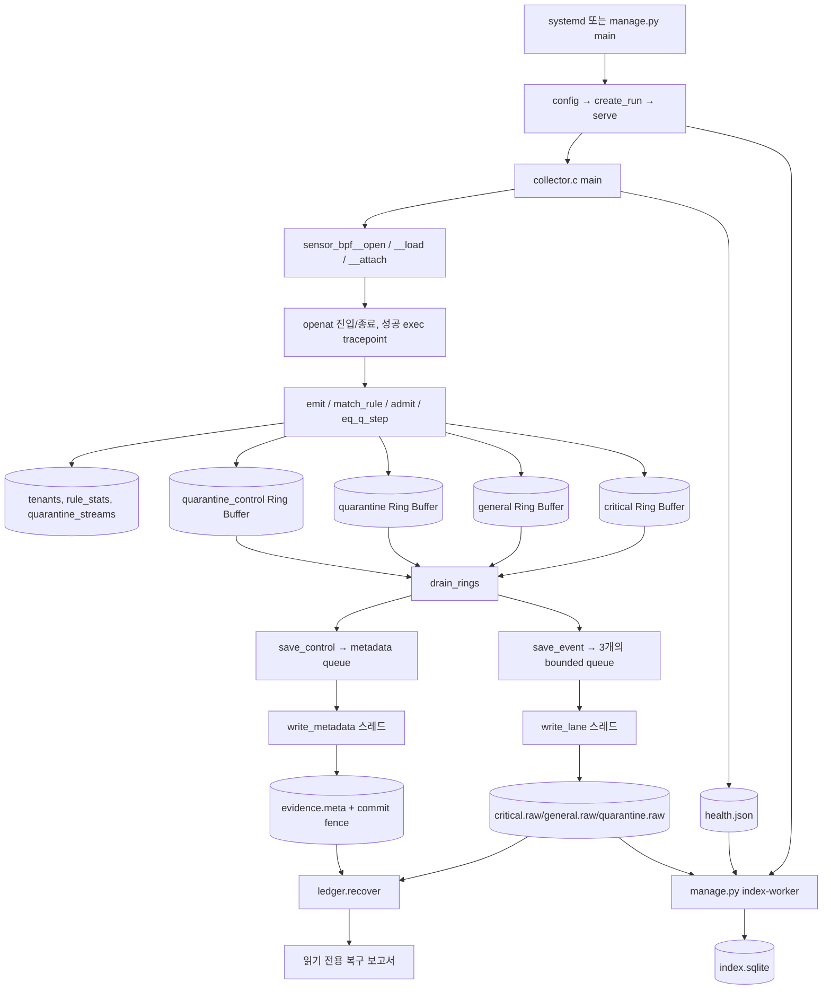
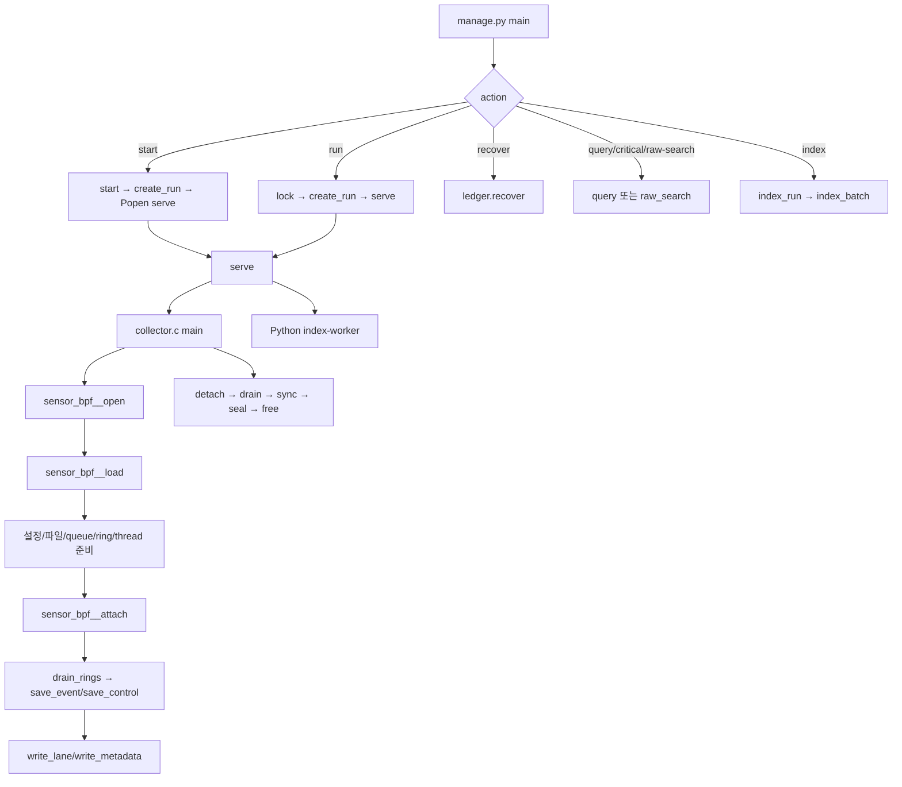
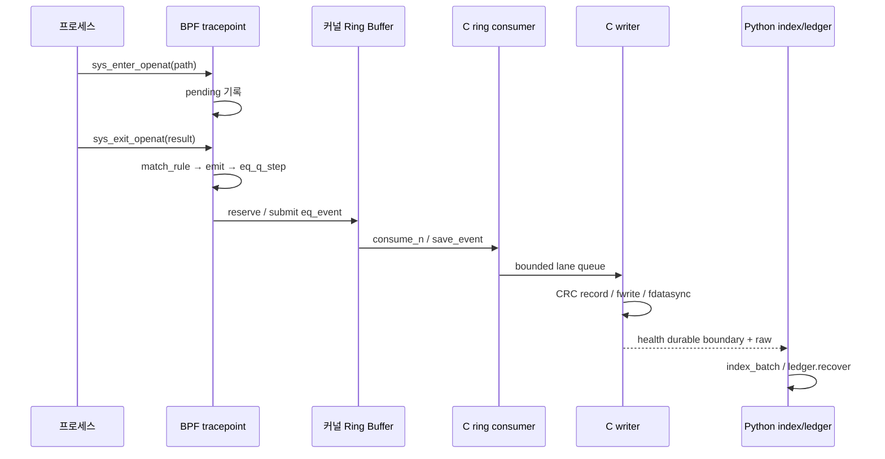

# MGlogWH 전체 소스코드 학습서 (한국어)

> **기준 소스**: `habang2222/MGlogWH` — 2026-10-15 확인한 커밋 `e6ff2b9922086d2167fe0483a0616adda55d3a50`. 모든 소스 링크는 당시 커밋에 고정하였다. **소스 읽기 학습용**으로 작성했으며, 프로젝트 README나 설계 의도만 옮긴 요약이 아니다.
>
> **검증 범위**: GitHub에서 코드와 파일 트리를 확인하였다. 이 문서를 작성하면서 Linux/WSL 센서를 실제로 빌드·실행하거나 단위 테스트를 수행하지 않았다. 문서 안의 테스트는 테스트 **코드가 검사하는 것**이지 이 작업에서 새로 통과시킨 결과가 아니다. 기존 `validation/` 자료에 보고된 실험도 별도 기록으로 취급한다.
>
> **학습 원칙**: 먼저 의미를 이해하고, 바로 아래의 실제 코드·줄 번호를 대조한다. 모든 함수 해설의 원본 코드는 중간을 임의 생략하지 않고 해당 함수 정의 구간을 싣는다. 코드를 수정해도 된다는 과제가 있더라도 이 작업은 프로그램 자체를 수정하지 않는다.

## 시작 전에 알아둘 기초 문법

| 개념 | 의미 | 이 프로젝트에서 찾을 곳 |
|---|---|---|
| 변수와 주소 | `&x`는 x의 주소, `*p`는 포인터 p가 가리키는 값 | `collector.c`의 `&state_lock` |
| 구조체 | `struct`는 이름 붙인 필드들의 메모리 묶음 | `eq_event`, `eq_quarantine_episode` |
| 멤버 연산자 | `p->field`는 `(*p).field`와 같다 | `e->pid`, `lane->count` |
| 배열과 포인터 | 배열은 고정 길이 연속 데이터, 포인터는 메모리 주소 | `lanes[3]`·`ring_buffer *rings[4]` |
| enum | 의미를 가진 정수 상수 묶음 | `EQ_BULK`, `EQ_CRITICAL` |
| 비트마스크 | 일부 비트를 `&`로 추출하고 `|`로 설정한다 | `quality`에서 rule ID 추출 |
| 전처리 | `#define`은 컴파일 전에 값·코드 조각을 치환 | `EQ_PATH`·`EQ_RULES` |
| static | C 파일 내부에서만 이름을 볼 수 있게 하거나 정적 저장 기간을 준다 | `static struct lane lanes[]` |
| 호출 스택 | 함수를 부르면 실행 흐름이 해당 함수로 이동했다가 반환 | `main`→`sensor_bpf__load` |
| 힙 할당 | `calloc`/`malloc`은 명시적 `free`가 필요한 데이터 공간 | lane 큐·metadata 큐 |
| 사용자 공간/커널 | 일반 프로세스 메모리·권한과 OS kernel 메모리·권한 구분 | collector↔eBPF |
| syscall | 프로세스가 커널에 요청하는 API. `openat`는 파일 열기 | sys_enter/exit_openat |
| tracepoint | 커널이 미리 제공하는 계측 지점 | `SEC("tp/...")` |
| eBPF map | 커널의 여러 BPF 실행 사이 상태를 공유하는 자료구조 | `tenants`·`pending` |
| Ring Buffer | 커널 데이터를 사용자 공간으로 흘리는 고정 크기 공유 버퍼 | `critical`·`general` |
| mutex | 여러 스레드가 공유 변수 변경을 동시에 하지 못하도록 잠금 | `state_lock` |
| condition variable | 작업이 생겼을 때 스레드를 깨우는 동기화 도구 | `pthread_cond_signal` |
| CAS | 값이 예상 상태일 때만 원자적으로 변경하는 연산 | `admit`·stream lock |
| CRC32 | 우발 손상을 탐지하는 짧은 checksum. 변조 방지 서명은 아니다 | raw record/journal frame |
| durable | 버퍼에 써 놓았다는 것과 달리 fdatasync/fsync 성공으로 게시된 경계 | `sync_lane`·`meta_sync` |
| ABI | C/Python/커널 사이 같은 바이트 레이아웃이라는 계약 | 232B event + 8B CRC/reserved |
| CO-RE/BTF | 커널 타입 메타데이터를 이용한 BPF 필드 접근 호환 방식 | `BPF_CORE_READ` |

# PART 1. 프로젝트 전체 이해

MGlogWH는 **Linux의 openat 호출과 성공한 프로세스 실행을 관찰**하고, 사건 중요도·격리 정책에 따라 커널 Ring Buffer와 사용자 공간 저장 경로를 나누며, 수집 자체가 실패했을 때 어디까지 관측/보존했는지 확인 가능한 근거를 남기려는 수집기다. 무조건 모든 로그를 저장해 준다는 보장은 없다. 수집량이 파일 시스템/큐 속도를 초과하면 중요 이벤트도 누락될 수 있다.

구성 요소는 다음과 같다. `sensor.bpf.c`는 커널 이벤트 캡처·규칙 평가·BULK 예산·격리 분기를 담당한다. `collector.c`는 BPF 로드·ring callback·고정 크기 큐·독립 기록 스레드·metadata checkpoint를 담당한다. `manage.py`는 설정·실행·중지·조회·SQLite 인덱스를 담당한다. `ledger.py`는 **기존 파일을 수정하지 않고** 커밋된 원장과 raw를 검증하여 복구 보고서를 만든다.



위 다이어그램의 중요한 구분은 **Python이 raw 이벤트를 직접 수집하지 않는다는 것**이다. Python은 C 수집기와 인덱서를 관리하고, C는 BPF에서 가져온 이벤트를 디스크에 쓴다. 정상 종료 시 C는 detach→ring drain→큐 닫기→writer join/sync→metadata seal/commit→스냅샷 정리로 진행한다.

# PART 2. 파일 및 디렉터리 인벤토리

Git tree에 등록된 소스·설정·테스트뿐 아니라 validation 하위 실험 파일도 목록에서 빠뜨리지 않는다. 파일 링크는 읽은 커밋의 실제 위치를 가리킨다.

| 경로 | 역할과 연결 관계 | 링크 |
|---|---|---|
| `.gitattributes` | Git 관리·문서·설정 자료 | [221 B](https://github.com/habang2222/MGlogWH/blob/e6ff2b9922086d2167fe0483a0616adda55d3a50/.gitattributes) |
| `.gitignore` | Git 관리·문서·설정 자료 | [327 B](https://github.com/habang2222/MGlogWH/blob/e6ff2b9922086d2167fe0483a0616adda55d3a50/.gitignore) |
| `LEDGER.md` | 증거·손실 해석 계약 | [14273 B](https://github.com/habang2222/MGlogWH/blob/e6ff2b9922086d2167fe0483a0616adda55d3a50/LEDGER.md) |
| `Makefile` | 클랭 BPF·skeleton·collector·테스트 빌드 | [1723 B](https://github.com/habang2222/MGlogWH/blob/e6ff2b9922086d2167fe0483a0616adda55d3a50/Makefile) |
| `QUARANTINE.md` | 격리 정책 설명 | [11578 B](https://github.com/habang2222/MGlogWH/blob/e6ff2b9922086d2167fe0483a0616adda55d3a50/QUARANTINE.md) |
| `README.md` | 설치·사용 안내, 실제 구현과 다른 경우 소스 우선 | [8666 B](https://github.com/habang2222/MGlogWH/blob/e6ff2b9922086d2167fe0483a0616adda55d3a50/README.md) |
| `RULES.md` | 규칙 정책 설명 | [8330 B](https://github.com/habang2222/MGlogWH/blob/e6ff2b9922086d2167fe0483a0616adda55d3a50/RULES.md) |
| `THIRD_PARTY.md` | 외부 소스·라이선스 고지 | [7173 B](https://github.com/habang2222/MGlogWH/blob/e6ff2b9922086d2167fe0483a0616adda55d3a50/THIRD_PARTY.md) |
| `collector.c` | 사용자 공간 이벤트 수신, raw writer, metadata, 건강도·종료 | [66802 B](https://github.com/habang2222/MGlogWH/blob/e6ff2b9922086d2167fe0483a0616adda55d3a50/collector.c) |
| `config.json` | 기본값 및 구형 critical rule 예 | [605 B](https://github.com/habang2222/MGlogWH/blob/e6ff2b9922086d2167fe0483a0616adda55d3a50/config.json) |
| `event.h` | event/record ABI, 버전·quality 비트 | [1648 B](https://github.com/habang2222/MGlogWH/blob/e6ff2b9922086d2167fe0483a0616adda55d3a50/event.h) |
| `examples/A-nonroot-etc-write.json` | 규칙 설정 예제 | [960 B](https://github.com/habang2222/MGlogWH/blob/e6ff2b9922086d2167fe0483a0616adda55d3a50/examples/A-nonroot-etc-write.json) |
| `examples/B-cgroup-shell-exec.json` | 규칙 설정 예제 | [853 B](https://github.com/habang2222/MGlogWH/blob/e6ff2b9922086d2167fe0483a0616adda55d3a50/examples/B-cgroup-shell-exec.json) |
| `examples/C-shadow-exempt.json` | 규칙 설정 예제 | [819 B](https://github.com/habang2222/MGlogWH/blob/e6ff2b9922086d2167fe0483a0616adda55d3a50/examples/C-shadow-exempt.json) |
| `examples/D-uid-specific-file.json` | 규칙 설정 예제 | [855 B](https://github.com/habang2222/MGlogWH/blob/e6ff2b9922086d2167fe0483a0616adda55d3a50/examples/D-uid-specific-file.json) |
| `install-ubuntu.sh` | 컴파일 결과·소스의 root-owned 설치 | [5480 B](https://github.com/habang2222/MGlogWH/blob/e6ff2b9922086d2167fe0483a0616adda55d3a50/install-ubuntu.sh) |
| `ledger.py` | 커밋된 원장·raw 읽기 전용 복구 | [62871 B](https://github.com/habang2222/MGlogWH/blob/e6ff2b9922086d2167fe0483a0616adda55d3a50/ledger.py) |
| `licenses/GPL-2.0.txt` | 외부 라이선스 원문 | [18092 B](https://github.com/habang2222/MGlogWH/blob/e6ff2b9922086d2167fe0483a0616adda55d3a50/licenses/GPL-2.0.txt) |
| `licenses/bootstrap-BSD-3-Clause.txt` | 외부 라이선스 원문 | [1523 B](https://github.com/habang2222/MGlogWH/blob/e6ff2b9922086d2167fe0483a0616adda55d3a50/licenses/bootstrap-BSD-3-Clause.txt) |
| `licenses/libbpf-BSD-2-Clause.txt` | 외부 라이선스 원문 | [1649 B](https://github.com/habang2222/MGlogWH/blob/e6ff2b9922086d2167fe0483a0616adda55d3a50/licenses/libbpf-BSD-2-Clause.txt) |
| `manage.py` | CLI, 설정, supervisor, SQLite·검색 | [67194 B](https://github.com/habang2222/MGlogWH/blob/e6ff2b9922086d2167fe0483a0616adda55d3a50/manage.py) |
| `packaging/mglogwh.logrotate` | 텍스트 진단 로그 회전 | [229 B](https://github.com/habang2222/MGlogWH/blob/e6ff2b9922086d2167fe0483a0616adda55d3a50/packaging/mglogwh.logrotate) |
| `packaging/mglogwh.service` | systemd 서비스 사전검사와 실행 | [769 B](https://github.com/habang2222/MGlogWH/blob/e6ff2b9922086d2167fe0483a0616adda55d3a50/packaging/mglogwh.service) |
| `quarantine.h` | 격리 상태 머신과 샘플 정책 | [12440 B](https://github.com/habang2222/MGlogWH/blob/e6ff2b9922086d2167fe0483a0616adda55d3a50/quarantine.h) |
| `rules.h` | fixed rule ABI, 3값 evaluator | [11218 B](https://github.com/habang2222/MGlogWH/blob/e6ff2b9922086d2167fe0483a0616adda55d3a50/rules.h) |
| `sensor.bpf.c` | 커널 tracepoint, BPF 맵, emit 및 정책/예산 적용 | [24529 B](https://github.com/habang2222/MGlogWH/blob/e6ff2b9922086d2167fe0483a0616adda55d3a50/sensor.bpf.c) |
| `tenant.h` | cgroup 단위 카운터와 시퀀스 | [523 B](https://github.com/habang2222/MGlogWH/blob/e6ff2b9922086d2167fe0483a0616adda55d3a50/tenant.h) |
| `test_budget.py` | 낮은 BULK 예산 수집 통합 검증(명시 실행) | [2348 B](https://github.com/habang2222/MGlogWH/blob/e6ff2b9922086d2167fe0483a0616adda55d3a50/test_budget.py) |
| `test_ledger.py` | 원장 해석·복구 fixture 테스트 | [38255 B](https://github.com/habang2222/MGlogWH/blob/e6ff2b9922086d2167fe0483a0616adda55d3a50/test_ledger.py) |
| `test_live.py` | 실제 프로브/색인 장애 smoke 테스트(명시 실행) | [3966 B](https://github.com/habang2222/MGlogWH/blob/e6ff2b9922086d2167fe0483a0616adda55d3a50/test_live.py) |
| `test_manage.py` | 설정·인덱스·파일 경로·lock 시험 | [30137 B](https://github.com/habang2222/MGlogWH/blob/e6ff2b9922086d2167fe0483a0616adda55d3a50/test_manage.py) |
| `test_quarantine.c` | 격리 정책 단위 테스트 | [11276 B](https://github.com/habang2222/MGlogWH/blob/e6ff2b9922086d2167fe0483a0616adda55d3a50/test_quarantine.c) |
| `test_rules.c` | 규칙 evaluator 단위 테스트 | [10562 B](https://github.com/habang2222/MGlogWH/blob/e6ff2b9922086d2167fe0483a0616adda55d3a50/test_rules.c) |
| `test_writer.c` | raw/metadata writer 검증 | [17566 B](https://github.com/habang2222/MGlogWH/blob/e6ff2b9922086d2167fe0483a0616adda55d3a50/test_writer.c) |
| `validation/2026-10-14/CORRECTION-eb9c888.md` | 버전·날짜가 고정된 벤치·검증 스크립트 또는 결과 산출물 | [3365 B](https://github.com/habang2222/MGlogWH/blob/e6ff2b9922086d2167fe0483a0616adda55d3a50/validation/2026-10-14/CORRECTION-eb9c888.md) |
| `validation/2026-10-14/REVIEW.md` | 버전·날짜가 고정된 벤치·검증 스크립트 또는 결과 산출물 | [22545 B](https://github.com/habang2222/MGlogWH/blob/e6ff2b9922086d2167fe0483a0616adda55d3a50/validation/2026-10-14/REVIEW.md) |
| `validation/2026-10-14/artifact-hashes-eb9c888.json` | 버전·날짜가 고정된 벤치·검증 스크립트 또는 결과 산출물 | [21882 B](https://github.com/habang2222/MGlogWH/blob/e6ff2b9922086d2167fe0483a0616adda55d3a50/validation/2026-10-14/artifact-hashes-eb9c888.json) |
| `validation/2026-10-14/bench_workload.c` | 버전·날짜가 고정된 벤치·검증 스크립트 또는 결과 산출물 | [6151 B](https://github.com/habang2222/MGlogWH/blob/e6ff2b9922086d2167fe0483a0616adda55d3a50/validation/2026-10-14/bench_workload.c) |
| `validation/2026-10-14/configs/baseline.json` | 버전·날짜가 고정된 벤치·검증 스크립트 또는 결과 산출물 | [512 B](https://github.com/habang2222/MGlogWH/blob/e6ff2b9922086d2167fe0483a0616adda55d3a50/validation/2026-10-14/configs/baseline.json) |
| `validation/2026-10-14/configs/rule1.json` | 버전·날짜가 고정된 벤치·검증 스크립트 또는 결과 산출물 | [989 B](https://github.com/habang2222/MGlogWH/blob/e6ff2b9922086d2167fe0483a0616adda55d3a50/validation/2026-10-14/configs/rule1.json) |
| `validation/2026-10-14/configs/rule4.json` | 버전·날짜가 고정된 벤치·검증 스크립트 또는 결과 산출물 | [2351 B](https://github.com/habang2222/MGlogWH/blob/e6ff2b9922086d2167fe0483a0616adda55d3a50/validation/2026-10-14/configs/rule4.json) |
| `validation/2026-10-14/configs/rule8.json` | 버전·날짜가 고정된 벤치·검증 스크립트 또는 결과 산출물 | [4167 B](https://github.com/habang2222/MGlogWH/blob/e6ff2b9922086d2167fe0483a0616adda55d3a50/validation/2026-10-14/configs/rule8.json) |
| `validation/2026-10-14/controlroom-live-evidence.json` | 버전·날짜가 고정된 벤치·검증 스크립트 또는 결과 산출물 | [1031 B](https://github.com/habang2222/MGlogWH/blob/e6ff2b9922086d2167fe0483a0616adda55d3a50/validation/2026-10-14/controlroom-live-evidence.json) |
| `validation/2026-10-14/corrected_summary-eb9c888.json` | 버전·날짜가 고정된 벤치·검증 스크립트 또는 결과 산출물 | [49259 B](https://github.com/habang2222/MGlogWH/blob/e6ff2b9922086d2167fe0483a0616adda55d3a50/validation/2026-10-14/corrected_summary-eb9c888.json) |
| `validation/2026-10-14/current-code-benchmark.md` | 버전·날짜가 고정된 벤치·검증 스크립트 또는 결과 산출물 | [3465 B](https://github.com/habang2222/MGlogWH/blob/e6ff2b9922086d2167fe0483a0616adda55d3a50/validation/2026-10-14/current-code-benchmark.md) |
| `validation/2026-10-14/environment.json` | 버전·날짜가 고정된 벤치·검증 스크립트 또는 결과 산출물 | [1943 B](https://github.com/habang2222/MGlogWH/blob/e6ff2b9922086d2167fe0483a0616adda55d3a50/validation/2026-10-14/environment.json) |
| `validation/2026-10-14/final-f9bd477/configs/legacy1.json` | 버전·날짜가 고정된 벤치·검증 스크립트 또는 결과 산출물 | [686 B](https://github.com/habang2222/MGlogWH/blob/e6ff2b9922086d2167fe0483a0616adda55d3a50/validation/2026-10-14/final-f9bd477/configs/legacy1.json) |
| `validation/2026-10-14/final-f9bd477/configs/rule1.json` | 버전·날짜가 고정된 벤치·검증 스크립트 또는 결과 산출물 | [993 B](https://github.com/habang2222/MGlogWH/blob/e6ff2b9922086d2167fe0483a0616adda55d3a50/validation/2026-10-14/final-f9bd477/configs/rule1.json) |
| `validation/2026-10-14/final-f9bd477/configs/rule4.json` | 버전·날짜가 고정된 벤치·검증 스크립트 또는 결과 산출물 | [2361 B](https://github.com/habang2222/MGlogWH/blob/e6ff2b9922086d2167fe0483a0616adda55d3a50/validation/2026-10-14/final-f9bd477/configs/rule4.json) |
| `validation/2026-10-14/final-f9bd477/configs/rule8.json` | 버전·날짜가 고정된 벤치·검증 스크립트 또는 결과 산출물 | [4185 B](https://github.com/habang2222/MGlogWH/blob/e6ff2b9922086d2167fe0483a0616adda55d3a50/validation/2026-10-14/final-f9bd477/configs/rule8.json) |
| `validation/2026-10-14/final-f9bd477/environment.json` | 버전·날짜가 고정된 벤치·검증 스크립트 또는 결과 산출물 | [2227 B](https://github.com/habang2222/MGlogWH/blob/e6ff2b9922086d2167fe0483a0616adda55d3a50/validation/2026-10-14/final-f9bd477/environment.json) |
| `validation/2026-10-14/final-f9bd477/runs/legacy1-r1.json` | 버전·날짜가 고정된 벤치·검증 스크립트 또는 결과 산출물 | [55594 B](https://github.com/habang2222/MGlogWH/blob/e6ff2b9922086d2167fe0483a0616adda55d3a50/validation/2026-10-14/final-f9bd477/runs/legacy1-r1.json) |
| `validation/2026-10-14/final-f9bd477/runs/legacy1-r2.json` | 버전·날짜가 고정된 벤치·검증 스크립트 또는 결과 산출물 | [50316 B](https://github.com/habang2222/MGlogWH/blob/e6ff2b9922086d2167fe0483a0616adda55d3a50/validation/2026-10-14/final-f9bd477/runs/legacy1-r2.json) |
| `validation/2026-10-14/final-f9bd477/runs/legacy1-r3.json` | 버전·날짜가 고정된 벤치·검증 스크립트 또는 결과 산출물 | [50319 B](https://github.com/habang2222/MGlogWH/blob/e6ff2b9922086d2167fe0483a0616adda55d3a50/validation/2026-10-14/final-f9bd477/runs/legacy1-r3.json) |
| `validation/2026-10-14/final-f9bd477/runs/rule1-r1.json` | 버전·날짜가 고정된 벤치·검증 스크립트 또는 결과 산출물 | [62802 B](https://github.com/habang2222/MGlogWH/blob/e6ff2b9922086d2167fe0483a0616adda55d3a50/validation/2026-10-14/final-f9bd477/runs/rule1-r1.json) |
| `validation/2026-10-14/final-f9bd477/runs/rule1-r2.json` | 버전·날짜가 고정된 벤치·검증 스크립트 또는 결과 산출물 | [52201 B](https://github.com/habang2222/MGlogWH/blob/e6ff2b9922086d2167fe0483a0616adda55d3a50/validation/2026-10-14/final-f9bd477/runs/rule1-r2.json) |
| `validation/2026-10-14/final-f9bd477/runs/rule1-r3.json` | 버전·날짜가 고정된 벤치·검증 스크립트 또는 결과 산출물 | [50498 B](https://github.com/habang2222/MGlogWH/blob/e6ff2b9922086d2167fe0483a0616adda55d3a50/validation/2026-10-14/final-f9bd477/runs/rule1-r3.json) |
| `validation/2026-10-14/final-f9bd477/runs/rule4-r1.json` | 버전·날짜가 고정된 벤치·검증 스크립트 또는 결과 산출물 | [63967 B](https://github.com/habang2222/MGlogWH/blob/e6ff2b9922086d2167fe0483a0616adda55d3a50/validation/2026-10-14/final-f9bd477/runs/rule4-r1.json) |
| `validation/2026-10-14/final-f9bd477/runs/rule4-r2.json` | 버전·날짜가 고정된 벤치·검증 스크립트 또는 결과 산출물 | [63968 B](https://github.com/habang2222/MGlogWH/blob/e6ff2b9922086d2167fe0483a0616adda55d3a50/validation/2026-10-14/final-f9bd477/runs/rule4-r2.json) |
| `validation/2026-10-14/final-f9bd477/runs/rule4-r3.json` | 버전·날짜가 고정된 벤치·검증 스크립트 또는 결과 산출물 | [65775 B](https://github.com/habang2222/MGlogWH/blob/e6ff2b9922086d2167fe0483a0616adda55d3a50/validation/2026-10-14/final-f9bd477/runs/rule4-r3.json) |
| `validation/2026-10-14/final-f9bd477/runs/rule8-r1.json` | 버전·날짜가 고정된 벤치·검증 스크립트 또는 결과 산출물 | [86165 B](https://github.com/habang2222/MGlogWH/blob/e6ff2b9922086d2167fe0483a0616adda55d3a50/validation/2026-10-14/final-f9bd477/runs/rule8-r1.json) |
| `validation/2026-10-14/final-f9bd477/runs/rule8-r2.json` | 버전·날짜가 고정된 벤치·검증 스크립트 또는 결과 산출물 | [84310 B](https://github.com/habang2222/MGlogWH/blob/e6ff2b9922086d2167fe0483a0616adda55d3a50/validation/2026-10-14/final-f9bd477/runs/rule8-r2.json) |
| `validation/2026-10-14/final-f9bd477/runs/rule8-r3.json` | 버전·날짜가 고정된 벤치·검증 스크립트 또는 결과 산출물 | [87924 B](https://github.com/habang2222/MGlogWH/blob/e6ff2b9922086d2167fe0483a0616adda55d3a50/validation/2026-10-14/final-f9bd477/runs/rule8-r3.json) |
| `validation/2026-10-14/final-f9bd477/summary.json` | 버전·날짜가 고정된 벤치·검증 스크립트 또는 결과 산출물 | [5202 B](https://github.com/habang2222/MGlogWH/blob/e6ff2b9922086d2167fe0483a0616adda55d3a50/validation/2026-10-14/final-f9bd477/summary.json) |
| `validation/2026-10-14/hash_artifacts.py` | 버전·날짜가 고정된 벤치·검증 스크립트 또는 결과 산출물 | [1498 B](https://github.com/habang2222/MGlogWH/blob/e6ff2b9922086d2167fe0483a0616adda55d3a50/validation/2026-10-14/hash_artifacts.py) |
| `validation/2026-10-14/path-matrix-288b454fc769/compile.stderr` | 버전·날짜가 고정된 벤치·검증 스크립트 또는 결과 산출물 | [0 B](https://github.com/habang2222/MGlogWH/blob/e6ff2b9922086d2167fe0483a0616adda55d3a50/validation/2026-10-14/path-matrix-288b454fc769/compile.stderr) |
| `validation/2026-10-14/path-matrix-288b454fc769/compile.stdout` | 버전·날짜가 고정된 벤치·검증 스크립트 또는 결과 산출물 | [0 B](https://github.com/habang2222/MGlogWH/blob/e6ff2b9922086d2167fe0483a0616adda55d3a50/validation/2026-10-14/path-matrix-288b454fc769/compile.stdout) |
| `validation/2026-10-14/path-matrix-288b454fc769/config.json` | 버전·날짜가 고정된 벤치·검증 스크립트 또는 결과 산출물 | [4594 B](https://github.com/habang2222/MGlogWH/blob/e6ff2b9922086d2167fe0483a0616adda55d3a50/validation/2026-10-14/path-matrix-288b454fc769/config.json) |
| `validation/2026-10-14/path-matrix-288b454fc769/health.json` | 버전·날짜가 고정된 벤치·검증 스크립트 또는 결과 산출물 | [18210 B](https://github.com/habang2222/MGlogWH/blob/e6ff2b9922086d2167fe0483a0616adda55d3a50/validation/2026-10-14/path-matrix-288b454fc769/health.json) |
| `validation/2026-10-14/path-matrix-288b454fc769/index-health.json` | 버전·날짜가 고정된 벤치·검증 스크립트 또는 결과 산출물 | [1121 B](https://github.com/habang2222/MGlogWH/blob/e6ff2b9922086d2167fe0483a0616adda55d3a50/validation/2026-10-14/path-matrix-288b454fc769/index-health.json) |
| `validation/2026-10-14/path-matrix-288b454fc769/manifest.json` | 버전·날짜가 고정된 벤치·검증 스크립트 또는 결과 산출물 | [2534 B](https://github.com/habang2222/MGlogWH/blob/e6ff2b9922086d2167fe0483a0616adda55d3a50/validation/2026-10-14/path-matrix-288b454fc769/manifest.json) |
| `validation/2026-10-14/path-matrix-288b454fc769/probe.stderr` | 버전·날짜가 고정된 벤치·검증 스크립트 또는 결과 산출물 | [0 B](https://github.com/habang2222/MGlogWH/blob/e6ff2b9922086d2167fe0483a0616adda55d3a50/validation/2026-10-14/path-matrix-288b454fc769/probe.stderr) |
| `validation/2026-10-14/path-matrix-288b454fc769/probe.stdout` | 버전·날짜가 고정된 벤치·검증 스크립트 또는 결과 산출물 | [0 B](https://github.com/habang2222/MGlogWH/blob/e6ff2b9922086d2167fe0483a0616adda55d3a50/validation/2026-10-14/path-matrix-288b454fc769/probe.stdout) |
| `validation/2026-10-14/path-matrix-288b454fc769/recover.stderr` | 버전·날짜가 고정된 벤치·검증 스크립트 또는 결과 산출물 | [0 B](https://github.com/habang2222/MGlogWH/blob/e6ff2b9922086d2167fe0483a0616adda55d3a50/validation/2026-10-14/path-matrix-288b454fc769/recover.stderr) |
| `validation/2026-10-14/path-matrix-288b454fc769/recover.stdout` | 버전·날짜가 고정된 벤치·검증 스크립트 또는 결과 산출물 | [59747 B](https://github.com/habang2222/MGlogWH/blob/e6ff2b9922086d2167fe0483a0616adda55d3a50/validation/2026-10-14/path-matrix-288b454fc769/recover.stdout) |
| `validation/2026-10-14/path-matrix-288b454fc769/result.json` | 버전·날짜가 고정된 벤치·검증 스크립트 또는 결과 산출물 | [78940 B](https://github.com/habang2222/MGlogWH/blob/e6ff2b9922086d2167fe0483a0616adda55d3a50/validation/2026-10-14/path-matrix-288b454fc769/result.json) |
| `validation/2026-10-14/path-matrix-288b454fc769/start.stderr` | 버전·날짜가 고정된 벤치·검증 스크립트 또는 결과 산출물 | [0 B](https://github.com/habang2222/MGlogWH/blob/e6ff2b9922086d2167fe0483a0616adda55d3a50/validation/2026-10-14/path-matrix-288b454fc769/start.stderr) |
| `validation/2026-10-14/path-matrix-288b454fc769/start.stdout` | 버전·날짜가 고정된 벤치·검증 스크립트 또는 결과 산출물 | [19511 B](https://github.com/habang2222/MGlogWH/blob/e6ff2b9922086d2167fe0483a0616adda55d3a50/validation/2026-10-14/path-matrix-288b454fc769/start.stdout) |
| `validation/2026-10-14/path-matrix-288b454fc769/stop.stderr` | 버전·날짜가 고정된 벤치·검증 스크립트 또는 결과 산출물 | [0 B](https://github.com/habang2222/MGlogWH/blob/e6ff2b9922086d2167fe0483a0616adda55d3a50/validation/2026-10-14/path-matrix-288b454fc769/stop.stderr) |
| `validation/2026-10-14/path-matrix-288b454fc769/stop.stdout` | 버전·날짜가 고정된 벤치·검증 스크립트 또는 결과 산출물 | [40491 B](https://github.com/habang2222/MGlogWH/blob/e6ff2b9922086d2167fe0483a0616adda55d3a50/validation/2026-10-14/path-matrix-288b454fc769/stop.stdout) |
| `validation/2026-10-14/path-matrix-288b454fc769/truth.csv` | 버전·날짜가 고정된 벤치·검증 스크립트 또는 결과 산출물 | [1788 B](https://github.com/habang2222/MGlogWH/blob/e6ff2b9922086d2167fe0483a0616adda55d3a50/validation/2026-10-14/path-matrix-288b454fc769/truth.csv) |
| `validation/2026-10-14/path-matrix-288b454fc769/validate.stderr` | 버전·날짜가 고정된 벤치·검증 스크립트 또는 결과 산출물 | [0 B](https://github.com/habang2222/MGlogWH/blob/e6ff2b9922086d2167fe0483a0616adda55d3a50/validation/2026-10-14/path-matrix-288b454fc769/validate.stderr) |
| `validation/2026-10-14/path-matrix-288b454fc769/validate.stdout` | 버전·날짜가 고정된 벤치·검증 스크립트 또는 결과 산출물 | [11846 B](https://github.com/habang2222/MGlogWH/blob/e6ff2b9922086d2167fe0483a0616adda55d3a50/validation/2026-10-14/path-matrix-288b454fc769/validate.stdout) |
| `validation/2026-10-14/path-matrix-7c1ccb849a3f/CORRECTION.md` | 버전·날짜가 고정된 벤치·검증 스크립트 또는 결과 산출물 | [978 B](https://github.com/habang2222/MGlogWH/blob/e6ff2b9922086d2167fe0483a0616adda55d3a50/validation/2026-10-14/path-matrix-7c1ccb849a3f/CORRECTION.md) |
| `validation/2026-10-14/path-matrix-7c1ccb849a3f/compile.stderr` | 버전·날짜가 고정된 벤치·검증 스크립트 또는 결과 산출물 | [0 B](https://github.com/habang2222/MGlogWH/blob/e6ff2b9922086d2167fe0483a0616adda55d3a50/validation/2026-10-14/path-matrix-7c1ccb849a3f/compile.stderr) |
| `validation/2026-10-14/path-matrix-7c1ccb849a3f/compile.stdout` | 버전·날짜가 고정된 벤치·검증 스크립트 또는 결과 산출물 | [0 B](https://github.com/habang2222/MGlogWH/blob/e6ff2b9922086d2167fe0483a0616adda55d3a50/validation/2026-10-14/path-matrix-7c1ccb849a3f/compile.stdout) |
| `validation/2026-10-14/path-matrix-7c1ccb849a3f/config.json` | 버전·날짜가 고정된 벤치·검증 스크립트 또는 결과 산출물 | [4594 B](https://github.com/habang2222/MGlogWH/blob/e6ff2b9922086d2167fe0483a0616adda55d3a50/validation/2026-10-14/path-matrix-7c1ccb849a3f/config.json) |
| `validation/2026-10-14/path-matrix-7c1ccb849a3f/health.json` | 버전·날짜가 고정된 벤치·검증 스크립트 또는 결과 산출물 | [18448 B](https://github.com/habang2222/MGlogWH/blob/e6ff2b9922086d2167fe0483a0616adda55d3a50/validation/2026-10-14/path-matrix-7c1ccb849a3f/health.json) |
| `validation/2026-10-14/path-matrix-7c1ccb849a3f/index-health.json` | 버전·날짜가 고정된 벤치·검증 스크립트 또는 결과 산출물 | [1119 B](https://github.com/habang2222/MGlogWH/blob/e6ff2b9922086d2167fe0483a0616adda55d3a50/validation/2026-10-14/path-matrix-7c1ccb849a3f/index-health.json) |
| `validation/2026-10-14/path-matrix-7c1ccb849a3f/manifest.json` | 버전·날짜가 고정된 벤치·검증 스크립트 또는 결과 산출물 | [2533 B](https://github.com/habang2222/MGlogWH/blob/e6ff2b9922086d2167fe0483a0616adda55d3a50/validation/2026-10-14/path-matrix-7c1ccb849a3f/manifest.json) |
| `validation/2026-10-14/path-matrix-7c1ccb849a3f/probe.stderr` | 버전·날짜가 고정된 벤치·검증 스크립트 또는 결과 산출물 | [0 B](https://github.com/habang2222/MGlogWH/blob/e6ff2b9922086d2167fe0483a0616adda55d3a50/validation/2026-10-14/path-matrix-7c1ccb849a3f/probe.stderr) |
| `validation/2026-10-14/path-matrix-7c1ccb849a3f/probe.stdout` | 버전·날짜가 고정된 벤치·검증 스크립트 또는 결과 산출물 | [0 B](https://github.com/habang2222/MGlogWH/blob/e6ff2b9922086d2167fe0483a0616adda55d3a50/validation/2026-10-14/path-matrix-7c1ccb849a3f/probe.stdout) |
| `validation/2026-10-14/path-matrix-7c1ccb849a3f/recover.stderr` | 버전·날짜가 고정된 벤치·검증 스크립트 또는 결과 산출물 | [0 B](https://github.com/habang2222/MGlogWH/blob/e6ff2b9922086d2167fe0483a0616adda55d3a50/validation/2026-10-14/path-matrix-7c1ccb849a3f/recover.stderr) |
| `validation/2026-10-14/path-matrix-7c1ccb849a3f/recover.stdout` | 버전·날짜가 고정된 벤치·검증 스크립트 또는 결과 산출물 | [60558 B](https://github.com/habang2222/MGlogWH/blob/e6ff2b9922086d2167fe0483a0616adda55d3a50/validation/2026-10-14/path-matrix-7c1ccb849a3f/recover.stdout) |
| `validation/2026-10-14/path-matrix-7c1ccb849a3f/result.json` | 버전·날짜가 고정된 벤치·검증 스크립트 또는 결과 산출물 | [74598 B](https://github.com/habang2222/MGlogWH/blob/e6ff2b9922086d2167fe0483a0616adda55d3a50/validation/2026-10-14/path-matrix-7c1ccb849a3f/result.json) |
| `validation/2026-10-14/path-matrix-7c1ccb849a3f/start.stderr` | 버전·날짜가 고정된 벤치·검증 스크립트 또는 결과 산출물 | [0 B](https://github.com/habang2222/MGlogWH/blob/e6ff2b9922086d2167fe0483a0616adda55d3a50/validation/2026-10-14/path-matrix-7c1ccb849a3f/start.stderr) |
| `validation/2026-10-14/path-matrix-7c1ccb849a3f/start.stdout` | 버전·날짜가 고정된 벤치·검증 스크립트 또는 결과 산출물 | [19510 B](https://github.com/habang2222/MGlogWH/blob/e6ff2b9922086d2167fe0483a0616adda55d3a50/validation/2026-10-14/path-matrix-7c1ccb849a3f/start.stdout) |
| `validation/2026-10-14/path-matrix-7c1ccb849a3f/stop.stderr` | 버전·날짜가 고정된 벤치·검증 스크립트 또는 결과 산출물 | [0 B](https://github.com/habang2222/MGlogWH/blob/e6ff2b9922086d2167fe0483a0616adda55d3a50/validation/2026-10-14/path-matrix-7c1ccb849a3f/stop.stderr) |
| `validation/2026-10-14/path-matrix-7c1ccb849a3f/stop.stdout` | 버전·날짜가 고정된 벤치·검증 스크립트 또는 결과 산출물 | [40903 B](https://github.com/habang2222/MGlogWH/blob/e6ff2b9922086d2167fe0483a0616adda55d3a50/validation/2026-10-14/path-matrix-7c1ccb849a3f/stop.stdout) |
| `validation/2026-10-14/path-matrix-7c1ccb849a3f/truth.csv` | 버전·날짜가 고정된 벤치·검증 스크립트 또는 결과 산출물 | [1772 B](https://github.com/habang2222/MGlogWH/blob/e6ff2b9922086d2167fe0483a0616adda55d3a50/validation/2026-10-14/path-matrix-7c1ccb849a3f/truth.csv) |
| `validation/2026-10-14/path-matrix-7c1ccb849a3f/validate.stderr` | 버전·날짜가 고정된 벤치·검증 스크립트 또는 결과 산출물 | [0 B](https://github.com/habang2222/MGlogWH/blob/e6ff2b9922086d2167fe0483a0616adda55d3a50/validation/2026-10-14/path-matrix-7c1ccb849a3f/validate.stderr) |
| `validation/2026-10-14/path-matrix-7c1ccb849a3f/validate.stdout` | 버전·날짜가 고정된 벤치·검증 스크립트 또는 결과 산출물 | [11846 B](https://github.com/habang2222/MGlogWH/blob/e6ff2b9922086d2167fe0483a0616adda55d3a50/validation/2026-10-14/path-matrix-7c1ccb849a3f/validate.stdout) |
| `validation/2026-10-14/path_matrix_probe.c` | 버전·날짜가 고정된 벤치·검증 스크립트 또는 결과 산출물 | [4905 B](https://github.com/habang2222/MGlogWH/blob/e6ff2b9922086d2167fe0483a0616adda55d3a50/validation/2026-10-14/path_matrix_probe.c) |
| `validation/2026-10-14/pilot-15k.json` | 버전·날짜가 고정된 벤치·검증 스크립트 또는 결과 산출물 | [779 B](https://github.com/habang2222/MGlogWH/blob/e6ff2b9922086d2167fe0483a0616adda55d3a50/validation/2026-10-14/pilot-15k.json) |
| `validation/2026-10-14/run_benchmark.py` | 버전·날짜가 고정된 벤치·검증 스크립트 또는 결과 산출물 | [13621 B](https://github.com/habang2222/MGlogWH/blob/e6ff2b9922086d2167fe0483a0616adda55d3a50/validation/2026-10-14/run_benchmark.py) |
| `validation/2026-10-14/run_benchmark_portable.py` | 버전·날짜가 고정된 벤치·검증 스크립트 또는 결과 산출물 | [16067 B](https://github.com/habang2222/MGlogWH/blob/e6ff2b9922086d2167fe0483a0616adda55d3a50/validation/2026-10-14/run_benchmark_portable.py) |
| `validation/2026-10-14/run_path_matrix.py` | 버전·날짜가 고정된 벤치·검증 스크립트 또는 결과 산출물 | [15806 B](https://github.com/habang2222/MGlogWH/blob/e6ff2b9922086d2167fe0483a0616adda55d3a50/validation/2026-10-14/run_path_matrix.py) |
| `validation/2026-10-14/runs/baseline-r1.json` | 버전·날짜가 고정된 벤치·검증 스크립트 또는 결과 산출물 | [31078 B](https://github.com/habang2222/MGlogWH/blob/e6ff2b9922086d2167fe0483a0616adda55d3a50/validation/2026-10-14/runs/baseline-r1.json) |
| `validation/2026-10-14/runs/baseline-r2.json` | 버전·날짜가 고정된 벤치·검증 스크립트 또는 결과 산출물 | [30180 B](https://github.com/habang2222/MGlogWH/blob/e6ff2b9922086d2167fe0483a0616adda55d3a50/validation/2026-10-14/runs/baseline-r2.json) |
| `validation/2026-10-14/runs/baseline-r3.json` | 버전·날짜가 고정된 벤치·검증 스크립트 또는 결과 산출물 | [31081 B](https://github.com/habang2222/MGlogWH/blob/e6ff2b9922086d2167fe0483a0616adda55d3a50/validation/2026-10-14/runs/baseline-r3.json) |
| `validation/2026-10-14/runs/rule1-r1.json` | 버전·날짜가 고정된 벤치·검증 스크립트 또는 결과 산출물 | [32862 B](https://github.com/habang2222/MGlogWH/blob/e6ff2b9922086d2167fe0483a0616adda55d3a50/validation/2026-10-14/runs/rule1-r1.json) |
| `validation/2026-10-14/runs/rule1-r2.json` | 버전·날짜가 고정된 벤치·검증 스크립트 또는 결과 산출물 | [31136 B](https://github.com/habang2222/MGlogWH/blob/e6ff2b9922086d2167fe0483a0616adda55d3a50/validation/2026-10-14/runs/rule1-r2.json) |
| `validation/2026-10-14/runs/rule1-r3.json` | 버전·날짜가 고정된 벤치·검증 스크립트 또는 결과 산출물 | [31137 B](https://github.com/habang2222/MGlogWH/blob/e6ff2b9922086d2167fe0483a0616adda55d3a50/validation/2026-10-14/runs/rule1-r3.json) |
| `validation/2026-10-14/runs/rule4-r1.json` | 버전·날짜가 고정된 벤치·검증 스크립트 또는 결과 산출물 | [39062 B](https://github.com/habang2222/MGlogWH/blob/e6ff2b9922086d2167fe0483a0616adda55d3a50/validation/2026-10-14/runs/rule4-r1.json) |
| `validation/2026-10-14/runs/rule4-r2.json` | 버전·날짜가 고정된 벤치·검증 스크립트 또는 결과 산출물 | [39093 B](https://github.com/habang2222/MGlogWH/blob/e6ff2b9922086d2167fe0483a0616adda55d3a50/validation/2026-10-14/runs/rule4-r2.json) |
| `validation/2026-10-14/runs/rule4-r3.json` | 버전·날짜가 고정된 벤치·검증 스크립트 또는 결과 산출물 | [39060 B](https://github.com/habang2222/MGlogWH/blob/e6ff2b9922086d2167fe0483a0616adda55d3a50/validation/2026-10-14/runs/rule4-r3.json) |
| `validation/2026-10-14/runs/rule8-r1.json` | 버전·날짜가 고정된 벤치·검증 스크립트 또는 결과 산출물 | [49697 B](https://github.com/habang2222/MGlogWH/blob/e6ff2b9922086d2167fe0483a0616adda55d3a50/validation/2026-10-14/runs/rule8-r1.json) |
| `validation/2026-10-14/runs/rule8-r2.json` | 버전·날짜가 고정된 벤치·검증 스크립트 또는 결과 산출물 | [49704 B](https://github.com/habang2222/MGlogWH/blob/e6ff2b9922086d2167fe0483a0616adda55d3a50/validation/2026-10-14/runs/rule8-r2.json) |
| `validation/2026-10-14/runs/rule8-r3.json` | 버전·날짜가 고정된 벤치·검증 스크립트 또는 결과 산출물 | [49677 B](https://github.com/habang2222/MGlogWH/blob/e6ff2b9922086d2167fe0483a0616adda55d3a50/validation/2026-10-14/runs/rule8-r3.json) |
| `validation/2026-10-14/source-eb9c888.tar` | 버전·날짜가 고정된 벤치·검증 스크립트 또는 결과 산출물 | [471040 B](https://github.com/habang2222/MGlogWH/blob/e6ff2b9922086d2167fe0483a0616adda55d3a50/validation/2026-10-14/source-eb9c888.tar) |
| `validation/2026-10-14/summarize_benchmark.py` | 버전·날짜가 고정된 벤치·검증 스크립트 또는 결과 산출물 | [11744 B](https://github.com/habang2222/MGlogWH/blob/e6ff2b9922086d2167fe0483a0616adda55d3a50/validation/2026-10-14/summarize_benchmark.py) |
| `validation/2026-10-14/summary.json` | 버전·날짜가 고정된 벤치·검증 스크립트 또는 결과 산출물 | [3955 B](https://github.com/habang2222/MGlogWH/blob/e6ff2b9922086d2167fe0483a0616adda55d3a50/validation/2026-10-14/summary.json) |
| `validation/2026-10-14/test_benchmark_portable.py` | 버전·날짜가 고정된 벤치·검증 스크립트 또는 결과 산출물 | [3032 B](https://github.com/habang2222/MGlogWH/blob/e6ff2b9922086d2167fe0483a0616adda55d3a50/validation/2026-10-14/test_benchmark_portable.py) |
| `validation/2026-10-14/verify_controlroom_run.py` | 버전·날짜가 고정된 벤치·검증 스크립트 또는 결과 산출물 | [4632 B](https://github.com/habang2222/MGlogWH/blob/e6ff2b9922086d2167fe0483a0616adda55d3a50/validation/2026-10-14/verify_controlroom_run.py) |


**소스와 빌드물 차이**: `sensor.bpf.c`는 편집하는 소스, `build/sensor.bpf.o`는 clang BPF 오브젝트, `build/sensor.skel.h`는 bpftool 생성 헤더, `build/collector`는 C 실행 파일이다. `build/`는 런타임 증거 저장 위치가 아니다. `critical.raw`·`general.raw`·`quarantine.raw`·`health.json`·`index.sqlite`·`evidence.meta`는 UUID run 디렉터리 안에 생기는 산출물이다. `validation/2026-10-14`의 보관 JSON은 현재 run의 raw 파일이 아니라 과거 실험 결과다.

# PART 3. 실행 시작점부터 종료까지

### Python 실행 진입점
[`manage.py main`](https://github.com/habang2222/MGlogWH/blob/e6ff2b9922086d2167fe0483a0616adda55d3a50/manage.py#L1146-L1246)는 `argparse`로 action·--config·--run·--run-dir 등을 읽는다. 파일 하단 `if __name__ == '__main__': main()`에서만 명령행 진입이 일어난다. `validate`는 config를 읽고 다음 run에 적용될 설정 diff를 출력할 뿐 현재 센서를 바꾸지 않는다.

`start` 경로: `main → config → ensure_data_dir → lock(control.lock) → start → lock(collector.lock) → create_run → subprocess.Popen(python manage.py serve --run ID)`. `run` 경로는 `main → lock → create_run → serve`이며 collector lock을 foreground 생명주기 동안 보유한다. `serve`는 run의 설정·manifest/rules.bin 무결성을 확인한 뒤 환경변수로 lineage를 전달하고 C collector와 index worker 자식을 관리한다.

### C 실행 진입점
[`collector.c int main(int argc, char **argv)`](https://github.com/habang2222/MGlogWH/blob/e6ff2b9922086d2167fe0483a0616adda55d3a50/collector.c#L1017-L1172)가 실행 파일 시작점이다. argc/argv와 lineage 환경변수를 확인하고 `sensor_bpf__open`, rodata 주입, `sensor_bpf__load`, `install_rule_strings`, 파일/큐 생성, metadata 스레드·raw writer 스레드 생성, 4개 Ring Buffer consumer 생성, `sensor_bpf__attach`, ring drain 스레드 기동 순으로 진행한다. 마지막 `done:`이 detach와 자원 정리의 공통 경로다.



`open_enter`·`open_exit`·`exec_event`는 C main이 **직접 호출하지 않는다**. 커널 tracepoint가 발생하면 커널이 BPF 프로그램을 호출한다. `save_event`는 `ring_buffer__consume_n`에 등록된 callback으로 호출되며 `write_lane`은 `pthread_create`의 별도 스레드 진입점이다. 따라서 호출 함수와 트리거 이벤트를 구분해야 한다.

## 실행 시 생성되는 상태

| 순서 | 함수 | 생성/변경되는 데이터 | 다음 단계 |
|---|---|---|---|
| 1 | `config` | 정상화된 Python dict | 필수 키·타입·범위·규칙 조건 검사 |
| 2 | `create_run` | UUID run/config/manifest/선택적 rules.bin/current.json | 디렉터리·공간·권한 통과 |
| 3 | C `main` | `skel`, rodata, BPF 맵, ring handle | `sensor_bpf__load` 성공 |
| 4 | `queue_init/meta_init` | 큐 용량·파일·조건변수 | 준비 후 attach |
| 5 | BPF `emit` | sequence/priority/quality와 제출 카운터 | 규칙/예산/격리 판단 |
| 6 | `save_event` | 큐 삽입 또는 사용자 공간 loss | ABI·저장/큐 한도 |
| 7 | `write_lane/sync_lane` | CRC record, durable bytes | 쓰기·fdatasync 성공 |
| 8 | `index_batch` | SQLite events/cursor | published durable 경계까지만 |
| 9 | `ledger.recover` | run 외부의 보고서 JSON | fence·CRC·lineage 확인 |

# PART 4. C/eBPF 함수별 원본 코드와 해설

이 PART는 각 주요 함수의 **정의 전체**, 매개변수·반환·호출·분기·예외/손실 경계를 다룬다. 연결 링크의 L번호가 실제 정의 위치다.

<!-- PART4_INSERT -->

# PART 5. 자료구조와 메모리

## 이벤트 ABI — 원본 코드


```c
/* SPDX-License-Identifier: BSD-3-Clause */
#ifndef EVIDENCE_EVENT_H
#define EVIDENCE_EVENT_H
#define EQ_MAGIC 0x31514f45u
#define EQ_SCHEMA 3
#define EQ_PREVIOUS_SCHEMA 2
#define EQ_LEGACY_SCHEMA 1
#define EQ_PATH 128
#define EQ_TENANTS 1024
enum eq_kind { EQ_EXEC = 1, EQ_OPEN = 2 };
enum eq_priority { EQ_BULK, EQ_NORMAL, EQ_CRITICAL };
enum eq_quality { EQ_TRUNCATED = 1, EQ_READ_ERROR = 2,
    EQ_QUARANTINED = 1u << 8, EQ_Q_INITIAL = 1u << 9,
    EQ_Q_PERIODIC = 1u << 10, EQ_Q_PROTECTED = 1u << 11,
    EQ_Q_UNTRACKED = 1u << 12 };
#define EQ_CAPTURE_QUALITY_MASK 3u
#define EQ_CONFIGURED_POLICY_SHIFT 13u
#define EQ_CONFIGURED_POLICY_MASK (3u << EQ_CONFIGURED_POLICY_SHIFT)
#define EQ_RULE_SHIFT 16u
#define EQ_RULE_MASK (255u << EQ_RULE_SHIFT)
#define EQ_RULE_VERSION_SHIFT 24u
#define EQ_RULE_VERSION_MASK (15u << EQ_RULE_VERSION_SHIFT)
#define EQ_POLICY_VERSION_SHIFT 28u
#define EQ_POLICY_VERSION_MASK (15u << EQ_POLICY_VERSION_SHIFT)
#define EQ_RULE_VERSION_V1 (1u << EQ_RULE_VERSION_SHIFT)
#define EQ_POLICY_VERSION_V1 (1u << EQ_POLICY_VERSION_SHIFT)
/* Schema 3 keeps the schema 1/2 size/layout. Rule id now also applies to
 * BULK/NORMAL; configured overload policy and encoding versions occupy quality
 * bits. The run manifest's config_sha256 identifies the actual rule revision. */
struct eq_event {
    unsigned long long monotonic_ns, cgroup_id, sequence, process_start_ns;
    long long result;
    unsigned magic, schema, kind, priority, pid, tid, uid, ppid, cpu;
    unsigned op_flags, captured_len, quality;
    char comm[16], path[EQ_PATH];
};
struct eq_record { struct eq_event event; unsigned crc32, reserved; };
#endif
```
`struct eq_event`는 232바이트, `struct eq_record`는 event와 `crc32`·`reserved`를 더한 240바이트다. [`collector.c`](https://github.com/habang2222/MGlogWH/blob/e6ff2b9922086d2167fe0483a0616adda55d3a50/collector.c#L28-L34)의 `_Static_assert`가 크기를 검사하며 Python의 `struct.Struct('<4Qq12I16s128s')`도 같은 레이아웃을 쓴다.

| 필드 | 타입/크기 | 생성·사용 의미 |
|---|---|---|
| `monotonic_ns` | u64 | 커널 `bpf_ktime_get_ns`, 부팅기준 시간 |
| `cgroup_id`, `sequence` | u64 둘 | cgroup마다 증가하는 시퀀스와 ID의 쌍 |
| `process_start_ns` | u64 | 현재 task group leader start_time |
| `result` | s64 | openat 결과값(음수 오류 포함), exec는 성공 이벤트 |
| `magic/schema/kind/priority` | u32 넷 | ABI·버전·이벤트/중요도 |
| `pid/tid/uid/ppid/cpu` | u32 다섯 | 프로세스/스레드와 실행 CPU |
| `op_flags/captured_len/quality` | u32 셋 | syscall 플래그·유효 경로 길이·캡처/정책 메타비트 |
| `comm[16]` | char[16] | 커널 프로세스명 |
| `path[128]` | char[128] | 포인터에서 복사한 경로 바이트 |
| `crc32,reserved` | u32 둘 | raw 디스크 record 검증과 예약 공간 |

**소유권**: BPF `ringbuf_reserve`로 확보한 커널 ring 위치는 `submit` 뒤 consumer가 받는다. C `save_event`는 이벤트를 `memcpy`로 지역 변수에 복사하고 `lane.queue` 배열에도 값 복사를 하므로 callback 종료 후 원본 ring 포인터를 보관하지 않는다. 쓰기 스레드는 큐에서 `eq_record`로 다시 복사한다. `queue_init`이 할당한 힙 메모리는 `queue_destroy`가 해제한다. ring buffer 포인터를 일반 `free`로 해제하면 안 되며 libbpf `ring_buffer__free`를 이용한다.

BPF map `tenants`와 `quarantine_streams`는 각각 key/value가 있는 커널 공간 해시 맵으로 크기 한도가 있다. `exec_scratch`·`rule_lookup_scratch`는 per-CPU 배열로 BPF의 제한된 스택 사용량을 줄인다. `state_lock`은 C queue/meta/counters에 대한 스레드 간 동기화를 맡고, `pthread_cond_signal`은 새 이벤트가 생겼음을 writer에게 알린다.

<!-- PART5_STRUCTS -->

# PART 6. eBPF와 Linux 커널

- **eBPF**: 커널에서 실행되지만 verifier가 메모리 접근·반복·호출 등을 검사하는 제한된 프로그램이다. 일반 C `malloc`/`printf`/파일 I/O를 그대로 호출할 수 없다. 커널 helper와 BPF map으로 작업한다.
- **tracepoint**: `sensor.bpf.c`의 `SEC("tp/syscalls/sys_enter_openat")`, `SEC("tp/syscalls/sys_exit_openat")`, `SEC("tp/sched/sched_process_exec")`에서 실제 콜백 실행 지점을 정의한다. 정확한 섹션 문자열은 함수 위의 `SEC` 선언을 확인한다.
- **openat 쌍**: `open_enter`는 사용자 주소의 path와 flags를 pending map에 넣고 `open_exit`는 결과를 함께 묶어 emit한 뒤 임시 상태를 삭제한다. pairing에 실패하면 진단 카운터가 있지만 사건의 개별 원본을 잃을 수 있다.
- **성공 exec**: `sched_process_exec`는 성공한 실행 시점이므로 실패한 exec 요청 전체를 수집했다고 주장하면 안 된다.
- **BPF Map**: key/value 기반의 커널 상태·규칙·스크래치 데이터. `tenants`·`pending`·`quarantine_streams`·`rule_stats` 등 크기가 다르고 서로 다른 수명/소유권을 가진다.
- **Ring Buffer**: kernel producer→userspace consumer. `critical` 1MiB, `general` 4MiB, `quarantine` 1MiB, `quarantine_control` 256KiB. `bpf_ringbuf_reserve` 실패는 event 미제출과 카운터 갱신으로 이어진다.
- **BPF Verifier**: 컴파일된 BPF object의 제어 흐름·접근 안정성을 점검한다. `bpf_loop`, bound가 있는 CAS 재시도, per-CPU scratch 등은 eBPF 실행 제약과 연결된다. 코드 문법이 옳다고 모든 커널에서 verifier 통과하는 것은 아니다.
- **BTF/CO-RE**: `vmlinux.h`의 타입과 `BPF_CORE_READ`를 이용해 task 필드에 접근한다. 커널/빌드 차이를 제거해 주는 만능 보증은 아니다.
- **libbpf/skeleton**: `Makefile`이 clang→`sensor.bpf.o`→bpftool→`sensor.skel.h` 순서로 생성하고 C는 `sensor_bpf__open`·`load`·`attach`·`detach`·`destroy`를 호출한다.

# PART 7. 실제 로그 하나가 이동하는 경로

예를 들어 `/etc/shadow`의 파일 접근을 생각한다. **중요**: 기본 `config.json`은 `/tmp/mglogwh-decoy.txt`를 legacy critical 규칙으로 설정한다. 따라서 `/etc/shadow`가 기본적으로 CRITICAL이라고 단정하면 틀리다. 여기서는 *새 run*의 `event_rules`에서 `openat`·`path == "/etc/shadow"`·`priority == "CRITICAL"`을 지정한 가상 예시라고 가정한다.

1. 프로세스가 `openat`로 사용자 주소의 경로를 전달한다. `open_enter`가 `bpf_get_current_pid_tgid`를 키로 `pending`에 path와 flags를 보관.
2. syscall이 반환하면 `open_exit`가 같은 키를 읽고 `emit(EQ_OPEN, result, capture)` 호출. 잘린 문자열/읽기 실패는 `quality`와 UNKNOWN 판정에 영향.
3. `match_rule`이 활성 규칙을 평가하여 승리 rule slot을 고른다. `priority`는 기본 실패 open=BULK·그 외 NORMAL에서 매치된 rule의 값으로 변경될 수 있다.
4. `tenants[cgroup_id]`에서 `sequence` 원자 증가. 예시 `cgroup_id=77, sequence=19`는 단지 추적 설명을 위한 가상 숫자. 실제 시퀀스는 전역 하나가 아닌 cgroup 단위다.
5. CRITICAL이면서 `QUARANTINE` 정책이면 `quarantine_streams`의 상태를 검사하고 `eq_q_step`이 NORMAL/FULL/SAMPLE/SUMMARIZE 중 하나를 결정한다. FULL/SAMPLE은 격리 ring, 요약은 raw 원본 없이 통계.
6. 커널 `bpf_ringbuf_reserve` 성공 시 `struct eq_event`에 PID/TID/UID/PPID/CPU/시간/경로·정책 필드 기록 후 `bpf_ringbuf_submit`. 실패 시 ring-full 계수를 증가시킨다.
7. C `drain_rings`가 `ring_buffer__consume_n`으로 읽어 `save_event` callback 호출. 232바이트, schema 3, 비트·lane의 불변식 확인, quota와 큐 여유 검사 후 배열에 복사한다.
8. `write_lane`이 `struct eq_record` CRC32/예약 필드를 추가하여 raw에 fwrite. `sync_lane`의 `fdatasync`가 성공해야 `durable` 경계가 증가한다.
9. `snapshot`으로 health/checkpoint 게시, `meta_write`로 원장 frame, `meta_sync`로 commit fence. `index_batch`는 durable offset까지만 SQLite에 색인한다.
10. `query`는 인덱스, `raw_search`는 제한된 raw 직접 조회, `ledger.recover`는 정지한 run의 commit fence와 raw를 대조한다.



### 주요 손실·불완전성 발생 지점

| 지점 | 근거/카운터 | 잃는 것 |
|---|---|---|
| tracepoint 관측 대상 밖 | 해당 프로브 없음 | 개별 사건 ID 자체를 만들지 않음 |
| pending map 포화/조회 실패 | `faults` 관련 진단 | sys_enter/exit 쌍의 event 원본 |
| tenant map 생성 실패 | `fault(0)` | 시퀀스 할당 이전 event |
| BULK 예산/경합 | `budget_suppress`/`budget_contention` | 해당 raw 개별 기록 |
| stream map 포화/CAS 실패 | untracked/fallback 카운터 | 완전한 episode 정책 귀속 |
| 정책상 요약 | `EQ_Q_SUMMARIZE` | 개별 raw가 아닌 요약 통계만 |
| ring 포화 | `critical_full`/`general_full`/`quarantine_full` | 커널→사용자 공간 전달 실패 |
| 사용자 큐 포화 | `QUEUE_FULL` tombstone 시도 | raw 미저장; meta 큐도 포화 가능 |
| 일반/격리 raw quota | `GENERAL_QUOTA`/`Q_STORAGE_LIMIT` | 해당 lane에서 raw 미저장 |
| raw/meta write/sync 실패 | `fail`/`meta_failure` | durable 경계가 진전되지 않음 |
| metadata cap/큐 초과 | overflow/dropped | 개별 손실 이유의 완전성 |
| SQLite 색인 중단 | INDEX_LAG/INDEX_PAUSED 등 | 검색의 최신성, raw 존재와 다름 |
| 외부 스토리지/적대적 조작 | CRC·해시만 존재 | 암호학적 위변조 방지는 보장 X |

# PART 8. 우선순위·격리·손실·저장 정책

### Priority와 Overload Policy의 차이

초기 `emit`은 실패 `openat`를 BULK, 다른 이벤트를 NORMAL로 분류한다. 규칙이 맞으면 `chosen->priority`가 실제 우선순위를 덮는다. 여러 규칙의 충돌은 `eq_rule_better`를 따른다: **큰 precedence → 높은 priority → 정책 우선순위 QUARANTINE/EXEMPT/COLLECTION → 작은 규칙 ID**. Python은 BULK/NORMAL 정책이 NORMAL_COLLECTION이 아니면 거부한다.

| 분류 | 저장 경로 | 특성 |
|---|---|---|
| BULK | general ring/general.raw | cgroup별 rate·burst 예산, suppress 가능 |
| NORMAL | general ring/general.raw | 독립 bulk 예산을 소비하지 않는 일반 수집 |
| CRITICAL + NORMAL_COLLECTION | critical ring/critical.raw | 격리하지 않지만 ring·queue·disk 한계 존재 |
| CRITICAL + QUARANTINE | 정상은 critical, 격리 중 full/sample은 quarantine.raw | 나머지 사건을 정책상 요약 |
| CRITICAL + QUARANTINE_EXEMPT | critical.raw | 격리 면제만 의미, 영구 보존 보증 X |

### Quarantine

key는 `cgroup_id×rule_id×kind`. 완료된 1초 EPS 창을 이어서 진입 기준을 충족하면 `EQ_Q_ENTER`, 낮은 EPS가 회복 지속 시간 조건을 만족하면 `EQ_Q_EXIT` 전이를 만든다. 처음 부분 창을 완료된 1초로 오인하지 않는다. 격리 중 초기 `initial_full`건은 전체 보존, 이후 `sample_interval_ms`마다 주기 표본, 나머지는 summarized로 집계한다. 상태 추적 lock 획득 실패나 맵 포화가 생기면 `EQ_Q_UNTRACKED`/전역 fallback으로 이동한다. 면제된 규칙은 QUARANTINE으로 낮아지지 않지만 ring/queue 실패는 별개다. PID/UID bitmap은 중복·해시 충돌 때문에 정확한 서로 다른 값 개수가 아닌 **하한**이다.

### 손실 원장·메타데이터

`loss_locked`는 C ring callback에서 실제로 수신한 이벤트가 quota/queue 등으로 거부됐을 때 metadata에 tombstone을 시도한다. `meta_write`는 run lineage, record_type, 이유, 개별 witness(커널에서 수집된 event bytes)를 길이+CRC frame으로 기록한다. `meta_sync`가 commit fence를 갱신하며 `ledger.recover`는 fence 밖 쓰기를 보존하되 확정된 증거로 승격하지 않는다. pre-sequence 커널 문제의 집계만으로 특정 사라진 사건의 ID를 만들거나 이유를 단정하지 않는다.

### 저장 자원

`max_raw_mib`는 세 lane admitted bytes의 **논리 총량**이고 `critical_reserve_mib`는 비중요 이벤트의 허용량을 낮추는 논리 예산이다. `quarantine_max_mib`는 별도 격리 lane 허용량, `metadata_max_mib`는 원장 용량, `max_index_mib`는 SQLite 메인 파일의 페이지 제한과 관련된다. 이들은 디스크에 그 크기의 블록을 미리 물리 예약하는 기능이 아니다. 외부 프로세스·SQLite rollback journal·메타데이터·현재 파일시스템 오류는 별도 고려가 필요하다.

# PART 9. Python 관리 및 ledger의 모든 함수

`manage.py`의 CLI/config/run/index/query 함수와 `ledger.py`의 읽기 전용 복구 함수를 실제 원문으로 각각 분석한다.

<!-- PART9_INSERT -->

# PART 10. 설정·빌드·설치

## config.json (원문)

```json
{
  "bulk_rate": 500,
  "bulk_burst": 1000,
  "protected_path": "/tmp/mglogwh-decoy.txt",
  "max_raw_mib": 512,
  "critical_reserve_mib": 64,
  "max_index_mib": 256,
  "minimum_free_mib": 1024,
  "metadata_max_mib": 16,
  "critical_rate_threshold": 10000,
  "critical_rate_duration_seconds": 3,
  "critical_recovery_threshold": 2000,
  "critical_recovery_duration_seconds": 10,
  "quarantine_initial_full_events": 8,
  "quarantine_sample_interval_ms": 100,
  "quarantine_max_mib": 16,
  "critical_rules": [
    {"id": 1, "event_type": "openat", "path": "/tmp/mglogwh-decoy.txt", "protected": false}
  ]
}
```
| 설정 키 | 현재 값(누락 항목은 선택 입력) | 실제 허용 범위·참조·영향 |
|---|---|---|
| `bulk_rate` | `500` | 정수 1..1000000: `admit`의 초당 rate; `config→serve→collector rodata`; 잘못된 값은 `config`가 거부 |
| `bulk_burst` | `1000` | 정수 1..1000000: cgroup 예산 burst; `admit`; 잘못된 값은 `config`가 거부 |
| `protected_path` | `"/tmp/mglogwh-decoy.txt"` | Linux 절대경로 UTF-8 126B 이하: legacy 기본 규칙. 이벤트 경로와 문자가 동일해야 함; 잘못된 값은 `config`가 거부 |
| `max_raw_mib` | `512` | 정수 16..1024: 총 raw 논리 예산; `save_event`; 잘못된 값은 `config`가 거부 |
| `critical_reserve_mib` | `64` | 정수 1..1023 및 max_raw보다 작아야 함: general/quarantine 쪽 예약 제외 예산; 잘못된 값은 `config`가 거부 |
| `max_index_mib` | `256` | 정수 16..512: `index_batch` SQLite max_page_count; 잘못된 값은 `config`가 거부 |
| `minimum_free_mib` | `1024` | 정수 256..65536: `create_run` 사전·`index_batch` 후속 공간 압력; 잘못된 값은 `config`가 거부 |
| `metadata_max_mib` | `16` | 정수 8..64: `meta_init`/`meta_write` 원장 한도; 잘못된 값은 `config`가 거부 |
| `critical_rate_threshold` | `10000` | 정수 1..1000000: `eq_q_step` 격리 진입 EPS; 잘못된 값은 `config`가 거부 |
| `critical_rate_duration_seconds` | `3` | 정수 1..60: `serve`에서 ms로 변환; 잘못된 값은 `config`가 거부 |
| `critical_recovery_threshold` | `2000` | 정수 0..999999, 진입 EPS 미만: `eq_q_step` 복구 창; 잘못된 값은 `config`가 거부 |
| `critical_recovery_duration_seconds` | `10` | 정수 1..600: `serve`에서 ms 변환; 잘못된 값은 `config`가 거부 |
| `quarantine_initial_full_events` | `8` | 정수 0..64: 격리 첫 전체 보존 건수; 잘못된 값은 `config`가 거부 |
| `quarantine_sample_interval_ms` | `100` | 정수 10..60000: 다음 표본 채택 간격; 잘못된 값은 `config`가 거부 |
| `quarantine_max_mib` | `16` | 정수 1..256, noncritical 예산 이하: 격리 raw 한도; 잘못된 값은 `config`가 거부 |
| `critical_rules` | `[{"id":1,"event_type":"openat","path":"/tmp/mglogwh-decoy.txt","protected":false}]` | legacy 배열 1~8 규칙. 각 규칙: id 1..255 중복 금지, event_type=openat/exec, path 절대경로, protected 불리언; 잘못된 값은 `config`가 거부 |
| `event_rules` | `"기본 설정에 없음"` | 선택적 advanced 배열 1~8. priority·overload_policy·when 필수, enabled·precedence·quarantine 선택; 잘못된 값은 `config`가 거부 |


새 `event_rules`는 `critical_rules`와 동시에 존재할 수 없다. `when`은 all/any/not과 eq/ne/in/not_in/prefix/gt/ge/lt/le로 표현되며 깊이 4, 노드 24, 후위 토큰 24, 문자열 1024바이트, in 후보 4개가 상한이다. `precedence`는 0..1000이다. 규칙별 quarantine은 글로벌 값을 덮어쓰지만 두 임계치 사이의 대소 관계를 검증한다. 잘못된 설정은 조용히 무시하지 않고 `ValueError`로 종료된다.

## Makefile (원문)

```make
# Build against a pinned libbpf-bootstrap checkout beside this repository.
# Both paths can be overridden for a different installation layout.
BOOTSTRAP ?= $(abspath $(CURDIR)/../libbpf-bootstrap)
BUILD ?= $(CURDIR)/build
.DELETE_ON_ERROR:
LIBDIR := $(BOOTSTRAP)/examples/c/.output
BPFTOOL := $(LIBDIR)/bpftool/bootstrap/bpftool
INC := -I$(LIBDIR) -I$(BOOTSTRAP)/libbpf/include/uapi -I$(BOOTSTRAP)/vmlinux.h/include/x86

all: $(BUILD)/collector
$(BUILD):
	mkdir -p $@
$(BUILD)/sensor.bpf.o: sensor.bpf.c event.h tenant.h quarantine.h rules.h | $(BUILD)
	clang -g -O2 -target bpf -mcpu=v3 -D__TARGET_ARCH_x86 $(INC) -c $< -o $@
$(BUILD)/sensor.skel.h: $(BUILD)/sensor.bpf.o
	$(BPFTOOL) gen skeleton $< > $@
$(BUILD)/collector: collector.c event.h tenant.h quarantine.h rules.h $(BUILD)/sensor.skel.h
	cc -g -O2 -Wall -Wextra -Werror -Wno-unused-parameter -pthread $(INC) -I$(BUILD) collector.c $(LIBDIR)/libbpf.a -lelf -lz -o $@
.PHONY: all
$(BUILD)/test_writer: test_writer.c collector.c event.h tenant.h quarantine.h rules.h $(BUILD)/sensor.skel.h
	cc -g -O2 -Wall -Wextra -Werror -Wno-unused-parameter -pthread $(INC) -I$(BUILD) test_writer.c $(LIBDIR)/libbpf.a -lelf -lz -o $@
$(BUILD)/test_quarantine: test_quarantine.c quarantine.h event.h | $(BUILD)
	cc -g -O2 -Wall -Wextra -Werror test_quarantine.c -o $@
$(BUILD)/test_rules: test_rules.c rules.h quarantine.h event.h | $(BUILD)
	cc -g -O2 -Wall -Wextra -Werror test_rules.c -o $@
test: $(BUILD)/test_writer $(BUILD)/test_quarantine $(BUILD)/test_rules
	$(BUILD)/test_writer
	$(BUILD)/test_quarantine
	$(BUILD)/test_rules
	python3 -m unittest -v test_manage
	python3 -m unittest -v test_ledger
	python3 validation/2026-10-14/test_benchmark_portable.py
.PHONY: test
```
`?=`는 외부 값이 없다면 기본값을 사용, `:=`는 즉시 대입, `$<`는 첫 의존 파일, `$@`는 현재 타깃이다. `| $(BUILD)`는 디렉터리를 **순서만 필요한 의존성**으로 지정한다. `clang -target bpf`는 `sensor.bpf.o`, `bpftool gen skeleton`은 `sensor.skel.h`, 호스트 C 컴파일은 `collector`를 생성한다. `-pthread`는 Pthreads 링크, `libbpf.a`는 BPF 로드·링 관리, `-lelf`/`-lz`는 ELF·압축/CRC 관련 의존성이다. `make test`는 C writer/quarantine/rules, Python manage/ledger unittest, validation 설정 검증을 수행한다. **실제 센서를 켜는 `test_live.py`·`test_budget.py`는 자동 실행 대상이 아니다.**

## Ubuntu 설치 스크립트 (전체 원문)

```bash
#!/usr/bin/env bash
set -euo pipefail
umask 077

# Build as an ordinary user first. This step only installs the already-built
# collector and its source into root-owned locations.
if (( EUID != 0 )); then
  echo "Run this installer with sudo after building MGlogWH." >&2
  exit 1
fi
if [[ $(uname -s) != Linux || $(uname -m) != x86_64 ]]; then
  echo "MGlogWH currently supports Linux x86_64 only." >&2
  exit 1
fi
/usr/bin/python3 -c 'import sys; sys.exit(0 if sys.version_info >= (3, 12) else 1)' || {
  echo "/usr/bin/python3 must be Python 3.12 or newer for the systemd service." >&2
  exit 1
}

source_dir=$(cd -- "$(dirname -- "${BASH_SOURCE[0]}")" && pwd -P)
build_dir=${MGLOGWH_BUILD_DIR:-$source_dir/build}
if [[ $build_dir != /* ]]; then
  build_dir=$source_dir/$build_dir
fi
for artifact in "$build_dir/collector" "$build_dir/sensor.bpf.o"; do
  if [[ ! -f $artifact || -L $artifact ]]; then
    echo "Missing build artifact: $artifact. Run make in the MGlogWH directory first." >&2
    exit 1
  fi
done
if [[ -d /run/systemd/system ]] && systemctl is-active --quiet mglogwh.service; then
  echo "Stop mglogwh.service before replacing its installed code." >&2
  exit 1
fi

for directory in /opt/mglogwh /opt/mglogwh/build /opt/mglogwh/licenses /opt/mglogwh/examples \
                 /etc/mglogwh /var/lib/mglogwh; do
  if [[ -L $directory ]]; then
    echo "Refusing symlinked install directory: $directory" >&2
    exit 1
  fi
  if [[ -e $directory && ( ! -d $directory || $(stat -c %u "$directory") != 0 ) ]]; then
    echo "Install directory must be a root-owned directory: $directory" >&2
    exit 1
  fi
  if [[ -d $directory ]]; then
    mode=$(stat -c %a "$directory")
    if (( (8#$mode & 0022) != 0 )); then
      echo "Install directory must not be group/world writable: $directory" >&2
      exit 1
    fi
  fi
done
source_files=(manage.py ledger.py collector.c sensor.bpf.c event.h tenant.h
              quarantine.h rules.h Makefile README.md RULES.md LEDGER.md QUARANTINE.md
              THIRD_PARTY.md)
for name in "${source_files[@]}"; do
  destination=/opt/mglogwh/$name
  if [[ ! -f $source_dir/$name || -L $source_dir/$name || -L $destination ||
        ( -e $destination &&
          ( ! -f $destination || $(stat -c %u "$destination") != 0 ) ) ]]; then
    echo "Missing or unsafe source/destination: $name" >&2
    exit 1
  fi
done
shopt -s nullglob
licenses=("$source_dir"/licenses/*)
if (( ${#licenses[@]} == 0 )); then
  echo "Missing third-party license files." >&2
  exit 1
fi
for license in "${licenses[@]}"; do
  if [[ ! -f $license || -L $license || -L /opt/mglogwh/licenses/${license##*/} ]]; then
    echo "Missing or symlinked license: ${license##*/}" >&2
    exit 1
  fi
done
for source in "$source_dir/config.json" "$source_dir/packaging/mglogwh.service" \
              "$source_dir/packaging/mglogwh.logrotate"; do
  if [[ ! -f $source || -L $source ]]; then
    echo "Missing or symlinked source: $source" >&2
    exit 1
  fi
done
examples=("$source_dir"/examples/*.json)
if (( ${#examples[@]} != 4 )); then
  echo "Expected four validated rule examples in examples/." >&2
  exit 1
fi
for example in "${examples[@]}"; do
  destination=/opt/mglogwh/examples/${example##*/}
  if [[ ! -f $example || -L $example || -L $destination ||
        ( -e $destination &&
          ( ! -f $destination || $(stat -c %u "$destination") != 0 ) ) ]]; then
    echo "Missing or unsafe rule example: ${example##*/}" >&2
    exit 1
  fi
done
for destination in /etc/mglogwh/config.json /etc/systemd/system/mglogwh.service \
                   /etc/logrotate.d/mglogwh /opt/mglogwh/build/collector \
                   /opt/mglogwh/build/sensor.bpf.o; do
  if [[ -L $destination || ( -e $destination &&
        ( ! -f $destination || $(stat -c %u "$destination") != 0 ) ) ]]; then
    echo "Installed file must be regular and root-owned: $destination" >&2
    exit 1
  fi
done

install -d -o root -g root -m 0755 /opt/mglogwh /opt/mglogwh/build /opt/mglogwh/licenses /opt/mglogwh/examples
install -d -o root -g root -m 0700 /etc/mglogwh /var/lib/mglogwh
# Also reject a manually started collector before replacing installed code.
exec {collector_lock_fd}>/var/lib/mglogwh/collector.lock
if ! flock -n "$collector_lock_fd"; then
  echo "Stop the running collector before replacing its installed code." >&2
  exit 1
fi

for name in "${source_files[@]}"; do
  install -o root -g root -m 0644 "$source_dir/$name" "/opt/mglogwh/$name"
done
for license in "${licenses[@]}"; do
  install -o root -g root -m 0644 "$license" /opt/mglogwh/licenses/
done
for example in "${examples[@]}"; do
  install -o root -g root -m 0644 "$example" /opt/mglogwh/examples/
done
install -o root -g root -m 0755 "$build_dir/collector" /opt/mglogwh/build/collector
install -o root -g root -m 0644 "$build_dir/sensor.bpf.o" /opt/mglogwh/build/sensor.bpf.o

if [[ ! -e /etc/mglogwh/config.json ]]; then
  install -o root -g root -m 0600 "$source_dir/config.json" /etc/mglogwh/config.json
else
  chmod 0600 /etc/mglogwh/config.json
fi

install -o root -g root -m 0644 "$source_dir/packaging/mglogwh.service" /etc/systemd/system/mglogwh.service
install -o root -g root -m 0644 "$source_dir/packaging/mglogwh.logrotate" /etc/logrotate.d/mglogwh
if [[ -d /run/systemd/system ]]; then
  systemctl daemon-reload
fi
echo "Installed MGlogWH in /opt/mglogwh with configuration in /etc/mglogwh/config.json."
echo "Review the configuration, then run: sudo systemctl enable --now mglogwh"
```
설치는 root로 수행하지만 빌드는 일반 사용자로 먼저 실행해야 한다. Linux x86_64·Python 3.12+·빌드 산출물 존재 여부와 root 소유·symlink·서비스 실행 상태를 검사한다. 기존 데이터 run/설정을 자동 삭제하지 않으며 C collector와 sensor object 및 소스·라이선스/운영 설정을 지정 위치로 복사한다. `set -euo pipefail`은 쉘 실패·정의되지 않은 변수·파이프 실패를 처리한다.

## systemd unit (원문)

```ini
[Unit]
Description=MGlogWH eBPF log collector
Documentation=file:/opt/mglogwh/README.md
After=local-fs.target
StartLimitIntervalSec=10min
StartLimitBurst=3

[Service]
Type=simple
User=root
Group=root
WorkingDirectory=/opt/mglogwh
Environment=MGLOGWH_DATA_DIR=/var/lib/mglogwh
Environment=MGLOGWH_BUILD_DIR=/opt/mglogwh/build
ExecStartPre=/usr/bin/python3 /opt/mglogwh/manage.py validate --config /etc/mglogwh/config.json
ExecStartPre=/usr/bin/python3 /opt/mglogwh/manage.py prepare --config /etc/mglogwh/config.json
ExecStart=/usr/bin/python3 /opt/mglogwh/manage.py run --config /etc/mglogwh/config.json
Restart=on-failure
RestartSec=15s
KillMode=mixed
TimeoutStopSec=120s
UMask=0077
StateDirectory=mglogwh
StateDirectoryMode=0700

[Install]
WantedBy=multi-user.target
```
`ExecStartPre`에서 validate/prepare 후 `ExecStart=manage.py run`을 시작한다. `User=root`이므로 BPF 로딩 권한을 사용한다. `Restart=on-failure`는 장애 후 새 run 생성으로 연결될 수 있으므로 고장 원인 확인 없이 상태 전이를 혼동하면 안 된다. `UMask=0077`, `StateDirectoryMode=0700` 등도 실제로 명시돼 있다.

## logrotate (원문)

```text
/var/lib/mglogwh/runs/*/collector.log /var/lib/mglogwh/runs/*/service.log /var/lib/mglogwh/runs/*/indexer.log {
    daily
    maxsize 10M
    rotate 7
    missingok
    notifempty
    compress
    copytruncate
    su root root
}
```
이 logrotate는 `collector.log`/`service.log`/`indexer.log`의 *진단 텍스트 로그만* 대상으로 한다. raw·메타데이터·기존 run은 자동 삭제/회전 대상으로 설정돼 있지 않다.

<!-- PART10_EXAMPLES -->

# PART 11. 모든 테스트 로직 분석

테스트마다 작성된 입력, 검증하려는 조건·단언식과 성공/실패 의미를 실제 테스트 함수 코드로 보여준다. **이 문서 생성 중 실행하지 않았다.** 정상·오류 경로의 단위 테스트가 실환경 커널 부하·장기간 안정성을 자동 보장하지 않는다.

<!-- PART11_INSERT -->

# PART 12. 코드 기준 보안성·한계

| 항목 | 코드로 확인한 보장/구현 | 남는 위험·미구현/미검증 |
|---|---|---|
| 권한 | root service, 데이터 디렉터리 0700, lineage/lock 검사 | 커널별 verifier·BPF 권한·보안 모듈 정책 |
| 감사 범위 | openat 및 성공 process exec tracepoint | 모든 파일/네트워크 이벤트, 실패 exec, inode/최종 경로를 보장하지 않음 |
| 경로 신뢰 | bounded 128B 경로와 quality 상태 | 상대경로/잘림/symlink·TOCTOU, 프로세스명 15B 제한 |
| 커널 버퍼 | 4개 ring·용량 제한·실패 카운터 | reserve 실패, map 한도, pre-sequence 관측 누락 |
| 사용자 공간 | callback 크기/ABI/quality 검증, queue mutex | 큐 포화·락 경쟁·쓰기 속도·스레드 실패 |
| 디스크 | fflush/fdatasync, 원자 스냅샷, metadata commit fence | 물리적 공간 예약 X, 전원/디스크 장애·외부 소모 |
| 인덱스 | durable raw 범위만 SQLite 색인, 커서와 데이터 동일 트랜잭션 | 색인 지연/실패·rollback journal 공간 |
| 증거 | CRC32·SHA256 lineage·손실 witness·불확실성 표시 | 악의적 root에 대한 전자서명/위변조 방지 없음 |
| 복구 | fence 안에서만 확정 증거, source read-only | 임의 누락 raw 원본 복원/unknown의 확정 추론 불가 |
| 운영 | systemd prepare/validate/run, 시그널 정리 | 외부 Ubuntu·다른 kernel·지속 부하·전원차단 검증 필요 |

**오해 금지**: CRC32은 암호학적 MAC이 아니다. quarantine은 악성 프로세스를 격리하거나 중지시키는 OS 격리 시스템이 아니라 **로그 보존 정책의 샘플링 상태**다. critical reserve는 별도 물리 디스크를 예약하지 않는다. 카운터가 존재한다고 개별 누락 이벤트의 모든 속성을 되살리는 것은 아니다. 인덱스에 보이지 않아도 durable raw에 있을 수 있고, 반대로 검색 완료 상태만으로 전체 kernel 사건의 누락이 없었다고 말할 수도 없다.

# PART 13. 실제 코드 학습·수정 연습 순서

| 단계 | 읽을 파일·함수 | 먼저 알아야 할 개념 | 스스로 확인할 질문 | 별도 복사본에서 할 작은 과제 |
|---|---|---|---|---|
| 1 | `event.h`, `manage.decode_record` | C struct, bytes, Little-Endian | 왜 232+8=240바이트인가? | Python `struct.calcsize`와 CRC 테스트 |
| 2 | `manage.main`/`config` | argparse, JSON, Exception | 설정은 C와 Python 중 누가 읽는가? | 임시 JSON에서 오류 키를 추가해 validate 예측 |
| 3 | `manage.create_run`/`serve` | subprocess, 파일, lock | run UUID와 프로세스 ID는 무엇이 다른가? | manifest 필드 정의 표 작성 |
| 4 | `collector.main` | argc/argv, goto, signal | attach 전에 어떤 것이 반드시 준비되는가? | C 함수 호출 순서 그리기 |
| 5 | `sensor.open_enter`/`open_exit` | syscall, user pointer, BPF HASH | 입력 경로와 종료 결과는 어떻게 짝짓나? | 성공/실패 openat 가상 시퀀스 |
| 6 | `rules.h`/`match_rule` | 3값 논리, mask, prefix | 잘린 path의 NOT은 왜 참이 아닌가? | 예제 조건 truth table 작성 |
| 7 | `emit`/`admit`/`tenant.h` | cgroup, CAS, 제한률 | 예산 suppress와 ring 실패는 어떻게 다른가? | 작은 rate/burst 가상 계산 |
| 8 | `eq_q_step`/`quarantine.h` | EPS 창, 상태 머신 | 부분 첫 창은 진입에 포함되나? | 초기/full/periodic/sample/summarize 표 만들기 |
| 9 | `save_event` | memcpy, mutex, 원형 큐 | ring 수신 후 queue overflow는 어디서 생기나? | capacity=2인 큐 인덱스 손 계산 |
| 10 | `write_lane`/`sync_lane` | CRC, buffered I/O, fdatasync | fwrite한 건과 durable한 건은 왜 다른가? | 고정 바이트 record 손으로 계산 |
| 11 | `meta_write`/`meta_sync` | journal, fence, JSON+CRC | metadata가 꽉 차면 손실 근거는 어디까지 남나? | truncated frame 복구 시험 제안 |
| 12 | `index_batch`/`index_run` | SQLite transaction, cursor | 커서와 행을 같이 커밋해야 하는 이유는? | 고의 중단 뒤 중복 인덱싱 위험 추적 |
| 13 | `ledger._read_journal`/`recover` | 증거의 확실성, 불확실성 | UNCOMMITTED·INVALID·RECOVERED 차이는? | 모의 run fixture로 각각 분기 예측 |
| 14 | `test_*.c`/`test_*.py` | 단위/통합/부하 테스트 | 어떤 테스트는 실험 후에도 무엇을 증명하지 못하나? | 경계값 반례 테스트를 새 파일로 제안 |

**최종 목표 점검**: ① 첫 진입점부터 종료까지 함수/프로세스를 설명, ② 단일 `openat` 데이터가 어떤 구조체와 파일에 기록되는지 추적, ③ 상호 배타적 quota/suppress/ring/queue/metadata 손실을 구분, ④ 실제 소스와 보고된 실험 결과를 서로 혼동하지 않을 수 있어야 한다.

# 전체 소스 및 함수 누락 점검표

<!-- CHECKLIST_INSERT -->

## 한계 및 확인 상태

- Git 트리 목록의 모든 추적 파일 경로를 PART 2에 적었다. validation의 많은 JSON/로그/아카이브 **내용 전체**를 코드 함수처럼 해석하거나 실험으로 재검증하지 않았다. 보관된 과거 성능 결론을 이 문서의 새 측정으로 인용하지 않는다.
- C/Python 함수 목록은 정의문 기반 정적 추출이다. 동적 콜백·함수 포인터·C 전처리 분기·Python 동적 참조 때문에 문자 검색만으로 호출 그래프 전체를 증명할 수는 없다. 각 코드 전체와 원본 링크를 우선한다.
- 이번 작성에서 실제 센서를 설치/구동하거나 `make test`를 실행하지 않았다. 현재 호스트에서 verifier·커널 호환성·systemd 설치가 통과한다는 판정을 내리지 않는다.
- 이 작업은 `docs/CODE_WALKTHROUGH_KO.md`만 추가한다. 기존 소스/설정/테스트/README는 변경하지 않는다.
