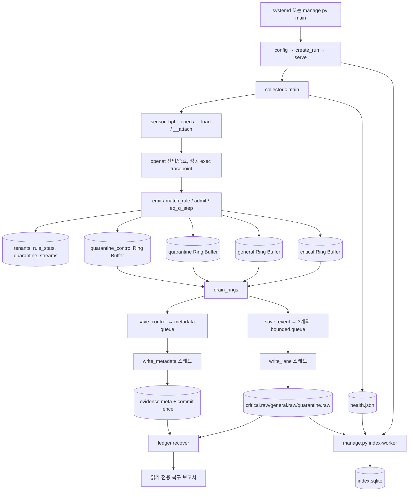
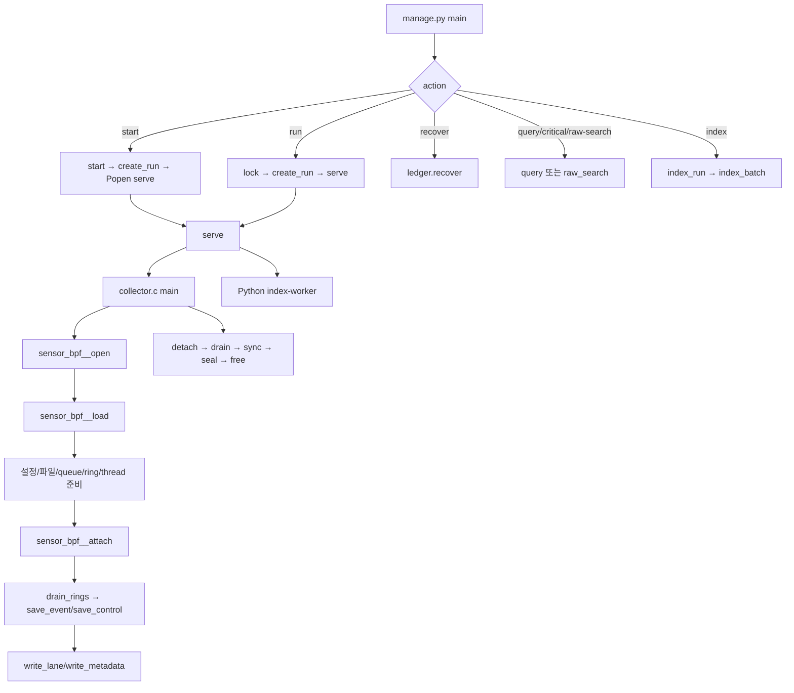
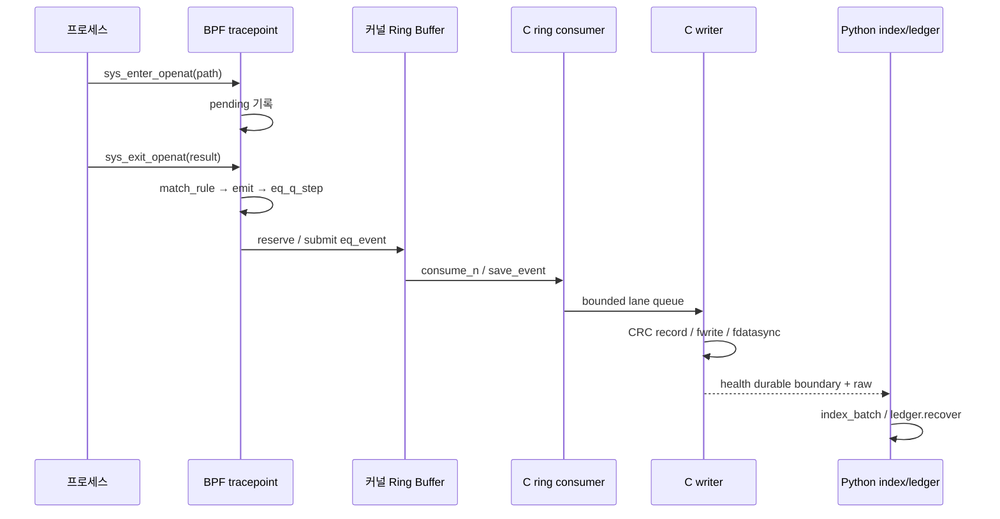

# MGlogWH 전체 소스코드 학습서 (한국어)

> **기준 소스**: `habang2222/MGlogWH` — 2026-10-15 확인한 커밋 `e6ff2b9922086d2167fe0483a0616adda55d3a50`. 모든 소스 링크는 당시 커밋에 고정하였다. **소스 읽기 학습용**으로 작성했으며, 프로젝트 README나 설계 의도만 옮긴 요약이 아니다.
>
> **검증 범위**: GitHub에서 코드와 파일 트리를 확인하였다. 이 문서를 작성하면서 Linux/WSL 센서를 실제로 빌드·실행하거나 단위 테스트를 수행하지 않았다. 문서 안의 테스트는 테스트 **코드가 검사하는 것**이지 이 작업에서 새로 통과시킨 결과가 아니다. 기존 `validation/` 자료에 보고된 실험도 별도 기록으로 취급한다.
>
> **학습 원칙**: 먼저 의미를 이해하고, 바로 아래의 실제 코드·줄 번호를 대조한다. 모든 함수 해설의 원본 코드는 중간을 임의 생략하지 않고 해당 함수 정의 구간을 싣는다. 코드를 수정해도 된다는 과제가 있더라도 이 작업은 프로그램 자체를 수정하지 않는다.

## 시작 전에 알아둘 기초 문법

| 개념 | 의미 | 이 프로젝트에서 찾을 곳 |
|---|---|---|
| 변수와 주소 | `&x`는 x의 주소, `*p`는 포인터 p가 가리키는 값 | `collector.c`의 `&state_lock` |
| 구조체 | `struct`는 이름 붙인 필드들의 메모리 묶음 | `eq_event`, `eq_quarantine_episode` |
| 멤버 연산자 | `p->field`는 `(*p).field`와 같다 | `e->pid`, `lane->count` |
| 배열과 포인터 | 배열은 고정 길이 연속 데이터, 포인터는 메모리 주소 | `lanes[3]`·`ring_buffer *rings[4]` |
| enum | 의미를 가진 정수 상수 묶음 | `EQ_BULK`, `EQ_CRITICAL` |
| 비트마스크 | 일부 비트를 `&`로 추출하고 `|`로 설정한다 | `quality`에서 rule ID 추출 |
| 전처리 | `#define`은 컴파일 전에 값·코드 조각을 치환 | `EQ_PATH`·`EQ_RULES` |
| static | C 파일 내부에서만 이름을 볼 수 있게 하거나 정적 저장 기간을 준다 | `static struct lane lanes[]` |
| 호출 스택 | 함수를 부르면 실행 흐름이 해당 함수로 이동했다가 반환 | `main`→`sensor_bpf__load` |
| 힙 할당 | `calloc`/`malloc`은 명시적 `free`가 필요한 데이터 공간 | lane 큐·metadata 큐 |
| 사용자 공간/커널 | 일반 프로세스 메모리·권한과 OS kernel 메모리·권한 구분 | collector↔eBPF |
| syscall | 프로세스가 커널에 요청하는 API. `openat`는 파일 열기 | sys_enter/exit_openat |
| tracepoint | 커널이 미리 제공하는 계측 지점 | `SEC("tp/...")` |
| eBPF map | 커널의 여러 BPF 실행 사이 상태를 공유하는 자료구조 | `tenants`·`pending` |
| Ring Buffer | 커널 데이터를 사용자 공간으로 흘리는 고정 크기 공유 버퍼 | `critical`·`general` |
| mutex | 여러 스레드가 공유 변수 변경을 동시에 하지 못하도록 잠금 | `state_lock` |
| condition variable | 작업이 생겼을 때 스레드를 깨우는 동기화 도구 | `pthread_cond_signal` |
| CAS | 값이 예상 상태일 때만 원자적으로 변경하는 연산 | `admit`·stream lock |
| CRC32 | 우발 손상을 탐지하는 짧은 checksum. 변조 방지 서명은 아니다 | raw record/journal frame |
| durable | 버퍼에 써 놓았다는 것과 달리 fdatasync/fsync 성공으로 게시된 경계 | `sync_lane`·`meta_sync` |
| ABI | C/Python/커널 사이 같은 바이트 레이아웃이라는 계약 | 232B event + 8B CRC/reserved |
| CO-RE/BTF | 커널 타입 메타데이터를 이용한 BPF 필드 접근 호환 방식 | `BPF_CORE_READ` |

# PART 1. 프로젝트 전체 이해

MGlogWH는 **Linux의 openat 호출과 성공한 프로세스 실행을 관찰**하고, 사건 중요도·격리 정책에 따라 커널 Ring Buffer와 사용자 공간 저장 경로를 나누며, 수집 자체가 실패했을 때 어디까지 관측/보존했는지 확인 가능한 근거를 남기려는 수집기다. 무조건 모든 로그를 저장해 준다는 보장은 없다. 수집량이 파일 시스템/큐 속도를 초과하면 중요 이벤트도 누락될 수 있다.

구성 요소는 다음과 같다. `sensor.bpf.c`는 커널 이벤트 캡처·규칙 평가·BULK 예산·격리 분기를 담당한다. `collector.c`는 BPF 로드·ring callback·고정 크기 큐·독립 기록 스레드·metadata checkpoint를 담당한다. `manage.py`는 설정·실행·중지·조회·SQLite 인덱스를 담당한다. `ledger.py`는 **기존 파일을 수정하지 않고** 커밋된 원장과 raw를 검증하여 복구 보고서를 만든다.



위 다이어그램의 중요한 구분은 **Python이 raw 이벤트를 직접 수집하지 않는다는 것**이다. Python은 C 수집기와 인덱서를 관리하고, C는 BPF에서 가져온 이벤트를 디스크에 쓴다. 정상 종료 시 C는 detach→ring drain→큐 닫기→writer join/sync→metadata seal/commit→스냅샷 정리로 진행한다.

# PART 2. 파일 및 디렉터리 인벤토리

Git tree에 등록된 소스·설정·테스트뿐 아니라 validation 하위 실험 파일도 목록에서 빠뜨리지 않는다. 파일 링크는 읽은 커밋의 실제 위치를 가리킨다.

| 경로 | 역할과 연결 관계 | 링크 |
|---|---|---|
| `.gitattributes` | Git 관리·문서·설정 자료 | [221 B](https://github.com/habang2222/MGlogWH/blob/e6ff2b9922086d2167fe0483a0616adda55d3a50/.gitattributes) |
| `.gitignore` | Git 관리·문서·설정 자료 | [327 B](https://github.com/habang2222/MGlogWH/blob/e6ff2b9922086d2167fe0483a0616adda55d3a50/.gitignore) |
| `LEDGER.md` | 증거·손실 해석 계약 | [14273 B](https://github.com/habang2222/MGlogWH/blob/e6ff2b9922086d2167fe0483a0616adda55d3a50/LEDGER.md) |
| `Makefile` | 클랭 BPF·skeleton·collector·테스트 빌드 | [1723 B](https://github.com/habang2222/MGlogWH/blob/e6ff2b9922086d2167fe0483a0616adda55d3a50/Makefile) |
| `QUARANTINE.md` | 격리 정책 설명 | [11578 B](https://github.com/habang2222/MGlogWH/blob/e6ff2b9922086d2167fe0483a0616adda55d3a50/QUARANTINE.md) |
| `README.md` | 설치·사용 안내, 실제 구현과 다른 경우 소스 우선 | [8666 B](https://github.com/habang2222/MGlogWH/blob/e6ff2b9922086d2167fe0483a0616adda55d3a50/README.md) |
| `RULES.md` | 규칙 정책 설명 | [8330 B](https://github.com/habang2222/MGlogWH/blob/e6ff2b9922086d2167fe0483a0616adda55d3a50/RULES.md) |
| `THIRD_PARTY.md` | 외부 소스·라이선스 고지 | [7173 B](https://github.com/habang2222/MGlogWH/blob/e6ff2b9922086d2167fe0483a0616adda55d3a50/THIRD_PARTY.md) |
| `collector.c` | 사용자 공간 이벤트 수신, raw writer, metadata, 건강도·종료 | [66802 B](https://github.com/habang2222/MGlogWH/blob/e6ff2b9922086d2167fe0483a0616adda55d3a50/collector.c) |
| `config.json` | 기본값 및 구형 critical rule 예 | [605 B](https://github.com/habang2222/MGlogWH/blob/e6ff2b9922086d2167fe0483a0616adda55d3a50/config.json) |
| `event.h` | event/record ABI, 버전·quality 비트 | [1648 B](https://github.com/habang2222/MGlogWH/blob/e6ff2b9922086d2167fe0483a0616adda55d3a50/event.h) |
| `examples/A-nonroot-etc-write.json` | 규칙 설정 예제 | [960 B](https://github.com/habang2222/MGlogWH/blob/e6ff2b9922086d2167fe0483a0616adda55d3a50/examples/A-nonroot-etc-write.json) |
| `examples/B-cgroup-shell-exec.json` | 규칙 설정 예제 | [853 B](https://github.com/habang2222/MGlogWH/blob/e6ff2b9922086d2167fe0483a0616adda55d3a50/examples/B-cgroup-shell-exec.json) |
| `examples/C-shadow-exempt.json` | 규칙 설정 예제 | [819 B](https://github.com/habang2222/MGlogWH/blob/e6ff2b9922086d2167fe0483a0616adda55d3a50/examples/C-shadow-exempt.json) |
| `examples/D-uid-specific-file.json` | 규칙 설정 예제 | [855 B](https://github.com/habang2222/MGlogWH/blob/e6ff2b9922086d2167fe0483a0616adda55d3a50/examples/D-uid-specific-file.json) |
| `install-ubuntu.sh` | 컴파일 결과·소스의 root-owned 설치 | [5480 B](https://github.com/habang2222/MGlogWH/blob/e6ff2b9922086d2167fe0483a0616adda55d3a50/install-ubuntu.sh) |
| `ledger.py` | 커밋된 원장·raw 읽기 전용 복구 | [62871 B](https://github.com/habang2222/MGlogWH/blob/e6ff2b9922086d2167fe0483a0616adda55d3a50/ledger.py) |
| `licenses/GPL-2.0.txt` | 외부 라이선스 원문 | [18092 B](https://github.com/habang2222/MGlogWH/blob/e6ff2b9922086d2167fe0483a0616adda55d3a50/licenses/GPL-2.0.txt) |
| `licenses/bootstrap-BSD-3-Clause.txt` | 외부 라이선스 원문 | [1523 B](https://github.com/habang2222/MGlogWH/blob/e6ff2b9922086d2167fe0483a0616adda55d3a50/licenses/bootstrap-BSD-3-Clause.txt) |
| `licenses/libbpf-BSD-2-Clause.txt` | 외부 라이선스 원문 | [1649 B](https://github.com/habang2222/MGlogWH/blob/e6ff2b9922086d2167fe0483a0616adda55d3a50/licenses/libbpf-BSD-2-Clause.txt) |
| `manage.py` | CLI, 설정, supervisor, SQLite·검색 | [67194 B](https://github.com/habang2222/MGlogWH/blob/e6ff2b9922086d2167fe0483a0616adda55d3a50/manage.py) |
| `packaging/mglogwh.logrotate` | 텍스트 진단 로그 회전 | [229 B](https://github.com/habang2222/MGlogWH/blob/e6ff2b9922086d2167fe0483a0616adda55d3a50/packaging/mglogwh.logrotate) |
| `packaging/mglogwh.service` | systemd 서비스 사전검사와 실행 | [769 B](https://github.com/habang2222/MGlogWH/blob/e6ff2b9922086d2167fe0483a0616adda55d3a50/packaging/mglogwh.service) |
| `quarantine.h` | 격리 상태 머신과 샘플 정책 | [12440 B](https://github.com/habang2222/MGlogWH/blob/e6ff2b9922086d2167fe0483a0616adda55d3a50/quarantine.h) |
| `rules.h` | fixed rule ABI, 3값 evaluator | [11218 B](https://github.com/habang2222/MGlogWH/blob/e6ff2b9922086d2167fe0483a0616adda55d3a50/rules.h) |
| `sensor.bpf.c` | 커널 tracepoint, BPF 맵, emit 및 정책/예산 적용 | [24529 B](https://github.com/habang2222/MGlogWH/blob/e6ff2b9922086d2167fe0483a0616adda55d3a50/sensor.bpf.c) |
| `tenant.h` | cgroup 단위 카운터와 시퀀스 | [523 B](https://github.com/habang2222/MGlogWH/blob/e6ff2b9922086d2167fe0483a0616adda55d3a50/tenant.h) |
| `test_budget.py` | 낮은 BULK 예산 수집 통합 검증(명시 실행) | [2348 B](https://github.com/habang2222/MGlogWH/blob/e6ff2b9922086d2167fe0483a0616adda55d3a50/test_budget.py) |
| `test_ledger.py` | 원장 해석·복구 fixture 테스트 | [38255 B](https://github.com/habang2222/MGlogWH/blob/e6ff2b9922086d2167fe0483a0616adda55d3a50/test_ledger.py) |
| `test_live.py` | 실제 프로브/색인 장애 smoke 테스트(명시 실행) | [3966 B](https://github.com/habang2222/MGlogWH/blob/e6ff2b9922086d2167fe0483a0616adda55d3a50/test_live.py) |
| `test_manage.py` | 설정·인덱스·파일 경로·lock 시험 | [30137 B](https://github.com/habang2222/MGlogWH/blob/e6ff2b9922086d2167fe0483a0616adda55d3a50/test_manage.py) |
| `test_quarantine.c` | 격리 정책 단위 테스트 | [11276 B](https://github.com/habang2222/MGlogWH/blob/e6ff2b9922086d2167fe0483a0616adda55d3a50/test_quarantine.c) |
| `test_rules.c` | 규칙 evaluator 단위 테스트 | [10562 B](https://github.com/habang2222/MGlogWH/blob/e6ff2b9922086d2167fe0483a0616adda55d3a50/test_rules.c) |
| `test_writer.c` | raw/metadata writer 검증 | [17566 B](https://github.com/habang2222/MGlogWH/blob/e6ff2b9922086d2167fe0483a0616adda55d3a50/test_writer.c) |
| `validation/2026-10-14/CORRECTION-eb9c888.md` | 버전·날짜가 고정된 벤치·검증 스크립트 또는 결과 산출물 | [3365 B](https://github.com/habang2222/MGlogWH/blob/e6ff2b9922086d2167fe0483a0616adda55d3a50/validation/2026-10-14/CORRECTION-eb9c888.md) |
| `validation/2026-10-14/REVIEW.md` | 버전·날짜가 고정된 벤치·검증 스크립트 또는 결과 산출물 | [22545 B](https://github.com/habang2222/MGlogWH/blob/e6ff2b9922086d2167fe0483a0616adda55d3a50/validation/2026-10-14/REVIEW.md) |
| `validation/2026-10-14/artifact-hashes-eb9c888.json` | 버전·날짜가 고정된 벤치·검증 스크립트 또는 결과 산출물 | [21882 B](https://github.com/habang2222/MGlogWH/blob/e6ff2b9922086d2167fe0483a0616adda55d3a50/validation/2026-10-14/artifact-hashes-eb9c888.json) |
| `validation/2026-10-14/bench_workload.c` | 버전·날짜가 고정된 벤치·검증 스크립트 또는 결과 산출물 | [6151 B](https://github.com/habang2222/MGlogWH/blob/e6ff2b9922086d2167fe0483a0616adda55d3a50/validation/2026-10-14/bench_workload.c) |
| `validation/2026-10-14/configs/baseline.json` | 버전·날짜가 고정된 벤치·검증 스크립트 또는 결과 산출물 | [512 B](https://github.com/habang2222/MGlogWH/blob/e6ff2b9922086d2167fe0483a0616adda55d3a50/validation/2026-10-14/configs/baseline.json) |
| `validation/2026-10-14/configs/rule1.json` | 버전·날짜가 고정된 벤치·검증 스크립트 또는 결과 산출물 | [989 B](https://github.com/habang2222/MGlogWH/blob/e6ff2b9922086d2167fe0483a0616adda55d3a50/validation/2026-10-14/configs/rule1.json) |
| `validation/2026-10-14/configs/rule4.json` | 버전·날짜가 고정된 벤치·검증 스크립트 또는 결과 산출물 | [2351 B](https://github.com/habang2222/MGlogWH/blob/e6ff2b9922086d2167fe0483a0616adda55d3a50/validation/2026-10-14/configs/rule4.json) |
| `validation/2026-10-14/configs/rule8.json` | 버전·날짜가 고정된 벤치·검증 스크립트 또는 결과 산출물 | [4167 B](https://github.com/habang2222/MGlogWH/blob/e6ff2b9922086d2167fe0483a0616adda55d3a50/validation/2026-10-14/configs/rule8.json) |
| `validation/2026-10-14/controlroom-live-evidence.json` | 버전·날짜가 고정된 벤치·검증 스크립트 또는 결과 산출물 | [1031 B](https://github.com/habang2222/MGlogWH/blob/e6ff2b9922086d2167fe0483a0616adda55d3a50/validation/2026-10-14/controlroom-live-evidence.json) |
| `validation/2026-10-14/corrected_summary-eb9c888.json` | 버전·날짜가 고정된 벤치·검증 스크립트 또는 결과 산출물 | [49259 B](https://github.com/habang2222/MGlogWH/blob/e6ff2b9922086d2167fe0483a0616adda55d3a50/validation/2026-10-14/corrected_summary-eb9c888.json) |
| `validation/2026-10-14/current-code-benchmark.md` | 버전·날짜가 고정된 벤치·검증 스크립트 또는 결과 산출물 | [3465 B](https://github.com/habang2222/MGlogWH/blob/e6ff2b9922086d2167fe0483a0616adda55d3a50/validation/2026-10-14/current-code-benchmark.md) |
| `validation/2026-10-14/environment.json` | 버전·날짜가 고정된 벤치·검증 스크립트 또는 결과 산출물 | [1943 B](https://github.com/habang2222/MGlogWH/blob/e6ff2b9922086d2167fe0483a0616adda55d3a50/validation/2026-10-14/environment.json) |
| `validation/2026-10-14/final-f9bd477/configs/legacy1.json` | 버전·날짜가 고정된 벤치·검증 스크립트 또는 결과 산출물 | [686 B](https://github.com/habang2222/MGlogWH/blob/e6ff2b9922086d2167fe0483a0616adda55d3a50/validation/2026-10-14/final-f9bd477/configs/legacy1.json) |
| `validation/2026-10-14/final-f9bd477/configs/rule1.json` | 버전·날짜가 고정된 벤치·검증 스크립트 또는 결과 산출물 | [993 B](https://github.com/habang2222/MGlogWH/blob/e6ff2b9922086d2167fe0483a0616adda55d3a50/validation/2026-10-14/final-f9bd477/configs/rule1.json) |
| `validation/2026-10-14/final-f9bd477/configs/rule4.json` | 버전·날짜가 고정된 벤치·검증 스크립트 또는 결과 산출물 | [2361 B](https://github.com/habang2222/MGlogWH/blob/e6ff2b9922086d2167fe0483a0616adda55d3a50/validation/2026-10-14/final-f9bd477/configs/rule4.json) |
| `validation/2026-10-14/final-f9bd477/configs/rule8.json` | 버전·날짜가 고정된 벤치·검증 스크립트 또는 결과 산출물 | [4185 B](https://github.com/habang2222/MGlogWH/blob/e6ff2b9922086d2167fe0483a0616adda55d3a50/validation/2026-10-14/final-f9bd477/configs/rule8.json) |
| `validation/2026-10-14/final-f9bd477/environment.json` | 버전·날짜가 고정된 벤치·검증 스크립트 또는 결과 산출물 | [2227 B](https://github.com/habang2222/MGlogWH/blob/e6ff2b9922086d2167fe0483a0616adda55d3a50/validation/2026-10-14/final-f9bd477/environment.json) |
| `validation/2026-10-14/final-f9bd477/runs/legacy1-r1.json` | 버전·날짜가 고정된 벤치·검증 스크립트 또는 결과 산출물 | [55594 B](https://github.com/habang2222/MGlogWH/blob/e6ff2b9922086d2167fe0483a0616adda55d3a50/validation/2026-10-14/final-f9bd477/runs/legacy1-r1.json) |
| `validation/2026-10-14/final-f9bd477/runs/legacy1-r2.json` | 버전·날짜가 고정된 벤치·검증 스크립트 또는 결과 산출물 | [50316 B](https://github.com/habang2222/MGlogWH/blob/e6ff2b9922086d2167fe0483a0616adda55d3a50/validation/2026-10-14/final-f9bd477/runs/legacy1-r2.json) |
| `validation/2026-10-14/final-f9bd477/runs/legacy1-r3.json` | 버전·날짜가 고정된 벤치·검증 스크립트 또는 결과 산출물 | [50319 B](https://github.com/habang2222/MGlogWH/blob/e6ff2b9922086d2167fe0483a0616adda55d3a50/validation/2026-10-14/final-f9bd477/runs/legacy1-r3.json) |
| `validation/2026-10-14/final-f9bd477/runs/rule1-r1.json` | 버전·날짜가 고정된 벤치·검증 스크립트 또는 결과 산출물 | [62802 B](https://github.com/habang2222/MGlogWH/blob/e6ff2b9922086d2167fe0483a0616adda55d3a50/validation/2026-10-14/final-f9bd477/runs/rule1-r1.json) |
| `validation/2026-10-14/final-f9bd477/runs/rule1-r2.json` | 버전·날짜가 고정된 벤치·검증 스크립트 또는 결과 산출물 | [52201 B](https://github.com/habang2222/MGlogWH/blob/e6ff2b9922086d2167fe0483a0616adda55d3a50/validation/2026-10-14/final-f9bd477/runs/rule1-r2.json) |
| `validation/2026-10-14/final-f9bd477/runs/rule1-r3.json` | 버전·날짜가 고정된 벤치·검증 스크립트 또는 결과 산출물 | [50498 B](https://github.com/habang2222/MGlogWH/blob/e6ff2b9922086d2167fe0483a0616adda55d3a50/validation/2026-10-14/final-f9bd477/runs/rule1-r3.json) |
| `validation/2026-10-14/final-f9bd477/runs/rule4-r1.json` | 버전·날짜가 고정된 벤치·검증 스크립트 또는 결과 산출물 | [63967 B](https://github.com/habang2222/MGlogWH/blob/e6ff2b9922086d2167fe0483a0616adda55d3a50/validation/2026-10-14/final-f9bd477/runs/rule4-r1.json) |
| `validation/2026-10-14/final-f9bd477/runs/rule4-r2.json` | 버전·날짜가 고정된 벤치·검증 스크립트 또는 결과 산출물 | [63968 B](https://github.com/habang2222/MGlogWH/blob/e6ff2b9922086d2167fe0483a0616adda55d3a50/validation/2026-10-14/final-f9bd477/runs/rule4-r2.json) |
| `validation/2026-10-14/final-f9bd477/runs/rule4-r3.json` | 버전·날짜가 고정된 벤치·검증 스크립트 또는 결과 산출물 | [65775 B](https://github.com/habang2222/MGlogWH/blob/e6ff2b9922086d2167fe0483a0616adda55d3a50/validation/2026-10-14/final-f9bd477/runs/rule4-r3.json) |
| `validation/2026-10-14/final-f9bd477/runs/rule8-r1.json` | 버전·날짜가 고정된 벤치·검증 스크립트 또는 결과 산출물 | [86165 B](https://github.com/habang2222/MGlogWH/blob/e6ff2b9922086d2167fe0483a0616adda55d3a50/validation/2026-10-14/final-f9bd477/runs/rule8-r1.json) |
| `validation/2026-10-14/final-f9bd477/runs/rule8-r2.json` | 버전·날짜가 고정된 벤치·검증 스크립트 또는 결과 산출물 | [84310 B](https://github.com/habang2222/MGlogWH/blob/e6ff2b9922086d2167fe0483a0616adda55d3a50/validation/2026-10-14/final-f9bd477/runs/rule8-r2.json) |
| `validation/2026-10-14/final-f9bd477/runs/rule8-r3.json` | 버전·날짜가 고정된 벤치·검증 스크립트 또는 결과 산출물 | [87924 B](https://github.com/habang2222/MGlogWH/blob/e6ff2b9922086d2167fe0483a0616adda55d3a50/validation/2026-10-14/final-f9bd477/runs/rule8-r3.json) |
| `validation/2026-10-14/final-f9bd477/summary.json` | 버전·날짜가 고정된 벤치·검증 스크립트 또는 결과 산출물 | [5202 B](https://github.com/habang2222/MGlogWH/blob/e6ff2b9922086d2167fe0483a0616adda55d3a50/validation/2026-10-14/final-f9bd477/summary.json) |
| `validation/2026-10-14/hash_artifacts.py` | 버전·날짜가 고정된 벤치·검증 스크립트 또는 결과 산출물 | [1498 B](https://github.com/habang2222/MGlogWH/blob/e6ff2b9922086d2167fe0483a0616adda55d3a50/validation/2026-10-14/hash_artifacts.py) |
| `validation/2026-10-14/path-matrix-288b454fc769/compile.stderr` | 버전·날짜가 고정된 벤치·검증 스크립트 또는 결과 산출물 | [0 B](https://github.com/habang2222/MGlogWH/blob/e6ff2b9922086d2167fe0483a0616adda55d3a50/validation/2026-10-14/path-matrix-288b454fc769/compile.stderr) |
| `validation/2026-10-14/path-matrix-288b454fc769/compile.stdout` | 버전·날짜가 고정된 벤치·검증 스크립트 또는 결과 산출물 | [0 B](https://github.com/habang2222/MGlogWH/blob/e6ff2b9922086d2167fe0483a0616adda55d3a50/validation/2026-10-14/path-matrix-288b454fc769/compile.stdout) |
| `validation/2026-10-14/path-matrix-288b454fc769/config.json` | 버전·날짜가 고정된 벤치·검증 스크립트 또는 결과 산출물 | [4594 B](https://github.com/habang2222/MGlogWH/blob/e6ff2b9922086d2167fe0483a0616adda55d3a50/validation/2026-10-14/path-matrix-288b454fc769/config.json) |
| `validation/2026-10-14/path-matrix-288b454fc769/health.json` | 버전·날짜가 고정된 벤치·검증 스크립트 또는 결과 산출물 | [18210 B](https://github.com/habang2222/MGlogWH/blob/e6ff2b9922086d2167fe0483a0616adda55d3a50/validation/2026-10-14/path-matrix-288b454fc769/health.json) |
| `validation/2026-10-14/path-matrix-288b454fc769/index-health.json` | 버전·날짜가 고정된 벤치·검증 스크립트 또는 결과 산출물 | [1121 B](https://github.com/habang2222/MGlogWH/blob/e6ff2b9922086d2167fe0483a0616adda55d3a50/validation/2026-10-14/path-matrix-288b454fc769/index-health.json) |
| `validation/2026-10-14/path-matrix-288b454fc769/manifest.json` | 버전·날짜가 고정된 벤치·검증 스크립트 또는 결과 산출물 | [2534 B](https://github.com/habang2222/MGlogWH/blob/e6ff2b9922086d2167fe0483a0616adda55d3a50/validation/2026-10-14/path-matrix-288b454fc769/manifest.json) |
| `validation/2026-10-14/path-matrix-288b454fc769/probe.stderr` | 버전·날짜가 고정된 벤치·검증 스크립트 또는 결과 산출물 | [0 B](https://github.com/habang2222/MGlogWH/blob/e6ff2b9922086d2167fe0483a0616adda55d3a50/validation/2026-10-14/path-matrix-288b454fc769/probe.stderr) |
| `validation/2026-10-14/path-matrix-288b454fc769/probe.stdout` | 버전·날짜가 고정된 벤치·검증 스크립트 또는 결과 산출물 | [0 B](https://github.com/habang2222/MGlogWH/blob/e6ff2b9922086d2167fe0483a0616adda55d3a50/validation/2026-10-14/path-matrix-288b454fc769/probe.stdout) |
| `validation/2026-10-14/path-matrix-288b454fc769/recover.stderr` | 버전·날짜가 고정된 벤치·검증 스크립트 또는 결과 산출물 | [0 B](https://github.com/habang2222/MGlogWH/blob/e6ff2b9922086d2167fe0483a0616adda55d3a50/validation/2026-10-14/path-matrix-288b454fc769/recover.stderr) |
| `validation/2026-10-14/path-matrix-288b454fc769/recover.stdout` | 버전·날짜가 고정된 벤치·검증 스크립트 또는 결과 산출물 | [59747 B](https://github.com/habang2222/MGlogWH/blob/e6ff2b9922086d2167fe0483a0616adda55d3a50/validation/2026-10-14/path-matrix-288b454fc769/recover.stdout) |
| `validation/2026-10-14/path-matrix-288b454fc769/result.json` | 버전·날짜가 고정된 벤치·검증 스크립트 또는 결과 산출물 | [78940 B](https://github.com/habang2222/MGlogWH/blob/e6ff2b9922086d2167fe0483a0616adda55d3a50/validation/2026-10-14/path-matrix-288b454fc769/result.json) |
| `validation/2026-10-14/path-matrix-288b454fc769/start.stderr` | 버전·날짜가 고정된 벤치·검증 스크립트 또는 결과 산출물 | [0 B](https://github.com/habang2222/MGlogWH/blob/e6ff2b9922086d2167fe0483a0616adda55d3a50/validation/2026-10-14/path-matrix-288b454fc769/start.stderr) |
| `validation/2026-10-14/path-matrix-288b454fc769/start.stdout` | 버전·날짜가 고정된 벤치·검증 스크립트 또는 결과 산출물 | [19511 B](https://github.com/habang2222/MGlogWH/blob/e6ff2b9922086d2167fe0483a0616adda55d3a50/validation/2026-10-14/path-matrix-288b454fc769/start.stdout) |
| `validation/2026-10-14/path-matrix-288b454fc769/stop.stderr` | 버전·날짜가 고정된 벤치·검증 스크립트 또는 결과 산출물 | [0 B](https://github.com/habang2222/MGlogWH/blob/e6ff2b9922086d2167fe0483a0616adda55d3a50/validation/2026-10-14/path-matrix-288b454fc769/stop.stderr) |
| `validation/2026-10-14/path-matrix-288b454fc769/stop.stdout` | 버전·날짜가 고정된 벤치·검증 스크립트 또는 결과 산출물 | [40491 B](https://github.com/habang2222/MGlogWH/blob/e6ff2b9922086d2167fe0483a0616adda55d3a50/validation/2026-10-14/path-matrix-288b454fc769/stop.stdout) |
| `validation/2026-10-14/path-matrix-288b454fc769/truth.csv` | 버전·날짜가 고정된 벤치·검증 스크립트 또는 결과 산출물 | [1788 B](https://github.com/habang2222/MGlogWH/blob/e6ff2b9922086d2167fe0483a0616adda55d3a50/validation/2026-10-14/path-matrix-288b454fc769/truth.csv) |
| `validation/2026-10-14/path-matrix-288b454fc769/validate.stderr` | 버전·날짜가 고정된 벤치·검증 스크립트 또는 결과 산출물 | [0 B](https://github.com/habang2222/MGlogWH/blob/e6ff2b9922086d2167fe0483a0616adda55d3a50/validation/2026-10-14/path-matrix-288b454fc769/validate.stderr) |
| `validation/2026-10-14/path-matrix-288b454fc769/validate.stdout` | 버전·날짜가 고정된 벤치·검증 스크립트 또는 결과 산출물 | [11846 B](https://github.com/habang2222/MGlogWH/blob/e6ff2b9922086d2167fe0483a0616adda55d3a50/validation/2026-10-14/path-matrix-288b454fc769/validate.stdout) |
| `validation/2026-10-14/path-matrix-7c1ccb849a3f/CORRECTION.md` | 버전·날짜가 고정된 벤치·검증 스크립트 또는 결과 산출물 | [978 B](https://github.com/habang2222/MGlogWH/blob/e6ff2b9922086d2167fe0483a0616adda55d3a50/validation/2026-10-14/path-matrix-7c1ccb849a3f/CORRECTION.md) |
| `validation/2026-10-14/path-matrix-7c1ccb849a3f/compile.stderr` | 버전·날짜가 고정된 벤치·검증 스크립트 또는 결과 산출물 | [0 B](https://github.com/habang2222/MGlogWH/blob/e6ff2b9922086d2167fe0483a0616adda55d3a50/validation/2026-10-14/path-matrix-7c1ccb849a3f/compile.stderr) |
| `validation/2026-10-14/path-matrix-7c1ccb849a3f/compile.stdout` | 버전·날짜가 고정된 벤치·검증 스크립트 또는 결과 산출물 | [0 B](https://github.com/habang2222/MGlogWH/blob/e6ff2b9922086d2167fe0483a0616adda55d3a50/validation/2026-10-14/path-matrix-7c1ccb849a3f/compile.stdout) |
| `validation/2026-10-14/path-matrix-7c1ccb849a3f/config.json` | 버전·날짜가 고정된 벤치·검증 스크립트 또는 결과 산출물 | [4594 B](https://github.com/habang2222/MGlogWH/blob/e6ff2b9922086d2167fe0483a0616adda55d3a50/validation/2026-10-14/path-matrix-7c1ccb849a3f/config.json) |
| `validation/2026-10-14/path-matrix-7c1ccb849a3f/health.json` | 버전·날짜가 고정된 벤치·검증 스크립트 또는 결과 산출물 | [18448 B](https://github.com/habang2222/MGlogWH/blob/e6ff2b9922086d2167fe0483a0616adda55d3a50/validation/2026-10-14/path-matrix-7c1ccb849a3f/health.json) |
| `validation/2026-10-14/path-matrix-7c1ccb849a3f/index-health.json` | 버전·날짜가 고정된 벤치·검증 스크립트 또는 결과 산출물 | [1119 B](https://github.com/habang2222/MGlogWH/blob/e6ff2b9922086d2167fe0483a0616adda55d3a50/validation/2026-10-14/path-matrix-7c1ccb849a3f/index-health.json) |
| `validation/2026-10-14/path-matrix-7c1ccb849a3f/manifest.json` | 버전·날짜가 고정된 벤치·검증 스크립트 또는 결과 산출물 | [2533 B](https://github.com/habang2222/MGlogWH/blob/e6ff2b9922086d2167fe0483a0616adda55d3a50/validation/2026-10-14/path-matrix-7c1ccb849a3f/manifest.json) |
| `validation/2026-10-14/path-matrix-7c1ccb849a3f/probe.stderr` | 버전·날짜가 고정된 벤치·검증 스크립트 또는 결과 산출물 | [0 B](https://github.com/habang2222/MGlogWH/blob/e6ff2b9922086d2167fe0483a0616adda55d3a50/validation/2026-10-14/path-matrix-7c1ccb849a3f/probe.stderr) |
| `validation/2026-10-14/path-matrix-7c1ccb849a3f/probe.stdout` | 버전·날짜가 고정된 벤치·검증 스크립트 또는 결과 산출물 | [0 B](https://github.com/habang2222/MGlogWH/blob/e6ff2b9922086d2167fe0483a0616adda55d3a50/validation/2026-10-14/path-matrix-7c1ccb849a3f/probe.stdout) |
| `validation/2026-10-14/path-matrix-7c1ccb849a3f/recover.stderr` | 버전·날짜가 고정된 벤치·검증 스크립트 또는 결과 산출물 | [0 B](https://github.com/habang2222/MGlogWH/blob/e6ff2b9922086d2167fe0483a0616adda55d3a50/validation/2026-10-14/path-matrix-7c1ccb849a3f/recover.stderr) |
| `validation/2026-10-14/path-matrix-7c1ccb849a3f/recover.stdout` | 버전·날짜가 고정된 벤치·검증 스크립트 또는 결과 산출물 | [60558 B](https://github.com/habang2222/MGlogWH/blob/e6ff2b9922086d2167fe0483a0616adda55d3a50/validation/2026-10-14/path-matrix-7c1ccb849a3f/recover.stdout) |
| `validation/2026-10-14/path-matrix-7c1ccb849a3f/result.json` | 버전·날짜가 고정된 벤치·검증 스크립트 또는 결과 산출물 | [74598 B](https://github.com/habang2222/MGlogWH/blob/e6ff2b9922086d2167fe0483a0616adda55d3a50/validation/2026-10-14/path-matrix-7c1ccb849a3f/result.json) |
| `validation/2026-10-14/path-matrix-7c1ccb849a3f/start.stderr` | 버전·날짜가 고정된 벤치·검증 스크립트 또는 결과 산출물 | [0 B](https://github.com/habang2222/MGlogWH/blob/e6ff2b9922086d2167fe0483a0616adda55d3a50/validation/2026-10-14/path-matrix-7c1ccb849a3f/start.stderr) |
| `validation/2026-10-14/path-matrix-7c1ccb849a3f/start.stdout` | 버전·날짜가 고정된 벤치·검증 스크립트 또는 결과 산출물 | [19510 B](https://github.com/habang2222/MGlogWH/blob/e6ff2b9922086d2167fe0483a0616adda55d3a50/validation/2026-10-14/path-matrix-7c1ccb849a3f/start.stdout) |
| `validation/2026-10-14/path-matrix-7c1ccb849a3f/stop.stderr` | 버전·날짜가 고정된 벤치·검증 스크립트 또는 결과 산출물 | [0 B](https://github.com/habang2222/MGlogWH/blob/e6ff2b9922086d2167fe0483a0616adda55d3a50/validation/2026-10-14/path-matrix-7c1ccb849a3f/stop.stderr) |
| `validation/2026-10-14/path-matrix-7c1ccb849a3f/stop.stdout` | 버전·날짜가 고정된 벤치·검증 스크립트 또는 결과 산출물 | [40903 B](https://github.com/habang2222/MGlogWH/blob/e6ff2b9922086d2167fe0483a0616adda55d3a50/validation/2026-10-14/path-matrix-7c1ccb849a3f/stop.stdout) |
| `validation/2026-10-14/path-matrix-7c1ccb849a3f/truth.csv` | 버전·날짜가 고정된 벤치·검증 스크립트 또는 결과 산출물 | [1772 B](https://github.com/habang2222/MGlogWH/blob/e6ff2b9922086d2167fe0483a0616adda55d3a50/validation/2026-10-14/path-matrix-7c1ccb849a3f/truth.csv) |
| `validation/2026-10-14/path-matrix-7c1ccb849a3f/validate.stderr` | 버전·날짜가 고정된 벤치·검증 스크립트 또는 결과 산출물 | [0 B](https://github.com/habang2222/MGlogWH/blob/e6ff2b9922086d2167fe0483a0616adda55d3a50/validation/2026-10-14/path-matrix-7c1ccb849a3f/validate.stderr) |
| `validation/2026-10-14/path-matrix-7c1ccb849a3f/validate.stdout` | 버전·날짜가 고정된 벤치·검증 스크립트 또는 결과 산출물 | [11846 B](https://github.com/habang2222/MGlogWH/blob/e6ff2b9922086d2167fe0483a0616adda55d3a50/validation/2026-10-14/path-matrix-7c1ccb849a3f/validate.stdout) |
| `validation/2026-10-14/path_matrix_probe.c` | 버전·날짜가 고정된 벤치·검증 스크립트 또는 결과 산출물 | [4905 B](https://github.com/habang2222/MGlogWH/blob/e6ff2b9922086d2167fe0483a0616adda55d3a50/validation/2026-10-14/path_matrix_probe.c) |
| `validation/2026-10-14/pilot-15k.json` | 버전·날짜가 고정된 벤치·검증 스크립트 또는 결과 산출물 | [779 B](https://github.com/habang2222/MGlogWH/blob/e6ff2b9922086d2167fe0483a0616adda55d3a50/validation/2026-10-14/pilot-15k.json) |
| `validation/2026-10-14/run_benchmark.py` | 버전·날짜가 고정된 벤치·검증 스크립트 또는 결과 산출물 | [13621 B](https://github.com/habang2222/MGlogWH/blob/e6ff2b9922086d2167fe0483a0616adda55d3a50/validation/2026-10-14/run_benchmark.py) |
| `validation/2026-10-14/run_benchmark_portable.py` | 버전·날짜가 고정된 벤치·검증 스크립트 또는 결과 산출물 | [16067 B](https://github.com/habang2222/MGlogWH/blob/e6ff2b9922086d2167fe0483a0616adda55d3a50/validation/2026-10-14/run_benchmark_portable.py) |
| `validation/2026-10-14/run_path_matrix.py` | 버전·날짜가 고정된 벤치·검증 스크립트 또는 결과 산출물 | [15806 B](https://github.com/habang2222/MGlogWH/blob/e6ff2b9922086d2167fe0483a0616adda55d3a50/validation/2026-10-14/run_path_matrix.py) |
| `validation/2026-10-14/runs/baseline-r1.json` | 버전·날짜가 고정된 벤치·검증 스크립트 또는 결과 산출물 | [31078 B](https://github.com/habang2222/MGlogWH/blob/e6ff2b9922086d2167fe0483a0616adda55d3a50/validation/2026-10-14/runs/baseline-r1.json) |
| `validation/2026-10-14/runs/baseline-r2.json` | 버전·날짜가 고정된 벤치·검증 스크립트 또는 결과 산출물 | [30180 B](https://github.com/habang2222/MGlogWH/blob/e6ff2b9922086d2167fe0483a0616adda55d3a50/validation/2026-10-14/runs/baseline-r2.json) |
| `validation/2026-10-14/runs/baseline-r3.json` | 버전·날짜가 고정된 벤치·검증 스크립트 또는 결과 산출물 | [31081 B](https://github.com/habang2222/MGlogWH/blob/e6ff2b9922086d2167fe0483a0616adda55d3a50/validation/2026-10-14/runs/baseline-r3.json) |
| `validation/2026-10-14/runs/rule1-r1.json` | 버전·날짜가 고정된 벤치·검증 스크립트 또는 결과 산출물 | [32862 B](https://github.com/habang2222/MGlogWH/blob/e6ff2b9922086d2167fe0483a0616adda55d3a50/validation/2026-10-14/runs/rule1-r1.json) |
| `validation/2026-10-14/runs/rule1-r2.json` | 버전·날짜가 고정된 벤치·검증 스크립트 또는 결과 산출물 | [31136 B](https://github.com/habang2222/MGlogWH/blob/e6ff2b9922086d2167fe0483a0616adda55d3a50/validation/2026-10-14/runs/rule1-r2.json) |
| `validation/2026-10-14/runs/rule1-r3.json` | 버전·날짜가 고정된 벤치·검증 스크립트 또는 결과 산출물 | [31137 B](https://github.com/habang2222/MGlogWH/blob/e6ff2b9922086d2167fe0483a0616adda55d3a50/validation/2026-10-14/runs/rule1-r3.json) |
| `validation/2026-10-14/runs/rule4-r1.json` | 버전·날짜가 고정된 벤치·검증 스크립트 또는 결과 산출물 | [39062 B](https://github.com/habang2222/MGlogWH/blob/e6ff2b9922086d2167fe0483a0616adda55d3a50/validation/2026-10-14/runs/rule4-r1.json) |
| `validation/2026-10-14/runs/rule4-r2.json` | 버전·날짜가 고정된 벤치·검증 스크립트 또는 결과 산출물 | [39093 B](https://github.com/habang2222/MGlogWH/blob/e6ff2b9922086d2167fe0483a0616adda55d3a50/validation/2026-10-14/runs/rule4-r2.json) |
| `validation/2026-10-14/runs/rule4-r3.json` | 버전·날짜가 고정된 벤치·검증 스크립트 또는 결과 산출물 | [39060 B](https://github.com/habang2222/MGlogWH/blob/e6ff2b9922086d2167fe0483a0616adda55d3a50/validation/2026-10-14/runs/rule4-r3.json) |
| `validation/2026-10-14/runs/rule8-r1.json` | 버전·날짜가 고정된 벤치·검증 스크립트 또는 결과 산출물 | [49697 B](https://github.com/habang2222/MGlogWH/blob/e6ff2b9922086d2167fe0483a0616adda55d3a50/validation/2026-10-14/runs/rule8-r1.json) |
| `validation/2026-10-14/runs/rule8-r2.json` | 버전·날짜가 고정된 벤치·검증 스크립트 또는 결과 산출물 | [49704 B](https://github.com/habang2222/MGlogWH/blob/e6ff2b9922086d2167fe0483a0616adda55d3a50/validation/2026-10-14/runs/rule8-r2.json) |
| `validation/2026-10-14/runs/rule8-r3.json` | 버전·날짜가 고정된 벤치·검증 스크립트 또는 결과 산출물 | [49677 B](https://github.com/habang2222/MGlogWH/blob/e6ff2b9922086d2167fe0483a0616adda55d3a50/validation/2026-10-14/runs/rule8-r3.json) |
| `validation/2026-10-14/source-eb9c888.tar` | 버전·날짜가 고정된 벤치·검증 스크립트 또는 결과 산출물 | [471040 B](https://github.com/habang2222/MGlogWH/blob/e6ff2b9922086d2167fe0483a0616adda55d3a50/validation/2026-10-14/source-eb9c888.tar) |
| `validation/2026-10-14/summarize_benchmark.py` | 버전·날짜가 고정된 벤치·검증 스크립트 또는 결과 산출물 | [11744 B](https://github.com/habang2222/MGlogWH/blob/e6ff2b9922086d2167fe0483a0616adda55d3a50/validation/2026-10-14/summarize_benchmark.py) |
| `validation/2026-10-14/summary.json` | 버전·날짜가 고정된 벤치·검증 스크립트 또는 결과 산출물 | [3955 B](https://github.com/habang2222/MGlogWH/blob/e6ff2b9922086d2167fe0483a0616adda55d3a50/validation/2026-10-14/summary.json) |
| `validation/2026-10-14/test_benchmark_portable.py` | 버전·날짜가 고정된 벤치·검증 스크립트 또는 결과 산출물 | [3032 B](https://github.com/habang2222/MGlogWH/blob/e6ff2b9922086d2167fe0483a0616adda55d3a50/validation/2026-10-14/test_benchmark_portable.py) |
| `validation/2026-10-14/verify_controlroom_run.py` | 버전·날짜가 고정된 벤치·검증 스크립트 또는 결과 산출물 | [4632 B](https://github.com/habang2222/MGlogWH/blob/e6ff2b9922086d2167fe0483a0616adda55d3a50/validation/2026-10-14/verify_controlroom_run.py) |


**소스와 빌드물 차이**: `sensor.bpf.c`는 편집하는 소스, `build/sensor.bpf.o`는 clang BPF 오브젝트, `build/sensor.skel.h`는 bpftool 생성 헤더, `build/collector`는 C 실행 파일이다. `build/`는 런타임 증거 저장 위치가 아니다. `critical.raw`·`general.raw`·`quarantine.raw`·`health.json`·`index.sqlite`·`evidence.meta`는 UUID run 디렉터리 안에 생기는 산출물이다. `validation/2026-10-14`의 보관 JSON은 현재 run의 raw 파일이 아니라 과거 실험 결과다.

# PART 3. 실행 시작점부터 종료까지

### Python 실행 진입점
[`manage.py main`](https://github.com/habang2222/MGlogWH/blob/e6ff2b9922086d2167fe0483a0616adda55d3a50/manage.py#L1146-L1246)는 `argparse`로 action·--config·--run·--run-dir 등을 읽는다. 파일 하단 `if __name__ == '__main__': main()`에서만 명령행 진입이 일어난다. `validate`는 config를 읽고 다음 run에 적용될 설정 diff를 출력할 뿐 현재 센서를 바꾸지 않는다.

`start` 경로: `main → config → ensure_data_dir → lock(control.lock) → start → lock(collector.lock) → create_run → subprocess.Popen(python manage.py serve --run ID)`. `run` 경로는 `main → lock → create_run → serve`이며 collector lock을 foreground 생명주기 동안 보유한다. `serve`는 run의 설정·manifest/rules.bin 무결성을 확인한 뒤 환경변수로 lineage를 전달하고 C collector와 index worker 자식을 관리한다.

### C 실행 진입점
[`collector.c int main(int argc, char **argv)`](https://github.com/habang2222/MGlogWH/blob/e6ff2b9922086d2167fe0483a0616adda55d3a50/collector.c#L1017-L1172)가 실행 파일 시작점이다. argc/argv와 lineage 환경변수를 확인하고 `sensor_bpf__open`, rodata 주입, `sensor_bpf__load`, `install_rule_strings`, 파일/큐 생성, metadata 스레드·raw writer 스레드 생성, 4개 Ring Buffer consumer 생성, `sensor_bpf__attach`, ring drain 스레드 기동 순으로 진행한다. 마지막 `done:`이 detach와 자원 정리의 공통 경로다.



`open_enter`·`open_exit`·`exec_event`는 C main이 **직접 호출하지 않는다**. 커널 tracepoint가 발생하면 커널이 BPF 프로그램을 호출한다. `save_event`는 `ring_buffer__consume_n`에 등록된 callback으로 호출되며 `write_lane`은 `pthread_create`의 별도 스레드 진입점이다. 따라서 호출 함수와 트리거 이벤트를 구분해야 한다.

## 실행 시 생성되는 상태

| 순서 | 함수 | 생성/변경되는 데이터 | 다음 단계 |
|---|---|---|---|
| 1 | `config` | 정상화된 Python dict | 필수 키·타입·범위·규칙 조건 검사 |
| 2 | `create_run` | UUID run/config/manifest/선택적 rules.bin/current.json | 디렉터리·공간·권한 통과 |
| 3 | C `main` | `skel`, rodata, BPF 맵, ring handle | `sensor_bpf__load` 성공 |
| 4 | `queue_init/meta_init` | 큐 용량·파일·조건변수 | 준비 후 attach |
| 5 | BPF `emit` | sequence/priority/quality와 제출 카운터 | 규칙/예산/격리 판단 |
| 6 | `save_event` | 큐 삽입 또는 사용자 공간 loss | ABI·저장/큐 한도 |
| 7 | `write_lane/sync_lane` | CRC record, durable bytes | 쓰기·fdatasync 성공 |
| 8 | `index_batch` | SQLite events/cursor | published durable 경계까지만 |
| 9 | `ledger.recover` | run 외부의 보고서 JSON | fence·CRC·lineage 확인 |

# PART 4. C/eBPF 함수별 원본 코드와 해설

이 PART는 각 주요 함수의 **정의 전체**, 매개변수·반환·호출·분기·예외/손실 경계를 다룬다. 연결 링크의 L번호가 실제 정의 위치다.


## sensor.bpf.c (14개 함수)

[원본 전체 보기](https://github.com/habang2222/MGlogWH/blob/e6ff2b9922086d2167fe0483a0616adda55d3a50/sensor.bpf.c#L1-L534)


#### fault — [sensor.bpf.c:111–114](https://github.com/habang2222/MGlogWH/blob/e6ff2b9922086d2167fe0483a0616adda55d3a50/sensor.bpf.c#L111-L114)

**함수 선언**: `static __always_inline void fault(__u32 key)`

**1. 목적**: 함수 본문에 표시한 연산과 조건을 통해 입력을 판정하거나 구조체·전역 상태를 변경한다. 원본 코드가 기능 근거다.

**2. 매개변수**: 선언의 괄호 안은 전달받는 값과 자료형이다. `T *`는 값이 있는 주소이며 `->`로 구조체를 접근한다. `const T *`는 이 포인터를 통한 수정을 제한한다. `void *ctx`는 callback 또는 스레드 시작 때 넘긴 실제 컨텍스트로 형변환한다. 인자 중 `&variable`로 전달되는 값은 호출자가 주소를 넘긴 것이다. 실제 인자 출처는 PART 3 호출 흐름과 연결한다.

**3. 반환**: 명시적 반환 없음/void 반환; 오류 의미(0, 양수, 음수, NULL, errno)는 바로 아래 조건·호출자와 대조한다.

**4. 내부 실행 순서**: 원본에 등장하는 주요 분기·반복·종료점:
- [L113](https://github.com/habang2222/MGlogWH/blob/e6ff2b9922086d2167fe0483a0616adda55d3a50/sensor.bpf.c#L113-L113) `if (value) (*value)++;`

상태/메모리/I/O 관련 실제 연산: `bpf_map_lookup_elem`.

**5. 연결 함수**: 코드에 나타나는 호출 표현(호출 조건 및 실행 여부는 원본 분기로 판정): `bpf_map_lookup_elem`. 데이터 공유는 `->` 필드, 전역 배열·BPF map, pthread mutex 및 callback `ctx`를 추적한다.

**6. 문법 학습**: `*p` 주소 역참조, `p->x` 구조체 멤버, `&x` 주소 취득, `a & MASK` 비트 선택, `__sync_*` 원자연산, `goto done` cleanup, `pthread_*` 동시성, `fwrite`와 `fdatasync`의 차이를 해당 원문 표현이 나온 경우 대조한다.

**7. 실행 예시(가상 값)**: 가상의 정상 입력과 최대/최소·NULL·용량 포화 입력을 아래 첫 조건문부터 대입해 반환값과 변경되는 필드를 기록해 본다. 이 예시는 실제 측정값이 아니다.

**8. 경계·오류·보안**: 크기 검사, 초기화, 소유권, 동시 접근, 에러 후 정리 여부를 확인한다. 이 함수가 호출됐다는 사실과 raw가 내구화됐다는 사실은 서로 다르다. 

**원본 구현 전체(생략 없음)**

```c
static __always_inline void fault(__u32 key) {
    __u64 *value = bpf_map_lookup_elem(&faults, &key);
    if (value) (*value)++;
}
```

#### is_collector — [sensor.bpf.c:115–120](https://github.com/habang2222/MGlogWH/blob/e6ff2b9922086d2167fe0483a0616adda55d3a50/sensor.bpf.c#L115-L120)

**함수 선언**: `static __always_inline int is_collector(void)`

**1. 목적**: 함수 본문에 표시한 연산과 조건을 통해 입력을 판정하거나 구조체·전역 상태를 변경한다. 원본 코드가 기능 근거다.

**2. 매개변수**: 선언의 괄호 안은 전달받는 값과 자료형이다. `T *`는 값이 있는 주소이며 `->`로 구조체를 접근한다. `const T *`는 이 포인터를 통한 수정을 제한한다. `void *ctx`는 callback 또는 스레드 시작 때 넘긴 실제 컨텍스트로 형변환한다. 인자 중 `&variable`로 전달되는 값은 호출자가 주소를 넘긴 것이다. 실제 인자 출처는 PART 3 호출 흐름과 연결한다.

**3. 반환**: `return !bpf_get_ns_current_pid_tgid(self_ns_dev, self_ns_ino, &info, sizeof(info)) &&`; 오류 의미(0, 양수, 음수, NULL, errno)는 바로 아래 조건·호출자와 대조한다.

**4. 내부 실행 순서**: 원본에 등장하는 주요 분기·반복·종료점:
- [L118](https://github.com/habang2222/MGlogWH/blob/e6ff2b9922086d2167fe0483a0616adda55d3a50/sensor.bpf.c#L118-L118) `return !bpf_get_ns_current_pid_tgid(self_ns_dev, self_ns_ino, &info, sizeof(info)) &&`

상태/메모리/I/O 관련 실제 연산: 주요 시스템 API가 직접 보이지 않아도 필드 대입 및 호출 효과를 봐야 한다..

**5. 연결 함수**: 코드에 나타나는 호출 표현(호출 조건 및 실행 여부는 원본 분기로 판정): `getpid`, `bpf_get_ns_current_pid_tgid`. 데이터 공유는 `->` 필드, 전역 배열·BPF map, pthread mutex 및 callback `ctx`를 추적한다.

**6. 문법 학습**: `*p` 주소 역참조, `p->x` 구조체 멤버, `&x` 주소 취득, `a & MASK` 비트 선택, `__sync_*` 원자연산, `goto done` cleanup, `pthread_*` 동시성, `fwrite`와 `fdatasync`의 차이를 해당 원문 표현이 나온 경우 대조한다.

**7. 실행 예시(가상 값)**: 가상의 정상 입력과 최대/최소·NULL·용량 포화 입력을 아래 첫 조건문부터 대입해 반환값과 변경되는 필드를 기록해 본다. 이 예시는 실제 측정값이 아니다.

**8. 경계·오류·보안**: 크기 검사, 초기화, 소유권, 동시 접근, 에러 후 정리 여부를 확인한다. 이 함수가 호출됐다는 사실과 raw가 내구화됐다는 사실은 서로 다르다. 

**원본 구현 전체(생략 없음)**

```c
static __always_inline int is_collector(void) {
    struct bpf_pidns_info info = {};
    /* WSL has a PID namespace: userspace getpid() is not a host BPF TGID. */
    return !bpf_get_ns_current_pid_tgid(self_ns_dev, self_ns_ino, &info, sizeof(info)) &&
           info.tgid == self_pid;
}
```

#### eq_bpf_numeric_predicate — [sensor.bpf.c:128–131](https://github.com/habang2222/MGlogWH/blob/e6ff2b9922086d2167fe0483a0616adda55d3a50/sensor.bpf.c#L128-L131)

**함수 선언**: `static __noinline unsigned eq_bpf_numeric_predicate( const volatile struct eq_rule_token *token, const struct eq_rule_input *input)`

**1. 목적**: 함수 본문에 표시한 연산과 조건을 통해 입력을 판정하거나 구조체·전역 상태를 변경한다. 원본 코드가 기능 근거다.

**2. 매개변수**: 선언의 괄호 안은 전달받는 값과 자료형이다. `T *`는 값이 있는 주소이며 `->`로 구조체를 접근한다. `const T *`는 이 포인터를 통한 수정을 제한한다. `void *ctx`는 callback 또는 스레드 시작 때 넘긴 실제 컨텍스트로 형변환한다. 인자 중 `&variable`로 전달되는 값은 호출자가 주소를 넘긴 것이다. 실제 인자 출처는 PART 3 호출 흐름과 연결한다.

**3. 반환**: `return eq_rule_numeric_predicate(token, input);`; 오류 의미(0, 양수, 음수, NULL, errno)는 바로 아래 조건·호출자와 대조한다.

**4. 내부 실행 순서**: 원본에 등장하는 주요 분기·반복·종료점:
- [L130](https://github.com/habang2222/MGlogWH/blob/e6ff2b9922086d2167fe0483a0616adda55d3a50/sensor.bpf.c#L130-L130) `return eq_rule_numeric_predicate(token, input);`

상태/메모리/I/O 관련 실제 연산: 주요 시스템 API가 직접 보이지 않아도 필드 대입 및 호출 효과를 봐야 한다..

**5. 연결 함수**: 코드에 나타나는 호출 표현(호출 조건 및 실행 여부는 원본 분기로 판정): `eq_rule_numeric_predicate`. 데이터 공유는 `->` 필드, 전역 배열·BPF map, pthread mutex 및 callback `ctx`를 추적한다.

**6. 문법 학습**: `*p` 주소 역참조, `p->x` 구조체 멤버, `&x` 주소 취득, `a & MASK` 비트 선택, `__sync_*` 원자연산, `goto done` cleanup, `pthread_*` 동시성, `fwrite`와 `fdatasync`의 차이를 해당 원문 표현이 나온 경우 대조한다.

**7. 실행 예시(가상 값)**: 가상의 정상 입력과 최대/최소·NULL·용량 포화 입력을 아래 첫 조건문부터 대입해 반환값과 변경되는 필드를 기록해 본다. 이 예시는 실제 측정값이 아니다.

**8. 경계·오류·보안**: 크기 검사, 초기화, 소유권, 동시 접근, 에러 후 정리 여부를 확인한다. 이 함수가 호출됐다는 사실과 raw가 내구화됐다는 사실은 서로 다르다. 

**원본 구현 전체(생략 없음)**

```c
static __noinline unsigned eq_bpf_numeric_predicate(
    const volatile struct eq_rule_token *token, const struct eq_rule_input *input) {
    return eq_rule_numeric_predicate(token, input);
}
```

#### eq_bpf_evaluate — [sensor.bpf.c:132–196](https://github.com/habang2222/MGlogWH/blob/e6ff2b9922086d2167fe0483a0616adda55d3a50/sensor.bpf.c#L132-L196)

**함수 선언**: `static __noinline unsigned eq_bpf_evaluate( const volatile struct eq_rule_program *program, const struct eq_rule_input *input, struct eq_rule_lookup_scratch *lookup, unsigned rule_slot)`

**1. 목적**: 후위표기 규칙의 참/거짓/UNKNOWN을 BPF scratch 및 trie를 이용해 평가한다. 원본 코드가 기능 근거다.

**2. 매개변수**: 선언의 괄호 안은 전달받는 값과 자료형이다. `T *`는 값이 있는 주소이며 `->`로 구조체를 접근한다. `const T *`는 이 포인터를 통한 수정을 제한한다. `void *ctx`는 callback 또는 스레드 시작 때 넘긴 실제 컨텍스트로 형변환한다. 인자 중 `&variable`로 전달되는 값은 호출자가 주소를 넘긴 것이다. 실제 인자 출처는 PART 3 호출 흐름과 연결한다.

**3. 반환**: `if (depth >= EQ_RULE_TOKENS) return EQ_UNKNOWN;`; `if (!depth) return EQ_UNKNOWN;`; `if (depth < 2) return EQ_UNKNOWN;`; `} else return EQ_UNKNOWN;`; `return lookup->eval_depth == 1 ? lookup->eval_stack & 3u : EQ_UNKNOWN;`; 오류 의미(0, 양수, 음수, NULL, errno)는 바로 아래 조건·호출자와 대조한다.

**4. 내부 실행 순서**: 원본에 등장하는 주요 분기·반복·종료점:
- [L139](https://github.com/habang2222/MGlogWH/blob/e6ff2b9922086d2167fe0483a0616adda55d3a50/sensor.bpf.c#L139-L139) `for (unsigned t = 0; t < EQ_RULE_TOKENS; t++) {`
- [L140](https://github.com/habang2222/MGlogWH/blob/e6ff2b9922086d2167fe0483a0616adda55d3a50/sensor.bpf.c#L140-L140) `if (t >= program->token_count) break;`
- [L142](https://github.com/habang2222/MGlogWH/blob/e6ff2b9922086d2167fe0483a0616adda55d3a50/sensor.bpf.c#L142-L142) `if (token->opcode == EQ_TEST) {`
- [L144](https://github.com/habang2222/MGlogWH/blob/e6ff2b9922086d2167fe0483a0616adda55d3a50/sensor.bpf.c#L144-L144) `if (depth >= EQ_RULE_TOKENS) return EQ_UNKNOWN;`
- [L146](https://github.com/habang2222/MGlogWH/blob/e6ff2b9922086d2167fe0483a0616adda55d3a50/sensor.bpf.c#L146-L146) `if (token->field == EQ_FIELD_PATH || token->field == EQ_FIELD_COMM) {`
- [L148](https://github.com/habang2222/MGlogWH/blob/e6ff2b9922086d2167fe0483a0616adda55d3a50/sensor.bpf.c#L148-L148) `if (token->field == EQ_FIELD_PATH) {`
- [L149](https://github.com/habang2222/MGlogWH/blob/e6ff2b9922086d2167fe0483a0616adda55d3a50/sensor.bpf.c#L149-L149) `if ((input->path_quality & EQ_CAPTURE_QUALITY_MASK) ||`
- [L151](https://github.com/habang2222/MGlogWH/blob/e6ff2b9922086d2167fe0483a0616adda55d3a50/sensor.bpf.c#L151-L151) `else {`
- [L159](https://github.com/habang2222/MGlogWH/blob/e6ff2b9922086d2167fe0483a0616adda55d3a50/sensor.bpf.c#L159-L159) `if (!input->comm) truth = EQ_UNKNOWN;`
- [L160](https://github.com/habang2222/MGlogWH/blob/e6ff2b9922086d2167fe0483a0616adda55d3a50/sensor.bpf.c#L160-L160) `else {`
- [L168](https://github.com/habang2222/MGlogWH/blob/e6ff2b9922086d2167fe0483a0616adda55d3a50/sensor.bpf.c#L168-L168) `if (token->comparison == EQ_OP_NE ||`
- [L177](https://github.com/habang2222/MGlogWH/blob/e6ff2b9922086d2167fe0483a0616adda55d3a50/sensor.bpf.c#L177-L177) `if (!depth) return EQ_UNKNOWN;`
- [L184](https://github.com/habang2222/MGlogWH/blob/e6ff2b9922086d2167fe0483a0616adda55d3a50/sensor.bpf.c#L184-L184) `if (depth < 2) return EQ_UNKNOWN;`
- [L195](https://github.com/habang2222/MGlogWH/blob/e6ff2b9922086d2167fe0483a0616adda55d3a50/sensor.bpf.c#L195-L195) `return lookup->eval_depth == 1 ? lookup->eval_stack & 3u : EQ_UNKNOWN;`

상태/메모리/I/O 관련 실제 연산: `bpf_map_lookup_elem`.

**5. 연결 함수**: 코드에 나타나는 호출 표현(호출 조건 및 실행 여부는 원본 분기로 판정): `unroll`, `bpf_map_lookup_elem`, `eq_rule_not`, `eq_bpf_numeric_predicate`, `eq_rule_all`, `eq_rule_any`. 데이터 공유는 `->` 필드, 전역 배열·BPF map, pthread mutex 및 callback `ctx`를 추적한다.

**6. 문법 학습**: `*p` 주소 역참조, `p->x` 구조체 멤버, `&x` 주소 취득, `a & MASK` 비트 선택, `__sync_*` 원자연산, `goto done` cleanup, `pthread_*` 동시성, `fwrite`와 `fdatasync`의 차이를 해당 원문 표현이 나온 경우 대조한다.

**7. 실행 예시(가상 값)**: 가상의 정상 입력과 최대/최소·NULL·용량 포화 입력을 아래 첫 조건문부터 대입해 반환값과 변경되는 필드를 기록해 본다. 이 예시는 실제 측정값이 아니다.

**8. 경계·오류·보안**: 크기 검사, 초기화, 소유권, 동시 접근, 에러 후 정리 여부를 확인한다. 이 함수가 호출됐다는 사실과 raw가 내구화됐다는 사실은 서로 다르다. 

**원본 구현 전체(생략 없음)**

```c
static __noinline unsigned eq_bpf_evaluate(
    const volatile struct eq_rule_program *program,
    const struct eq_rule_input *input,
    struct eq_rule_lookup_scratch *lookup, unsigned rule_slot) {
    lookup->eval_stack = 0;
    lookup->eval_depth = 0;
#pragma clang loop unroll(disable)
    for (unsigned t = 0; t < EQ_RULE_TOKENS; t++) {
        if (t >= program->token_count) break;
        const volatile struct eq_rule_token *token = &program->tokens[t];
        if (token->opcode == EQ_TEST) {
            unsigned depth = lookup->eval_depth;
            if (depth >= EQ_RULE_TOKENS) return EQ_UNKNOWN;
            unsigned truth;
            if (token->field == EQ_FIELD_PATH || token->field == EQ_FIELD_COMM) {
                struct eq_rule_trie_key *key;
                if (token->field == EQ_FIELD_PATH) {
                    if ((input->path_quality & EQ_CAPTURE_QUALITY_MASK) ||
                        !input->path || input->path[0] != '/') truth = EQ_UNKNOWN;
                    else {
                        key = &lookup->path;
                        key->rule_slot = rule_slot;
                        key->token_slot = t;
                        truth = bpf_map_lookup_elem(&rule_strings, key) ?
                                EQ_TRUE : EQ_FALSE;
                    }
                } else {
                    if (!input->comm) truth = EQ_UNKNOWN;
                    else {
                        key = &lookup->comm;
                        key->rule_slot = rule_slot;
                        key->token_slot = t;
                        truth = bpf_map_lookup_elem(&rule_strings, key) ?
                                EQ_TRUE : EQ_FALSE;
                    }
                }
                if (token->comparison == EQ_OP_NE ||
                    token->comparison == EQ_OP_NOT_IN) truth = eq_rule_not(truth);
            } else truth = eq_bpf_numeric_predicate(token, input);
            unsigned shift = 2 * depth;
            lookup->eval_stack = (lookup->eval_stack & ~(3ULL << shift)) |
                                 ((unsigned long long)truth << shift);
            lookup->eval_depth = depth + 1;
        } else if (token->opcode == EQ_NOT) {
            unsigned depth = lookup->eval_depth;
            if (!depth) return EQ_UNKNOWN;
            unsigned shift = 2 * (depth - 1);
            unsigned truth = eq_rule_not((lookup->eval_stack >> shift) & 3u);
            lookup->eval_stack = (lookup->eval_stack & ~(3ULL << shift)) |
                                 ((unsigned long long)truth << shift);
        } else if (token->opcode == EQ_ALL || token->opcode == EQ_ANY) {
            unsigned depth = lookup->eval_depth;
            if (depth < 2) return EQ_UNKNOWN;
            unsigned right = (lookup->eval_stack >> (2 * (depth - 1))) & 3u;
            unsigned shift = 2 * (depth - 2);
            unsigned left = (lookup->eval_stack >> shift) & 3u;
            unsigned truth = token->opcode == EQ_ALL ?
                eq_rule_all(left, right) : eq_rule_any(left, right);
            lookup->eval_stack = (lookup->eval_stack & ~(3ULL << shift)) |
                                 ((unsigned long long)truth << shift);
            lookup->eval_depth = depth - 1;
        } else return EQ_UNKNOWN;
    }
    return lookup->eval_depth == 1 ? lookup->eval_stack & 3u : EQ_UNKNOWN;
}
```

#### eq_match_rule_step — [sensor.bpf.c:197–214](https://github.com/habang2222/MGlogWH/blob/e6ff2b9922086d2167fe0483a0616adda55d3a50/sensor.bpf.c#L197-L214)

**함수 선언**: `static long eq_match_rule_step(unsigned index, void *context)`

**1. 목적**: bpf_loop의 규칙 하나 평가 callback이며 winner 갱신을 수행한다. 원본 코드가 기능 근거다.

**2. 매개변수**: 선언의 괄호 안은 전달받는 값과 자료형이다. `T *`는 값이 있는 주소이며 `->`로 구조체를 접근한다. `const T *`는 이 포인터를 통한 수정을 제한한다. `void *ctx`는 callback 또는 스레드 시작 때 넘긴 실제 컨텍스트로 형변환한다. 인자 중 `&variable`로 전달되는 값은 호출자가 주소를 넘긴 것이다. 실제 인자 출처는 PART 3 호출 흐름과 연결한다.

**3. 반환**: `if (index >= EQ_RULES || index >= rule_count) return 1;`; `if (!candidate->enabled) return 0;`; `return 0;`; 오류 의미(0, 양수, 음수, NULL, errno)는 바로 아래 조건·호출자와 대조한다.

**4. 내부 실행 순서**: 원본에 등장하는 주요 분기·반복·종료점:
- [L199](https://github.com/habang2222/MGlogWH/blob/e6ff2b9922086d2167fe0483a0616adda55d3a50/sensor.bpf.c#L199-L199) `if (index >= EQ_RULES || index >= rule_count) return 1;`
- [L201](https://github.com/habang2222/MGlogWH/blob/e6ff2b9922086d2167fe0483a0616adda55d3a50/sensor.bpf.c#L201-L201) `if (!candidate->enabled) return 0;`
- [L204](https://github.com/habang2222/MGlogWH/blob/e6ff2b9922086d2167fe0483a0616adda55d3a50/sensor.bpf.c#L204-L204) `if (stats) __sync_fetch_and_add(&stats->evaluated, 1);`
- [L206](https://github.com/habang2222/MGlogWH/blob/e6ff2b9922086d2167fe0483a0616adda55d3a50/sensor.bpf.c#L206-L206) `if (truth == EQ_UNKNOWN && stats) __sync_fetch_and_add(&stats->unknown, 1);`
- [L207](https://github.com/habang2222/MGlogWH/blob/e6ff2b9922086d2167fe0483a0616adda55d3a50/sensor.bpf.c#L207-L207) `if (truth == EQ_TRUE) {`
- [L208](https://github.com/habang2222/MGlogWH/blob/e6ff2b9922086d2167fe0483a0616adda55d3a50/sensor.bpf.c#L208-L208) `if (stats) __sync_fetch_and_add(&stats->matched, 1);`
- [L209](https://github.com/habang2222/MGlogWH/blob/e6ff2b9922086d2167fe0483a0616adda55d3a50/sensor.bpf.c#L209-L209) `if (walk->winner < 0 || walk->winner >= EQ_RULES ||`
- [L213](https://github.com/habang2222/MGlogWH/blob/e6ff2b9922086d2167fe0483a0616adda55d3a50/sensor.bpf.c#L213-L213) `return 0;`

상태/메모리/I/O 관련 실제 연산: `bpf_map_lookup_elem`, `__sync_fetch_and_add`.

**5. 연결 함수**: 코드에 나타나는 호출 표현(호출 조건 및 실행 여부는 원본 분기로 판정): `bpf_map_lookup_elem`, `__sync_fetch_and_add`, `eq_bpf_evaluate`, `eq_rule_better`. 데이터 공유는 `->` 필드, 전역 배열·BPF map, pthread mutex 및 callback `ctx`를 추적한다.

**6. 문법 학습**: `*p` 주소 역참조, `p->x` 구조체 멤버, `&x` 주소 취득, `a & MASK` 비트 선택, `__sync_*` 원자연산, `goto done` cleanup, `pthread_*` 동시성, `fwrite`와 `fdatasync`의 차이를 해당 원문 표현이 나온 경우 대조한다.

**7. 실행 예시(가상 값)**: 가상의 정상 입력과 최대/최소·NULL·용량 포화 입력을 아래 첫 조건문부터 대입해 반환값과 변경되는 필드를 기록해 본다. 이 예시는 실제 측정값이 아니다.

**8. 경계·오류·보안**: 크기 검사, 초기화, 소유권, 동시 접근, 에러 후 정리 여부를 확인한다. 이 함수가 호출됐다는 사실과 raw가 내구화됐다는 사실은 서로 다르다. 

**원본 구현 전체(생략 없음)**

```c
static long eq_match_rule_step(unsigned index, void *context) {
    struct eq_match_walk *walk = context;
    if (index >= EQ_RULES || index >= rule_count) return 1;
    const volatile struct eq_rule_program *candidate = &event_rules[index];
    if (!candidate->enabled) return 0;
    __u32 key = index;
    struct eq_rule_stats *stats = bpf_map_lookup_elem(&rule_stats, &key);
    if (stats) __sync_fetch_and_add(&stats->evaluated, 1);
    unsigned truth = eq_bpf_evaluate(candidate, walk->input, walk->lookup, index);
    if (truth == EQ_UNKNOWN && stats) __sync_fetch_and_add(&stats->unknown, 1);
    if (truth == EQ_TRUE) {
        if (stats) __sync_fetch_and_add(&stats->matched, 1);
        if (walk->winner < 0 || walk->winner >= EQ_RULES ||
            eq_rule_better(candidate, &event_rules[walk->winner]))
            walk->winner = index;
    }
    return 0;
}
```

#### match_rule — [sensor.bpf.c:215–247](https://github.com/habang2222/MGlogWH/blob/e6ff2b9922086d2167fe0483a0616adda55d3a50/sensor.bpf.c#L215-L247)

**함수 선언**: `static __always_inline int match_rule(const struct eq_rule_input *input)`

**1. 목적**: 여러 규칙 중 경로/종류/필드가 일치한 최우선 후보를 선택한다. 원본 코드가 기능 근거다.

**2. 매개변수**: 선언의 괄호 안은 전달받는 값과 자료형이다. `T *`는 값이 있는 주소이며 `->`로 구조체를 접근한다. `const T *`는 이 포인터를 통한 수정을 제한한다. `void *ctx`는 callback 또는 스레드 시작 때 넘긴 실제 컨텍스트로 형변환한다. 인자 중 `&variable`로 전달되는 값은 호출자가 주소를 넘긴 것이다. 실제 인자 출처는 PART 3 호출 흐름과 연결한다.

**3. 반환**: `if (!rule_count) return -1;`; `if (!lookup) { fault(3); return -1; }`; `return -1;`; `return -1;`; `return walk.winner;`; 오류 의미(0, 양수, 음수, NULL, errno)는 바로 아래 조건·호출자와 대조한다.

**4. 내부 실행 순서**: 원본에 등장하는 주요 분기·반복·종료점:
- [L216](https://github.com/habang2222/MGlogWH/blob/e6ff2b9922086d2167fe0483a0616adda55d3a50/sensor.bpf.c#L216-L216) `if (!rule_count) return -1;`
- [L220](https://github.com/habang2222/MGlogWH/blob/e6ff2b9922086d2167fe0483a0616adda55d3a50/sensor.bpf.c#L220-L220) `if (!lookup) { fault(3); return -1; }`
- [L224](https://github.com/habang2222/MGlogWH/blob/e6ff2b9922086d2167fe0483a0616adda55d3a50/sensor.bpf.c#L224-L224) `if (__sync_val_compare_and_swap(&lookup->busy, 0, 1) != 0) {`
- [L226](https://github.com/habang2222/MGlogWH/blob/e6ff2b9922086d2167fe0483a0616adda55d3a50/sensor.bpf.c#L226-L226) `return -1;`
- [L230](https://github.com/habang2222/MGlogWH/blob/e6ff2b9922086d2167fe0483a0616adda55d3a50/sensor.bpf.c#L230-L230) `if (input->path)`
- [L232](https://github.com/habang2222/MGlogWH/blob/e6ff2b9922086d2167fe0483a0616adda55d3a50/sensor.bpf.c#L232-L232) `if (input->comm)`
- [L235](https://github.com/habang2222/MGlogWH/blob/e6ff2b9922086d2167fe0483a0616adda55d3a50/sensor.bpf.c#L235-L235) `if (bpf_loop(EQ_RULES, eq_match_rule_step, &walk, 0) < 0) {`
- [L238](https://github.com/habang2222/MGlogWH/blob/e6ff2b9922086d2167fe0483a0616adda55d3a50/sensor.bpf.c#L238-L238) `return -1;`
- [L240](https://github.com/habang2222/MGlogWH/blob/e6ff2b9922086d2167fe0483a0616adda55d3a50/sensor.bpf.c#L240-L240) `if (walk.winner >= 0 && walk.winner < EQ_RULES) {`
- [L243](https://github.com/habang2222/MGlogWH/blob/e6ff2b9922086d2167fe0483a0616adda55d3a50/sensor.bpf.c#L243-L243) `if (stats) __sync_fetch_and_add(&stats->selected, 1);`
- [L246](https://github.com/habang2222/MGlogWH/blob/e6ff2b9922086d2167fe0483a0616adda55d3a50/sensor.bpf.c#L246-L246) `return walk.winner;`

상태/메모리/I/O 관련 실제 연산: `bpf_map_lookup_elem`, `__sync_fetch_and_add`, `__sync_val_compare_and_swap`, `bpf_loop`.

**5. 연결 함수**: 코드에 나타나는 호출 표현(호출 조건 및 실행 여부는 원본 분기로 판정): `bpf_map_lookup_elem`, `fault`, `__sync_val_compare_and_swap`, `__builtin_memcpy`, `bpf_loop`, `__sync_fetch_and_add`. 데이터 공유는 `->` 필드, 전역 배열·BPF map, pthread mutex 및 callback `ctx`를 추적한다.

**6. 문법 학습**: `*p` 주소 역참조, `p->x` 구조체 멤버, `&x` 주소 취득, `a & MASK` 비트 선택, `__sync_*` 원자연산, `goto done` cleanup, `pthread_*` 동시성, `fwrite`와 `fdatasync`의 차이를 해당 원문 표현이 나온 경우 대조한다.

**7. 실행 예시(가상 값)**: 가상의 정상 입력과 최대/최소·NULL·용량 포화 입력을 아래 첫 조건문부터 대입해 반환값과 변경되는 필드를 기록해 본다. 이 예시는 실제 측정값이 아니다.

**8. 경계·오류·보안**: 크기 검사, 초기화, 소유권, 동시 접근, 에러 후 정리 여부를 확인한다. 이 함수가 호출됐다는 사실과 raw가 내구화됐다는 사실은 서로 다르다. 

**원본 구현 전체(생략 없음)**

```c
static __always_inline int match_rule(const struct eq_rule_input *input) {
    if (!rule_count) return -1;
    __u32 zero = 0;
    struct eq_rule_lookup_scratch *lookup =
        bpf_map_lookup_elem(&rule_lookup_scratch, &zero);
    if (!lookup) { fault(3); return -1; }
    /* Per-CPU storage is shared by a nested tracepoint on the same CPU.
     * A failed acquisition uses the default event route and records a fault
     * instead of evaluating a partially overwritten rule state. */
    if (__sync_val_compare_and_swap(&lookup->busy, 0, 1) != 0) {
        fault(3);
        return -1;
    }
    lookup->path.prefixlen = EQ_RULE_TRIE_QUERY_BITS;
    lookup->comm.prefixlen = EQ_RULE_TRIE_QUERY_BITS;
    if (input->path)
        __builtin_memcpy(lookup->path.text, input->path, EQ_PATH);
    if (input->comm)
        __builtin_memcpy(lookup->comm.text, input->comm, 16);
    struct eq_match_walk walk = {.input = input, .lookup = lookup, .winner = -1};
    if (bpf_loop(EQ_RULES, eq_match_rule_step, &walk, 0) < 0) {
        fault(3);
        __sync_val_compare_and_swap(&lookup->busy, 1, 0);
        return -1;
    }
    if (walk.winner >= 0 && walk.winner < EQ_RULES) {
        __u32 key = walk.winner;
        struct eq_rule_stats *stats = bpf_map_lookup_elem(&rule_stats, &key);
        if (stats) __sync_fetch_and_add(&stats->selected, 1);
    }
    __sync_val_compare_and_swap(&lookup->busy, 1, 0);
    return walk.winner;
}
```

#### admit — [sensor.bpf.c:251–263](https://github.com/habang2222/MGlogWH/blob/e6ff2b9922086d2167fe0483a0616adda55d3a50/sensor.bpf.c#L251-L263)

**함수 선언**: `static __always_inline int admit(unsigned long long *next_ns, __u64 now, __u32 configured_rate, __u32 burst)`

**1. 목적**: cgroup별 공유 rate/burst 제한을 CAS로 구현하고 거부/경합을 나눈다. 원본 코드가 기능 근거다.

**2. 매개변수**: 선언의 괄호 안은 전달받는 값과 자료형이다. `T *`는 값이 있는 주소이며 `->`로 구조체를 접근한다. `const T *`는 이 포인터를 통한 수정을 제한한다. `void *ctx`는 callback 또는 스레드 시작 때 넘긴 실제 컨텍스트로 형변환한다. 인자 중 `&variable`로 전달되는 값은 호출자가 주소를 넘긴 것이다. 실제 인자 출처는 PART 3 호출 흐름과 연결한다.

**3. 반환**: `if (old > now && old - now > slack) return 1;`; `if (__sync_val_compare_and_swap(next_ns, old, next) == old) return 0;`; `return 2;`; 오류 의미(0, 양수, 음수, NULL, errno)는 바로 아래 조건·호출자와 대조한다.

**4. 내부 실행 순서**: 원본에 등장하는 주요 분기·반복·종료점:
- [L256](https://github.com/habang2222/MGlogWH/blob/e6ff2b9922086d2167fe0483a0616adda55d3a50/sensor.bpf.c#L256-L256) `for (int retry = 0; retry < 8; retry++) {`
- [L258](https://github.com/habang2222/MGlogWH/blob/e6ff2b9922086d2167fe0483a0616adda55d3a50/sensor.bpf.c#L258-L258) `if (old > now && old - now > slack) return 1;`
- [L260](https://github.com/habang2222/MGlogWH/blob/e6ff2b9922086d2167fe0483a0616adda55d3a50/sensor.bpf.c#L260-L260) `if (__sync_val_compare_and_swap(next_ns, old, next) == old) return 0;`
- [L262](https://github.com/habang2222/MGlogWH/blob/e6ff2b9922086d2167fe0483a0616adda55d3a50/sensor.bpf.c#L262-L262) `return 2;`

상태/메모리/I/O 관련 실제 연산: `__sync_val_compare_and_swap`.

**5. 연결 함수**: 코드에 나타나는 호출 표현(호출 조건 및 실행 여부는 원본 분기로 판정): `__sync_val_compare_and_swap`. 데이터 공유는 `->` 필드, 전역 배열·BPF map, pthread mutex 및 callback `ctx`를 추적한다.

**6. 문법 학습**: `*p` 주소 역참조, `p->x` 구조체 멤버, `&x` 주소 취득, `a & MASK` 비트 선택, `__sync_*` 원자연산, `goto done` cleanup, `pthread_*` 동시성, `fwrite`와 `fdatasync`의 차이를 해당 원문 표현이 나온 경우 대조한다.

**7. 실행 예시(가상 값)**: 가상의 정상 입력과 최대/최소·NULL·용량 포화 입력을 아래 첫 조건문부터 대입해 반환값과 변경되는 필드를 기록해 본다. 이 예시는 실제 측정값이 아니다.

**8. 경계·오류·보안**: 크기 검사, 초기화, 소유권, 동시 접근, 에러 후 정리 여부를 확인한다. 이 함수가 호출됐다는 사실과 raw가 내구화됐다는 사실은 서로 다르다. 

**원본 구현 전체(생략 없음)**

```c
static __always_inline int admit(unsigned long long *next_ns, __u64 now,
                                 __u32 configured_rate, __u32 burst) {
    __u64 rate = configured_rate ? configured_rate : 1;
    __u64 interval = (1000000000ULL + rate - 1) / rate;
    __u64 slack = interval * (burst ? burst - 1 : 0);
    for (int retry = 0; retry < 8; retry++) {
        __u64 old = *(volatile unsigned long long *)next_ns;
        if (old > now && old - now > slack) return 1;
        __u64 next = (old > now ? old : now) + interval;
        if (__sync_val_compare_and_swap(next_ns, old, next) == old) return 0;
    }
    return 2;
}
```

#### acquire_stream — [sensor.bpf.c:264–268](https://github.com/habang2222/MGlogWH/blob/e6ff2b9922086d2167fe0483a0616adda55d3a50/sensor.bpf.c#L264-L268)

**함수 선언**: `static __always_inline int acquire_stream(struct eq_quarantine_stream *stream)`

**1. 목적**: 함수 본문에 표시한 연산과 조건을 통해 입력을 판정하거나 구조체·전역 상태를 변경한다. 원본 코드가 기능 근거다.

**2. 매개변수**: 선언의 괄호 안은 전달받는 값과 자료형이다. `T *`는 값이 있는 주소이며 `->`로 구조체를 접근한다. `const T *`는 이 포인터를 통한 수정을 제한한다. `void *ctx`는 callback 또는 스레드 시작 때 넘긴 실제 컨텍스트로 형변환한다. 인자 중 `&variable`로 전달되는 값은 호출자가 주소를 넘긴 것이다. 실제 인자 출처는 PART 3 호출 흐름과 연결한다.

**3. 반환**: `if (__sync_val_compare_and_swap(&stream->lock, 0, 1) == 0) return 1;`; `return 0;`; 오류 의미(0, 양수, 음수, NULL, errno)는 바로 아래 조건·호출자와 대조한다.

**4. 내부 실행 순서**: 원본에 등장하는 주요 분기·반복·종료점:
- [L265](https://github.com/habang2222/MGlogWH/blob/e6ff2b9922086d2167fe0483a0616adda55d3a50/sensor.bpf.c#L265-L265) `for (int retry = 0; retry < 8; retry++)`
- [L266](https://github.com/habang2222/MGlogWH/blob/e6ff2b9922086d2167fe0483a0616adda55d3a50/sensor.bpf.c#L266-L266) `if (__sync_val_compare_and_swap(&stream->lock, 0, 1) == 0) return 1;`
- [L267](https://github.com/habang2222/MGlogWH/blob/e6ff2b9922086d2167fe0483a0616adda55d3a50/sensor.bpf.c#L267-L267) `return 0;`

상태/메모리/I/O 관련 실제 연산: `__sync_val_compare_and_swap`.

**5. 연결 함수**: 코드에 나타나는 호출 표현(호출 조건 및 실행 여부는 원본 분기로 판정): `__sync_val_compare_and_swap`. 데이터 공유는 `->` 필드, 전역 배열·BPF map, pthread mutex 및 callback `ctx`를 추적한다.

**6. 문법 학습**: `*p` 주소 역참조, `p->x` 구조체 멤버, `&x` 주소 취득, `a & MASK` 비트 선택, `__sync_*` 원자연산, `goto done` cleanup, `pthread_*` 동시성, `fwrite`와 `fdatasync`의 차이를 해당 원문 표현이 나온 경우 대조한다.

**7. 실행 예시(가상 값)**: 가상의 정상 입력과 최대/최소·NULL·용량 포화 입력을 아래 첫 조건문부터 대입해 반환값과 변경되는 필드를 기록해 본다. 이 예시는 실제 측정값이 아니다.

**8. 경계·오류·보안**: 크기 검사, 초기화, 소유권, 동시 접근, 에러 후 정리 여부를 확인한다. 이 함수가 호출됐다는 사실과 raw가 내구화됐다는 사실은 서로 다르다. 

**원본 구현 전체(생략 없음)**

```c
static __always_inline int acquire_stream(struct eq_quarantine_stream *stream) {
    for (int retry = 0; retry < 8; retry++)
        if (__sync_val_compare_and_swap(&stream->lock, 0, 1) == 0) return 1;
    return 0;
}
```

#### fallback_sample — [sensor.bpf.c:269–277](https://github.com/habang2222/MGlogWH/blob/e6ff2b9922086d2167fe0483a0616adda55d3a50/sensor.bpf.c#L269-L277)

**함수 선언**: `static __always_inline int fallback_sample(struct eq_quarantine_global *global, __u64 now, __u64 interval)`

**1. 목적**: 함수 본문에 표시한 연산과 조건을 통해 입력을 판정하거나 구조체·전역 상태를 변경한다. 원본 코드가 기능 근거다.

**2. 매개변수**: 선언의 괄호 안은 전달받는 값과 자료형이다. `T *`는 값이 있는 주소이며 `->`로 구조체를 접근한다. `const T *`는 이 포인터를 통한 수정을 제한한다. `void *ctx`는 callback 또는 스레드 시작 때 넘긴 실제 컨텍스트로 형변환한다. 인자 중 `&variable`로 전달되는 값은 호출자가 주소를 넘긴 것이다. 실제 인자 출처는 PART 3 호출 흐름과 연결한다.

**3. 반환**: `if (now < old) return 0;`; `if (__sync_val_compare_and_swap(&global->fallback_next_ns, old, now + interval) == old) return 1;`; `return 0;`; 오류 의미(0, 양수, 음수, NULL, errno)는 바로 아래 조건·호출자와 대조한다.

**4. 내부 실행 순서**: 원본에 등장하는 주요 분기·반복·종료점:
- [L271](https://github.com/habang2222/MGlogWH/blob/e6ff2b9922086d2167fe0483a0616adda55d3a50/sensor.bpf.c#L271-L271) `for (int retry = 0; retry < 8; retry++) {`
- [L273](https://github.com/habang2222/MGlogWH/blob/e6ff2b9922086d2167fe0483a0616adda55d3a50/sensor.bpf.c#L273-L273) `if (now < old) return 0;`
- [L274](https://github.com/habang2222/MGlogWH/blob/e6ff2b9922086d2167fe0483a0616adda55d3a50/sensor.bpf.c#L274-L274) `if (__sync_val_compare_and_swap(&global->fallback_next_ns, old, now + interval) == old) return 1;`
- [L276](https://github.com/habang2222/MGlogWH/blob/e6ff2b9922086d2167fe0483a0616adda55d3a50/sensor.bpf.c#L276-L276) `return 0;`

상태/메모리/I/O 관련 실제 연산: `__sync_val_compare_and_swap`.

**5. 연결 함수**: 코드에 나타나는 호출 표현(호출 조건 및 실행 여부는 원본 분기로 판정): `__sync_val_compare_and_swap`. 데이터 공유는 `->` 필드, 전역 배열·BPF map, pthread mutex 및 callback `ctx`를 추적한다.

**6. 문법 학습**: `*p` 주소 역참조, `p->x` 구조체 멤버, `&x` 주소 취득, `a & MASK` 비트 선택, `__sync_*` 원자연산, `goto done` cleanup, `pthread_*` 동시성, `fwrite`와 `fdatasync`의 차이를 해당 원문 표현이 나온 경우 대조한다.

**7. 실행 예시(가상 값)**: 가상의 정상 입력과 최대/최소·NULL·용량 포화 입력을 아래 첫 조건문부터 대입해 반환값과 변경되는 필드를 기록해 본다. 이 예시는 실제 측정값이 아니다.

**8. 경계·오류·보안**: 크기 검사, 초기화, 소유권, 동시 접근, 에러 후 정리 여부를 확인한다. 이 함수가 호출됐다는 사실과 raw가 내구화됐다는 사실은 서로 다르다. 

**원본 구현 전체(생략 없음)**

```c
static __always_inline int fallback_sample(struct eq_quarantine_global *global,
                                           __u64 now, __u64 interval) {
    for (int retry = 0; retry < 8; retry++) {
        __u64 old = *(volatile unsigned long long *)&global->fallback_next_ns;
        if (now < old) return 0;
        if (__sync_val_compare_and_swap(&global->fallback_next_ns, old, now + interval) == old) return 1;
    }
    return 0;
}
```

#### emit — [sensor.bpf.c:278–489](https://github.com/habang2222/MGlogWH/blob/e6ff2b9922086d2167fe0483a0616adda55d3a50/sensor.bpf.c#L278-L489)

**함수 선언**: `static __noinline int emit(__u32 kind, long result, const struct pending_open *capture)`

**1. 목적**: 커널 이벤트를 규칙/우선순위/예산/격리 정책으로 분기하여 ring에 제출한다. 각 경로의 진단 카운터와 quality 필드를 함께 갱신한다. 원본 코드가 기능 근거다.

**2. 매개변수**: 선언의 괄호 안은 전달받는 값과 자료형이다. `T *`는 값이 있는 주소이며 `->`로 구조체를 접근한다. `const T *`는 이 포인터를 통한 수정을 제한한다. `void *ctx`는 callback 또는 스레드 시작 때 넘긴 실제 컨텍스트로 형변환한다. 인자 중 `&variable`로 전달되는 값은 호출자가 주소를 넘긴 것이다. 실제 인자 출처는 PART 3 호출 흐름과 연결한다.

**3. 반환**: `if (!t) { fault(0); return 0; }`; `__sync_fetch_and_add(&t->budget_suppress, 1); return 0;`; `__sync_fetch_and_add(&t->budget_contention, 1); return 0;`; `return 0;`; 오류 의미(0, 양수, 음수, NULL, errno)는 바로 아래 조건·호출자와 대조한다.

**4. 내부 실행 순서**: 원본에 등장하는 주요 분기·반복·종료점:
- [L293](https://github.com/habang2222/MGlogWH/blob/e6ff2b9922086d2167fe0483a0616adda55d3a50/sensor.bpf.c#L293-L293) `if (rule_slot < 0 || rule_slot >= EQ_RULES) rule_slot = -1;`
- [L299](https://github.com/habang2222/MGlogWH/blob/e6ff2b9922086d2167fe0483a0616adda55d3a50/sensor.bpf.c#L299-L299) `if (rule_slot >= 0) {`
- [L306](https://github.com/habang2222/MGlogWH/blob/e6ff2b9922086d2167fe0483a0616adda55d3a50/sensor.bpf.c#L306-L306) `if (configured_policy == EQ_POLICY_EXEMPT) quality |= EQ_Q_PROTECTED;`
- [L310](https://github.com/habang2222/MGlogWH/blob/e6ff2b9922086d2167fe0483a0616adda55d3a50/sensor.bpf.c#L310-L310) `if (priority == EQ_CRITICAL) {`
- [L313](https://github.com/habang2222/MGlogWH/blob/e6ff2b9922086d2167fe0483a0616adda55d3a50/sensor.bpf.c#L313-L313) `if (global) {`
- [L315](https://github.com/habang2222/MGlogWH/blob/e6ff2b9922086d2167fe0483a0616adda55d3a50/sensor.bpf.c#L315-L315) `if (protected_rule) __sync_fetch_and_add(&global->protected_events_total, 1);`
- [L319](https://github.com/habang2222/MGlogWH/blob/e6ff2b9922086d2167fe0483a0616adda55d3a50/sensor.bpf.c#L319-L319) `if (!t) {`
- [L322](https://github.com/habang2222/MGlogWH/blob/e6ff2b9922086d2167fe0483a0616adda55d3a50/sensor.bpf.c#L322-L322) `if (!t) { fault(0); return 0; }`
- [L325](https://github.com/habang2222/MGlogWH/blob/e6ff2b9922086d2167fe0483a0616adda55d3a50/sensor.bpf.c#L325-L325) `if (priority == EQ_BULK) {`
- [L330](https://github.com/habang2222/MGlogWH/blob/e6ff2b9922086d2167fe0483a0616adda55d3a50/sensor.bpf.c#L330-L330) `if (admission == 1) {`
- [L331](https://github.com/habang2222/MGlogWH/blob/e6ff2b9922086d2167fe0483a0616adda55d3a50/sensor.bpf.c#L331-L331) `if (rule_slot >= 0) {`
- [L334](https://github.com/habang2222/MGlogWH/blob/e6ff2b9922086d2167fe0483a0616adda55d3a50/sensor.bpf.c#L334-L334) `if (stats) __sync_fetch_and_add(&stats->budget_suppress, 1);`
- [L338](https://github.com/habang2222/MGlogWH/blob/e6ff2b9922086d2167fe0483a0616adda55d3a50/sensor.bpf.c#L338-L338) `if (admission == 2) {`
- [L339](https://github.com/habang2222/MGlogWH/blob/e6ff2b9922086d2167fe0483a0616adda55d3a50/sensor.bpf.c#L339-L339) `if (rule_slot >= 0) {`
- [L342](https://github.com/habang2222/MGlogWH/blob/e6ff2b9922086d2167fe0483a0616adda55d3a50/sensor.bpf.c#L342-L342) `if (stats) __sync_fetch_and_add(&stats->budget_contention, 1);`
- [L352](https://github.com/habang2222/MGlogWH/blob/e6ff2b9922086d2167fe0483a0616adda55d3a50/sensor.bpf.c#L352-L352) `if (priority == EQ_CRITICAL && configured_policy != EQ_COLLECTION) {`

상태/메모리/I/O 관련 실제 연산: `bpf_map_lookup_elem`, `bpf_map_update_elem`, `bpf_ringbuf_reserve`, `bpf_ringbuf_submit`, `__sync_fetch_and_add`, `__sync_val_compare_and_swap`, `BPF_CORE_READ`.

**5. 연결 함수**: 코드에 나타나는 호출 표현(호출 조건 및 실행 여부는 원본 분기로 판정): `bpf_ktime_get_ns`, `bpf_get_current_cgroup_id`, `bpf_get_current_pid_tgid`, `bpf_get_current_uid_gid`, `bpf_get_current_comm`, `match_rule`, `bpf_map_lookup_elem`, `__sync_fetch_and_add`, `fault`, `bpf_map_update_elem`, `admit`, `acquire_stream`, `eq_q_step`, `fallback_sample`, `bpf_ringbuf_reserve`, `__builtin_memset`, `bpf_get_current_task`, `BPF_CORE_READ`, `bpf_get_smp_processor_id`, `__builtin_memcpy`, `bpf_ringbuf_submit`, `eq_q_note_submission`, `eq_q_make_control`, `__sync_val_compare_and_swap`. 데이터 공유는 `->` 필드, 전역 배열·BPF map, pthread mutex 및 callback `ctx`를 추적한다.

**6. 문법 학습**: `*p` 주소 역참조, `p->x` 구조체 멤버, `&x` 주소 취득, `a & MASK` 비트 선택, `__sync_*` 원자연산, `goto done` cleanup, `pthread_*` 동시성, `fwrite`와 `fdatasync`의 차이를 해당 원문 표현이 나온 경우 대조한다.

**7. 실행 예시(가상 값)**: 실패한 openat는 일단 BULK로 정해지고 규칙이 CRITICAL이면 chosen priority로 바뀐다. cgroup의 sequence는 atomic으로 부여한 뒤 적절한 ring reserve 성공 여부를 따진다.

**8. 경계·오류·보안**: 크기 검사, 초기화, 소유권, 동시 접근, 에러 후 정리 여부를 확인한다. 이 함수가 호출됐다는 사실과 raw가 내구화됐다는 사실은 서로 다르다. 

**원본 구현 전체(생략 없음)**

```c
static __noinline int emit(__u32 kind, long result, const struct pending_open *capture) {
    __u32 length = capture->captured_len, quality = capture->quality, flags = capture->flags;
    const char *path = capture->path;
    __u64 now = bpf_ktime_get_ns(), cg = bpf_get_current_cgroup_id();
    __u32 priority = kind == EQ_OPEN && result < 0 ? EQ_BULK : EQ_NORMAL;
    __u64 ids = bpf_get_current_pid_tgid();
    __u32 uid = (__u32)bpf_get_current_uid_gid();
    char comm[16] = {};
    int comm_ok = !bpf_get_current_comm(comm, sizeof(comm));
    struct eq_rule_input input = {
        .kind = kind, .flags = flags, .path_quality = quality,
        .uid = uid, .pid = ids >> 32, .result = result,
        .cgroup_id = cg, .path = path, .comm = comm_ok ? comm : 0,
    };
    int rule_slot = match_rule(&input);
    if (rule_slot < 0 || rule_slot >= EQ_RULES) rule_slot = -1;
    /* The verifier loses the signed range of a callback-produced winner at
     * the later policy branch; keep every rodata index explicitly bounded. */
    __u32 bounded_slot = (__u32)rule_slot & (EQ_RULES - 1u);
    __u32 rule = 0, configured_policy = EQ_COLLECTION;
    quality |= EQ_RULE_VERSION_V1 | EQ_POLICY_VERSION_V1;
    if (rule_slot >= 0) {
        const volatile struct eq_rule_program *chosen = &event_rules[bounded_slot];
        rule = chosen->id;
        priority = chosen->priority;
        configured_policy = chosen->overload_policy;
        quality |= rule << EQ_RULE_SHIFT;
        quality |= configured_policy << EQ_CONFIGURED_POLICY_SHIFT;
        if (configured_policy == EQ_POLICY_EXEMPT) quality |= EQ_Q_PROTECTED;
    }
    int protected_rule = configured_policy == EQ_POLICY_EXEMPT;
    struct eq_quarantine_global *global = 0;
    if (priority == EQ_CRITICAL) {
        __u32 key = 0;
        global = bpf_map_lookup_elem(&quarantine_global, &key);
        if (global) {
            __sync_fetch_and_add(&global->critical_events_total, 1);
            if (protected_rule) __sync_fetch_and_add(&global->protected_events_total, 1);
        } else fault(3);
    }
    struct eq_tenant_stats *t = bpf_map_lookup_elem(&tenants, &cg);
    if (!t) {
        bpf_map_update_elem(&tenants, &cg, &empty_tenant, BPF_NOEXIST);
        t = bpf_map_lookup_elem(&tenants, &cg);
        if (!t) { fault(0); return 0; }
    }
    __u64 seq = __sync_fetch_and_add(&t->sequence, 1) + 1;
    if (priority == EQ_BULK) {
        /* GCRA/token-bucket equivalent. One shared cgroup budget across CPUs.
         * Tracepoints cannot use bpf_spin_lock. Bounded CAS retries never spin
         * indefinitely; contention suppression has its own counter. */
        int admission = admit(&t->next_ns, now, bulk_rate, bulk_burst);
        if (admission == 1) {
            if (rule_slot >= 0) {
                __u32 key = rule_slot;
                struct eq_rule_stats *stats = bpf_map_lookup_elem(&rule_stats, &key);
                if (stats) __sync_fetch_and_add(&stats->budget_suppress, 1);
            }
            __sync_fetch_and_add(&t->budget_suppress, 1); return 0;
        }
        if (admission == 2) {
            if (rule_slot >= 0) {
                __u32 key = rule_slot;
                struct eq_rule_stats *stats = bpf_map_lookup_elem(&rule_stats, &key);
                if (stats) __sync_fetch_and_add(&stats->budget_contention, 1);
            }
            __sync_fetch_and_add(&t->budget_contention, 1); return 0;
        }
    }
    struct eq_quarantine_key stream_key = {cg, rule, kind};
    struct eq_quarantine_stream *stream = 0;
    struct eq_q_decision decision = {};
    const volatile struct eq_quarantine_config *config = 0;
    int owner = 0, untracked = 0, quarantined = 0;
    if (priority == EQ_CRITICAL && configured_policy != EQ_COLLECTION) {
        config = &event_rules[bounded_slot].quarantine;
        stream = bpf_map_lookup_elem(&quarantine_streams, &stream_key);
        if (!stream) {
            bpf_map_update_elem(&quarantine_streams, &stream_key, &empty_stream, BPF_NOEXIST);
            stream = bpf_map_lookup_elem(&quarantine_streams, &stream_key);
        }
        if (stream) {
            __sync_fetch_and_add(&stream->seen, 1);
            owner = acquire_stream(stream);
            if (owner) {
                /* Serial policy time avoids one CPU moving the window backwards.
                 * Keep ownership through ring accounting, making episode selected
                 * = submitted + ring_failed coherent after detach/drain. */
                now = bpf_ktime_get_ns();
                if (protected_rule) __sync_fetch_and_add(&stream->protected_seen, 1);
                __u64 seen = __sync_fetch_and_add(&stream->seen, 0);
                __u64 errors = __sync_fetch_and_add(&stream->tracking_failed, 0);
                eq_q_step(&stream->engine, config, now, seq, (__u32)(bpf_get_current_pid_tgid() >> 32),
                          (__u32)bpf_get_current_uid_gid(), seen, errors, protected_rule, &decision);
                quarantined = decision.route != EQ_Q_NORMAL;
            } else {
                untracked = 1;
                __sync_fetch_and_add(&stream->tracking_failed, 1);
                __sync_fetch_and_add(&t->stream_contention, 1);
                if (global) __sync_fetch_and_add(&global->state_contention, 1);
            }
        } else {
            untracked = 1;
            __sync_fetch_and_add(&t->stream_map_full, 1);
            if (global) __sync_fetch_and_add(&global->stream_map_full, 1);
        }
        if (untracked) {
            quality |= EQ_Q_UNTRACKED;
            if (stream) __sync_fetch_and_add(&stream->untracked_seen, 1);
            if (global) __sync_fetch_and_add(&global->untracked_seen, 1);
            if (protected_rule) {
                if (global) __sync_fetch_and_add(&global->untracked_protected, 1);
            } else {
                quarantined = 1;
                if (global && fallback_sample(global, now, config->sample_interval_ms * EQ_Q_MS_NS)) {
                    decision.route = EQ_Q_SAMPLE;
                    __sync_fetch_and_add(&global->untracked_selected, 1);
                    if (stream) __sync_fetch_and_add(&stream->untracked_selected, 1);
                } else {
                    decision.route = EQ_Q_SUMMARIZE;
                    if (global) __sync_fetch_and_add(&global->untracked_summarized, 1);
                    if (stream) __sync_fetch_and_add(&stream->untracked_summarized, 1);
                }
            }
        }
        if (quarantined) {
            if (global) __sync_fetch_and_add(&global->quarantined_events_total, 1);
            quality |= EQ_QUARANTINED;
            if (decision.route == EQ_Q_FULL) quality |= EQ_Q_INITIAL;
            else if (decision.route == EQ_Q_SAMPLE) quality |= EQ_Q_PERIODIC;
        }
    }
    int submitted = 0;
    if (quarantined && decision.route == EQ_Q_SUMMARIZE) {
        if (rule_slot >= 0) {
            __u32 key = rule_slot;
            struct eq_rule_stats *stats = bpf_map_lookup_elem(&rule_stats, &key);
            if (stats) __sync_fetch_and_add(&stats->summarized, 1);
        }
        __sync_fetch_and_add(&t->quarantine_summarized, 1);
        goto policy_done;
    }
    struct eq_event *e = 0;
    if (quarantined) e = bpf_ringbuf_reserve(&quarantine, sizeof(*e), 0);
    else if (priority == EQ_CRITICAL) e = bpf_ringbuf_reserve(&critical, sizeof(*e), 0);
    else e = bpf_ringbuf_reserve(&general, sizeof(*e), 0);
    if (!e) {
        if (rule_slot >= 0) {
            __u32 key = rule_slot;
            struct eq_rule_stats *stats = bpf_map_lookup_elem(&rule_stats, &key);
            if (stats) __sync_fetch_and_add(&stats->ring_failed, 1);
        }
        if (quarantined) __sync_fetch_and_add(&t->quarantine_full, 1);
        else if (priority == EQ_CRITICAL) __sync_fetch_and_add(&t->critical_full, 1);
        else __sync_fetch_and_add(&t->general_full, 1);
        goto policy_done;
    }
    __builtin_memset(e, 0, sizeof(*e));
    struct task_struct *task = (void *)bpf_get_current_task();
    e->monotonic_ns = now; e->cgroup_id = cg; e->sequence = seq;
    e->process_start_ns = BPF_CORE_READ(task, group_leader, start_time);
    e->result = result; e->magic = EQ_MAGIC; e->schema = EQ_SCHEMA;
    e->kind = kind; e->priority = priority; e->pid = ids >> 32;
    e->tid = (__u32)ids; e->uid = uid;
    e->ppid = BPF_CORE_READ(task, real_parent, tgid);
    e->cpu = bpf_get_smp_processor_id(); e->op_flags = flags;
    e->captured_len = length; e->quality = quality;
    __builtin_memcpy(e->comm, comm, sizeof(comm));
    __builtin_memcpy(e->path, path, EQ_PATH);
    bpf_ringbuf_submit(e, 0);
    submitted = 1;
    if (rule_slot >= 0) {
        __u32 key = rule_slot;
        struct eq_rule_stats *stats = bpf_map_lookup_elem(&rule_stats, &key);
        if (stats) __sync_fetch_and_add(&stats->submitted, 1);
    }
    if (quarantined) __sync_fetch_and_add(&t->quarantine_submitted, 1);
    if (priority == EQ_CRITICAL) __sync_fetch_and_add(&t->submitted[2], 1);
    else if (priority == EQ_NORMAL) __sync_fetch_and_add(&t->submitted[1], 1);
    else __sync_fetch_and_add(&t->submitted[0], 1);
policy_done:
    if (owner) {
        if (quarantined) eq_q_note_submission(&stream->engine, decision.route, submitted);
        else if (submitted) __sync_fetch_and_add(&stream->critical_submitted, 1);
        else __sync_fetch_and_add(&stream->critical_ring_failed, 1);
        if (decision.transition) {
            struct eq_quarantine_control *control = bpf_ringbuf_reserve(&quarantine_control, sizeof(*control), 0);
            if (control) {
                eq_q_make_control(control, &stream_key, &stream->engine, config, &decision);
                bpf_ringbuf_submit(control, 0);
            } else {
                __sync_fetch_and_add(&stream->transition_ring_failed, 1);
                if (global) __sync_fetch_and_add(&global->transition_ring_failed, 1);
            }
        }
        __sync_val_compare_and_swap(&stream->lock, 1, 0);
    } else if (untracked) {
        if (protected_rule) {
            if (global && submitted) __sync_fetch_and_add(&global->untracked_protected_submitted, 1);
            else if (global) __sync_fetch_and_add(&global->untracked_protected_ring_failed, 1);
        } else if (decision.route == EQ_Q_SAMPLE) {
            if (submitted) {
                if (global) __sync_fetch_and_add(&global->untracked_submitted, 1);
                if (stream) __sync_fetch_and_add(&stream->untracked_submitted, 1);
            } else {
                if (global) __sync_fetch_and_add(&global->untracked_ring_failed, 1);
                if (stream) __sync_fetch_and_add(&stream->untracked_ring_failed, 1);
            }
        }
    }
    return 0;
}
```

#### open_enter — [sensor.bpf.c:491–505](https://github.com/habang2222/MGlogWH/blob/e6ff2b9922086d2167fe0483a0616adda55d3a50/sensor.bpf.c#L491-L505)

**함수 선언**: `int open_enter(struct trace_event_raw_sys_enter *ctx)`

**1. 목적**: sys_enter_openat에서 경로 문자열과 flags를 thread별 pending map에 넣는다. 원본 코드가 기능 근거다.

**2. 매개변수**: 선언의 괄호 안은 전달받는 값과 자료형이다. `T *`는 값이 있는 주소이며 `->`로 구조체를 접근한다. `const T *`는 이 포인터를 통한 수정을 제한한다. `void *ctx`는 callback 또는 스레드 시작 때 넘긴 실제 컨텍스트로 형변환한다. 인자 중 `&variable`로 전달되는 값은 호출자가 주소를 넘긴 것이다. 실제 인자 출처는 PART 3 호출 흐름과 연결한다.

**3. 반환**: `if (is_collector()) return 0;`; `return 0;`; 오류 의미(0, 양수, 음수, NULL, errno)는 바로 아래 조건·호출자와 대조한다.

**4. 내부 실행 순서**: 원본에 등장하는 주요 분기·반복·종료점:
- [L493](https://github.com/habang2222/MGlogWH/blob/e6ff2b9922086d2167fe0483a0616adda55d3a50/sensor.bpf.c#L493-L493) `if (is_collector()) return 0;`
- [L497](https://github.com/habang2222/MGlogWH/blob/e6ff2b9922086d2167fe0483a0616adda55d3a50/sensor.bpf.c#L497-L497) `if (len < 0) p.quality = EQ_READ_ERROR;`
- [L498](https://github.com/habang2222/MGlogWH/blob/e6ff2b9922086d2167fe0483a0616adda55d3a50/sensor.bpf.c#L498-L498) `else {`
- [L501](https://github.com/habang2222/MGlogWH/blob/e6ff2b9922086d2167fe0483a0616adda55d3a50/sensor.bpf.c#L501-L501) `if (len == EQ_PATH) p.quality = EQ_TRUNCATED;`
- [L503](https://github.com/habang2222/MGlogWH/blob/e6ff2b9922086d2167fe0483a0616adda55d3a50/sensor.bpf.c#L503-L503) `if (bpf_map_update_elem(&pending, &key, &p, BPF_ANY)) fault(1);`
- [L504](https://github.com/habang2222/MGlogWH/blob/e6ff2b9922086d2167fe0483a0616adda55d3a50/sensor.bpf.c#L504-L504) `return 0;`

상태/메모리/I/O 관련 실제 연산: `bpf_map_update_elem`, `bpf_probe_read_user_str`.

**5. 연결 함수**: 코드에 나타나는 호출 표현(호출 조건 및 실행 여부는 원본 분기로 판정): `bpf_get_current_pid_tgid`, `is_collector`, `bpf_probe_read_user_str`, `bpf_map_update_elem`, `fault`. 데이터 공유는 `->` 필드, 전역 배열·BPF map, pthread mutex 및 callback `ctx`를 추적한다.

**6. 문법 학습**: `*p` 주소 역참조, `p->x` 구조체 멤버, `&x` 주소 취득, `a & MASK` 비트 선택, `__sync_*` 원자연산, `goto done` cleanup, `pthread_*` 동시성, `fwrite`와 `fdatasync`의 차이를 해당 원문 표현이 나온 경우 대조한다.

**7. 실행 예시(가상 값)**: 가상의 정상 입력과 최대/최소·NULL·용량 포화 입력을 아래 첫 조건문부터 대입해 반환값과 변경되는 필드를 기록해 본다. 이 예시는 실제 측정값이 아니다.

**8. 경계·오류·보안**: 크기 검사, 초기화, 소유권, 동시 접근, 에러 후 정리 여부를 확인한다. 이 함수가 호출됐다는 사실과 raw가 내구화됐다는 사실은 서로 다르다. 

**원본 구현 전체(생략 없음)**

```c
int open_enter(struct trace_event_raw_sys_enter *ctx) {
    __u64 key = bpf_get_current_pid_tgid();
    if (is_collector()) return 0;
    struct pending_open p = {};
    long len = bpf_probe_read_user_str(p.path, sizeof(p.path), (void *)ctx->args[1]);
    p.flags = ctx->args[2];
    if (len < 0) p.quality = EQ_READ_ERROR;
    else {
        p.captured_len = len - 1;
        /* At the bound, original length is unknown; conservative truncation flag. */
        if (len == EQ_PATH) p.quality = EQ_TRUNCATED;
    }
    if (bpf_map_update_elem(&pending, &key, &p, BPF_ANY)) fault(1);
    return 0;
}
```

#### open_exit — [sensor.bpf.c:507–515](https://github.com/habang2222/MGlogWH/blob/e6ff2b9922086d2167fe0483a0616adda55d3a50/sensor.bpf.c#L507-L515)

**함수 선언**: `int open_exit(struct trace_event_raw_sys_exit *ctx)`

**1. 목적**: sys_exit_openat에서 pending 이벤트와 return 값을 연결하고 emit 후 pending을 삭제한다. 원본 코드가 기능 근거다.

**2. 매개변수**: 선언의 괄호 안은 전달받는 값과 자료형이다. `T *`는 값이 있는 주소이며 `->`로 구조체를 접근한다. `const T *`는 이 포인터를 통한 수정을 제한한다. `void *ctx`는 callback 또는 스레드 시작 때 넘긴 실제 컨텍스트로 형변환한다. 인자 중 `&variable`로 전달되는 값은 호출자가 주소를 넘긴 것이다. 실제 인자 출처는 PART 3 호출 흐름과 연결한다.

**3. 반환**: `if (is_collector()) return 0;`; `if (!p) { fault(2); return 0; }`; `return 0;`; 오류 의미(0, 양수, 음수, NULL, errno)는 바로 아래 조건·호출자와 대조한다.

**4. 내부 실행 순서**: 원본에 등장하는 주요 분기·반복·종료점:
- [L509](https://github.com/habang2222/MGlogWH/blob/e6ff2b9922086d2167fe0483a0616adda55d3a50/sensor.bpf.c#L509-L509) `if (is_collector()) return 0;`
- [L511](https://github.com/habang2222/MGlogWH/blob/e6ff2b9922086d2167fe0483a0616adda55d3a50/sensor.bpf.c#L511-L511) `if (!p) { fault(2); return 0; }`
- [L514](https://github.com/habang2222/MGlogWH/blob/e6ff2b9922086d2167fe0483a0616adda55d3a50/sensor.bpf.c#L514-L514) `return 0;`

상태/메모리/I/O 관련 실제 연산: `bpf_map_lookup_elem`.

**5. 연결 함수**: 코드에 나타나는 호출 표현(호출 조건 및 실행 여부는 원본 분기로 판정): `bpf_get_current_pid_tgid`, `is_collector`, `bpf_map_lookup_elem`, `fault`, `emit`, `bpf_map_delete_elem`. 데이터 공유는 `->` 필드, 전역 배열·BPF map, pthread mutex 및 callback `ctx`를 추적한다.

**6. 문법 학습**: `*p` 주소 역참조, `p->x` 구조체 멤버, `&x` 주소 취득, `a & MASK` 비트 선택, `__sync_*` 원자연산, `goto done` cleanup, `pthread_*` 동시성, `fwrite`와 `fdatasync`의 차이를 해당 원문 표현이 나온 경우 대조한다.

**7. 실행 예시(가상 값)**: 가상의 정상 입력과 최대/최소·NULL·용량 포화 입력을 아래 첫 조건문부터 대입해 반환값과 변경되는 필드를 기록해 본다. 이 예시는 실제 측정값이 아니다.

**8. 경계·오류·보안**: 크기 검사, 초기화, 소유권, 동시 접근, 에러 후 정리 여부를 확인한다. 이 함수가 호출됐다는 사실과 raw가 내구화됐다는 사실은 서로 다르다. 

**원본 구현 전체(생략 없음)**

```c
int open_exit(struct trace_event_raw_sys_exit *ctx) {
    __u64 key = bpf_get_current_pid_tgid();
    if (is_collector()) return 0;
    struct pending_open *p = bpf_map_lookup_elem(&pending, &key);
    if (!p) { fault(2); return 0; }
    emit(EQ_OPEN, ctx->ret, p);
    bpf_map_delete_elem(&pending, &key);
    return 0;
}
```

#### exec_event — [sensor.bpf.c:517–527](https://github.com/habang2222/MGlogWH/blob/e6ff2b9922086d2167fe0483a0616adda55d3a50/sensor.bpf.c#L517-L527)

**함수 선언**: `int exec_event(struct trace_event_raw_sched_process_exec *ctx)`

**1. 목적**: 성공한 sched_process_exec 이벤트에서 커널 문자열을 캡처해 emit한다. 원본 코드가 기능 근거다.

**2. 매개변수**: 선언의 괄호 안은 전달받는 값과 자료형이다. `T *`는 값이 있는 주소이며 `->`로 구조체를 접근한다. `const T *`는 이 포인터를 통한 수정을 제한한다. `void *ctx`는 callback 또는 스레드 시작 때 넘긴 실제 컨텍스트로 형변환한다. 인자 중 `&variable`로 전달되는 값은 호출자가 주소를 넘긴 것이다. 실제 인자 출처는 PART 3 호출 흐름과 연결한다.

**3. 반환**: `if (!capture) { fault(0); return 0; }`; `return emit(EQ_EXEC, 0, capture);`; 오류 의미(0, 양수, 음수, NULL, errno)는 바로 아래 조건·호출자와 대조한다.

**4. 내부 실행 순서**: 원본에 등장하는 주요 분기·반복·종료점:
- [L520](https://github.com/habang2222/MGlogWH/blob/e6ff2b9922086d2167fe0483a0616adda55d3a50/sensor.bpf.c#L520-L520) `if (!capture) { fault(0); return 0; }`
- [L526](https://github.com/habang2222/MGlogWH/blob/e6ff2b9922086d2167fe0483a0616adda55d3a50/sensor.bpf.c#L526-L526) `return emit(EQ_EXEC, 0, capture);`

상태/메모리/I/O 관련 실제 연산: `bpf_map_lookup_elem`, `bpf_probe_read_kernel_str`.

**5. 연결 함수**: 코드에 나타나는 호출 표현(호출 조건 및 실행 여부는 원본 분기로 판정): `bpf_map_lookup_elem`, `fault`, `__builtin_memset`, `bpf_probe_read_kernel_str`, `emit`. 데이터 공유는 `->` 필드, 전역 배열·BPF map, pthread mutex 및 callback `ctx`를 추적한다.

**6. 문법 학습**: `*p` 주소 역참조, `p->x` 구조체 멤버, `&x` 주소 취득, `a & MASK` 비트 선택, `__sync_*` 원자연산, `goto done` cleanup, `pthread_*` 동시성, `fwrite`와 `fdatasync`의 차이를 해당 원문 표현이 나온 경우 대조한다.

**7. 실행 예시(가상 값)**: 가상의 정상 입력과 최대/최소·NULL·용량 포화 입력을 아래 첫 조건문부터 대입해 반환값과 변경되는 필드를 기록해 본다. 이 예시는 실제 측정값이 아니다.

**8. 경계·오류·보안**: 크기 검사, 초기화, 소유권, 동시 접근, 에러 후 정리 여부를 확인한다. 이 함수가 호출됐다는 사실과 raw가 내구화됐다는 사실은 서로 다르다. 

**원본 구현 전체(생략 없음)**

```c
int exec_event(struct trace_event_raw_sched_process_exec *ctx) {
    __u32 key = 0;
    struct pending_open *capture = bpf_map_lookup_elem(&exec_scratch, &key);
    if (!capture) { fault(0); return 0; }
    __builtin_memset(capture, 0, sizeof(*capture));
    unsigned off = ctx->__data_loc_filename & 0xffff;
    long len = bpf_probe_read_kernel_str(capture->path, sizeof(capture->path), (void *)ctx + off);
    capture->captured_len = len > 0 ? len - 1 : 0;
    capture->quality = len < 0 ? EQ_READ_ERROR : len == EQ_PATH ? EQ_TRUNCATED : 0;
    return emit(EQ_EXEC, 0, capture);
}
```

#### cleanup_thread — [sensor.bpf.c:529–533](https://github.com/habang2222/MGlogWH/blob/e6ff2b9922086d2167fe0483a0616adda55d3a50/sensor.bpf.c#L529-L533)

**함수 선언**: `int cleanup_thread(struct trace_event_raw_sched_process_template *ctx)`

**1. 목적**: 종료한 thread의 pending open 데이터를 삭제한다. 원본 코드가 기능 근거다.

**2. 매개변수**: 선언의 괄호 안은 전달받는 값과 자료형이다. `T *`는 값이 있는 주소이며 `->`로 구조체를 접근한다. `const T *`는 이 포인터를 통한 수정을 제한한다. `void *ctx`는 callback 또는 스레드 시작 때 넘긴 실제 컨텍스트로 형변환한다. 인자 중 `&variable`로 전달되는 값은 호출자가 주소를 넘긴 것이다. 실제 인자 출처는 PART 3 호출 흐름과 연결한다.

**3. 반환**: `return 0;`; 오류 의미(0, 양수, 음수, NULL, errno)는 바로 아래 조건·호출자와 대조한다.

**4. 내부 실행 순서**: 원본에 등장하는 주요 분기·반복·종료점:
- [L532](https://github.com/habang2222/MGlogWH/blob/e6ff2b9922086d2167fe0483a0616adda55d3a50/sensor.bpf.c#L532-L532) `return 0;`

상태/메모리/I/O 관련 실제 연산: 주요 시스템 API가 직접 보이지 않아도 필드 대입 및 호출 효과를 봐야 한다..

**5. 연결 함수**: 코드에 나타나는 호출 표현(호출 조건 및 실행 여부는 원본 분기로 판정): `bpf_get_current_pid_tgid`, `bpf_map_delete_elem`. 데이터 공유는 `->` 필드, 전역 배열·BPF map, pthread mutex 및 callback `ctx`를 추적한다.

**6. 문법 학습**: `*p` 주소 역참조, `p->x` 구조체 멤버, `&x` 주소 취득, `a & MASK` 비트 선택, `__sync_*` 원자연산, `goto done` cleanup, `pthread_*` 동시성, `fwrite`와 `fdatasync`의 차이를 해당 원문 표현이 나온 경우 대조한다.

**7. 실행 예시(가상 값)**: 가상의 정상 입력과 최대/최소·NULL·용량 포화 입력을 아래 첫 조건문부터 대입해 반환값과 변경되는 필드를 기록해 본다. 이 예시는 실제 측정값이 아니다.

**8. 경계·오류·보안**: 크기 검사, 초기화, 소유권, 동시 접근, 에러 후 정리 여부를 확인한다. 이 함수가 호출됐다는 사실과 raw가 내구화됐다는 사실은 서로 다르다. 

**원본 구현 전체(생략 없음)**

```c
int cleanup_thread(struct trace_event_raw_sched_process_template *ctx) {
    __u64 key = bpf_get_current_pid_tgid();
    bpf_map_delete_elem(&pending, &key);
    return 0;
}
```

## collector.c (40개 함수)

[원본 전체 보기](https://github.com/habang2222/MGlogWH/blob/e6ff2b9922086d2167fe0483a0616adda55d3a50/collector.c#L1-L1172)


#### rule_id — [collector.c:88–90](https://github.com/habang2222/MGlogWH/blob/e6ff2b9922086d2167fe0483a0616adda55d3a50/collector.c#L88-L90)

**함수 선언**: `static unsigned rule_id(const struct eq_event *event)`

**1. 목적**: 함수 본문에 표시한 연산과 조건을 통해 입력을 판정하거나 구조체·전역 상태를 변경한다. 원본 코드가 기능 근거다.

**2. 매개변수**: 선언의 괄호 안은 전달받는 값과 자료형이다. `T *`는 값이 있는 주소이며 `->`로 구조체를 접근한다. `const T *`는 이 포인터를 통한 수정을 제한한다. `void *ctx`는 callback 또는 스레드 시작 때 넘긴 실제 컨텍스트로 형변환한다. 인자 중 `&variable`로 전달되는 값은 호출자가 주소를 넘긴 것이다. 실제 인자 출처는 PART 3 호출 흐름과 연결한다.

**3. 반환**: `return (event->quality & EQ_RULE_MASK) >> EQ_RULE_SHIFT;`; 오류 의미(0, 양수, 음수, NULL, errno)는 바로 아래 조건·호출자와 대조한다.

**4. 내부 실행 순서**: 원본에 등장하는 주요 분기·반복·종료점:
- [L89](https://github.com/habang2222/MGlogWH/blob/e6ff2b9922086d2167fe0483a0616adda55d3a50/collector.c#L89-L89) `return (event->quality & EQ_RULE_MASK) >> EQ_RULE_SHIFT;`

상태/메모리/I/O 관련 실제 연산: 주요 시스템 API가 직접 보이지 않아도 필드 대입 및 호출 효과를 봐야 한다..

**5. 연결 함수**: 코드에 나타나는 호출 표현(호출 조건 및 실행 여부는 원본 분기로 판정): 별도 호출 없음. 데이터 공유는 `->` 필드, 전역 배열·BPF map, pthread mutex 및 callback `ctx`를 추적한다.

**6. 문법 학습**: `*p` 주소 역참조, `p->x` 구조체 멤버, `&x` 주소 취득, `a & MASK` 비트 선택, `__sync_*` 원자연산, `goto done` cleanup, `pthread_*` 동시성, `fwrite`와 `fdatasync`의 차이를 해당 원문 표현이 나온 경우 대조한다.

**7. 실행 예시(가상 값)**: 가상의 정상 입력과 최대/최소·NULL·용량 포화 입력을 아래 첫 조건문부터 대입해 반환값과 변경되는 필드를 기록해 본다. 이 예시는 실제 측정값이 아니다.

**8. 경계·오류·보안**: 크기 검사, 초기화, 소유권, 동시 접근, 에러 후 정리 여부를 확인한다. 이 함수가 호출됐다는 사실과 raw가 내구화됐다는 사실은 서로 다르다. 

**원본 구현 전체(생략 없음)**

```c
static unsigned rule_id(const struct eq_event *event) {
    return (event->quality & EQ_RULE_MASK) >> EQ_RULE_SHIFT;
}
```

#### storage_for — [collector.c:93–104](https://github.com/habang2222/MGlogWH/blob/e6ff2b9922086d2167fe0483a0616adda55d3a50/collector.c#L93-L104)

**함수 선언**: `static struct stream_storage *storage_for(const struct eq_event *event)`

**1. 목적**: stream 단위 보존량 통계 슬롯을 bounded 해시 탐색하며 넘치면 fallback으로 보낸다. 원본 코드가 기능 근거다.

**2. 매개변수**: 선언의 괄호 안은 전달받는 값과 자료형이다. `T *`는 값이 있는 주소이며 `->`로 구조체를 접근한다. `const T *`는 이 포인터를 통한 수정을 제한한다. `void *ctx`는 callback 또는 스레드 시작 때 넘긴 실제 컨텍스트로 형변환한다. 인자 중 `&variable`로 전달되는 값은 호출자가 주소를 넘긴 것이다. 실제 인자 출처는 PART 3 호출 흐름과 연결한다.

**3. 반환**: `if (event->quality & EQ_Q_UNTRACKED) return &fallback_storage;`; `if (!entry->used) { entry->used = 1; entry->key = key; return entry; }`; `if (!memcmp(&entry->key, &key, sizeof(key))) return entry;`; `return &fallback_storage;`; 오류 의미(0, 양수, 음수, NULL, errno)는 바로 아래 조건·호출자와 대조한다.

**4. 내부 실행 순서**: 원본에 등장하는 주요 분기·반복·종료점:
- [L94](https://github.com/habang2222/MGlogWH/blob/e6ff2b9922086d2167fe0483a0616adda55d3a50/collector.c#L94-L94) `if (event->quality & EQ_Q_UNTRACKED) return &fallback_storage;`
- [L97](https://github.com/habang2222/MGlogWH/blob/e6ff2b9922086d2167fe0483a0616adda55d3a50/collector.c#L97-L97) `for (size_t n = 0; n < EQ_STREAMS; n++) {`
- [L99](https://github.com/habang2222/MGlogWH/blob/e6ff2b9922086d2167fe0483a0616adda55d3a50/collector.c#L99-L99) `if (!entry->used) { entry->used = 1; entry->key = key; return entry; }`
- [L100](https://github.com/habang2222/MGlogWH/blob/e6ff2b9922086d2167fe0483a0616adda55d3a50/collector.c#L100-L100) `if (!memcmp(&entry->key, &key, sizeof(key))) return entry;`
- [L103](https://github.com/habang2222/MGlogWH/blob/e6ff2b9922086d2167fe0483a0616adda55d3a50/collector.c#L103-L103) `return &fallback_storage;`

상태/메모리/I/O 관련 실제 연산: 주요 시스템 API가 직접 보이지 않아도 필드 대입 및 호출 효과를 봐야 한다..

**5. 연결 함수**: 코드에 나타나는 호출 표현(호출 조건 및 실행 여부는 원본 분기로 판정): `rule_id`, `memcmp`. 데이터 공유는 `->` 필드, 전역 배열·BPF map, pthread mutex 및 callback `ctx`를 추적한다.

**6. 문법 학습**: `*p` 주소 역참조, `p->x` 구조체 멤버, `&x` 주소 취득, `a & MASK` 비트 선택, `__sync_*` 원자연산, `goto done` cleanup, `pthread_*` 동시성, `fwrite`와 `fdatasync`의 차이를 해당 원문 표현이 나온 경우 대조한다.

**7. 실행 예시(가상 값)**: 가상의 정상 입력과 최대/최소·NULL·용량 포화 입력을 아래 첫 조건문부터 대입해 반환값과 변경되는 필드를 기록해 본다. 이 예시는 실제 측정값이 아니다.

**8. 경계·오류·보안**: 크기 검사, 초기화, 소유권, 동시 접근, 에러 후 정리 여부를 확인한다. 이 함수가 호출됐다는 사실과 raw가 내구화됐다는 사실은 서로 다르다. 

**원본 구현 전체(생략 없음)**

```c
static struct stream_storage *storage_for(const struct eq_event *event) {
    if (event->quality & EQ_Q_UNTRACKED) return &fallback_storage;
    struct eq_quarantine_key key = {.cgroup_id = event->cgroup_id, .rule_id = rule_id(event), .kind = event->kind};
    size_t start = (key.cgroup_id ^ (key.cgroup_id >> 32) ^ key.rule_id ^ key.kind) % EQ_STREAMS;
    for (size_t n = 0; n < EQ_STREAMS; n++) {
        struct stream_storage *entry = &stream_storage[(start + n) % EQ_STREAMS];
        if (!entry->used) { entry->used = 1; entry->key = key; return entry; }
        if (!memcmp(&entry->key, &key, sizeof(key))) return entry;
    }
    stream_storage_complete = 0; stream_storage_overflow++;
    return &fallback_storage;
}
```

#### storage_class — [collector.c:105–107](https://github.com/habang2222/MGlogWH/blob/e6ff2b9922086d2167fe0483a0616adda55d3a50/collector.c#L105-L107)

**함수 선언**: `static unsigned storage_class(const struct eq_event *event)`

**1. 목적**: 함수 본문에 표시한 연산과 조건을 통해 입력을 판정하거나 구조체·전역 상태를 변경한다. 원본 코드가 기능 근거다.

**2. 매개변수**: 선언의 괄호 안은 전달받는 값과 자료형이다. `T *`는 값이 있는 주소이며 `->`로 구조체를 접근한다. `const T *`는 이 포인터를 통한 수정을 제한한다. `void *ctx`는 callback 또는 스레드 시작 때 넘긴 실제 컨텍스트로 형변환한다. 인자 중 `&variable`로 전달되는 값은 호출자가 주소를 넘긴 것이다. 실제 인자 출처는 PART 3 호출 흐름과 연결한다.

**3. 반환**: `return !(event->quality & EQ_QUARANTINED) ? 0 : event->quality & EQ_Q_INITIAL ? 1 : 2;`; 오류 의미(0, 양수, 음수, NULL, errno)는 바로 아래 조건·호출자와 대조한다.

**4. 내부 실행 순서**: 원본에 등장하는 주요 분기·반복·종료점:
- [L106](https://github.com/habang2222/MGlogWH/blob/e6ff2b9922086d2167fe0483a0616adda55d3a50/collector.c#L106-L106) `return !(event->quality & EQ_QUARANTINED) ? 0 : event->quality & EQ_Q_INITIAL ? 1 : 2;`

상태/메모리/I/O 관련 실제 연산: 주요 시스템 API가 직접 보이지 않아도 필드 대입 및 호출 효과를 봐야 한다..

**5. 연결 함수**: 코드에 나타나는 호출 표현(호출 조건 및 실행 여부는 원본 분기로 판정): 별도 호출 없음. 데이터 공유는 `->` 필드, 전역 배열·BPF map, pthread mutex 및 callback `ctx`를 추적한다.

**6. 문법 학습**: `*p` 주소 역참조, `p->x` 구조체 멤버, `&x` 주소 취득, `a & MASK` 비트 선택, `__sync_*` 원자연산, `goto done` cleanup, `pthread_*` 동시성, `fwrite`와 `fdatasync`의 차이를 해당 원문 표현이 나온 경우 대조한다.

**7. 실행 예시(가상 값)**: 가상의 정상 입력과 최대/최소·NULL·용량 포화 입력을 아래 첫 조건문부터 대입해 반환값과 변경되는 필드를 기록해 본다. 이 예시는 실제 측정값이 아니다.

**8. 경계·오류·보안**: 크기 검사, 초기화, 소유권, 동시 접근, 에러 후 정리 여부를 확인한다. 이 함수가 호출됐다는 사실과 raw가 내구화됐다는 사실은 서로 다르다. 

**원본 구현 전체(생략 없음)**

```c
static unsigned storage_class(const struct eq_event *event) {
    return !(event->quality & EQ_QUARANTINED) ? 0 : event->quality & EQ_Q_INITIAL ? 1 : 2;
}
```

#### json_episode — [collector.c:108–120](https://github.com/habang2222/MGlogWH/blob/e6ff2b9922086d2167fe0483a0616adda55d3a50/collector.c#L108-L120)

**함수 선언**: `static void json_episode(FILE *out, const struct eq_quarantine_episode *episode)`

**1. 목적**: 함수 본문에 표시한 연산과 조건을 통해 입력을 판정하거나 구조체·전역 상태를 변경한다. 원본 코드가 기능 근거다.

**2. 매개변수**: 선언의 괄호 안은 전달받는 값과 자료형이다. `T *`는 값이 있는 주소이며 `->`로 구조체를 접근한다. `const T *`는 이 포인터를 통한 수정을 제한한다. `void *ctx`는 callback 또는 스레드 시작 때 넘긴 실제 컨텍스트로 형변환한다. 인자 중 `&variable`로 전달되는 값은 호출자가 주소를 넘긴 것이다. 실제 인자 출처는 PART 3 호출 흐름과 연결한다.

**3. 반환**: 명시적 반환 없음/void 반환; 오류 의미(0, 양수, 음수, NULL, errno)는 바로 아래 조건·호출자와 대조한다.

**4. 내부 실행 순서**: 원본에 등장하는 주요 분기·반복·종료점:
- 조건 분기가 거의 없고 값/구조체 조작을 수행한다.

상태/메모리/I/O 관련 실제 연산: 주요 시스템 API가 직접 보이지 않아도 필드 대입 및 호출 효과를 봐야 한다..

**5. 연결 함수**: 코드에 나타나는 호출 표현(호출 조건 및 실행 여부는 원본 분기로 판정): `fputc`, `EP`, `fprintf`. 데이터 공유는 `->` 필드, 전역 배열·BPF map, pthread mutex 및 callback `ctx`를 추적한다.

**6. 문법 학습**: `*p` 주소 역참조, `p->x` 구조체 멤버, `&x` 주소 취득, `a & MASK` 비트 선택, `__sync_*` 원자연산, `goto done` cleanup, `pthread_*` 동시성, `fwrite`와 `fdatasync`의 차이를 해당 원문 표현이 나온 경우 대조한다.

**7. 실행 예시(가상 값)**: 가상의 정상 입력과 최대/최소·NULL·용량 포화 입력을 아래 첫 조건문부터 대입해 반환값과 변경되는 필드를 기록해 본다. 이 예시는 실제 측정값이 아니다.

**8. 경계·오류·보안**: 크기 검사, 초기화, 소유권, 동시 접근, 에러 후 정리 여부를 확인한다. 이 함수가 호출됐다는 사실과 raw가 내구화됐다는 사실은 서로 다르다. 

**원본 구현 전체(생략 없음)**

```c
static void json_episode(FILE *out, const struct eq_quarantine_episode *episode) {
    fputc('{', out);
#define EP(field) fprintf(out, "\"" #field "\":%llu,", (unsigned long long)episode->field)
    EP(episode_id); EP(start_ns); EP(end_ns); EP(first_sequence); EP(last_sequence);
    EP(last_event_ns); EP(burst_start_ns); EP(peak_rate_eps); EP(high_rate_duration_ms);
    EP(threshold_eps); EP(observed_eps); EP(duration_ms);
    EP(first_pid); EP(first_uid); EP(last_pid); EP(last_uid); EP(seen);
    EP(full_selected); EP(sample_selected); EP(summarized); EP(full_submitted);
    EP(sample_submitted); EP(ring_failed); EP(unique_pid_lower_bound); EP(unique_uid_lower_bound);
    EP(tracking_failed_start); EP(tracking_failed_end);
#undef EP
    fprintf(out, "\"tracking_complete\":%llu}", (unsigned long long)episode->tracking_complete);
}
```

#### json_storage — [collector.c:121–131](https://github.com/habang2222/MGlogWH/blob/e6ff2b9922086d2167fe0483a0616adda55d3a50/collector.c#L121-L131)

**함수 선언**: `static void json_storage(FILE *out, const struct stream_storage *storage)`

**1. 목적**: 함수 본문에 표시한 연산과 조건을 통해 입력을 판정하거나 구조체·전역 상태를 변경한다. 원본 코드가 기능 근거다.

**2. 매개변수**: 선언의 괄호 안은 전달받는 값과 자료형이다. `T *`는 값이 있는 주소이며 `->`로 구조체를 접근한다. `const T *`는 이 포인터를 통한 수정을 제한한다. `void *ctx`는 callback 또는 스레드 시작 때 넘긴 실제 컨텍스트로 형변환한다. 인자 중 `&variable`로 전달되는 값은 호출자가 주소를 넘긴 것이다. 실제 인자 출처는 PART 3 호출 흐름과 연결한다.

**3. 반환**: 명시적 반환 없음/void 반환; 오류 의미(0, 양수, 음수, NULL, errno)는 바로 아래 조건·호출자와 대조한다.

**4. 내부 실행 순서**: 원본에 등장하는 주요 분기·반복·종료점:
- 조건 분기가 거의 없고 값/구조체 조작을 수행한다.

상태/메모리/I/O 관련 실제 연산: 주요 시스템 API가 직접 보이지 않아도 필드 대입 및 호출 효과를 봐야 한다..

**5. 연결 함수**: 코드에 나타나는 호출 표현(호출 조건 및 실행 여부는 원본 분기로 판정): `fprintf`. 데이터 공유는 `->` 필드, 전역 배열·BPF map, pthread mutex 및 callback `ctx`를 추적한다.

**6. 문법 학습**: `*p` 주소 역참조, `p->x` 구조체 멤버, `&x` 주소 취득, `a & MASK` 비트 선택, `__sync_*` 원자연산, `goto done` cleanup, `pthread_*` 동시성, `fwrite`와 `fdatasync`의 차이를 해당 원문 표현이 나온 경우 대조한다.

**7. 실행 예시(가상 값)**: 가상의 정상 입력과 최대/최소·NULL·용량 포화 입력을 아래 첫 조건문부터 대입해 반환값과 변경되는 필드를 기록해 본다. 이 예시는 실제 측정값이 아니다.

**8. 경계·오류·보안**: 크기 검사, 초기화, 소유권, 동시 접근, 에러 후 정리 여부를 확인한다. 이 함수가 호출됐다는 사실과 raw가 내구화됐다는 사실은 서로 다르다. 

**원본 구현 전체(생략 없음)**

```c
static void json_storage(FILE *out, const struct stream_storage *storage) {
    fprintf(out, "{\"normal_appended\":%llu,\"normal_durable\":%llu,\"full_appended\":%llu,"
        "\"full_durable\":%llu,\"sample_appended\":%llu,\"sample_durable\":%llu,"
        "\"queue_rejected_full\":%llu,\"queue_rejected_sample\":%llu,"
        "\"storage_rejected_full\":%llu,\"storage_rejected_sample\":%llu}",
        (unsigned long long)storage->appended[0], (unsigned long long)storage->durable[0],
        (unsigned long long)storage->appended[1], (unsigned long long)storage->durable[1],
        (unsigned long long)storage->appended[2], (unsigned long long)storage->durable[2],
        (unsigned long long)storage->queue_rejected[0], (unsigned long long)storage->queue_rejected[1],
        (unsigned long long)storage->storage_rejected[0], (unsigned long long)storage->storage_rejected[1]);
}
```

#### json_rule_storage — [collector.c:132–143](https://github.com/habang2222/MGlogWH/blob/e6ff2b9922086d2167fe0483a0616adda55d3a50/collector.c#L132-L143)

**함수 선언**: `static void json_rule_storage(FILE *out, const struct rule_storage *storage)`

**1. 목적**: 함수 본문에 표시한 연산과 조건을 통해 입력을 판정하거나 구조체·전역 상태를 변경한다. 원본 코드가 기능 근거다.

**2. 매개변수**: 선언의 괄호 안은 전달받는 값과 자료형이다. `T *`는 값이 있는 주소이며 `->`로 구조체를 접근한다. `const T *`는 이 포인터를 통한 수정을 제한한다. `void *ctx`는 callback 또는 스레드 시작 때 넘긴 실제 컨텍스트로 형변환한다. 인자 중 `&variable`로 전달되는 값은 호출자가 주소를 넘긴 것이다. 실제 인자 출처는 PART 3 호출 흐름과 연결한다.

**3. 반환**: 명시적 반환 없음/void 반환; 오류 의미(0, 양수, 음수, NULL, errno)는 바로 아래 조건·호출자와 대조한다.

**4. 내부 실행 순서**: 원본에 등장하는 주요 분기·반복·종료점:
- [L134](https://github.com/habang2222/MGlogWH/blob/e6ff2b9922086d2167fe0483a0616adda55d3a50/collector.c#L134-L134) `for (int lane = 0; lane < LANE_COUNT; lane++) \`

상태/메모리/I/O 관련 실제 연산: 주요 시스템 API가 직접 보이지 않아도 필드 대입 및 호출 효과를 봐야 한다..

**5. 연결 함수**: 코드에 나타나는 호출 표현(호출 조건 및 실행 여부는 원본 분기로 판정): `RULE_ARRAY`, `fputs`, `fprintf`, `fputc`. 데이터 공유는 `->` 필드, 전역 배열·BPF map, pthread mutex 및 callback `ctx`를 추적한다.

**6. 문법 학습**: `*p` 주소 역참조, `p->x` 구조체 멤버, `&x` 주소 취득, `a & MASK` 비트 선택, `__sync_*` 원자연산, `goto done` cleanup, `pthread_*` 동시성, `fwrite`와 `fdatasync`의 차이를 해당 원문 표현이 나온 경우 대조한다.

**7. 실행 예시(가상 값)**: 가상의 정상 입력과 최대/최소·NULL·용량 포화 입력을 아래 첫 조건문부터 대입해 반환값과 변경되는 필드를 기록해 본다. 이 예시는 실제 측정값이 아니다.

**8. 경계·오류·보안**: 크기 검사, 초기화, 소유권, 동시 접근, 에러 후 정리 여부를 확인한다. 이 함수가 호출됐다는 사실과 raw가 내구화됐다는 사실은 서로 다르다. 

**원본 구현 전체(생략 없음)**

```c
static void json_rule_storage(FILE *out, const struct rule_storage *storage) {
#define RULE_ARRAY(name, field) do { fputs(",\"" name "\":[", out); \
    for (int lane = 0; lane < LANE_COUNT; lane++) \
        fprintf(out, "%s%llu", lane ? "," : "", (unsigned long long)storage->field[lane]); \
    fputc(']', out); } while (0)
    RULE_ARRAY("collector_observed", observed);
    RULE_ARRAY("collector_appended", appended);
    RULE_ARRAY("collector_durable", durable);
    RULE_ARRAY("collector_queue_rejected", queue_rejected);
    RULE_ARRAY("collector_quota_rejected", quota_rejected);
#undef RULE_ARRAY
}
```

#### stop — [collector.c:144–144](https://github.com/habang2222/MGlogWH/blob/e6ff2b9922086d2167fe0483a0616adda55d3a50/collector.c#L144-L144)

**함수 선언**: `static void stop(int sig)`

**1. 목적**: SIGTERM/SIGINT 처리 시 종료 플래그를 기록한다. 원본 코드가 기능 근거다.

**2. 매개변수**: 선언의 괄호 안은 전달받는 값과 자료형이다. `T *`는 값이 있는 주소이며 `->`로 구조체를 접근한다. `const T *`는 이 포인터를 통한 수정을 제한한다. `void *ctx`는 callback 또는 스레드 시작 때 넘긴 실제 컨텍스트로 형변환한다. 인자 중 `&variable`로 전달되는 값은 호출자가 주소를 넘긴 것이다. 실제 인자 출처는 PART 3 호출 흐름과 연결한다.

**3. 반환**: 명시적 반환 없음/void 반환; 오류 의미(0, 양수, 음수, NULL, errno)는 바로 아래 조건·호출자와 대조한다.

**4. 내부 실행 순서**: 원본에 등장하는 주요 분기·반복·종료점:
- 조건 분기가 거의 없고 값/구조체 조작을 수행한다.

상태/메모리/I/O 관련 실제 연산: 주요 시스템 API가 직접 보이지 않아도 필드 대입 및 호출 효과를 봐야 한다..

**5. 연결 함수**: 코드에 나타나는 호출 표현(호출 조건 및 실행 여부는 원본 분기로 판정): 별도 호출 없음. 데이터 공유는 `->` 필드, 전역 배열·BPF map, pthread mutex 및 callback `ctx`를 추적한다.

**6. 문법 학습**: `*p` 주소 역참조, `p->x` 구조체 멤버, `&x` 주소 취득, `a & MASK` 비트 선택, `__sync_*` 원자연산, `goto done` cleanup, `pthread_*` 동시성, `fwrite`와 `fdatasync`의 차이를 해당 원문 표현이 나온 경우 대조한다.

**7. 실행 예시(가상 값)**: 가상의 정상 입력과 최대/최소·NULL·용량 포화 입력을 아래 첫 조건문부터 대입해 반환값과 변경되는 필드를 기록해 본다. 이 예시는 실제 측정값이 아니다.

**8. 경계·오류·보안**: 크기 검사, 초기화, 소유권, 동시 접근, 에러 후 정리 여부를 확인한다. 이 함수가 호출됐다는 사실과 raw가 내구화됐다는 사실은 서로 다르다. 

**원본 구현 전체(생략 없음)**

```c
static void stop(int sig) { stopping = 1; }
```

#### now_ms — [collector.c:145–149](https://github.com/habang2222/MGlogWH/blob/e6ff2b9922086d2167fe0483a0616adda55d3a50/collector.c#L145-L149)

**함수 선언**: `static uint64_t now_ms(void)`

**1. 목적**: 함수 본문에 표시한 연산과 조건을 통해 입력을 판정하거나 구조체·전역 상태를 변경한다. 원본 코드가 기능 근거다.

**2. 매개변수**: 선언의 괄호 안은 전달받는 값과 자료형이다. `T *`는 값이 있는 주소이며 `->`로 구조체를 접근한다. `const T *`는 이 포인터를 통한 수정을 제한한다. `void *ctx`는 callback 또는 스레드 시작 때 넘긴 실제 컨텍스트로 형변환한다. 인자 중 `&variable`로 전달되는 값은 호출자가 주소를 넘긴 것이다. 실제 인자 출처는 PART 3 호출 흐름과 연결한다.

**3. 반환**: `return (uint64_t)ts.tv_sec * 1000 + ts.tv_nsec / 1000000;`; 오류 의미(0, 양수, 음수, NULL, errno)는 바로 아래 조건·호출자와 대조한다.

**4. 내부 실행 순서**: 원본에 등장하는 주요 분기·반복·종료점:
- [L148](https://github.com/habang2222/MGlogWH/blob/e6ff2b9922086d2167fe0483a0616adda55d3a50/collector.c#L148-L148) `return (uint64_t)ts.tv_sec * 1000 + ts.tv_nsec / 1000000;`

상태/메모리/I/O 관련 실제 연산: 주요 시스템 API가 직접 보이지 않아도 필드 대입 및 호출 효과를 봐야 한다..

**5. 연결 함수**: 코드에 나타나는 호출 표현(호출 조건 및 실행 여부는 원본 분기로 판정): `clock_gettime`. 데이터 공유는 `->` 필드, 전역 배열·BPF map, pthread mutex 및 callback `ctx`를 추적한다.

**6. 문법 학습**: `*p` 주소 역참조, `p->x` 구조체 멤버, `&x` 주소 취득, `a & MASK` 비트 선택, `__sync_*` 원자연산, `goto done` cleanup, `pthread_*` 동시성, `fwrite`와 `fdatasync`의 차이를 해당 원문 표현이 나온 경우 대조한다.

**7. 실행 예시(가상 값)**: 가상의 정상 입력과 최대/최소·NULL·용량 포화 입력을 아래 첫 조건문부터 대입해 반환값과 변경되는 필드를 기록해 본다. 이 예시는 실제 측정값이 아니다.

**8. 경계·오류·보안**: 크기 검사, 초기화, 소유권, 동시 접근, 에러 후 정리 여부를 확인한다. 이 함수가 호출됐다는 사실과 raw가 내구화됐다는 사실은 서로 다르다. 

**원본 구현 전체(생략 없음)**

```c
static uint64_t now_ms(void) {
    struct timespec ts;
    clock_gettime(CLOCK_MONOTONIC, &ts);
    return (uint64_t)ts.tv_sec * 1000 + ts.tv_nsec / 1000000;
}
```

#### fail — [collector.c:150–157](https://github.com/habang2222/MGlogWH/blob/e6ff2b9922086d2167fe0483a0616adda55d3a50/collector.c#L150-L157)

**함수 선언**: `static int fail(int error, int persistence)`

**1. 목적**: 공유 실패값을 동기화하고 첫 번째 오류의 상태를 보존한다. 원본 코드가 기능 근거다.

**2. 매개변수**: 선언의 괄호 안은 전달받는 값과 자료형이다. `T *`는 값이 있는 주소이며 `->`로 구조체를 접근한다. `const T *`는 이 포인터를 통한 수정을 제한한다. `void *ctx`는 callback 또는 스레드 시작 때 넘긴 실제 컨텍스트로 형변환한다. 인자 중 `&variable`로 전달되는 값은 호출자가 주소를 넘긴 것이다. 실제 인자 출처는 PART 3 호출 흐름과 연결한다.

**3. 반환**: `return result;`; 오류 의미(0, 양수, 음수, NULL, errno)는 바로 아래 조건·호출자와 대조한다.

**4. 내부 실행 순서**: 원본에 등장하는 주요 분기·반복·종료점:
- [L152](https://github.com/habang2222/MGlogWH/blob/e6ff2b9922086d2167fe0483a0616adda55d3a50/collector.c#L152-L152) `if (!failure) failure = error ? error : EIO;`
- [L153](https://github.com/habang2222/MGlogWH/blob/e6ff2b9922086d2167fe0483a0616adda55d3a50/collector.c#L153-L153) `if (persistence) persist_failed++;`
- [L156](https://github.com/habang2222/MGlogWH/blob/e6ff2b9922086d2167fe0483a0616adda55d3a50/collector.c#L156-L156) `return result;`

상태/메모리/I/O 관련 실제 연산: `pthread_mutex_lock`, `pthread_mutex_unlock`.

**5. 연결 함수**: 코드에 나타나는 호출 표현(호출 조건 및 실행 여부는 원본 분기로 판정): `pthread_mutex_lock`, `pthread_mutex_unlock`. 데이터 공유는 `->` 필드, 전역 배열·BPF map, pthread mutex 및 callback `ctx`를 추적한다.

**6. 문법 학습**: `*p` 주소 역참조, `p->x` 구조체 멤버, `&x` 주소 취득, `a & MASK` 비트 선택, `__sync_*` 원자연산, `goto done` cleanup, `pthread_*` 동시성, `fwrite`와 `fdatasync`의 차이를 해당 원문 표현이 나온 경우 대조한다.

**7. 실행 예시(가상 값)**: 가상의 정상 입력과 최대/최소·NULL·용량 포화 입력을 아래 첫 조건문부터 대입해 반환값과 변경되는 필드를 기록해 본다. 이 예시는 실제 측정값이 아니다.

**8. 경계·오류·보안**: 크기 검사, 초기화, 소유권, 동시 접근, 에러 후 정리 여부를 확인한다. 이 함수가 호출됐다는 사실과 raw가 내구화됐다는 사실은 서로 다르다. 

**원본 구현 전체(생략 없음)**

```c
static int fail(int error, int persistence) {
    pthread_mutex_lock(&state_lock);
    if (!failure) failure = error ? error : EIO;
    if (persistence) persist_failed++;
    int result = -failure;
    pthread_mutex_unlock(&state_lock);
    return result;
}
```

#### failed — [collector.c:158–163](https://github.com/habang2222/MGlogWH/blob/e6ff2b9922086d2167fe0483a0616adda55d3a50/collector.c#L158-L163)

**함수 선언**: `static int failed(void)`

**1. 목적**: 함수 본문에 표시한 연산과 조건을 통해 입력을 판정하거나 구조체·전역 상태를 변경한다. 원본 코드가 기능 근거다.

**2. 매개변수**: 선언의 괄호 안은 전달받는 값과 자료형이다. `T *`는 값이 있는 주소이며 `->`로 구조체를 접근한다. `const T *`는 이 포인터를 통한 수정을 제한한다. `void *ctx`는 callback 또는 스레드 시작 때 넘긴 실제 컨텍스트로 형변환한다. 인자 중 `&variable`로 전달되는 값은 호출자가 주소를 넘긴 것이다. 실제 인자 출처는 PART 3 호출 흐름과 연결한다.

**3. 반환**: `return result;`; 오류 의미(0, 양수, 음수, NULL, errno)는 바로 아래 조건·호출자와 대조한다.

**4. 내부 실행 순서**: 원본에 등장하는 주요 분기·반복·종료점:
- [L162](https://github.com/habang2222/MGlogWH/blob/e6ff2b9922086d2167fe0483a0616adda55d3a50/collector.c#L162-L162) `return result;`

상태/메모리/I/O 관련 실제 연산: `pthread_mutex_lock`, `pthread_mutex_unlock`.

**5. 연결 함수**: 코드에 나타나는 호출 표현(호출 조건 및 실행 여부는 원본 분기로 판정): `pthread_mutex_lock`, `pthread_mutex_unlock`. 데이터 공유는 `->` 필드, 전역 배열·BPF map, pthread mutex 및 callback `ctx`를 추적한다.

**6. 문법 학습**: `*p` 주소 역참조, `p->x` 구조체 멤버, `&x` 주소 취득, `a & MASK` 비트 선택, `__sync_*` 원자연산, `goto done` cleanup, `pthread_*` 동시성, `fwrite`와 `fdatasync`의 차이를 해당 원문 표현이 나온 경우 대조한다.

**7. 실행 예시(가상 값)**: 가상의 정상 입력과 최대/최소·NULL·용량 포화 입력을 아래 첫 조건문부터 대입해 반환값과 변경되는 필드를 기록해 본다. 이 예시는 실제 측정값이 아니다.

**8. 경계·오류·보안**: 크기 검사, 초기화, 소유권, 동시 접근, 에러 후 정리 여부를 확인한다. 이 함수가 호출됐다는 사실과 raw가 내구화됐다는 사실은 서로 다르다. 

**원본 구현 전체(생략 없음)**

```c
static int failed(void) {
    pthread_mutex_lock(&state_lock);
    int result = failure;
    pthread_mutex_unlock(&state_lock);
    return result;
}
```

#### loss_name — [collector.c:164–171](https://github.com/habang2222/MGlogWH/blob/e6ff2b9922086d2167fe0483a0616adda55d3a50/collector.c#L164-L171)

**함수 선언**: `static const char *loss_name(enum loss_reason reason, int lane)`

**1. 목적**: 함수 본문에 표시한 연산과 조건을 통해 입력을 판정하거나 구조체·전역 상태를 변경한다. 원본 코드가 기능 근거다.

**2. 매개변수**: 선언의 괄호 안은 전달받는 값과 자료형이다. `T *`는 값이 있는 주소이며 `->`로 구조체를 접근한다. `const T *`는 이 포인터를 통한 수정을 제한한다. `void *ctx`는 callback 또는 스레드 시작 때 넘긴 실제 컨텍스트로 형변환한다. 인자 중 `&variable`로 전달되는 값은 호출자가 주소를 넘긴 것이다. 실제 인자 출처는 PART 3 호출 흐름과 연결한다.

**3. 반환**: `case GENERAL_QUOTA: return "GENERAL_QUOTA";`; `case RAW_QUOTA: return "RAW_QUOTA_FAILURE";`; `case Q_STORAGE_LIMIT: return "Q_STORAGE_LIMIT";`; `default: return lane == 0 ? "CRITICAL_QUEUE_FULL" : lane == 2 ? "Q_QUEUE_FULL" : "GENERAL_QUEUE_FULL";`; 오류 의미(0, 양수, 음수, NULL, errno)는 바로 아래 조건·호출자와 대조한다.

**4. 내부 실행 순서**: 원본에 등장하는 주요 분기·반복·종료점:
- [L165](https://github.com/habang2222/MGlogWH/blob/e6ff2b9922086d2167fe0483a0616adda55d3a50/collector.c#L165-L165) `switch (reason) {`
- [L166](https://github.com/habang2222/MGlogWH/blob/e6ff2b9922086d2167fe0483a0616adda55d3a50/collector.c#L166-L166) `case GENERAL_QUOTA: return "GENERAL_QUOTA";`
- [L167](https://github.com/habang2222/MGlogWH/blob/e6ff2b9922086d2167fe0483a0616adda55d3a50/collector.c#L167-L167) `case RAW_QUOTA: return "RAW_QUOTA_FAILURE";`
- [L168](https://github.com/habang2222/MGlogWH/blob/e6ff2b9922086d2167fe0483a0616adda55d3a50/collector.c#L168-L168) `case Q_STORAGE_LIMIT: return "Q_STORAGE_LIMIT";`

상태/메모리/I/O 관련 실제 연산: 주요 시스템 API가 직접 보이지 않아도 필드 대입 및 호출 효과를 봐야 한다..

**5. 연결 함수**: 코드에 나타나는 호출 표현(호출 조건 및 실행 여부는 원본 분기로 판정): 별도 호출 없음. 데이터 공유는 `->` 필드, 전역 배열·BPF map, pthread mutex 및 callback `ctx`를 추적한다.

**6. 문법 학습**: `*p` 주소 역참조, `p->x` 구조체 멤버, `&x` 주소 취득, `a & MASK` 비트 선택, `__sync_*` 원자연산, `goto done` cleanup, `pthread_*` 동시성, `fwrite`와 `fdatasync`의 차이를 해당 원문 표현이 나온 경우 대조한다.

**7. 실행 예시(가상 값)**: 가상의 정상 입력과 최대/최소·NULL·용량 포화 입력을 아래 첫 조건문부터 대입해 반환값과 변경되는 필드를 기록해 본다. 이 예시는 실제 측정값이 아니다.

**8. 경계·오류·보안**: 크기 검사, 초기화, 소유권, 동시 접근, 에러 후 정리 여부를 확인한다. 이 함수가 호출됐다는 사실과 raw가 내구화됐다는 사실은 서로 다르다. 

**원본 구현 전체(생략 없음)**

```c
static const char *loss_name(enum loss_reason reason, int lane) {
    switch (reason) {
    case GENERAL_QUOTA: return "GENERAL_QUOTA";
    case RAW_QUOTA: return "RAW_QUOTA_FAILURE";
    case Q_STORAGE_LIMIT: return "Q_STORAGE_LIMIT";
    default: return lane == 0 ? "CRITICAL_QUEUE_FULL" : lane == 2 ? "Q_QUEUE_FULL" : "GENERAL_QUEUE_FULL";
    }
}
```

#### loss_locked — [collector.c:174–184](https://github.com/habang2222/MGlogWH/blob/e6ff2b9922086d2167fe0483a0616adda55d3a50/collector.c#L174-L184)

**함수 선언**: `static void loss_locked(const struct eq_event *event, enum loss_reason reason, int lane)`

**1. 목적**: 사용자 공간에서 확인된 버린 이벤트의 witness를 metadata 큐에 올린다. 원본 코드가 기능 근거다.

**2. 매개변수**: 선언의 괄호 안은 전달받는 값과 자료형이다. `T *`는 값이 있는 주소이며 `->`로 구조체를 접근한다. `const T *`는 이 포인터를 통한 수정을 제한한다. `void *ctx`는 callback 또는 스레드 시작 때 넘긴 실제 컨텍스트로 형변환한다. 인자 중 `&variable`로 전달되는 값은 호출자가 주소를 넘긴 것이다. 실제 인자 출처는 PART 3 호출 흐름과 연결한다.

**3. 반환**: `if (!metadata.queue || metadata.closed) return;`; `metadata.overflow++; metadata.dropped++; return;`; 오류 의미(0, 양수, 음수, NULL, errno)는 바로 아래 조건·호출자와 대조한다.

**4. 내부 실행 순서**: 원본에 등장하는 주요 분기·반복·종료점:
- [L175](https://github.com/habang2222/MGlogWH/blob/e6ff2b9922086d2167fe0483a0616adda55d3a50/collector.c#L175-L175) `if (!metadata.queue || metadata.closed) return;`
- [L176](https://github.com/habang2222/MGlogWH/blob/e6ff2b9922086d2167fe0483a0616adda55d3a50/collector.c#L176-L176) `if (metadata.count == META_QUEUE_CAP) {`
- [L182](https://github.com/habang2222/MGlogWH/blob/e6ff2b9922086d2167fe0483a0616adda55d3a50/collector.c#L182-L182) `if (metadata.count > metadata.high_water) metadata.high_water = metadata.count;`

상태/메모리/I/O 관련 실제 연산: `pthread_cond_signal`.

**5. 연결 함수**: 코드에 나타나는 호출 표현(호출 조건 및 실행 여부는 원본 분기로 판정): `pthread_cond_signal`. 데이터 공유는 `->` 필드, 전역 배열·BPF map, pthread mutex 및 callback `ctx`를 추적한다.

**6. 문법 학습**: `*p` 주소 역참조, `p->x` 구조체 멤버, `&x` 주소 취득, `a & MASK` 비트 선택, `__sync_*` 원자연산, `goto done` cleanup, `pthread_*` 동시성, `fwrite`와 `fdatasync`의 차이를 해당 원문 표현이 나온 경우 대조한다.

**7. 실행 예시(가상 값)**: 가상의 정상 입력과 최대/최소·NULL·용량 포화 입력을 아래 첫 조건문부터 대입해 반환값과 변경되는 필드를 기록해 본다. 이 예시는 실제 측정값이 아니다.

**8. 경계·오류·보안**: 크기 검사, 초기화, 소유권, 동시 접근, 에러 후 정리 여부를 확인한다. 이 함수가 호출됐다는 사실과 raw가 내구화됐다는 사실은 서로 다르다. 

**원본 구현 전체(생략 없음)**

```c
static void loss_locked(const struct eq_event *event, enum loss_reason reason, int lane) {
    if (!metadata.queue || metadata.closed) return;
    if (metadata.count == META_QUEUE_CAP) {
        metadata.overflow++; metadata.dropped++; return;
    }
    struct meta_item *item = &metadata.queue[(metadata.head + metadata.count) % META_QUEUE_CAP];
    *item = (struct meta_item){.loss = 1, .event = *event, .reason = reason, .lane = lane};
    metadata.count++;
    if (metadata.count > metadata.high_water) metadata.high_water = metadata.count;
    pthread_cond_signal(&metadata.ready);
}
```

#### save_control — [collector.c:185–205](https://github.com/habang2222/MGlogWH/blob/e6ff2b9922086d2167fe0483a0616adda55d3a50/collector.c#L185-L205)

**함수 선언**: `static int save_control(void *ctx, void *data, size_t size)`

**1. 목적**: quarantine_control ring의 전이 레코드를 검증해 metadata 큐에 넣는다. 원본 코드가 기능 근거다.

**2. 매개변수**: 선언의 괄호 안은 전달받는 값과 자료형이다. `T *`는 값이 있는 주소이며 `->`로 구조체를 접근한다. `const T *`는 이 포인터를 통한 수정을 제한한다. `void *ctx`는 callback 또는 스레드 시작 때 넘긴 실제 컨텍스트로 형변환한다. 인자 중 `&variable`로 전달되는 값은 호출자가 주소를 넘긴 것이다. 실제 인자 출처는 PART 3 호출 흐름과 연결한다.

**3. 반환**: `if (size != sizeof(struct eq_quarantine_control)) return fail(EPROTO, 0);`; `(control.key.kind != EQ_OPEN && control.key.kind != EQ_EXEC)) return fail(EPROTO, 0);`; `int error = failure ? failure : EPIPE; pthread_mutex_unlock(&state_lock); return -error;`; `pthread_mutex_unlock(&state_lock); return 0;`; 오류 의미(0, 양수, 음수, NULL, errno)는 바로 아래 조건·호출자와 대조한다.

**4. 내부 실행 순서**: 원본에 등장하는 주요 분기·반복·종료점:
- [L187](https://github.com/habang2222/MGlogWH/blob/e6ff2b9922086d2167fe0483a0616adda55d3a50/collector.c#L187-L187) `if (size != sizeof(struct eq_quarantine_control)) return fail(EPROTO, 0);`
- [L189](https://github.com/habang2222/MGlogWH/blob/e6ff2b9922086d2167fe0483a0616adda55d3a50/collector.c#L189-L189) `if ((control.transition != EQ_Q_ENTER && control.transition != EQ_Q_EXIT) ||`
- [L194](https://github.com/habang2222/MGlogWH/blob/e6ff2b9922086d2167fe0483a0616adda55d3a50/collector.c#L194-L194) `if (failure || metadata.closed || !metadata.queue) {`
- [L197](https://github.com/habang2222/MGlogWH/blob/e6ff2b9922086d2167fe0483a0616adda55d3a50/collector.c#L197-L197) `if (metadata.count == META_QUEUE_CAP) { metadata.overflow++; metadata.dropped++; }`
- [L198](https://github.com/habang2222/MGlogWH/blob/e6ff2b9922086d2167fe0483a0616adda55d3a50/collector.c#L198-L198) `else {`
- [L201](https://github.com/habang2222/MGlogWH/blob/e6ff2b9922086d2167fe0483a0616adda55d3a50/collector.c#L201-L201) `if (metadata.count > metadata.high_water) metadata.high_water = metadata.count;`

상태/메모리/I/O 관련 실제 연산: `pthread_mutex_lock`, `pthread_mutex_unlock`, `pthread_cond_signal`.

**5. 연결 함수**: 코드에 나타나는 호출 표현(호출 조건 및 실행 여부는 원본 분기로 판정): `fail`, `memcpy`, `pthread_mutex_lock`, `pthread_mutex_unlock`, `pthread_cond_signal`. 데이터 공유는 `->` 필드, 전역 배열·BPF map, pthread mutex 및 callback `ctx`를 추적한다.

**6. 문법 학습**: `*p` 주소 역참조, `p->x` 구조체 멤버, `&x` 주소 취득, `a & MASK` 비트 선택, `__sync_*` 원자연산, `goto done` cleanup, `pthread_*` 동시성, `fwrite`와 `fdatasync`의 차이를 해당 원문 표현이 나온 경우 대조한다.

**7. 실행 예시(가상 값)**: 가상의 정상 입력과 최대/최소·NULL·용량 포화 입력을 아래 첫 조건문부터 대입해 반환값과 변경되는 필드를 기록해 본다. 이 예시는 실제 측정값이 아니다.

**8. 경계·오류·보안**: 크기 검사, 초기화, 소유권, 동시 접근, 에러 후 정리 여부를 확인한다. 이 함수가 호출됐다는 사실과 raw가 내구화됐다는 사실은 서로 다르다. 

**원본 구현 전체(생략 없음)**

```c
static int save_control(void *ctx, void *data, size_t size) {
    (void)ctx;
    if (size != sizeof(struct eq_quarantine_control)) return fail(EPROTO, 0);
    struct eq_quarantine_control control; memcpy(&control, data, sizeof(control));
    if ((control.transition != EQ_Q_ENTER && control.transition != EQ_Q_EXIT) ||
        (control.reason != EQ_Q_HIGH_RATE && control.reason != EQ_Q_LOW_RATE) ||
        !control.key.rule_id || control.key.rule_id > 255 ||
        (control.key.kind != EQ_OPEN && control.key.kind != EQ_EXEC)) return fail(EPROTO, 0);
    pthread_mutex_lock(&state_lock);
    if (failure || metadata.closed || !metadata.queue) {
        int error = failure ? failure : EPIPE; pthread_mutex_unlock(&state_lock); return -error;
    }
    if (metadata.count == META_QUEUE_CAP) { metadata.overflow++; metadata.dropped++; }
    else {
        struct meta_item *item = &metadata.queue[(metadata.head + metadata.count) % META_QUEUE_CAP];
        *item = (struct meta_item){.control = 1, .transition = control}; metadata.count++;
        if (metadata.count > metadata.high_water) metadata.high_water = metadata.count;
        pthread_cond_signal(&metadata.ready);
    }
    pthread_mutex_unlock(&state_lock); return 0;
}
```

#### meta_failure — [collector.c:206–212](https://github.com/habang2222/MGlogWH/blob/e6ff2b9922086d2167fe0483a0616adda55d3a50/collector.c#L206-L212)

**함수 선언**: `static int meta_failure(int error)`

**1. 목적**: 함수 본문에 표시한 연산과 조건을 통해 입력을 판정하거나 구조체·전역 상태를 변경한다. 원본 코드가 기능 근거다.

**2. 매개변수**: 선언의 괄호 안은 전달받는 값과 자료형이다. `T *`는 값이 있는 주소이며 `->`로 구조체를 접근한다. `const T *`는 이 포인터를 통한 수정을 제한한다. `void *ctx`는 callback 또는 스레드 시작 때 넘긴 실제 컨텍스트로 형변환한다. 인자 중 `&variable`로 전달되는 값은 호출자가 주소를 넘긴 것이다. 실제 인자 출처는 PART 3 호출 흐름과 연결한다.

**3. 반환**: `return fail(error, 1);`; 오류 의미(0, 양수, 음수, NULL, errno)는 바로 아래 조건·호출자와 대조한다.

**4. 내부 실행 순서**: 원본에 등장하는 주요 분기·반복·종료점:
- [L209](https://github.com/habang2222/MGlogWH/blob/e6ff2b9922086d2167fe0483a0616adda55d3a50/collector.c#L209-L209) `if (metadata.queue) pthread_cond_broadcast(&metadata.ready);`
- [L211](https://github.com/habang2222/MGlogWH/blob/e6ff2b9922086d2167fe0483a0616adda55d3a50/collector.c#L211-L211) `return fail(error, 1);`

상태/메모리/I/O 관련 실제 연산: `pthread_mutex_lock`, `pthread_mutex_unlock`.

**5. 연결 함수**: 코드에 나타나는 호출 표현(호출 조건 및 실행 여부는 원본 분기로 판정): `pthread_mutex_lock`, `pthread_cond_broadcast`, `pthread_mutex_unlock`, `fail`. 데이터 공유는 `->` 필드, 전역 배열·BPF map, pthread mutex 및 callback `ctx`를 추적한다.

**6. 문법 학습**: `*p` 주소 역참조, `p->x` 구조체 멤버, `&x` 주소 취득, `a & MASK` 비트 선택, `__sync_*` 원자연산, `goto done` cleanup, `pthread_*` 동시성, `fwrite`와 `fdatasync`의 차이를 해당 원문 표현이 나온 경우 대조한다.

**7. 실행 예시(가상 값)**: 가상의 정상 입력과 최대/최소·NULL·용량 포화 입력을 아래 첫 조건문부터 대입해 반환값과 변경되는 필드를 기록해 본다. 이 예시는 실제 측정값이 아니다.

**8. 경계·오류·보안**: 크기 검사, 초기화, 소유권, 동시 접근, 에러 후 정리 여부를 확인한다. 이 함수가 호출됐다는 사실과 raw가 내구화됐다는 사실은 서로 다르다. 

**원본 구현 전체(생략 없음)**

```c
static int meta_failure(int error) {
    pthread_mutex_lock(&state_lock);
    metadata.persist_failed++;
    if (metadata.queue) pthread_cond_broadcast(&metadata.ready);
    pthread_mutex_unlock(&state_lock);
    return fail(error, 1);
}
```

#### meta_init — [collector.c:213–232](https://github.com/habang2222/MGlogWH/blob/e6ff2b9922086d2167fe0483a0616adda55d3a50/collector.c#L213-L232)

**함수 선언**: `static int meta_init(uint64_t limit, int fd)`

**1. 목적**: 함수 본문에 표시한 연산과 조건을 통해 입력을 판정하거나 구조체·전역 상태를 변경한다. 원본 코드가 기능 근거다.

**2. 매개변수**: 선언의 괄호 안은 전달받는 값과 자료형이다. `T *`는 값이 있는 주소이며 `->`로 구조체를 접근한다. `const T *`는 이 포인터를 통한 수정을 제한한다. `void *ctx`는 callback 또는 스레드 시작 때 넘긴 실제 컨텍스트로 형변환한다. 인자 중 `&variable`로 전달되는 값은 호출자가 주소를 넘긴 것이다. 실제 인자 출처는 PART 3 호출 흐름과 연결한다.

**3. 반환**: `if (!metadata.queue) return ENOMEM;`; `if (error) { free(metadata.queue); metadata.queue = NULL; return error; }`; `free(metadata.queue); metadata.queue = NULL; return error;`; `return 0;`; 오류 의미(0, 양수, 음수, NULL, errno)는 바로 아래 조건·호출자와 대조한다.

**4. 내부 실행 순서**: 원본에 등장하는 주요 분기·반복·종료점:
- [L215](https://github.com/habang2222/MGlogWH/blob/e6ff2b9922086d2167fe0483a0616adda55d3a50/collector.c#L215-L215) `if (!metadata.queue) return ENOMEM;`
- [L218](https://github.com/habang2222/MGlogWH/blob/e6ff2b9922086d2167fe0483a0616adda55d3a50/collector.c#L218-L218) `if (!error) {`
- [L220](https://github.com/habang2222/MGlogWH/blob/e6ff2b9922086d2167fe0483a0616adda55d3a50/collector.c#L220-L220) `if (!error) error = pthread_cond_init(&metadata.ready, &attributes);`
- [L223](https://github.com/habang2222/MGlogWH/blob/e6ff2b9922086d2167fe0483a0616adda55d3a50/collector.c#L223-L223) `if (error) { free(metadata.queue); metadata.queue = NULL; return error; }`
- [L225](https://github.com/habang2222/MGlogWH/blob/e6ff2b9922086d2167fe0483a0616adda55d3a50/collector.c#L225-L225) `if (!metadata.file) {`
- [L231](https://github.com/habang2222/MGlogWH/blob/e6ff2b9922086d2167fe0483a0616adda55d3a50/collector.c#L231-L231) `return 0;`

상태/메모리/I/O 관련 실제 연산: `calloc`, `free`.

**5. 연결 함수**: 코드에 나타나는 호출 표현(호출 조건 및 실행 여부는 원본 분기로 판정): `calloc`, `pthread_condattr_init`, `pthread_condattr_setclock`, `pthread_cond_init`, `pthread_condattr_destroy`, `free`, `fdopen`, `pthread_cond_destroy`, `setvbuf`. 데이터 공유는 `->` 필드, 전역 배열·BPF map, pthread mutex 및 callback `ctx`를 추적한다.

**6. 문법 학습**: `*p` 주소 역참조, `p->x` 구조체 멤버, `&x` 주소 취득, `a & MASK` 비트 선택, `__sync_*` 원자연산, `goto done` cleanup, `pthread_*` 동시성, `fwrite`와 `fdatasync`의 차이를 해당 원문 표현이 나온 경우 대조한다.

**7. 실행 예시(가상 값)**: 가상의 정상 입력과 최대/최소·NULL·용량 포화 입력을 아래 첫 조건문부터 대입해 반환값과 변경되는 필드를 기록해 본다. 이 예시는 실제 측정값이 아니다.

**8. 경계·오류·보안**: 크기 검사, 초기화, 소유권, 동시 접근, 에러 후 정리 여부를 확인한다. 이 함수가 호출됐다는 사실과 raw가 내구화됐다는 사실은 서로 다르다. 

**원본 구현 전체(생략 없음)**

```c
static int meta_init(uint64_t limit, int fd) {
    metadata.queue = calloc(META_QUEUE_CAP, sizeof(*metadata.queue));
    if (!metadata.queue) return ENOMEM;
    pthread_condattr_t attributes;
    int error = pthread_condattr_init(&attributes);
    if (!error) {
        error = pthread_condattr_setclock(&attributes, CLOCK_MONOTONIC);
        if (!error) error = pthread_cond_init(&metadata.ready, &attributes);
        pthread_condattr_destroy(&attributes);
    }
    if (error) { free(metadata.queue); metadata.queue = NULL; return error; }
    metadata.file = fdopen(fd, "wb");
    if (!metadata.file) {
        error = errno; pthread_cond_destroy(&metadata.ready);
        free(metadata.queue); metadata.queue = NULL; return error;
    }
    metadata.max_bytes = limit;
    setvbuf(metadata.file, NULL, _IOFBF, 64 * 1024);
    return 0;
}
```

#### meta_sync — [collector.c:235–255](https://github.com/habang2222/MGlogWH/blob/e6ff2b9922086d2167fe0483a0616adda55d3a50/collector.c#L235-L255)

**함수 선언**: `static int meta_sync(void)`

**1. 목적**: metadata file sync와 evidence.meta.commit fence 갱신으로 복구 가능 경계를 게시한다. 원본 코드가 기능 근거다.

**2. 매개변수**: 선언의 괄호 안은 전달받는 값과 자료형이다. `T *`는 값이 있는 주소이며 `->`로 구조체를 접근한다. `const T *`는 이 포인터를 통한 수정을 제한한다. `void *ctx`는 callback 또는 스레드 시작 때 넘긴 실제 컨텍스트로 형변환한다. 인자 중 `&variable`로 전달되는 값은 호출자가 주소를 넘긴 것이다. 실제 인자 출처는 PART 3 호출 흐름과 연결한다.

**3. 반환**: `if (!metadata.file) return 0;`; `if (fflush(metadata.file) || fdatasync(fileno(metadata.file))) return meta_failure(errno);`; `if (!fence) return meta_failure(errno);`; `if (bad) return meta_failure(error);`; `return meta_failure(errno);`; `return 0;`; 오류 의미(0, 양수, 음수, NULL, errno)는 바로 아래 조건·호출자와 대조한다.

**4. 내부 실행 순서**: 원본에 등장하는 주요 분기·반복·종료점:
- [L236](https://github.com/habang2222/MGlogWH/blob/e6ff2b9922086d2167fe0483a0616adda55d3a50/collector.c#L236-L236) `if (!metadata.file) return 0;`
- [L237](https://github.com/habang2222/MGlogWH/blob/e6ff2b9922086d2167fe0483a0616adda55d3a50/collector.c#L237-L237) `if (fflush(metadata.file) || fdatasync(fileno(metadata.file))) return meta_failure(errno);`
- [L239](https://github.com/habang2222/MGlogWH/blob/e6ff2b9922086d2167fe0483a0616adda55d3a50/collector.c#L239-L239) `if (!fence) return meta_failure(errno);`
- [L246](https://github.com/habang2222/MGlogWH/blob/e6ff2b9922086d2167fe0483a0616adda55d3a50/collector.c#L246-L246) `if (fclose(fence)) { bad = 1; error = errno; }`
- [L247](https://github.com/habang2222/MGlogWH/blob/e6ff2b9922086d2167fe0483a0616adda55d3a50/collector.c#L247-L247) `if (bad) return meta_failure(error);`
- [L248](https://github.com/habang2222/MGlogWH/blob/e6ff2b9922086d2167fe0483a0616adda55d3a50/collector.c#L248-L248) `if (rename("evidence.meta.commit.tmp", "evidence.meta.commit") || fsync(dirfd_))`
- [L249](https://github.com/habang2222/MGlogWH/blob/e6ff2b9922086d2167fe0483a0616adda55d3a50/collector.c#L249-L249) `return meta_failure(errno);`
- [L254](https://github.com/habang2222/MGlogWH/blob/e6ff2b9922086d2167fe0483a0616adda55d3a50/collector.c#L254-L254) `return 0;`

상태/메모리/I/O 관련 실제 연산: `pthread_mutex_lock`, `pthread_mutex_unlock`, `fflush`, `fsync`, `fdatasync`.

**5. 연결 함수**: 코드에 나타나는 호출 표현(호출 조건 및 실행 여부는 원본 분기로 판정): `fflush`, `fdatasync`, `fileno`, `meta_failure`, `fopen`, `fprintf`, `ferror`, `fclose`, `rename`, `fsync`, `pthread_mutex_lock`, `pthread_mutex_unlock`. 데이터 공유는 `->` 필드, 전역 배열·BPF map, pthread mutex 및 callback `ctx`를 추적한다.

**6. 문법 학습**: `*p` 주소 역참조, `p->x` 구조체 멤버, `&x` 주소 취득, `a & MASK` 비트 선택, `__sync_*` 원자연산, `goto done` cleanup, `pthread_*` 동시성, `fwrite`와 `fdatasync`의 차이를 해당 원문 표현이 나온 경우 대조한다.

**7. 실행 예시(가상 값)**: 가상의 정상 입력과 최대/최소·NULL·용량 포화 입력을 아래 첫 조건문부터 대입해 반환값과 변경되는 필드를 기록해 본다. 이 예시는 실제 측정값이 아니다.

**8. 경계·오류·보안**: 크기 검사, 초기화, 소유권, 동시 접근, 에러 후 정리 여부를 확인한다. 이 함수가 호출됐다는 사실과 raw가 내구화됐다는 사실은 서로 다르다. 

**원본 구현 전체(생략 없음)**

```c
static int meta_sync(void) {
    if (!metadata.file) return 0;
    if (fflush(metadata.file) || fdatasync(fileno(metadata.file))) return meta_failure(errno);
    FILE *fence = fopen("evidence.meta.commit.tmp", "we");
    if (!fence) return meta_failure(errno);
    fprintf(fence, "{\"schema\":1,\"run_id\":\"%s\",\"manifest_sha256\":\"%s\","
        "\"config_sha256\":\"%s\",\"boot_id\":\"%s\",\"offset\":%llu,\"journal_seq\":%llu}\n",
        run_id, manifest_sha256, config_sha256, boot_id,
        (unsigned long long)metadata.written, (unsigned long long)metadata.seq);
    int bad = ferror(fence) || fflush(fence) || fdatasync(fileno(fence));
    int error = errno;
    if (fclose(fence)) { bad = 1; error = errno; }
    if (bad) return meta_failure(error);
    if (rename("evidence.meta.commit.tmp", "evidence.meta.commit") || fsync(dirfd_))
        return meta_failure(errno);
    pthread_mutex_lock(&state_lock);
    metadata.committed = metadata.written;
    metadata.committed_seq = metadata.seq;
    pthread_mutex_unlock(&state_lock);
    return 0;
}
```

#### meta_write — [collector.c:256–346](https://github.com/habang2222/MGlogWH/blob/e6ff2b9922086d2167fe0483a0616adda55d3a50/collector.c#L256-L346)

**함수 선언**: `static int meta_write(const struct meta_item *item)`

**1. 목적**: metadata JSON에 lineage·length·CRC32를 적용해 프레임으로 기록한다. 원본 코드가 기능 근거다.

**2. 매개변수**: 선언의 괄호 안은 전달받는 값과 자료형이다. `T *`는 값이 있는 주소이며 `->`로 구조체를 접근한다. `const T *`는 이 포인터를 통한 수정을 제한한다. `void *ctx`는 callback 또는 스레드 시작 때 넘긴 실제 컨텍스트로 형변환한다. 인자 중 `&variable`로 전달되는 값은 호출자가 주소를 넘긴 것이다. 실제 인자 출처는 PART 3 호출 흐름과 연결한다.

**3. 반환**: `if (count < 0 || (size_t)count >= sizeof(loss)) return meta_failure(EOVERFLOW);`; `if (!out) return meta_failure(errno);`; `if (bad || length < 0 || (size_t)length >= sizeof(control_json)) return meta_failure(EOVERFLOW);`; `return meta_failure(EPROTO);`; `if (item->terminal) return meta_failure(EFBIG);`; `return 0;`; `if (!payload) return meta_failure(ENOMEM);`; `if (bad) return meta_failure(error);`; `return 0;`; 오류 의미(0, 양수, 음수, NULL, errno)는 바로 아래 조건·호출자와 대조한다.

**4. 내부 실행 순서**: 원본에 등장하는 주요 분기·반복·종료점:
- [L261](https://github.com/habang2222/MGlogWH/blob/e6ff2b9922086d2167fe0483a0616adda55d3a50/collector.c#L261-L261) `if (item->loss) {`
- [L266](https://github.com/habang2222/MGlogWH/blob/e6ff2b9922086d2167fe0483a0616adda55d3a50/collector.c#L266-L266) `for (unsigned n = 0; n < item->event.captured_len; n++) {`
- [L286](https://github.com/habang2222/MGlogWH/blob/e6ff2b9922086d2167fe0483a0616adda55d3a50/collector.c#L286-L286) `if (count < 0 || (size_t)count >= sizeof(loss)) return meta_failure(EOVERFLOW);`
- [L291](https://github.com/habang2222/MGlogWH/blob/e6ff2b9922086d2167fe0483a0616adda55d3a50/collector.c#L291-L291) `if (!out) return meta_failure(errno);`
- [L307](https://github.com/habang2222/MGlogWH/blob/e6ff2b9922086d2167fe0483a0616adda55d3a50/collector.c#L307-L307) `if (bad || length < 0 || (size_t)length >= sizeof(control_json)) return meta_failure(EOVERFLOW);`
- [L320](https://github.com/habang2222/MGlogWH/blob/e6ff2b9922086d2167fe0483a0616adda55d3a50/collector.c#L320-L320) `if (prefix_length < 0 || (size_t)prefix_length >= sizeof(prefix) || !body_length || body[0] != '{')`
- [L321](https://github.com/habang2222/MGlogWH/blob/e6ff2b9922086d2167fe0483a0616adda55d3a50/collector.c#L321-L321) `return meta_failure(EPROTO);`
- [L326](https://github.com/habang2222/MGlogWH/blob/e6ff2b9922086d2167fe0483a0616adda55d3a50/collector.c#L326-L326) `if (!item->terminal) limit = limit > META_FRAME_MAX + 8 ? limit - META_FRAME_MAX - 8 : 0;`
- [L327](https://github.com/habang2222/MGlogWH/blob/e6ff2b9922086d2167fe0483a0616adda55d3a50/collector.c#L327-L327) `if (length > META_FRAME_MAX || metadata.written + 8 + length > limit) {`
- [L331](https://github.com/habang2222/MGlogWH/blob/e6ff2b9922086d2167fe0483a0616adda55d3a50/collector.c#L331-L331) `if (item->terminal) return meta_failure(EFBIG);`
- [L332](https://github.com/habang2222/MGlogWH/blob/e6ff2b9922086d2167fe0483a0616adda55d3a50/collector.c#L332-L332) `return 0;`
- [L335](https://github.com/habang2222/MGlogWH/blob/e6ff2b9922086d2167fe0483a0616adda55d3a50/collector.c#L335-L335) `if (!payload) return meta_failure(ENOMEM);`
- [L339](https://github.com/habang2222/MGlogWH/blob/e6ff2b9922086d2167fe0483a0616adda55d3a50/collector.c#L339-L339) `for (unsigned n = 0; n < 4; n++) { header[n] = length >> (8 * n); header[n + 4] = checksum >> (8 * n); }`
- [L343](https://github.com/habang2222/MGlogWH/blob/e6ff2b9922086d2167fe0483a0616adda55d3a50/collector.c#L343-L343) `if (bad) return meta_failure(error);`
- [L345](https://github.com/habang2222/MGlogWH/blob/e6ff2b9922086d2167fe0483a0616adda55d3a50/collector.c#L345-L345) `return 0;`

상태/메모리/I/O 관련 실제 연산: `pthread_mutex_lock`, `pthread_mutex_unlock`, `fwrite`, `malloc`, `free`, `crc32`.

**5. 연결 함수**: 코드에 나타나는 호출 표현(호출 조건 및 실행 여부는 원본 분기로 판정): `snprintf`, `loss_name`, `rule_id`, `meta_failure`, `fmemopen`, `fprintf`, `json_episode`, `fputc`, `ftell`, `ferror`, `fclose`, `pthread_mutex_lock`, `pthread_mutex_unlock`, `malloc`, `memcpy`, `crc32`, `fwrite`, `free`. 데이터 공유는 `->` 필드, 전역 배열·BPF map, pthread mutex 및 callback `ctx`를 추적한다.

**6. 문법 학습**: `*p` 주소 역참조, `p->x` 구조체 멤버, `&x` 주소 취득, `a & MASK` 비트 선택, `__sync_*` 원자연산, `goto done` cleanup, `pthread_*` 동시성, `fwrite`와 `fdatasync`의 차이를 해당 원문 표현이 나온 경우 대조한다.

**7. 실행 예시(가상 값)**: 가상의 정상 입력과 최대/최소·NULL·용량 포화 입력을 아래 첫 조건문부터 대입해 반환값과 변경되는 필드를 기록해 본다. 이 예시는 실제 측정값이 아니다.

**8. 경계·오류·보안**: 크기 검사, 초기화, 소유권, 동시 접근, 에러 후 정리 여부를 확인한다. 이 함수가 호출됐다는 사실과 raw가 내구화됐다는 사실은 서로 다르다. 

**원본 구현 전체(생략 없음)**

```c
static int meta_write(const struct meta_item *item) {
    char loss[1024];
    char control_json[4096];
    const char *body = item->payload;
    size_t body_length = item->length;
    if (item->loss) {
        /* Preserve the observed bytes without interpreting the path. Metadata
         * work runs on the writer thread, outside the ring callback. */
        char path_hex[EQ_PATH * 2 + 1];
        static const char hex[] = "0123456789abcdef";
        for (unsigned n = 0; n < item->event.captured_len; n++) {
            unsigned char byte = (unsigned char)item->event.path[n];
            path_hex[2 * n] = hex[byte >> 4];
            path_hex[2 * n + 1] = hex[byte & 15];
        }
        path_hex[2 * item->event.captured_len] = '\0';
        int count = snprintf(loss, sizeof(loss), "{\"record_type\":\"loss\",\"cgroup_id\":%llu,"
            "\"seq\":%llu,\"lane\":\"%s\",\"reason\":\"%s\",\"monotonic_ns\":%llu,"
            "\"witness\":{\"version\":1,\"source\":\"USERSPACE_RING_CALLBACK\","
            "\"event_schema\":%u,\"kind\":%u,\"priority\":%u,\"quality\":%u,"
            "\"rule_id\":%u,\"pid\":%u,\"tid\":%u,\"uid\":%u,"
            "\"process_start_ns\":%llu,\"result\":%lld,\"op_flags\":%u,"
            "\"captured_len\":%u,\"path_hex\":\"%s\"}}",
            (unsigned long long)item->event.cgroup_id, (unsigned long long)item->event.sequence,
            lane_names[item->lane], loss_name(item->reason, item->lane),
            (unsigned long long)item->event.monotonic_ns,
            item->event.schema, item->event.kind, item->event.priority, item->event.quality,
            rule_id(&item->event), item->event.pid, item->event.tid, item->event.uid,
            (unsigned long long)item->event.process_start_ns, (long long)item->event.result,
            item->event.op_flags, item->event.captured_len, path_hex);
        if (count < 0 || (size_t)count >= sizeof(loss)) return meta_failure(EOVERFLOW);
        body = loss; body_length = count;
    } else if (item->control) {
        const struct eq_quarantine_control *control = &item->transition;
        FILE *out = fmemopen(control_json, sizeof(control_json), "w");
        if (!out) return meta_failure(errno);
        fprintf(out, "{\"record_type\":\"quarantine_%s\",\"cgroup_id\":%llu,\"rule_id\":%u,"
            "\"kind\":%u,\"episode_id\":%llu,\"first_seq\":%llu,\"last_seq\":%llu,\"seq\":%llu,"
            "\"monotonic_ns\":%llu,\"threshold_eps\":%llu,\"observed_eps\":%llu,\"duration_ms\":%llu,"
            "\"reason\":\"%s\",\"original_priority\":\"CRITICAL\",\"effective_policy\":\"%s\","
            "\"trigger_reason\":\"%s\",\"episode\":",
            control->transition == EQ_Q_ENTER ? "enter" : "exit", (unsigned long long)control->key.cgroup_id,
            control->key.rule_id, control->key.kind, (unsigned long long)control->episode.episode_id,
            (unsigned long long)control->episode.first_sequence, (unsigned long long)control->episode.last_sequence,
            (unsigned long long)control->transition_sequence, (unsigned long long)control->monotonic_ns,
            (unsigned long long)control->threshold_eps, (unsigned long long)control->observed_eps,
            (unsigned long long)control->duration_ms, control->reason == EQ_Q_HIGH_RATE ? "HIGH_RATE" : "LOW_RATE",
            control->transition == EQ_Q_ENTER ? "QUARANTINE" : "CRITICAL",
            control->transition == EQ_Q_ENTER ? "CRITICAL_RATE_EXCEEDED" : "CRITICAL_RATE_RECOVERED");
        json_episode(out, &control->episode); fputc('}', out);
        long length = ftell(out); int bad = ferror(out); if (fclose(out)) bad = 1;
        if (bad || length < 0 || (size_t)length >= sizeof(control_json)) return meta_failure(EOVERFLOW);
        body = control_json; body_length = length;
    }
    char prefix[512];
    /* Checkpoint/seal bodies also become health.json and already contain the
     * config hash. Keep exactly one key in each committed journal frame. */
    int prefix_length = item->loss || item->control ?
        snprintf(prefix, sizeof(prefix), "{\"schema\":1,\"run_id\":\"%s\","
            "\"manifest_sha256\":\"%s\",\"config_sha256\":\"%s\",\"boot_id\":\"%s\",\"journal_seq\":%llu,",
            run_id, manifest_sha256, config_sha256, boot_id, (unsigned long long)(metadata.seq + 1)) :
        snprintf(prefix, sizeof(prefix), "{\"schema\":1,\"run_id\":\"%s\","
            "\"manifest_sha256\":\"%s\",\"boot_id\":\"%s\",\"journal_seq\":%llu,",
            run_id, manifest_sha256, boot_id, (unsigned long long)(metadata.seq + 1));
    if (prefix_length < 0 || (size_t)prefix_length >= sizeof(prefix) || !body_length || body[0] != '{')
        return meta_failure(EPROTO);
    size_t length = prefix_length + body_length - 1;
    uint64_t limit = metadata.max_bytes;
    /* Reserve a full maximum frame for a terminal seal. Small 1 MiB budgets
     * may preserve only the seal; dropped reasons remain explicitly degraded. */
    if (!item->terminal) limit = limit > META_FRAME_MAX + 8 ? limit - META_FRAME_MAX - 8 : 0;
    if (length > META_FRAME_MAX || metadata.written + 8 + length > limit) {
        pthread_mutex_lock(&state_lock);
        metadata.dropped++;
        pthread_mutex_unlock(&state_lock);
        if (item->terminal) return meta_failure(EFBIG);
        return 0;
    }
    char *payload = malloc(length);
    if (!payload) return meta_failure(ENOMEM);
    memcpy(payload, prefix, prefix_length); memcpy(payload + prefix_length, body + 1, body_length - 1);
    uint32_t checksum = crc32(0, (void *)payload, length);
    unsigned char header[8];
    for (unsigned n = 0; n < 4; n++) { header[n] = length >> (8 * n); header[n + 4] = checksum >> (8 * n); }
    int bad = fwrite(header, sizeof(header), 1, metadata.file) != 1 ||
        fwrite(payload, length, 1, metadata.file) != 1;
    int error = errno; free(payload);
    if (bad) return meta_failure(error);
    metadata.written += length + 8; metadata.seq++;
    return 0;
}
```

#### write_metadata — [collector.c:347–380](https://github.com/habang2222/MGlogWH/blob/e6ff2b9922086d2167fe0483a0616adda55d3a50/collector.c#L347-L380)

**함수 선언**: `static void *write_metadata(void *ctx)`

**1. 목적**: 독립 metadata writer 스레드의 큐 소비·주기적 sync 루프다. 원본 코드가 기능 근거다.

**2. 매개변수**: 선언의 괄호 안은 전달받는 값과 자료형이다. `T *`는 값이 있는 주소이며 `->`로 구조체를 접근한다. `const T *`는 이 포인터를 통한 수정을 제한한다. `void *ctx`는 callback 또는 스레드 시작 때 넘긴 실제 컨텍스트로 형변환한다. 인자 중 `&variable`로 전달되는 값은 호출자가 주소를 넘긴 것이다. 실제 인자 출처는 PART 3 호출 흐름과 연결한다.

**3. 반환**: `if (error) return NULL;`; `if (have && item.terminal) { if (meta_sync()) return NULL; last_sync = now; }`; `else if (now - last_sync >= 1000) { if (meta_sync()) return NULL; last_sync = now; }`; `return NULL;`; 오류 의미(0, 양수, 음수, NULL, errno)는 바로 아래 조건·호출자와 대조한다.

**4. 내부 실행 순서**: 원본에 등장하는 주요 분기·반복·종료점:
- [L350](https://github.com/habang2222/MGlogWH/blob/e6ff2b9922086d2167fe0483a0616adda55d3a50/collector.c#L350-L350) `for (;;) {`
- [L352](https://github.com/habang2222/MGlogWH/blob/e6ff2b9922086d2167fe0483a0616adda55d3a50/collector.c#L352-L352) `if (!metadata.count && !metadata.closed) {`
- [L359](https://github.com/habang2222/MGlogWH/blob/e6ff2b9922086d2167fe0483a0616adda55d3a50/collector.c#L359-L359) `if (have) {`
- [L367](https://github.com/habang2222/MGlogWH/blob/e6ff2b9922086d2167fe0483a0616adda55d3a50/collector.c#L367-L367) `if (finish) break;`
- [L371](https://github.com/habang2222/MGlogWH/blob/e6ff2b9922086d2167fe0483a0616adda55d3a50/collector.c#L371-L371) `if (have && !item.loss && !item.control && !item.terminal) metadata.checkpoint_pending--;`
- [L373](https://github.com/habang2222/MGlogWH/blob/e6ff2b9922086d2167fe0483a0616adda55d3a50/collector.c#L373-L373) `if (error) return NULL;`
- [L375](https://github.com/habang2222/MGlogWH/blob/e6ff2b9922086d2167fe0483a0616adda55d3a50/collector.c#L375-L375) `if (have && item.terminal) { if (meta_sync()) return NULL; last_sync = now; }`
- [L376](https://github.com/habang2222/MGlogWH/blob/e6ff2b9922086d2167fe0483a0616adda55d3a50/collector.c#L376-L376) `else if (now - last_sync >= 1000) { if (meta_sync()) return NULL; last_sync = now; }`
- [L379](https://github.com/habang2222/MGlogWH/blob/e6ff2b9922086d2167fe0483a0616adda55d3a50/collector.c#L379-L379) `return NULL;`

상태/메모리/I/O 관련 실제 연산: `pthread_mutex_lock`, `pthread_mutex_unlock`, `pthread_cond_timedwait`, `free`.

**5. 연결 함수**: 코드에 나타나는 호출 표현(호출 조건 및 실행 여부는 원본 분기로 판정): `now_ms`, `pthread_mutex_lock`, `clock_gettime`, `pthread_cond_timedwait`, `memset`, `pthread_cond_broadcast`, `pthread_mutex_unlock`, `meta_write`, `free`, `meta_sync`. 데이터 공유는 `->` 필드, 전역 배열·BPF map, pthread mutex 및 callback `ctx`를 추적한다.

**6. 문법 학습**: `*p` 주소 역참조, `p->x` 구조체 멤버, `&x` 주소 취득, `a & MASK` 비트 선택, `__sync_*` 원자연산, `goto done` cleanup, `pthread_*` 동시성, `fwrite`와 `fdatasync`의 차이를 해당 원문 표현이 나온 경우 대조한다.

**7. 실행 예시(가상 값)**: 가상의 정상 입력과 최대/최소·NULL·용량 포화 입력을 아래 첫 조건문부터 대입해 반환값과 변경되는 필드를 기록해 본다. 이 예시는 실제 측정값이 아니다.

**8. 경계·오류·보안**: 크기 검사, 초기화, 소유권, 동시 접근, 에러 후 정리 여부를 확인한다. 이 함수가 호출됐다는 사실과 raw가 내구화됐다는 사실은 서로 다르다. 

**원본 구현 전체(생략 없음)**

```c
static void *write_metadata(void *ctx) {
    (void)ctx;
    uint64_t last_sync = now_ms();
    for (;;) {
        pthread_mutex_lock(&state_lock);
        if (!metadata.count && !metadata.closed) {
            struct timespec until; clock_gettime(CLOCK_MONOTONIC, &until); until.tv_sec++;
            pthread_cond_timedwait(&metadata.ready, &state_lock, &until);
        }
        int finish = !metadata.count && metadata.closed;
        struct meta_item item = {};
        int have = metadata.count != 0;
        if (have) {
            item = metadata.queue[metadata.head];
            memset(&metadata.queue[metadata.head], 0, sizeof(item));
            metadata.head = (metadata.head + 1) % META_QUEUE_CAP; metadata.count--;
            metadata.in_flight = 1;
            pthread_cond_broadcast(&metadata.ready);
        }
        pthread_mutex_unlock(&state_lock);
        if (finish) break;
        int error = have ? meta_write(&item) : 0;
        free(item.payload);
        pthread_mutex_lock(&state_lock); metadata.in_flight = 0;
        if (have && !item.loss && !item.control && !item.terminal) metadata.checkpoint_pending--;
        pthread_cond_broadcast(&metadata.ready); pthread_mutex_unlock(&state_lock);
        if (error) return NULL;
        uint64_t now = now_ms();
        if (have && item.terminal) { if (meta_sync()) return NULL; last_sync = now; }
        else if (now - last_sync >= 1000) { if (meta_sync()) return NULL; last_sync = now; }
    }
    meta_sync();
    return NULL;
}
```

#### meta_enqueue — [collector.c:383–403](https://github.com/habang2222/MGlogWH/blob/e6ff2b9922086d2167fe0483a0616adda55d3a50/collector.c#L383-L403)

**함수 선언**: `static int meta_enqueue(char *payload, size_t length, int terminal)`

**1. 목적**: 함수 본문에 표시한 연산과 조건을 통해 입력을 판정하거나 구조체·전역 상태를 변경한다. 원본 코드가 기능 근거다.

**2. 매개변수**: 선언의 괄호 안은 전달받는 값과 자료형이다. `T *`는 값이 있는 주소이며 `->`로 구조체를 접근한다. `const T *`는 이 포인터를 통한 수정을 제한한다. `void *ctx`는 callback 또는 스레드 시작 때 넘긴 실제 컨텍스트로 형변환한다. 인자 중 `&variable`로 전달되는 값은 호출자가 주소를 넘긴 것이다. 실제 인자 출처는 PART 3 호출 흐름과 연결한다.

**3. 반환**: `pthread_mutex_unlock(&state_lock); free(payload); return 0;`; `pthread_mutex_unlock(&state_lock); free(payload); return 0;`; `return 0;`; 오류 의미(0, 양수, 음수, NULL, errno)는 바로 아래 조건·호출자와 대조한다.

**4. 내부 실행 순서**: 원본에 등장하는 주요 분기·반복·종료점:
- [L385](https://github.com/habang2222/MGlogWH/blob/e6ff2b9922086d2167fe0483a0616adda55d3a50/collector.c#L385-L385) `if (!terminal && metadata.checkpoint_pending) {`
- [L389](https://github.com/habang2222/MGlogWH/blob/e6ff2b9922086d2167fe0483a0616adda55d3a50/collector.c#L389-L389) `while (terminal && metadata.count == META_QUEUE_CAP && !metadata.persist_failed)`
- [L391](https://github.com/habang2222/MGlogWH/blob/e6ff2b9922086d2167fe0483a0616adda55d3a50/collector.c#L391-L391) `if (!metadata.queue || metadata.closed || metadata.persist_failed || metadata.count == META_QUEUE_CAP) {`
- [L398](https://github.com/habang2222/MGlogWH/blob/e6ff2b9922086d2167fe0483a0616adda55d3a50/collector.c#L398-L398) `if (!terminal) metadata.checkpoint_pending++;`
- [L399](https://github.com/habang2222/MGlogWH/blob/e6ff2b9922086d2167fe0483a0616adda55d3a50/collector.c#L399-L399) `if (metadata.count > metadata.high_water) metadata.high_water = metadata.count;`
- [L402](https://github.com/habang2222/MGlogWH/blob/e6ff2b9922086d2167fe0483a0616adda55d3a50/collector.c#L402-L402) `return 0;`

상태/메모리/I/O 관련 실제 연산: `pthread_mutex_lock`, `pthread_mutex_unlock`, `pthread_cond_signal`, `free`.

**5. 연결 함수**: 코드에 나타나는 호출 표현(호출 조건 및 실행 여부는 원본 분기로 판정): `pthread_mutex_lock`, `pthread_mutex_unlock`, `free`, `pthread_cond_wait`, `pthread_cond_signal`. 데이터 공유는 `->` 필드, 전역 배열·BPF map, pthread mutex 및 callback `ctx`를 추적한다.

**6. 문법 학습**: `*p` 주소 역참조, `p->x` 구조체 멤버, `&x` 주소 취득, `a & MASK` 비트 선택, `__sync_*` 원자연산, `goto done` cleanup, `pthread_*` 동시성, `fwrite`와 `fdatasync`의 차이를 해당 원문 표현이 나온 경우 대조한다.

**7. 실행 예시(가상 값)**: 가상의 정상 입력과 최대/최소·NULL·용량 포화 입력을 아래 첫 조건문부터 대입해 반환값과 변경되는 필드를 기록해 본다. 이 예시는 실제 측정값이 아니다.

**8. 경계·오류·보안**: 크기 검사, 초기화, 소유권, 동시 접근, 에러 후 정리 여부를 확인한다. 이 함수가 호출됐다는 사실과 raw가 내구화됐다는 사실은 서로 다르다. 

**원본 구현 전체(생략 없음)**

```c
static int meta_enqueue(char *payload, size_t length, int terminal) {
    pthread_mutex_lock(&state_lock);
    if (!terminal && metadata.checkpoint_pending) {
        metadata.checkpoint_coalesced++;
        pthread_mutex_unlock(&state_lock); free(payload); return 0;
    }
    while (terminal && metadata.count == META_QUEUE_CAP && !metadata.persist_failed)
        pthread_cond_wait(&metadata.ready, &state_lock);
    if (!metadata.queue || metadata.closed || metadata.persist_failed || metadata.count == META_QUEUE_CAP) {
        metadata.overflow++; metadata.dropped++;
        pthread_mutex_unlock(&state_lock); free(payload); return 0;
    }
    struct meta_item *item = &metadata.queue[(metadata.head + metadata.count) % META_QUEUE_CAP];
    *item = (struct meta_item){.payload = payload, .length = length, .terminal = terminal};
    metadata.count++;
    if (!terminal) metadata.checkpoint_pending++;
    if (metadata.count > metadata.high_water) metadata.high_water = metadata.count;
    pthread_cond_signal(&metadata.ready);
    pthread_mutex_unlock(&state_lock);
    return 0;
}
```

#### meta_close — [collector.c:404–408](https://github.com/habang2222/MGlogWH/blob/e6ff2b9922086d2167fe0483a0616adda55d3a50/collector.c#L404-L408)

**함수 선언**: `static void meta_close(void)`

**1. 목적**: 함수 본문에 표시한 연산과 조건을 통해 입력을 판정하거나 구조체·전역 상태를 변경한다. 원본 코드가 기능 근거다.

**2. 매개변수**: 선언의 괄호 안은 전달받는 값과 자료형이다. `T *`는 값이 있는 주소이며 `->`로 구조체를 접근한다. `const T *`는 이 포인터를 통한 수정을 제한한다. `void *ctx`는 callback 또는 스레드 시작 때 넘긴 실제 컨텍스트로 형변환한다. 인자 중 `&variable`로 전달되는 값은 호출자가 주소를 넘긴 것이다. 실제 인자 출처는 PART 3 호출 흐름과 연결한다.

**3. 반환**: 명시적 반환 없음/void 반환; 오류 의미(0, 양수, 음수, NULL, errno)는 바로 아래 조건·호출자와 대조한다.

**4. 내부 실행 순서**: 원본에 등장하는 주요 분기·반복·종료점:
- [L406](https://github.com/habang2222/MGlogWH/blob/e6ff2b9922086d2167fe0483a0616adda55d3a50/collector.c#L406-L406) `if (metadata.queue) pthread_cond_broadcast(&metadata.ready);`

상태/메모리/I/O 관련 실제 연산: `pthread_mutex_lock`, `pthread_mutex_unlock`.

**5. 연결 함수**: 코드에 나타나는 호출 표현(호출 조건 및 실행 여부는 원본 분기로 판정): `pthread_mutex_lock`, `pthread_cond_broadcast`, `pthread_mutex_unlock`. 데이터 공유는 `->` 필드, 전역 배열·BPF map, pthread mutex 및 callback `ctx`를 추적한다.

**6. 문법 학습**: `*p` 주소 역참조, `p->x` 구조체 멤버, `&x` 주소 취득, `a & MASK` 비트 선택, `__sync_*` 원자연산, `goto done` cleanup, `pthread_*` 동시성, `fwrite`와 `fdatasync`의 차이를 해당 원문 표현이 나온 경우 대조한다.

**7. 실행 예시(가상 값)**: 가상의 정상 입력과 최대/최소·NULL·용량 포화 입력을 아래 첫 조건문부터 대입해 반환값과 변경되는 필드를 기록해 본다. 이 예시는 실제 측정값이 아니다.

**8. 경계·오류·보안**: 크기 검사, 초기화, 소유권, 동시 접근, 에러 후 정리 여부를 확인한다. 이 함수가 호출됐다는 사실과 raw가 내구화됐다는 사실은 서로 다르다. 

**원본 구현 전체(생략 없음)**

```c
static void meta_close(void) {
    pthread_mutex_lock(&state_lock); metadata.closed = 1;
    if (metadata.queue) pthread_cond_broadcast(&metadata.ready);
    pthread_mutex_unlock(&state_lock);
}
```

#### meta_wait_idle — [collector.c:409–414](https://github.com/habang2222/MGlogWH/blob/e6ff2b9922086d2167fe0483a0616adda55d3a50/collector.c#L409-L414)

**함수 선언**: `static void meta_wait_idle(void)`

**1. 목적**: 함수 본문에 표시한 연산과 조건을 통해 입력을 판정하거나 구조체·전역 상태를 변경한다. 원본 코드가 기능 근거다.

**2. 매개변수**: 선언의 괄호 안은 전달받는 값과 자료형이다. `T *`는 값이 있는 주소이며 `->`로 구조체를 접근한다. `const T *`는 이 포인터를 통한 수정을 제한한다. `void *ctx`는 callback 또는 스레드 시작 때 넘긴 실제 컨텍스트로 형변환한다. 인자 중 `&variable`로 전달되는 값은 호출자가 주소를 넘긴 것이다. 실제 인자 출처는 PART 3 호출 흐름과 연결한다.

**3. 반환**: 명시적 반환 없음/void 반환; 오류 의미(0, 양수, 음수, NULL, errno)는 바로 아래 조건·호출자와 대조한다.

**4. 내부 실행 순서**: 원본에 등장하는 주요 분기·반복·종료점:
- [L411](https://github.com/habang2222/MGlogWH/blob/e6ff2b9922086d2167fe0483a0616adda55d3a50/collector.c#L411-L411) `while ((metadata.count || metadata.in_flight) && !metadata.persist_failed)`

상태/메모리/I/O 관련 실제 연산: `pthread_mutex_lock`, `pthread_mutex_unlock`.

**5. 연결 함수**: 코드에 나타나는 호출 표현(호출 조건 및 실행 여부는 원본 분기로 판정): `pthread_mutex_lock`, `pthread_cond_wait`, `pthread_mutex_unlock`. 데이터 공유는 `->` 필드, 전역 배열·BPF map, pthread mutex 및 callback `ctx`를 추적한다.

**6. 문법 학습**: `*p` 주소 역참조, `p->x` 구조체 멤버, `&x` 주소 취득, `a & MASK` 비트 선택, `__sync_*` 원자연산, `goto done` cleanup, `pthread_*` 동시성, `fwrite`와 `fdatasync`의 차이를 해당 원문 표현이 나온 경우 대조한다.

**7. 실행 예시(가상 값)**: 가상의 정상 입력과 최대/최소·NULL·용량 포화 입력을 아래 첫 조건문부터 대입해 반환값과 변경되는 필드를 기록해 본다. 이 예시는 실제 측정값이 아니다.

**8. 경계·오류·보안**: 크기 검사, 초기화, 소유권, 동시 접근, 에러 후 정리 여부를 확인한다. 이 함수가 호출됐다는 사실과 raw가 내구화됐다는 사실은 서로 다르다. 

**원본 구현 전체(생략 없음)**

```c
static void meta_wait_idle(void) {
    pthread_mutex_lock(&state_lock);
    while ((metadata.count || metadata.in_flight) && !metadata.persist_failed)
        pthread_cond_wait(&metadata.ready, &state_lock);
    pthread_mutex_unlock(&state_lock);
}
```

#### meta_destroy — [collector.c:415–421](https://github.com/habang2222/MGlogWH/blob/e6ff2b9922086d2167fe0483a0616adda55d3a50/collector.c#L415-L421)

**함수 선언**: `static void meta_destroy(void)`

**1. 목적**: 함수 본문에 표시한 연산과 조건을 통해 입력을 판정하거나 구조체·전역 상태를 변경한다. 원본 코드가 기능 근거다.

**2. 매개변수**: 선언의 괄호 안은 전달받는 값과 자료형이다. `T *`는 값이 있는 주소이며 `->`로 구조체를 접근한다. `const T *`는 이 포인터를 통한 수정을 제한한다. `void *ctx`는 callback 또는 스레드 시작 때 넘긴 실제 컨텍스트로 형변환한다. 인자 중 `&variable`로 전달되는 값은 호출자가 주소를 넘긴 것이다. 실제 인자 출처는 PART 3 호출 흐름과 연결한다.

**3. 반환**: `if (!metadata.queue) return;`; 오류 의미(0, 양수, 음수, NULL, errno)는 바로 아래 조건·호출자와 대조한다.

**4. 내부 실행 순서**: 원본에 등장하는 주요 분기·반복·종료점:
- [L416](https://github.com/habang2222/MGlogWH/blob/e6ff2b9922086d2167fe0483a0616adda55d3a50/collector.c#L416-L416) `if (metadata.file && fclose(metadata.file)) meta_failure(errno);`
- [L418](https://github.com/habang2222/MGlogWH/blob/e6ff2b9922086d2167fe0483a0616adda55d3a50/collector.c#L418-L418) `if (!metadata.queue) return;`
- [L419](https://github.com/habang2222/MGlogWH/blob/e6ff2b9922086d2167fe0483a0616adda55d3a50/collector.c#L419-L419) `for (size_t n = 0; n < META_QUEUE_CAP; n++) free(metadata.queue[n].payload);`

상태/메모리/I/O 관련 실제 연산: `free`.

**5. 연결 함수**: 코드에 나타나는 호출 표현(호출 조건 및 실행 여부는 원본 분기로 판정): `fclose`, `meta_failure`, `free`, `pthread_cond_destroy`. 데이터 공유는 `->` 필드, 전역 배열·BPF map, pthread mutex 및 callback `ctx`를 추적한다.

**6. 문법 학습**: `*p` 주소 역참조, `p->x` 구조체 멤버, `&x` 주소 취득, `a & MASK` 비트 선택, `__sync_*` 원자연산, `goto done` cleanup, `pthread_*` 동시성, `fwrite`와 `fdatasync`의 차이를 해당 원문 표현이 나온 경우 대조한다.

**7. 실행 예시(가상 값)**: 가상의 정상 입력과 최대/최소·NULL·용량 포화 입력을 아래 첫 조건문부터 대입해 반환값과 변경되는 필드를 기록해 본다. 이 예시는 실제 측정값이 아니다.

**8. 경계·오류·보안**: 크기 검사, 초기화, 소유권, 동시 접근, 에러 후 정리 여부를 확인한다. 이 함수가 호출됐다는 사실과 raw가 내구화됐다는 사실은 서로 다르다. 

**원본 구현 전체(생략 없음)**

```c
static void meta_destroy(void) {
    if (metadata.file && fclose(metadata.file)) meta_failure(errno);
    metadata.file = NULL;
    if (!metadata.queue) return;
    for (size_t n = 0; n < META_QUEUE_CAP; n++) free(metadata.queue[n].payload);
    free(metadata.queue); metadata.queue = NULL; pthread_cond_destroy(&metadata.ready);
}
```

#### queue_init — [collector.c:422–435](https://github.com/habang2222/MGlogWH/blob/e6ff2b9922086d2167fe0483a0616adda55d3a50/collector.c#L422-L435)

**함수 선언**: `static int queue_init(struct lane *lane, size_t capacity)`

**1. 목적**: lane의 원형 큐 메모리와 condition variable을 초기화한다. 원본 코드가 기능 근거다.

**2. 매개변수**: 선언의 괄호 안은 전달받는 값과 자료형이다. `T *`는 값이 있는 주소이며 `->`로 구조체를 접근한다. `const T *`는 이 포인터를 통한 수정을 제한한다. `void *ctx`는 callback 또는 스레드 시작 때 넘긴 실제 컨텍스트로 형변환한다. 인자 중 `&variable`로 전달되는 값은 호출자가 주소를 넘긴 것이다. 실제 인자 출처는 PART 3 호출 흐름과 연결한다.

**3. 반환**: `if (!capacity || capacity > SIZE_MAX / sizeof(*lane->queue)) return EINVAL;`; `if (!lane->queue) return ENOMEM;`; `if (error) { free(lane->queue); lane->queue = NULL; return error; }`; `if (error) { free(lane->queue); lane->queue = NULL; return error; }`; `return 0;`; 오류 의미(0, 양수, 음수, NULL, errno)는 바로 아래 조건·호출자와 대조한다.

**4. 내부 실행 순서**: 원본에 등장하는 주요 분기·반복·종료점:
- [L423](https://github.com/habang2222/MGlogWH/blob/e6ff2b9922086d2167fe0483a0616adda55d3a50/collector.c#L423-L423) `if (!capacity || capacity > SIZE_MAX / sizeof(*lane->queue)) return EINVAL;`
- [L425](https://github.com/habang2222/MGlogWH/blob/e6ff2b9922086d2167fe0483a0616adda55d3a50/collector.c#L425-L425) `if (!lane->queue) return ENOMEM;`
- [L428](https://github.com/habang2222/MGlogWH/blob/e6ff2b9922086d2167fe0483a0616adda55d3a50/collector.c#L428-L428) `if (error) { free(lane->queue); lane->queue = NULL; return error; }`
- [L430](https://github.com/habang2222/MGlogWH/blob/e6ff2b9922086d2167fe0483a0616adda55d3a50/collector.c#L430-L430) `if (!error) error = pthread_cond_init(&lane->ready, &attributes);`
- [L432](https://github.com/habang2222/MGlogWH/blob/e6ff2b9922086d2167fe0483a0616adda55d3a50/collector.c#L432-L432) `if (error) { free(lane->queue); lane->queue = NULL; return error; }`
- [L434](https://github.com/habang2222/MGlogWH/blob/e6ff2b9922086d2167fe0483a0616adda55d3a50/collector.c#L434-L434) `return 0;`

상태/메모리/I/O 관련 실제 연산: `calloc`, `free`.

**5. 연결 함수**: 코드에 나타나는 호출 표현(호출 조건 및 실행 여부는 원본 분기로 판정): `calloc`, `pthread_condattr_init`, `free`, `pthread_condattr_setclock`, `pthread_cond_init`, `pthread_condattr_destroy`. 데이터 공유는 `->` 필드, 전역 배열·BPF map, pthread mutex 및 callback `ctx`를 추적한다.

**6. 문법 학습**: `*p` 주소 역참조, `p->x` 구조체 멤버, `&x` 주소 취득, `a & MASK` 비트 선택, `__sync_*` 원자연산, `goto done` cleanup, `pthread_*` 동시성, `fwrite`와 `fdatasync`의 차이를 해당 원문 표현이 나온 경우 대조한다.

**7. 실행 예시(가상 값)**: 가상의 정상 입력과 최대/최소·NULL·용량 포화 입력을 아래 첫 조건문부터 대입해 반환값과 변경되는 필드를 기록해 본다. 이 예시는 실제 측정값이 아니다.

**8. 경계·오류·보안**: 크기 검사, 초기화, 소유권, 동시 접근, 에러 후 정리 여부를 확인한다. 이 함수가 호출됐다는 사실과 raw가 내구화됐다는 사실은 서로 다르다. 

**원본 구현 전체(생략 없음)**

```c
static int queue_init(struct lane *lane, size_t capacity) {
    if (!capacity || capacity > SIZE_MAX / sizeof(*lane->queue)) return EINVAL;
    lane->queue = calloc(capacity, sizeof(*lane->queue));
    if (!lane->queue) return ENOMEM;
    pthread_condattr_t attributes;
    int error = pthread_condattr_init(&attributes);
    if (error) { free(lane->queue); lane->queue = NULL; return error; }
    error = pthread_condattr_setclock(&attributes, CLOCK_MONOTONIC);
    if (!error) error = pthread_cond_init(&lane->ready, &attributes);
    pthread_condattr_destroy(&attributes);
    if (error) { free(lane->queue); lane->queue = NULL; return error; }
    lane->capacity = capacity;
    return 0;
}
```

#### queues_close — [collector.c:436–443](https://github.com/habang2222/MGlogWH/blob/e6ff2b9922086d2167fe0483a0616adda55d3a50/collector.c#L436-L443)

**함수 선언**: `static void queues_close(void)`

**1. 목적**: writer가 큐를 모두 비우고 종료할 수 있도록 closed와 조건변수를 변경한다. 원본 코드가 기능 근거다.

**2. 매개변수**: 선언의 괄호 안은 전달받는 값과 자료형이다. `T *`는 값이 있는 주소이며 `->`로 구조체를 접근한다. `const T *`는 이 포인터를 통한 수정을 제한한다. `void *ctx`는 callback 또는 스레드 시작 때 넘긴 실제 컨텍스트로 형변환한다. 인자 중 `&variable`로 전달되는 값은 호출자가 주소를 넘긴 것이다. 실제 인자 출처는 PART 3 호출 흐름과 연결한다.

**3. 반환**: 명시적 반환 없음/void 반환; 오류 의미(0, 양수, 음수, NULL, errno)는 바로 아래 조건·호출자와 대조한다.

**4. 내부 실행 순서**: 원본에 등장하는 주요 분기·반복·종료점:
- [L438](https://github.com/habang2222/MGlogWH/blob/e6ff2b9922086d2167fe0483a0616adda55d3a50/collector.c#L438-L438) `for (int i = 0; i < LANE_COUNT; i++) {`
- [L440](https://github.com/habang2222/MGlogWH/blob/e6ff2b9922086d2167fe0483a0616adda55d3a50/collector.c#L440-L440) `if (lanes[i].queue) pthread_cond_broadcast(&lanes[i].ready);`

상태/메모리/I/O 관련 실제 연산: `pthread_mutex_lock`, `pthread_mutex_unlock`.

**5. 연결 함수**: 코드에 나타나는 호출 표현(호출 조건 및 실행 여부는 원본 분기로 판정): `pthread_mutex_lock`, `pthread_cond_broadcast`, `pthread_mutex_unlock`. 데이터 공유는 `->` 필드, 전역 배열·BPF map, pthread mutex 및 callback `ctx`를 추적한다.

**6. 문법 학습**: `*p` 주소 역참조, `p->x` 구조체 멤버, `&x` 주소 취득, `a & MASK` 비트 선택, `__sync_*` 원자연산, `goto done` cleanup, `pthread_*` 동시성, `fwrite`와 `fdatasync`의 차이를 해당 원문 표현이 나온 경우 대조한다.

**7. 실행 예시(가상 값)**: 가상의 정상 입력과 최대/최소·NULL·용량 포화 입력을 아래 첫 조건문부터 대입해 반환값과 변경되는 필드를 기록해 본다. 이 예시는 실제 측정값이 아니다.

**8. 경계·오류·보안**: 크기 검사, 초기화, 소유권, 동시 접근, 에러 후 정리 여부를 확인한다. 이 함수가 호출됐다는 사실과 raw가 내구화됐다는 사실은 서로 다르다. 

**원본 구현 전체(생략 없음)**

```c
static void queues_close(void) {
    pthread_mutex_lock(&state_lock);
    for (int i = 0; i < LANE_COUNT; i++) {
        lanes[i].closed = 1;
        if (lanes[i].queue) pthread_cond_broadcast(&lanes[i].ready);
    }
    pthread_mutex_unlock(&state_lock);
}
```

#### queue_destroy — [collector.c:444–449](https://github.com/habang2222/MGlogWH/blob/e6ff2b9922086d2167fe0483a0616adda55d3a50/collector.c#L444-L449)

**함수 선언**: `static void queue_destroy(struct lane *lane)`

**1. 목적**: 함수 본문에 표시한 연산과 조건을 통해 입력을 판정하거나 구조체·전역 상태를 변경한다. 원본 코드가 기능 근거다.

**2. 매개변수**: 선언의 괄호 안은 전달받는 값과 자료형이다. `T *`는 값이 있는 주소이며 `->`로 구조체를 접근한다. `const T *`는 이 포인터를 통한 수정을 제한한다. `void *ctx`는 callback 또는 스레드 시작 때 넘긴 실제 컨텍스트로 형변환한다. 인자 중 `&variable`로 전달되는 값은 호출자가 주소를 넘긴 것이다. 실제 인자 출처는 PART 3 호출 흐름과 연결한다.

**3. 반환**: `if (!lane->queue) return;`; 오류 의미(0, 양수, 음수, NULL, errno)는 바로 아래 조건·호출자와 대조한다.

**4. 내부 실행 순서**: 원본에 등장하는 주요 분기·반복·종료점:
- [L445](https://github.com/habang2222/MGlogWH/blob/e6ff2b9922086d2167fe0483a0616adda55d3a50/collector.c#L445-L445) `if (!lane->queue) return;`

상태/메모리/I/O 관련 실제 연산: `free`.

**5. 연결 함수**: 코드에 나타나는 호출 표현(호출 조건 및 실행 여부는 원본 분기로 판정): `pthread_cond_destroy`, `free`. 데이터 공유는 `->` 필드, 전역 배열·BPF map, pthread mutex 및 callback `ctx`를 추적한다.

**6. 문법 학습**: `*p` 주소 역참조, `p->x` 구조체 멤버, `&x` 주소 취득, `a & MASK` 비트 선택, `__sync_*` 원자연산, `goto done` cleanup, `pthread_*` 동시성, `fwrite`와 `fdatasync`의 차이를 해당 원문 표현이 나온 경우 대조한다.

**7. 실행 예시(가상 값)**: 가상의 정상 입력과 최대/최소·NULL·용량 포화 입력을 아래 첫 조건문부터 대입해 반환값과 변경되는 필드를 기록해 본다. 이 예시는 실제 측정값이 아니다.

**8. 경계·오류·보안**: 크기 검사, 초기화, 소유권, 동시 접근, 에러 후 정리 여부를 확인한다. 이 함수가 호출됐다는 사실과 raw가 내구화됐다는 사실은 서로 다르다. 

**원본 구현 전체(생략 없음)**

```c
static void queue_destroy(struct lane *lane) {
    if (!lane->queue) return;
    pthread_cond_destroy(&lane->ready);
    free(lane->queue);
    lane->queue = NULL;
}
```

#### save_event — [collector.c:452–529](https://github.com/habang2222/MGlogWH/blob/e6ff2b9922086d2167fe0483a0616adda55d3a50/collector.c#L452-L529)

**함수 선언**: `static int save_event(void *ctx, void *data, size_t size)`

**1. 목적**: ring callback에서 ABI, policy, lane을 검증한 뒤 큐에 복사하거나 quota/queue 거부 증거를 남긴다. 원본 코드가 기능 근거다.

**2. 매개변수**: 선언의 괄호 안은 전달받는 값과 자료형이다. `T *`는 값이 있는 주소이며 `->`로 구조체를 접근한다. `const T *`는 이 포인터를 통한 수정을 제한한다. `void *ctx`는 callback 또는 스레드 시작 때 넘긴 실제 컨텍스트로 형변환한다. 인자 중 `&variable`로 전달되는 값은 호출자가 주소를 넘긴 것이다. 실제 인자 출처는 PART 3 호출 흐름과 연결한다.

**3. 반환**: `if (size != sizeof(event)) return fail(EPROTO, 0);`; `EQ_RULE_VERSION_MASK | EQ_POLICY_VERSION_MASK))) return fail(EPROTO, 0);`; `((event.quality & EQ_Q_UNTRACKED) && !quarantined && !(event.quality & EQ_Q_PROTECTED))) return fail(EPROTO, 0);`; `return -error;`; `pthread_mutex_unlock(&state_lock); return 0;`; `return 0; /* Explicit quota loss; continue servicing the critical reserve. */`; `return -EFBIG;`; `return 0;`; `return 0;`; 오류 의미(0, 양수, 음수, NULL, errno)는 바로 아래 조건·호출자와 대조한다.

**4. 내부 실행 순서**: 원본에 등장하는 주요 분기·반복·종료점:
- [L456](https://github.com/habang2222/MGlogWH/blob/e6ff2b9922086d2167fe0483a0616adda55d3a50/collector.c#L456-L456) `if (size != sizeof(event)) return fail(EPROTO, 0);`
- [L458](https://github.com/habang2222/MGlogWH/blob/e6ff2b9922086d2167fe0483a0616adda55d3a50/collector.c#L458-L458) `if (event.magic != EQ_MAGIC || event.schema != EQ_SCHEMA ||`
- [L466](https://github.com/habang2222/MGlogWH/blob/e6ff2b9922086d2167fe0483a0616adda55d3a50/collector.c#L466-L466) `if ((event.quality & EQ_RULE_VERSION_MASK) != EQ_RULE_VERSION_V1 ||`
- [L482](https://github.com/habang2222/MGlogWH/blob/e6ff2b9922086d2167fe0483a0616adda55d3a50/collector.c#L482-L482) `if (failure || lane->closed) {`
- [L485](https://github.com/habang2222/MGlogWH/blob/e6ff2b9922086d2167fe0483a0616adda55d3a50/collector.c#L485-L485) `return -error;`
- [L493](https://github.com/habang2222/MGlogWH/blob/e6ff2b9922086d2167fe0483a0616adda55d3a50/collector.c#L493-L493) `if (index == 2 && ((lane->admitted + 1) * sizeof(struct eq_record) > quarantine_limit ||`
- [L500](https://github.com/habang2222/MGlogWH/blob/e6ff2b9922086d2167fe0483a0616adda55d3a50/collector.c#L500-L500) `if (index == 1 && noncritical > general_limit) {`
- [L505](https://github.com/habang2222/MGlogWH/blob/e6ff2b9922086d2167fe0483a0616adda55d3a50/collector.c#L505-L505) `return 0; /* Explicit quota loss; continue servicing the critical reserve. */`
- [L507](https://github.com/habang2222/MGlogWH/blob/e6ff2b9922086d2167fe0483a0616adda55d3a50/collector.c#L507-L507) `if (total > max_bytes) {`
- [L512](https://github.com/habang2222/MGlogWH/blob/e6ff2b9922086d2167fe0483a0616adda55d3a50/collector.c#L512-L512) `return -EFBIG;`
- [L514](https://github.com/habang2222/MGlogWH/blob/e6ff2b9922086d2167fe0483a0616adda55d3a50/collector.c#L514-L514) `if (lane->count >= lane->capacity) {`
- [L517](https://github.com/habang2222/MGlogWH/blob/e6ff2b9922086d2167fe0483a0616adda55d3a50/collector.c#L517-L517) `if (index == 2) storage->queue_rejected[sample_class]++;`
- [L520](https://github.com/habang2222/MGlogWH/blob/e6ff2b9922086d2167fe0483a0616adda55d3a50/collector.c#L520-L520) `return 0;`
- [L525](https://github.com/habang2222/MGlogWH/blob/e6ff2b9922086d2167fe0483a0616adda55d3a50/collector.c#L525-L525) `if (lane->count > lane->high_water) lane->high_water = lane->count;`
- [L528](https://github.com/habang2222/MGlogWH/blob/e6ff2b9922086d2167fe0483a0616adda55d3a50/collector.c#L528-L528) `return 0;`

상태/메모리/I/O 관련 실제 연산: `pthread_mutex_lock`, `pthread_mutex_unlock`, `pthread_cond_signal`.

**5. 연결 함수**: 코드에 나타나는 호출 표현(호출 조건 및 실행 여부는 원본 분기로 판정): `fail`, `memcpy`, `rule_id`, `pthread_mutex_lock`, `pthread_mutex_unlock`, `storage_for`, `storage_class`, `loss_locked`, `pthread_cond_signal`. 데이터 공유는 `->` 필드, 전역 배열·BPF map, pthread mutex 및 callback `ctx`를 추적한다.

**6. 문법 학습**: `*p` 주소 역참조, `p->x` 구조체 멤버, `&x` 주소 취득, `a & MASK` 비트 선택, `__sync_*` 원자연산, `goto done` cleanup, `pthread_*` 동시성, `fwrite`와 `fdatasync`의 차이를 해당 원문 표현이 나온 경우 대조한다.

**7. 실행 예시(가상 값)**: queue count=0, capacity=2, admitted 예산 여유인 critical 이벤트가 들어오면 queue[0]에 복사하고 count=1. count=capacity인 경우 queue_full 쪽으로 간다.

**8. 경계·오류·보안**: 크기 검사, 초기화, 소유권, 동시 접근, 에러 후 정리 여부를 확인한다. 이 함수가 호출됐다는 사실과 raw가 내구화됐다는 사실은 서로 다르다. 

**원본 구현 전체(생략 없음)**

```c
static int save_event(void *ctx, void *data, size_t size) {
    struct lane *lane = ctx;
    int index = lane - lanes;
    struct eq_event event;
    if (size != sizeof(event)) return fail(EPROTO, 0);
    memcpy(&event, data, size);
    if (event.magic != EQ_MAGIC || event.schema != EQ_SCHEMA ||
        (event.kind != EQ_EXEC && event.kind != EQ_OPEN) || event.priority > EQ_CRITICAL ||
        index < 0 || index >= LANE_COUNT ||
        (event.quality & ~(EQ_CAPTURE_QUALITY_MASK | EQ_QUARANTINED | EQ_Q_INITIAL | EQ_Q_PERIODIC |
            EQ_Q_PROTECTED | EQ_Q_UNTRACKED | EQ_CONFIGURED_POLICY_MASK | EQ_RULE_MASK |
            EQ_RULE_VERSION_MASK | EQ_POLICY_VERSION_MASK))) return fail(EPROTO, 0);
    int quarantined = (event.quality & EQ_QUARANTINED) != 0;
    unsigned policy = (event.quality & EQ_CONFIGURED_POLICY_MASK) >> EQ_CONFIGURED_POLICY_SHIFT;
    if ((event.quality & EQ_RULE_VERSION_MASK) != EQ_RULE_VERSION_V1 ||
        (event.quality & EQ_POLICY_VERSION_MASK) != EQ_POLICY_VERSION_V1 ||
        policy > EQ_POLICY_EXEMPT ||
        (event.priority == EQ_CRITICAL && !rule_id(&event)) ||
        (event.priority != EQ_CRITICAL && policy != EQ_COLLECTION) ||
        (policy == EQ_POLICY_EXEMPT) != !!(event.quality & EQ_Q_PROTECTED) ||
        (quarantined && policy != EQ_POLICY_QUARANTINE) ||
        event.captured_len >= EQ_PATH ||
        (index == 1 && (event.priority == EQ_CRITICAL || quarantined ||
            (event.quality & (EQ_Q_PROTECTED | EQ_Q_UNTRACKED)))) ||
        (index != 1 && event.priority != EQ_CRITICAL) || quarantined != (index == 2) ||
        (quarantined && (!!(event.quality & EQ_Q_INITIAL) == !!(event.quality & EQ_Q_PERIODIC))) ||
        (!quarantined && (event.quality & (EQ_Q_INITIAL | EQ_Q_PERIODIC))) ||
        (quarantined && (event.quality & EQ_Q_PROTECTED)) ||
        ((event.quality & EQ_Q_UNTRACKED) && !quarantined && !(event.quality & EQ_Q_PROTECTED))) return fail(EPROTO, 0);
    pthread_mutex_lock(&state_lock);
    if (failure || lane->closed) {
        int error = failure ? failure : EPIPE;
        pthread_mutex_unlock(&state_lock);
        return -error;
    }
    lane->observed++;
    rule_storage[rule_id(&event)].observed[index]++;
    struct stream_storage *storage = index == 1 ? NULL : storage_for(&event);
    unsigned class = storage_class(&event), sample_class = class == 1 ? 0 : 1;
    uint64_t noncritical = (lanes[1].admitted + lanes[2].admitted + 1) * sizeof(struct eq_record);
    uint64_t total = (lanes[0].admitted + lanes[1].admitted + lanes[2].admitted + 1) * sizeof(struct eq_record);
    if (index == 2 && ((lane->admitted + 1) * sizeof(struct eq_record) > quarantine_limit ||
        noncritical > general_limit || total > max_bytes)) {
        rule_storage[rule_id(&event)].quota_rejected[index]++;
        quarantine_storage_drop++; storage->storage_rejected[sample_class]++;
        loss_locked(&event, Q_STORAGE_LIMIT, index);
        pthread_mutex_unlock(&state_lock); return 0;
    }
    if (index == 1 && noncritical > general_limit) {
        rule_storage[rule_id(&event)].quota_rejected[index]++;
        general_quota_drop++;
        loss_locked(&event, GENERAL_QUOTA, index);
        pthread_mutex_unlock(&state_lock);
        return 0; /* Explicit quota loss; continue servicing the critical reserve. */
    }
    if (total > max_bytes) {
        rule_storage[rule_id(&event)].quota_rejected[index]++;
        persist_failed++; failure = EFBIG;
        loss_locked(&event, RAW_QUOTA, index);
        pthread_mutex_unlock(&state_lock);
        return -EFBIG;
    }
    if (lane->count >= lane->capacity) {
        rule_storage[rule_id(&event)].queue_rejected[index]++;
        lane->queue_overflow++;
        if (index == 2) storage->queue_rejected[sample_class]++;
        loss_locked(&event, QUEUE_FULL, index);
        pthread_mutex_unlock(&state_lock);
        return 0;
    }
    lane->queue[(lane->head + lane->count) % lane->capacity] = event;
    lane->count++;
    lane->admitted++;
    if (lane->count > lane->high_water) lane->high_water = lane->count;
    pthread_cond_signal(&lane->ready);
    pthread_mutex_unlock(&state_lock);
    return 0;
}
```

#### sync_lane — [collector.c:532–549](https://github.com/habang2222/MGlogWH/blob/e6ff2b9922086d2167fe0483a0616adda55d3a50/collector.c#L532-L549)

**함수 선언**: `static int sync_lane(struct lane *lane)`

**1. 목적**: raw 파일의 fflush/fdatasync를 수행한 뒤 durable 경계를 갱신한다. 원본 코드가 기능 근거다.

**2. 매개변수**: 선언의 괄호 안은 전달받는 값과 자료형이다. `T *`는 값이 있는 주소이며 `->`로 구조체를 접근한다. `const T *`는 이 포인터를 통한 수정을 제한한다. `void *ctx`는 callback 또는 스레드 시작 때 넘긴 실제 컨텍스트로 형변환한다. 인자 중 `&variable`로 전달되는 값은 호출자가 주소를 넘긴 것이다. 실제 인자 출처는 PART 3 호출 흐름과 연결한다.

**3. 반환**: `if (!lane->file) return 0;`; `if (fflush(lane->file) || fdatasync(fileno(lane->file))) return fail(errno, 1);`; `return 0;`; 오류 의미(0, 양수, 음수, NULL, errno)는 바로 아래 조건·호출자와 대조한다.

**4. 내부 실행 순서**: 원본에 등장하는 주요 분기·반복·종료점:
- [L533](https://github.com/habang2222/MGlogWH/blob/e6ff2b9922086d2167fe0483a0616adda55d3a50/collector.c#L533-L533) `if (!lane->file) return 0;`
- [L534](https://github.com/habang2222/MGlogWH/blob/e6ff2b9922086d2167fe0483a0616adda55d3a50/collector.c#L534-L534) `if (fflush(lane->file) || fdatasync(fileno(lane->file))) return fail(errno, 1);`
- [L538](https://github.com/habang2222/MGlogWH/blob/e6ff2b9922086d2167fe0483a0616adda55d3a50/collector.c#L538-L538) `for (unsigned id = 0; id < 256; id++)`
- [L540](https://github.com/habang2222/MGlogWH/blob/e6ff2b9922086d2167fe0483a0616adda55d3a50/collector.c#L540-L540) `for (size_t n = 0; n <= EQ_STREAMS; n++) {`
- [L542](https://github.com/habang2222/MGlogWH/blob/e6ff2b9922086d2167fe0483a0616adda55d3a50/collector.c#L542-L542) `if (index == 0) storage->durable[0] = storage->appended[0];`
- [L543](https://github.com/habang2222/MGlogWH/blob/e6ff2b9922086d2167fe0483a0616adda55d3a50/collector.c#L543-L543) `else if (index == 2) {`
- [L548](https://github.com/habang2222/MGlogWH/blob/e6ff2b9922086d2167fe0483a0616adda55d3a50/collector.c#L548-L548) `return 0;`

상태/메모리/I/O 관련 실제 연산: `pthread_mutex_lock`, `pthread_mutex_unlock`, `fflush`, `fdatasync`.

**5. 연결 함수**: 코드에 나타나는 호출 표현(호출 조건 및 실행 여부는 원본 분기로 판정): `fflush`, `fdatasync`, `fileno`, `fail`, `pthread_mutex_lock`, `pthread_mutex_unlock`. 데이터 공유는 `->` 필드, 전역 배열·BPF map, pthread mutex 및 callback `ctx`를 추적한다.

**6. 문법 학습**: `*p` 주소 역참조, `p->x` 구조체 멤버, `&x` 주소 취득, `a & MASK` 비트 선택, `__sync_*` 원자연산, `goto done` cleanup, `pthread_*` 동시성, `fwrite`와 `fdatasync`의 차이를 해당 원문 표현이 나온 경우 대조한다.

**7. 실행 예시(가상 값)**: 가상의 정상 입력과 최대/최소·NULL·용량 포화 입력을 아래 첫 조건문부터 대입해 반환값과 변경되는 필드를 기록해 본다. 이 예시는 실제 측정값이 아니다.

**8. 경계·오류·보안**: 크기 검사, 초기화, 소유권, 동시 접근, 에러 후 정리 여부를 확인한다. 이 함수가 호출됐다는 사실과 raw가 내구화됐다는 사실은 서로 다르다. 

**원본 구현 전체(생략 없음)**

```c
static int sync_lane(struct lane *lane) {
    if (!lane->file) return 0;
    if (fflush(lane->file) || fdatasync(fileno(lane->file))) return fail(errno, 1);
    pthread_mutex_lock(&state_lock);
    lane->durable = lane->received * sizeof(struct eq_record);
    int index = lane - lanes;
    for (unsigned id = 0; id < 256; id++)
        rule_storage[id].durable[index] = rule_storage[id].appended[index];
    for (size_t n = 0; n <= EQ_STREAMS; n++) {
        struct stream_storage *storage = n == EQ_STREAMS ? &fallback_storage : &stream_storage[n];
        if (index == 0) storage->durable[0] = storage->appended[0];
        else if (index == 2) {
            storage->durable[1] = storage->appended[1]; storage->durable[2] = storage->appended[2];
        }
    }
    pthread_mutex_unlock(&state_lock);
    return 0;
}
```

#### write_lane — [collector.c:550–594](https://github.com/habang2222/MGlogWH/blob/e6ff2b9922086d2167fe0483a0616adda55d3a50/collector.c#L550-L594)

**함수 선언**: `static void *write_lane(void *ctx)`

**1. 목적**: lane queue를 소비해 240B eq_record와 CRC32를 fwrite하고 주기적으로 sync한다. 원본 코드가 기능 근거다.

**2. 매개변수**: 선언의 괄호 안은 전달받는 값과 자료형이다. `T *`는 값이 있는 주소이며 `->`로 구조체를 접근한다. `const T *`는 이 포인터를 통한 수정을 제한한다. `void *ctx`는 callback 또는 스레드 시작 때 넘긴 실제 컨텍스트로 형변환한다. 인자 중 `&variable`로 전달되는 값은 호출자가 주소를 넘긴 것이다. 실제 인자 출처는 PART 3 호출 흐름과 연결한다.

**3. 반환**: `if (error) { fail(saved_errno, 1); return NULL; }`; `if (sync_lane(lane)) return NULL;`; `return NULL;`; 오류 의미(0, 양수, 음수, NULL, errno)는 바로 아래 조건·호출자와 대조한다.

**4. 내부 실행 순서**: 원본에 등장하는 주요 분기·반복·종료점:
- [L553](https://github.com/habang2222/MGlogWH/blob/e6ff2b9922086d2167fe0483a0616adda55d3a50/collector.c#L553-L553) `for (;;) {`
- [L556](https://github.com/habang2222/MGlogWH/blob/e6ff2b9922086d2167fe0483a0616adda55d3a50/collector.c#L556-L556) `if (!lane->count && !lane->closed) {`
- [L564](https://github.com/habang2222/MGlogWH/blob/e6ff2b9922086d2167fe0483a0616adda55d3a50/collector.c#L564-L564) `if (have_event) {`
- [L571](https://github.com/habang2222/MGlogWH/blob/e6ff2b9922086d2167fe0483a0616adda55d3a50/collector.c#L571-L571) `if (finish) break;`
- [L572](https://github.com/habang2222/MGlogWH/blob/e6ff2b9922086d2167fe0483a0616adda55d3a50/collector.c#L572-L572) `if (have_event) {`
- [L578](https://github.com/habang2222/MGlogWH/blob/e6ff2b9922086d2167fe0483a0616adda55d3a50/collector.c#L578-L578) `if (!error) {`
- [L581](https://github.com/habang2222/MGlogWH/blob/e6ff2b9922086d2167fe0483a0616adda55d3a50/collector.c#L581-L581) `if (lane != &lanes[1]) storage_for(&record.event)->appended[storage_class(&record.event)]++;`
- [L584](https://github.com/habang2222/MGlogWH/blob/e6ff2b9922086d2167fe0483a0616adda55d3a50/collector.c#L584-L584) `if (error) { fail(saved_errno, 1); return NULL; }`
- [L587](https://github.com/habang2222/MGlogWH/blob/e6ff2b9922086d2167fe0483a0616adda55d3a50/collector.c#L587-L587) `if (now - last_sync >= 1000) {`
- [L588](https://github.com/habang2222/MGlogWH/blob/e6ff2b9922086d2167fe0483a0616adda55d3a50/collector.c#L588-L588) `if (sync_lane(lane)) return NULL;`
- [L593](https://github.com/habang2222/MGlogWH/blob/e6ff2b9922086d2167fe0483a0616adda55d3a50/collector.c#L593-L593) `return NULL;`

상태/메모리/I/O 관련 실제 연산: `pthread_mutex_lock`, `pthread_mutex_unlock`, `pthread_cond_timedwait`, `fwrite`, `crc32`.

**5. 연결 함수**: 코드에 나타나는 호출 표현(호출 조건 및 실행 여부는 원본 분기로 판정): `now_ms`, `pthread_mutex_lock`, `clock_gettime`, `pthread_cond_timedwait`, `pthread_mutex_unlock`, `crc32`, `fwrite`, `rule_id`, `storage_for`, `storage_class`, `fail`, `sync_lane`. 데이터 공유는 `->` 필드, 전역 배열·BPF map, pthread mutex 및 callback `ctx`를 추적한다.

**6. 문법 학습**: `*p` 주소 역참조, `p->x` 구조체 멤버, `&x` 주소 취득, `a & MASK` 비트 선택, `__sync_*` 원자연산, `goto done` cleanup, `pthread_*` 동시성, `fwrite`와 `fdatasync`의 차이를 해당 원문 표현이 나온 경우 대조한다.

**7. 실행 예시(가상 값)**: 이벤트 하나를 큐에서 꺼내 232B event와 CRC/reserved를 결합한 240B record로 쓰지만 바로 durable 카운터가 증가하는 것은 아니다.

**8. 경계·오류·보안**: 크기 검사, 초기화, 소유권, 동시 접근, 에러 후 정리 여부를 확인한다. 이 함수가 호출됐다는 사실과 raw가 내구화됐다는 사실은 서로 다르다. 

**원본 구현 전체(생략 없음)**

```c
static void *write_lane(void *ctx) {
    struct lane *lane = ctx;
    uint64_t last_sync = now_ms();
    for (;;) {
        struct eq_record record = {};
        pthread_mutex_lock(&state_lock);
        if (!lane->count && !lane->closed) {
            struct timespec until;
            clock_gettime(CLOCK_MONOTONIC, &until);
            until.tv_sec++;
            pthread_cond_timedwait(&lane->ready, &state_lock, &until);
        }
        int finish = !lane->count && lane->closed;
        int have_event = lane->count != 0;
        if (have_event) {
            record.event = lane->queue[lane->head];
            lane->head = (lane->head + 1) % lane->capacity;
            lane->count--;
            lane->in_flight = 1;
        }
        pthread_mutex_unlock(&state_lock);
        if (finish) break;
        if (have_event) {
            record.crc32 = crc32(0, (void *)&record.event, sizeof(record.event));
            int error = fwrite(&record, sizeof(record), 1, lane->file) != 1;
            int saved_errno = errno;
            pthread_mutex_lock(&state_lock);
            lane->in_flight = 0;
            if (!error) {
                lane->received++;
                rule_storage[rule_id(&record.event)].appended[lane - lanes]++;
                if (lane != &lanes[1]) storage_for(&record.event)->appended[storage_class(&record.event)]++;
            }
            pthread_mutex_unlock(&state_lock);
            if (error) { fail(saved_errno, 1); return NULL; }
        }
        uint64_t now = now_ms();
        if (now - last_sync >= 1000) {
            if (sync_lane(lane)) return NULL;
            last_sync = now;
        }
    }
    sync_lane(lane);
    return NULL;
}
```

#### drain_rings — [collector.c:596–611](https://github.com/habang2222/MGlogWH/blob/e6ff2b9922086d2167fe0483a0616adda55d3a50/collector.c#L596-L611)

**함수 선언**: `static void *drain_rings(void *ctx)`

**1. 목적**: 4개 ring을 bounded per-lane quota로 순회하면서 callback을 실행한다. 원본 코드가 기능 근거다.

**2. 매개변수**: 선언의 괄호 안은 전달받는 값과 자료형이다. `T *`는 값이 있는 주소이며 `->`로 구조체를 접근한다. `const T *`는 이 포인터를 통한 수정을 제한한다. `void *ctx`는 callback 또는 스레드 시작 때 넘긴 실제 컨텍스트로 형변환한다. 인자 중 `&variable`로 전달되는 값은 호출자가 주소를 넘긴 것이다. 실제 인자 출처는 PART 3 호출 흐름과 연결한다.

**3. 반환**: `return NULL;`; 오류 의미(0, 양수, 음수, NULL, errno)는 바로 아래 조건·호출자와 대조한다.

**4. 내부 실행 순서**: 원본에 등장하는 주요 분기·반복·종료점:
- [L598](https://github.com/habang2222/MGlogWH/blob/e6ff2b9922086d2167fe0483a0616adda55d3a50/collector.c#L598-L598) `while (!failed()) {`
- [L603](https://github.com/habang2222/MGlogWH/blob/e6ff2b9922086d2167fe0483a0616adda55d3a50/collector.c#L603-L603) `if (critical < 0 || general < 0 || quarantine < 0 || control < 0) { fail(EIO, 0); break; }`
- [L607](https://github.com/habang2222/MGlogWH/blob/e6ff2b9922086d2167fe0483a0616adda55d3a50/collector.c#L607-L607) `if (finish && !critical && !general && !quarantine && !control) break;`
- [L608](https://github.com/habang2222/MGlogWH/blob/e6ff2b9922086d2167fe0483a0616adda55d3a50/collector.c#L608-L608) `if (!critical && !general && !quarantine && !control) usleep(1000);`
- [L610](https://github.com/habang2222/MGlogWH/blob/e6ff2b9922086d2167fe0483a0616adda55d3a50/collector.c#L610-L610) `return NULL;`

상태/메모리/I/O 관련 실제 연산: `pthread_mutex_lock`, `pthread_mutex_unlock`, `ring_buffer__consume_n`.

**5. 연결 함수**: 코드에 나타나는 호출 표현(호출 조건 및 실행 여부는 원본 분기로 판정): `failed`, `ring_buffer__consume_n`, `fail`, `pthread_mutex_lock`, `pthread_mutex_unlock`, `usleep`. 데이터 공유는 `->` 필드, 전역 배열·BPF map, pthread mutex 및 callback `ctx`를 추적한다.

**6. 문법 학습**: `*p` 주소 역참조, `p->x` 구조체 멤버, `&x` 주소 취득, `a & MASK` 비트 선택, `__sync_*` 원자연산, `goto done` cleanup, `pthread_*` 동시성, `fwrite`와 `fdatasync`의 차이를 해당 원문 표현이 나온 경우 대조한다.

**7. 실행 예시(가상 값)**: 가상의 정상 입력과 최대/최소·NULL·용량 포화 입력을 아래 첫 조건문부터 대입해 반환값과 변경되는 필드를 기록해 본다. 이 예시는 실제 측정값이 아니다.

**8. 경계·오류·보안**: 크기 검사, 초기화, 소유권, 동시 접근, 에러 후 정리 여부를 확인한다. 이 함수가 호출됐다는 사실과 raw가 내구화됐다는 사실은 서로 다르다. 

**원본 구현 전체(생략 없음)**

```c
static void *drain_rings(void *ctx) {
    struct drain_context *drain = ctx;
    while (!failed()) {
        int critical = ring_buffer__consume_n(drain->rings[0], 256);
        int general = failed() ? 0 : ring_buffer__consume_n(drain->rings[1], 1024);
        int quarantine = failed() ? 0 : ring_buffer__consume_n(drain->rings[2], 128);
        int control = failed() ? 0 : ring_buffer__consume_n(drain->rings[3], 64);
        if (critical < 0 || general < 0 || quarantine < 0 || control < 0) { fail(EIO, 0); break; }
        pthread_mutex_lock(&state_lock);
        int finish = input_done;
        pthread_mutex_unlock(&state_lock);
        if (finish && !critical && !general && !quarantine && !control) break;
        if (!critical && !general && !quarantine && !control) usleep(1000);
    }
    return NULL;
}
```

#### publish_snapshot — [collector.c:612–624](https://github.com/habang2222/MGlogWH/blob/e6ff2b9922086d2167fe0483a0616adda55d3a50/collector.c#L612-L624)

**함수 선언**: `static int publish_snapshot(char *payload, size_t length, int journal, int terminal)`

**1. 목적**: 함수 본문에 표시한 연산과 조건을 통해 입력을 판정하거나 구조체·전역 상태를 변경한다. 원본 코드가 기능 근거다.

**2. 매개변수**: 선언의 괄호 안은 전달받는 값과 자료형이다. `T *`는 값이 있는 주소이며 `->`로 구조체를 접근한다. `const T *`는 이 포인터를 통한 수정을 제한한다. `void *ctx`는 callback 또는 스레드 시작 때 넘긴 실제 컨텍스트로 형변환한다. 인자 중 `&variable`로 전달되는 값은 호출자가 주소를 넘긴 것이다. 실제 인자 출처는 PART 3 호출 흐름과 연결한다.

**3. 반환**: `if (journal && terminal) return meta_enqueue(payload, length, 1);`; `if (!out) { free(payload); return -1; }`; `if (bad || rename("health.json.tmp", "health.json") || fsync(dirfd_)) { free(payload); return -1; }`; `return 0;`; 오류 의미(0, 양수, 음수, NULL, errno)는 바로 아래 조건·호출자와 대조한다.

**4. 내부 실행 순서**: 원본에 등장하는 주요 분기·반복·종료점:
- [L615](https://github.com/habang2222/MGlogWH/blob/e6ff2b9922086d2167fe0483a0616adda55d3a50/collector.c#L615-L615) `if (journal && terminal) return meta_enqueue(payload, length, 1);`
- [L617](https://github.com/habang2222/MGlogWH/blob/e6ff2b9922086d2167fe0483a0616adda55d3a50/collector.c#L617-L617) `if (!out) { free(payload); return -1; }`
- [L619](https://github.com/habang2222/MGlogWH/blob/e6ff2b9922086d2167fe0483a0616adda55d3a50/collector.c#L619-L619) `if (fclose(out)) bad = 1;`
- [L620](https://github.com/habang2222/MGlogWH/blob/e6ff2b9922086d2167fe0483a0616adda55d3a50/collector.c#L620-L620) `if (bad || rename("health.json.tmp", "health.json") || fsync(dirfd_)) { free(payload); return -1; }`
- [L621](https://github.com/habang2222/MGlogWH/blob/e6ff2b9922086d2167fe0483a0616adda55d3a50/collector.c#L621-L621) `if (journal) meta_enqueue(payload, length, 0);`
- [L622](https://github.com/habang2222/MGlogWH/blob/e6ff2b9922086d2167fe0483a0616adda55d3a50/collector.c#L622-L622) `else free(payload);`
- [L623](https://github.com/habang2222/MGlogWH/blob/e6ff2b9922086d2167fe0483a0616adda55d3a50/collector.c#L623-L623) `return 0;`

상태/메모리/I/O 관련 실제 연산: `fwrite`, `fflush`, `fsync`, `fdatasync`, `free`.

**5. 연결 함수**: 코드에 나타나는 호출 표현(호출 조건 및 실행 여부는 원본 분기로 판정): `meta_enqueue`, `fopen`, `free`, `fwrite`, `fflush`, `fdatasync`, `fileno`, `fclose`, `rename`, `fsync`. 데이터 공유는 `->` 필드, 전역 배열·BPF map, pthread mutex 및 callback `ctx`를 추적한다.

**6. 문법 학습**: `*p` 주소 역참조, `p->x` 구조체 멤버, `&x` 주소 취득, `a & MASK` 비트 선택, `__sync_*` 원자연산, `goto done` cleanup, `pthread_*` 동시성, `fwrite`와 `fdatasync`의 차이를 해당 원문 표현이 나온 경우 대조한다.

**7. 실행 예시(가상 값)**: 가상의 정상 입력과 최대/최소·NULL·용량 포화 입력을 아래 첫 조건문부터 대입해 반환값과 변경되는 필드를 기록해 본다. 이 예시는 실제 측정값이 아니다.

**8. 경계·오류·보안**: 크기 검사, 초기화, 소유권, 동시 접근, 에러 후 정리 여부를 확인한다. 이 함수가 호출됐다는 사실과 raw가 내구화됐다는 사실은 서로 다르다. 

**원본 구현 전체(생략 없음)**

```c
static int publish_snapshot(char *payload, size_t length, int journal, int terminal) {
    /* Terminal health is published only by the final caller, after the metadata
     * worker has committed its seal and joined. Queueing a seal is not STOPPED. */
    if (journal && terminal) return meta_enqueue(payload, length, 1);
    FILE *out = fopen("health.json.tmp", "we");
    if (!out) { free(payload); return -1; }
    int bad = fwrite(payload, length, 1, out) != 1 || fflush(out) || fdatasync(fileno(out));
    if (fclose(out)) bad = 1;
    if (bad || rename("health.json.tmp", "health.json") || fsync(dirfd_)) { free(payload); return -1; }
    if (journal) meta_enqueue(payload, length, 0);
    else free(payload);
    return 0;
}
```

#### json_engine — [collector.c:625–636](https://github.com/habang2222/MGlogWH/blob/e6ff2b9922086d2167fe0483a0616adda55d3a50/collector.c#L625-L636)

**함수 선언**: `static void json_engine(FILE *out, const struct eq_quarantine_engine *engine)`

**1. 목적**: 함수 본문에 표시한 연산과 조건을 통해 입력을 판정하거나 구조체·전역 상태를 변경한다. 원본 코드가 기능 근거다.

**2. 매개변수**: 선언의 괄호 안은 전달받는 값과 자료형이다. `T *`는 값이 있는 주소이며 `->`로 구조체를 접근한다. `const T *`는 이 포인터를 통한 수정을 제한한다. `void *ctx`는 callback 또는 스레드 시작 때 넘긴 실제 컨텍스트로 형변환한다. 인자 중 `&variable`로 전달되는 값은 호출자가 주소를 넘긴 것이다. 실제 인자 출처는 PART 3 호출 흐름과 연결한다.

**3. 반환**: 명시적 반환 없음/void 반환; 오류 의미(0, 양수, 음수, NULL, errno)는 바로 아래 조건·호출자와 대조한다.

**4. 내부 실행 순서**: 원본에 등장하는 주요 분기·반복·종료점:
- 조건 분기가 거의 없고 값/구조체 조작을 수행한다.

상태/메모리/I/O 관련 실제 연산: 주요 시스템 API가 직접 보이지 않아도 필드 대입 및 호출 효과를 봐야 한다..

**5. 연결 함수**: 코드에 나타나는 호출 표현(호출 조건 및 실행 여부는 원본 분기로 판정): `fputc`, `EN`, `fprintf`, `fputs`, `json_episode`. 데이터 공유는 `->` 필드, 전역 배열·BPF map, pthread mutex 및 callback `ctx`를 추적한다.

**6. 문법 학습**: `*p` 주소 역참조, `p->x` 구조체 멤버, `&x` 주소 취득, `a & MASK` 비트 선택, `__sync_*` 원자연산, `goto done` cleanup, `pthread_*` 동시성, `fwrite`와 `fdatasync`의 차이를 해당 원문 표현이 나온 경우 대조한다.

**7. 실행 예시(가상 값)**: 가상의 정상 입력과 최대/최소·NULL·용량 포화 입력을 아래 첫 조건문부터 대입해 반환값과 변경되는 필드를 기록해 본다. 이 예시는 실제 측정값이 아니다.

**8. 경계·오류·보안**: 크기 검사, 초기화, 소유권, 동시 접근, 에러 후 정리 여부를 확인한다. 이 함수가 호출됐다는 사실과 raw가 내구화됐다는 사실은 서로 다르다. 

**원본 구현 전체(생략 없음)**

```c
static void json_engine(FILE *out, const struct eq_quarantine_engine *engine) {
    fputc('{', out);
#define EN(field) fprintf(out, "\"" #field "\":%llu,", (unsigned long long)engine->field)
    EN(initialized); EN(window_start_ns); EN(window_count); EN(window_complete);
    EN(accounted_seen); EN(high_windows); EN(low_windows); EN(quarantined); EN(next_sample_ns);
    EN(current_rate_eps); EN(peak_rate_eps); EN(burst_start_ns);
    EN(q_seen); EN(full_selected); EN(sample_selected); EN(summarized);
    EN(full_submitted); EN(sample_submitted); EN(ring_failed); EN(enter_count); EN(exit_count);
#undef EN
    fputs("\"current\":", out); json_episode(out, &engine->current);
    fputs(",\"last\":", out); json_episode(out, &engine->last); fputc('}', out);
}
```

#### storage_snapshot_for — [collector.c:637–647](https://github.com/habang2222/MGlogWH/blob/e6ff2b9922086d2167fe0483a0616adda55d3a50/collector.c#L637-L647)

**함수 선언**: `static const struct stream_storage *storage_snapshot_for(const struct stream_storage *entries, const struct eq_quarantine_key *key)`

**1. 목적**: 함수 본문에 표시한 연산과 조건을 통해 입력을 판정하거나 구조체·전역 상태를 변경한다. 원본 코드가 기능 근거다.

**2. 매개변수**: 선언의 괄호 안은 전달받는 값과 자료형이다. `T *`는 값이 있는 주소이며 `->`로 구조체를 접근한다. `const T *`는 이 포인터를 통한 수정을 제한한다. `void *ctx`는 callback 또는 스레드 시작 때 넘긴 실제 컨텍스트로 형변환한다. 인자 중 `&variable`로 전달되는 값은 호출자가 주소를 넘긴 것이다. 실제 인자 출처는 PART 3 호출 흐름과 연결한다.

**3. 반환**: `if (!memcmp(&entry->key, key, sizeof(*key))) return entry;`; `return &empty;`; 오류 의미(0, 양수, 음수, NULL, errno)는 바로 아래 조건·호출자와 대조한다.

**4. 내부 실행 순서**: 원본에 등장하는 주요 분기·반복·종료점:
- [L640](https://github.com/habang2222/MGlogWH/blob/e6ff2b9922086d2167fe0483a0616adda55d3a50/collector.c#L640-L640) `for (size_t n = 0; n < EQ_STREAMS; n++) {`
- [L642](https://github.com/habang2222/MGlogWH/blob/e6ff2b9922086d2167fe0483a0616adda55d3a50/collector.c#L642-L642) `if (!entry->used) break;`
- [L643](https://github.com/habang2222/MGlogWH/blob/e6ff2b9922086d2167fe0483a0616adda55d3a50/collector.c#L643-L643) `if (!memcmp(&entry->key, key, sizeof(*key))) return entry;`
- [L646](https://github.com/habang2222/MGlogWH/blob/e6ff2b9922086d2167fe0483a0616adda55d3a50/collector.c#L646-L646) `return &empty;`

상태/메모리/I/O 관련 실제 연산: 주요 시스템 API가 직접 보이지 않아도 필드 대입 및 호출 효과를 봐야 한다..

**5. 연결 함수**: 코드에 나타나는 호출 표현(호출 조건 및 실행 여부는 원본 분기로 판정): `memcmp`. 데이터 공유는 `->` 필드, 전역 배열·BPF map, pthread mutex 및 callback `ctx`를 추적한다.

**6. 문법 학습**: `*p` 주소 역참조, `p->x` 구조체 멤버, `&x` 주소 취득, `a & MASK` 비트 선택, `__sync_*` 원자연산, `goto done` cleanup, `pthread_*` 동시성, `fwrite`와 `fdatasync`의 차이를 해당 원문 표현이 나온 경우 대조한다.

**7. 실행 예시(가상 값)**: 가상의 정상 입력과 최대/최소·NULL·용량 포화 입력을 아래 첫 조건문부터 대입해 반환값과 변경되는 필드를 기록해 본다. 이 예시는 실제 측정값이 아니다.

**8. 경계·오류·보안**: 크기 검사, 초기화, 소유권, 동시 접근, 에러 후 정리 여부를 확인한다. 이 함수가 호출됐다는 사실과 raw가 내구화됐다는 사실은 서로 다르다. 

**원본 구현 전체(생략 없음)**

```c
static const struct stream_storage *storage_snapshot_for(const struct stream_storage *entries,
                                                         const struct eq_quarantine_key *key) {
    size_t start = (key->cgroup_id ^ (key->cgroup_id >> 32) ^ key->rule_id ^ key->kind) % EQ_STREAMS;
    for (size_t n = 0; n < EQ_STREAMS; n++) {
        const struct stream_storage *entry = &entries[(start + n) % EQ_STREAMS];
        if (!entry->used) break;
        if (!memcmp(&entry->key, key, sizeof(*key))) return entry;
    }
    static const struct stream_storage empty;
    return &empty;
}
```

#### snapshot — [collector.c:648–859](https://github.com/habang2222/MGlogWH/blob/e6ff2b9922086d2167fe0483a0616adda55d3a50/collector.c#L648-L859)

**함수 선언**: `static int snapshot(struct sensor_bpf *skel, const char *state, int journal)`

**1. 목적**: BPF map과 collector의 카운터/경계를 모아 health 및 metadata checkpoint/seal을 만든다. 원본 코드가 기능 근거다.

**2. 매개변수**: 선언의 괄호 안은 전달받는 값과 자료형이다. `T *`는 값이 있는 주소이며 `->`로 구조체를 접근한다. `const T *`는 이 포인터를 통한 수정을 제한한다. `void *ctx`는 callback 또는 스레드 시작 때 넘긴 실제 컨텍스트로 형변환한다. 인자 중 `&variable`로 전달되는 값은 호출자가 주소를 넘긴 것이다. 실제 인자 출처는 PART 3 호출 흐름과 연결한다.

**3. 반환**: `if (!storage_view) { errno = ENOMEM; return -1; }`; `if (!rule_storage_view) { free(storage_view); errno = ENOMEM; return -1; }`; `if (!out) { free(storage_view); free(rule_storage_view); return -1; }`; `if (!values) { fclose(out); free(payload); free(storage_view); free(rule_storage_view); errno = ENOMEM; return -1; }`; `free(values); fclose(out); free(payload); free(storage_view); free(rule_storage_view); return -1;`; `if (bad) { free(payload); return -1; }`; `return publish_snapshot(payload, payload_length, journal, strcmp(state, "RUNNING") != 0);`; 오류 의미(0, 양수, 음수, NULL, errno)는 바로 아래 조건·호출자와 대조한다.

**4. 내부 실행 순서**: 원본에 등장하는 주요 분기·반복·종료점:
- [L653](https://github.com/habang2222/MGlogWH/blob/e6ff2b9922086d2167fe0483a0616adda55d3a50/collector.c#L653-L653) `if (!storage_view) { errno = ENOMEM; return -1; }`
- [L655](https://github.com/habang2222/MGlogWH/blob/e6ff2b9922086d2167fe0483a0616adda55d3a50/collector.c#L655-L655) `if (!rule_storage_view) { free(storage_view); errno = ENOMEM; return -1; }`
- [L657](https://github.com/habang2222/MGlogWH/blob/e6ff2b9922086d2167fe0483a0616adda55d3a50/collector.c#L657-L657) `for (int i = 0; i < LANE_COUNT; i++) {`
- [L676](https://github.com/habang2222/MGlogWH/blob/e6ff2b9922086d2167fe0483a0616adda55d3a50/collector.c#L676-L676) `if (!out) { free(storage_view); free(rule_storage_view); return -1; }`
- [L690](https://github.com/habang2222/MGlogWH/blob/e6ff2b9922086d2167fe0483a0616adda55d3a50/collector.c#L690-L690) `for (int i = 0; i < LANE_COUNT; i++) fprintf(out, "%s\"%s.raw\":%llu", i ? "," : "", lane_names[i], (unsigned long long)view[i].durable);`
- [L692](https://github.com/habang2222/MGlogWH/blob/e6ff2b9922086d2167fe0483a0616adda55d3a50/collector.c#L692-L692) `for (int i = 0; i < LANE_COUNT; i++) fprintf(out, "%s\"%s\":%llu", i ? "," : "", lane_names[i], (unsigned long long)view[i].durable);`
- [L695](https://github.com/habang2222/MGlogWH/blob/e6ff2b9922086d2167fe0483a0616adda55d3a50/collector.c#L695-L695) `for (int i = 0; i < LANE_COUNT; i++) { fprintf(out, "%s%llu", i ? "," : "", (unsigned long long)view[i].field); } \`
- [L714](https://github.com/habang2222/MGlogWH/blob/e6ff2b9922086d2167fe0483a0616adda55d3a50/collector.c#L714-L714) `for (n = 0; n < EQ_TENANTS; n++) {`
- [L715](https://github.com/habang2222/MGlogWH/blob/e6ff2b9922086d2167fe0483a0616adda55d3a50/collector.c#L715-L715) `if (bpf_map_get_next_key(fd, previous, &next)) { if (errno != ENOENT) sequence_complete = 0; break; }`
- [L717](https://github.com/habang2222/MGlogWH/blob/e6ff2b9922086d2167fe0483a0616adda55d3a50/collector.c#L717-L717) `if (!bpf_map_lookup_elem(fd, &next, &tenant)) {`
- [L729](https://github.com/habang2222/MGlogWH/blob/e6ff2b9922086d2167fe0483a0616adda55d3a50/collector.c#L729-L729) `if (n == EQ_TENANTS && (!bpf_map_get_next_key(fd, previous, &next) || errno != ENOENT)) sequence_complete = 0;`
- [L736](https://github.com/habang2222/MGlogWH/blob/e6ff2b9922086d2167fe0483a0616adda55d3a50/collector.c#L736-L736) `for (n = 0; n < EQ_STREAMS; n++) {`
- [L737](https://github.com/habang2222/MGlogWH/blob/e6ff2b9922086d2167fe0483a0616adda55d3a50/collector.c#L737-L737) `if (bpf_map_get_next_key(fd, previous, &stream_next)) { if (errno != ENOENT) streams_complete = 0; break; }`
- [L739](https://github.com/habang2222/MGlogWH/blob/e6ff2b9922086d2167fe0483a0616adda55d3a50/collector.c#L739-L739) `if (!bpf_map_lookup_elem(fd, &stream_next, &stream)) {`
- [L747](https://github.com/habang2222/MGlogWH/blob/e6ff2b9922086d2167fe0483a0616adda55d3a50/collector.c#L747-L747) `if (stream.tracking_failed) {`
- [L759](https://github.com/habang2222/MGlogWH/blob/e6ff2b9922086d2167fe0483a0616adda55d3a50/collector.c#L759-L759) `if (stream.engine.peak_rate_eps > peak_rate) peak_rate = stream.engine.peak_rate_eps;`

상태/메모리/I/O 관련 실제 연산: `bpf_map_lookup_elem`, `pthread_mutex_lock`, `pthread_mutex_unlock`, `calloc`, `malloc`, `free`.

**5. 연결 함수**: 코드에 나타나는 호출 표현(호출 조건 및 실행 여부는 원본 분기로 판정): `calloc`, `malloc`, `free`, `pthread_mutex_lock`, `memcpy`, `pthread_mutex_unlock`, `open_memstream`, `getrusage`, `fprintf`, `strcmp`, `getpid`, `now_ms`, `fputs`, `fputc`, `LANE_ARRAY`, `bpf_map__fd`, `bpf_map_get_next_key`, `bpf_map_lookup_elem`, `TN`, `ST`, `json_engine`, `json_storage`, `storage_snapshot_for`, `GL`. 데이터 공유는 `->` 필드, 전역 배열·BPF map, pthread mutex 및 callback `ctx`를 추적한다.

**6. 문법 학습**: `*p` 주소 역참조, `p->x` 구조체 멤버, `&x` 주소 취득, `a & MASK` 비트 선택, `__sync_*` 원자연산, `goto done` cleanup, `pthread_*` 동시성, `fwrite`와 `fdatasync`의 차이를 해당 원문 표현이 나온 경우 대조한다.

**7. 실행 예시(가상 값)**: 가상의 정상 입력과 최대/최소·NULL·용량 포화 입력을 아래 첫 조건문부터 대입해 반환값과 변경되는 필드를 기록해 본다. 이 예시는 실제 측정값이 아니다.

**8. 경계·오류·보안**: 크기 검사, 초기화, 소유권, 동시 접근, 에러 후 정리 여부를 확인한다. 이 함수가 호출됐다는 사실과 raw가 내구화됐다는 사실은 서로 다르다. 

**원본 구현 전체(생략 없음)**

```c
static int snapshot(struct sensor_bpf *skel, const char *state, int journal) {
    struct {
        uint64_t appended, durable, observed, admitted, overflow, high_water, queued, in_flight, capacity;
    } view[LANE_COUNT];
    struct stream_storage *storage_view = calloc(EQ_STREAMS, sizeof(*storage_view));
    if (!storage_view) { errno = ENOMEM; return -1; }
    struct rule_storage *rule_storage_view = malloc(sizeof(rule_storage));
    if (!rule_storage_view) { free(storage_view); errno = ENOMEM; return -1; }
    pthread_mutex_lock(&state_lock);
    for (int i = 0; i < LANE_COUNT; i++) {
        view[i].appended = lanes[i].received; view[i].durable = lanes[i].durable;
        view[i].observed = lanes[i].observed; view[i].admitted = lanes[i].admitted;
        view[i].overflow = lanes[i].queue_overflow; view[i].high_water = lanes[i].high_water;
        view[i].queued = lanes[i].count; view[i].in_flight = lanes[i].in_flight; view[i].capacity = lanes[i].capacity;
    }
    memcpy(storage_view, stream_storage, EQ_STREAMS * sizeof(*storage_view));
    memcpy(rule_storage_view, rule_storage, sizeof(rule_storage));
    struct stream_storage fallback_view = fallback_storage;
    uint64_t storage_overflow = stream_storage_overflow; int storage_complete = stream_storage_complete;
    int snapshot_failure = failure;
    uint64_t snapshot_persist_failed = persist_failed, quota_drop = general_quota_drop, q_quota_drop = quarantine_storage_drop;
    uint64_t meta_committed = metadata.committed, meta_seq = metadata.committed_seq;
    uint64_t meta_overflow = metadata.overflow, meta_dropped = metadata.dropped;
    uint64_t meta_failed = metadata.persist_failed, meta_depth = metadata.count, meta_high = metadata.high_water;
    uint64_t meta_coalesced = metadata.checkpoint_coalesced; int meta_closed = metadata.closed;
    pthread_mutex_unlock(&state_lock);
    char *payload = NULL; size_t payload_length = 0;
    FILE *out = open_memstream(&payload, &payload_length);
    if (!out) { free(storage_view); free(rule_storage_view); return -1; }
    struct rusage usage = {}; getrusage(RUSAGE_SELF, &usage);
    fprintf(out, "{\"record_type\":\"%s\",\"version\":\"0.4.0\",\"raw_schema\":3,\"state\":\"%s\",\"pid\":%d,"
        "\"config_sha256\":\"%s\",\"rule_version\":1,\"policy_version\":1,"
        "\"monotonic_ms\":%llu,\"error_errno\":%d,\"persist_failed\":%llu,\"record_size\":240,"
        "\"general_quota_drop\":%llu,\"quarantine_storage_drop\":%llu,\"writer_threads\":3,"
        "\"dedicated_drain_thread\":true,\"critical_scheduler\":\"FIFO\","
        "\"cpu_seconds\":%.6f,\"max_rss_kib\":%ld,\"summary_kind\":\"AGGREGATE_ONLY\",",
        !strcmp(state, "RUNNING") ? "checkpoint" : "seal", state, getpid(), config_sha256,
        (unsigned long long)now_ms(),
        snapshot_failure, (unsigned long long)snapshot_persist_failed, (unsigned long long)quota_drop,
        (unsigned long long)q_quota_drop, usage.ru_utime.tv_sec + usage.ru_utime.tv_usec / 1e6 +
        usage.ru_stime.tv_sec + usage.ru_stime.tv_usec / 1e6, usage.ru_maxrss);
    fputs("\"durable\":{", out);
    for (int i = 0; i < LANE_COUNT; i++) fprintf(out, "%s\"%s.raw\":%llu", i ? "," : "", lane_names[i], (unsigned long long)view[i].durable);
    fputs("},\"durable_offsets\":{", out);
    for (int i = 0; i < LANE_COUNT; i++) fprintf(out, "%s\"%s\":%llu", i ? "," : "", lane_names[i], (unsigned long long)view[i].durable);
    fputc('}', out);
#define LANE_ARRAY(label, field) do { fputs(",\"" label "\":[", out); \
    for (int i = 0; i < LANE_COUNT; i++) { fprintf(out, "%s%llu", i ? "," : "", (unsigned long long)view[i].field); } \
    fputc(']', out); } while (0)
    LANE_ARRAY("appended", appended); LANE_ARRAY("received", observed); LANE_ARRAY("admitted", admitted);
    LANE_ARRAY("queue_capacity", capacity); LANE_ARRAY("queue_depth", queued); LANE_ARRAY("queue_in_flight", in_flight);
    LANE_ARRAY("queue_high_water", high_water); LANE_ARRAY("queue_overflow", overflow);
#undef LANE_ARRAY
    fprintf(out, ",\"metadata\":{\"committed_offset\":%llu,\"committed_seq\":%llu,\"overflow\":%llu,"
        "\"dropped\":%llu,\"persist_failed\":%llu,\"queue_capacity\":4096,\"queue_depth\":%llu,"
        "\"queue_high_water\":%llu,\"checkpoint_coalesced\":%llu,\"state\":\"%s\"},"
        "\"metadata_overflow\":%llu,\"metadata_dropped\":%llu,\"metadata_failed\":%s,\"exact_loss_available\":%s,"
        "\"exact_loss_scope\":\"USERSPACE_REJECTIONS\",\"tenants\":[",
        (unsigned long long)meta_committed, (unsigned long long)meta_seq, (unsigned long long)meta_overflow,
        (unsigned long long)meta_dropped, (unsigned long long)meta_failed, (unsigned long long)meta_depth,
        (unsigned long long)meta_high, (unsigned long long)meta_coalesced,
        meta_failed ? "FAILED" : meta_dropped || meta_overflow ? "DEGRADED" : meta_closed ? "STOPPED" : "RUNNING",
        (unsigned long long)meta_overflow, (unsigned long long)meta_dropped, meta_failed ? "true" : "false",
        metadata.started && !meta_failed && !meta_dropped && !meta_overflow ? "true" : "false");
    int first = 1, fd = bpf_map__fd(skel->maps.tenants), sequence_complete = 1;
    uint64_t key = 0, next; void *previous = NULL; int n;
    for (n = 0; n < EQ_TENANTS; n++) {
        if (bpf_map_get_next_key(fd, previous, &next)) { if (errno != ENOENT) sequence_complete = 0; break; }
        struct eq_tenant_stats tenant;
        if (!bpf_map_lookup_elem(fd, &next, &tenant)) {
            fprintf(out, "%s{\"cgroup_id\":%llu,\"sequence\":%llu,\"submitted\":[%llu,%llu,%llu],",
                first ? "" : ",", (unsigned long long)next, (unsigned long long)tenant.sequence,
                (unsigned long long)tenant.submitted[0], (unsigned long long)tenant.submitted[1], (unsigned long long)tenant.submitted[2]);
#define TN(field) fprintf(out, "\"" #field "\":%llu,", (unsigned long long)tenant.field)
            TN(budget_suppress); TN(general_full); TN(critical_full); TN(budget_contention);
            TN(quarantine_submitted); TN(quarantine_full); TN(quarantine_summarized); TN(stream_map_full);
#undef TN
            fprintf(out, "\"stream_contention\":%llu}", (unsigned long long)tenant.stream_contention); first = 0;
        } else sequence_complete = 0;
        key = next; previous = &key;
    }
    if (n == EQ_TENANTS && (!bpf_map_get_next_key(fd, previous, &next) || errno != ENOENT)) sequence_complete = 0;
    fputs("],\"streams\":[", out);
    struct eq_quarantine_key stream_key = {}, stream_next; previous = NULL;
    int streams_complete = 1, tracking_complete = 1; first = 1; fd = bpf_map__fd(skel->maps.quarantine_streams);
    uint64_t critical_seen = 0, q_seen = 0, summarized = 0, full_selected = 0, sample_selected = 0;
    uint64_t full_submitted = 0, sample_submitted = 0, ring_failed = 0, enters = 0, exits = 0, current_streams = 0;
    uint64_t peak_rate = 0;
    for (n = 0; n < EQ_STREAMS; n++) {
        if (bpf_map_get_next_key(fd, previous, &stream_next)) { if (errno != ENOENT) streams_complete = 0; break; }
        struct eq_quarantine_stream stream;
        if (!bpf_map_lookup_elem(fd, &stream_next, &stream)) {
            fprintf(out, "%s{\"cgroup_id\":%llu,\"rule_id\":%u,\"kind\":%u,", first ? "" : ",",
                (unsigned long long)stream_next.cgroup_id, stream_next.rule_id, stream_next.kind);
#define ST(field) fprintf(out, "\"" #field "\":%llu,", (unsigned long long)stream.field)
            ST(seen); ST(tracking_failed); ST(protected_seen); ST(critical_submitted); ST(critical_ring_failed);
            ST(untracked_seen); ST(untracked_selected); ST(untracked_summarized); ST(untracked_submitted);
            ST(untracked_ring_failed); ST(transition_ring_failed);
#undef ST
            if (stream.tracking_failed) {
                tracking_complete = 0;
                stream.engine.current.tracking_complete = 0; stream.engine.last.tracking_complete = 0;
            }
            fputs("\"engine\":", out); json_engine(out, &stream.engine);
            fputs(",\"collector\":", out); json_storage(out, storage_snapshot_for(storage_view, &stream_next));
            fputc('}', out); first = 0;
            critical_seen += stream.seen; q_seen += stream.engine.q_seen; summarized += stream.engine.summarized;
            full_selected += stream.engine.full_selected; sample_selected += stream.engine.sample_selected;
            full_submitted += stream.engine.full_submitted; sample_submitted += stream.engine.sample_submitted;
            ring_failed += stream.engine.ring_failed; enters += stream.engine.enter_count; exits += stream.engine.exit_count;
            current_streams += !!stream.engine.quarantined;
            if (stream.engine.peak_rate_eps > peak_rate) peak_rate = stream.engine.peak_rate_eps;
        } else streams_complete = 0;
        stream_key = stream_next; previous = &stream_key;
    }
    if (n == EQ_STREAMS && (!bpf_map_get_next_key(fd, previous, &stream_next) || errno != ENOENT)) streams_complete = 0;
    struct eq_quarantine_global global = {}; unsigned global_key = 0;
    if (bpf_map_lookup_elem(bpf_map__fd(skel->maps.quarantine_global), &global_key, &global)) streams_complete = 0;
    critical_seen = global.critical_events_total; q_seen = global.quarantined_events_total;
    if (global.stream_map_full || global.state_contention) tracking_complete = 0;
    summarized += global.untracked_summarized; sample_selected += global.untracked_selected;
    sample_submitted += global.untracked_submitted; ring_failed += global.untracked_ring_failed;
    fputs("],\"quarantine_global\":{", out);
#define GL(field) fprintf(out, "\"" #field "\":%llu,", (unsigned long long)global.field)
    GL(critical_events_total); GL(protected_events_total); GL(quarantined_events_total);
    GL(stream_map_full); GL(state_contention); GL(untracked_seen); GL(untracked_selected); GL(untracked_summarized);
    GL(untracked_submitted); GL(untracked_ring_failed); GL(untracked_protected); GL(untracked_protected_submitted);
    GL(untracked_protected_ring_failed);
#undef GL
    fprintf(out, "\"transition_ring_failed\":%llu},\"untracked_collector\":", (unsigned long long)global.transition_ring_failed);
    json_storage(out, &fallback_view);
    uint64_t full_saved = fallback_view.durable[1], sample_saved = fallback_view.durable[2];
    uint64_t full_appended = fallback_view.appended[1], sample_appended = fallback_view.appended[2];
    for (n = 0; n < EQ_STREAMS; n++) {
        full_saved += storage_view[n].durable[1]; sample_saved += storage_view[n].durable[2];
        full_appended += storage_view[n].appended[1]; sample_appended += storage_view[n].appended[2];
    }
    int accounting_final = !strcmp(state, "STOPPED") && streams_complete && storage_complete && tracking_complete;
    uint64_t not_durable = q_seen >= full_saved + sample_saved ? q_seen - full_saved - sample_saved : 0;
    fprintf(out, ",\"active_quarantined_streams\":%llu,\"critical_events_total\":%llu,"
        "\"quarantined_events_total\":%llu,\"peak_critical_rate\":%llu,"
        "\"peak_critical_rate_scope\":\"MAX_TRACKED_STREAM_ONE_SECOND_EPS\","
        "\"quarantine_by_reason\":{\"CRITICAL_RATE_EXCEEDED\":%llu,\"CRITICAL_RATE_RECOVERED\":%llu},"
        "\"quarantine_by_reason_scope\":\"TRANSITIONS\"",
        (unsigned long long)current_streams, (unsigned long long)critical_seen, (unsigned long long)q_seen,
        (unsigned long long)peak_rate, (unsigned long long)enters, (unsigned long long)exits);
    fprintf(out, ",\"stream_snapshot_complete\":%s,\"stream_storage_complete\":%s,\"stream_storage_overflow\":%llu,"
        "\"quarantine_tracking_complete\":%s,\"critical_seen_total\":%llu,\"protected_critical_seen_total\":%llu,"
        "\"quarantine_seen_total\":%llu,\"quarantine_full_selected_total\":%llu,"
        "\"quarantine_sample_selected_total\":%llu,\"quarantine_summarized_total\":%llu,"
        "\"quarantine_full_submitted_total\":%llu,\"quarantine_sample_submitted_total\":%llu,\"quarantine_ring_failed_total\":%llu,"
        "\"quarantine_full_appended_total\":%llu,\"quarantine_sample_appended_total\":%llu,"
        "\"quarantine_full_saved_total\":%llu,\"quarantine_sampled_total\":%llu,\"quarantine_enter_total\":%llu,"
        "\"quarantine_exit_total\":%llu,\"quarantined_streams\":%llu,\"quarantine_accounting_final\":%s,"
        "\"quarantine_not_stored_observed_total\":%llu,\"quarantine_pending_total\":%llu,\"quarantine_dropped_total\":",
        streams_complete ? "true" : "false", storage_complete ? "true" : "false", (unsigned long long)storage_overflow,
        tracking_complete ? "true" : "false", (unsigned long long)critical_seen,
        (unsigned long long)global.protected_events_total, (unsigned long long)q_seen, (unsigned long long)full_selected,
        (unsigned long long)sample_selected, (unsigned long long)summarized, (unsigned long long)full_submitted,
        (unsigned long long)sample_submitted, (unsigned long long)ring_failed, (unsigned long long)full_appended,
        (unsigned long long)sample_appended, (unsigned long long)full_saved, (unsigned long long)sample_saved,
        (unsigned long long)enters, (unsigned long long)exits, (unsigned long long)current_streams,
        accounting_final ? "true" : "false", (unsigned long long)not_durable,
        (unsigned long long)(view[2].admitted >= full_saved + sample_saved ? view[2].admitted - full_saved - sample_saved : 0));
    if (accounting_final) fprintf(out, "%llu", (unsigned long long)not_durable); else fputs("null", out);
    fputs(",\"rule_stats\":[", out);
    int rule_stats_complete = 1;
    for (unsigned slot = 0; slot < skel->rodata->rule_count; slot++) {
        unsigned key = slot;
        struct eq_rule_stats stats = {};
        int available = !bpf_map_lookup_elem(bpf_map__fd(skel->maps.rule_stats), &key, &stats);
        if (!available) rule_stats_complete = 0;
        unsigned id = skel->rodata->event_rules[slot].id;
        fprintf(out, "%s{\"rule_id\":%u,\"priority\":%u,\"configured_policy\":%u,"
            "\"precedence\":%u,\"enabled\":%s,\"stats_available\":%s",
            slot ? "," : "", id, skel->rodata->event_rules[slot].priority,
            skel->rodata->event_rules[slot].overload_policy,
            skel->rodata->event_rules[slot].precedence,
            skel->rodata->event_rules[slot].enabled ? "true" : "false",
            available ? "true" : "false");
#define RULE_STAT(name, field) do { fputs(",\"" name "\":", out); \
    if (available) fprintf(out, "%llu", (unsigned long long)stats.field); \
    else fputs("null", out); } while (0)
        RULE_STAT("evaluated", evaluated); RULE_STAT("matched", matched);
        RULE_STAT("unknown", unknown); RULE_STAT("selected", selected);
        RULE_STAT("ring_submitted", submitted); RULE_STAT("quarantine_summarized", summarized);
        RULE_STAT("ring_failed", ring_failed); RULE_STAT("bulk_budget_suppressed", budget_suppress);
        RULE_STAT("bulk_budget_contention", budget_contention);
#undef RULE_STAT
        json_rule_storage(out, &rule_storage_view[id]);
        fputc('}', out);
    }
    fprintf(out, "],\"rule_stats_snapshot_complete\":%s,"
        "\"rule_stats_scope\":\"AGGREGATE_SELECTED_ATTEMPTS_AND_DURABLE_WRITES; PRE_SEQUENCE_AND_KERNEL_LOSS_NOT_EVENT_IDENTIFIABLE\"",
        rule_stats_complete ? "true" : "false");
    fputs(",\"faults\":[", out);
    int cpus = libbpf_num_possible_cpus(); uint64_t *values = cpus > 0 ? calloc(cpus, sizeof(*values)) : NULL;
    if (!values) { fclose(out); free(payload); free(storage_view); free(rule_storage_view); errno = ENOMEM; return -1; }
    for (unsigned i = 0; i < 4; i++) {
        uint64_t sum = 0;
        if (bpf_map_lookup_elem(bpf_map__fd(skel->maps.faults), &i, values)) {
            free(values); fclose(out); free(payload); free(storage_view); free(rule_storage_view); return -1;
        }
        for (int c = 0; c < cpus; c++) sum += values[c];
        fprintf(out, "%s%llu", i ? "," : "", (unsigned long long)sum);
    }
    free(values); free(storage_view); free(rule_storage_view);
    fprintf(out, "],\"sequence_snapshot_complete\":%s,\"fault_snapshot_complete\":true}\n", sequence_complete ? "true" : "false");
    int bad = ferror(out); if (fclose(out)) bad = 1;
    if (bad) { free(payload); return -1; }
    return publish_snapshot(payload, payload_length, journal, strcmp(state, "RUNNING") != 0);
}
```

#### parse_number — [collector.c:860–865](https://github.com/habang2222/MGlogWH/blob/e6ff2b9922086d2167fe0483a0616adda55d3a50/collector.c#L860-L865)

**함수 선언**: `static int parse_number(const char *text, uint64_t low, uint64_t high, uint64_t *value)`

**1. 목적**: 함수 본문에 표시한 연산과 조건을 통해 입력을 판정하거나 구조체·전역 상태를 변경한다. 원본 코드가 기능 근거다.

**2. 매개변수**: 선언의 괄호 안은 전달받는 값과 자료형이다. `T *`는 값이 있는 주소이며 `->`로 구조체를 접근한다. `const T *`는 이 포인터를 통한 수정을 제한한다. `void *ctx`는 callback 또는 스레드 시작 때 넘긴 실제 컨텍스트로 형변환한다. 인자 중 `&variable`로 전달되는 값은 호출자가 주소를 넘긴 것이다. 실제 인자 출처는 PART 3 호출 흐름과 연결한다.

**3. 반환**: `if (!text || !*text || text[0] == '-' || text[0] == '+') return -1;`; `if (errno || *end || parsed < low || parsed > high) return -1;`; `*value = parsed; return 0;`; 오류 의미(0, 양수, 음수, NULL, errno)는 바로 아래 조건·호출자와 대조한다.

**4. 내부 실행 순서**: 원본에 등장하는 주요 분기·반복·종료점:
- [L861](https://github.com/habang2222/MGlogWH/blob/e6ff2b9922086d2167fe0483a0616adda55d3a50/collector.c#L861-L861) `if (!text || !*text || text[0] == '-' || text[0] == '+') return -1;`
- [L863](https://github.com/habang2222/MGlogWH/blob/e6ff2b9922086d2167fe0483a0616adda55d3a50/collector.c#L863-L863) `if (errno || *end || parsed < low || parsed > high) return -1;`

상태/메모리/I/O 관련 실제 연산: 주요 시스템 API가 직접 보이지 않아도 필드 대입 및 호출 효과를 봐야 한다..

**5. 연결 함수**: 코드에 나타나는 호출 표현(호출 조건 및 실행 여부는 원본 분기로 판정): `strtoull`. 데이터 공유는 `->` 필드, 전역 배열·BPF map, pthread mutex 및 callback `ctx`를 추적한다.

**6. 문법 학습**: `*p` 주소 역참조, `p->x` 구조체 멤버, `&x` 주소 취득, `a & MASK` 비트 선택, `__sync_*` 원자연산, `goto done` cleanup, `pthread_*` 동시성, `fwrite`와 `fdatasync`의 차이를 해당 원문 표현이 나온 경우 대조한다.

**7. 실행 예시(가상 값)**: 가상의 정상 입력과 최대/최소·NULL·용량 포화 입력을 아래 첫 조건문부터 대입해 반환값과 변경되는 필드를 기록해 본다. 이 예시는 실제 측정값이 아니다.

**8. 경계·오류·보안**: 크기 검사, 초기화, 소유권, 동시 접근, 에러 후 정리 여부를 확인한다. 이 함수가 호출됐다는 사실과 raw가 내구화됐다는 사실은 서로 다르다. 

**원본 구현 전체(생략 없음)**

```c
static int parse_number(const char *text, uint64_t low, uint64_t high, uint64_t *value) {
    if (!text || !*text || text[0] == '-' || text[0] == '+') return -1;
    char *end; errno = 0; unsigned long long parsed = strtoull(text, &end, 10);
    if (errno || *end || parsed < low || parsed > high) return -1;
    *value = parsed; return 0;
}
```

#### copy_identity — [collector.c:866–876](https://github.com/habang2222/MGlogWH/blob/e6ff2b9922086d2167fe0483a0616adda55d3a50/collector.c#L866-L876)

**함수 선언**: `static int copy_identity(char *dest, size_t capacity, const char *name, int uuid)`

**1. 목적**: 함수 본문에 표시한 연산과 조건을 통해 입력을 판정하거나 구조체·전역 상태를 변경한다. 원본 코드가 기능 근거다.

**2. 매개변수**: 선언의 괄호 안은 전달받는 값과 자료형이다. `T *`는 값이 있는 주소이며 `->`로 구조체를 접근한다. `const T *`는 이 포인터를 통한 수정을 제한한다. `void *ctx`는 callback 또는 스레드 시작 때 넘긴 실제 컨텍스트로 형변환한다. 인자 중 `&variable`로 전달되는 값은 호출자가 주소를 넘긴 것이다. 실제 인자 출처는 PART 3 호출 흐름과 연결한다.

**3. 반환**: `if (!value || strlen(value) != wanted || capacity <= wanted) return -1;`; `if (value[n] != '-') return -1;`; `} else if (!((value[n] >= '0' && value[n] <= '9') || (value[n] >= 'a' && value[n] <= 'f'))) return -1;`; `memcpy(dest, value, wanted + 1); return 0;`; 오류 의미(0, 양수, 음수, NULL, errno)는 바로 아래 조건·호출자와 대조한다.

**4. 내부 실행 순서**: 원본에 등장하는 주요 분기·반복·종료점:
- [L869](https://github.com/habang2222/MGlogWH/blob/e6ff2b9922086d2167fe0483a0616adda55d3a50/collector.c#L869-L869) `if (!value || strlen(value) != wanted || capacity <= wanted) return -1;`
- [L870](https://github.com/habang2222/MGlogWH/blob/e6ff2b9922086d2167fe0483a0616adda55d3a50/collector.c#L870-L870) `for (size_t n = 0; n < wanted; n++) {`
- [L871](https://github.com/habang2222/MGlogWH/blob/e6ff2b9922086d2167fe0483a0616adda55d3a50/collector.c#L871-L871) `if (uuid && (n == 8 || n == 13 || n == 18 || n == 23)) {`
- [L872](https://github.com/habang2222/MGlogWH/blob/e6ff2b9922086d2167fe0483a0616adda55d3a50/collector.c#L872-L872) `if (value[n] != '-') return -1;`

상태/메모리/I/O 관련 실제 연산: 주요 시스템 API가 직접 보이지 않아도 필드 대입 및 호출 효과를 봐야 한다..

**5. 연결 함수**: 코드에 나타나는 호출 표현(호출 조건 및 실행 여부는 원본 분기로 판정): `getenv`, `strlen`, `memcpy`. 데이터 공유는 `->` 필드, 전역 배열·BPF map, pthread mutex 및 callback `ctx`를 추적한다.

**6. 문법 학습**: `*p` 주소 역참조, `p->x` 구조체 멤버, `&x` 주소 취득, `a & MASK` 비트 선택, `__sync_*` 원자연산, `goto done` cleanup, `pthread_*` 동시성, `fwrite`와 `fdatasync`의 차이를 해당 원문 표현이 나온 경우 대조한다.

**7. 실행 예시(가상 값)**: 가상의 정상 입력과 최대/최소·NULL·용량 포화 입력을 아래 첫 조건문부터 대입해 반환값과 변경되는 필드를 기록해 본다. 이 예시는 실제 측정값이 아니다.

**8. 경계·오류·보안**: 크기 검사, 초기화, 소유권, 동시 접근, 에러 후 정리 여부를 확인한다. 이 함수가 호출됐다는 사실과 raw가 내구화됐다는 사실은 서로 다르다. 

**원본 구현 전체(생략 없음)**

```c
static int copy_identity(char *dest, size_t capacity, const char *name, int uuid) {
    const char *value = getenv(name);
    size_t wanted = uuid ? 36 : 64;
    if (!value || strlen(value) != wanted || capacity <= wanted) return -1;
    for (size_t n = 0; n < wanted; n++) {
        if (uuid && (n == 8 || n == 13 || n == 18 || n == 23)) {
            if (value[n] != '-') return -1;
        } else if (!((value[n] >= '0' && value[n] <= '9') || (value[n] >= 'a' && value[n] <= 'f'))) return -1;
    }
    memcpy(dest, value, wanted + 1); return 0;
}
```

#### rule_program_valid — [collector.c:877–937](https://github.com/habang2222/MGlogWH/blob/e6ff2b9922086d2167fe0483a0616adda55d3a50/collector.c#L877-L937)

**함수 선언**: `static int rule_program_valid(const struct eq_rule_program *program)`

**1. 목적**: compiled rule ABI의 오퍼코드/범위/형식을 검증한다. 원본 코드가 기능 근거다.

**2. 매개변수**: 선언의 괄호 안은 전달받는 값과 자료형이다. `T *`는 값이 있는 주소이며 `->`로 구조체를 접근한다. `const T *`는 이 포인터를 통한 수정을 제한한다. `void *ctx`는 callback 또는 스레드 시작 때 넘긴 실제 컨텍스트로 형변환한다. 인자 중 `&variable`로 전달되는 값은 호출자가 주소를 넘긴 것이다. 실제 인자 출처는 PART 3 호출 흐름과 연결한다.

**3. 반환**: `program->string_bytes > EQ_RULE_STRINGS || program->reserved) return 0;`; `q->sample_interval_ms < 10 || q->sample_interval_ms > 60000) return 0;`; `token->value_count != 1)) return 0;`; `token->comparison != EQ_OP_PREFIX : token->comparison == EQ_OP_PREFIX) return 0;`; `if (token->comparison == EQ_OP_PREFIX && token->value_count != 1) return 0;`; `if (value < 0) return 0;`; `if (!length || offset >= program->string_bytes) return 0;`; `(token->field == EQ_FIELD_COMM && (size_t)(end - start) > 15)) return 0;`; `(token->field == EQ_FIELD_CGROUP && value < 0)) return 0;`; `if (++depth > EQ_RULE_TOKENS) return 0;`; 오류 의미(0, 양수, 음수, NULL, errno)는 바로 아래 조건·호출자와 대조한다.

**4. 내부 실행 순서**: 원본에 등장하는 주요 분기·반복·종료점:
- [L878](https://github.com/habang2222/MGlogWH/blob/e6ff2b9922086d2167fe0483a0616adda55d3a50/collector.c#L878-L878) `if (!program->id || program->id > 255 || program->enabled > 1 ||`
- [L885](https://github.com/habang2222/MGlogWH/blob/e6ff2b9922086d2167fe0483a0616adda55d3a50/collector.c#L885-L885) `if (!q->threshold_eps || q->threshold_eps > 1000000 ||`
- [L891](https://github.com/habang2222/MGlogWH/blob/e6ff2b9922086d2167fe0483a0616adda55d3a50/collector.c#L891-L891) `for (unsigned i = 0; i < program->token_count; i++) {`
- [L893](https://github.com/habang2222/MGlogWH/blob/e6ff2b9922086d2167fe0483a0616adda55d3a50/collector.c#L893-L893) `if (token->opcode == EQ_TEST) {`
- [L894](https://github.com/habang2222/MGlogWH/blob/e6ff2b9922086d2167fe0483a0616adda55d3a50/collector.c#L894-L894) `if (token->field < EQ_FIELD_KIND || token->field > EQ_FIELD_WRITE_ACCESS ||`
- [L900](https://github.com/habang2222/MGlogWH/blob/e6ff2b9922086d2167fe0483a0616adda55d3a50/collector.c#L900-L900) `if (string ? token->comparison != EQ_OP_EQ && token->comparison != EQ_OP_NE &&`
- [L903](https://github.com/habang2222/MGlogWH/blob/e6ff2b9922086d2167fe0483a0616adda55d3a50/collector.c#L903-L903) `if (token->comparison == EQ_OP_PREFIX && token->value_count != 1) return 0;`
- [L904](https://github.com/habang2222/MGlogWH/blob/e6ff2b9922086d2167fe0483a0616adda55d3a50/collector.c#L904-L904) `for (unsigned n = 0; n < token->value_count; n++) {`
- [L906](https://github.com/habang2222/MGlogWH/blob/e6ff2b9922086d2167fe0483a0616adda55d3a50/collector.c#L906-L906) `if (string) {`
- [L907](https://github.com/habang2222/MGlogWH/blob/e6ff2b9922086d2167fe0483a0616adda55d3a50/collector.c#L907-L907) `if (value < 0) return 0;`
- [L911](https://github.com/habang2222/MGlogWH/blob/e6ff2b9922086d2167fe0483a0616adda55d3a50/collector.c#L911-L911) `if (!length || offset >= program->string_bytes) return 0;`
- [L915](https://github.com/habang2222/MGlogWH/blob/e6ff2b9922086d2167fe0483a0616adda55d3a50/collector.c#L915-L915) `if (!end || (size_t)(end - start) != length ||`
- [L928](https://github.com/habang2222/MGlogWH/blob/e6ff2b9922086d2167fe0483a0616adda55d3a50/collector.c#L928-L928) `if (++depth > EQ_RULE_TOKENS) return 0;`
- [L930](https://github.com/habang2222/MGlogWH/blob/e6ff2b9922086d2167fe0483a0616adda55d3a50/collector.c#L930-L930) `if (depth < 1 || token->field || token->comparison || token->value_count) return 0;`
- [L932](https://github.com/habang2222/MGlogWH/blob/e6ff2b9922086d2167fe0483a0616adda55d3a50/collector.c#L932-L932) `if (depth < 2 || token->field || token->comparison || token->value_count) return 0;`
- [L936](https://github.com/habang2222/MGlogWH/blob/e6ff2b9922086d2167fe0483a0616adda55d3a50/collector.c#L936-L936) `return depth == 1;`

상태/메모리/I/O 관련 실제 연산: 주요 시스템 API가 직접 보이지 않아도 필드 대입 및 호출 효과를 봐야 한다..

**5. 연결 함수**: 코드에 나타나는 호출 표현(호출 조건 및 실행 여부는 원본 분기로 판정): `memchr`. 데이터 공유는 `->` 필드, 전역 배열·BPF map, pthread mutex 및 callback `ctx`를 추적한다.

**6. 문법 학습**: `*p` 주소 역참조, `p->x` 구조체 멤버, `&x` 주소 취득, `a & MASK` 비트 선택, `__sync_*` 원자연산, `goto done` cleanup, `pthread_*` 동시성, `fwrite`와 `fdatasync`의 차이를 해당 원문 표현이 나온 경우 대조한다.

**7. 실행 예시(가상 값)**: 가상의 정상 입력과 최대/최소·NULL·용량 포화 입력을 아래 첫 조건문부터 대입해 반환값과 변경되는 필드를 기록해 본다. 이 예시는 실제 측정값이 아니다.

**8. 경계·오류·보안**: 크기 검사, 초기화, 소유권, 동시 접근, 에러 후 정리 여부를 확인한다. 이 함수가 호출됐다는 사실과 raw가 내구화됐다는 사실은 서로 다르다. 

**원본 구현 전체(생략 없음)**

```c
static int rule_program_valid(const struct eq_rule_program *program) {
    if (!program->id || program->id > 255 || program->enabled > 1 ||
        program->precedence > 1000 || program->priority > EQ_CRITICAL ||
        program->overload_policy > EQ_POLICY_EXEMPT ||
        (program->priority != EQ_CRITICAL && program->overload_policy != EQ_COLLECTION) ||
        !program->token_count || program->token_count > EQ_RULE_TOKENS ||
        program->string_bytes > EQ_RULE_STRINGS || program->reserved) return 0;
    const struct eq_quarantine_config *q = &program->quarantine;
    if (!q->threshold_eps || q->threshold_eps > 1000000 ||
        q->duration_ms < 1000 || q->duration_ms > 60000 ||
        q->recovery_eps >= q->threshold_eps || q->cooldown_ms < 1000 ||
        q->cooldown_ms > 600000 || q->initial_full > 64 ||
        q->sample_interval_ms < 10 || q->sample_interval_ms > 60000) return 0;
    unsigned depth = 0;
    for (unsigned i = 0; i < program->token_count; i++) {
        const struct eq_rule_token *token = &program->tokens[i];
        if (token->opcode == EQ_TEST) {
            if (token->field < EQ_FIELD_KIND || token->field > EQ_FIELD_WRITE_ACCESS ||
                token->comparison < EQ_OP_EQ || token->comparison > EQ_OP_LE ||
                !token->value_count || token->value_count > EQ_RULE_VALUES ||
                (token->comparison != EQ_OP_IN && token->comparison != EQ_OP_NOT_IN &&
                 token->value_count != 1)) return 0;
            int string = token->field == EQ_FIELD_PATH || token->field == EQ_FIELD_COMM;
            if (string ? token->comparison != EQ_OP_EQ && token->comparison != EQ_OP_NE &&
                         token->comparison != EQ_OP_IN && token->comparison != EQ_OP_NOT_IN &&
                         token->comparison != EQ_OP_PREFIX : token->comparison == EQ_OP_PREFIX) return 0;
            if (token->comparison == EQ_OP_PREFIX && token->value_count != 1) return 0;
            for (unsigned n = 0; n < token->value_count; n++) {
                long long value = token->values[n];
                if (string) {
                    if (value < 0) return 0;
                    uint64_t encoded = (uint64_t)value;
                    uint32_t offset = (uint32_t)encoded;
                    uint32_t length = encoded >> 32;
                    if (!length || offset >= program->string_bytes) return 0;
                    const char *start = program->strings + offset;
                    size_t maximum = program->string_bytes - (size_t)offset;
                    const char *end = memchr(start, 0, maximum);
                    if (!end || (size_t)(end - start) != length ||
                        (token->field == EQ_FIELD_PATH &&
                         (start[0] != '/' || (size_t)(end - start) > EQ_PATH - 2)) ||
                        (token->field == EQ_FIELD_COMM && (size_t)(end - start) > 15)) return 0;
                } else if ((token->field == EQ_FIELD_KIND && (value < EQ_EXEC || value > EQ_OPEN)) ||
                           (token->field == EQ_FIELD_ACCESS_MODE && (value < 0 || value > 2)) ||
                           ((token->field == EQ_FIELD_SUCCESS || token->field == EQ_FIELD_CREATE ||
                             token->field == EQ_FIELD_TRUNCATE || token->field == EQ_FIELD_ROOT ||
                             token->field == EQ_FIELD_WRITE_ACCESS) && (value < 0 || value > 1)) ||
                           ((token->field == EQ_FIELD_UID || token->field == EQ_FIELD_PID) &&
                            (value < 0 || value > UINT32_MAX)) ||
                           (token->field == EQ_FIELD_CGROUP && value < 0)) return 0;
            }
            if (++depth > EQ_RULE_TOKENS) return 0;
        } else if (token->opcode == EQ_NOT) {
            if (depth < 1 || token->field || token->comparison || token->value_count) return 0;
        } else if (token->opcode == EQ_ALL || token->opcode == EQ_ANY) {
            if (depth < 2 || token->field || token->comparison || token->value_count) return 0;
            depth--;
        } else return 0;
    }
    return depth == 1;
}
```

#### read_rules_file — [collector.c:938–975](https://github.com/habang2222/MGlogWH/blob/e6ff2b9922086d2167fe0483a0616adda55d3a50/collector.c#L938-L975)

**함수 선언**: `static int read_rules_file(const char *name, struct eq_rule_program *programs, unsigned *count)`

**1. 목적**: compiled rules.bin의 magic/CRC/크기와 규칙 유효성을 검증하여 로드한다. 원본 코드가 기능 근거다.

**2. 매개변수**: 선언의 괄호 안은 전달받는 값과 자료형이다. `T *`는 값이 있는 주소이며 `->`로 구조체를 접근한다. `const T *`는 이 포인터를 통한 수정을 제한한다. `void *ctx`는 callback 또는 스레드 시작 때 넘긴 실제 컨텍스트로 형변환한다. 인자 중 `&variable`로 전달되는 값은 호출자가 주소를 넘긴 것이다. 실제 인자 출처는 PART 3 호출 흐름과 연결한다.

**3. 반환**: `if (fd < 0) return -1;`; `(info.st_mode & 0022)) { close(fd); errno = EINVAL; return -1; }`; `if (!buffer) { close(fd); return -1; }`; `if (got <= 0) { free(buffer); close(fd); errno = EIO; return -1; }`; `free(buffer); errno = EPROTO; return -1;`; `if (!rule_program_valid(&programs[i])) { errno = EPROTO; return -1; }`; `if (programs[i].id == programs[j].id) { errno = EPROTO; return -1; }`; `return 0;`; 오류 의미(0, 양수, 음수, NULL, errno)는 바로 아래 조건·호출자와 대조한다.

**4. 내부 실행 순서**: 원본에 등장하는 주요 분기·반복·종료점:
- [L941](https://github.com/habang2222/MGlogWH/blob/e6ff2b9922086d2167fe0483a0616adda55d3a50/collector.c#L941-L941) `if (fd < 0) return -1;`
- [L943](https://github.com/habang2222/MGlogWH/blob/e6ff2b9922086d2167fe0483a0616adda55d3a50/collector.c#L943-L943) `if (fstat(fd, &info) || !S_ISREG(info.st_mode) || info.st_size < (off_t)sizeof(struct eq_rule_file_header) ||`
- [L948](https://github.com/habang2222/MGlogWH/blob/e6ff2b9922086d2167fe0483a0616adda55d3a50/collector.c#L948-L948) `if (!buffer) { close(fd); return -1; }`
- [L950](https://github.com/habang2222/MGlogWH/blob/e6ff2b9922086d2167fe0483a0616adda55d3a50/collector.c#L950-L950) `while (offset < length) {`
- [L952](https://github.com/habang2222/MGlogWH/blob/e6ff2b9922086d2167fe0483a0616adda55d3a50/collector.c#L952-L952) `if (got < 0 && errno == EINTR) continue;`
- [L953](https://github.com/habang2222/MGlogWH/blob/e6ff2b9922086d2167fe0483a0616adda55d3a50/collector.c#L953-L953) `if (got <= 0) { free(buffer); close(fd); errno = EIO; return -1; }`
- [L960](https://github.com/habang2222/MGlogWH/blob/e6ff2b9922086d2167fe0483a0616adda55d3a50/collector.c#L960-L960) `if (header.magic != EQ_RULE_FILE_MAGIC || header.version != EQ_RULE_FILE_VERSION ||`
- [L968](https://github.com/habang2222/MGlogWH/blob/e6ff2b9922086d2167fe0483a0616adda55d3a50/collector.c#L968-L968) `for (unsigned i = 0; i < header.count; i++) {`
- [L969](https://github.com/habang2222/MGlogWH/blob/e6ff2b9922086d2167fe0483a0616adda55d3a50/collector.c#L969-L969) `if (!rule_program_valid(&programs[i])) { errno = EPROTO; return -1; }`
- [L970](https://github.com/habang2222/MGlogWH/blob/e6ff2b9922086d2167fe0483a0616adda55d3a50/collector.c#L970-L970) `for (unsigned j = 0; j < i; j++)`
- [L971](https://github.com/habang2222/MGlogWH/blob/e6ff2b9922086d2167fe0483a0616adda55d3a50/collector.c#L971-L971) `if (programs[i].id == programs[j].id) { errno = EPROTO; return -1; }`
- [L974](https://github.com/habang2222/MGlogWH/blob/e6ff2b9922086d2167fe0483a0616adda55d3a50/collector.c#L974-L974) `return 0;`

상태/메모리/I/O 관련 실제 연산: `malloc`, `free`, `crc32`.

**5. 연결 함수**: 코드에 나타나는 호출 표현(호출 조건 및 실행 여부는 원본 분기로 판정): `open`, `fstat`, `S_ISREG`, `close`, `malloc`, `read`, `free`, `memcpy`, `crc32`, `rule_program_valid`. 데이터 공유는 `->` 필드, 전역 배열·BPF map, pthread mutex 및 callback `ctx`를 추적한다.

**6. 문법 학습**: `*p` 주소 역참조, `p->x` 구조체 멤버, `&x` 주소 취득, `a & MASK` 비트 선택, `__sync_*` 원자연산, `goto done` cleanup, `pthread_*` 동시성, `fwrite`와 `fdatasync`의 차이를 해당 원문 표현이 나온 경우 대조한다.

**7. 실행 예시(가상 값)**: 가상의 정상 입력과 최대/최소·NULL·용량 포화 입력을 아래 첫 조건문부터 대입해 반환값과 변경되는 필드를 기록해 본다. 이 예시는 실제 측정값이 아니다.

**8. 경계·오류·보안**: 크기 검사, 초기화, 소유권, 동시 접근, 에러 후 정리 여부를 확인한다. 이 함수가 호출됐다는 사실과 raw가 내구화됐다는 사실은 서로 다르다. 

**원본 구현 전체(생략 없음)**

```c
static int read_rules_file(const char *name, struct eq_rule_program *programs,
                           unsigned *count) {
    int fd = open(name, O_RDONLY | O_CLOEXEC | O_NOFOLLOW);
    if (fd < 0) return -1;
    struct stat info;
    if (fstat(fd, &info) || !S_ISREG(info.st_mode) || info.st_size < (off_t)sizeof(struct eq_rule_file_header) ||
        info.st_size > (off_t)(sizeof(struct eq_rule_file_header) + EQ_RULES * sizeof(*programs)) ||
        (info.st_mode & 0022)) { close(fd); errno = EINVAL; return -1; }
    size_t length = info.st_size;
    unsigned char *buffer = malloc(length);
    if (!buffer) { close(fd); return -1; }
    size_t offset = 0;
    while (offset < length) {
        ssize_t got = read(fd, buffer + offset, length - offset);
        if (got < 0 && errno == EINTR) continue;
        if (got <= 0) { free(buffer); close(fd); errno = EIO; return -1; }
        offset += got;
    }
    close(fd);
    struct eq_rule_file_header header;
    memcpy(&header, buffer, sizeof(header));
    size_t payload_length = length - sizeof(header);
    if (header.magic != EQ_RULE_FILE_MAGIC || header.version != EQ_RULE_FILE_VERSION ||
        !header.count || header.count > EQ_RULES || header.program_size != sizeof(*programs) ||
        payload_length != header.count * sizeof(*programs) ||
        crc32(0, buffer + sizeof(header), payload_length) != header.payload_crc32) {
        free(buffer); errno = EPROTO; return -1;
    }
    memcpy(programs, buffer + sizeof(header), payload_length);
    free(buffer);
    for (unsigned i = 0; i < header.count; i++) {
        if (!rule_program_valid(&programs[i])) { errno = EPROTO; return -1; }
        for (unsigned j = 0; j < i; j++)
            if (programs[i].id == programs[j].id) { errno = EPROTO; return -1; }
    }
    *count = header.count;
    return 0;
}
```

#### legacy_program — [collector.c:976–991](https://github.com/habang2222/MGlogWH/blob/e6ff2b9922086d2167fe0483a0616adda55d3a50/collector.c#L976-L991)

**함수 선언**: `static void legacy_program(struct eq_rule_program *program, unsigned id, unsigned kind, unsigned protected_rule, const char *path, const struct eq_quarantine_config *config)`

**1. 목적**: legacy critical_rules 항목을 새로운 내부 eq_rule_program으로 변환한다. 원본 코드가 기능 근거다.

**2. 매개변수**: 선언의 괄호 안은 전달받는 값과 자료형이다. `T *`는 값이 있는 주소이며 `->`로 구조체를 접근한다. `const T *`는 이 포인터를 통한 수정을 제한한다. `void *ctx`는 callback 또는 스레드 시작 때 넘긴 실제 컨텍스트로 형변환한다. 인자 중 `&variable`로 전달되는 값은 호출자가 주소를 넘긴 것이다. 실제 인자 출처는 PART 3 호출 흐름과 연결한다.

**3. 반환**: 명시적 반환 없음/void 반환; 오류 의미(0, 양수, 음수, NULL, errno)는 바로 아래 조건·호출자와 대조한다.

**4. 내부 실행 순서**: 원본에 등장하는 주요 분기·반복·종료점:
- 조건 분기가 거의 없고 값/구조체 조작을 수행한다.

상태/메모리/I/O 관련 실제 연산: 주요 시스템 API가 직접 보이지 않아도 필드 대입 및 호출 효과를 봐야 한다..

**5. 연결 함수**: 코드에 나타나는 호출 표현(호출 조건 및 실행 여부는 원본 분기로 판정): `memset`, `strlen`, `memcpy`. 데이터 공유는 `->` 필드, 전역 배열·BPF map, pthread mutex 및 callback `ctx`를 추적한다.

**6. 문법 학습**: `*p` 주소 역참조, `p->x` 구조체 멤버, `&x` 주소 취득, `a & MASK` 비트 선택, `__sync_*` 원자연산, `goto done` cleanup, `pthread_*` 동시성, `fwrite`와 `fdatasync`의 차이를 해당 원문 표현이 나온 경우 대조한다.

**7. 실행 예시(가상 값)**: 가상의 정상 입력과 최대/최소·NULL·용량 포화 입력을 아래 첫 조건문부터 대입해 반환값과 변경되는 필드를 기록해 본다. 이 예시는 실제 측정값이 아니다.

**8. 경계·오류·보안**: 크기 검사, 초기화, 소유권, 동시 접근, 에러 후 정리 여부를 확인한다. 이 함수가 호출됐다는 사실과 raw가 내구화됐다는 사실은 서로 다르다. 

**원본 구현 전체(생략 없음)**

```c
static void legacy_program(struct eq_rule_program *program, unsigned id, unsigned kind,
                           unsigned protected_rule, const char *path,
                           const struct eq_quarantine_config *config) {
    memset(program, 0, sizeof(*program));
    program->id = id; program->enabled = 1; program->priority = EQ_CRITICAL;
    program->overload_policy = protected_rule ? EQ_POLICY_EXEMPT : EQ_POLICY_QUARANTINE;
    program->quarantine = *config;
    program->token_count = 3; program->string_bytes = strlen(path) + 1;
    memcpy(program->strings, path, program->string_bytes);
    program->tokens[0] = (struct eq_rule_token){.opcode = EQ_TEST, .field = EQ_FIELD_KIND,
        .comparison = EQ_OP_EQ, .value_count = 1, .values = {kind}};
    program->tokens[1] = (struct eq_rule_token){.opcode = EQ_TEST, .field = EQ_FIELD_PATH,
        .comparison = EQ_OP_EQ, .value_count = 1,
        .values = {(long long)strlen(path) << 32}};
    program->tokens[2] = (struct eq_rule_token){.opcode = EQ_ALL};
}
```

#### install_rule_strings — [collector.c:992–1016](https://github.com/habang2222/MGlogWH/blob/e6ff2b9922086d2167fe0483a0616adda55d3a50/collector.c#L992-L1016)

**함수 선언**: `static int install_rule_strings(struct sensor_bpf *skel, const struct eq_rule_program *rules, unsigned count)`

**1. 목적**: BPF LPM trie에 규칙의 문자열 predicate keys를 설치한다. 원본 코드가 기능 근거다.

**2. 매개변수**: 선언의 괄호 안은 전달받는 값과 자료형이다. `T *`는 값이 있는 주소이며 `->`로 구조체를 접근한다. `const T *`는 이 포인터를 통한 수정을 제한한다. `void *ctx`는 callback 또는 스레드 시작 때 넘긴 실제 컨텍스트로 형변환한다. 인자 중 `&variable`로 전달되는 값은 호출자가 주소를 넘긴 것이다. 실제 인자 출처는 PART 3 호출 흐름과 연결한다.

**3. 반환**: `if (fd < 0) { errno = EINVAL; return -1; }`; `if (bpf_map_update_elem(fd, &key, &present, BPF_ANY)) return -1;`; `return 0;`; 오류 의미(0, 양수, 음수, NULL, errno)는 바로 아래 조건·호출자와 대조한다.

**4. 내부 실행 순서**: 원본에 등장하는 주요 분기·반복·종료점:
- [L995](https://github.com/habang2222/MGlogWH/blob/e6ff2b9922086d2167fe0483a0616adda55d3a50/collector.c#L995-L995) `if (fd < 0) { errno = EINVAL; return -1; }`
- [L996](https://github.com/habang2222/MGlogWH/blob/e6ff2b9922086d2167fe0483a0616adda55d3a50/collector.c#L996-L996) `for (unsigned slot = 0; slot < count; slot++) {`
- [L998](https://github.com/habang2222/MGlogWH/blob/e6ff2b9922086d2167fe0483a0616adda55d3a50/collector.c#L998-L998) `if (!program->enabled) continue;`
- [L999](https://github.com/habang2222/MGlogWH/blob/e6ff2b9922086d2167fe0483a0616adda55d3a50/collector.c#L999-L999) `for (unsigned t = 0; t < program->token_count; t++) {`
- [L1001](https://github.com/habang2222/MGlogWH/blob/e6ff2b9922086d2167fe0483a0616adda55d3a50/collector.c#L1001-L1001) `if (token->opcode != EQ_TEST ||`
- [L1003](https://github.com/habang2222/MGlogWH/blob/e6ff2b9922086d2167fe0483a0616adda55d3a50/collector.c#L1003-L1003) `for (unsigned v = 0; v < token->value_count; v++) {`
- [L1011](https://github.com/habang2222/MGlogWH/blob/e6ff2b9922086d2167fe0483a0616adda55d3a50/collector.c#L1011-L1011) `if (bpf_map_update_elem(fd, &key, &present, BPF_ANY)) return -1;`
- [L1015](https://github.com/habang2222/MGlogWH/blob/e6ff2b9922086d2167fe0483a0616adda55d3a50/collector.c#L1015-L1015) `return 0;`

상태/메모리/I/O 관련 실제 연산: `bpf_map_update_elem`.

**5. 연결 함수**: 코드에 나타나는 호출 표현(호출 조건 및 실행 여부는 원본 분기로 판정): `bpf_map__fd`, `memcpy`, `bpf_map_update_elem`. 데이터 공유는 `->` 필드, 전역 배열·BPF map, pthread mutex 및 callback `ctx`를 추적한다.

**6. 문법 학습**: `*p` 주소 역참조, `p->x` 구조체 멤버, `&x` 주소 취득, `a & MASK` 비트 선택, `__sync_*` 원자연산, `goto done` cleanup, `pthread_*` 동시성, `fwrite`와 `fdatasync`의 차이를 해당 원문 표현이 나온 경우 대조한다.

**7. 실행 예시(가상 값)**: 가상의 정상 입력과 최대/최소·NULL·용량 포화 입력을 아래 첫 조건문부터 대입해 반환값과 변경되는 필드를 기록해 본다. 이 예시는 실제 측정값이 아니다.

**8. 경계·오류·보안**: 크기 검사, 초기화, 소유권, 동시 접근, 에러 후 정리 여부를 확인한다. 이 함수가 호출됐다는 사실과 raw가 내구화됐다는 사실은 서로 다르다. 

**원본 구현 전체(생략 없음)**

```c
static int install_rule_strings(struct sensor_bpf *skel,
                                const struct eq_rule_program *rules, unsigned count) {
    int fd = bpf_map__fd(skel->maps.rule_strings);
    if (fd < 0) { errno = EINVAL; return -1; }
    for (unsigned slot = 0; slot < count; slot++) {
        const struct eq_rule_program *program = &rules[slot];
        if (!program->enabled) continue;
        for (unsigned t = 0; t < program->token_count; t++) {
            const struct eq_rule_token *token = &program->tokens[t];
            if (token->opcode != EQ_TEST ||
                (token->field != EQ_FIELD_PATH && token->field != EQ_FIELD_COMM)) continue;
            for (unsigned v = 0; v < token->value_count; v++) {
                uint64_t encoded = (uint64_t)token->values[v];
                unsigned offset = (unsigned)encoded, length = (unsigned)(encoded >> 32);
                struct eq_rule_trie_key key = {.rule_slot = slot, .token_slot = t};
                int prefix = token->comparison == EQ_OP_PREFIX;
                key.prefixlen = EQ_RULE_TRIE_META_BITS + 8u * (length + !prefix);
                memcpy(key.text, program->strings + offset, length + !prefix);
                unsigned char present = 1;
                if (bpf_map_update_elem(fd, &key, &present, BPF_ANY)) return -1;
            }
        }
    }
    return 0;
}
```

#### main — [collector.c:1017–1171](https://github.com/habang2222/MGlogWH/blob/e6ff2b9922086d2167fe0483a0616adda55d3a50/collector.c#L1017-L1171)

**함수 선언**: `int main(int argc, char **argv)`

**1. 목적**: 프로그램 진입점: 명령행 인자 범위 검사, run lineage 검증, BPF 로드·attach, 파일/스레드 생성, 종료 정리를 총괄한다. 원본 코드가 기능 근거다.

**2. 매개변수**: 선언의 괄호 안은 전달받는 값과 자료형이다. `T *`는 값이 있는 주소이며 `->`로 구조체를 접근한다. `const T *`는 이 포인터를 통한 수정을 제한한다. `void *ctx`는 callback 또는 스레드 시작 때 넘긴 실제 컨텍스트로 형변환한다. 인자 중 `&variable`로 전달되는 값은 호출자가 주소를 넘긴 것이다. 실제 인자 출처는 PART 3 호출 흐름과 연결한다.

**3. 반환**: `if (prctl(PR_SET_PDEATHSIG, SIGTERM) || getppid() != parent) return 1;`; `fprintf(stderr, "usage: collector DIR RATE BURST PATH MAX_MIB RESERVE_MIB [META_MIB Q_MIB THRESHOLD DURATION_MS RECOVERY_THRESHOLD COOLDOWN_`; `if (!rules) return 1;`; `reserve >= max_mib || strlen(argv[4]) > EQ_PATH - 2 || argv[4][0] != '/') return 2;`; `recovery >= threshold) return 2;`; `perror("compiled rules"); return 2;`; `if (parse_number(argv[15], 1, EQ_RULES, &count) || argc != 16 + 4 * (int)count) return 2;`; `strlen(argv[base + 3]) > EQ_PATH - 2) return 2;`; `for (unsigned previous = 0; previous < n; previous++) if (rules[previous].id == id) return 2;`; `if (q_mib > max_mib - reserve) return 2;`; 오류 의미(0, 양수, 음수, NULL, errno)는 바로 아래 조건·호출자와 대조한다.

**4. 내부 실행 순서**: 원본에 등장하는 주요 분기·반복·종료점:
- [L1019](https://github.com/habang2222/MGlogWH/blob/e6ff2b9922086d2167fe0483a0616adda55d3a50/collector.c#L1019-L1019) `if (prctl(PR_SET_PDEATHSIG, SIGTERM) || getppid() != parent) return 1;`
- [L1021](https://github.com/habang2222/MGlogWH/blob/e6ff2b9922086d2167fe0483a0616adda55d3a50/collector.c#L1021-L1021) `if (argc != 7 && !compiled_rules && argc < 20) {`
- [L1028](https://github.com/habang2222/MGlogWH/blob/e6ff2b9922086d2167fe0483a0616adda55d3a50/collector.c#L1028-L1028) `if (!rules) return 1;`
- [L1029](https://github.com/habang2222/MGlogWH/blob/e6ff2b9922086d2167fe0483a0616adda55d3a50/collector.c#L1029-L1029) `if (parse_number(argv[2], 1, 1000000, &rate) || parse_number(argv[3], 1, 1000000, &burst) ||`
- [L1032](https://github.com/habang2222/MGlogWH/blob/e6ff2b9922086d2167fe0483a0616adda55d3a50/collector.c#L1032-L1032) `if (argc != 7) {`
- [L1034](https://github.com/habang2222/MGlogWH/blob/e6ff2b9922086d2167fe0483a0616adda55d3a50/collector.c#L1034-L1034) `if (parse_number(argv[7], 8, 64, &meta_mib) || parse_number(argv[8], 1, 256, &q_mib) ||`
- [L1041](https://github.com/habang2222/MGlogWH/blob/e6ff2b9922086d2167fe0483a0616adda55d3a50/collector.c#L1041-L1041) `if (compiled_rules) {`
- [L1043](https://github.com/habang2222/MGlogWH/blob/e6ff2b9922086d2167fe0483a0616adda55d3a50/collector.c#L1043-L1043) `if (read_rules_file(argv[16], rules, &loaded)) {`
- [L1048](https://github.com/habang2222/MGlogWH/blob/e6ff2b9922086d2167fe0483a0616adda55d3a50/collector.c#L1048-L1048) `if (parse_number(argv[15], 1, EQ_RULES, &count) || argc != 16 + 4 * (int)count) return 2;`
- [L1049](https://github.com/habang2222/MGlogWH/blob/e6ff2b9922086d2167fe0483a0616adda55d3a50/collector.c#L1049-L1049) `for (unsigned n = 0; n < count; n++) {`
- [L1051](https://github.com/habang2222/MGlogWH/blob/e6ff2b9922086d2167fe0483a0616adda55d3a50/collector.c#L1051-L1051) `if (parse_number(argv[base], 1, 255, &id) || parse_number(argv[base + 1], EQ_EXEC, EQ_OPEN, &kind) ||`
- [L1054](https://github.com/habang2222/MGlogWH/blob/e6ff2b9922086d2167fe0483a0616adda55d3a50/collector.c#L1054-L1054) `for (unsigned previous = 0; previous < n; previous++) if (rules[previous].id == id) return 2;`
- [L1059](https://github.com/habang2222/MGlogWH/blob/e6ff2b9922086d2167fe0483a0616adda55d3a50/collector.c#L1059-L1059) `if (q_mib > max_mib - reserve) q_mib = max_mib - reserve;`
- [L1062](https://github.com/habang2222/MGlogWH/blob/e6ff2b9922086d2167fe0483a0616adda55d3a50/collector.c#L1062-L1062) `if (q_mib > max_mib - reserve) return 2;`
- [L1063](https://github.com/habang2222/MGlogWH/blob/e6ff2b9922086d2167fe0483a0616adda55d3a50/collector.c#L1063-L1063) `if (copy_identity(run_id, sizeof(run_id), "MGLOGWH_RUN_ID", 1) ||`
- [L1073](https://github.com/habang2222/MGlogWH/blob/e6ff2b9922086d2167fe0483a0616adda55d3a50/collector.c#L1073-L1073) `if (chdir(argv[1]) || (dirfd_ = open(".", O_RDONLY | O_DIRECTORY)) < 0) { perror("run directory"); return 1; }`

상태/메모리/I/O 관련 실제 연산: `pthread_mutex_lock`, `pthread_mutex_unlock`, `pthread_create`, `pthread_join`, `fsync`, `fdatasync`, `calloc`, `free`.

**5. 연결 함수**: 코드에 나타나는 호출 표현(호출 조건 및 실행 여부는 원본 분기로 판정): `getppid`, `prctl`, `strcmp`, `fprintf`, `calloc`, `parse_number`, `strlen`, `read_rules_file`, `perror`, `legacy_program`, `copy_identity`, `umask`, `chdir`, `open`, `getcwd`, `strrchr`, `close`, `signal`, `sensor_bpf__open`, `memcpy`, `getpid`, `stat`, `sensor_bpf__load`, `install_rule_strings`. 데이터 공유는 `->` 필드, 전역 배열·BPF map, pthread mutex 및 callback `ctx`를 추적한다.

**6. 문법 학습**: `*p` 주소 역참조, `p->x` 구조체 멤버, `&x` 주소 취득, `a & MASK` 비트 선택, `__sync_*` 원자연산, `goto done` cleanup, `pthread_*` 동시성, `fwrite`와 `fdatasync`의 차이를 해당 원문 표현이 나온 경우 대조한다.

**7. 실행 예시(가상 값)**: 가상의 정상 입력과 최대/최소·NULL·용량 포화 입력을 아래 첫 조건문부터 대입해 반환값과 변경되는 필드를 기록해 본다. 이 예시는 실제 측정값이 아니다.

**8. 경계·오류·보안**: 크기 검사, 초기화, 소유권, 동시 접근, 에러 후 정리 여부를 확인한다. 이 함수가 호출됐다는 사실과 raw가 내구화됐다는 사실은 서로 다르다. 

**원본 구현 전체(생략 없음)**

```c
int main(int argc, char **argv) {
    pid_t parent = getppid();
    if (prctl(PR_SET_PDEATHSIG, SIGTERM) || getppid() != parent) return 1;
    int compiled_rules = argc == 17 && !strcmp(argv[15], "--rules-file");
    if (argc != 7 && !compiled_rules && argc < 20) {
        fprintf(stderr, "usage: collector DIR RATE BURST PATH MAX_MIB RESERVE_MIB [META_MIB Q_MIB THRESHOLD DURATION_MS RECOVERY_THRESHOLD COOLDOWN_MS INITIAL_FULL SAMPLE_INTERVAL_MS {RULE_COUNT ID KIND PROTECTED PATH ...|--rules-file FILE}]\n"); return 2;
    }
    uint64_t rate, burst, max_mib, reserve, meta_mib = 16, q_mib = 16, count = 1;
    struct eq_quarantine_config q_config = {.threshold_eps = 10000, .duration_ms = 3000,
        .recovery_eps = 2000, .cooldown_ms = 10000, .initial_full = 8, .sample_interval_ms = 100};
    struct eq_rule_program *rules = calloc(EQ_RULES, sizeof(*rules));
    if (!rules) return 1;
    if (parse_number(argv[2], 1, 1000000, &rate) || parse_number(argv[3], 1, 1000000, &burst) ||
        parse_number(argv[5], 16, 1024, &max_mib) || parse_number(argv[6], 0, 1023, &reserve) ||
        reserve >= max_mib || strlen(argv[4]) > EQ_PATH - 2 || argv[4][0] != '/') return 2;
    if (argc != 7) {
        uint64_t threshold, duration, recovery, cooldown, initial, interval;
        if (parse_number(argv[7], 8, 64, &meta_mib) || parse_number(argv[8], 1, 256, &q_mib) ||
            parse_number(argv[9], 1, 1000000, &threshold) || parse_number(argv[10], 1000, 60000, &duration) ||
            parse_number(argv[11], 0, 999999, &recovery) || parse_number(argv[12], 1000, 600000, &cooldown) ||
            parse_number(argv[13], 0, 64, &initial) || parse_number(argv[14], 10, 60000, &interval) ||
            recovery >= threshold) return 2;
        q_config = (struct eq_quarantine_config){.threshold_eps = threshold, .duration_ms = duration,
            .recovery_eps = recovery, .cooldown_ms = cooldown, .initial_full = initial, .sample_interval_ms = interval};
        if (compiled_rules) {
            unsigned loaded = 0;
            if (read_rules_file(argv[16], rules, &loaded)) {
                perror("compiled rules"); return 2;
            }
            count = loaded;
        } else {
            if (parse_number(argv[15], 1, EQ_RULES, &count) || argc != 16 + 4 * (int)count) return 2;
            for (unsigned n = 0; n < count; n++) {
                int base = 16 + 4 * n; uint64_t id, kind, protected_rule;
                if (parse_number(argv[base], 1, 255, &id) || parse_number(argv[base + 1], EQ_EXEC, EQ_OPEN, &kind) ||
                    parse_number(argv[base + 2], 0, 1, &protected_rule) || argv[base + 3][0] != '/' ||
                    strlen(argv[base + 3]) > EQ_PATH - 2) return 2;
                for (unsigned previous = 0; previous < n; previous++) if (rules[previous].id == id) return 2;
                legacy_program(&rules[n], id, kind, protected_rule, argv[base + 3], &q_config);
            }
        }
    } else {
        if (q_mib > max_mib - reserve) q_mib = max_mib - reserve;
        legacy_program(&rules[0], 1, EQ_OPEN, 0, argv[4], &q_config);
    }
    if (q_mib > max_mib - reserve) return 2;
    if (copy_identity(run_id, sizeof(run_id), "MGLOGWH_RUN_ID", 1) ||
        copy_identity(manifest_sha256, sizeof(manifest_sha256), "MGLOGWH_MANIFEST_SHA256", 0) ||
        copy_identity(config_sha256, sizeof(config_sha256), "MGLOGWH_CONFIG_SHA256", 0) ||
        copy_identity(boot_id, sizeof(boot_id), "MGLOGWH_BOOT_ID", 1)) {
        fprintf(stderr, "collector requires validated run lineage from manage.py\n"); return 2;
    }
    max_bytes = (uint64_t)max_mib * 1024 * 1024;
    general_limit = (uint64_t)(max_mib - reserve) * 1024 * 1024;
    quarantine_limit = q_mib * 1024 * 1024;
    umask(0077);
    if (chdir(argv[1]) || (dirfd_ = open(".", O_RDONLY | O_DIRECTORY)) < 0) { perror("run directory"); return 1; }
    char directory[PATH_MAX];
    if (!getcwd(directory, sizeof(directory)) || strcmp(strrchr(directory, '/') + 1, run_id)) {
        fprintf(stderr, "run directory does not match run lineage\n"); close(dirfd_); return 2;
    }
    signal(SIGINT, stop); signal(SIGTERM, stop);
    struct sensor_bpf *skel = sensor_bpf__open();
    struct ring_buffer *rings[RING_COUNT] = {};
    pthread_t writers[LANE_COUNT], drain_thread, metadata_thread;
    int writers_started[LANE_COUNT] = {}, drain_started = 0;
    struct drain_context drain = {};
    int loaded = 0;
    if (!skel) { failure = EINVAL; goto done; }
    skel->rodata->bulk_rate = rate; skel->rodata->bulk_burst = burst;
    skel->rodata->quarantine_config = q_config; skel->rodata->rule_count = count;
    memcpy((void *)skel->rodata->event_rules, rules, EQ_RULES * sizeof(*rules));
    skel->rodata->self_pid = getpid();
    struct stat ns;
    if (stat("/proc/self/ns/pid", &ns)) { failure = errno; goto done; }
    skel->rodata->self_ns_dev = ns.st_dev; skel->rodata->self_ns_ino = ns.st_ino;
    if (sensor_bpf__load(skel)) { failure = EINVAL; goto done; }
    loaded = 1;
    if (install_rule_strings(skel, rules, count)) { failure = errno; goto done; }
    const char *names[] = {"critical.raw", "general.raw", "quarantine.raw"};
    for (int i = 0; i < LANE_COUNT; i++) {
        int file = open(names[i], O_CREAT | O_EXCL | O_WRONLY | O_CLOEXEC, 0600);
        if (file < 0) { failure = errno; goto done; }
        lanes[i].file = fdopen(file, "wb");
        if (!lanes[i].file) { close(file); failure = errno; goto done; }
        setvbuf(lanes[i].file, NULL, _IOFBF, 256 * 1024);
        int error = queue_init(&lanes[i], i == 0 ? 8192 : i == 1 ? 16384 : 512);
        if (error) { failure = error; goto done; }
    }
    int meta_fd = open("evidence.meta", O_CREAT | O_EXCL | O_WRONLY | O_CLOEXEC, 0600);
    if (meta_fd < 0) { failure = errno; goto done; }
    int error = meta_init(meta_mib * 1024 * 1024, meta_fd);
    if (error) { close(meta_fd); failure = error; goto done; }
    if (fsync(dirfd_)) { failure = errno; goto done; }
    if (meta_sync()) goto done;
    error = pthread_create(&metadata_thread, NULL, write_metadata, NULL);
    if (error) { fail(error, 0); goto done; }
    metadata.started = 1;
    rings[0] = ring_buffer__new(bpf_map__fd(skel->maps.critical), save_event, &lanes[0], NULL);
    rings[1] = ring_buffer__new(bpf_map__fd(skel->maps.general), save_event, &lanes[1], NULL);
    rings[2] = ring_buffer__new(bpf_map__fd(skel->maps.quarantine), save_event, &lanes[2], NULL);
    rings[3] = ring_buffer__new(bpf_map__fd(skel->maps.quarantine_control), save_control, NULL, NULL);
    if (!rings[0] || !rings[1] || !rings[2] || !rings[3]) { fail(EINVAL, 0); goto done; }
    for (int i = 0; i < LANE_COUNT; i++) {
        int error = pthread_create(&writers[i], NULL, write_lane, &lanes[i]);
        if (error) { fail(error, 0); goto done; }
        writers_started[i] = 1;
    }
    if (sensor_bpf__attach(skel)) { fail(EINVAL, 0); goto done; }
    for (int i = 0; i < RING_COUNT; i++) drain.rings[i] = rings[i];
    error = pthread_create(&drain_thread, NULL, drain_rings, &drain);
    if (error) { fail(error, 0); goto done; }
    drain_started = 1;
    if (snapshot(skel, "RUNNING", 1)) { fail(errno, 0); goto done; }
    uint64_t last_snapshot = now_ms();
    while (!stopping && !failed()) {
        uint64_t now = now_ms();
        if (now - last_snapshot >= 1000) {
            if (snapshot(skel, "RUNNING", 1)) { fail(errno, 0); break; }
            last_snapshot = now;
        }
        usleep(10000);
    }
done:
    if (skel) sensor_bpf__detach(skel);
    pthread_mutex_lock(&state_lock);
    input_done = 1;
    pthread_mutex_unlock(&state_lock);
    if (drain_started) pthread_join(drain_thread, NULL);
    queues_close();
    for (int i = 0; i < LANE_COUNT; i++) if (writers_started[i]) pthread_join(writers[i], NULL);
    /* Writers drain accepted queues and publish fdatasync boundaries before the
     * final snapshot. A failed lane can retain unappended admitted events. */
    for (int i = 0; i < LANE_COUNT; i++) {
        if (lanes[i].file && fclose(lanes[i].file)) fail(errno, 1);
        lanes[i].file = NULL;
    }
    for (int i = 0; i < RING_COUNT; i++) ring_buffer__free(rings[i]);
    if (metadata.started) {
        meta_wait_idle();
        if (loaded && snapshot(skel, failed() ? "FAILED" : "STOPPED", 1)) fail(errno, 0);
    }
    meta_close();
    if (metadata.started) pthread_join(metadata_thread, NULL);
    meta_destroy();
    if (loaded && snapshot(skel, failed() ? "FAILED" : "STOPPED", 0)) fail(errno, 0);
    for (int i = 0; i < LANE_COUNT; i++) {
        queue_destroy(&lanes[i]);
    }
    sensor_bpf__destroy(skel);
    free(rules);
    if (dirfd_ >= 0) close(dirfd_);
    if (failure) fprintf(stderr, "collector failed: %s (%d)\n", strerror(failure), failure);
    return failure ? 1 : 0;
}
```

## rules.h (10개 함수)

[원본 전체 보기](https://github.com/habang2222/MGlogWH/blob/e6ff2b9922086d2167fe0483a0616adda55d3a50/rules.h#L1-L244)


#### eq_rule_not — [rules.h:72–74](https://github.com/habang2222/MGlogWH/blob/e6ff2b9922086d2167fe0483a0616adda55d3a50/rules.h#L72-L74)

**함수 선언**: `EQ_RULE_INLINE unsigned eq_rule_not(unsigned value)`

**1. 목적**: 함수 본문에 표시한 연산과 조건을 통해 입력을 판정하거나 구조체·전역 상태를 변경한다. 원본 코드가 기능 근거다.

**2. 매개변수**: 선언의 괄호 안은 전달받는 값과 자료형이다. `T *`는 값이 있는 주소이며 `->`로 구조체를 접근한다. `const T *`는 이 포인터를 통한 수정을 제한한다. `void *ctx`는 callback 또는 스레드 시작 때 넘긴 실제 컨텍스트로 형변환한다. 인자 중 `&variable`로 전달되는 값은 호출자가 주소를 넘긴 것이다. 실제 인자 출처는 PART 3 호출 흐름과 연결한다.

**3. 반환**: `return value == EQ_UNKNOWN ? EQ_UNKNOWN : value == EQ_TRUE ? EQ_FALSE : EQ_TRUE;`; 오류 의미(0, 양수, 음수, NULL, errno)는 바로 아래 조건·호출자와 대조한다.

**4. 내부 실행 순서**: 원본에 등장하는 주요 분기·반복·종료점:
- [L73](https://github.com/habang2222/MGlogWH/blob/e6ff2b9922086d2167fe0483a0616adda55d3a50/rules.h#L73-L73) `return value == EQ_UNKNOWN ? EQ_UNKNOWN : value == EQ_TRUE ? EQ_FALSE : EQ_TRUE;`

상태/메모리/I/O 관련 실제 연산: 주요 시스템 API가 직접 보이지 않아도 필드 대입 및 호출 효과를 봐야 한다..

**5. 연결 함수**: 코드에 나타나는 호출 표현(호출 조건 및 실행 여부는 원본 분기로 판정): 별도 호출 없음. 데이터 공유는 `->` 필드, 전역 배열·BPF map, pthread mutex 및 callback `ctx`를 추적한다.

**6. 문법 학습**: `*p` 주소 역참조, `p->x` 구조체 멤버, `&x` 주소 취득, `a & MASK` 비트 선택, `__sync_*` 원자연산, `goto done` cleanup, `pthread_*` 동시성, `fwrite`와 `fdatasync`의 차이를 해당 원문 표현이 나온 경우 대조한다.

**7. 실행 예시(가상 값)**: 가상의 정상 입력과 최대/최소·NULL·용량 포화 입력을 아래 첫 조건문부터 대입해 반환값과 변경되는 필드를 기록해 본다. 이 예시는 실제 측정값이 아니다.

**8. 경계·오류·보안**: 크기 검사, 초기화, 소유권, 동시 접근, 에러 후 정리 여부를 확인한다. 이 함수가 호출됐다는 사실과 raw가 내구화됐다는 사실은 서로 다르다. 

**원본 구현 전체(생략 없음)**

```c
EQ_RULE_INLINE unsigned eq_rule_not(unsigned value) {
    return value == EQ_UNKNOWN ? EQ_UNKNOWN : value == EQ_TRUE ? EQ_FALSE : EQ_TRUE;
}
```

#### eq_rule_all — [rules.h:75–78](https://github.com/habang2222/MGlogWH/blob/e6ff2b9922086d2167fe0483a0616adda55d3a50/rules.h#L75-L78)

**함수 선언**: `EQ_RULE_INLINE unsigned eq_rule_all(unsigned left, unsigned right)`

**1. 목적**: 함수 본문에 표시한 연산과 조건을 통해 입력을 판정하거나 구조체·전역 상태를 변경한다. 원본 코드가 기능 근거다.

**2. 매개변수**: 선언의 괄호 안은 전달받는 값과 자료형이다. `T *`는 값이 있는 주소이며 `->`로 구조체를 접근한다. `const T *`는 이 포인터를 통한 수정을 제한한다. `void *ctx`는 callback 또는 스레드 시작 때 넘긴 실제 컨텍스트로 형변환한다. 인자 중 `&variable`로 전달되는 값은 호출자가 주소를 넘긴 것이다. 실제 인자 출처는 PART 3 호출 흐름과 연결한다.

**3. 반환**: `return left == EQ_FALSE || right == EQ_FALSE ? EQ_FALSE :`; 오류 의미(0, 양수, 음수, NULL, errno)는 바로 아래 조건·호출자와 대조한다.

**4. 내부 실행 순서**: 원본에 등장하는 주요 분기·반복·종료점:
- [L76](https://github.com/habang2222/MGlogWH/blob/e6ff2b9922086d2167fe0483a0616adda55d3a50/rules.h#L76-L76) `return left == EQ_FALSE || right == EQ_FALSE ? EQ_FALSE :`

상태/메모리/I/O 관련 실제 연산: 주요 시스템 API가 직접 보이지 않아도 필드 대입 및 호출 효과를 봐야 한다..

**5. 연결 함수**: 코드에 나타나는 호출 표현(호출 조건 및 실행 여부는 원본 분기로 판정): 별도 호출 없음. 데이터 공유는 `->` 필드, 전역 배열·BPF map, pthread mutex 및 callback `ctx`를 추적한다.

**6. 문법 학습**: `*p` 주소 역참조, `p->x` 구조체 멤버, `&x` 주소 취득, `a & MASK` 비트 선택, `__sync_*` 원자연산, `goto done` cleanup, `pthread_*` 동시성, `fwrite`와 `fdatasync`의 차이를 해당 원문 표현이 나온 경우 대조한다.

**7. 실행 예시(가상 값)**: 가상의 정상 입력과 최대/최소·NULL·용량 포화 입력을 아래 첫 조건문부터 대입해 반환값과 변경되는 필드를 기록해 본다. 이 예시는 실제 측정값이 아니다.

**8. 경계·오류·보안**: 크기 검사, 초기화, 소유권, 동시 접근, 에러 후 정리 여부를 확인한다. 이 함수가 호출됐다는 사실과 raw가 내구화됐다는 사실은 서로 다르다. 

**원본 구현 전체(생략 없음)**

```c
EQ_RULE_INLINE unsigned eq_rule_all(unsigned left, unsigned right) {
    return left == EQ_FALSE || right == EQ_FALSE ? EQ_FALSE :
           left == EQ_UNKNOWN || right == EQ_UNKNOWN ? EQ_UNKNOWN : EQ_TRUE;
}
```

#### eq_rule_any — [rules.h:79–82](https://github.com/habang2222/MGlogWH/blob/e6ff2b9922086d2167fe0483a0616adda55d3a50/rules.h#L79-L82)

**함수 선언**: `EQ_RULE_INLINE unsigned eq_rule_any(unsigned left, unsigned right)`

**1. 목적**: 함수 본문에 표시한 연산과 조건을 통해 입력을 판정하거나 구조체·전역 상태를 변경한다. 원본 코드가 기능 근거다.

**2. 매개변수**: 선언의 괄호 안은 전달받는 값과 자료형이다. `T *`는 값이 있는 주소이며 `->`로 구조체를 접근한다. `const T *`는 이 포인터를 통한 수정을 제한한다. `void *ctx`는 callback 또는 스레드 시작 때 넘긴 실제 컨텍스트로 형변환한다. 인자 중 `&variable`로 전달되는 값은 호출자가 주소를 넘긴 것이다. 실제 인자 출처는 PART 3 호출 흐름과 연결한다.

**3. 반환**: `return left == EQ_TRUE || right == EQ_TRUE ? EQ_TRUE :`; 오류 의미(0, 양수, 음수, NULL, errno)는 바로 아래 조건·호출자와 대조한다.

**4. 내부 실행 순서**: 원본에 등장하는 주요 분기·반복·종료점:
- [L80](https://github.com/habang2222/MGlogWH/blob/e6ff2b9922086d2167fe0483a0616adda55d3a50/rules.h#L80-L80) `return left == EQ_TRUE || right == EQ_TRUE ? EQ_TRUE :`

상태/메모리/I/O 관련 실제 연산: 주요 시스템 API가 직접 보이지 않아도 필드 대입 및 호출 효과를 봐야 한다..

**5. 연결 함수**: 코드에 나타나는 호출 표현(호출 조건 및 실행 여부는 원본 분기로 판정): 별도 호출 없음. 데이터 공유는 `->` 필드, 전역 배열·BPF map, pthread mutex 및 callback `ctx`를 추적한다.

**6. 문법 학습**: `*p` 주소 역참조, `p->x` 구조체 멤버, `&x` 주소 취득, `a & MASK` 비트 선택, `__sync_*` 원자연산, `goto done` cleanup, `pthread_*` 동시성, `fwrite`와 `fdatasync`의 차이를 해당 원문 표현이 나온 경우 대조한다.

**7. 실행 예시(가상 값)**: 가상의 정상 입력과 최대/최소·NULL·용량 포화 입력을 아래 첫 조건문부터 대입해 반환값과 변경되는 필드를 기록해 본다. 이 예시는 실제 측정값이 아니다.

**8. 경계·오류·보안**: 크기 검사, 초기화, 소유권, 동시 접근, 에러 후 정리 여부를 확인한다. 이 함수가 호출됐다는 사실과 raw가 내구화됐다는 사실은 서로 다르다. 

**원본 구현 전체(생략 없음)**

```c
EQ_RULE_INLINE unsigned eq_rule_any(unsigned left, unsigned right) {
    return left == EQ_TRUE || right == EQ_TRUE ? EQ_TRUE :
           left == EQ_UNKNOWN || right == EQ_UNKNOWN ? EQ_UNKNOWN : EQ_FALSE;
}
```

#### eq_rule_numeric — [rules.h:83–104](https://github.com/habang2222/MGlogWH/blob/e6ff2b9922086d2167fe0483a0616adda55d3a50/rules.h#L83-L104)

**함수 선언**: `EQ_RULE_INLINE unsigned eq_rule_numeric(const volatile struct eq_rule_token *token, long long actual)`

**1. 목적**: 함수 본문에 표시한 연산과 조건을 통해 입력을 판정하거나 구조체·전역 상태를 변경한다. 원본 코드가 기능 근거다.

**2. 매개변수**: 선언의 괄호 안은 전달받는 값과 자료형이다. `T *`는 값이 있는 주소이며 `->`로 구조체를 접근한다. `const T *`는 이 포인터를 통한 수정을 제한한다. `void *ctx`는 callback 또는 스레드 시작 때 넘긴 실제 컨텍스트로 형변환한다. 인자 중 `&variable`로 전달되는 값은 호출자가 주소를 넘긴 것이다. 실제 인자 출처는 PART 3 호출 흐름과 연결한다.

**3. 반환**: `case EQ_OP_EQ: return actual == expected;`; `case EQ_OP_NE: return actual != expected;`; `case EQ_OP_GT: return actual > expected;`; `case EQ_OP_GE: return actual >= expected;`; `case EQ_OP_LT: return actual < expected;`; `case EQ_OP_LE: return actual <= expected;`; `return token->comparison == EQ_OP_IN ? found : !found;`; `default: return EQ_UNKNOWN;`; 오류 의미(0, 양수, 음수, NULL, errno)는 바로 아래 조건·호출자와 대조한다.

**4. 내부 실행 순서**: 원본에 등장하는 주요 분기·반복·종료점:
- [L86](https://github.com/habang2222/MGlogWH/blob/e6ff2b9922086d2167fe0483a0616adda55d3a50/rules.h#L86-L86) `switch (token->comparison) {`
- [L87](https://github.com/habang2222/MGlogWH/blob/e6ff2b9922086d2167fe0483a0616adda55d3a50/rules.h#L87-L87) `case EQ_OP_EQ: return actual == expected;`
- [L88](https://github.com/habang2222/MGlogWH/blob/e6ff2b9922086d2167fe0483a0616adda55d3a50/rules.h#L88-L88) `case EQ_OP_NE: return actual != expected;`
- [L89](https://github.com/habang2222/MGlogWH/blob/e6ff2b9922086d2167fe0483a0616adda55d3a50/rules.h#L89-L89) `case EQ_OP_GT: return actual > expected;`
- [L90](https://github.com/habang2222/MGlogWH/blob/e6ff2b9922086d2167fe0483a0616adda55d3a50/rules.h#L90-L90) `case EQ_OP_GE: return actual >= expected;`
- [L91](https://github.com/habang2222/MGlogWH/blob/e6ff2b9922086d2167fe0483a0616adda55d3a50/rules.h#L91-L91) `case EQ_OP_LT: return actual < expected;`
- [L92](https://github.com/habang2222/MGlogWH/blob/e6ff2b9922086d2167fe0483a0616adda55d3a50/rules.h#L92-L92) `case EQ_OP_LE: return actual <= expected;`
- [L93](https://github.com/habang2222/MGlogWH/blob/e6ff2b9922086d2167fe0483a0616adda55d3a50/rules.h#L93-L93) `case EQ_OP_IN:`
- [L94](https://github.com/habang2222/MGlogWH/blob/e6ff2b9922086d2167fe0483a0616adda55d3a50/rules.h#L94-L94) `case EQ_OP_NOT_IN: {`
- [L96](https://github.com/habang2222/MGlogWH/blob/e6ff2b9922086d2167fe0483a0616adda55d3a50/rules.h#L96-L96) `for (unsigned i = 0; i < EQ_RULE_VALUES; i++) {`
- [L97](https://github.com/habang2222/MGlogWH/blob/e6ff2b9922086d2167fe0483a0616adda55d3a50/rules.h#L97-L97) `if (i >= token->value_count) break;`
- [L98](https://github.com/habang2222/MGlogWH/blob/e6ff2b9922086d2167fe0483a0616adda55d3a50/rules.h#L98-L98) `if (actual == token->values[i]) found = 1;`
- [L100](https://github.com/habang2222/MGlogWH/blob/e6ff2b9922086d2167fe0483a0616adda55d3a50/rules.h#L100-L100) `return token->comparison == EQ_OP_IN ? found : !found;`

상태/메모리/I/O 관련 실제 연산: 주요 시스템 API가 직접 보이지 않아도 필드 대입 및 호출 효과를 봐야 한다..

**5. 연결 함수**: 코드에 나타나는 호출 표현(호출 조건 및 실행 여부는 원본 분기로 판정): 별도 호출 없음. 데이터 공유는 `->` 필드, 전역 배열·BPF map, pthread mutex 및 callback `ctx`를 추적한다.

**6. 문법 학습**: `*p` 주소 역참조, `p->x` 구조체 멤버, `&x` 주소 취득, `a & MASK` 비트 선택, `__sync_*` 원자연산, `goto done` cleanup, `pthread_*` 동시성, `fwrite`와 `fdatasync`의 차이를 해당 원문 표현이 나온 경우 대조한다.

**7. 실행 예시(가상 값)**: 가상의 정상 입력과 최대/최소·NULL·용량 포화 입력을 아래 첫 조건문부터 대입해 반환값과 변경되는 필드를 기록해 본다. 이 예시는 실제 측정값이 아니다.

**8. 경계·오류·보안**: 크기 검사, 초기화, 소유권, 동시 접근, 에러 후 정리 여부를 확인한다. 이 함수가 호출됐다는 사실과 raw가 내구화됐다는 사실은 서로 다르다. 

**원본 구현 전체(생략 없음)**

```c
EQ_RULE_INLINE unsigned eq_rule_numeric(const volatile struct eq_rule_token *token,
                                        long long actual) {
    long long expected = token->values[0];
    switch (token->comparison) {
    case EQ_OP_EQ: return actual == expected;
    case EQ_OP_NE: return actual != expected;
    case EQ_OP_GT: return actual > expected;
    case EQ_OP_GE: return actual >= expected;
    case EQ_OP_LT: return actual < expected;
    case EQ_OP_LE: return actual <= expected;
    case EQ_OP_IN:
    case EQ_OP_NOT_IN: {
        unsigned found = 0;
        for (unsigned i = 0; i < EQ_RULE_VALUES; i++) {
            if (i >= token->value_count) break;
            if (actual == token->values[i]) found = 1;
        }
        return token->comparison == EQ_OP_IN ? found : !found;
    }
    default: return EQ_UNKNOWN;
    }
}
```

#### eq_rule_one_string — [rules.h:107–126](https://github.com/habang2222/MGlogWH/blob/e6ff2b9922086d2167fe0483a0616adda55d3a50/rules.h#L107-L126)

**함수 선언**: `EQ_RULE_INLINE unsigned eq_rule_one_string(const volatile struct eq_rule_program *program, const char *actual, unsigned actual_limit, unsigned offset, unsigned length, unsigned prefix)`

**1. 목적**: 함수 본문에 표시한 연산과 조건을 통해 입력을 판정하거나 구조체·전역 상태를 변경한다. 원본 코드가 기능 근거다.

**2. 매개변수**: 선언의 괄호 안은 전달받는 값과 자료형이다. `T *`는 값이 있는 주소이며 `->`로 구조체를 접근한다. `const T *`는 이 포인터를 통한 수정을 제한한다. `void *ctx`는 callback 또는 스레드 시작 때 넘긴 실제 컨텍스트로 형변환한다. 인자 중 `&variable`로 전달되는 값은 호출자가 주소를 넘긴 것이다. 실제 인자 출처는 PART 3 호출 흐름과 연결한다.

**3. 반환**: `return EQ_UNKNOWN;`; `return difference ? EQ_FALSE : EQ_TRUE;`; `if (!observed) return EQ_FALSE;`; `return EQ_UNKNOWN;`; 오류 의미(0, 양수, 음수, NULL, errno)는 바로 아래 조건·호출자와 대조한다.

**4. 내부 실행 순서**: 원본에 등장하는 주요 분기·반복·종료점:
- [L110](https://github.com/habang2222/MGlogWH/blob/e6ff2b9922086d2167fe0483a0616adda55d3a50/rules.h#L110-L110) `if (!length || length >= actual_limit || offset >= program->string_bytes ||`
- [L113](https://github.com/habang2222/MGlogWH/blob/e6ff2b9922086d2167fe0483a0616adda55d3a50/rules.h#L113-L113) `return EQ_UNKNOWN;`
- [L115](https://github.com/habang2222/MGlogWH/blob/e6ff2b9922086d2167fe0483a0616adda55d3a50/rules.h#L115-L115) `for (unsigned i = 0; i < EQ_PATH; i++) {`
- [L116](https://github.com/habang2222/MGlogWH/blob/e6ff2b9922086d2167fe0483a0616adda55d3a50/rules.h#L116-L116) `if (i >= length) {`
- [L117](https://github.com/habang2222/MGlogWH/blob/e6ff2b9922086d2167fe0483a0616adda55d3a50/rules.h#L117-L117) `if (!prefix) difference |= (unsigned char)actual[i];`
- [L118](https://github.com/habang2222/MGlogWH/blob/e6ff2b9922086d2167fe0483a0616adda55d3a50/rules.h#L118-L118) `return difference ? EQ_FALSE : EQ_TRUE;`
- [L121](https://github.com/habang2222/MGlogWH/blob/e6ff2b9922086d2167fe0483a0616adda55d3a50/rules.h#L121-L121) `if (!observed) return EQ_FALSE;`
- [L125](https://github.com/habang2222/MGlogWH/blob/e6ff2b9922086d2167fe0483a0616adda55d3a50/rules.h#L125-L125) `return EQ_UNKNOWN;`

상태/메모리/I/O 관련 실제 연산: 주요 시스템 API가 직접 보이지 않아도 필드 대입 및 호출 효과를 봐야 한다..

**5. 연결 함수**: 코드에 나타나는 호출 표현(호출 조건 및 실행 여부는 원본 분기로 판정): 별도 호출 없음. 데이터 공유는 `->` 필드, 전역 배열·BPF map, pthread mutex 및 callback `ctx`를 추적한다.

**6. 문법 학습**: `*p` 주소 역참조, `p->x` 구조체 멤버, `&x` 주소 취득, `a & MASK` 비트 선택, `__sync_*` 원자연산, `goto done` cleanup, `pthread_*` 동시성, `fwrite`와 `fdatasync`의 차이를 해당 원문 표현이 나온 경우 대조한다.

**7. 실행 예시(가상 값)**: 가상의 정상 입력과 최대/최소·NULL·용량 포화 입력을 아래 첫 조건문부터 대입해 반환값과 변경되는 필드를 기록해 본다. 이 예시는 실제 측정값이 아니다.

**8. 경계·오류·보안**: 크기 검사, 초기화, 소유권, 동시 접근, 에러 후 정리 여부를 확인한다. 이 함수가 호출됐다는 사실과 raw가 내구화됐다는 사실은 서로 다르다. 

**원본 구현 전체(생략 없음)**

```c
EQ_RULE_INLINE unsigned eq_rule_one_string(const volatile struct eq_rule_program *program,
                                           const char *actual, unsigned actual_limit,
                                           unsigned offset, unsigned length, unsigned prefix) {
    if (!length || length >= actual_limit || offset >= program->string_bytes ||
        offset >= EQ_RULE_STRINGS || length >= EQ_RULE_STRINGS - offset ||
        length >= program->string_bytes - offset)
        return EQ_UNKNOWN;
    unsigned difference = 0;
    for (unsigned i = 0; i < EQ_PATH; i++) {
        if (i >= length) {
            if (!prefix) difference |= (unsigned char)actual[i];
            return difference ? EQ_FALSE : EQ_TRUE;
        }
        unsigned char observed = (unsigned char)actual[i];
        if (!observed) return EQ_FALSE;
        difference |= observed ^
                      (unsigned char)program->strings[offset + i];
    }
    return EQ_UNKNOWN;
}
```

#### eq_rule_string — [rules.h:127–146](https://github.com/habang2222/MGlogWH/blob/e6ff2b9922086d2167fe0483a0616adda55d3a50/rules.h#L127-L146)

**함수 선언**: `EQ_RULE_INLINE unsigned eq_rule_string(const volatile struct eq_rule_program *program, const volatile struct eq_rule_token *token, const char *actual, unsigned actual_limit)`

**1. 목적**: 함수 본문에 표시한 연산과 조건을 통해 입력을 판정하거나 구조체·전역 상태를 변경한다. 원본 코드가 기능 근거다.

**2. 매개변수**: 선언의 괄호 안은 전달받는 값과 자료형이다. `T *`는 값이 있는 주소이며 `->`로 구조체를 접근한다. `const T *`는 이 포인터를 통한 수정을 제한한다. `void *ctx`는 callback 또는 스레드 시작 때 넘긴 실제 컨텍스트로 형변환한다. 인자 중 `&variable`로 전달되는 값은 호출자가 주소를 넘긴 것이다. 실제 인자 출처는 PART 3 호출 흐름과 연결한다.

**3. 반환**: `if (token->values[i] < 0) return EQ_UNKNOWN;`; `if (found != EQ_TRUE && unknown) return EQ_UNKNOWN;`; `return token->comparison == EQ_OP_NE || token->comparison == EQ_OP_NOT_IN ?`; 오류 의미(0, 양수, 음수, NULL, errno)는 바로 아래 조건·호출자와 대조한다.

**4. 내부 실행 순서**: 원본에 등장하는 주요 분기·반복·종료점:
- [L131](https://github.com/habang2222/MGlogWH/blob/e6ff2b9922086d2167fe0483a0616adda55d3a50/rules.h#L131-L131) `for (unsigned i = 0; i < EQ_RULE_VALUES; i++) {`
- [L132](https://github.com/habang2222/MGlogWH/blob/e6ff2b9922086d2167fe0483a0616adda55d3a50/rules.h#L132-L132) `if (i >= token->value_count) break;`
- [L133](https://github.com/habang2222/MGlogWH/blob/e6ff2b9922086d2167fe0483a0616adda55d3a50/rules.h#L133-L133) `if (token->values[i] < 0) return EQ_UNKNOWN;`
- [L140](https://github.com/habang2222/MGlogWH/blob/e6ff2b9922086d2167fe0483a0616adda55d3a50/rules.h#L140-L140) `if (result == EQ_TRUE) found = EQ_TRUE;`
- [L141](https://github.com/habang2222/MGlogWH/blob/e6ff2b9922086d2167fe0483a0616adda55d3a50/rules.h#L141-L141) `if (result == EQ_UNKNOWN) unknown = 1;`
- [L143](https://github.com/habang2222/MGlogWH/blob/e6ff2b9922086d2167fe0483a0616adda55d3a50/rules.h#L143-L143) `if (found != EQ_TRUE && unknown) return EQ_UNKNOWN;`
- [L144](https://github.com/habang2222/MGlogWH/blob/e6ff2b9922086d2167fe0483a0616adda55d3a50/rules.h#L144-L144) `return token->comparison == EQ_OP_NE || token->comparison == EQ_OP_NOT_IN ?`

상태/메모리/I/O 관련 실제 연산: 주요 시스템 API가 직접 보이지 않아도 필드 대입 및 호출 효과를 봐야 한다..

**5. 연결 함수**: 코드에 나타나는 호출 표현(호출 조건 및 실행 여부는 원본 분기로 판정): `eq_rule_one_string`, `eq_rule_not`. 데이터 공유는 `->` 필드, 전역 배열·BPF map, pthread mutex 및 callback `ctx`를 추적한다.

**6. 문법 학습**: `*p` 주소 역참조, `p->x` 구조체 멤버, `&x` 주소 취득, `a & MASK` 비트 선택, `__sync_*` 원자연산, `goto done` cleanup, `pthread_*` 동시성, `fwrite`와 `fdatasync`의 차이를 해당 원문 표현이 나온 경우 대조한다.

**7. 실행 예시(가상 값)**: 가상의 정상 입력과 최대/최소·NULL·용량 포화 입력을 아래 첫 조건문부터 대입해 반환값과 변경되는 필드를 기록해 본다. 이 예시는 실제 측정값이 아니다.

**8. 경계·오류·보안**: 크기 검사, 초기화, 소유권, 동시 접근, 에러 후 정리 여부를 확인한다. 이 함수가 호출됐다는 사실과 raw가 내구화됐다는 사실은 서로 다르다. 

**원본 구현 전체(생략 없음)**

```c
EQ_RULE_INLINE unsigned eq_rule_string(const volatile struct eq_rule_program *program,
                                       const volatile struct eq_rule_token *token,
                                       const char *actual, unsigned actual_limit) {
    unsigned found = EQ_FALSE, unknown = 0;
    for (unsigned i = 0; i < EQ_RULE_VALUES; i++) {
        if (i >= token->value_count) break;
        if (token->values[i] < 0) return EQ_UNKNOWN;
        unsigned long long encoded = (unsigned long long)token->values[i];
        unsigned offset = (unsigned)encoded;
        unsigned length = (unsigned)(encoded >> 32);
        unsigned result = eq_rule_one_string(program, actual, actual_limit,
                                             offset, length,
                                             token->comparison == EQ_OP_PREFIX);
        if (result == EQ_TRUE) found = EQ_TRUE;
        if (result == EQ_UNKNOWN) unknown = 1;
    }
    if (found != EQ_TRUE && unknown) return EQ_UNKNOWN;
    return token->comparison == EQ_OP_NE || token->comparison == EQ_OP_NOT_IN ?
           eq_rule_not(found) : found;
}
```

#### eq_rule_numeric_predicate — [rules.h:147–177](https://github.com/habang2222/MGlogWH/blob/e6ff2b9922086d2167fe0483a0616adda55d3a50/rules.h#L147-L177)

**함수 선언**: `EQ_RULE_INLINE unsigned eq_rule_numeric_predicate(const volatile struct eq_rule_token *token, const struct eq_rule_input *input)`

**1. 목적**: 함수 본문에 표시한 연산과 조건을 통해 입력을 판정하거나 구조체·전역 상태를 변경한다. 원본 코드가 기능 근거다.

**2. 매개변수**: 선언의 괄호 안은 전달받는 값과 자료형이다. `T *`는 값이 있는 주소이며 `->`로 구조체를 접근한다. `const T *`는 이 포인터를 통한 수정을 제한한다. `void *ctx`는 callback 또는 스레드 시작 때 넘긴 실제 컨텍스트로 형변환한다. 인자 중 `&variable`로 전달되는 값은 호출자가 주소를 넘긴 것이다. 실제 인자 출처는 PART 3 호출 흐름과 연결한다.

**3. 반환**: `(input->flags & 3u) == 3u) return EQ_UNKNOWN;`; `if (input->kind != EQ_OPEN) return EQ_UNKNOWN;`; `if (input->kind != EQ_OPEN) return EQ_UNKNOWN;`; `if (input->cgroup_id > 0x7fffffffffffffffULL) return EQ_UNKNOWN;`; `(input->flags & 3u) == 3u) return EQ_UNKNOWN;`; `default: return EQ_UNKNOWN;`; `return eq_rule_numeric(token, actual);`; 오류 의미(0, 양수, 음수, NULL, errno)는 바로 아래 조건·호출자와 대조한다.

**4. 내부 실행 순서**: 원본에 등장하는 주요 분기·반복·종료점:
- [L150](https://github.com/habang2222/MGlogWH/blob/e6ff2b9922086d2167fe0483a0616adda55d3a50/rules.h#L150-L150) `switch (token->field) {`
- [L151](https://github.com/habang2222/MGlogWH/blob/e6ff2b9922086d2167fe0483a0616adda55d3a50/rules.h#L151-L151) `case EQ_FIELD_KIND: actual = input->kind; break;`
- [L152](https://github.com/habang2222/MGlogWH/blob/e6ff2b9922086d2167fe0483a0616adda55d3a50/rules.h#L152-L152) `case EQ_FIELD_SUCCESS: actual = input->result >= 0; break;`
- [L153](https://github.com/habang2222/MGlogWH/blob/e6ff2b9922086d2167fe0483a0616adda55d3a50/rules.h#L153-L153) `case EQ_FIELD_RESULT: actual = input->result; break;`
- [L154](https://github.com/habang2222/MGlogWH/blob/e6ff2b9922086d2167fe0483a0616adda55d3a50/rules.h#L154-L154) `case EQ_FIELD_ACCESS_MODE:`
- [L155](https://github.com/habang2222/MGlogWH/blob/e6ff2b9922086d2167fe0483a0616adda55d3a50/rules.h#L155-L155) `if (input->kind != EQ_OPEN || (input->flags & EQ_OPEN_PATH_ONLY) ||`
- [L158](https://github.com/habang2222/MGlogWH/blob/e6ff2b9922086d2167fe0483a0616adda55d3a50/rules.h#L158-L158) `case EQ_FIELD_CREATE:`
- [L159](https://github.com/habang2222/MGlogWH/blob/e6ff2b9922086d2167fe0483a0616adda55d3a50/rules.h#L159-L159) `if (input->kind != EQ_OPEN) return EQ_UNKNOWN;`
- [L161](https://github.com/habang2222/MGlogWH/blob/e6ff2b9922086d2167fe0483a0616adda55d3a50/rules.h#L161-L161) `case EQ_FIELD_TRUNCATE:`
- [L162](https://github.com/habang2222/MGlogWH/blob/e6ff2b9922086d2167fe0483a0616adda55d3a50/rules.h#L162-L162) `if (input->kind != EQ_OPEN) return EQ_UNKNOWN;`
- [L164](https://github.com/habang2222/MGlogWH/blob/e6ff2b9922086d2167fe0483a0616adda55d3a50/rules.h#L164-L164) `case EQ_FIELD_UID: actual = input->uid; break;`
- [L165](https://github.com/habang2222/MGlogWH/blob/e6ff2b9922086d2167fe0483a0616adda55d3a50/rules.h#L165-L165) `case EQ_FIELD_PID: actual = input->pid; break;`
- [L166](https://github.com/habang2222/MGlogWH/blob/e6ff2b9922086d2167fe0483a0616adda55d3a50/rules.h#L166-L166) `case EQ_FIELD_CGROUP:`
- [L167](https://github.com/habang2222/MGlogWH/blob/e6ff2b9922086d2167fe0483a0616adda55d3a50/rules.h#L167-L167) `if (input->cgroup_id > 0x7fffffffffffffffULL) return EQ_UNKNOWN;`
- [L169](https://github.com/habang2222/MGlogWH/blob/e6ff2b9922086d2167fe0483a0616adda55d3a50/rules.h#L169-L169) `case EQ_FIELD_ROOT: actual = input->uid == 0; break;`
- [L170](https://github.com/habang2222/MGlogWH/blob/e6ff2b9922086d2167fe0483a0616adda55d3a50/rules.h#L170-L170) `case EQ_FIELD_WRITE_ACCESS:`

상태/메모리/I/O 관련 실제 연산: 주요 시스템 API가 직접 보이지 않아도 필드 대입 및 호출 효과를 봐야 한다..

**5. 연결 함수**: 코드에 나타나는 호출 표현(호출 조건 및 실행 여부는 원본 분기로 판정): `eq_rule_numeric`. 데이터 공유는 `->` 필드, 전역 배열·BPF map, pthread mutex 및 callback `ctx`를 추적한다.

**6. 문법 학습**: `*p` 주소 역참조, `p->x` 구조체 멤버, `&x` 주소 취득, `a & MASK` 비트 선택, `__sync_*` 원자연산, `goto done` cleanup, `pthread_*` 동시성, `fwrite`와 `fdatasync`의 차이를 해당 원문 표현이 나온 경우 대조한다.

**7. 실행 예시(가상 값)**: 가상의 정상 입력과 최대/최소·NULL·용량 포화 입력을 아래 첫 조건문부터 대입해 반환값과 변경되는 필드를 기록해 본다. 이 예시는 실제 측정값이 아니다.

**8. 경계·오류·보안**: 크기 검사, 초기화, 소유권, 동시 접근, 에러 후 정리 여부를 확인한다. 이 함수가 호출됐다는 사실과 raw가 내구화됐다는 사실은 서로 다르다. 

**원본 구현 전체(생략 없음)**

```c
EQ_RULE_INLINE unsigned eq_rule_numeric_predicate(const volatile struct eq_rule_token *token,
                                                  const struct eq_rule_input *input) {
    long long actual = 0;
    switch (token->field) {
    case EQ_FIELD_KIND: actual = input->kind; break;
    case EQ_FIELD_SUCCESS: actual = input->result >= 0; break;
    case EQ_FIELD_RESULT: actual = input->result; break;
    case EQ_FIELD_ACCESS_MODE:
        if (input->kind != EQ_OPEN || (input->flags & EQ_OPEN_PATH_ONLY) ||
            (input->flags & 3u) == 3u) return EQ_UNKNOWN;
        actual = input->flags & 3u; break;
    case EQ_FIELD_CREATE:
        if (input->kind != EQ_OPEN) return EQ_UNKNOWN;
        actual = !!(input->flags & 0100u); break;
    case EQ_FIELD_TRUNCATE:
        if (input->kind != EQ_OPEN) return EQ_UNKNOWN;
        actual = !!(input->flags & 01000u); break;
    case EQ_FIELD_UID: actual = input->uid; break;
    case EQ_FIELD_PID: actual = input->pid; break;
    case EQ_FIELD_CGROUP:
        if (input->cgroup_id > 0x7fffffffffffffffULL) return EQ_UNKNOWN;
        actual = (long long)input->cgroup_id; break;
    case EQ_FIELD_ROOT: actual = input->uid == 0; break;
    case EQ_FIELD_WRITE_ACCESS:
        if (input->kind != EQ_OPEN || (input->flags & EQ_OPEN_PATH_ONLY) ||
            (input->flags & 3u) == 3u) return EQ_UNKNOWN;
        actual = (input->flags & 3u) == 1u || (input->flags & 3u) == 2u; break;
    default: return EQ_UNKNOWN;
    }
    return eq_rule_numeric(token, actual);
}
```

#### eq_rule_predicate — [rules.h:178–191](https://github.com/habang2222/MGlogWH/blob/e6ff2b9922086d2167fe0483a0616adda55d3a50/rules.h#L178-L191)

**함수 선언**: `EQ_RULE_INLINE unsigned eq_rule_predicate(const volatile struct eq_rule_program *program, const volatile struct eq_rule_token *token, const struct eq_rule_input *input)`

**1. 목적**: 필드/연산자별 3값 비교를 수행한다. 원본 코드가 기능 근거다.

**2. 매개변수**: 선언의 괄호 안은 전달받는 값과 자료형이다. `T *`는 값이 있는 주소이며 `->`로 구조체를 접근한다. `const T *`는 이 포인터를 통한 수정을 제한한다. `void *ctx`는 callback 또는 스레드 시작 때 넘긴 실제 컨텍스트로 형변환한다. 인자 중 `&variable`로 전달되는 값은 호출자가 주소를 넘긴 것이다. 실제 인자 출처는 PART 3 호출 흐름과 연결한다.

**3. 반환**: `input->path[0] != '/') return EQ_UNKNOWN;`; `return eq_rule_string(program, token, input->path, EQ_PATH);`; `if (!input->comm) return EQ_UNKNOWN;`; `return eq_rule_string(program, token, input->comm, 16);`; `return eq_rule_numeric_predicate(token, input);`; 오류 의미(0, 양수, 음수, NULL, errno)는 바로 아래 조건·호출자와 대조한다.

**4. 내부 실행 순서**: 원본에 등장하는 주요 분기·반복·종료점:
- [L181](https://github.com/habang2222/MGlogWH/blob/e6ff2b9922086d2167fe0483a0616adda55d3a50/rules.h#L181-L181) `if (token->field == EQ_FIELD_PATH) {`
- [L182](https://github.com/habang2222/MGlogWH/blob/e6ff2b9922086d2167fe0483a0616adda55d3a50/rules.h#L182-L182) `if (input->path_quality & EQ_CAPTURE_QUALITY_MASK || !input->path ||`
- [L184](https://github.com/habang2222/MGlogWH/blob/e6ff2b9922086d2167fe0483a0616adda55d3a50/rules.h#L184-L184) `return eq_rule_string(program, token, input->path, EQ_PATH);`
- [L186](https://github.com/habang2222/MGlogWH/blob/e6ff2b9922086d2167fe0483a0616adda55d3a50/rules.h#L186-L186) `if (token->field == EQ_FIELD_COMM) {`
- [L187](https://github.com/habang2222/MGlogWH/blob/e6ff2b9922086d2167fe0483a0616adda55d3a50/rules.h#L187-L187) `if (!input->comm) return EQ_UNKNOWN;`
- [L188](https://github.com/habang2222/MGlogWH/blob/e6ff2b9922086d2167fe0483a0616adda55d3a50/rules.h#L188-L188) `return eq_rule_string(program, token, input->comm, 16);`
- [L190](https://github.com/habang2222/MGlogWH/blob/e6ff2b9922086d2167fe0483a0616adda55d3a50/rules.h#L190-L190) `return eq_rule_numeric_predicate(token, input);`

상태/메모리/I/O 관련 실제 연산: 주요 시스템 API가 직접 보이지 않아도 필드 대입 및 호출 효과를 봐야 한다..

**5. 연결 함수**: 코드에 나타나는 호출 표현(호출 조건 및 실행 여부는 원본 분기로 판정): `eq_rule_string`, `eq_rule_numeric_predicate`. 데이터 공유는 `->` 필드, 전역 배열·BPF map, pthread mutex 및 callback `ctx`를 추적한다.

**6. 문법 학습**: `*p` 주소 역참조, `p->x` 구조체 멤버, `&x` 주소 취득, `a & MASK` 비트 선택, `__sync_*` 원자연산, `goto done` cleanup, `pthread_*` 동시성, `fwrite`와 `fdatasync`의 차이를 해당 원문 표현이 나온 경우 대조한다.

**7. 실행 예시(가상 값)**: 가상의 정상 입력과 최대/최소·NULL·용량 포화 입력을 아래 첫 조건문부터 대입해 반환값과 변경되는 필드를 기록해 본다. 이 예시는 실제 측정값이 아니다.

**8. 경계·오류·보안**: 크기 검사, 초기화, 소유권, 동시 접근, 에러 후 정리 여부를 확인한다. 이 함수가 호출됐다는 사실과 raw가 내구화됐다는 사실은 서로 다르다. 

**원본 구현 전체(생략 없음)**

```c
EQ_RULE_INLINE unsigned eq_rule_predicate(const volatile struct eq_rule_program *program,
                                          const volatile struct eq_rule_token *token,
                                          const struct eq_rule_input *input) {
    if (token->field == EQ_FIELD_PATH) {
        if (input->path_quality & EQ_CAPTURE_QUALITY_MASK || !input->path ||
            input->path[0] != '/') return EQ_UNKNOWN;
        return eq_rule_string(program, token, input->path, EQ_PATH);
    }
    if (token->field == EQ_FIELD_COMM) {
        if (!input->comm) return EQ_UNKNOWN;
        return eq_rule_string(program, token, input->comm, 16);
    }
    return eq_rule_numeric_predicate(token, input);
}
```

#### eq_rule_evaluate — [rules.h:192–224](https://github.com/habang2222/MGlogWH/blob/e6ff2b9922086d2167fe0483a0616adda55d3a50/rules.h#L192-L224)

**함수 선언**: `EQ_RULE_INLINE unsigned eq_rule_evaluate(const volatile struct eq_rule_program *program, const struct eq_rule_input *input)`

**1. 목적**: 고정된 토큰 프로그램을 후위표기 스택으로 해석한다. 원본 코드가 기능 근거다.

**2. 매개변수**: 선언의 괄호 안은 전달받는 값과 자료형이다. `T *`는 값이 있는 주소이며 `->`로 구조체를 접근한다. `const T *`는 이 포인터를 통한 수정을 제한한다. `void *ctx`는 callback 또는 스레드 시작 때 넘긴 실제 컨텍스트로 형변환한다. 인자 중 `&variable`로 전달되는 값은 호출자가 주소를 넘긴 것이다. 실제 인자 출처는 PART 3 호출 흐름과 연결한다.

**3. 반환**: `if (depth >= EQ_RULE_TOKENS) return EQ_UNKNOWN;`; `if (!depth) return EQ_UNKNOWN;`; `if (depth < 2) return EQ_UNKNOWN;`; `} else return EQ_UNKNOWN;`; `return depth == 1 ? stack & 3u : EQ_UNKNOWN;`; 오류 의미(0, 양수, 음수, NULL, errno)는 바로 아래 조건·호출자와 대조한다.

**4. 내부 실행 순서**: 원본에 등장하는 주요 분기·반복·종료점:
- [L198](https://github.com/habang2222/MGlogWH/blob/e6ff2b9922086d2167fe0483a0616adda55d3a50/rules.h#L198-L198) `for (unsigned i = 0; i < EQ_RULE_TOKENS; i++) {`
- [L199](https://github.com/habang2222/MGlogWH/blob/e6ff2b9922086d2167fe0483a0616adda55d3a50/rules.h#L199-L199) `if (i >= program->token_count) break;`
- [L201](https://github.com/habang2222/MGlogWH/blob/e6ff2b9922086d2167fe0483a0616adda55d3a50/rules.h#L201-L201) `if (token->opcode == EQ_TEST) {`
- [L202](https://github.com/habang2222/MGlogWH/blob/e6ff2b9922086d2167fe0483a0616adda55d3a50/rules.h#L202-L202) `if (depth >= EQ_RULE_TOKENS) return EQ_UNKNOWN;`
- [L208](https://github.com/habang2222/MGlogWH/blob/e6ff2b9922086d2167fe0483a0616adda55d3a50/rules.h#L208-L208) `if (!depth) return EQ_UNKNOWN;`
- [L214](https://github.com/habang2222/MGlogWH/blob/e6ff2b9922086d2167fe0483a0616adda55d3a50/rules.h#L214-L214) `if (depth < 2) return EQ_UNKNOWN;`
- [L223](https://github.com/habang2222/MGlogWH/blob/e6ff2b9922086d2167fe0483a0616adda55d3a50/rules.h#L223-L223) `return depth == 1 ? stack & 3u : EQ_UNKNOWN;`

상태/메모리/I/O 관련 실제 연산: 주요 시스템 API가 직접 보이지 않아도 필드 대입 및 호출 효과를 봐야 한다..

**5. 연결 함수**: 코드에 나타나는 호출 표현(호출 조건 및 실행 여부는 원본 분기로 판정): `each`, `eq_rule_predicate`, `eq_rule_not`, `eq_rule_all`, `eq_rule_any`. 데이터 공유는 `->` 필드, 전역 배열·BPF map, pthread mutex 및 callback `ctx`를 추적한다.

**6. 문법 학습**: `*p` 주소 역참조, `p->x` 구조체 멤버, `&x` 주소 취득, `a & MASK` 비트 선택, `__sync_*` 원자연산, `goto done` cleanup, `pthread_*` 동시성, `fwrite`와 `fdatasync`의 차이를 해당 원문 표현이 나온 경우 대조한다.

**7. 실행 예시(가상 값)**: 가상의 정상 입력과 최대/최소·NULL·용량 포화 입력을 아래 첫 조건문부터 대입해 반환값과 변경되는 필드를 기록해 본다. 이 예시는 실제 측정값이 아니다.

**8. 경계·오류·보안**: 크기 검사, 초기화, 소유권, 동시 접근, 에러 후 정리 여부를 확인한다. 이 함수가 호출됐다는 사실과 raw가 내구화됐다는 사실은 서로 다르다. 

**원본 구현 전체(생략 없음)**

```c
EQ_RULE_INLINE unsigned eq_rule_evaluate(const volatile struct eq_rule_program *program,
                                         const struct eq_rule_input *input) {
    /* Three-valued postfix results fit in two bits each (24 * 2 < 64),
     * avoiding a variable-indexed BPF stack array and its verifier states. */
    unsigned long long stack = 0;
    unsigned depth = 0;
    for (unsigned i = 0; i < EQ_RULE_TOKENS; i++) {
        if (i >= program->token_count) break;
        const volatile struct eq_rule_token *token = &program->tokens[i];
        if (token->opcode == EQ_TEST) {
            if (depth >= EQ_RULE_TOKENS) return EQ_UNKNOWN;
            unsigned shift = 2 * depth;
            stack = (stack & ~(3ULL << shift)) |
                    ((unsigned long long)eq_rule_predicate(program, token, input) << shift);
            depth++;
        } else if (token->opcode == EQ_NOT) {
            if (!depth) return EQ_UNKNOWN;
            unsigned shift = 2 * (depth - 1);
            unsigned value = (stack >> shift) & 3u;
            stack = (stack & ~(3ULL << shift)) |
                    ((unsigned long long)eq_rule_not(value) << shift);
        } else if (token->opcode == EQ_ALL || token->opcode == EQ_ANY) {
            if (depth < 2) return EQ_UNKNOWN;
            unsigned right = (stack >> (2 * --depth)) & 3u;
            unsigned shift = 2 * (depth - 1);
            unsigned left = (stack >> shift) & 3u;
            unsigned value = token->opcode == EQ_ALL ?
                eq_rule_all(left, right) : eq_rule_any(left, right);
            stack = (stack & ~(3ULL << shift)) | ((unsigned long long)value << shift);
        } else return EQ_UNKNOWN;
    }
    return depth == 1 ? stack & 3u : EQ_UNKNOWN;
}
```

#### eq_rule_better — [rules.h:225–240](https://github.com/habang2222/MGlogWH/blob/e6ff2b9922086d2167fe0483a0616adda55d3a50/rules.h#L225-L240)

**함수 선언**: `EQ_RULE_INLINE int eq_rule_better(const volatile struct eq_rule_program *candidate, const volatile struct eq_rule_program *current)`

**1. 목적**: precedence→priority→policy→작은 ID 순으로 승리 규칙을 결정한다. 원본 코드가 기능 근거다.

**2. 매개변수**: 선언의 괄호 안은 전달받는 값과 자료형이다. `T *`는 값이 있는 주소이며 `->`로 구조체를 접근한다. `const T *`는 이 포인터를 통한 수정을 제한한다. `void *ctx`는 callback 또는 스레드 시작 때 넘긴 실제 컨텍스트로 형변환한다. 인자 중 `&variable`로 전달되는 값은 호출자가 주소를 넘긴 것이다. 실제 인자 출처는 PART 3 호출 흐름과 연결한다.

**3. 반환**: `if (!current) return 1;`; `return candidate->precedence > current->precedence;`; `return candidate->priority > current->priority;`; `return a > b;`; `return candidate->id < current->id;`; 오류 의미(0, 양수, 음수, NULL, errno)는 바로 아래 조건·호출자와 대조한다.

**4. 내부 실행 순서**: 원본에 등장하는 주요 분기·반복·종료점:
- [L227](https://github.com/habang2222/MGlogWH/blob/e6ff2b9922086d2167fe0483a0616adda55d3a50/rules.h#L227-L227) `if (!current) return 1;`
- [L228](https://github.com/habang2222/MGlogWH/blob/e6ff2b9922086d2167fe0483a0616adda55d3a50/rules.h#L228-L228) `if (candidate->precedence != current->precedence)`
- [L229](https://github.com/habang2222/MGlogWH/blob/e6ff2b9922086d2167fe0483a0616adda55d3a50/rules.h#L229-L229) `return candidate->precedence > current->precedence;`
- [L230](https://github.com/habang2222/MGlogWH/blob/e6ff2b9922086d2167fe0483a0616adda55d3a50/rules.h#L230-L230) `if (candidate->priority != current->priority)`
- [L231](https://github.com/habang2222/MGlogWH/blob/e6ff2b9922086d2167fe0483a0616adda55d3a50/rules.h#L231-L231) `return candidate->priority > current->priority;`
- [L232](https://github.com/habang2222/MGlogWH/blob/e6ff2b9922086d2167fe0483a0616adda55d3a50/rules.h#L232-L232) `if (candidate->overload_policy != current->overload_policy) {`
- [L237](https://github.com/habang2222/MGlogWH/blob/e6ff2b9922086d2167fe0483a0616adda55d3a50/rules.h#L237-L237) `return a > b;`
- [L239](https://github.com/habang2222/MGlogWH/blob/e6ff2b9922086d2167fe0483a0616adda55d3a50/rules.h#L239-L239) `return candidate->id < current->id;`

상태/메모리/I/O 관련 실제 연산: 주요 시스템 API가 직접 보이지 않아도 필드 대입 및 호출 효과를 봐야 한다..

**5. 연결 함수**: 코드에 나타나는 호출 표현(호출 조건 및 실행 여부는 원본 분기로 판정): 별도 호출 없음. 데이터 공유는 `->` 필드, 전역 배열·BPF map, pthread mutex 및 callback `ctx`를 추적한다.

**6. 문법 학습**: `*p` 주소 역참조, `p->x` 구조체 멤버, `&x` 주소 취득, `a & MASK` 비트 선택, `__sync_*` 원자연산, `goto done` cleanup, `pthread_*` 동시성, `fwrite`와 `fdatasync`의 차이를 해당 원문 표현이 나온 경우 대조한다.

**7. 실행 예시(가상 값)**: 가상의 정상 입력과 최대/최소·NULL·용량 포화 입력을 아래 첫 조건문부터 대입해 반환값과 변경되는 필드를 기록해 본다. 이 예시는 실제 측정값이 아니다.

**8. 경계·오류·보안**: 크기 검사, 초기화, 소유권, 동시 접근, 에러 후 정리 여부를 확인한다. 이 함수가 호출됐다는 사실과 raw가 내구화됐다는 사실은 서로 다르다. 

**원본 구현 전체(생략 없음)**

```c
EQ_RULE_INLINE int eq_rule_better(const volatile struct eq_rule_program *candidate,
                                 const volatile struct eq_rule_program *current) {
    if (!current) return 1;
    if (candidate->precedence != current->precedence)
        return candidate->precedence > current->precedence;
    if (candidate->priority != current->priority)
        return candidate->priority > current->priority;
    if (candidate->overload_policy != current->overload_policy) {
        unsigned a = candidate->overload_policy == EQ_POLICY_QUARANTINE ? 3 :
                     candidate->overload_policy == EQ_POLICY_EXEMPT ? 2 : 1;
        unsigned b = current->overload_policy == EQ_POLICY_QUARANTINE ? 3 :
                     current->overload_policy == EQ_POLICY_EXEMPT ? 2 : 1;
        return a > b;
    }
    return candidate->id < current->id;
}
```

## quarantine.h (5개 함수)

[원본 전체 보기](https://github.com/habang2222/MGlogWH/blob/e6ff2b9922086d2167fe0483a0616adda55d3a50/quarantine.h#L1-L234)


#### eq_q_distinct — [quarantine.h:89–96](https://github.com/habang2222/MGlogWH/blob/e6ff2b9922086d2167fe0483a0616adda55d3a50/quarantine.h#L89-L96)

**함수 선언**: `EQ_Q_INLINE void eq_q_distinct(unsigned long long *bitmap, unsigned long long *count, unsigned value)`

**1. 목적**: 충돌 가능한 bitmap 해시로 PID·UID 개수의 하한을 센다. 원본 코드가 기능 근거다.

**2. 매개변수**: 선언의 괄호 안은 전달받는 값과 자료형이다. `T *`는 값이 있는 주소이며 `->`로 구조체를 접근한다. `const T *`는 이 포인터를 통한 수정을 제한한다. `void *ctx`는 callback 또는 스레드 시작 때 넘긴 실제 컨텍스트로 형변환한다. 인자 중 `&variable`로 전달되는 값은 호출자가 주소를 넘긴 것이다. 실제 인자 출처는 PART 3 호출 흐름과 연결한다.

**3. 반환**: 명시적 반환 없음/void 반환; 오류 의미(0, 양수, 음수, NULL, errno)는 바로 아래 조건·호출자와 대조한다.

**4. 내부 실행 순서**: 원본에 등장하는 주요 분기·반복·종료점:
- [L95](https://github.com/habang2222/MGlogWH/blob/e6ff2b9922086d2167fe0483a0616adda55d3a50/quarantine.h#L95-L95) `if (!(bitmap[word] & mask)) { bitmap[word] |= mask; (*count)++; }`

상태/메모리/I/O 관련 실제 연산: 주요 시스템 API가 직접 보이지 않아도 필드 대입 및 호출 효과를 봐야 한다..

**5. 연결 함수**: 코드에 나타나는 호출 표현(호출 조건 및 실행 여부는 원본 분기로 판정): 별도 호출 없음. 데이터 공유는 `->` 필드, 전역 배열·BPF map, pthread mutex 및 callback `ctx`를 추적한다.

**6. 문법 학습**: `*p` 주소 역참조, `p->x` 구조체 멤버, `&x` 주소 취득, `a & MASK` 비트 선택, `__sync_*` 원자연산, `goto done` cleanup, `pthread_*` 동시성, `fwrite`와 `fdatasync`의 차이를 해당 원문 표현이 나온 경우 대조한다.

**7. 실행 예시(가상 값)**: 가상의 정상 입력과 최대/최소·NULL·용량 포화 입력을 아래 첫 조건문부터 대입해 반환값과 변경되는 필드를 기록해 본다. 이 예시는 실제 측정값이 아니다.

**8. 경계·오류·보안**: 크기 검사, 초기화, 소유권, 동시 접근, 에러 후 정리 여부를 확인한다. 이 함수가 호출됐다는 사실과 raw가 내구화됐다는 사실은 서로 다르다. 

**원본 구현 전체(생략 없음)**

```c
EQ_Q_INLINE void eq_q_distinct(unsigned long long *bitmap,
                               unsigned long long *count, unsigned value) {
    unsigned hash = value * 2654435761u;
    unsigned bit = hash >> 24;
    unsigned long long mask = 1ULL << (bit & 63);
    unsigned word = bit >> 6;
    if (!(bitmap[word] & mask)) { bitmap[word] |= mask; (*count)++; }
}
```

#### eq_q_observe_window — [quarantine.h:97–116](https://github.com/habang2222/MGlogWH/blob/e6ff2b9922086d2167fe0483a0616adda55d3a50/quarantine.h#L97-L116)

**함수 선언**: `EQ_Q_INLINE void eq_q_observe_window(struct eq_quarantine_engine *engine, const volatile struct eq_quarantine_config *config, unsigned long long count, unsigned long long start_ns)`

**1. 목적**: 완성 EPS 창의 고속/저속 지속시간과 peak를 기록한다. 원본 코드가 기능 근거다.

**2. 매개변수**: 선언의 괄호 안은 전달받는 값과 자료형이다. `T *`는 값이 있는 주소이며 `->`로 구조체를 접근한다. `const T *`는 이 포인터를 통한 수정을 제한한다. `void *ctx`는 callback 또는 스레드 시작 때 넘긴 실제 컨텍스트로 형변환한다. 인자 중 `&variable`로 전달되는 값은 호출자가 주소를 넘긴 것이다. 실제 인자 출처는 PART 3 호출 흐름과 연결한다.

**3. 반환**: 명시적 반환 없음/void 반환; 오류 의미(0, 양수, 음수, NULL, errno)는 바로 아래 조건·호출자와 대조한다.

**4. 내부 실행 순서**: 원본에 등장하는 주요 분기·반복·종료점:
- [L102](https://github.com/habang2222/MGlogWH/blob/e6ff2b9922086d2167fe0483a0616adda55d3a50/quarantine.h#L102-L102) `if (count > engine->peak_rate_eps) engine->peak_rate_eps = count;`
- [L103](https://github.com/habang2222/MGlogWH/blob/e6ff2b9922086d2167fe0483a0616adda55d3a50/quarantine.h#L103-L103) `if (count >= config->threshold_eps) {`
- [L104](https://github.com/habang2222/MGlogWH/blob/e6ff2b9922086d2167fe0483a0616adda55d3a50/quarantine.h#L104-L104) `if (!engine->high_windows) engine->burst_start_ns = start_ns;`
- [L109](https://github.com/habang2222/MGlogWH/blob/e6ff2b9922086d2167fe0483a0616adda55d3a50/quarantine.h#L109-L109) `if (engine->quarantined) {`
- [L110](https://github.com/habang2222/MGlogWH/blob/e6ff2b9922086d2167fe0483a0616adda55d3a50/quarantine.h#L110-L110) `if (count <= config->recovery_eps) engine->low_windows++;`
- [L111](https://github.com/habang2222/MGlogWH/blob/e6ff2b9922086d2167fe0483a0616adda55d3a50/quarantine.h#L111-L111) `else engine->low_windows = 0;`
- [L112](https://github.com/habang2222/MGlogWH/blob/e6ff2b9922086d2167fe0483a0616adda55d3a50/quarantine.h#L112-L112) `if (count > engine->current.peak_rate_eps) engine->current.peak_rate_eps = count;`
- [L113](https://github.com/habang2222/MGlogWH/blob/e6ff2b9922086d2167fe0483a0616adda55d3a50/quarantine.h#L113-L113) `if (engine->high_windows * 1000 > engine->current.high_rate_duration_ms)`

상태/메모리/I/O 관련 실제 연산: 주요 시스템 API가 직접 보이지 않아도 필드 대입 및 호출 효과를 봐야 한다..

**5. 연결 함수**: 코드에 나타나는 호출 표현(호출 조건 및 실행 여부는 원본 분기로 판정): 별도 호출 없음. 데이터 공유는 `->` 필드, 전역 배열·BPF map, pthread mutex 및 callback `ctx`를 추적한다.

**6. 문법 학습**: `*p` 주소 역참조, `p->x` 구조체 멤버, `&x` 주소 취득, `a & MASK` 비트 선택, `__sync_*` 원자연산, `goto done` cleanup, `pthread_*` 동시성, `fwrite`와 `fdatasync`의 차이를 해당 원문 표현이 나온 경우 대조한다.

**7. 실행 예시(가상 값)**: 가상의 정상 입력과 최대/최소·NULL·용량 포화 입력을 아래 첫 조건문부터 대입해 반환값과 변경되는 필드를 기록해 본다. 이 예시는 실제 측정값이 아니다.

**8. 경계·오류·보안**: 크기 검사, 초기화, 소유권, 동시 접근, 에러 후 정리 여부를 확인한다. 이 함수가 호출됐다는 사실과 raw가 내구화됐다는 사실은 서로 다르다. 

**원본 구현 전체(생략 없음)**

```c
EQ_Q_INLINE void eq_q_observe_window(struct eq_quarantine_engine *engine,
                                     const volatile struct eq_quarantine_config *config,
                                     unsigned long long count,
                                     unsigned long long start_ns) {
    engine->current_rate_eps = count;
    if (count > engine->peak_rate_eps) engine->peak_rate_eps = count;
    if (count >= config->threshold_eps) {
        if (!engine->high_windows) engine->burst_start_ns = start_ns;
        engine->high_windows++;
    } else {
        engine->high_windows = 0; engine->burst_start_ns = 0;
    }
    if (engine->quarantined) {
        if (count <= config->recovery_eps) engine->low_windows++;
        else engine->low_windows = 0;
        if (count > engine->current.peak_rate_eps) engine->current.peak_rate_eps = count;
        if (engine->high_windows * 1000 > engine->current.high_rate_duration_ms)
            engine->current.high_rate_duration_ms = engine->high_windows * 1000;
    }
}
```

#### eq_q_step — [quarantine.h:117–202](https://github.com/habang2222/MGlogWH/blob/e6ff2b9922086d2167fe0483a0616adda55d3a50/quarantine.h#L117-L202)

**함수 선언**: `EQ_Q_INLINE void eq_q_step(struct eq_quarantine_engine *engine, const volatile struct eq_quarantine_config *config, unsigned long long now_ns, unsigned long long sequence, unsigned pid, unsigned uid, unsigned long long seen_snapshot, unsigned long long tracking_failed, int protected_rule, struct eq_q_decision *decision)`

**1. 목적**: 1초 EPS 창과 격리/회복 임계치, 초기 원본/주기 표본/요약 결정을 업데이트한다. 원본 코드가 기능 근거다.

**2. 매개변수**: 선언의 괄호 안은 전달받는 값과 자료형이다. `T *`는 값이 있는 주소이며 `->`로 구조체를 접근한다. `const T *`는 이 포인터를 통한 수정을 제한한다. `void *ctx`는 callback 또는 스레드 시작 때 넘긴 실제 컨텍스트로 형변환한다. 인자 중 `&variable`로 전달되는 값은 호출자가 주소를 넘긴 것이다. 실제 인자 출처는 PART 3 호출 흐름과 연결한다.

**3. 반환**: `if (protected_rule || !engine->quarantined) return;`; 오류 의미(0, 양수, 음수, NULL, errno)는 바로 아래 조건·호출자와 대조한다.

**4. 내부 실행 순서**: 원본에 등장하는 주요 분기·반복·종료점:
- [L129](https://github.com/habang2222/MGlogWH/blob/e6ff2b9922086d2167fe0483a0616adda55d3a50/quarantine.h#L129-L129) `if (!engine->initialized) {`
- [L136](https://github.com/habang2222/MGlogWH/blob/e6ff2b9922086d2167fe0483a0616adda55d3a50/quarantine.h#L136-L136) `if (engine->window_complete)`
- [L138](https://github.com/habang2222/MGlogWH/blob/e6ff2b9922086d2167fe0483a0616adda55d3a50/quarantine.h#L138-L138) `if (gap > 1) {`
- [L144](https://github.com/habang2222/MGlogWH/blob/e6ff2b9922086d2167fe0483a0616adda55d3a50/quarantine.h#L144-L144) `if (engine->quarantined && delta <= 1) engine->low_windows += gap - 1;`
- [L145](https://github.com/habang2222/MGlogWH/blob/e6ff2b9922086d2167fe0483a0616adda55d3a50/quarantine.h#L145-L145) `else engine->low_windows = 0;`
- [L149](https://github.com/habang2222/MGlogWH/blob/e6ff2b9922086d2167fe0483a0616adda55d3a50/quarantine.h#L149-L149) `if (!protected_rule && !engine->quarantined &&`
- [L181](https://github.com/habang2222/MGlogWH/blob/e6ff2b9922086d2167fe0483a0616adda55d3a50/quarantine.h#L181-L181) `if (protected_rule || !engine->quarantined) return;`
- [L190](https://github.com/habang2222/MGlogWH/blob/e6ff2b9922086d2167fe0483a0616adda55d3a50/quarantine.h#L190-L190) `if (episode->full_selected < config->initial_full) {`

상태/메모리/I/O 관련 실제 연산: 주요 시스템 API가 직접 보이지 않아도 필드 대입 및 호출 효과를 봐야 한다..

**5. 연결 함수**: 코드에 나타나는 호출 표현(호출 조건 및 실행 여부는 원본 분기로 판정): `__builtin_memset`, `eq_q_observe_window`, `eq_q_distinct`. 데이터 공유는 `->` 필드, 전역 배열·BPF map, pthread mutex 및 callback `ctx`를 추적한다.

**6. 문법 학습**: `*p` 주소 역참조, `p->x` 구조체 멤버, `&x` 주소 취득, `a & MASK` 비트 선택, `__sync_*` 원자연산, `goto done` cleanup, `pthread_*` 동시성, `fwrite`와 `fdatasync`의 차이를 해당 원문 표현이 나온 경우 대조한다.

**7. 실행 예시(가상 값)**: 완료된 1초 high rate 창이 설정된 연속 지속시간을 채우면 EQ_Q_ENTER, 그 후 initial_full 개는 EQ_Q_FULL, 다음은 시간조건의 sample 또는 summary가 된다.

**8. 경계·오류·보안**: 크기 검사, 초기화, 소유권, 동시 접근, 에러 후 정리 여부를 확인한다. 이 함수가 호출됐다는 사실과 raw가 내구화됐다는 사실은 서로 다르다. 

**원본 구현 전체(생략 없음)**

```c
EQ_Q_INLINE void eq_q_step(struct eq_quarantine_engine *engine,
                           const volatile struct eq_quarantine_config *config,
                           unsigned long long now_ns, unsigned long long sequence,
                           unsigned pid, unsigned uid, unsigned long long seen_snapshot,
                           unsigned long long tracking_failed, int protected_rule,
                           struct eq_q_decision *decision) {
    __builtin_memset(decision, 0, sizeof(*decision));
    decision->monotonic_ns = now_ns; decision->transition_sequence = sequence;
    unsigned long long start = now_ns - now_ns % EQ_Q_SECOND_NS;
    unsigned long long delta = seen_snapshot >= engine->accounted_seen ?
                               seen_snapshot - engine->accounted_seen : 0;
    engine->accounted_seen = seen_snapshot;
    if (!engine->initialized) {
        engine->initialized = 1; engine->window_start_ns = start;
        engine->window_count = delta;
        /* An initial partial window cannot satisfy the sustained duration. */
        engine->window_complete = now_ns == start;
    } else if (start > engine->window_start_ns) {
        unsigned long long gap = (start - engine->window_start_ns) / EQ_Q_SECOND_NS;
        if (engine->window_complete)
            eq_q_observe_window(engine, config, engine->window_count, engine->window_start_ns);
        if (gap > 1) {
            engine->high_windows = 0; engine->burst_start_ns = 0;
            engine->current_rate_eps = 0;
            /* No attempts since the prior snapshot proves the skipped windows
             * idle. Otherwise their distribution is unknown, so do not infer
             * a recovery interval from the missing policy observations. */
            if (engine->quarantined && delta <= 1) engine->low_windows += gap - 1;
            else engine->low_windows = 0;
        }
        engine->window_start_ns = start; engine->window_count = delta;
        engine->window_complete = 1;
        if (!protected_rule && !engine->quarantined &&
            engine->high_windows * 1000 >= config->duration_ms) {
            engine->quarantined = 1; engine->low_windows = 0; engine->enter_count++;
            __builtin_memset(&engine->current, 0, sizeof(engine->current));
            engine->current.episode_id = sequence;
            engine->current.start_ns = now_ns;
            engine->current.first_sequence = sequence;
            engine->current.first_pid = pid; engine->current.first_uid = uid;
            engine->current.burst_start_ns = engine->burst_start_ns;
            engine->current.peak_rate_eps = engine->current_rate_eps;
            engine->current.high_rate_duration_ms = engine->high_windows * 1000;
            engine->current.threshold_eps = config->threshold_eps;
            engine->current.observed_eps = engine->current_rate_eps;
            engine->current.duration_ms = config->duration_ms;
            engine->current.tracking_failed_start = tracking_failed;
            engine->current.tracking_failed_end = tracking_failed;
            engine->current.tracking_complete = tracking_failed == 0;
            engine->next_sample_ns = now_ns;
            decision->transition = EQ_Q_ENTER;
            decision->observed_eps = engine->current_rate_eps;
        } else if (!protected_rule && engine->quarantined &&
                   engine->low_windows * 1000 >= config->cooldown_ms) {
            engine->current.end_ns = now_ns;
            engine->current.tracking_failed_end = tracking_failed;
            engine->current.tracking_complete = tracking_failed == 0;
            engine->last = engine->current;
            __builtin_memset(&engine->current, 0, sizeof(engine->current));
            engine->quarantined = 0; engine->low_windows = 0; engine->exit_count++;
            decision->transition = EQ_Q_EXIT;
            decision->observed_eps = engine->current_rate_eps;
        }
    } else engine->window_count += delta;
    if (protected_rule || !engine->quarantined) return;
    struct eq_quarantine_episode *episode = &engine->current;
    episode->seen++; engine->q_seen++;
    episode->last_event_ns = now_ns; episode->last_sequence = sequence;
    episode->last_pid = pid; episode->last_uid = uid;
    episode->tracking_failed_end = tracking_failed;
    episode->tracking_complete = tracking_failed == 0;
    eq_q_distinct(episode->pid_bitmap, &episode->unique_pid_lower_bound, pid);
    eq_q_distinct(episode->uid_bitmap, &episode->unique_uid_lower_bound, uid);
    if (episode->full_selected < config->initial_full) {
        episode->full_selected++; engine->full_selected++;
        engine->next_sample_ns = now_ns + config->sample_interval_ms * EQ_Q_MS_NS;
        decision->route = EQ_Q_FULL;
    } else if (now_ns >= engine->next_sample_ns) {
        episode->sample_selected++; engine->sample_selected++;
        engine->next_sample_ns = now_ns + config->sample_interval_ms * EQ_Q_MS_NS;
        decision->route = EQ_Q_SAMPLE;
    } else {
        episode->summarized++; engine->summarized++;
        decision->route = EQ_Q_SUMMARIZE;
    }
}
```

#### eq_q_note_submission — [quarantine.h:203–212](https://github.com/habang2222/MGlogWH/blob/e6ff2b9922086d2167fe0483a0616adda55d3a50/quarantine.h#L203-L212)

**함수 선언**: `EQ_Q_INLINE void eq_q_note_submission(struct eq_quarantine_engine *engine, unsigned route, int submitted)`

**1. 목적**: 함수 본문에 표시한 연산과 조건을 통해 입력을 판정하거나 구조체·전역 상태를 변경한다. 원본 코드가 기능 근거다.

**2. 매개변수**: 선언의 괄호 안은 전달받는 값과 자료형이다. `T *`는 값이 있는 주소이며 `->`로 구조체를 접근한다. `const T *`는 이 포인터를 통한 수정을 제한한다. `void *ctx`는 callback 또는 스레드 시작 때 넘긴 실제 컨텍스트로 형변환한다. 인자 중 `&variable`로 전달되는 값은 호출자가 주소를 넘긴 것이다. 실제 인자 출처는 PART 3 호출 흐름과 연결한다.

**3. 반환**: `if (route != EQ_Q_FULL && route != EQ_Q_SAMPLE) return;`; 오류 의미(0, 양수, 음수, NULL, errno)는 바로 아래 조건·호출자와 대조한다.

**4. 내부 실행 순서**: 원본에 등장하는 주요 분기·반복·종료점:
- [L205](https://github.com/habang2222/MGlogWH/blob/e6ff2b9922086d2167fe0483a0616adda55d3a50/quarantine.h#L205-L205) `if (route != EQ_Q_FULL && route != EQ_Q_SAMPLE) return;`
- [L206](https://github.com/habang2222/MGlogWH/blob/e6ff2b9922086d2167fe0483a0616adda55d3a50/quarantine.h#L206-L206) `if (!submitted) { engine->ring_failed++; engine->current.ring_failed++; }`
- [L207](https://github.com/habang2222/MGlogWH/blob/e6ff2b9922086d2167fe0483a0616adda55d3a50/quarantine.h#L207-L207) `else if (route == EQ_Q_FULL) {`

상태/메모리/I/O 관련 실제 연산: 주요 시스템 API가 직접 보이지 않아도 필드 대입 및 호출 효과를 봐야 한다..

**5. 연결 함수**: 코드에 나타나는 호출 표현(호출 조건 및 실행 여부는 원본 분기로 판정): 별도 호출 없음. 데이터 공유는 `->` 필드, 전역 배열·BPF map, pthread mutex 및 callback `ctx`를 추적한다.

**6. 문법 학습**: `*p` 주소 역참조, `p->x` 구조체 멤버, `&x` 주소 취득, `a & MASK` 비트 선택, `__sync_*` 원자연산, `goto done` cleanup, `pthread_*` 동시성, `fwrite`와 `fdatasync`의 차이를 해당 원문 표현이 나온 경우 대조한다.

**7. 실행 예시(가상 값)**: 가상의 정상 입력과 최대/최소·NULL·용량 포화 입력을 아래 첫 조건문부터 대입해 반환값과 변경되는 필드를 기록해 본다. 이 예시는 실제 측정값이 아니다.

**8. 경계·오류·보안**: 크기 검사, 초기화, 소유권, 동시 접근, 에러 후 정리 여부를 확인한다. 이 함수가 호출됐다는 사실과 raw가 내구화됐다는 사실은 서로 다르다. 

**원본 구현 전체(생략 없음)**

```c
EQ_Q_INLINE void eq_q_note_submission(struct eq_quarantine_engine *engine,
                                      unsigned route, int submitted) {
    if (route != EQ_Q_FULL && route != EQ_Q_SAMPLE) return;
    if (!submitted) { engine->ring_failed++; engine->current.ring_failed++; }
    else if (route == EQ_Q_FULL) {
        engine->full_submitted++; engine->current.full_submitted++;
    } else {
        engine->sample_submitted++; engine->current.sample_submitted++;
    }
}
```

#### eq_q_make_control — [quarantine.h:213–230](https://github.com/habang2222/MGlogWH/blob/e6ff2b9922086d2167fe0483a0616adda55d3a50/quarantine.h#L213-L230)

**함수 선언**: `EQ_Q_INLINE void eq_q_make_control(struct eq_quarantine_control *control, const struct eq_quarantine_key *key, const struct eq_quarantine_engine *engine, const volatile struct eq_quarantine_config *config, const struct eq_q_decision *decision)`

**1. 목적**: QUARANTINE ENTER/EXIT 당시의 계측 내용을 control record에 넣는다. 원본 코드가 기능 근거다.

**2. 매개변수**: 선언의 괄호 안은 전달받는 값과 자료형이다. `T *`는 값이 있는 주소이며 `->`로 구조체를 접근한다. `const T *`는 이 포인터를 통한 수정을 제한한다. `void *ctx`는 callback 또는 스레드 시작 때 넘긴 실제 컨텍스트로 형변환한다. 인자 중 `&variable`로 전달되는 값은 호출자가 주소를 넘긴 것이다. 실제 인자 출처는 PART 3 호출 흐름과 연결한다.

**3. 반환**: 명시적 반환 없음/void 반환; 오류 의미(0, 양수, 음수, NULL, errno)는 바로 아래 조건·호출자와 대조한다.

**4. 내부 실행 순서**: 원본에 등장하는 주요 분기·반복·종료점:
- [L228](https://github.com/habang2222/MGlogWH/blob/e6ff2b9922086d2167fe0483a0616adda55d3a50/quarantine.h#L228-L228) `if (decision->transition == EQ_Q_ENTER) control->episode = engine->current;`
- [L229](https://github.com/habang2222/MGlogWH/blob/e6ff2b9922086d2167fe0483a0616adda55d3a50/quarantine.h#L229-L229) `else control->episode = engine->last;`

상태/메모리/I/O 관련 실제 연산: 주요 시스템 API가 직접 보이지 않아도 필드 대입 및 호출 효과를 봐야 한다..

**5. 연결 함수**: 코드에 나타나는 호출 표현(호출 조건 및 실행 여부는 원본 분기로 판정): `__builtin_memset`. 데이터 공유는 `->` 필드, 전역 배열·BPF map, pthread mutex 및 callback `ctx`를 추적한다.

**6. 문법 학습**: `*p` 주소 역참조, `p->x` 구조체 멤버, `&x` 주소 취득, `a & MASK` 비트 선택, `__sync_*` 원자연산, `goto done` cleanup, `pthread_*` 동시성, `fwrite`와 `fdatasync`의 차이를 해당 원문 표현이 나온 경우 대조한다.

**7. 실행 예시(가상 값)**: 가상의 정상 입력과 최대/최소·NULL·용량 포화 입력을 아래 첫 조건문부터 대입해 반환값과 변경되는 필드를 기록해 본다. 이 예시는 실제 측정값이 아니다.

**8. 경계·오류·보안**: 크기 검사, 초기화, 소유권, 동시 접근, 에러 후 정리 여부를 확인한다. 이 함수가 호출됐다는 사실과 raw가 내구화됐다는 사실은 서로 다르다. 

**원본 구현 전체(생략 없음)**

```c
EQ_Q_INLINE void eq_q_make_control(struct eq_quarantine_control *control,
                                    const struct eq_quarantine_key *key,
                                    const struct eq_quarantine_engine *engine,
                                    const volatile struct eq_quarantine_config *config,
                                    const struct eq_q_decision *decision) {
    __builtin_memset(control, 0, sizeof(*control));
    control->key = *key; control->transition = decision->transition;
    control->reason = decision->transition == EQ_Q_ENTER ? EQ_Q_HIGH_RATE : EQ_Q_LOW_RATE;
    control->monotonic_ns = decision->monotonic_ns;
    control->transition_sequence = decision->transition_sequence;
    control->observed_eps = decision->observed_eps;
    control->threshold_eps = decision->transition == EQ_Q_ENTER ?
                             config->threshold_eps : config->recovery_eps;
    control->duration_ms = decision->transition == EQ_Q_ENTER ?
                           config->duration_ms : config->cooldown_ms;
    if (decision->transition == EQ_Q_ENTER) control->episode = engine->current;
    else control->episode = engine->last;
}
```


# PART 5. 자료구조와 메모리

## 이벤트 ABI — 원본 코드


```c
/* SPDX-License-Identifier: BSD-3-Clause */
#ifndef EVIDENCE_EVENT_H
#define EVIDENCE_EVENT_H
#define EQ_MAGIC 0x31514f45u
#define EQ_SCHEMA 3
#define EQ_PREVIOUS_SCHEMA 2
#define EQ_LEGACY_SCHEMA 1
#define EQ_PATH 128
#define EQ_TENANTS 1024
enum eq_kind { EQ_EXEC = 1, EQ_OPEN = 2 };
enum eq_priority { EQ_BULK, EQ_NORMAL, EQ_CRITICAL };
enum eq_quality { EQ_TRUNCATED = 1, EQ_READ_ERROR = 2,
    EQ_QUARANTINED = 1u << 8, EQ_Q_INITIAL = 1u << 9,
    EQ_Q_PERIODIC = 1u << 10, EQ_Q_PROTECTED = 1u << 11,
    EQ_Q_UNTRACKED = 1u << 12 };
#define EQ_CAPTURE_QUALITY_MASK 3u
#define EQ_CONFIGURED_POLICY_SHIFT 13u
#define EQ_CONFIGURED_POLICY_MASK (3u << EQ_CONFIGURED_POLICY_SHIFT)
#define EQ_RULE_SHIFT 16u
#define EQ_RULE_MASK (255u << EQ_RULE_SHIFT)
#define EQ_RULE_VERSION_SHIFT 24u
#define EQ_RULE_VERSION_MASK (15u << EQ_RULE_VERSION_SHIFT)
#define EQ_POLICY_VERSION_SHIFT 28u
#define EQ_POLICY_VERSION_MASK (15u << EQ_POLICY_VERSION_SHIFT)
#define EQ_RULE_VERSION_V1 (1u << EQ_RULE_VERSION_SHIFT)
#define EQ_POLICY_VERSION_V1 (1u << EQ_POLICY_VERSION_SHIFT)
/* Schema 3 keeps the schema 1/2 size/layout. Rule id now also applies to
 * BULK/NORMAL; configured overload policy and encoding versions occupy quality
 * bits. The run manifest's config_sha256 identifies the actual rule revision. */
struct eq_event {
    unsigned long long monotonic_ns, cgroup_id, sequence, process_start_ns;
    long long result;
    unsigned magic, schema, kind, priority, pid, tid, uid, ppid, cpu;
    unsigned op_flags, captured_len, quality;
    char comm[16], path[EQ_PATH];
};
struct eq_record { struct eq_event event; unsigned crc32, reserved; };
#endif
```
`struct eq_event`는 232바이트, `struct eq_record`는 event와 `crc32`·`reserved`를 더한 240바이트다. [`collector.c`](https://github.com/habang2222/MGlogWH/blob/e6ff2b9922086d2167fe0483a0616adda55d3a50/collector.c#L28-L34)의 `_Static_assert`가 크기를 검사하며 Python의 `struct.Struct('<4Qq12I16s128s')`도 같은 레이아웃을 쓴다.

| 필드 | 타입/크기 | 생성·사용 의미 |
|---|---|---|
| `monotonic_ns` | u64 | 커널 `bpf_ktime_get_ns`, 부팅기준 시간 |
| `cgroup_id`, `sequence` | u64 둘 | cgroup마다 증가하는 시퀀스와 ID의 쌍 |
| `process_start_ns` | u64 | 현재 task group leader start_time |
| `result` | s64 | openat 결과값(음수 오류 포함), exec는 성공 이벤트 |
| `magic/schema/kind/priority` | u32 넷 | ABI·버전·이벤트/중요도 |
| `pid/tid/uid/ppid/cpu` | u32 다섯 | 프로세스/스레드와 실행 CPU |
| `op_flags/captured_len/quality` | u32 셋 | syscall 플래그·유효 경로 길이·캡처/정책 메타비트 |
| `comm[16]` | char[16] | 커널 프로세스명 |
| `path[128]` | char[128] | 포인터에서 복사한 경로 바이트 |
| `crc32,reserved` | u32 둘 | raw 디스크 record 검증과 예약 공간 |

**소유권**: BPF `ringbuf_reserve`로 확보한 커널 ring 위치는 `submit` 뒤 consumer가 받는다. C `save_event`는 이벤트를 `memcpy`로 지역 변수에 복사하고 `lane.queue` 배열에도 값 복사를 하므로 callback 종료 후 원본 ring 포인터를 보관하지 않는다. 쓰기 스레드는 큐에서 `eq_record`로 다시 복사한다. `queue_init`이 할당한 힙 메모리는 `queue_destroy`가 해제한다. ring buffer 포인터를 일반 `free`로 해제하면 안 되며 libbpf `ring_buffer__free`를 이용한다.

BPF map `tenants`와 `quarantine_streams`는 각각 key/value가 있는 커널 공간 해시 맵으로 크기 한도가 있다. `exec_scratch`·`rule_lookup_scratch`는 per-CPU 배열로 BPF의 제한된 스택 사용량을 줄인다. `state_lock`은 C queue/meta/counters에 대한 스레드 간 동기화를 맡고, `pthread_cond_signal`은 새 이벤트가 생겼음을 writer에게 알린다.

<!-- PART5_STRUCTS -->

# PART 6. eBPF와 Linux 커널

- **eBPF**: 커널에서 실행되지만 verifier가 메모리 접근·반복·호출 등을 검사하는 제한된 프로그램이다. 일반 C `malloc`/`printf`/파일 I/O를 그대로 호출할 수 없다. 커널 helper와 BPF map으로 작업한다.
- **tracepoint**: `sensor.bpf.c`의 `SEC("tp/syscalls/sys_enter_openat")`, `SEC("tp/syscalls/sys_exit_openat")`, `SEC("tp/sched/sched_process_exec")`에서 실제 콜백 실행 지점을 정의한다. 정확한 섹션 문자열은 함수 위의 `SEC` 선언을 확인한다.
- **openat 쌍**: `open_enter`는 사용자 주소의 path와 flags를 pending map에 넣고 `open_exit`는 결과를 함께 묶어 emit한 뒤 임시 상태를 삭제한다. pairing에 실패하면 진단 카운터가 있지만 사건의 개별 원본을 잃을 수 있다.
- **성공 exec**: `sched_process_exec`는 성공한 실행 시점이므로 실패한 exec 요청 전체를 수집했다고 주장하면 안 된다.
- **BPF Map**: key/value 기반의 커널 상태·규칙·스크래치 데이터. `tenants`·`pending`·`quarantine_streams`·`rule_stats` 등 크기가 다르고 서로 다른 수명/소유권을 가진다.
- **Ring Buffer**: kernel producer→userspace consumer. `critical` 1MiB, `general` 4MiB, `quarantine` 1MiB, `quarantine_control` 256KiB. `bpf_ringbuf_reserve` 실패는 event 미제출과 카운터 갱신으로 이어진다.
- **BPF Verifier**: 컴파일된 BPF object의 제어 흐름·접근 안정성을 점검한다. `bpf_loop`, bound가 있는 CAS 재시도, per-CPU scratch 등은 eBPF 실행 제약과 연결된다. 코드 문법이 옳다고 모든 커널에서 verifier 통과하는 것은 아니다.
- **BTF/CO-RE**: `vmlinux.h`의 타입과 `BPF_CORE_READ`를 이용해 task 필드에 접근한다. 커널/빌드 차이를 제거해 주는 만능 보증은 아니다.
- **libbpf/skeleton**: `Makefile`이 clang→`sensor.bpf.o`→bpftool→`sensor.skel.h` 순서로 생성하고 C는 `sensor_bpf__open`·`load`·`attach`·`detach`·`destroy`를 호출한다.

# PART 7. 실제 로그 하나가 이동하는 경로

예를 들어 `/etc/shadow`의 파일 접근을 생각한다. **중요**: 기본 `config.json`은 `/tmp/mglogwh-decoy.txt`를 legacy critical 규칙으로 설정한다. 따라서 `/etc/shadow`가 기본적으로 CRITICAL이라고 단정하면 틀리다. 여기서는 *새 run*의 `event_rules`에서 `openat`·`path == "/etc/shadow"`·`priority == "CRITICAL"`을 지정한 가상 예시라고 가정한다.

1. 프로세스가 `openat`로 사용자 주소의 경로를 전달한다. `open_enter`가 `bpf_get_current_pid_tgid`를 키로 `pending`에 path와 flags를 보관.
2. syscall이 반환하면 `open_exit`가 같은 키를 읽고 `emit(EQ_OPEN, result, capture)` 호출. 잘린 문자열/읽기 실패는 `quality`와 UNKNOWN 판정에 영향.
3. `match_rule`이 활성 규칙을 평가하여 승리 rule slot을 고른다. `priority`는 기본 실패 open=BULK·그 외 NORMAL에서 매치된 rule의 값으로 변경될 수 있다.
4. `tenants[cgroup_id]`에서 `sequence` 원자 증가. 예시 `cgroup_id=77, sequence=19`는 단지 추적 설명을 위한 가상 숫자. 실제 시퀀스는 전역 하나가 아닌 cgroup 단위다.
5. CRITICAL이면서 `QUARANTINE` 정책이면 `quarantine_streams`의 상태를 검사하고 `eq_q_step`이 NORMAL/FULL/SAMPLE/SUMMARIZE 중 하나를 결정한다. FULL/SAMPLE은 격리 ring, 요약은 raw 원본 없이 통계.
6. 커널 `bpf_ringbuf_reserve` 성공 시 `struct eq_event`에 PID/TID/UID/PPID/CPU/시간/경로·정책 필드 기록 후 `bpf_ringbuf_submit`. 실패 시 ring-full 계수를 증가시킨다.
7. C `drain_rings`가 `ring_buffer__consume_n`으로 읽어 `save_event` callback 호출. 232바이트, schema 3, 비트·lane의 불변식 확인, quota와 큐 여유 검사 후 배열에 복사한다.
8. `write_lane`이 `struct eq_record` CRC32/예약 필드를 추가하여 raw에 fwrite. `sync_lane`의 `fdatasync`가 성공해야 `durable` 경계가 증가한다.
9. `snapshot`으로 health/checkpoint 게시, `meta_write`로 원장 frame, `meta_sync`로 commit fence. `index_batch`는 durable offset까지만 SQLite에 색인한다.
10. `query`는 인덱스, `raw_search`는 제한된 raw 직접 조회, `ledger.recover`는 정지한 run의 commit fence와 raw를 대조한다.



### 주요 손실·불완전성 발생 지점

| 지점 | 근거/카운터 | 잃는 것 |
|---|---|---|
| tracepoint 관측 대상 밖 | 해당 프로브 없음 | 개별 사건 ID 자체를 만들지 않음 |
| pending map 포화/조회 실패 | `faults` 관련 진단 | sys_enter/exit 쌍의 event 원본 |
| tenant map 생성 실패 | `fault(0)` | 시퀀스 할당 이전 event |
| BULK 예산/경합 | `budget_suppress`/`budget_contention` | 해당 raw 개별 기록 |
| stream map 포화/CAS 실패 | untracked/fallback 카운터 | 완전한 episode 정책 귀속 |
| 정책상 요약 | `EQ_Q_SUMMARIZE` | 개별 raw가 아닌 요약 통계만 |
| ring 포화 | `critical_full`/`general_full`/`quarantine_full` | 커널→사용자 공간 전달 실패 |
| 사용자 큐 포화 | `QUEUE_FULL` tombstone 시도 | raw 미저장; meta 큐도 포화 가능 |
| 일반/격리 raw quota | `GENERAL_QUOTA`/`Q_STORAGE_LIMIT` | 해당 lane에서 raw 미저장 |
| raw/meta write/sync 실패 | `fail`/`meta_failure` | durable 경계가 진전되지 않음 |
| metadata cap/큐 초과 | overflow/dropped | 개별 손실 이유의 완전성 |
| SQLite 색인 중단 | INDEX_LAG/INDEX_PAUSED 등 | 검색의 최신성, raw 존재와 다름 |
| 외부 스토리지/적대적 조작 | CRC·해시만 존재 | 암호학적 위변조 방지는 보장 X |

# PART 8. 우선순위·격리·손실·저장 정책

### Priority와 Overload Policy의 차이

초기 `emit`은 실패 `openat`를 BULK, 다른 이벤트를 NORMAL로 분류한다. 규칙이 맞으면 `chosen->priority`가 실제 우선순위를 덮는다. 여러 규칙의 충돌은 `eq_rule_better`를 따른다: **큰 precedence → 높은 priority → 정책 우선순위 QUARANTINE/EXEMPT/COLLECTION → 작은 규칙 ID**. Python은 BULK/NORMAL 정책이 NORMAL_COLLECTION이 아니면 거부한다.

| 분류 | 저장 경로 | 특성 |
|---|---|---|
| BULK | general ring/general.raw | cgroup별 rate·burst 예산, suppress 가능 |
| NORMAL | general ring/general.raw | 독립 bulk 예산을 소비하지 않는 일반 수집 |
| CRITICAL + NORMAL_COLLECTION | critical ring/critical.raw | 격리하지 않지만 ring·queue·disk 한계 존재 |
| CRITICAL + QUARANTINE | 정상은 critical, 격리 중 full/sample은 quarantine.raw | 나머지 사건을 정책상 요약 |
| CRITICAL + QUARANTINE_EXEMPT | critical.raw | 격리 면제만 의미, 영구 보존 보증 X |

### Quarantine

key는 `cgroup_id×rule_id×kind`. 완료된 1초 EPS 창을 이어서 진입 기준을 충족하면 `EQ_Q_ENTER`, 낮은 EPS가 회복 지속 시간 조건을 만족하면 `EQ_Q_EXIT` 전이를 만든다. 처음 부분 창을 완료된 1초로 오인하지 않는다. 격리 중 초기 `initial_full`건은 전체 보존, 이후 `sample_interval_ms`마다 주기 표본, 나머지는 summarized로 집계한다. 상태 추적 lock 획득 실패나 맵 포화가 생기면 `EQ_Q_UNTRACKED`/전역 fallback으로 이동한다. 면제된 규칙은 QUARANTINE으로 낮아지지 않지만 ring/queue 실패는 별개다. PID/UID bitmap은 중복·해시 충돌 때문에 정확한 서로 다른 값 개수가 아닌 **하한**이다.

### 손실 원장·메타데이터

`loss_locked`는 C ring callback에서 실제로 수신한 이벤트가 quota/queue 등으로 거부됐을 때 metadata에 tombstone을 시도한다. `meta_write`는 run lineage, record_type, 이유, 개별 witness(커널에서 수집된 event bytes)를 길이+CRC frame으로 기록한다. `meta_sync`가 commit fence를 갱신하며 `ledger.recover`는 fence 밖 쓰기를 보존하되 확정된 증거로 승격하지 않는다. pre-sequence 커널 문제의 집계만으로 특정 사라진 사건의 ID를 만들거나 이유를 단정하지 않는다.

### 저장 자원

`max_raw_mib`는 세 lane admitted bytes의 **논리 총량**이고 `critical_reserve_mib`는 비중요 이벤트의 허용량을 낮추는 논리 예산이다. `quarantine_max_mib`는 별도 격리 lane 허용량, `metadata_max_mib`는 원장 용량, `max_index_mib`는 SQLite 메인 파일의 페이지 제한과 관련된다. 이들은 디스크에 그 크기의 블록을 미리 물리 예약하는 기능이 아니다. 외부 프로세스·SQLite rollback journal·메타데이터·현재 파일시스템 오류는 별도 고려가 필요하다.

# PART 9. Python 관리 및 ledger의 모든 함수

`manage.py`의 CLI/config/run/index/query 함수와 `ledger.py`의 읽기 전용 복구 함수를 실제 원문으로 각각 분석한다.

<!-- PART9_INSERT -->

# PART 10. 설정·빌드·설치

## config.json (원문)

```json
{
  "bulk_rate": 500,
  "bulk_burst": 1000,
  "protected_path": "/tmp/mglogwh-decoy.txt",
  "max_raw_mib": 512,
  "critical_reserve_mib": 64,
  "max_index_mib": 256,
  "minimum_free_mib": 1024,
  "metadata_max_mib": 16,
  "critical_rate_threshold": 10000,
  "critical_rate_duration_seconds": 3,
  "critical_recovery_threshold": 2000,
  "critical_recovery_duration_seconds": 10,
  "quarantine_initial_full_events": 8,
  "quarantine_sample_interval_ms": 100,
  "quarantine_max_mib": 16,
  "critical_rules": [
    {"id": 1, "event_type": "openat", "path": "/tmp/mglogwh-decoy.txt", "protected": false}
  ]
}
```
| 설정 키 | 현재 값(누락 항목은 선택 입력) | 실제 허용 범위·참조·영향 |
|---|---|---|
| `bulk_rate` | `500` | 정수 1..1000000: `admit`의 초당 rate; `config→serve→collector rodata`; 잘못된 값은 `config`가 거부 |
| `bulk_burst` | `1000` | 정수 1..1000000: cgroup 예산 burst; `admit`; 잘못된 값은 `config`가 거부 |
| `protected_path` | `"/tmp/mglogwh-decoy.txt"` | Linux 절대경로 UTF-8 126B 이하: legacy 기본 규칙. 이벤트 경로와 문자가 동일해야 함; 잘못된 값은 `config`가 거부 |
| `max_raw_mib` | `512` | 정수 16..1024: 총 raw 논리 예산; `save_event`; 잘못된 값은 `config`가 거부 |
| `critical_reserve_mib` | `64` | 정수 1..1023 및 max_raw보다 작아야 함: general/quarantine 쪽 예약 제외 예산; 잘못된 값은 `config`가 거부 |
| `max_index_mib` | `256` | 정수 16..512: `index_batch` SQLite max_page_count; 잘못된 값은 `config`가 거부 |
| `minimum_free_mib` | `1024` | 정수 256..65536: `create_run` 사전·`index_batch` 후속 공간 압력; 잘못된 값은 `config`가 거부 |
| `metadata_max_mib` | `16` | 정수 8..64: `meta_init`/`meta_write` 원장 한도; 잘못된 값은 `config`가 거부 |
| `critical_rate_threshold` | `10000` | 정수 1..1000000: `eq_q_step` 격리 진입 EPS; 잘못된 값은 `config`가 거부 |
| `critical_rate_duration_seconds` | `3` | 정수 1..60: `serve`에서 ms로 변환; 잘못된 값은 `config`가 거부 |
| `critical_recovery_threshold` | `2000` | 정수 0..999999, 진입 EPS 미만: `eq_q_step` 복구 창; 잘못된 값은 `config`가 거부 |
| `critical_recovery_duration_seconds` | `10` | 정수 1..600: `serve`에서 ms 변환; 잘못된 값은 `config`가 거부 |
| `quarantine_initial_full_events` | `8` | 정수 0..64: 격리 첫 전체 보존 건수; 잘못된 값은 `config`가 거부 |
| `quarantine_sample_interval_ms` | `100` | 정수 10..60000: 다음 표본 채택 간격; 잘못된 값은 `config`가 거부 |
| `quarantine_max_mib` | `16` | 정수 1..256, noncritical 예산 이하: 격리 raw 한도; 잘못된 값은 `config`가 거부 |
| `critical_rules` | `[{"id":1,"event_type":"openat","path":"/tmp/mglogwh-decoy.txt","protected":false}]` | legacy 배열 1~8 규칙. 각 규칙: id 1..255 중복 금지, event_type=openat/exec, path 절대경로, protected 불리언; 잘못된 값은 `config`가 거부 |
| `event_rules` | `"기본 설정에 없음"` | 선택적 advanced 배열 1~8. priority·overload_policy·when 필수, enabled·precedence·quarantine 선택; 잘못된 값은 `config`가 거부 |


새 `event_rules`는 `critical_rules`와 동시에 존재할 수 없다. `when`은 all/any/not과 eq/ne/in/not_in/prefix/gt/ge/lt/le로 표현되며 깊이 4, 노드 24, 후위 토큰 24, 문자열 1024바이트, in 후보 4개가 상한이다. `precedence`는 0..1000이다. 규칙별 quarantine은 글로벌 값을 덮어쓰지만 두 임계치 사이의 대소 관계를 검증한다. 잘못된 설정은 조용히 무시하지 않고 `ValueError`로 종료된다.

## Makefile (원문)

```make
# Build against a pinned libbpf-bootstrap checkout beside this repository.
# Both paths can be overridden for a different installation layout.
BOOTSTRAP ?= $(abspath $(CURDIR)/../libbpf-bootstrap)
BUILD ?= $(CURDIR)/build
.DELETE_ON_ERROR:
LIBDIR := $(BOOTSTRAP)/examples/c/.output
BPFTOOL := $(LIBDIR)/bpftool/bootstrap/bpftool
INC := -I$(LIBDIR) -I$(BOOTSTRAP)/libbpf/include/uapi -I$(BOOTSTRAP)/vmlinux.h/include/x86

all: $(BUILD)/collector
$(BUILD):
	mkdir -p $@
$(BUILD)/sensor.bpf.o: sensor.bpf.c event.h tenant.h quarantine.h rules.h | $(BUILD)
	clang -g -O2 -target bpf -mcpu=v3 -D__TARGET_ARCH_x86 $(INC) -c $< -o $@
$(BUILD)/sensor.skel.h: $(BUILD)/sensor.bpf.o
	$(BPFTOOL) gen skeleton $< > $@
$(BUILD)/collector: collector.c event.h tenant.h quarantine.h rules.h $(BUILD)/sensor.skel.h
	cc -g -O2 -Wall -Wextra -Werror -Wno-unused-parameter -pthread $(INC) -I$(BUILD) collector.c $(LIBDIR)/libbpf.a -lelf -lz -o $@
.PHONY: all
$(BUILD)/test_writer: test_writer.c collector.c event.h tenant.h quarantine.h rules.h $(BUILD)/sensor.skel.h
	cc -g -O2 -Wall -Wextra -Werror -Wno-unused-parameter -pthread $(INC) -I$(BUILD) test_writer.c $(LIBDIR)/libbpf.a -lelf -lz -o $@
$(BUILD)/test_quarantine: test_quarantine.c quarantine.h event.h | $(BUILD)
	cc -g -O2 -Wall -Wextra -Werror test_quarantine.c -o $@
$(BUILD)/test_rules: test_rules.c rules.h quarantine.h event.h | $(BUILD)
	cc -g -O2 -Wall -Wextra -Werror test_rules.c -o $@
test: $(BUILD)/test_writer $(BUILD)/test_quarantine $(BUILD)/test_rules
	$(BUILD)/test_writer
	$(BUILD)/test_quarantine
	$(BUILD)/test_rules
	python3 -m unittest -v test_manage
	python3 -m unittest -v test_ledger
	python3 validation/2026-10-14/test_benchmark_portable.py
.PHONY: test
```
`?=`는 외부 값이 없다면 기본값을 사용, `:=`는 즉시 대입, `$<`는 첫 의존 파일, `$@`는 현재 타깃이다. `| $(BUILD)`는 디렉터리를 **순서만 필요한 의존성**으로 지정한다. `clang -target bpf`는 `sensor.bpf.o`, `bpftool gen skeleton`은 `sensor.skel.h`, 호스트 C 컴파일은 `collector`를 생성한다. `-pthread`는 Pthreads 링크, `libbpf.a`는 BPF 로드·링 관리, `-lelf`/`-lz`는 ELF·압축/CRC 관련 의존성이다. `make test`는 C writer/quarantine/rules, Python manage/ledger unittest, validation 설정 검증을 수행한다. **실제 센서를 켜는 `test_live.py`·`test_budget.py`는 자동 실행 대상이 아니다.**

## Ubuntu 설치 스크립트 (전체 원문)

```bash
#!/usr/bin/env bash
set -euo pipefail
umask 077

# Build as an ordinary user first. This step only installs the already-built
# collector and its source into root-owned locations.
if (( EUID != 0 )); then
  echo "Run this installer with sudo after building MGlogWH." >&2
  exit 1
fi
if [[ $(uname -s) != Linux || $(uname -m) != x86_64 ]]; then
  echo "MGlogWH currently supports Linux x86_64 only." >&2
  exit 1
fi
/usr/bin/python3 -c 'import sys; sys.exit(0 if sys.version_info >= (3, 12) else 1)' || {
  echo "/usr/bin/python3 must be Python 3.12 or newer for the systemd service." >&2
  exit 1
}

source_dir=$(cd -- "$(dirname -- "${BASH_SOURCE[0]}")" && pwd -P)
build_dir=${MGLOGWH_BUILD_DIR:-$source_dir/build}
if [[ $build_dir != /* ]]; then
  build_dir=$source_dir/$build_dir
fi
for artifact in "$build_dir/collector" "$build_dir/sensor.bpf.o"; do
  if [[ ! -f $artifact || -L $artifact ]]; then
    echo "Missing build artifact: $artifact. Run make in the MGlogWH directory first." >&2
    exit 1
  fi
done
if [[ -d /run/systemd/system ]] && systemctl is-active --quiet mglogwh.service; then
  echo "Stop mglogwh.service before replacing its installed code." >&2
  exit 1
fi

for directory in /opt/mglogwh /opt/mglogwh/build /opt/mglogwh/licenses /opt/mglogwh/examples \
                 /etc/mglogwh /var/lib/mglogwh; do
  if [[ -L $directory ]]; then
    echo "Refusing symlinked install directory: $directory" >&2
    exit 1
  fi
  if [[ -e $directory && ( ! -d $directory || $(stat -c %u "$directory") != 0 ) ]]; then
    echo "Install directory must be a root-owned directory: $directory" >&2
    exit 1
  fi
  if [[ -d $directory ]]; then
    mode=$(stat -c %a "$directory")
    if (( (8#$mode & 0022) != 0 )); then
      echo "Install directory must not be group/world writable: $directory" >&2
      exit 1
    fi
  fi
done
source_files=(manage.py ledger.py collector.c sensor.bpf.c event.h tenant.h
              quarantine.h rules.h Makefile README.md RULES.md LEDGER.md QUARANTINE.md
              THIRD_PARTY.md)
for name in "${source_files[@]}"; do
  destination=/opt/mglogwh/$name
  if [[ ! -f $source_dir/$name || -L $source_dir/$name || -L $destination ||
        ( -e $destination &&
          ( ! -f $destination || $(stat -c %u "$destination") != 0 ) ) ]]; then
    echo "Missing or unsafe source/destination: $name" >&2
    exit 1
  fi
done
shopt -s nullglob
licenses=("$source_dir"/licenses/*)
if (( ${#licenses[@]} == 0 )); then
  echo "Missing third-party license files." >&2
  exit 1
fi
for license in "${licenses[@]}"; do
  if [[ ! -f $license || -L $license || -L /opt/mglogwh/licenses/${license##*/} ]]; then
    echo "Missing or symlinked license: ${license##*/}" >&2
    exit 1
  fi
done
for source in "$source_dir/config.json" "$source_dir/packaging/mglogwh.service" \
              "$source_dir/packaging/mglogwh.logrotate"; do
  if [[ ! -f $source || -L $source ]]; then
    echo "Missing or symlinked source: $source" >&2
    exit 1
  fi
done
examples=("$source_dir"/examples/*.json)
if (( ${#examples[@]} != 4 )); then
  echo "Expected four validated rule examples in examples/." >&2
  exit 1
fi
for example in "${examples[@]}"; do
  destination=/opt/mglogwh/examples/${example##*/}
  if [[ ! -f $example || -L $example || -L $destination ||
        ( -e $destination &&
          ( ! -f $destination || $(stat -c %u "$destination") != 0 ) ) ]]; then
    echo "Missing or unsafe rule example: ${example##*/}" >&2
    exit 1
  fi
done
for destination in /etc/mglogwh/config.json /etc/systemd/system/mglogwh.service \
                   /etc/logrotate.d/mglogwh /opt/mglogwh/build/collector \
                   /opt/mglogwh/build/sensor.bpf.o; do
  if [[ -L $destination || ( -e $destination &&
        ( ! -f $destination || $(stat -c %u "$destination") != 0 ) ) ]]; then
    echo "Installed file must be regular and root-owned: $destination" >&2
    exit 1
  fi
done

install -d -o root -g root -m 0755 /opt/mglogwh /opt/mglogwh/build /opt/mglogwh/licenses /opt/mglogwh/examples
install -d -o root -g root -m 0700 /etc/mglogwh /var/lib/mglogwh
# Also reject a manually started collector before replacing installed code.
exec {collector_lock_fd}>/var/lib/mglogwh/collector.lock
if ! flock -n "$collector_lock_fd"; then
  echo "Stop the running collector before replacing its installed code." >&2
  exit 1
fi

for name in "${source_files[@]}"; do
  install -o root -g root -m 0644 "$source_dir/$name" "/opt/mglogwh/$name"
done
for license in "${licenses[@]}"; do
  install -o root -g root -m 0644 "$license" /opt/mglogwh/licenses/
done
for example in "${examples[@]}"; do
  install -o root -g root -m 0644 "$example" /opt/mglogwh/examples/
done
install -o root -g root -m 0755 "$build_dir/collector" /opt/mglogwh/build/collector
install -o root -g root -m 0644 "$build_dir/sensor.bpf.o" /opt/mglogwh/build/sensor.bpf.o

if [[ ! -e /etc/mglogwh/config.json ]]; then
  install -o root -g root -m 0600 "$source_dir/config.json" /etc/mglogwh/config.json
else
  chmod 0600 /etc/mglogwh/config.json
fi

install -o root -g root -m 0644 "$source_dir/packaging/mglogwh.service" /etc/systemd/system/mglogwh.service
install -o root -g root -m 0644 "$source_dir/packaging/mglogwh.logrotate" /etc/logrotate.d/mglogwh
if [[ -d /run/systemd/system ]]; then
  systemctl daemon-reload
fi
echo "Installed MGlogWH in /opt/mglogwh with configuration in /etc/mglogwh/config.json."
echo "Review the configuration, then run: sudo systemctl enable --now mglogwh"
```
설치는 root로 수행하지만 빌드는 일반 사용자로 먼저 실행해야 한다. Linux x86_64·Python 3.12+·빌드 산출물 존재 여부와 root 소유·symlink·서비스 실행 상태를 검사한다. 기존 데이터 run/설정을 자동 삭제하지 않으며 C collector와 sensor object 및 소스·라이선스/운영 설정을 지정 위치로 복사한다. `set -euo pipefail`은 쉘 실패·정의되지 않은 변수·파이프 실패를 처리한다.

## systemd unit (원문)

```ini
[Unit]
Description=MGlogWH eBPF log collector
Documentation=file:/opt/mglogwh/README.md
After=local-fs.target
StartLimitIntervalSec=10min
StartLimitBurst=3

[Service]
Type=simple
User=root
Group=root
WorkingDirectory=/opt/mglogwh
Environment=MGLOGWH_DATA_DIR=/var/lib/mglogwh
Environment=MGLOGWH_BUILD_DIR=/opt/mglogwh/build
ExecStartPre=/usr/bin/python3 /opt/mglogwh/manage.py validate --config /etc/mglogwh/config.json
ExecStartPre=/usr/bin/python3 /opt/mglogwh/manage.py prepare --config /etc/mglogwh/config.json
ExecStart=/usr/bin/python3 /opt/mglogwh/manage.py run --config /etc/mglogwh/config.json
Restart=on-failure
RestartSec=15s
KillMode=mixed
TimeoutStopSec=120s
UMask=0077
StateDirectory=mglogwh
StateDirectoryMode=0700

[Install]
WantedBy=multi-user.target
```
`ExecStartPre`에서 validate/prepare 후 `ExecStart=manage.py run`을 시작한다. `User=root`이므로 BPF 로딩 권한을 사용한다. `Restart=on-failure`는 장애 후 새 run 생성으로 연결될 수 있으므로 고장 원인 확인 없이 상태 전이를 혼동하면 안 된다. `UMask=0077`, `StateDirectoryMode=0700` 등도 실제로 명시돼 있다.

## logrotate (원문)

```text
/var/lib/mglogwh/runs/*/collector.log /var/lib/mglogwh/runs/*/service.log /var/lib/mglogwh/runs/*/indexer.log {
    daily
    maxsize 10M
    rotate 7
    missingok
    notifempty
    compress
    copytruncate
    su root root
}
```
이 logrotate는 `collector.log`/`service.log`/`indexer.log`의 *진단 텍스트 로그만* 대상으로 한다. raw·메타데이터·기존 run은 자동 삭제/회전 대상으로 설정돼 있지 않다.

<!-- PART10_EXAMPLES -->

# PART 11. 모든 테스트 로직 분석

테스트마다 작성된 입력, 검증하려는 조건·단언식과 성공/실패 의미를 실제 테스트 함수 코드로 보여준다. **이 문서 생성 중 실행하지 않았다.** 정상·오류 경로의 단위 테스트가 실환경 커널 부하·장기간 안정성을 자동 보장하지 않는다.

<!-- PART11_INSERT -->

# PART 12. 코드 기준 보안성·한계

| 항목 | 코드로 확인한 보장/구현 | 남는 위험·미구현/미검증 |
|---|---|---|
| 권한 | root service, 데이터 디렉터리 0700, lineage/lock 검사 | 커널별 verifier·BPF 권한·보안 모듈 정책 |
| 감사 범위 | openat 및 성공 process exec tracepoint | 모든 파일/네트워크 이벤트, 실패 exec, inode/최종 경로를 보장하지 않음 |
| 경로 신뢰 | bounded 128B 경로와 quality 상태 | 상대경로/잘림/symlink·TOCTOU, 프로세스명 15B 제한 |
| 커널 버퍼 | 4개 ring·용량 제한·실패 카운터 | reserve 실패, map 한도, pre-sequence 관측 누락 |
| 사용자 공간 | callback 크기/ABI/quality 검증, queue mutex | 큐 포화·락 경쟁·쓰기 속도·스레드 실패 |
| 디스크 | fflush/fdatasync, 원자 스냅샷, metadata commit fence | 물리적 공간 예약 X, 전원/디스크 장애·외부 소모 |
| 인덱스 | durable raw 범위만 SQLite 색인, 커서와 데이터 동일 트랜잭션 | 색인 지연/실패·rollback journal 공간 |
| 증거 | CRC32·SHA256 lineage·손실 witness·불확실성 표시 | 악의적 root에 대한 전자서명/위변조 방지 없음 |
| 복구 | fence 안에서만 확정 증거, source read-only | 임의 누락 raw 원본 복원/unknown의 확정 추론 불가 |
| 운영 | systemd prepare/validate/run, 시그널 정리 | 외부 Ubuntu·다른 kernel·지속 부하·전원차단 검증 필요 |

**오해 금지**: CRC32은 암호학적 MAC이 아니다. quarantine은 악성 프로세스를 격리하거나 중지시키는 OS 격리 시스템이 아니라 **로그 보존 정책의 샘플링 상태**다. critical reserve는 별도 물리 디스크를 예약하지 않는다. 카운터가 존재한다고 개별 누락 이벤트의 모든 속성을 되살리는 것은 아니다. 인덱스에 보이지 않아도 durable raw에 있을 수 있고, 반대로 검색 완료 상태만으로 전체 kernel 사건의 누락이 없었다고 말할 수도 없다.

# PART 13. 실제 코드 학습·수정 연습 순서

| 단계 | 읽을 파일·함수 | 먼저 알아야 할 개념 | 스스로 확인할 질문 | 별도 복사본에서 할 작은 과제 |
|---|---|---|---|---|
| 1 | `event.h`, `manage.decode_record` | C struct, bytes, Little-Endian | 왜 232+8=240바이트인가? | Python `struct.calcsize`와 CRC 테스트 |
| 2 | `manage.main`/`config` | argparse, JSON, Exception | 설정은 C와 Python 중 누가 읽는가? | 임시 JSON에서 오류 키를 추가해 validate 예측 |
| 3 | `manage.create_run`/`serve` | subprocess, 파일, lock | run UUID와 프로세스 ID는 무엇이 다른가? | manifest 필드 정의 표 작성 |
| 4 | `collector.main` | argc/argv, goto, signal | attach 전에 어떤 것이 반드시 준비되는가? | C 함수 호출 순서 그리기 |
| 5 | `sensor.open_enter`/`open_exit` | syscall, user pointer, BPF HASH | 입력 경로와 종료 결과는 어떻게 짝짓나? | 성공/실패 openat 가상 시퀀스 |
| 6 | `rules.h`/`match_rule` | 3값 논리, mask, prefix | 잘린 path의 NOT은 왜 참이 아닌가? | 예제 조건 truth table 작성 |
| 7 | `emit`/`admit`/`tenant.h` | cgroup, CAS, 제한률 | 예산 suppress와 ring 실패는 어떻게 다른가? | 작은 rate/burst 가상 계산 |
| 8 | `eq_q_step`/`quarantine.h` | EPS 창, 상태 머신 | 부분 첫 창은 진입에 포함되나? | 초기/full/periodic/sample/summarize 표 만들기 |
| 9 | `save_event` | memcpy, mutex, 원형 큐 | ring 수신 후 queue overflow는 어디서 생기나? | capacity=2인 큐 인덱스 손 계산 |
| 10 | `write_lane`/`sync_lane` | CRC, buffered I/O, fdatasync | fwrite한 건과 durable한 건은 왜 다른가? | 고정 바이트 record 손으로 계산 |
| 11 | `meta_write`/`meta_sync` | journal, fence, JSON+CRC | metadata가 꽉 차면 손실 근거는 어디까지 남나? | truncated frame 복구 시험 제안 |
| 12 | `index_batch`/`index_run` | SQLite transaction, cursor | 커서와 행을 같이 커밋해야 하는 이유는? | 고의 중단 뒤 중복 인덱싱 위험 추적 |
| 13 | `ledger._read_journal`/`recover` | 증거의 확실성, 불확실성 | UNCOMMITTED·INVALID·RECOVERED 차이는? | 모의 run fixture로 각각 분기 예측 |
| 14 | `test_*.c`/`test_*.py` | 단위/통합/부하 테스트 | 어떤 테스트는 실험 후에도 무엇을 증명하지 못하나? | 경계값 반례 테스트를 새 파일로 제안 |

**최종 목표 점검**: ① 첫 진입점부터 종료까지 함수/프로세스를 설명, ② 단일 `openat` 데이터가 어떤 구조체와 파일에 기록되는지 추적, ③ 상호 배타적 quota/suppress/ring/queue/metadata 손실을 구분, ④ 실제 소스와 보고된 실험 결과를 서로 혼동하지 않을 수 있어야 한다.

# 전체 소스 및 함수 누락 점검표

<!-- CHECKLIST_INSERT -->

## 한계 및 확인 상태

- Git 트리 목록의 모든 추적 파일 경로를 PART 2에 적었다. validation의 많은 JSON/로그/아카이브 **내용 전체**를 코드 함수처럼 해석하거나 실험으로 재검증하지 않았다. 보관된 과거 성능 결론을 이 문서의 새 측정으로 인용하지 않는다.
- C/Python 함수 목록은 정의문 기반 정적 추출이다. 동적 콜백·함수 포인터·C 전처리 분기·Python 동적 참조 때문에 문자 검색만으로 호출 그래프 전체를 증명할 수는 없다. 각 코드 전체와 원본 링크를 우선한다.
- 이번 작성에서 실제 센서를 설치/구동하거나 `make test`를 실행하지 않았다. 현재 호스트에서 verifier·커널 호환성·systemd 설치가 통과한다는 판정을 내리지 않는다.
- 이 작업은 `docs/CODE_WALKTHROUGH_KO.md`만 추가한다. 기존 소스/설정/테스트/README는 변경하지 않는다.
